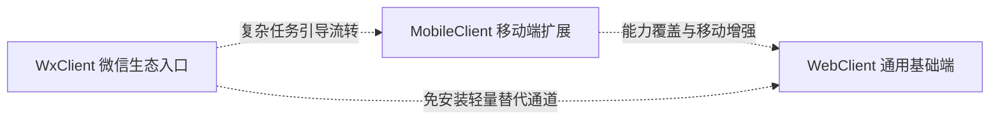
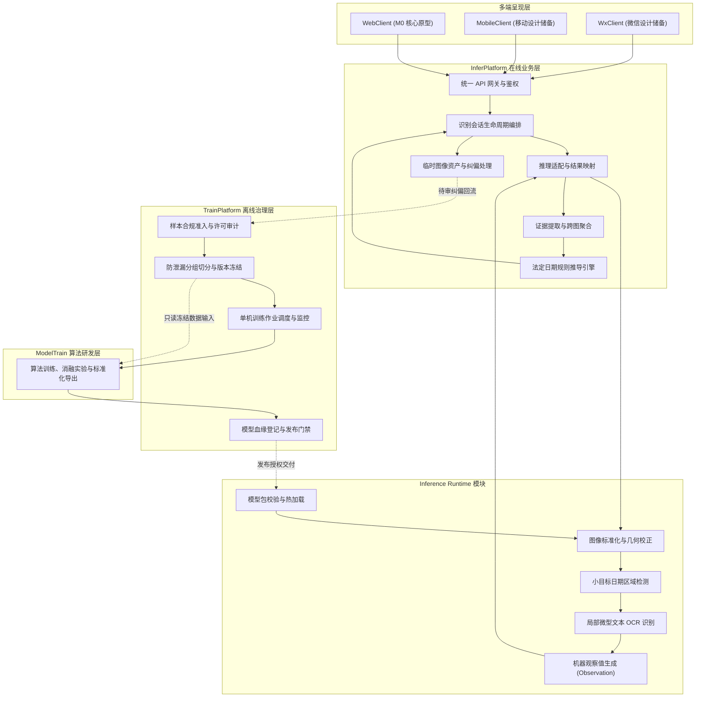
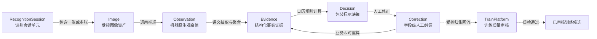

# 轻眸识刻系统总体架构

> 全域系统物理拓扑、在线与离线解耦边界、数据流模型与部署拓扑规范
>
> **设计依据**：[ADR-001 仓库职责边界与在线离线切分](decisions/ADR-001-REPOSITORY_BOUNDARIES.md) · 全域单一事实来源

《轻眸识刻》面向食品流通与消费场景，负责精准识别食品包装上的生产日期与保质期文本，并基于法定日历规则推导包装标示状态。系统通过建立严格的物理边界与契约约束，实现“数据治理、算法研发、在线服务与多端呈现”的全链路解耦与工业级工程协同。

---

## 一、系统定位与架构原则

1. **法定对象受限**：系统输出法定限定为“食品包装标示状态”，严禁向用户直接断言食品是否绝对可食用或卫生安全结论。
2. **在线离线严格解耦**：对外业务服务与对内模型生产物理分离，InferPlatform 独立负责在线会话与实时推导，TrainPlatform 专职负责样本资产治理与训练调度。
3. **推理分层与独立运行时**：Inference Runtime 作为 InferPlatform 内部逻辑模块协同运行，仅输出客观机器感知值（Observation），不参与会话管理或业务状态决策。
4. **算法研发只读消费**：ModelTrain 严格只读消费由 TrainPlatform 冻结的快照数据集，不擅自修改标注或切分，产出标准模型包（ModelBundle）交付审核。
5. **数据闭环质量门禁**：线上人工纠偏数据即时驱动业务重算；但回流纳入离线训练资产必须通过独立质量审核与合规准入，严防标签污染。
6. **核心流转主线**：数据流严格遵循 `Observation -> Evidence -> Decision` 标准化演进管线。

---

## 二、八仓物理拓扑与职责矩阵

系统由 8 个职责单一、物理隔离的 Git 代码仓库构成，全域分工矩阵如下：

| 仓库名称 | 物理定位 | 核心架构职责 |
| :--- | :--- | :--- |
| **.github** | 组织全局配置 | 维护组织公开主页、全域工程导航与统一开源规范 |
| **ProjectPRD** | 全域规范中枢 | 维护全系统需求池、架构设计、跨仓契约、质量规范与决策记录（SSOT） |
| **InferPlatform** | 在线服务中枢 | 承接多端 API、会话生命周期编排、内部推理适配、证据聚合与即时决策 |
| **TrainPlatform** | 训练治理中枢 | 负责受控样本准入、数据集版本冻结、标注审核留痕与模型发布门禁 |
| **ModelTrain** | 算法研发中心 | 负责日期定位网络与微型 OCR 算法攻关、消融评测与标准模型包导出 |
| **WebClient** | Web 原型系统 | 大创核心交付物，拉通 M0 单图主链路验证，呈现原图覆层与字段卡片 |
| **MobileClient** | 移动端客户端 | 规划现场拍摄手持稳态检测、微距对焦引导与离线食品台账设计储备 |
| **WxClient** | 微信小程序端 | 规划长辈大字关怀模式、免安装即开即用通道与社交卡片设计储备 |

---

## 三、多端客户端协同架构

- **WebClient**：作为不依赖特定移动操作系统的桌面与通用大屏基准端，优先验证 M0 单图全闭环；
- **MobileClient**：规划在 Web 在线查验能力基础上，利用移动设备传感器提供手持防抖与离线队列支持；
- **WxClient**：针对低使用门槛场景，提供长辈大字阅读与免安装查验通道，形成全场景覆盖合力。

---

## 四、全域分层架构与数据交互流

---

## 五、核心领域实体与演进管线

系统严格遵循不可篡改与分层派生的数据实体流转范式：

- **Observation**：保存机器原生检测框、置信度与识别文本，归档后绝对只读；
- **Evidence**：保存经业务层提取的结构化生产日期、到期日与保质期事实，附带置信度与派生来源；
- **Decision**：依据法定日期规则计算得出的最终业务结论，包含包装标示状态与独立复核指引；
- **Correction**：追加式的人工纠偏记录，被系统接受后即时驱动新版本 Evidence 与 Decision 生成，不覆写原机器 Observation。

---

## 六、三档部署拓扑规范

系统架构具备极高的部署弹性，可根据硬件条件与应用规模平滑演进：

### 1. 单机联合部署拓扑

面向开发调试、学术复现与 M0 阶段的最小可用部署模式：
- `WebClient` 构建为静态资源，由 Nginx 或 FastAPI 直接托管；
- `InferPlatform` 与内置 `runtime` 运行于单台工作站（配备单张消费级 GPU）；
- `TrainPlatform` 与 `ModelTrain` 通过本地命令行与单机脚本按需调度；
- 所有持久化数据基于本地 SQLite 与受控文件目录存储。

### 2. 微服务解耦部署拓扑

面向多用户并发查验与自动化实验评估的标准部署模式：
- 前端静态站点托管至独立 CDN 或静态 Web 服务器；
- `InferPlatform` 作为高可用无状态 API 集群运行，挂载 Redis 管理会话状态；
- `Inference Runtime` 作为专用推理 Worker 独立部署，支持利用 Triton 或多卡 GPU 扩展吞吐；
- `TrainPlatform` 作为后台管理服务，调度可信计算节点上的 `ModelTrain` 容器化作业；
- 元数据存储于 PostgreSQL，样本资产存储于私有对象存储。

### 3. 边缘轻量探索拓扑

面向 C3 远期移动端探索的混合拓扑模式：
- 移动端（`MobileClient`）通过 ONNX Runtime Mobile 或移动芯片 NPU 加载经量化导出的轻量模型，在无网环境下执行初筛识别；
- 联网状态下自动将弱网任务同步至云端 `InferPlatform` 执行高精度复核与决策校验。

---

## 七、权威依据与参考文档

- **需求池与非目标**：[ProjectPRD/REQUIREMENTS.md](REQUIREMENTS.md)
- **跨仓技术契约**：[contracts/API.md](contracts/API.md) · [contracts/DATA.md](contracts/DATA.md) · [contracts/openapi.json](contracts/openapi.json)
- **规则与执行契约**：[contracts/DATE_RULES.md](contracts/DATE_RULES.md) · [contracts/MODEL.md](contracts/MODEL.md) · [contracts/TRAINING.md](contracts/TRAINING.md)
- **架构决策记录**：[decisions/ADR-001-REPOSITORY_BOUNDARIES.md](decisions/ADR-001-REPOSITORY_BOUNDARIES.md)
