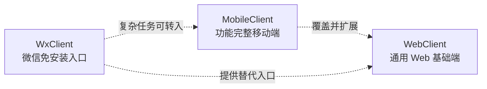
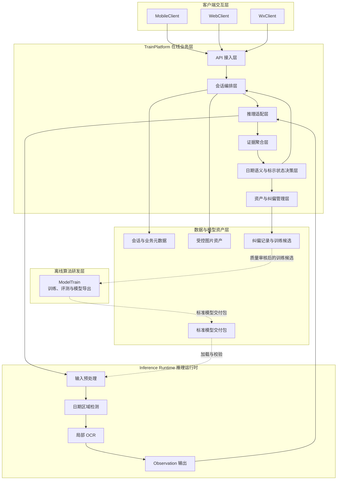
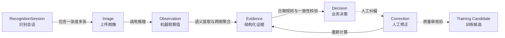
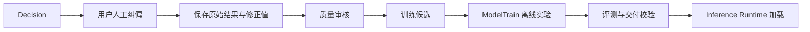
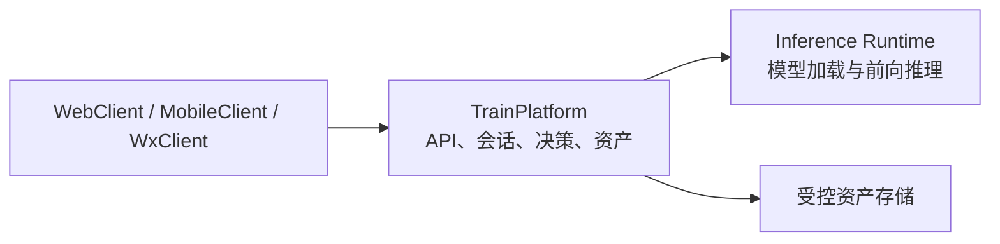
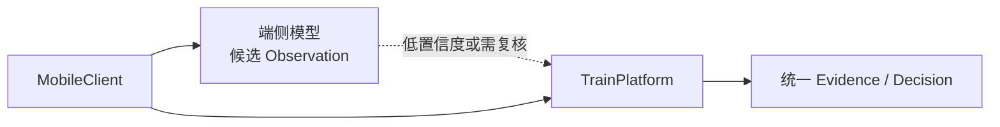

# 轻眸识刻系统总体架构

> **文档定位**：系统技术边界、数据流向和部署形态的稳定事实来源

## 一、系统定位与架构原则

轻眸识刻面向食品流通与消费场景，负责识别包装日期并推导包装上的标示状态。系统不直接判断食品是否绝对安全或适宜食用。

核心原则：

1. 客户端负责交互，不直接访问数据库或模型文件；
2. TrainPlatform 负责会话编排、证据聚合和业务决策；
3. Inference Runtime 只输出模型机器观察值；
4. ModelTrain 只通过标准模型包向推理运行时离线交付；
5. `Observation -> Evidence -> Decision` 是稳定的数据处理主线；
6. 人工纠偏经过质量审核后才可成为训练候选，不自动改变线上模型。

## 二、六仓职责矩阵

| 仓库 | 主要职责 |
| :--- | :--- |
| `ProjectPRD` | 需求、架构、接口、数据、模型和质量规范 |
| `TrainPlatform` | API、会话、资产、证据聚合和标示状态决策 |
| `ModelTrain` | 数据适配、训练、评测和模型导出 |
| `WebClient` | 在线识别、结果展示、证据查看和人工纠偏 |
| `MobileClient` | 覆盖 WebClient 能力并提供移动端增强 |
| `WxClient` | 免安装查验、轻量展示和微信分享 |

## 三、客户端关系



MobileClient 在能力上覆盖 WebClient 的全部在线识别能力，并增加移动设备专属能力。WxClient 面向免安装、临时查验、长辈使用和结果分享，不以覆盖其他客户端的全部能力为目标。

## 四、逻辑分层架构



Inference Runtime 不维护会话、不聚合多图证据、不计算 `marked_status` 或 `review_status`，也不直接向客户端输出业务结论。

## 五、核心领域实体与数据流



`Observation` 是模型输出，`Evidence` 是平台提取的结构化事实，`Decision` 是依据证据和规则生成的包装标示状态。三者不应混用。

## 六、在线运行时与离线研发边界

```text
ModelTrain
  -> 离线训练、实验评测、模型导出
  -> 标准模型交付包
  -> Inference Runtime

客户端
  -> TrainPlatform
  -> Inference Runtime
  -> TrainPlatform
  -> 客户端
```

线上请求不得直接调起训练任务，生产环境不得直接访问训练数据目录。线上纠偏记录只能经过审核后进入训练候选流程。



纠偏记录不等于训练标签；新模型必须通过独立评测、版本登记和完整性校验后才能发布。

## 七、部署形态

标准部署采用业务平台与推理运行时分离的结构：



开发和验证阶段允许将业务平台与推理运行时部署在同一台机器上，但不改变调用边界。

端云协同属于探索形态：



端侧模型只能提供候选观察值或离线辅助结果。端侧高置信度不能自动替代统一业务决策。

## 八、跨仓契约

- [需求规格](REQUIREMENTS.md)
- [接口契约](contracts/API.md)
- [数据模型](contracts/DATA.md)
- [模型交付规约](contracts/MODEL.md)
- [数据质量规范](standards/DATA_QUALITY.md)

客户端、业务平台、推理运行时和算法研发均应以这些契约为准，不通过实现细节建立跨仓依赖。

## 九、架构边界

本架构不强制规定：

- GPU、云部署或微服务；
- Python、Go 等具体实现语言；
- 是否启用端侧模型；
- 端侧结果、示例指标或线上纠偏是否直接替代服务端决策、实测结论或模型发布。

架构真正稳定的承诺是客户端统一接入、推理与业务决策分离、模型标准化交付，以及 `Observation -> Evidence -> Decision` 数据流保持清晰。
