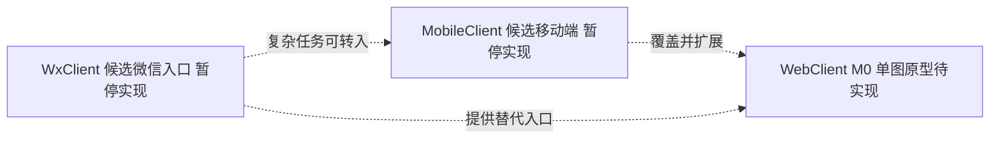
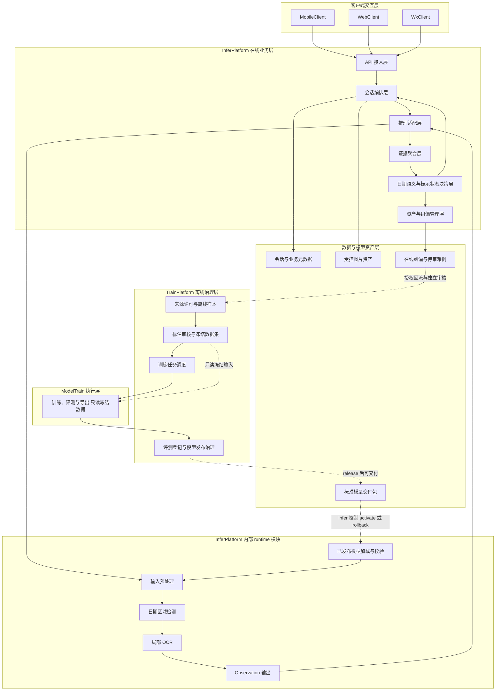
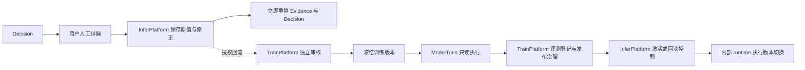
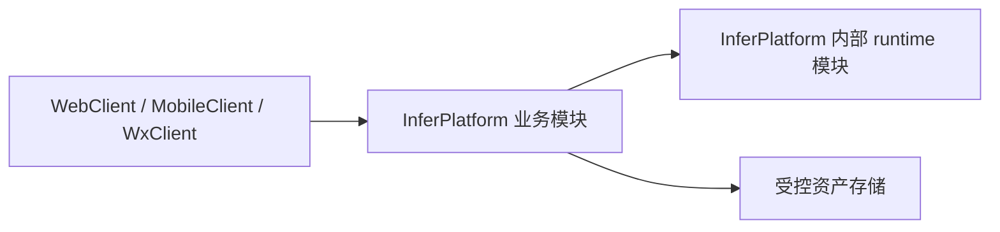
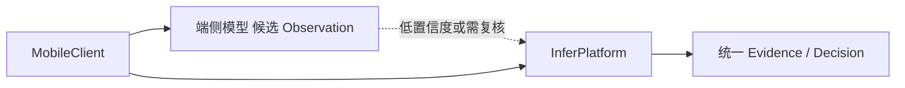

# 轻眸识刻系统总体架构

> **文档定位**：已批准的职责设计、目标数据流与候选部署边界
> **设计依据**：[ADR-001](decisions/ADR-001-REPOSITORY_BOUNDARIES.md)
> **实施状态**：M0 待实现；模块图表示目标职责，不表示现有代码、已部署服务或生产契约冻结

## 一、系统定位与架构原则

轻眸识刻面向食品流通与消费场景，负责识别包装日期并推导包装上的标示状态。系统不直接判断食品是否绝对安全或适宜食用。

核心原则：

1. 客户端负责交互，不直接访问数据库或模型文件；
2. InferPlatform 负责会话编排、证据聚合和业务决策，对外服务全部客户端；
3. Inference Runtime 是 InferPlatform 内部的推理运行时，只输出模型机器观察值；
4. TrainPlatform 负责离线样本、数据集与切分、标注审核、训练调度、评测登记、模型注册及发布治理，不承接在线业务 API；
5. ModelTrain 执行训练、评测与导出，只读 TrainPlatform 提供的冻结数据，不改标注、不重切分、不自行发布；
6. `Observation -> Evidence -> Decision` 是目标数据处理主线，具体字段仍属候选契约；
7. InferPlatform 接受业务纠偏后立即重算；训练资格由 TrainPlatform 独立审核，未审记录只可待审，不自动成为训练真值或改变线上模型。

对外服务与对内生产是两条独立链路：InferPlatform 面向客户端请求，TrainPlatform 面向数据与算法工作。两者不得互相侵入职责。

## 二、八仓职责矩阵

| 仓库 | 目标职责 | 边界与当前范围 |
| :--- | :--- | :--- |
| `.github` | 组织公共说明与协作入口 | 不承载业务、训练数据或模型注册服务 |
| `ProjectPRD` | 需求、架构、ADR、候选契约和质量规范 | 文档中枢，不提供可运行产品 |
| `TrainPlatform` | 离线样本、数据集、标注审核、训练调度、评测登记、模型注册及发布治理 | 拥有训练资格审核与 register/validate/release；M0 不要求完整平台实现 |
| `ModelTrain` | 数据适配、训练、评测与模型导出执行 | 只读冻结数据；输出模型包及评测产物给 TrainPlatform，不直达线上发布 |
| `InferPlatform` | 在线业务 API、会话、资产、编排、Evidence、日期 Decision、业务纠偏 | 内部 runtime 加载模型、检测、OCR，仅产 Observation；控制 activate/rollback |
| `WebClient` | 在线识别、结果展示、证据查看与人工纠偏交互 | M0 为单图基础展示；多图与完整交互属后续 C0 |
| `MobileClient` | 移动在线识别与设备增强的候选客户端 | 保留仓名与目标职责，暂停实现，不合并 |
| `WxClient` | 免安装查验、大字展示与微信分享的候选客户端 | 保留仓名与目标职责，暂停实现，不合并 |

八仓原名保留，旧版职责描述弃用；不新增 Data、Registry、Gateway 或 Runtime 仓。数据治理与模型注册是 TrainPlatform 模块，API 接入和 runtime 是 InferPlatform 模块，不因模块命名引入独立仓或服务。

## 三、客户端关系



上图只描述目标关系：MobileClient 计划覆盖 WebClient 在线能力并增加设备增强；WxClient 面向免安装、临时查验、长辈使用和分享，不要求覆盖全部能力。两者暂停实现，既不是已具备能力，也不成为 M0 依赖。消费者查验与巡检人员批量检查场景保留，批量和多图不进入 M0。

## 四、逻辑分层架构



runtime 的模型加载、预处理、检测、局部 OCR 和 Observation 输出都是 InferPlatform 内部模块；图中的逻辑分组不是独立仓库或强制服务拆分。runtime 不维护会话、不聚合多图证据、不计算 `marked_status` 或 `review_status`，也不直接向客户端输出业务结论。P2 检测头、受限字典 OCR、全局文本与条码感知均不因模块图而成为既定生产方案。

## 五、核心领域实体与数据流

```mermaid
flowchart LR
    SESSION["RecognitionSession 识别会话"]
    IMAGE["Image 上传图像"]
    OBS["Observation 机器观察值"]
    EVIDENCE["Evidence 结构化证据"]
    DECISION["Decision 包装标示状态"]
    CORRECTION["Correction 人工修正"]
    REVIEW["TrainPlatform 独立训练资格审核"]
    CANDIDATE["已审核训练候选"]

    SESSION -->|"包含一张或多张"| IMAGE
    IMAGE -->|"调用推理"| OBS
    OBS -->|"语义提取与跨图聚合"| EVIDENCE
    EVIDENCE -->|"日期规则与一致性校验"| DECISION
    DECISION -.人工纠偏.-> CORRECTION
    CORRECTION -->|"业务接受后立即重算"| EVIDENCE
    CORRECTION -.获授权的待审回流.-> REVIEW
    REVIEW -.审核通过.-> CANDIDATE
```



`Observation` 保存机器检测框、OCR 原文及置信度；`Evidence` 保存平台结构化事实、图像或人工来源、派生标记；`Decision` 保存规则版本、参考时间与双维状态。原始 Observation 不被纠偏或语义推导覆盖。M0 仅使用一张输入图；跨图聚合与完整 Correction 审核闭环为后续 C0。

## 六、在线运行时与离线研发边界

```text
TrainPlatform
  -> 审核并冻结数据、调度任务
  -> ModelTrain 只读执行训练、评测、导出
  -> TrainPlatform 评测登记、register、validate、release
  -> InferPlatform 决定 activate 或 rollback
  -> 内部 runtime 校验并执行模型版本切换

客户端
  -> InferPlatform
  -> Inference Runtime
  -> InferPlatform
  -> 客户端
```

线上请求不得直接调起训练任务，生产运行时不得直接读取训练集。业务纠偏的生效不等待训练审核；训练接纳必须独立审核来源许可、标签与防泄漏切分。ModelTrain 不拥有线上部署控制权。



纠偏记录不等于训练标签；拒绝或未审记录不得进入冻结训练集。候选治理动作如下，具体接口与权限待训练和模型契约冻结：

| 动作 | 责任方 | 约束 |
| :--- | :--- | :--- |
| `register` | TrainPlatform | 登记模型包、数据版本、任务与评测血缘 |
| `validate` | TrainPlatform | 治理质量与兼容性校验，ModelTrain 提供执行结果，不自行批准 |
| `release` | TrainPlatform | 批准可交付版本，不自动替换线上模型 |
| `activate` | InferPlatform 控制，内部 runtime 执行 | 仅切换至获发布资格且兼容的模型，记录版本与结果 |
| `rollback` | InferPlatform 控制，内部 runtime 执行 | 切回明确、兼容的已发布版本，保留原因与审计记录 |

模型包通过完整性校验不等于效果达标；发布也不等于线上激活。上述是已批准的职责边界，不声明这些治理功能已经实现。

## 七、部署形态

候选部署保持业务与 runtime 逻辑分离，不强制进程或机器分离：



开发和验证阶段允许将业务平台与推理运行时部署在同一台机器上，但不改变调用边界。

端云协同属于探索形态：



端侧是 C3 储备，不属于 M0。端侧模型只能提供候选观察值或离线辅助结果，高置信度不能自动替代统一业务决策。暂停的客户端不意味着另建端侧仓库。

## 八、跨仓契约

- [需求规格](REQUIREMENTS.md)
- [接口契约](contracts/API.md)
- [数据模型](contracts/DATA.md)
- [日期规则候选](contracts/DATE_RULES.md)
- [模型交付候选](contracts/MODEL.md)
- [训练契约候选](contracts/TRAINING.md)
- [OpenAPI 3.1 候选](contracts/openapi.json)
- [Observation JSON Schema](contracts/schemas/observation.v1.schema.json)
- [Evidence JSON Schema](contracts/schemas/evidence.v1.schema.json)
- [Decision JSON Schema](contracts/schemas/decision.v1.schema.json)
- [Correction JSON Schema](contracts/schemas/correction.v1.schema.json)
- [数据质量规范](standards/DATA_QUALITY.md)

人工契约和机器契约均已进入候选评审，不因文件存在、结构校验通过或链接有效而成为生产规范或验收成果。跨仓通过版本化契约与模型包协作，不直接依赖另一仓实现、可变训练资产或私有路径。

## 九、架构边界

本架构不强制规定：

- GPU、云部署或微服务；
- Python、Go 等具体实现语言；
- 是否启用端侧模型；
- 端侧结果、示例指标或线上纠偏是否直接替代服务端决策、实测结论或模型发布。

已批准的是八仓保留、在线离线职责隔离、内部 runtime 与业务决策分离，以及清晰的数据流。原仓名保留、旧版职责弃用；迁移按文档 -> 代码 -> 测试 -> CI 执行，不自动重写历史，也不因本次文档决议宣布各仓代码已迁移。
