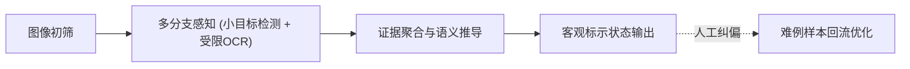
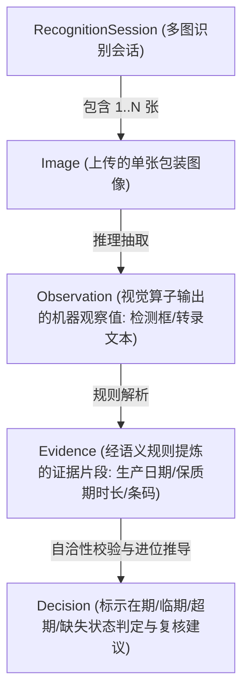
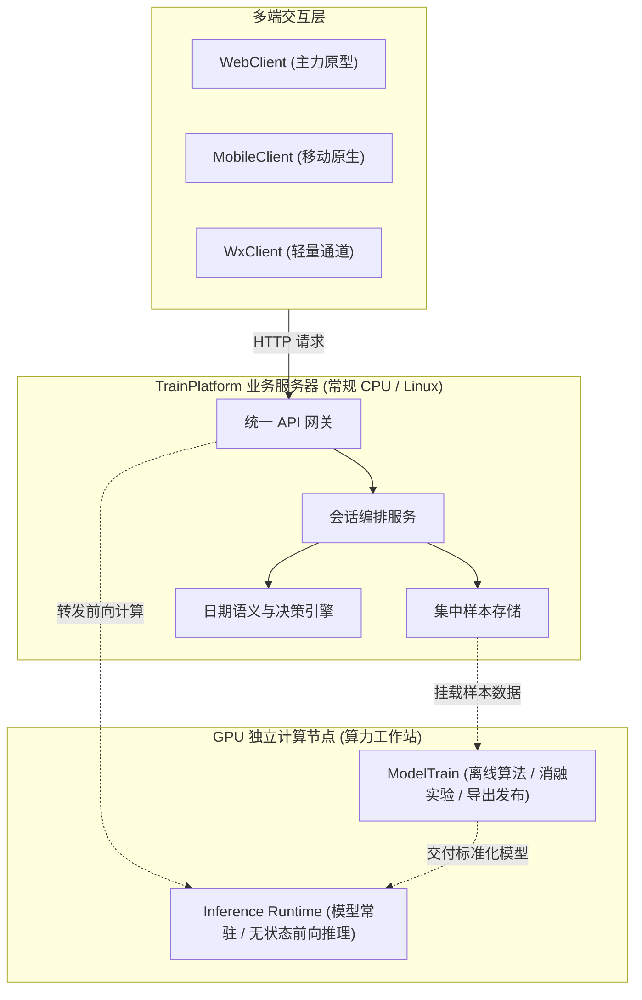

# 《轻眸识刻》系统总体架构设计

> **文档定位**：系统技术边界与架构拓扑唯一事实来源，定义系统组件划分、数据流向模型与部署形态  
> **关联依据**：[REQUIREMENTS.md](REQUIREMENTS.md)

---

## 一、 系统定位与业务主线

轻眸识刻是一套面向食品流通与消费场景的智能包装日期识别与标示期限推导系统。系统以“找得到、读得准、判得清、能改进”为核心技术闭环：



---

## 二、 组织六仓职责矩阵

系统按技术栈与运行环境物理隔离为 6 个核心代码仓库，各仓边界清晰、职责严格解耦：

| 仓库名称 | 领域属性 | 运行环境与技术栈 | 核心工程职责与定位 |
| :--- | :--- | :--- | :--- |
| **`ProjectPRD`** | **设计与文档中枢** | Markdown / Docs | 全域单一事实来源：系统架构、C0-C3需求池、接口契约与质量标准。不存放业务代码。 |
| **`TrainPlatform`** | **业务后端与平台** | Python (FastAPI) / DB | 客户端会话编排、多端统一 RESTful API、集中样本存储管理、日期决策引擎与难例归集。 |
| **`ModelTrain`** | **算法研发与评测** | PyTorch / Python | 极小目标检测网络、断笔点阵 OCR、8 项消融实验设计与轻量化 ONNX 模型导出。 |
| **`WebClient`** | **Web 原型系统** | Vue 3 / React (Vite) | 大创结题核心验收成果：多图会话、原生相机/条码解析、双重视图呈现、状态卡片与人工纠偏。 |
| **`MobileClient`** | **移动端客户端** | Flutter / 原生 | 移动实拍工具、传感器防抖、本地离线储藏台账、弱网队列与端侧推理探索。 |
| **`WxClient`** | **微信小程序端** | 微信原生 / Taro | 消费端轻量免安装备选通道、长辈关怀大字模式、微信一键社交分享卡片。 |

---

## 三、 核心领域实体与数据流向模型

系统在处理识别任务时，统一遵循自底向上的数据抽象流向：



1. **`RecognitionSession`（识别会话）**：客户端发起的单次查验会话，支持追加多张不同角度特写；
2. **`Image`（图像资产）**：经前置质量初筛合格并落盘于集中存储的原始图像；
3. **`Observation`（机器观察值）**：Inference Runtime 输出的标准检测矩形框坐标、置信度与 OCR 文本候选；
4. **`Evidence`（结构化证据）**：从观察值中提炼的强事实（生产日期、到期日）与弱事实（条形码、说明文本）；
5. **`Decision`（判定决策）**：结合日历规则推导出的二维判定结论（期限状态 + 复核状态）。

---

## 四、 在线运行时与离线算法研发边界

系统在逻辑与部署层面严格划分为三部分，实现计算密集与业务调度的解耦：



- **TrainPlatform（业务中枢）**：部署于常规通用服务器，负责状态管理、数据库读写、会话协调与规则计算；
- **Inference Runtime（推理运行时）**：常驻 GPU 内存，设计为纯无状态服务，仅接收图像输入并吐出标准观察值；
- **ModelTrain（离线算法环境）**：独立于线上运行时，负责网络调优、消融实验与产物构建。

---

## 五、 三档渐进式部署拓扑

```plain
一档：单机一体化研发模式 (当前阶段 · 满足 C0 原型验证与评测)
  单台多核工作站
  ┌────────────────────────────────────────────────────────┐
  │ FastAPI 统一宿主进程                                    │
  │ • 静态资源服务 (托管 WebClient 前端构建产物)            │
  │ • 业务 API 网关与会话管理                              │
  │ • 集中样本存储目录                                      │
  │ • Inference Runtime (本地直接加载 ONNX 模型推理)         │
  └────────────────────────────────────────────────────────┘

二档：中心算力解耦模式 (推进阶段 · 支撑多端并发与协作)
  业务中枢服务器 (云端 Linux 云主机 / CPU)       专用 GPU 算力工作站
  ┌────────────────────────────────┐        ┌────────────────────────────┐
  │ TrainPlatform 业务系统         │  HTTP  │ Inference Runtime 独立服务 │
  │ • 客户端多图识别会话编排       ├──RPC──►│ • 独立常驻 GPU 内存        │
  │ • 全量样本资产管理             │        │ • 批量推理与流水线调度     │
  │ • 规则决策与复核中心           │        └────────────────────────────┘
  └────────────────────────────────┘

三档：端云协同混合计算模式 (远期探索 · 优化云端算力开销)
  客户端移动设备 (MobileClient)             云端服务中枢与算力集群
  ┌────────────────────────────────┐        ┌────────────────────────────┐
  │ 端侧轻量模型 (TFLite / ONNX)   │ 低置信 │ 云端全精度大模型高精度重检 │
  │ 本地高置信度直接离线呈现       ├──样本─►│ 多图深度证据关联与多源决策 │
  │ 本地台账与临期提醒             │        └────────────────────────────┘
  └────────────────────────────────┘
```
