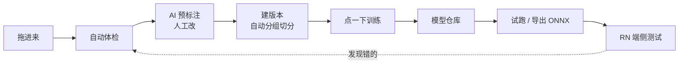

# 产品形态与实施规划 (PLAN)

> 一页篇幅说清"这东西长什么样"，再加一份可直接分配的 Issue 清单。
> 范围依据见 [SCOPE.md](./SCOPE.md)，仓库归属见 [REPOS.md](./REPOS.md)。

---

## 一、产品形态

**技术形态**：单机 Web 应用。一条 `docker compose up` 起来，浏览器打开就用。
底层 = 平台后端 + PostgreSQL + 本地目录（或 MinIO）+ k3s（跑训练）。

**界面就 5 个区**：

```
┌────────────┬──────────────────────────────────────────┐
│ 数据集      │  图库：缩略图、能筛、能翻、能看大图          │
│ 标  注      │                                          │
│ 训  练      │  版本：v1 / v2 / v3 … 每版是哪些图、怎么切   │
│ 模  型      │                                          │
│ 端  侧      │                                          │
└────────────┴──────────────────────────────────────────┘
```

**真实的一天长这样**：

1. 拍完照 → 照片**拖进「数据集」**（或 RN 里点上传）
2. 系统自动体检 → 「发现 37 张重复、12 张模糊、8 张没目标」→ 点一下处理
3. 点**「开始标注」** → 标注台：一次一张，**AI 先给好候选框**，拉着改，`Ctrl+Enter` 下一张
4. 标完一批 → 点**「建立版本 v3」** → 系统按"同一个包装"分组切好 train/val（**自动防泄漏**）
5. 去「训练」→ 选 `v3` + 选模板 → **点开始**
6. 盯一眼 loss 和 mAP 曲线 → 训完**自动进「模型」**
7. 点这个模型 → **「在线试跑」** → 拖张图进去看框对不对
8. 满意 → **「导出 ONNX」** → RN 客户端里下载，现场试



**未来形态（C 端，先不排期）**：微信小程序 → 对着包装拍一张 → 端侧跑模型（`wx.createInferenceSession`）→ 显示「生产日期 2026-10-01」。技术可行性已查证，做不做只等模型能用。

---

## 二、Issue 拆分原则

1. **按"能独立验收的切片"拆，不按技术分层。**
   ✅「能上传一张图并在图库里看到它」 ❌「先做数据库层 → 再做 API 层」
2. **一个 issue = 一个人 1~3 天。** 超过就再拆；不到半天就合并。
3. **第一个 issue 打通最窄的一条线**，之后每个都是"在这条线上加宽"。
4. **每个 issue 必须写「不要做什么」** —— 不写这个，范围会膨胀三倍。

### Issue 模板

```markdown
## 目标
一句话说清做完之后，用户能做什么以前做不到的事。

## 交付物
具体到文件/接口/页面。

## 验收
可执行的检查步骤（能跑、能点、能看）。禁止写"功能正常"。

## 依赖
必须先完成哪个 issue。没有就写"无"。

## 不要做什么（Out of Scope）
明确排除的相邻功能，防止顺手扩范围。
```

---

## 三、Issue 清单

> 依赖关系：`I01` 是地基，`I02→I03→I04→I07→I08→T01→T02→T03→I10` 是最窄的那条线，先打通它。

### TrainPlatform（平台 · 控制面）

| # | 标题 | 交付物 | 验收 | 依赖 |
| :--- | :--- | :--- | :--- | :--- |
| **I01** | 项目骨架与数据模型 | 后端框架 + 数据库迁移 + 核心表（Project / Dataset / DatasetVersion / DatasetVersionItem / DataSample / ManagedFile / LabelClass / Annotation / TrainTask / ModelVersion）+ 本地文件存储实现 | 服务能起；迁移能在空库跑出全部表；能写入并读出一个 DataSample | 无 |
| **I02** | 数据导入：本地上传 | 拖拽/多选上传、分片续传、幂等键 `(size, sha256)`、落 `DataSample` + `ManagedFile` | 上传 100 张图能在库里看到；**同一批重复上传不产生重复记录** | I01 |
| **I03** | 图库浏览 | 缩略图网格（懒加载）、筛选（按标注状态）、大图查看 | 1 万张图的库能流畅翻页；点开能看到原图 | I02 |
| **I04** | 标注台（矩形框） | 一次一张；画/改/删框；快捷键；自动保存；乐观锁防覆盖 | 连标 100 张不丢数据；两个标签页同时改一张图，后写被拒并提示 | I03 |
| **I05** | 类别体系 | 类别 CRUD、颜色、快捷键、重命名零回填（稳定 id） | 重命名类别后，历史标注仍正确指向且不需回填 | I01 |
| **I06** | 导入体检（预检） | 损坏 / 完全重复（MD5）/ 近重复（pHash）/ 无目标 / 尺寸异常的检测；报告页；保留·剔除·隔离三种处置 | 往库里注入损坏图、重复图、无目标图，全部能被检出并列出 | I02 |
| **I07** | 数据集版本与自动分组切分 | 建版本（不可变快照）、按 `group_key` 分组切 train/val、版本列表 | **构造同一包装的 10 张连拍图，验证它们不会跨 train/val** | I02 |
| **I08** | 训练任务提交与调度 | 提交表单（数据集版本 + 超参 + 镜像）、任务状态机、创建 k3s Job、心跳与看门狗 | 点提交后，`kubectl get jobs` 能看到 Job 并跑起来；杀掉 Pod 后任务转为失败并可重试 | I07, T01 |
| **I09** | 训练日志与指标看板 | 拉取 Pod 日志流式展示；解析 `train_log.txt` 画 loss / mAP 曲线；任务详情页 | 训练进行中，浏览器能实时看到日志和曲线；任务结束后曲线仍可回看 | I08 |
| **I10** | 模型仓库 | 回调落库（幂等 `(train_task_id, attempt)`）、模型列表与详情、**血缘展示** | 每个模型都能点出：用了哪版数据、哪组超参、哪个镜像 digest | I08, T03 |
| **I11** | 在线试跑 | 上传图片调推理、画框展示、**误检一键归档回待标注池** | 拖一张图进去能看到框；点"归档"后该图出现在数据集的待标注列表里 | I10 |
| **I12** | 登录与单管理员 | 会话与登录页；未登录一律拒绝 | 登出后访问任意页面被拒 | I01 |

### ModelTrain（执行面）

| # | 标题 | 交付物 | 验收 | 依赖 |
| :--- | :--- | :--- | :--- | :--- |
| **T01** | 训练镜像 | Dockerfile（CUDA → **固定版本** PyTorch → YOLOX → 代码）+ 构建与推送脚本 | `docker run` 该镜像能完成一次最小训练；镜像记为 digest | 无 |
| **T02** | 训练入口 | 读取 `train_args.json` / `exp_override.py`、跑 YOLOX 训练、产出 `latest_ckpt.pth` / `best_ckpt.pth` / `train_log.txt` | 容器内跑通一次训练并产出上述文件 | T01 |
| **T03** | 产物上传与回调 | 产物上传对象存储 + 回调平台；幂等键 `(train_task_id, attempt)` | **重复发送同一回调，只产生一条模型版本记录** | T02 |
| **T04** | 断点续训 | `attempt > 1` 时自动 `--resume` 读 `latest_ckpt.pth` | 训练中途杀掉进程，重试能从断点续上而非从零开始 | T03 |
| **T05** | ONNX 导出与精度复测 | 导出脚本 + 导出后在验证集复测并对比基线 | 导出的 `.onnx` 能加载并跑出框；复测指标与基线差异被记录 | T02 |
| **T06** | 视频抽帧算子 | ffmpeg 抽帧 + 写入帧血缘（`group_key` / `frame_index` / `timestamp`） | 抽出的帧能追溯到源视频与时间戳；同视频的帧 `group_key` 一致 | T01 |
| **T07** | AI 预标注脚本 | 用指定 `ModelVersion` 对未标注图批量推理，产出候选框 | 跑完后标注台能加载出候选框供人工修正 | T05, I04 |

### MobileClient（端侧）

| # | 标题 | 交付物 | 验收 | 依赖 |
| :--- | :--- | :--- | :--- | :--- |
| **C01** | RN 客户端骨架与登录 | 工程初始化、导航、鉴权（一个 token 即可） | 能登录并进入主界面 | I12 |
| **C02** | 拍摄与上传（含断点续传） | 拍照/连拍、分片上传、断点续传、**离线队列**（本地库 + 联网自动补传） | **断网拍 100 张，恢复网络后自动全部上传，且无重复** | C01, I02 |
| **C03** | 端侧推理与模型下载 | 下载 ONNX（带 sha256 校验）、本地推理、画框叠加显示 | 拍一张包装照片，本地出框（不依赖网络） | C01, T05 |

---

## 四、分配建议

| 人 | 建议负责 | 理由 |
| :--- | :--- | :--- |
| **后端** | I01 → I02 → I06 → I07 → I08 → I09 → I10 | 一条线走到黑，不用等人 |
| **前端** | I03 → I04 → I05 → I09(界面) → I11 | 依赖后端模型定稿后即可并行 |
| **算法/训练** | T01 → T02 → T03 → T04 → T05 → T06 → T07 | 与平台只通过 §3 的 Job 规约耦合 |
| **端** | C01 → C02 → C03 | 依赖 I02 的上传契约、T05 的导出产物 |

**开工顺序**：`I01` 与 `T01` 可同时开工（互不依赖）。其余按上表箭头推进。

**风险提示**：`I07`（分组切分）和 `I02`（上传幂等）是两个"看起来简单、做错很难发现"的 issue —— 验收里那两条加粗的检查必须真的跑一遍，不要靠肉眼审代码。
