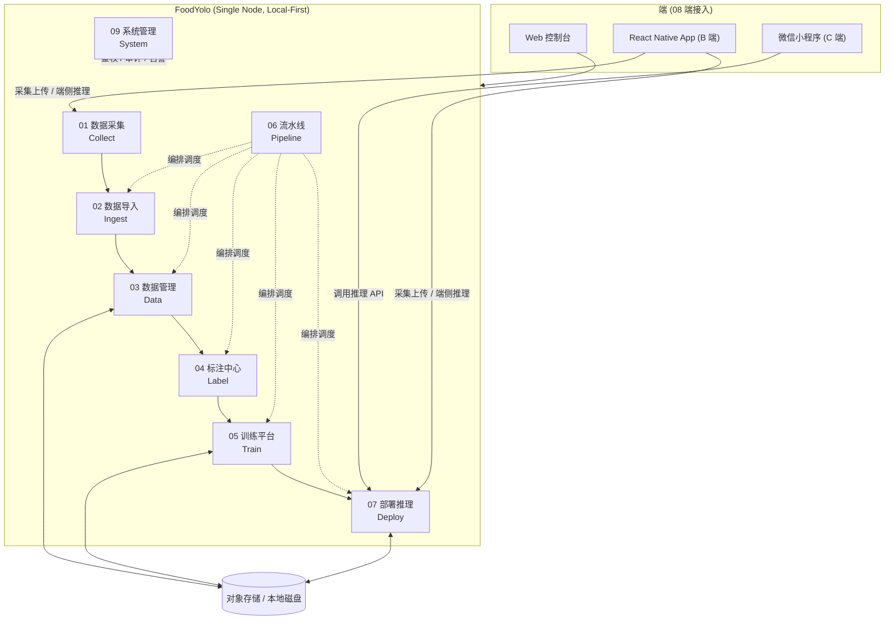
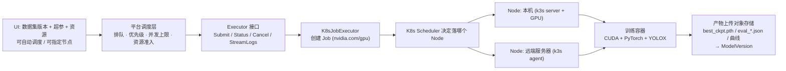

# FoodYolo 产品需求文档 (PRD)

## 1. 文档信息

| 属性 | 内容 |
| :--- | :--- |
| **文档名称** | FoodYolo PRD |
| **版本号** | v0.2 (Module Index) |
| **状态** | Draft |
| **编写日期** | 2026-10-01 |
| **关联文档** | [BRD](./BRD.md), [MRD](./MRD.md) |

## 2. 产品综述 (Product Overview)

FoodYolo 是一套 **Local-First 的视觉检测模型训练基建**，面向 2~3 人小团队，
覆盖 `数据采集 → 数据导入 → 数据管理 → 标注 → 训练 → 流水线 → 部署推理` 的完整闭环。

首个落地任务是**食品包装生产日期识别**：先做日期区域检测，再接入 OCR 读出日期字符串。
平台上三个关键抽象与任务解耦：**数据集**（不绑定任务类型）、**标注题型**（可扩展）、**训练后端**（可替换）。

### 2.1 总体架构 (Architecture)

### 2.2 训练执行分层 (Execution Layers)

平台内部实现为 DAG，但对用户呈现为**固定的十个阶段**，不做自由画布。

## 3. 模块索引 (Module Index)

### 3.1 01. 数据采集 (Collect)
> **Role**: 零数据冷启动的源头。把"出去拍数据"变成可管理的作业。

| PRD | 名称 | 描述 |
| :--- | :--- | :--- |
| **P0001** | 采集项目与 SOP | 采集目标、拍摄规范与验收标准的定义 |
| **P0002** | 采集任务派发 | 任务拆解、指派、领取与状态流转 |
| **P0003** | 移动端采集与上传 | 小程序 / RN 拍照录像、元数据采集、断点续传 |
| **P0004** | 采集产物验收 | 自动预检与人工验收、打回重采 |
| **P0005** | 采集统计 | 人均产出、合格率、项目进度 |

### 3.2 02. 数据导入 (Ingest)
> **Role**: 让已有数据干净地进来。

| PRD | 名称 | 描述 |
| :--- | :--- | :--- |
| **P0020** | 本地上传与压缩包导入 | 拖拽上传、zip/tar 解压与目录结构识别 |
| **P0021** | 标准数据集格式导入 | COCO / YOLO txt / VOC / LabelMe 解析与转换 |
| **P0022** | 视频抽帧 | 定间隔/定帧数抽帧、相邻帧去重、时间戳回溯 |
| **P0023** | 导入预检与清洗 | 损坏、重复、无目标、尺寸异常的检测与报告 |
| **P0024** | 类别映射与标签对齐 | 外部标签到平台标签体系的映射策略 |

### 3.3 03. 数据管理 (Data)
> **Role**: 数据的中央仓库。消灭"数据黑洞"。

| PRD | 名称 | 描述 |
| :--- | :--- | :--- |
| **P0040** | 存储配置与桶绑定 | 本地磁盘与 S3 兼容对象存储的接入 |
| **P0041** | 数据集与版本 | 不可变快照、冻结、Tag 与版本对比 |
| **P0042** | 数据检索与筛选 | 多维筛选与筛选器保存 |
| **P0043** | 数据预览与画廊 | 画廊浏览与单图详览 |
| **P0044** | 数据统计看板 | 总量、类别分布、标注进度、存储趋势 |
| **P0045** | 数据集导出 | 导出为标准格式 |
| **P0046** | 数据回收与 GC | 软删除、恢复与孤儿文件回收 |

### 3.4 04. 标注中心 (Label)
> **Role**: 标注作业与质量控制。

| PRD | 名称 | 描述 |
| :--- | :--- | :--- |
| **P0060** | 标注器与标注几何 | 矩形框 / 多边形 / 关键点 / OBB 的绘制与编辑 |
| **P0061** | 类别体系管理 | 标签组、颜色、快捷键的统一管理 |
| **P0062** | 标注任务与派单 | 数据切片、派单、领取与进度追踪 |
| **P0063** | 质检与返工 | 抽检、双标一致性、打回与质控记录 |
| **P0064** | AI 预标注 | 模型产出候选框，人工修正 |
| **P0065** | 字符转写与 OCR 标注 | 检测框上的文本转写，为 OCR 阶段供数 |
| **P0066** | 标注统计与绩效 | 人均产量、耗时、正确率、返工率 |

### 3.5 05. 训练平台 (Train)
> **Role**: 算力、任务与模型资产。

| PRD | 名称 | 描述 |
| :--- | :--- | :--- |
| **P0080** | 计算节点与资源池 | 本机与远端 GPU 节点的注册与状态上报 |
| **P0081** | 训练环境与镜像 | 镜像管理、依赖与 GPU 运行时 |
| **P0082** | 训练任务提交与调度 | 任务提交、队列、优先级与并发控制 |
| **P0083** | 超参数与训练模板 | 超参表单与模板复用 |
| **P0084** | 训练日志与指标看板 | 日志流与 mAP / loss 曲线 |
| **P0085** | 模型仓库与 Lineage | 权重版本化与全链路追溯 |
| **P0086** | 模型评估 | 指标报告、混淆矩阵、PR 曲线 |
| **P0087** | 断点续训与失败重试 | checkpoint 续训与重试语义 |

### 3.6 06. 流水线 (Pipeline)
> **Role**: 把重复劳动固化成可复现的流程。

| PRD | 名称 | 描述 |
| :--- | :--- | :--- |
| **P0100** | 流水线阶段与算子 | 十阶段模型、算子库与防泄漏切分 |
| **P0101** | 流水线执行与重跑 | 执行记录、失败点重跑与模板 |

### 3.7 07. 部署推理 (Deploy)
> **Role**: 成果落地。

| PRD | 名称 | 描述 |
| :--- | :--- | :--- |
| **P0110** | 模型服务发布 | 推理服务发布与健康检查 |
| **P0111** | 在线试跑 | 上传图片即时查看结果 |
| **P0112** | 端侧导出 | ONNX / TensorRT / TFLite 导出 |
| **P0113** | 版本灰度与回滚 | 多版本共存与回滚 |

### 3.8 08. 端接入 (Client Integration)
> **Role**: 外部业务如何消费模型能力。

| PRD | 名称 | 描述 |
| :--- | :--- | :--- |
| **P0120** | 小程序接入契约 | C 端拍照上传与推理调用 |
| **P0121** | RN 客户端接入契约 | B 端采集上传、离线队列与端侧推理 |
| **P0122** | 开放 API 与鉴权 | 对外最小 API 集合 |

### 3.9 09. 系统管理 (System)
> **Role**: 单机部署下的最小必要治理。

| PRD | 名称 | 描述 |
| :--- | :--- | :--- |
| **P0130** | 用户与权限 | 登录认证与角色权限 |
| **P0131** | 审计日志 | 关键操作的可追溯记录 |
| **P0132** | 告警中心 | 节点离线、训练失败、磁盘不足的统一告警 |

## 4. 全局非功能需求

- **单机部署**: 全套服务可在一台普通工作站上运行，不依赖集群。
- **响应速度**: 任意页面跳转 < 0.5s；列表分页接口 P95 < 200ms。
- **离线可用**: 核心功能无外网连接可正常使用。
- **数据安全**: 训练数据与模型权重默认不出本机（除非显式配置远端节点）。
- **可生长性**: 训练后端、标注题型、存储后端、调度执行器四处保留扩展点。

## 5. 文档进度

| 模块 | 计划文档数 | 状态 |
| :--- | :--- | :--- |
| BRD | 1 | 待编写 |
| MRD | 1 | 待编写 |
| 01_数据采集 | 5 | 待编写 |
| 02_数据导入 | 5 | 待编写 |
| 03_数据管理 | 7 | 待编写 |
| 04_标注中心 | 7 | 待编写 |
| 05_训练平台 | 8 | 待编写 |
| 06_流水线 | 2 | 待编写 |
| 07_部署推理 | 4 | 待编写 |
| 08_端接入 | 3 | 待编写 |
| 09_系统管理 | 3 | 待编写 |
| **合计** | **46** | |
