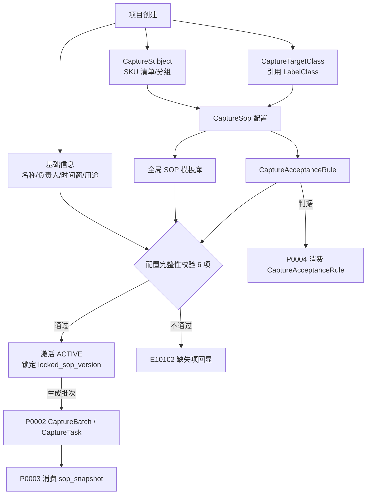
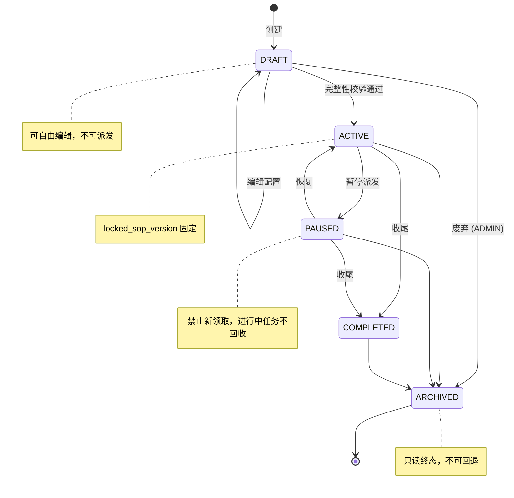
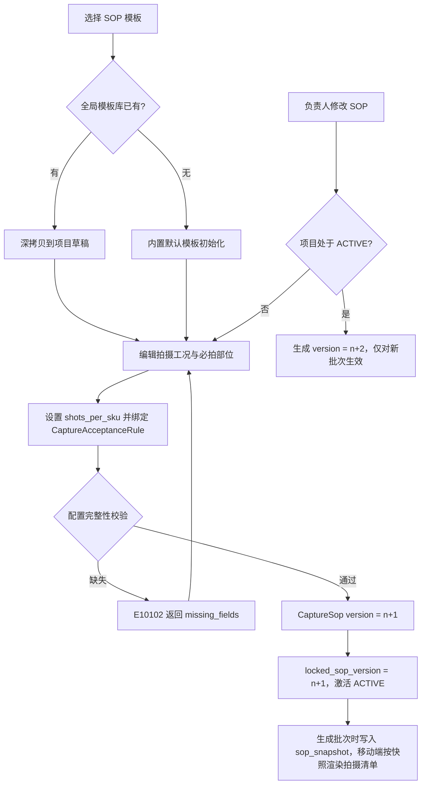
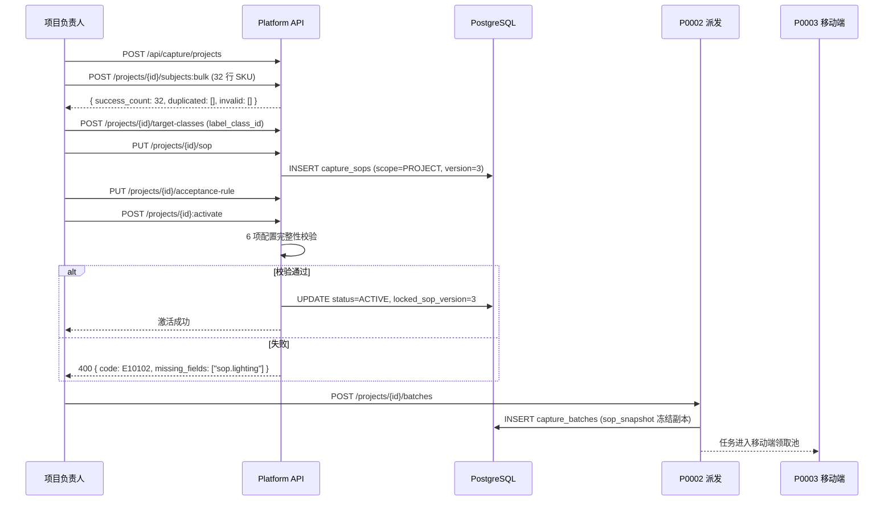
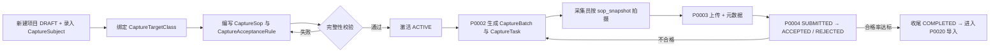
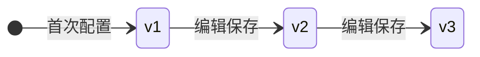

# PRD: P0001_采集项目与SOP (Capture Project & SOP)

| 属性 | 内容 |
| :--- | :--- |
| **文档编号** | P0001 |
| **功能模块** | M01_采集项目与SOP |
| **当前版本** | v1.0.0 |
| **文档状态** | Draft |
| **作者** | FoodYolo Team |
| **最后更新** | 2026-10-01 |

---

## 1. 全局说明
> [!IMPORTANT]
> **核心定位**: 把"出去拍数据"从口头交代变成**可下发、可校验、可复现**的作业。采集项目定义"拍什么、怎么拍、拍多少、拍到什么程度算合格"，是 P0002 任务派发与 P0004 产物验收的唯一依据。

### 名词解释
*   **CaptureProject（采集项目）**: 一次有明确目标的现场采集作业单元，绑定一份 `CaptureSop` 与一套 `CaptureAcceptanceRule`。
*   **CaptureSop（SOP 拍摄规范）**: 结构化拍摄约束（角度 / 距离 / 光照 / 背景 / 单 SKU 张数 `shots_per_sku` / 必拍部位），按 `version` 自增。
*   **必拍部位 (Required View)**: 单个拍摄对象必须出现的目标区域视角（如 `DATE_CLOSEUP`），用于计算部位覆盖率。
*   **CaptureSubject（拍摄对象）**: 最小物理个体。首个落地任务中 = 一个食品包装 SKU。
*   **CaptureTargetClass（项目目标类别）**: 项目对全局 `LabelClass` 的采集侧引用，附示例说明；**不构成新类别体系**。
*   **CaptureAcceptanceRule（验收标准）**: 判定产物是否合格的阈值集合（合格率 / 最小张数 / 部位覆盖率）。
*   **合格率 (Pass Rate)**: 通过预检与人工验收的资产数 ÷ 提交资产总数，按项目、`CaptureBatch`、采集员三维度统计。
*   **SOP 快照 (SOP Snapshot)**: `CaptureBatch` 生成瞬间冻结的 `CaptureSop` 副本，后续 SOP 修改不影响已生成批次。
*   **配置完整性 (Config Completeness)**: 项目从 `DRAFT` 进入 `ACTIVE` 前必须通过的 6 项校验。

### 统一异常处理
| Code | 场景 | 处理策略 |
| :--- | :--- | :--- |
| `E10101` | 项目名称重复 | 阻止保存，提示 "项目名称已存在"，输入框失焦即校验 |
| `E10102` | SOP 必填项缺失 | 阻止 `DRAFT → ACTIVE`，返回 `missing_fields[]` 并高亮对应表单项 |
| `E10103` | 目标类别 / 拍摄对象为空 | 阻止保存与激活，提示 "至少定义 1 个目标类别与 1 个拍摄对象" |
| `E10104` | 项目状态不允许当前操作 | 拒绝并回显当前状态，如 "项目已归档，仅支持查看" |
| `E10105` | 项目下存在未终态批次 | 阻止归档，返回指向 P0002 的未完成批次清单 |
| `E10106` | 项目存在但无权访问 | 返回 403，不泄漏存在性；`ANNOTATOR` 只能看到被授权项目的 SOP 快照 |
| `E10107` | SOP 版本冲突 | 并发保存时后写者得 409，返回当前 `version` 要求刷新重试 |
| `E10108` | 必拍部位张数之和超过 `shots_per_sku` | 阻止保存，返回 400 与两端数值 |
| `E10109` | 对象池为空导致张数不可计算 | `min_total_shots` 置 0，激活被 `E10103` 拦截 |

---

## 2. 项目背景
### 背景 (Context)
FoodYolo 首个落地任务是**食品包装生产日期识别**。平台具备完整的数据集管理与训练能力，但**没有任何自有数据**——冷启动只能靠人去产线、仓库、便利店把照片拍回来。目标区域（喷码日期）尺寸小、对比度低、易受反光与褶皱影响；若采集阶段的角度、距离、光照是随意的，后续标注与训练拿到的就是一批"模型永远学不会"的数据。**数据质量的上限在采集现场就已定死**。

### 问题陈述 (Problem Statement)
1.  **口头交代无法执行**: "多拍点、拍清楚点"既无法被采集员执行，也无法被系统校验。
2.  **现场自由发挥**: 各自用不同距离与角度拍摄，数据集内部方差极大，模型学到的只是拍摄习惯。
3.  **覆盖不全**: 拍了 200 张结果全是同一 SKU 同一角度，或某个 SKU 只拍了 1 张，类别分布严重倾斜。
4.  **无法判定"够了没"**: 没有最小张数与合格率阈值，项目何时收尾只能靠人眼看；撤场后才发现漏拍，返工成本极高。

### 目标与成功指标 (Goals & Success Metrics)
*   **北极星指标**: 采集项目从激活到收尾，**交付产物合格率 ≥ 85%**（首次提交口径，不含返工后补交）。
*   **次要指标**: 项目配置完整率 100%；SOP 必拍部位覆盖率 100%（按 `CaptureSubject`）；因"规范不明确"导致的返工 ≤ 1 次/项目；建项目 + 配 SOP < 10 分钟。

### 风险与规避 (Risks & Mitigation)
| 风险 | 影响 | 规避方案 |
| :--- | :--- | :--- |
| SOP 过于理想化，现场无法执行 | 采集员直接跳过规范 | 字段可填"实际可达区间"；移动端允许记 `sop_deviation_note` |
| SOP 中途修改 | 前后数据口径不一致，无法比较 | `CaptureSop` 版本化；`CaptureBatch` 持快照，修改只影响新批次 |
| 采集途中追加拍摄对象 | 已完成批次口径不一致 | 追加必须生成新批次，不改进行中批次的对象池 |
| 目标类别定义过粗（只写"日期"） | 标注阶段无法对齐 | 强制绑定 `label_class_id` 并要求示例说明 |

---

## 3. 价值模型
*   **方案**: 把采集规范抽象为**版本化的 `CaptureSop` + 结构化的 `CaptureAcceptanceRule`**，与 `CaptureProject` 绑定。项目激活后 SOP 即固化为可下发到移动端的拍摄清单，验收标准即成为 P0004 预检与人工验收的判据。
*   **目标**: 采集员现场只需照做，不需理解模型训练；负责人不下现场即可用合格率与部位覆盖率判断能否收尾；同一任务的多次采集产出结构一致的数据，可直接合并为一个 `DatasetVersion`。

---

## 4. 项目范围
### 功能结构图


### In Scope (包含范围)
1.  `CaptureProject` CRUD：创建、编辑、列表、详情、克隆、归档。
2.  `CaptureSubject` 管理：逐条新增、文本/CSV 批量导入、分组、排序、启用停用。
3.  `CaptureTargetClass` 定义：绑定 `label_class_id`、颜色、示例说明与示例图。
4.  `CaptureSop` 与版本：结构化字段、全局模板库、`version` 自增、`locked_sop_version`。
5.  `CaptureAcceptanceRule` 配置（最小张数 / 合格率阈值 / 部位覆盖率 / 预检开关）、配置完整性校验、生命周期迁移与权限约束。

### Out of Scope (不包含范围)
*   **任务拆解与派发**（P0002）：本篇不产生 `CaptureBatch` / `CaptureTask`。
*   **实际拍摄与上传**（P0003）；**预检与人工验收执行**（P0004，本篇只定义标准）。
*   **统计报表与绩效**（P0005，本篇只维护项目维度冗余进度字段）与 **`LabelClass` 全量治理**（标注中心，本篇只做引用）。
*   **数据增强与训练策略**：与采集规范无关。

---

## 5. 业务流程
### 5.1 采集项目状态机


| 状态 | 可派发 | 可编辑 SOP | 可编辑验收标准 | 可编辑对象池 |
| :--- | :--- | :--- | :--- | :--- |
| `DRAFT` | ✗ | ✓ | ✓ | ✓ |
| `ACTIVE` | ✓ | ✗（改则新建 version） | ✗ | 仅追加（生成新批次） |
| `PAUSED` | ✗ | ✗ | ✗ | ✗ |
| `COMPLETED` | ✗ | ✗ | ✗ | ✗ |
| `ARCHIVED` | ✗ | ✗ | ✗ | ✗ |

| 迁移 | 前置条件 | 失败异常 |
| :--- | :--- | :--- |
| `DRAFT → ACTIVE` | 名称唯一；≥1 目标类别；≥1 对象；`CaptureSop` 版本落库；`CaptureAcceptanceRule` 齐全 | `E10101`/`E10102`/`E10103` |
| `ACTIVE → PAUSED` | 操作者为 `owner_id` 或 `ADMIN` | `E10104` |
| `ACTIVE/PAUSED → COMPLETED` | 无 `PENDING/CLAIMED/IN_PROGRESS/SUBMITTED` 任务；合格率 ≥ 阈值（或强制收尾并填理由） | `E10105` |
| `* → ARCHIVED` | 无未终态 `CaptureBatch`；`DRAFT/ACTIVE/PAUSED` 归档需 `ADMIN` | `E10105` |

> [!NOTE]
> `ARCHIVED` 为不可逆终态。重启同一采集目标采用**克隆项目**（对象池与 SOP 深拷贝）而非回退状态，与 `DatasetVersion` 不可变的设计哲学一致。

### 5.2 SOP 配置与版本生效流程


### 5.3 项目创建到首次派发



---

## 6. 用户分析
### 6.1 用户画像 (User Personas)
| 角色 | 核心职责 | 核心诉求 | 核心痛点 |
| :--- | :--- | :--- | :--- |
| **ADMIN** | 维护平台配置与权限，必要时接管任意项目 | 全局可见，能纠正任何配置错误 | 项目配置散乱，无法批量核对 |
| **TRAINER / 负责人** | 定义目标、编写 SOP、设定验收标准、决定收尾 | 用最小沟通成本让采集员拍出能训的数据 | 口头交代不可执行；不知道现场够不够 |
| **ANNOTATOR / 采集员** | 按 SOP 现场拍摄与上传 | 打开 App 就知道"这个 SKU 拍哪几个角度、几张" | SOP 靠微信截图传达，容易看漏 |
| **VIEWER** | 查看进度与产物 | 只读，不打扰生产 | 权限不清，误操作风险 |

### 6.2 用户链路图 (User Journey Map)


---

## 7. 功能需求
### M01.F01 采集项目创建与基础信息 (Project Creation)
*   **用户故事**: 作为项目负责人，我希望创建采集项目并填写名称、目标与时间窗，以便把这次线下采集作业登记下来并分发给团队。
*   **逻辑与业务规则**
    *   **前置条件**: 角色为 `ADMIN` 或 `TRAINER`。
    *   **主流程**: 填写并提交 → 状态恒为 `DRAFT`；`name` 全平台唯一（忽略大小写、去首尾空格）；自动生成 `project_code`（`CP-20261001-001`）不可改；`created_by` 默认作为 `owner_id`。
    *   **后置条件**: `capture_projects` 落库，仅创建者与 `ADMIN` 可见。

| 字段名 | 类型 | 必填 | 校验规则 | 默认值 |
| :--- | :--- | :--- | :--- | :--- |
| 项目名称 `name` | Input | ✅ | 1–64 字符；全局唯一 | - |
| 负责人 `owner_id` | Select(User) | ✅ | 角色 ∈ {ADMIN, TRAINER} | 当前用户 |
| 计划时间窗 | DatePicker ×2 | ❌ | `end ≥ start`，`start ≥ 今天` | 今天 |
| 数据用途 `data_purpose` | Select | ✅ | `DETECTION` / `OCR` / `CLASSIFICATION` | `DETECTION` |
| 参与采集员范围 | MultiSelect | ❌ | 角色 ∈ {ANNOTATOR, TRAINER} | 全部 |

```gherkin
场景: 创建采集项目成功
  Given 用户角色为 TRAINER 且不存在同名项目
  When 提交名称 "2026Q4 牛奶包装日期采集" 与 data_purpose = DETECTION
  Then 创建成功，capture_projects.status = DRAFT
  And project_code 匹配 ^CP-\d{8}-\d{3}$

场景: 项目名称重复
  Given 已存在同名项目
  When 以同名提交创建
  Then 返回 E10101，前端提示 "项目名称已存在"
```

| 边界场景 | 处理 |
| :--- | :--- |
| 两人同时提交同名项目 | 对 `lower(name)` 建唯一索引，后提交者得 `E10101` |
| 结束时间早于开始时间 | 前端即时拦截，服务端二次校验返回 400 |
| 创建后立即废弃 | 不提供物理删除；`DRAFT` 项目由创建者迁至 `ARCHIVED`（`deleted_at` 保持 NULL） |
| `owner_id` 被停用 | 项目归入"待指派"，仅 `ADMIN` 可重新指派 |

### M01.F02 拍摄对象与目标类别定义 (Subjects & Target Classes)
*   **用户故事**: 作为项目负责人，我希望批量录入 SKU 清单与要检测的类别，以便系统按对象拆解任务、按类别统计覆盖度。
*   **逻辑与业务规则**
    *   **前置条件**: 项目状态 `DRAFT`。
    *   **主流程**: 批量粘贴 `sku_code,sku_name,group` 每行一条；`subject_key` 项目内唯一，重复行回报 `duplicated[]`、非法行回报 `invalid[]`；绑定 `LabelClass` 生成 `CaptureTargetClass`，同一 `label_class_id` 只能绑一次；每个目标类别须有 `example_note`（≥4 字符）或 `example_image_url`。
    *   **录入格式**: 每行 `对象编码,对象名称,分组`，如 `SKU-0001,XX牌纯牛奶 250ml 盒装,乳制品`；空行忽略，BOM 与全角逗号自动归一化。
    *   **后置条件**: 对象池与类别引用成型，可被 `CaptureSop.required_views` 引用。

```gherkin
场景: 批量导入拍摄对象
  Given 项目处于 DRAFT
  When 粘贴 32 行 SKU 清单并提交
  Then 创建 32 条 capture_subjects
  And 返回 { success_count: 32, duplicated: [], invalid: [] }

场景: 含重复与非法行
  Given 项目中已存在 SKU-0001
  When 粘贴含 "SKU-0001,..." 与空编码行的清单
  Then 已存在行计入 duplicated，空编码行计入 invalid 并返回行号
  And 其余合法行正常创建

场景: 目标类别缺少示例说明
  When 绑定 LabelClass "production_date" 但 example_note 与 example_image_url 均为空
  Then 返回 400 "目标类别必须提供示例说明或示例图"
```

| 边界场景 | 处理 |
| :--- | :--- |
| 同一 SKU 多个包装版本 | 视为不同 `subject_key`，用 `group_name` 区分 |
| 对象数 500+ | 异步导入并展示进度；> 1000 行提示拆分为多个批次 |
| `LabelClass` 被合并/删除 | 保留绑定记录并置 `stale = true`，项目页告警，不静默丢弃 |
| 项目 `ACTIVE` 后追加对象 | 允许，但必须伴随新 `CaptureBatch`；已有批次对象池不变 |

### M01.F03 SOP 拍摄规范配置 (SOP Specification)
*   **用户故事**: 作为项目负责人，我希望用结构化字段描述"怎么拍"，以便采集员现场拿到一份没有歧义的拍摄清单，而不是一段文字说明。
*   **逻辑与业务规则**
    *   **前置条件**: 项目已绑定 ≥1 `CaptureTargetClass`。
    *   **主流程**: 选模板或空白 → 配置拍摄工况 → 配置必拍部位（绑定 `label_class_id` 与张数）→ 设置 `shots_per_sku` → 保存生成 `version = max(version)+1` 并更新 `draft_sop_version`。
    *   **后置条件**: `capture_sops` 入库；激活时 `locked_sop_version` 固定，后续修改只影响新批次。

| SOP 字段 | 类型 | 必填 | 约束 / 取值 |
| :--- | :--- | :--- | :--- |
| `angles[]` | Array\<Enum\> | ✅ | `FRONT_0`/`LEFT_45`/`RIGHT_45`/`TOP_90`/`OBLIQUE_30`，≥1 项 |
| `distance_min_cm` / `distance_max_cm` | Integer | ✅ | `5 ≤ min ≤ max ≤ 200` |
| `lighting` / `lighting_note` | Enum / Text | ✅ / ❌ | `DIFFUSE`/`NATURAL`/`SHADOWLESS`；note 如 "避免顶灯直射产生反光斑" |
| `background` | Enum | ✅ | `WHITE`/`GRAY_MATTE`/`BLACK`/`SITE_ORIGINAL` |
| `shots_per_sku` | Integer | ✅ | 1–50 |
| `required_views[]` | JSONB | ✅ | ≥1 条，`Σ shots ≤ shots_per_sku` |
| `min_resolution` | Enum | ✅ | `1280x720`/`1920x1080`/`2560x1440` |
| `focus_rule` | Enum | ✅ | `AUTO`/`LOCK_ON_VIEW`/`MANUAL` |
| `tolerance_note` | Textarea | ❌ | 现场可接受的偏差说明 |

`required_views[]` 元素：`view_code`（项目内唯一）、`view_name`、`label_class_id`（须已在 `CaptureTargetClass` 绑定）、`shots`（1–20）、`hint_image_url`、`is_required`（默认 true）。

```gherkin
场景: 配置完整 SOP 并生成新版本
  Given 项目 draft_sop_version = 2
  When 提交 angles=[FRONT_0,LEFT_45]、distance={20,30}、lighting=DIFFUSE、
    background=SITE_ORIGINAL、shots_per_sku=6、required_views=[DATE_CLOSEUP(3)]
  Then 生成 capture_sops 记录且 version = 3，draft_sop_version = 3

场景: 必拍部位张数之和超过单 SKU 张数
  Given shots_per_sku = 6
  When required_views 张数之和为 9
  Then 返回 E10108 "必拍部位张数之和 (9) 不得超过单 SKU 张数 (6)"

场景: 激活后修改 SOP 且并发保存冲突
  Given 项目 ACTIVE 且 locked_sop_version = 3，用户 A 与 B 同时基于 version = 3 编辑
  When A 先保存成功，B 后保存
  Then 生成 version = 4，locked_sop_version 保持 3，已生成批次的 sop_snapshot 不变
  And B 收到 E10107 与当前 version = 4，其草稿不写入
```

| 边界场景 | 处理 |
| :--- | :--- |
| 必拍部位张数之和 > `shots_per_sku` | 拒绝保存返回 `E10108`（否则验收阶段永远无法达标） |
| 现场无法满足光照条件 | 允许填 `sop_deviation_note`，不阻塞提交，记入产物元数据供验收参考 |
| 同项目多版本并存 | 允许；跨版本比较合格率时 UI 强制提示版本差异 |
| `required_views` 引用未绑定类别 | 拒绝保存并列出缺失的 `label_class_id` |

### M01.F04 验收标准与合格率阈值配置 (Acceptance Rule)
*   **用户故事**: 作为项目负责人，我希望设定客观的验收阈值，以便系统自动判断项目是否达标、哪些产物要打回重采。
*   **逻辑与业务规则**
    *   **前置条件**: `CaptureSop` 已配置。
    *   **主流程**: 设置 `min_shots_per_subject`（默认 `shots_per_sku`）、`pass_rate_threshold`（默认 0.85）、`required_view_coverage`（默认 1.00）、`auto_precheck_enabled` 与 `precheck_flags`；系统计算 `min_total_shots = subject_count × min_shots_per_subject`。
    *   **后置条件**: `CaptureAcceptanceRule` 保存，被 P0002（算任务量）与 P0004（判合格）读取。

| 字段 | 类型 | 必填 | 默认 | 范围 |
| :--- | :--- | :--- | :--- | :--- |
| `min_shots_per_subject` | Integer | ✅ | = `shots_per_sku` | 1–50 |
| `pass_rate_threshold` | Decimal(3,2) | ✅ | 0.85 | 0.50–1.00 |
| `required_view_coverage` | Decimal(3,2) | ✅ | 1.00 | 0.50–1.00 |
| `auto_precheck_enabled` | Boolean | ✅ | true | - |
| `precheck_flags` | JSONB | ❌ | `{blur:true,duplicate:true,no_target:true,resolution:true}` | - |
| `min_total_shots` | Integer | 计算 | - | ≥0，存于 `capture_projects`，只读 |

```gherkin
场景: 配置验收标准并计算最小总张数
  Given 项目包含 32 个 CaptureSubject
  When 设置 min_shots_per_subject = 6 且 pass_rate_threshold = 0.85
  Then min_total_shots 显示为 192 且保存成功

场景: 合格率阈值越界
  When 提交 pass_rate_threshold = 1.2
  Then 返回 400 "合格率阈值必须在 0.50 ~ 1.00 之间"

场景: 对象池变更后自动刷新，且 ACTIVE 下禁止改阈值
  Given 原 min_total_shots = 192 且项目处于 ACTIVE
  When 追加 8 个 CaptureSubject
  Then min_total_shots 自动刷新为 240，无需手动重存
  When 提交新的 pass_rate_threshold
  Then 返回 E10104 "运行中的项目不可修改验收标准，请先暂停"
```

| 边界场景 | 处理 |
| :--- | :--- |
| 自动预检全部关闭 | 允许，UI 提示"将全部依赖人工验收，请确认人力充足" |
| 阈值 < 0.50 | 拒绝，避免产生"全是合格"的无效口径 |
| `min_shots_per_subject` > `shots_per_sku` | 允许（意味着需多轮补拍），UI 警告并提示影响 `min_total_shots` |
| 对象池为空 | `min_total_shots` 为 0，激活被 `E10103` 阻止 |

### M01.F05 项目生命周期管理 (Lifecycle Management)
*   **用户故事**: 作为项目负责人，我希望控制项目的启动、暂停、收尾与归档，以便项目在正确的时间点开放或停止派发。
*   **逻辑与业务规则**
    *   **前置条件**: 用户为 `owner_id` 或 `ADMIN`。
    *   **主流程**: 激活（6 项校验 + 锁 `locked_sop_version`）→ 暂停（禁新领取，不回收进行中任务）→ 恢复 → 收尾（要求无未终态任务并计算合格率）→ 归档（只读）。
    *   **后置条件**: 状态迁移写入 `audit_logs` 并触发项目进度重算（P0005 消费）。

**激活校验清单**

| # | 校验项 | 失败码 |
| :--- | :--- | :--- |
| 1 | `name` 非空且全局唯一 | `E10101` |
| 2 | `CaptureTargetClass` 数 ≥ 1 | `E10103` |
| 3 | `CaptureSubject` 数 ≥ 1（`enabled = true`） | `E10103` |
| 4 | `CaptureSop` 已绑定且版本可解析 | `E10102` |
| 5 | SOP 必填项齐全（角度/距离/光照/背景/张数/必拍部位/分辨率/对焦） | `E10102` |
| 6 | `CaptureAcceptanceRule` 齐全（最小张数/合格率/部位覆盖率） | `E10102` |

```gherkin
场景: 激活配置完整的项目
  Given 项目 DRAFT 且定义齐全
  When 点击 [激活项目]
  Then status = ACTIVE，locked_sop_version 记录当前版本
  And audit_logs 写入 action = capture.project.activate

场景: 缺少必填项时激活失败
  Given CaptureSop 未填写 lighting
  When 点击 [激活项目]
  Then 返回 E10102，missing_fields 包含 "sop.lighting"，状态保持 DRAFT

场景: 暂停禁止领取；存在未终态任务时收尾失败
  Given 项目处于 PAUSED 且下存在 3 个 IN_PROGRESS 任务
  When 采集员尝试领取任务，且负责人点击 [收尾]
  Then 领取返回 E10104 "项目已暂停，暂不可领取"
  And 收尾返回 E10105 并给出未完成任务清单

场景: 合格率未达标时强制收尾
  Given 实际合格率 0.72 < 阈值 0.85 且无未终态任务
  When 点击 [强制收尾] 并填写理由 "线下窗口期已结束"
  Then status = COMPLETED，force_complete_reason 持久化
  And audit_logs 写入告警级记录
```

| 边界场景 | 处理 |
| :--- | :--- |
| 激活与暂停并发 | `capture_projects.version` 乐观锁，冲突方得 409 提示刷新 |
| `PAUSED` 期间采集员仍有本地离线队列 | 允许上传；上传校验 `CaptureTask` 归属而非项目状态 |
| `ACTIVE` 期追加对象 | 仅对新批次生效，已有批次不重算 `min_total_shots` |
| 归档后需重启采集 | 返回 `E10104`，引导走克隆流程 |

### M01.F06 SOP 模板复用与项目克隆 (Template Reuse & Clone)
*   **用户故事**: 作为项目负责人，我希望复用 SOP 模板或克隆整个项目，以便新一批采集作业几分钟内配置完成。
*   **逻辑与业务规则**
    *   **前置条件**: 存在可读的 `CaptureSop(scope=GLOBAL)` 或历史项目。
    *   **主流程**: `保存为模板`（另存为 `scope = GLOBAL`，不携带对象池）→ `套用模板`（深拷贝并生成新 `version`）→ `克隆项目`（复制基础信息、`CaptureSubject`、`CaptureTargetClass` 绑定、`CaptureSop`、`CaptureAcceptanceRule`；新项目状态强制 `DRAFT`）。
    *   **后置条件**: 新项目/新版本入库，不影响源项目与源模板。

| 内置模板 | 关键参数 |
| :--- | :--- |
| 食品包装-日期检测（现场） | `background=SITE_ORIGINAL`，`distance=20–35cm`，`shots_per_sku=6`，必拍 `DATE_CLOSEUP(3)+WHOLE_PACKAGE(2)+SIDE_EDGE(1)` |
| 食品包装-日期检测（棚拍） | `background=WHITE`，`lighting=SHADOWLESS`，`distance=25–30cm`，`shots_per_sku=8` |

```gherkin
场景: 克隆项目生成独立草稿
  Given 源项目 COMPLETED 且含 32 个 CaptureSubject
  When 执行 [克隆项目]
  Then 新项目 name 以 "-副本" 结尾且全局唯一，status = DRAFT
  And 对象池 32 条与源项目无引用关系，修改新项目 SOP 不影响源项目

场景: 模板必拍部位引用未绑定类别
  Given 模板 required_views 关联 label_class_id = L-001 且当前项目未绑定
  When 套用该模板
  Then 返回 400 并列出缺失的 label_class_id
```

| 边界场景 | 处理 |
| :--- | :--- |
| 克隆时源项目已归档 | 允许（归档项目可读），新项目为 `DRAFT` |
| 模板套用后类别丢失 | 拒绝套用并列出缺失类别，不静默丢弃必拍部位 |
| 副本名称再次冲突 | 追加 `-副本2`、`-副本3`，最多 10 次后返回 `E10101`；克隆 1000+ 对象时异步返回 `job_id` |

---

## 8. 技术架构与数据模型
> [!NOTE]
> 通用字段：所有表含 `id UUID PK`、`created_at`、`updated_at`、`deleted_at timestamptz NULL`（软删除，下列各表不再重复列出）。状态字段一律 UPPER_SNAKE 枚举字符串。

### 8.1 数据实体
**`CaptureProject` / `capture_projects`**

| 字段名 | 类型 | 必填 | 说明 | 约束 |
| :--- | :--- | :--- | :--- | :--- |
| `project_code` | String(20) | Y | 项目编码 | UNIQUE, `CP-YYYYMMDD-NNN` |
| `name` / `description` / `target_dataset_id` | String(64) / Text / UUID | Y / N / N | 项目名称 / 描述 / 入库目标 | UNIQUE(lower(name))；≤512；`target_dataset_id` FK → `datasets.id`，为空表示采集产物不自动入库 |
| `owner_id` / `created_by` | UUID | Y | 负责人 / 创建人 | FK → `users.id` |
| `data_purpose` | Enum | Y | 数据用途 | `DETECTION`/`OCR`/`CLASSIFICATION` |
| `status` | Enum | Y | 项目状态 | `DRAFT`/`ACTIVE`/`PAUSED`/`COMPLETED`/`ARCHIVED` |
| `planned_start_at` / `planned_end_at` | timestamptz | N | 计划时间窗 | `end ≥ start` |
| `locked_sop_version` / `draft_sop_version` | Integer | N | 生效 / 草稿 SOP 版本 | 激活后 `locked_` 非空 |
| `subject_count` / `min_total_shots` | Integer | Y | 对象数 / 最小总张数 | 后者 = `subject_count × min_shots_per_subject` |
| `pass_rate_actual` | Decimal(4,3) | N | 实际合格率 | P0005 回写 |
| `force_complete_reason` | Text | N | 强制收尾理由 | ≥ 10 字符；`version` Integer Y 为乐观锁 |

**`CaptureSubject` / `capture_subjects`**

| 字段名 | 类型 | 必填 | 说明 | 约束 |
| :--- | :--- | :--- | :--- | :--- |
| `project_id` | UUID | Y | 所属项目 | FK → `capture_projects.id` |
| `subject_key` | String(64) | Y | 对象编码 | UNIQUE(`project_id`,`subject_key`) |
| `subject_name` | String(128) | Y | 对象名称 | - |
| `group_name` | String(64) | N | 分组 | 用于批次拆解 |
| `enabled` / `seq` | Boolean / Integer | Y | 是否启用 / 排序序号 | 默认 true；`seq` 用于稳定分片 |

**`CaptureTargetClass` / `capture_target_classes`**

| 字段名 | 类型 | 必填 | 说明 | 约束 |
| :--- | :--- | :--- | :--- | :--- |
| `project_id` | UUID | Y | 所属项目 | FK → `capture_projects.id` |
| `label_class_id` | UUID | Y | 引用的全局类别 | FK → `label_classes.id`，UNIQUE(`project_id`,`label_class_id`) |
| `display_name` | String(64) | N | 项目内显示名 | 缺省取 `LabelClass.name` |
| `example_note` / `example_image_url` | Text / String(512) | N | 示例说明 / 示例图 | 至少一个非空 |
| `stale` | Boolean | Y | 引用是否失效 | `LabelClass` 合并/删除时置 true |

**`CaptureSop` / `capture_sops`**

| 字段名 | 类型 | 必填 | 说明 | 约束 |
| :--- | :--- | :--- | :--- | :--- |
| `scope` | Enum | Y | 作用域 | `GLOBAL`（模板）/ `PROJECT`（版本） |
| `project_id` | UUID | N | 所属项目 | `scope=PROJECT` 必填；`GLOBAL` 为 NULL |
| `template_name` | String(64) | N | 模板名 | `scope=GLOBAL` 必填 |
| `version` / `schema_version` | Integer | Y | 版本号 / 结构版本 | UNIQUE(`project_id`,`version`) |
| `angles` | JSONB | Y | 角度集合 | 枚举数组，≥1 项 |
| `distance_min_cm` / `distance_max_cm` | Integer | Y | 距离区间 | `5 ≤ min ≤ max ≤ 200` |
| `lighting` / `lighting_note` | Enum / Text | Y / N | 光照 | `DIFFUSE`/`NATURAL`/`SHADOWLESS` |
| `background` | Enum | Y | 背景 | `WHITE`/`GRAY_MATTE`/`BLACK`/`SITE_ORIGINAL` |
| `shots_per_sku` | Integer | Y | 单 SKU 张数 | 1–50 |
| `required_views` | JSONB | Y | 必拍部位清单 | ≥1 项，`Σshots ≤ shots_per_sku` |
| `min_resolution` / `focus_rule` | Enum | Y | 最低分辨率 / 对焦规则 | `1920x1080` 等；`LOCK_ON_VIEW` 等 |
| `tolerance_note` / `created_by` | Text / UUID | N / Y | 现场容差说明 / 创建人 | FK → `users.id` |

**`CaptureAcceptanceRule` / `capture_acceptance_rules`**

| 字段名 | 类型 | 必填 | 说明 | 约束 |
| :--- | :--- | :--- | :--- | :--- |
| `project_id` | UUID | Y | 所属项目 | UNIQUE, FK → `capture_projects.id` |
| `min_shots_per_subject` | Integer | Y | 单对象最小张数 | 1–50 |
| `pass_rate_threshold` | Decimal(3,2) | Y | 合格率阈值 | 0.50–1.00 |
| `required_view_coverage` | Decimal(3,2) | Y | 部位覆盖率 | 0.50–1.00 |
| `auto_precheck_enabled` | Boolean | Y | 启用自动预检 | 默认 true |
| `precheck_flags` | JSONB | N | 预检项开关 | `{blur,duplicate,no_target,resolution}` |
| `updated_by` | UUID | Y | 最后修改人 | FK → `users.id` |

### 8.2 版本链

> [!IMPORTANT]
> **三层解耦**: `capture_sops`（版本）→ `capture_projects.locked_sop_version`（当前生效版本）→ `capture_batches.sop_snapshot`（批次冻结副本）。任一层变化都不回溯修改下一层，保证历史数据可比性。P0002 / P0004 引用本项目时一律使用 `CaptureProject` / `CaptureSop` / `CaptureAcceptanceRule` / `CaptureBatch` 实体名。

---

## 9. UI/UX 规格说明
### 9.1 采集项目列表页
```text
┌──────────────────────────────────────────────────────────────────────────────┐
│ FoodYolo  采集 / 采集项目                                    [+ 新建采集项目] │
├──────────────────────────────────────────────────────────────────────────────┤
│ 筛选: [状态 ▾ 全部] [负责人 ▾] [数据用途 ▾] [搜索项目名/SKU_______] [查询]    │
├──────────────────────────────────────────────────────────────────────────────┤
│ 项目编码         项目名称               状态        对象  进度     合格率      │
│ CP-20261001-001  2026Q4牛奶包装采集     ●ACTIVE     32   128/192  91.4%      │
│ CP-20260928-003  零食包装日期采集       ●PAUSED     18   54/108   78.2%      │
│ CP-20260920-002  便利店冷柜日期采集     ●COMPLETED  12   72/72    96.5%      │
│ CP-20260915-001  初期试拍               ●ARCHIVED   5    30/30    62.0%      │
├──────────────────────────────────────────────────────────────────────────────┤
│ 批量操作: [导出清单] [批量归档(ADMIN)]                 < 1 2 3 > 共 12 项     │
└──────────────────────────────────────────────────────────────────────────────┘
```

### 9.2 项目配置页（分步）
```text
┌──────────────────────────────────────────────────────────────────────────────┐
│ ← 返回  2026Q4牛奶包装日期采集  ●DRAFT        [保存草稿] [激活项目]          │
├──────────────────────────────────────────────────────────────────────────────┤
│ ①基础信息 ─ ②拍摄对象 ─ ③目标类别 ─ ④SOP规范 ─ ⑤验收标准                    │
├──────────────────────────────────────────────────────────────────────────────┤
│ ④ CaptureSop                模板: [套用模板 ▾] [另存]                        │
│   拍摄角度 [x]正面0° [x]左45° [ ]右45° [ ]俯拍90° [ ]斜拍30°                 │
│   拍摄距离 20cm ────●──── 30cm   光照 (•)漫射 ( )自然 ( )无影棚              │
│   背景 ( )纯白 ( )哑光灰 ( )纯黑 (•)现场原始   对焦 (•)锁定必拍部位         │
│   单SKU张数 [6] 张   最低分辨率 [1920x1080 ▾]                                │
│   补充说明 [避免顶灯直射产生反光斑________________________]                  │
│   必拍部位  DATE_CLOSEUP 生产日期区域特写 production_date 3张 [x]            │
│             WHOLE_PACKAGE 整包正面 package 2张 [x]                           │
│             SIDE_EDGE 侧面边缘 package 1张 [x]   [+添加部位]                 │
│             张数合计 6 / 上限 6 ✓                                            │
├──────────────────────────────────────────────────────────────────────────────┤
│ ⑤ 验收标准 单SKU最少张数[6] 合格率阈值[0.85] 部位覆盖率[1.00]                │
│   最小总张数(计算) 192   [x]启用自动预检(模糊/重复/无目标/分辨率)            │
├──────────────────────────────────────────────────────────────────────────────┤
│ 校验: ✓名称唯一 ✓目标类别(1) ✓对象(32) ✓SOP完整 ✓验收标准   [激活项目]      │
└──────────────────────────────────────────────────────────────────────────────┘
```

### 9.3 交互元素
| 元素 | 类型 | 状态 | 行为 |
| :--- | :--- | :--- | :--- |
| 激活项目 | Button (Primary) | Disabled（校验未过）/ Loading | `POST /projects/{id}:activate`；失败高亮 `missing_fields` 对应控件 |
| 暂停 / 恢复 / 收尾 | Button | Default / Confirm Modal / Disabled（有未终态任务） | 二次确认后迁移状态；收尾成功后弹出合格率汇总 |
| 距离区间 | RangeSlider | Default / Error | `min ≤ max` 实时校验，非法转红 |
| 必拍部位张数合计 | Live Counter | Normal / Over（红） | 超限禁用保存并提示 `E10108` |
| 批量导入对象 | Textarea | Default / Parsing / Done | 展示成功/重复/非法三类结果 |

---

## 10. 非功能性需求
*   **性能**: 项目列表 P95 < 200ms（单页 20 条）；项目详情聚合 P95 < 300ms；批量导入 1,000 对象 < 3s，超限转异步（前端轮询 1s）；项目克隆 1,000 对象 < 5s，超时异步返回 `job_id`。
*   **安全**: 创建/编辑/激活/归档限 `ADMIN` 与 `TRAINER`（仅本人 `owner_id` 的项目）；`ANNOTATOR` 只能读被授权项目的 SOP 快照，不可见 `pass_rate_threshold` 与实际合格率；`ARCHIVED` 对全体只读；所有状态迁移写入 `audit_logs`（`project_id`/`from_status`/`to_status`/`operator`/`reason`/`ts`）；强制收尾必须填理由并单独告警。
*   **兼容性**: Chrome / Edge ≥ 110、Safari ≥ 16；设计基准宽度 ≥ 1280px，1024px 以下 SOP 配置表横向滚动；移动端展示由 P0003 负责，本篇保证快照 JSON 含 `schema_version` 且结构稳定。
*   **可扩展性**: 单机部署下项目数 ≤ 200，单项目对象池 ≤ 5,000；`CaptureSop` 新增字段向后兼容（旧快照缺字段取默认值）；`CaptureTargetClass` 通过 `label_class_id` 引用 `LabelClass`，未来新增 OBB / 关键点题型无需改动本模型；`CaptureSop` 为通用结构，不含食品行业硬编码。

---

## 附录
### A. 已确认的设计决策
| # | 决策项 | 结论 | 理由 |
| :--- | :--- | :--- | :--- |
| 1 | SOP 是否版本化 | 版本化，`capture_sops.version` 自增，项目持 `locked_sop_version` | 执行口径必须可追溯，否则合格率无意义 |
| 2 | 批次是否冻结 SOP | 冻结为 `capture_batches.sop_snapshot` | 中途修改不得改变已派发任务的要求 |
| 3 | `ARCHIVED` 是否可回退 | 不可回退，终态只读 | 与 `DatasetVersion` 不可变策略一致；重启走克隆 |
| 4 | `min_total_shots` 刷新 | 对象池变更时自动刷新张数，阈值本身不变 | 避免用户忘记更新导致验收口径错误 |
| 5 | 必拍部位张数之和超限 | 拒绝保存（非仅警告），返回 `E10108` | 若允许，验收阶段必然无法达标，属配置错误 |
| 6 | 目标类别是否允许自由文本 | 不允许，必须绑定 `LabelClass` | 防止标注阶段出现同名不同 ID |
| 7 | 项目 `PAUSED` 与任务状态耦合 | 暂停不回收进行中任务 | 采集员可能已拍到一半，强制回收会造成数据丢失 |
| 8 | 内置默认模板 | 现场 / 棚拍两套食品包装模板 | 2~3 人团队无人愿意从零写 SOP |
| 9 | SOP 字段兼容策略 | 旧快照缺失字段取默认值；`schema_version` 仅破坏性变更时自增 | 避免历史批次因字段新增无法渲染 |
| 10 | `CaptureTargetClass` 与 `LabelClass` 关系 | 前者是"引用 + 示例说明"，不是新类别体系 | 遵循共享实体命名契约，避免同义实体 |
| 11 | E-code 格式 | `E` + 模块号 + P 编号后两位 + 流水两位；本篇 `E10101~E10109` | 全局统一格式，避免跨模块冲突 |

### B. 关联文档
| 文档 | 关系 |
| :--- | :--- |
| `P0002_采集任务派发` | 消费对象池、`locked_sop_version`、`CaptureAcceptanceRule`，生成 `CaptureBatch` / `CaptureTask` |
| `P0003_移动端采集与上传` | 消费 `sop_snapshot` 渲染拍摄清单 |
| `P0004_采集产物验收` | 消费 `CaptureAcceptanceRule` 作为预检与人工验收判据 |
| `P0005_采集统计` | 回写 `pass_rate_actual`，产出项目进度与人均产出 |
| `P0041_数据集与版本` | 采集产物最终进入不可变 `DatasetVersion` |

### C. Changelog
| 版本 | 日期 | 作者 | 变更说明 |
| :--- | :--- | :--- | :--- |
| v1.0.0 | 2026-10-01 | FoodYolo Team | 首版：`CaptureProject`、`CaptureSop` 版本化、`CaptureAcceptanceRule` 与生命周期 |
