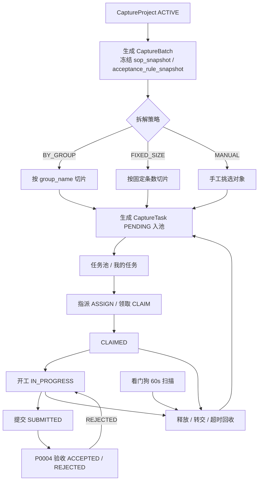
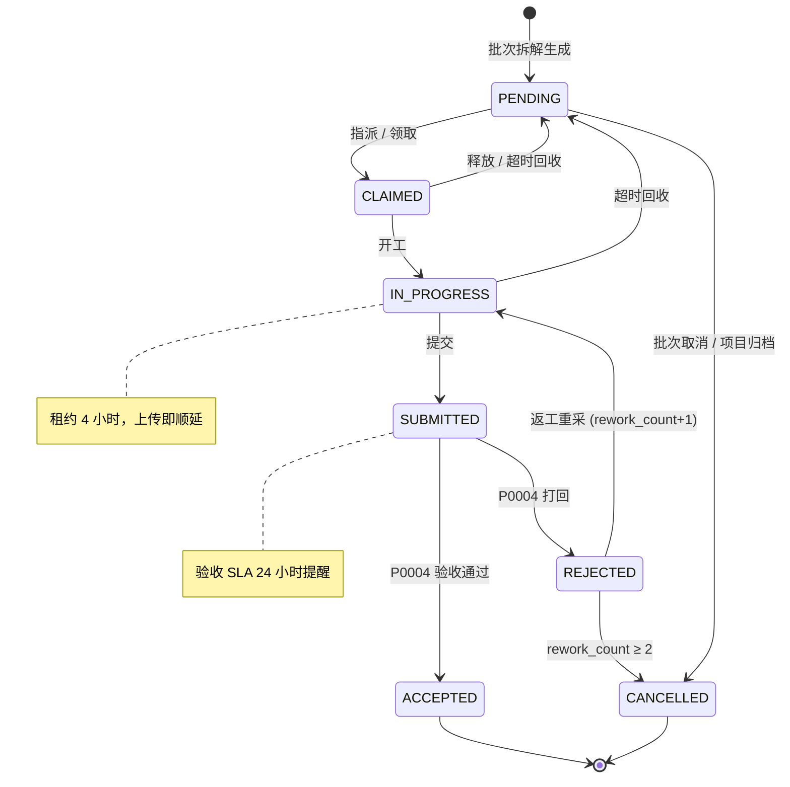
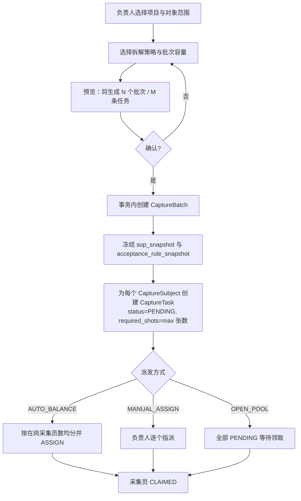
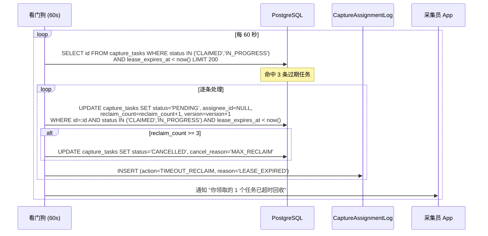
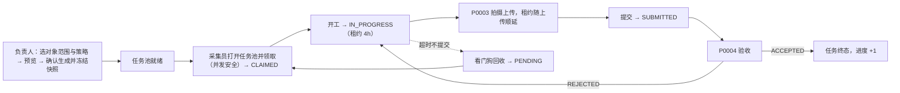
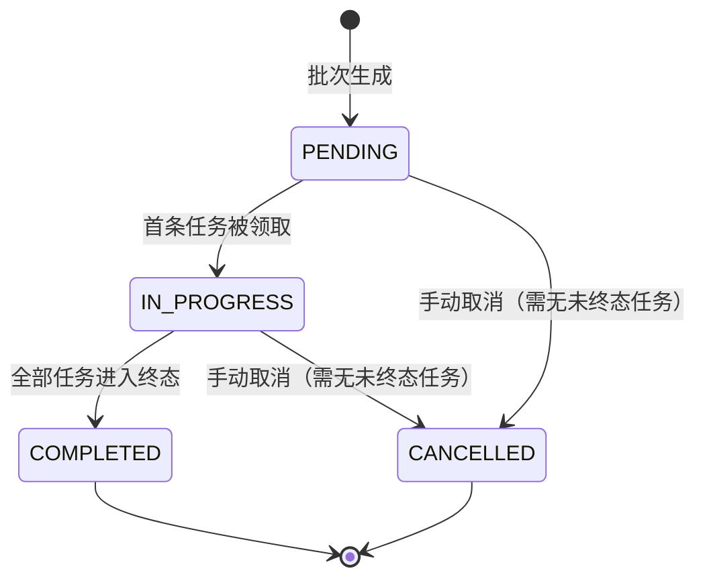

# PRD: P0002_采集任务派发 (Capture Task Dispatch)

| 属性 | 内容 |
| :--- | :--- |
| **文档编号** | P0002 |
| **功能模块** | M01_采集任务派发 |
| **当前版本** | v1.0.0 |
| **文档状态** | Draft |
| **作者** | 轻眸识刻 Team |
| **最后更新** | 2026-10-01 |

---

## 1. 全局说明
> [!IMPORTANT]
> **核心定位**: 把 `CaptureProject` 拆成**可领取、可追踪、可回收**的最小作业单元。一个项目 → 若干 `CaptureBatch` → 每个拍摄对象一条 `CaptureTask`。现场 3~5 个采集员用手机领取任务，任务不重不漏，超时自动回到池子。

### 名词解释
*   **CaptureBatch（采集批次）**: 项目的执行切片，持有 `sop_snapshot` 与 `acceptance_rule_snapshot`，是"同一口径下一批可并行派发的工作量"。
*   **CaptureTask（采集任务）**: 最小作业单元 = **一个 `CaptureSubject` 的一次拍摄作业**。
*   **拆解策略 (Split Strategy)**: `BY_GROUP`（按 `group_name` 切片）/ `FIXED_SIZE`（固定条数，默认 10）/ `MANUAL`。
*   **指派 (Assign)**: 负责人直接指给某采集员（`assignment_type = ASSIGN`）。
*   **领取 (Claim)**: 采集员自行抢单（`assignment_type = CLAIM`），抢占式、先到先得。
*   **释放 (Release) / 转交 (Transfer)**: 前者退回池子（`assignee_id` 置空、状态回 `PENDING`）；后者从 A 直接交给 B、不经过池子，A 必须是当前 `assignee_id`。
*   **任务租约 (Lease)**: 任务被占用后的有效期；超期未推进则由看门狗回收，防止"领了不干"锁死任务。
*   **`required_shots`**: 单任务要求张数 = `max(sop_snapshot.shots_per_sku, acceptance_rule_snapshot.min_shots_per_subject)`，批次生成时快照。

### 统一异常处理
| Code | 场景 | 处理策略 |
| :--- | :--- | :--- |
| `E10201` | 批次不存在或已 `CANCELLED` | 返回 404 / 409，前端刷新批次列表 |
| `E10202` | 任务不存在 | 返回 404，从本地列表移除该任务卡片 |
| `E10203` | 任务状态不允许该操作 | 返回 409 并回显当前状态与允许的动作集合 |
| `E10204` | 领取冲突（已被他人领取） | 返回 409 "任务已被 xxx 领取"，前端刷新任务池 |
| `E10205` | 并发领取超限 | 返回 429 "同时进行中的任务已达上限 (5)，请先提交" |
| `E10206` | 无权操作该任务 | 返回 403；非 `assignee_id` 且非 `ADMIN` 不可释放/转交/提交 |
| `E10207` | 转交/指派目标非法 | 返回 400，原因：`NOT_IN_PROJECT_SCOPE` / `TARGET_AT_LIMIT` / `TARGET_DISABLED` |
| `E10208` | 批次下存在未终态任务 | 阻止取消批次，返回未终态任务数 |
| `E10209` | 项目状态禁止派发 | 返回 409 "项目已暂停/已归档，暂不可领取" |

---

## 2. 项目背景
### 背景 (Context)
P0001 已能把"拍什么、怎么拍、拍到什么程度算合格"写成结构化配置，但配置本身不会派人干活。冷启动阶段要在 2~3 周内把一个项目下数百个 SKU 拍完，现场是 3~5 个采集员拿着手机在产线/仓库作业。他们**不认识模型、不关心数据集**，只关心"我现在该拍哪个 SKU、拍几张"。

### 问题陈述 (Problem Statement)
1.  **派单靠 Excel 且进度不透明**: 负责人手工把 SKU 清单分给采集员，谁拍完了靠微信回报；只能反复问"拍多少了"，无法回答"今天能不能收工"。
2.  **重复劳动**: 两人拍到同一 SKU，或某个 SKU 谁都没拍——因为没人知道"哪些已被领走"。
3.  **领了不干**: 采集员抢了一堆任务当天没拍完，任务被锁死，别人也无法接手。
4.  **并发下的重复领取**: 两个采集员同时点"领取"，系统必须只有一个成功，否则同一 SKU 会被拍两遍。

### 目标与成功指标 (Goals & Success Metrics)
*   **北极星指标**: 同一 `CaptureSubject` 在同一批次内被**重复采集的次数 = 0**（不含 P0004 打回后的返工）。
*   **次要指标**: 任务从 `PENDING` 到被领取的平均停留 < 30 分钟（有人在线时）；超时回收率 < 10%；负责人手工干预 < 2 次/项目；任务池页面 P95 < 200ms。

### 风险与规避 (Risks & Mitigation)
| 风险 | 影响 | 规避方案 |
| :--- | :--- | :--- |
| 领取并发冲突 | 同一 SKU 被重复拍摄 | 条件 UPDATE + `version` 乐观锁，影响行数为 0 即判冲突 |
| 租约过长 | 任务被长期锁死 | 分级租约：`CLAIMED` 30 分钟、`IN_PROGRESS` 4 小时，由看门狗回收 |
| 回收过于激进 | 采集员拍到一半任务被抢走 | 每次上传成功顺延租约；审阅 SLA 只提醒不自动通过 |
| 单批次过大 | 一次生成上万任务，扫描压力大 | 单批对象数上限 200，超出提示拆分 |
| 转交后责任不清 | 出问题无法追责 | `CaptureAssignmentLog` 全量记录每一次流转 |

---

## 3. 价值模型
*   **方案**: 以 `CaptureBatch` 为单位冻结拍摄口径，再拆成一条条 `CaptureTask` 放进**共享任务池**。采集员看到的是可领取的任务卡，领取即占用（带租约），提交即释放；负责人看到的是实时进度与异常任务。
*   **目标**: 负责人不必手工分派与对账；采集员打开 App 就知道干什么；任何一条任务在任何时刻都只有一个责任人，或明确地在池子里等人领。

---

## 4. 项目范围
### 功能结构图


### In Scope (包含范围)
1.  批次生成：选择对象范围、拆解策略、批次容量与截止时间，冻结 SOP 与验收标准快照。
2.  任务生成：每个 `CaptureSubject` 一条 `CaptureTask`，写入 `required_shots` 与 `due_at`。
3.  指派：把任务或整批任务分给指定采集员。
4.  领取：从池中抢占式领取，含并发安全与个人并发上限。
5.  释放与转交：退回池子或直接交给他人，均需权限校验。
6.  任务生命周期：`PENDING → CLAIMED → IN_PROGRESS → SUBMITTED → ACCEPTED / REJECTED` 及返工。
7.  超时回收：分级租约 + 看门狗自动回收 + 超过上限转 `CANCELLED`。
8.  进度看板：项目 / 批次 / 采集员三维度的任务计数与剩余量。

### Out of Scope (不包含范围)
*   **项目定义与 SOP 编辑**（P0001）：本篇只消费其快照。
*   **产物预检与人工验收判定**（P0004）：本篇只接收 `ACCEPTED` / `REJECTED` 并驱动状态流转。
*   **实际拍摄与上传**（P0003）：本篇不感知分片、断点续传细节，只消费上传进度回调。
*   **统计报表与绩效核算**（P0005）与 **通知渠道实现**（09 系统管理）：本篇只提供计数与事件。

---

## 5. 业务流程
### 5.1 任务状态机


| 状态 | 允许的动作 | 责任人 |
| :--- | :--- | :--- |
| `PENDING` | `ASSIGN` / `CLAIM` / `CANCEL` | 无（池中） |
| `CLAIMED` | `START` / `RELEASE` / `TRANSFER` / `RECLAIM` | `assignee_id` |
| `IN_PROGRESS` | `SUBMIT` / `RELEASE` / `TRANSFER` / `RECLAIM` | `assignee_id` |
| `SUBMITTED` | `ACCEPT` / `REJECT`（仅 P0004） | 验收人 |
| `REJECTED` | `START`（返工） / `CANCEL` | `assignee_id` |
| `ACCEPTED` / `CANCELLED` | 无（终态） | - |

**时间参数（可被项目级配置覆盖）**

| 参数 | 默认值 | 说明 |
| :--- | :--- | :--- |
| `claim_lease_seconds` | 1800 | `CLAIMED` 后未开工的回收阈值（30 分钟） |
| `work_lease_seconds` | 14400 | `IN_PROGRESS` 后未提交的回收阈值（4 小时）；每次上传顺延 |
| `review_sla_seconds` | 86400 | `SUBMITTED` 超时未验收则提醒，**不自动通过** |
| `watchdog_interval_seconds` | 60 | 看门狗扫描周期 |
| `max_reclaim_count` | 3 | 被回收达到该次数后转 `CANCELLED` |
| `max_rework_count` | 2 | 被打回达到该次数后转 `CANCELLED` |
| `max_concurrent_tasks_per_user` | 5 | 单采集员同时处于 `CLAIMED` + `IN_PROGRESS` 的上限 |

### 5.2 批次拆解与派发流程


### 5.3 并发领取冲突处理
```mermaid
sequenceDiagram
    participant A as 采集员 A
    participant B as 采集员 B
    participant API as Platform API
    participant DB as PostgreSQL

    A->>API: POST /capture/tasks/{id}:claim
    B->>API: POST /capture/tasks/{id}:claim
    API->>DB: BEGIN; SELECT 1 FROM users WHERE id=:uid FOR UPDATE
    API->>DB: SELECT count(*) FROM capture_tasks WHERE assignee_id=:uid<br/>AND status IN ('CLAIMED','IN_PROGRESS')
    Note over DB: A 的计数 2 < 5，放行
    API->>DB: UPDATE capture_tasks SET status='CLAIMED', assignee_id=A,<br/>claimed_at=now(), lease_expires_at=now()+30min, version=version+1<br/>WHERE id=:id AND status='PENDING'
    DB-->>API: affected_rows = 1
    API-->>A: 200 { status: CLAIMED, lease_expires_at }
    API->>DB: UPDATE capture_tasks ... WHERE id=:id AND status='PENDING'
    DB-->>API: affected_rows = 0
    API-->>B: 409 { code: E10204, current_assignee: "A" }
    B->>API: GET /capture/tasks?status=PENDING&batch_id=...
    API-->>B: 刷新后的任务池（该任务已消失）
```

> [!IMPORTANT]
> **并发控制的唯一真源是带 `status = 'PENDING'` 条件的 UPDATE**。读-改-写（先 SELECT 再 UPDATE）在单机多进程下同样会串车，一律禁止；`affected_rows = 0` 等价于"被人抢走了"。

### 5.4 超时回收看门狗


---

## 6. 用户分析
### 6.1 用户画像 (User Personas)
| 角色 | 核心职责 | 核心诉求 | 核心痛点 |
| :--- | :--- | :--- | :--- |
| **TRAINER / 负责人** | 拆批次、派任务、盯进度、处理异常任务 | 一眼看出谁在干什么、还差多少、哪些卡住了 | 手工派单靠 Excel，改派要重新喊人 |
| **ANNOTATOR / 采集员** | 现场刷任务池、领取、拍摄、提交 | 打开 App 就有任务，不用等人分配；拍到一半不被打断 | 提示"已被领取"却不知被谁领；领多了完不成 |
| **ADMIN** | 接管任意任务、强制回收、修正指派 | 能兜底任何异常状态 | 异常任务（锁死、长期 `SUBMITTED`）没有统一入口 |
| **VIEWER** | 查看进度与批次明细 | 只读，不打扰生产 | - |

### 6.2 用户链路图 (User Journey Map)


---

## 7. 功能需求
### M01.F01 批次拆解与任务生成 (Batch Split & Task Generation)
*   **用户故事**: 作为项目负责人，我希望按策略把一个采集项目拆成若干批次与任务，以便把工作量分给团队并冻结本次的拍摄口径。
*   **逻辑与业务规则**
    *   **前置条件**: `CaptureProject.status = ACTIVE` 且已定义 ≥1 `CaptureSubject`；操作者为 `owner_id` 或 `ADMIN`。
    *   **主流程**: 选对象范围与拆解策略 → 预览批次数/任务数 → 确认后在**单事务**内落库；每个批次冻结 `sop_snapshot`（取 `locked_sop_version`）与 `acceptance_rule_snapshot`；每个启用对象生成一条 `CaptureTask`（`PENDING`、`assignee_id = NULL`、`required_shots = max(张数)`）。
    *   **后置条件**: 任务进入共享池；`capture_projects.subject_count` 与 `min_total_shots` 重算。

| 字段 | 类型 | 必填 | 约束 / 默认 |
| :--- | :--- | :--- | :--- |
| 对象范围 | Enum + 选择器 | ✅ | `ALL` / `BY_GROUP` / `MANUAL` |
| 拆解策略 `split_strategy` | Enum | ✅ | `BY_GROUP` / `FIXED_SIZE` / `MANUAL` |
| 批次容量 `batch_size` | Integer | ✅ | `FIXED_SIZE` 时必填，1–200，默认 10 |
| 批次命名 | Input | ❌ | 默认 `{项目名}-批次{n}` |
| 截止时间 `due_at` | DatePicker | ❌ | 不早于今天 |
| 派发方式 | Enum | ✅ | `AUTO_BALANCE` / `MANUAL_ASSIGN` / `OPEN_POOL`，默认 `OPEN_POOL` |

```gherkin
场景: 按分组拆解生成批次与任务
  Given 项目 ACTIVE 且含 32 个 CaptureSubject，分为 3 个 group_name
  When 负责人选择对象范围 ALL 与 split_strategy = BY_GROUP
  Then 生成 3 个 CaptureBatch，各自写入 sop_snapshot 与 acceptance_rule_snapshot
  And 每个批次含该分组全部对象对应的 CaptureTask
  And 所有任务 status = PENDING 且 assignee_id 为 NULL

场景: 固定条数拆解
  Given 项目含 32 个启用对象
  When 选择 split_strategy = FIXED_SIZE 且 batch_size = 10
  Then 生成 4 个批次，任务数分别为 10 / 10 / 10 / 2

场景: required_shots 取两者较大值
  Given sop_snapshot.shots_per_sku = 6 且 acceptance_rule_snapshot.min_shots_per_subject = 8
  When 生成任务
  Then 该批次所有 CaptureTask.required_shots = 8
```

| 边界场景 | 处理 |
| :--- | :--- |
| 对象数超过单批上限（> 200） | 拒绝提交并提示改用 `FIXED_SIZE` 拆分；不静默截断 |
| 存在 `enabled = false` 的对象 | 默认跳过，预览面板显式列出跳过数量 |
| 生成过程中项目被暂停 | 事务内重新校验 `status = ACTIVE`，失败返回 `E10209` |
| 生成到一半数据库报错 | 整事务回滚，不产生"半截批次" |

### M01.F02 任务指派 (Task Assignment)
*   **用户故事**: 作为项目负责人，我希望把任务或整批任务直接指派给某个采集员，以便在需要指定分工时不必依赖抢单。
*   **逻辑与业务规则**
    *   **前置条件**: 任务 `status = PENDING`；目标用户在该项目可见范围内、角色 ∈ {`ANNOTATOR`, `TRAINER`} 且未停用。
    *   **主流程**: 选任务（单条/多选/整批）+ 目标采集员 → 校验目标剩余额度 → 条件更新为 `CLAIMED`（`assignment_type = ASSIGN`，`assigned_by = 操作者`）→ 写 `CaptureAssignmentLog`。
    *   **后置条件**: 任务出现在目标"我的任务"中，池中不再可见。

```gherkin
场景: 批量指派整批任务
  Given 批次下有 10 条 PENDING 任务，目标采集员当前 0 条进行中任务
  When 负责人整批指派给该采集员
  Then 10 条任务变为 CLAIMED，assignee_id 为目标用户
  And 生成 10 条 CaptureAssignmentLog，action = ASSIGN

场景: 目标已达并发上限
  Given 目标采集员已有 5 条 CLAIMED + IN_PROGRESS 任务
  When 负责人尝试指派 3 条任务给他
  Then 返回 E10207 "对方已达并发上限 (5)"，任务保持 PENDING

场景: 指派给非项目成员
  Given 目标用户不在该项目的参与采集员范围内
  When 负责人指派任务
  Then 返回 E10207，原因为 NOT_IN_PROJECT_SCOPE
```

| 边界场景 | 处理 |
| :--- | :--- |
| 批量指派超过对方额度 | 按剩余额度分配，其余保持 `PENDING`，返回 `assigned[]` 与 `skipped[]` |
| 目标用户被停用 | 允许指派但任务进入"待回收"清单，由看门狗回收 |
| 用户连点两次提交 | 以 `project_id + split_key` 幂等去重，第二次返回首次结果 |
| 同一任务被两人同时指派 | 条件 UPDATE 只生效一次，另一次返回 `E10204` |
| 负责人指派给自己 | 允许（TRAINER 可作采集员），仍受并发上限约束 |

### M01.F03 任务领取（并发安全） (Concurrent-safe Claim)
*   **用户故事**: 作为采集员，我希望自己在任务池里抢单，以便不用等负责人分配就能立刻开工。
*   **逻辑与业务规则**
    *   **前置条件**: 任务 `status = PENDING`；项目 `status = ACTIVE`；领取者在项目可见范围内。
    *   **主流程**: `POST /capture/tasks/{id}:claim` → 事务内锁定用户行 → 校验并发上限 → 条件 UPDATE（`WHERE id = :id AND status = 'PENDING'`）→ 成功则写 `lease_expires_at = now() + claim_lease_seconds` 并记 `action = CLAIM`；`affected_rows = 0` 则回滚返回 `E10204`（带 `current_assignee` 与 `claimed_at`）。
    *   **后置条件**: 任务归领取者，出现在其"我的任务"顶部。

```gherkin
场景: 并发领取只有一个成功
  Given 任务 X 为 PENDING
  When 采集员 A 与 B 同时发起领取
  Then 恰好一人返回 200 且任务 status = CLAIMED
  And 另一人返回 409 E10204 并携带当前 assignee 显示名
  And capture_tasks.version 只递增一次

场景: 超出个人并发上限
  Given 采集员 A 已有 5 条 CLAIMED/IN_PROGRESS 任务
  When A 领取第 6 条
  Then 返回 429 E10205，任务保持 PENDING

场景: 项目已暂停
  Given 任务所属项目 status = PAUSED
  When 采集员领取该任务
  Then 返回 409 E10209 "项目已暂停，暂不可领取"
```

| 边界场景 | 处理 |
| :--- | :--- |
| 弱网下客户端重发同一领取请求 | 幂等：若 `assignee_id = 本人` 且 `status = CLAIMED`，返回 200 与当前租约，不报 `E10204` |
| 领取瞬间任务刚被回收 | 条件 UPDATE 与回收的条件 UPDATE 互斥，冲突方按 `E10204` 处理 |
| 池中任务被清空 | 返回 200 与空列表，前端展示"暂无待领取任务" |
| 采集员离线后重复点击 | 客户端按 `task_id` 去重，未收到响应前禁用按钮 |

### M01.F04 任务开工与提交 (Start & Submit)
*   **用户故事**: 作为采集员，我希望明确地把任务标记为"开工中"并在拍完后提交，以便系统知道我正在做什么、什么时候可以验收。
*   **逻辑与业务规则**
    *   **前置条件**: 操作者 = `assignee_id`；开工要求 `status ∈ {CLAIMED, REJECTED}`，提交要求 `status = IN_PROGRESS`。
    *   **主流程**: 开工（`→ IN_PROGRESS`，写 `started_at`，租约升为 `work_lease_seconds`）→ 每次产物上传成功（P0003 回调）顺延租约 → 提交时校验该任务已 `COMMITTED` 的 `CaptureAsset` 数 ≥ `required_shots` → `SUBMITTED`，写 `submitted_at`，清空租约，通知验收人。
    *   **后置条件**: 任务进入 P0004 验收队列；采集员本地队列把该任务标记为"已提交"。

```gherkin
场景: 开工后租约升级
  Given 任务处于 CLAIMED，lease_expires_at = now()+30min
  When 采集员点击开始
  Then status = IN_PROGRESS，started_at 写入，lease_expires_at = now() + 4 小时

场景: 张数不足时拒绝提交
  Given required_shots = 6 且已 COMMITTED 的 CaptureAsset 数为 4
  When 采集员点击提交
  Then 返回 400 "已上传 4 张，少于要求 6 张"，任务保持 IN_PROGRESS

场景: 上传顺延租约
  Given 任务 IN_PROGRESS 且租约将在 20 分钟后到期
  When P0003 回调一次上传成功
  Then lease_expires_at 顺延为 now() + 4 小时，看门狗不再回收该任务

场景: 返工任务重新开工
  Given 任务被 P0004 打回，status = REJECTED，rework_count = 1
  When 采集员点击开始
  Then status = IN_PROGRESS，reject_reason_code 保留供参考
```

| 边界场景 | 处理 |
| :--- | :--- |
| 提交时仍有分片在上传 | 允许提交，但未 `COMMITTED` 的资产不计入张数；客户端提示"还有 N 张未上传完成" |
| 提交瞬间被看门狗回收 | 提交事务内校验 `status = IN_PROGRESS` 且租约未过期，失败返回 `E10203` |
| 采集员提交后反悔 | 不支持撤回；由验收人 `REJECT` 走返工流程 |
| 重复提交 | 幂等：已是 `SUBMITTED` 时返回 200 与 `submitted_at` |

### M01.F05 任务归还与回收 (Release, Transfer & Timeout Reclaim)
*   **用户故事**: 作为采集员，我希望把拍不完的任务退回池子或直接交给同事；作为负责人，我希望系统自动收回"领了不干"的任务，以便任务池不会因个别人的疏忽而停滞。
*   **逻辑与业务规则**
    *   **前置条件**: 释放/转交要求操作者为 `assignee_id` 或 `ADMIN`，任务 `status ∈ {CLAIMED, IN_PROGRESS}`。回收由看门狗每 `watchdog_interval_seconds`（60s）触发，单轮最多 200 条。
    *   **主流程**:
        1. **释放** → `PENDING`、`assignee_id = NULL`、`lease_expires_at = NULL`，记 `action = RELEASE`。
        2. **转交** → 校验目标在项目可见范围、未停用、未达并发上限；更新 `assignee_id`、`status = CLAIMED`、重置租约、`assignment_type = TRANSFER`；`rework_count` / `reclaim_count` 不变。
        3. **超时回收** → 查询 `lease_expires_at < now()` 的任务，逐条条件更新为 `PENDING` 并 `reclaim_count + 1`；`reclaim_count ≥ 3` 时置 `CANCELLED`（`cancel_reason = MAX_RECLAIM`）并告警；记 `action = TIMEOUT_RECLAIM` 并推送通知。
    *   **后置条件**: 任务归属明确；原责任人从"我的任务"中移除并收到通知。

```gherkin
场景: 转交任务给同事
  Given 任务 X 由 A 持有且 status = IN_PROGRESS，B 在项目范围内且进行中任务数为 2
  When A 把任务 X 转交给 B
  Then assignee_id = B，status = CLAIMED，租约重置为 30 分钟
  And CaptureAssignmentLog 记录 from_user_id = A, to_user_id = B, action = TRANSFER

场景: 非持有人尝试释放
  Given 任务 X 由 A 持有
  When 采集员 C 尝试释放任务 X
  Then 返回 403 E10206

场景: 转交给已达上限的用户
  Given B 当前进行中任务数为 5
  When A 转交任务 X 给 B
  Then 返回 400 E10207，原因为 TARGET_AT_LIMIT，任务仍归 A 所有

场景: 回收超时的 CLAIMED 任务
  Given 任务 X 于 40 分钟前被领取，claim_lease_seconds = 1800
  When 看门狗扫描
  Then status 回到 PENDING，assignee_id 置空，reclaim_count = 1
  And 原责任人收到 "任务已超时回收" 通知

场景: IN_PROGRESS 因持续上传未被回收
  Given 任务 Y IN_PROGRESS 且每 10 分钟有一次上传回调
  When 看门狗扫描
  Then 因 lease_expires_at 已被顺延至未来，Y 不被回收

场景: 反复被回收达到上限
  Given 任务 Z 的 reclaim_count = 2 且本次再次超时
  When 看门狗扫描
  Then reclaim_count = 3 且 status = CANCELLED，cancel_reason = MAX_RECLAIM
  And 触发告警 "任务被反复退回，请负责人介入"
```

| 边界场景 | 处理 |
| :--- | :--- |
| 转交给自己 | 拒绝并返回 400 "不能转交给自己" |
| 转交目标离线 | 允许，目标上线后即可在"我的任务"看到；同时推送通知 |
| 释放时任务已有上传产物 | 产物仍绑定原 `CaptureTask`；新责任人可见已有资产并继续补拍 |
| 看门狗进程重启 | 无内存状态、纯数据库驱动，重启后自然继续 |
| 单轮过期任务超过 200 条 | 分页处理，下一轮继续；不阻塞其他扫描 |
| 手机时间不准导致误判 | 租约判定一律以**服务端时间**为准 |
| 项目已 `PAUSED` | 回收仍然执行（`PAUSED` 只禁止新领取） |

### M01.F06 任务看板与进度 (Task Board & Progress)
*   **用户故事**: 作为负责人，我希望在一个页面上看到任务分布与卡点，以便决定要不要加人、哪些任务需要干预。
*   **逻辑与业务规则**
    *   **前置条件**: 操作者对该项目有读权限。
    *   **主流程**: 按项目 / 批次 / 采集员三维度聚合任务计数；展示待领取、进行中、待验收、已通过、需返工、超时回收分组；提供"回收异常任务""批量改派"入口。
    *   **刷新**: 页面默认 15s 轮询；采集员端"我的任务"在前后台切换时刷新。
    *   **后置条件**: 计数写入 `capture_projects` 冗余字段（`accepted_task_count` 等）供 P0005 直接读取。

```gherkin
场景: 进度按批次聚合
  Given 某批次含 10 条任务，其中 4 条 ACCEPTED、3 条 IN_PROGRESS、3 条 PENDING
  When 负责人打开批次详情
  Then 显示 4/10 已通过、3 进行中、3 待领取
  And 剩余待拍张数 = Σ required_shots(未 ACCEPTED 的任务)

场景: 识别待验收卡点
  Given 2 条任务 SUBMITTED 超过 review_sla_seconds
  When 负责人打开任务看板
  Then 显示 "待验收超时 2 条" 告警区块并提供跳转到 P0004 的入口
```

| 边界场景 | 处理 |
| :--- | :--- |
| 任务数达 5,000+ | 看板只做聚合查询，明细分页加载（每页 50 条） |
| 多端同时查看 | 只读查询不加锁；计数允许秒级延迟 |
| 项目被暂停后看板 | 仍可查看，领取入口置灰并提示 `E10209` |

---

## 8. 技术架构与数据模型
> [!NOTE]
> 通用字段：所有表含 `id UUID PK`、`created_at`、`updated_at`、`deleted_at timestamptz NULL`（软删除）。状态字段一律 UPPER_SNAKE 枚举字符串。

### 8.1 数据实体
**`CaptureBatch` / `capture_batches`**

| 字段名 | 类型 | 必填 | 说明 | 约束 |
| :--- | :--- | :--- | :--- | :--- |
| `project_id` | UUID | Y | 所属项目 | FK → `capture_projects.id` |
| `batch_code` / `name` | String(32/64) | Y | 批次编码 / 名称 | UNIQUE(`project_id`,`batch_code`) |
| `seq` | Integer | Y | 批次序号 | UNIQUE(`project_id`,`seq`) |
| `split_strategy` | Enum | Y | 拆解策略 | `BY_GROUP`/`FIXED_SIZE`/`MANUAL` |
| `subject_count` / `task_count` | Integer | Y | 对象数 / 任务数 | ≥ 0 |
| `sop_snapshot` | JSONB | Y | 冻结的 `CaptureSop` 副本 | 生成后不可变 |
| `acceptance_rule_snapshot` | JSONB | Y | 冻结的 `CaptureAcceptanceRule` 副本 | 生成后不可变 |
| `status` | Enum | Y | 批次状态 | `PENDING`/`IN_PROGRESS`/`COMPLETED`/`CANCELLED` |
| `due_at` / `created_by` | timestamptz / UUID | N / Y | 截止时间 / 创建人 | FK → `users.id` |

**`CaptureTask` / `capture_tasks`**

| 字段名 | 类型 | 必填 | 说明 | 约束 |
| :--- | :--- | :--- | :--- | :--- |
| `batch_id` / `project_id` | UUID | Y | 所属批次 / 项目 | FK → `capture_batches.id` / `capture_projects.id` |
| `capture_subject_id` | UUID | Y | 对应拍摄对象 | FK → `capture_subjects.id`，UNIQUE(`batch_id`,`capture_subject_id`) |
| `subject_key` / `task_code` | String | Y | 对象编码快照 / 任务编码 | `task_code` UNIQUE |
| `status` | Enum | Y | 任务状态 | `PENDING`/`CLAIMED`/`IN_PROGRESS`/`SUBMITTED`/`ACCEPTED`/`REJECTED`/`CANCELLED` |
| `assignment_type` | Enum | N | 归属方式 | `ASSIGN`/`CLAIM`/`TRANSFER` |
| `assignee_id` / `assigned_by` | UUID | N | 当前责任人 / 指派操作者 | FK → `users.id`；`PENDING` 时 `assignee_id` 为 NULL |
| `required_shots` / `accepted_shots` / `version` | Integer | Y / N / Y | 要求张数 / 已通过张数 / 乐观锁 | `accepted_shots` 由 P0004 回写；`version` 默认 0 |
| `claimed_at` / `started_at` / `submitted_at` / `accepted_at` | timestamptz | N | 各阶段时间 | - |
| `lease_expires_at` / `due_at` | timestamptz | N | 租约到期 / 任务截止 | 终态时租约为 NULL |
| `reclaim_count` / `rework_count` | Integer | Y | 回收次数 / 返工次数 | 默认 0 |
| `reject_reason_code` / `cancel_reason` | String(32) / Enum | N | 打回理由码 / 取消原因 | `MAX_RECLAIM`/`MAX_REWORK`/`BATCH_CANCELLED` |

```sql
-- 领取的原子操作（唯一并发真源）
UPDATE capture_tasks SET status='CLAIMED', assignee_id=:uid, assignment_type='CLAIM',
       claimed_at=now(), lease_expires_at=now()+make_interval(secs=>:claim_lease),
       version=version+1, updated_at=now()
 WHERE id=:task_id AND status='PENDING' AND deleted_at IS NULL;  -- affected_rows=0 → E10204

-- 看门狗回收（同样带条件，避免与上传心跳竞争）
UPDATE capture_tasks SET status='PENDING', assignee_id=NULL, lease_expires_at=NULL,
       reclaim_count=reclaim_count+1, version=version+1, updated_at=now()
 WHERE id=:task_id AND status IN ('CLAIMED','IN_PROGRESS') AND lease_expires_at < now();
```

必需索引：`idx_task_pool (batch_id, status)`、`idx_task_assignee (assignee_id, status)`、`idx_task_lease (lease_expires_at) WHERE status IN ('CLAIMED','IN_PROGRESS')`、`uk_task_batch_subject (batch_id, capture_subject_id)`。

**`CaptureAssignmentLog` / `capture_assignment_logs`**

| 字段名 | 类型 | 必填 | 说明 | 约束 |
| :--- | :--- | :--- | :--- | :--- |
| `task_id` | UUID | Y | 任务 | FK → `capture_tasks.id` |
| `action` | Enum | Y | 动作 | `ASSIGN`/`CLAIM`/`RELEASE`/`TRANSFER`/`TIMEOUT_RECLAIM`/`CANCEL` |
| `from_user_id` / `to_user_id` | UUID | N | 转出 / 转入责任人 | FK → `users.id` |
| `operator_id` | UUID | Y | 操作者（可为 SYSTEM） | FK → `users.id` |
| `reason` | String(128) | N | 原因，如 `LEASE_EXPIRED` | - |

### 8.2 批次状态机

> [!IMPORTANT]
> 批次状态由任务状态**派生**：全部任务 ∈ `{ACCEPTED, CANCELLED}` 即 `COMPLETED`；存在未终态任务时回退为 `IN_PROGRESS`。批次不撤销已生成的 `sop_snapshot`，P0004 的验收判据始终来自快照而非项目当前配置。

---

## 9. UI/UX 规格说明
### 9.1 任务池页（负责人视角）
```text
┌────────────────────────────────────────────────────────────────────────────────┐
│ 采集 / 任务派发        项目[2026Q4牛奶包装日期采集 ▾]   批次[全部 ▾]           │
├────────────────────────────────────────────────────────────────────────────────┤
│ 待领取 128 │ 进行中 41 │ 待验收 22 │ 已通过 96 │ 返工 3 │ 回收超时 2          │
│ [自动均分] [手工指派] [回收异常任务]           [暂停派发] [导出未完成任务]      │
├────────────────────────────────────────────────────────────────────────────────┤
│ ☐ 任务编码    对象              责任人   状态          租约剩余   操作         │
│ ☐ T-0001-03  SKU-0007 牛奶盒   A(张)   ●IN_PROGRESS  3h12m   [转交][回收]    │
│ ☐ T-0001-04  SKU-0008 酸奶杯   -       ●PENDING      -       [指派]          │
│ ☐ T-0001-05  SKU-0009 薯片袋   B(李)   ●SUBMITTED    待验收   [查看产物]      │
│ ☐ T-0001-06  SKU-0010 饼干盒   C(王)   ●REJECTED     返工1次  [催办]          │
│ 已选 0 项                              < 1 2 3 > 共 292 条                    │
└────────────────────────────────────────────────────────────────────────────────┘
```
采集员端「我的任务」为移动端列表：进行中卡片展示对象名、`required_shots`、已传张数、租约倒计时与 `[继续拍摄][提交][转交][释放]`；可领取区展示对象名与 `[领取]`，顶部横幅提示未上传张数（详见 P0003）。

### 9.2 交互元素
| 元素 | 类型 | 状态 | 行为 |
| :--- | :--- | :--- | :--- |
| 领取 | Button | Default / Loading / Disabled（离线或达上限） | `POST /tasks/{id}:claim`；409 时刷新池并提示当前责任人 |
| 开工 / 提交 | Button | Default / Disabled（张数不足） | `POST /tasks/{id}:start` / `:submit` |
| 释放 / 转交 | Button | Default / Picker | 打开人员选择器，仅列出项目范围内且未达上限的用户 |
| 回收异常任务 | Button (Warning) | Default / Confirm | 强制释放所选任务并记 `action = RELEASE`（负责人 / ADMIN） |
| 任务卡片 | Card | Normal / Locked（他人持有） | 展示对象、需拍张数、已传张数与租约倒计时 |

---

## 10. 非功能性需求
*   **性能**: 任务池查询 P95 < 200ms（单页 50 条，走 `idx_task_pool`）；领取接口 P95 < 300ms（含用户行锁）；看门狗单轮 200 条处理 < 5s；任务生成 1,000 条 < 3s。
*   **安全**: 指派/转交/回收需 `owner_id` 或 `ADMIN`；释放/转交/提交需为 `assignee_id`；所有流转写入 `capture_assignment_logs` 并同步 `audit_logs`；客户端不得直接写 `status`，一律通过动作接口。
*   **兼容性**: Web 端 Chrome/Edge ≥ 110、Safari ≥ 16；移动端（微信小程序 / RN）与 Web 共用接口，分页大小上限 100；弱网下动作接口按 `task_id + action` 去重 60 秒，支持幂等重发。
*   **可扩展性**: 单机部署下单项目任务数 ≤ 5,000；新增任务状态时同步更新状态机常量表；未来引入多节点调度时，条件 UPDATE + 租约模型可直接沿用，无需改为分布式锁。

---

## 附录
### A. 已确认的设计决策
| # | 决策项 | 结论 | 理由 |
| :--- | :--- | :--- | :--- |
| 1 | 任务粒度 | 一条 `CaptureTask` = 一个 `CaptureSubject` | 与"谁来拍"的决策单位一致，便于利用率统计 |
| 2 | 并发领取实现 | 条件 `UPDATE ... WHERE status='PENDING'` + `version` 乐观锁，不做分布式锁 | 单机 PostgreSQL 已足够，且天然幂等 |
| 3 | 是否允许直接改状态 | 不允许，只暴露 `claim/release/transfer/start/submit` 动作接口 | 防止绕过租约与并发校验 |
| 4 | 超时判定基准 | 一律使用**服务端时间** | 现场手机时间不可信 |
| 5 | `IN_PROGRESS` 是否会被回收 | 会，但每次上传成功自动顺延 `work_lease` | 平衡"防锁死"与"不打断现场作业" |
| 6 | 回收上限 | `reclaim_count ≥ 3` → `CANCELLED` 并告警 | 反复超时说明该对象在现场不可达，需人介入 |
| 7 | 打回上限 | `rework_count ≥ 2` → `CANCELLED` | 两次拍不合格通常意味着 SOP 或对象有问题 |
| 8 | 提交时张数校验 | 要求 `COMMITTED` 资产数 ≥ `required_shots` | 避免空提交进入验收队列浪费人力 |
| 9 | 批次快照来源 | `capture_projects.locked_sop_version` 与 `CaptureAcceptanceRule` | 与 P0001 的三层解耦一致，保证历史可比 |
| 10 | `PAUSED` 的语义 | 只禁止新领取与指派，不回收进行中任务 | 采集员可能已拍到一半 |
| 11 | E-code 格式 | `E` + 模块号 + P 编号后两位 + 流水两位；本篇 `E10201~E10209` | 全局统一格式，避免跨模块冲突 |

### B. 关联文档
| 文档 | 关系 |
| :--- | :--- |
| `P0001_采集项目与SOP` | 上游：提供对象池、`locked_sop_version`、`CaptureAcceptanceRule` 与项目状态 |
| `P0003_移动端采集与上传` | 下游：执行拍摄与上传，回调顺延租约；消费任务详情与 `required_shots` |
| `P0004_采集产物验收` | 下游：把 `SUBMITTED` 推进到 `ACCEPTED` / `REJECTED`，回写 `accepted_shots` |
| `P0005_采集统计` | 下游：消费 `capture_assignment_logs` 与任务计数做绩效统计 |
| `09_系统管理/告警中心` | 消费超时回收、反复重派的告警事件 |

### C. Changelog
| 版本 | 日期 | 作者 | 变更说明 |
| :--- | :--- | :--- | :--- |
| v1.0.0 | 2026-10-01 | 轻眸识刻 Team | 首版：批次拆解、任务池领取、租约与超时回收、并发领取并发安全 |
