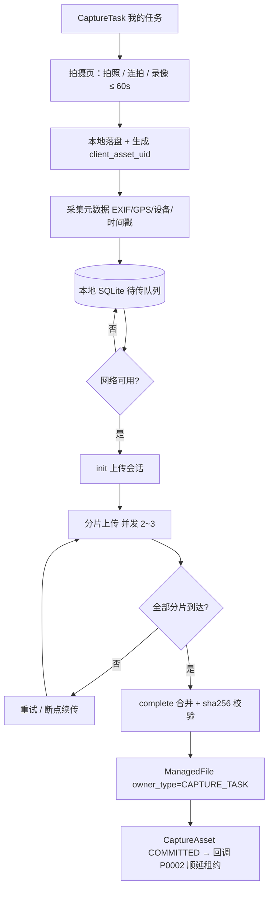
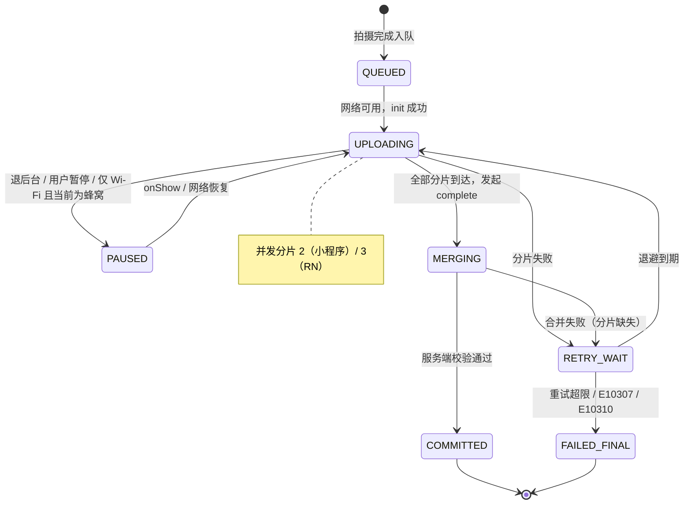
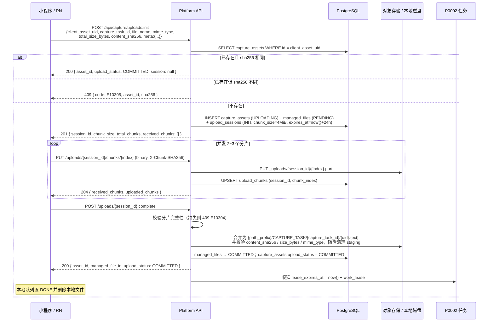
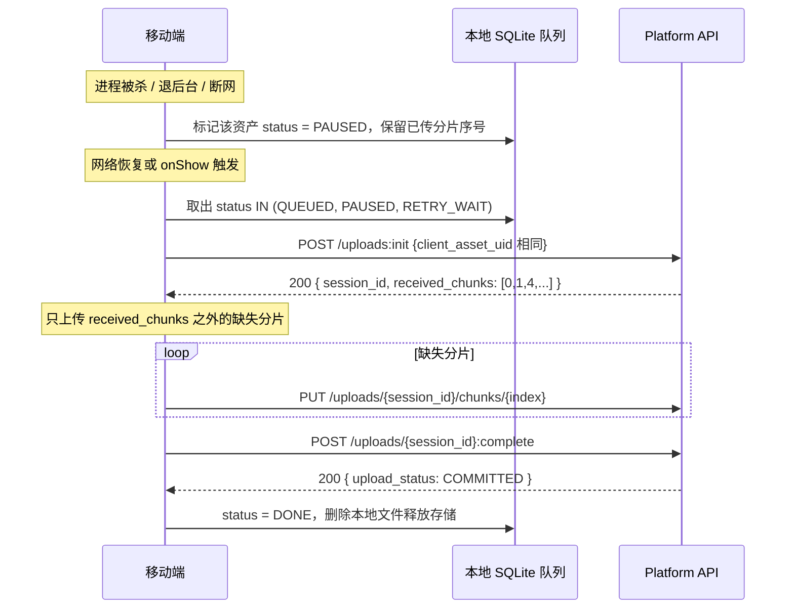
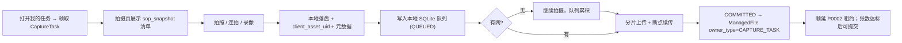
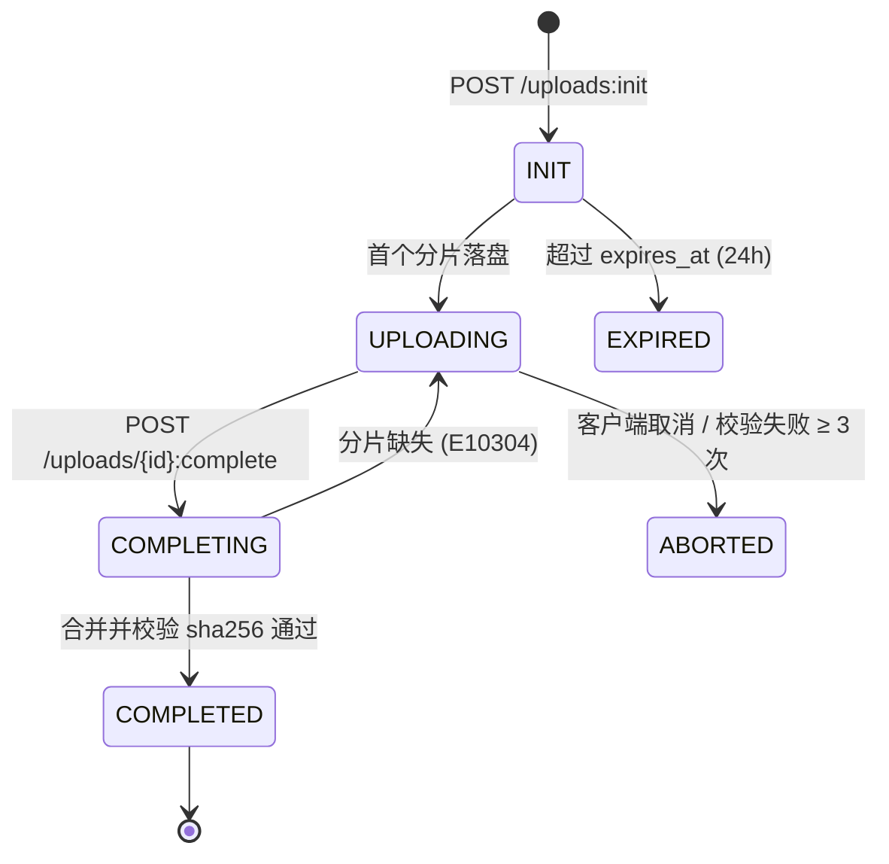

# PRD: P0003_移动端采集与上传 (Mobile Capture & Upload)

| 属性 | 内容 |
| :--- | :--- |
| **文档编号** | P0003 |
| **功能模块** | M01_移动端采集与上传 |
| **当前版本** | v1.0.0 |
| **文档状态** | Draft |
| **作者** | 轻眸识刻 Team |
| **最后更新** | 2026-10-01 |

---

## 1. 全局说明
> [!IMPORTANT]
> **核心定位**: 采集员在产线/仓库现场用手机按 `CaptureTask` 的 `sop_snapshot` 拍摄，把图片与视频连同 EXIF/GPS/设备/时间戳一起传回来。现场信号差是常态，因此**离线可用与断点续传是主路径，不是异常分支**。

### 名词解释
*   **CaptureAsset（采集资产）**: 一张照片或一段视频的元数据实体。`id` 由**设备端在拍摄瞬间生成**（UUIDv4），此后永不改变，是全平台血缘的根。
*   **`client_asset_uid`**: 即 `capture_assets.id`。生成后立即写入本地 SQLite，重传、改名、换设备登录都不变，是幂等键与血缘键。
*   **上传会话 (UploadSession)**: 分片上传的服务端状态机载体，绑定一个 `client_asset_uid` 与一份 `ManagedFile`。
*   **分片 (Chunk)**: 按 `chunk_size` 切出的上传单元，以 `(session_id, chunk_index)` 唯一约束保证重复上传天然幂等。
*   **断点续传 (Resume)**: 重新 `init` 时携带同一 `client_asset_uid`，服务端返回已收到的 `received_chunks[]`，客户端只补缺失分片。
*   **离线队列 (Offline Queue)**: 设备端 SQLite 待传队列，拍摄完成即入队、网络恢复后自动补传，进程被杀也不丢。**弱网降级**: RTT > 800ms 或连续 2 次请求失败时转入后台队列模式，不再阻塞拍摄界面。
*   **`ManagedFile`**: 平台统一文件模型；采集产物写入时 `owner_type = CAPTURE_TASK`、`owner_id = capture_task_id`，`status` 走 `PENDING → COMMITTED → DELETED`。

### 统一异常处理
| Code | 场景 | 处理策略 |
| :--- | :--- | :--- |
| `E10301` | 上传会话不存在或已过期 | 返回 410，客户端用同一 `client_asset_uid` 重新 `init` 续传 |
| `E10302` | 分片校验失败（sha256 / etag 不匹配） | 返回 400 并回传 `expected_sha256`，客户端重传该分片 |
| `E10303` | 分片序号越界或与已有分片冲突 | 返回 400，携带 `total_chunks` 与已收 `received_chunks[]` |
| `E10304` | 合并失败：分片缺失 | 返回 409 与 `missing_chunks[]`，客户端补齐后重试 `complete` |
| `E10305` | 幂等冲突：`client_asset_uid` 已存在但内容不同 | 返回 409 与既有 `asset_id` / `sha256`，提示"该资产已上传过不同内容" |
| `E10306` | 存储空间不足 | 返回 507，暂停该会话并触发磁盘告警；客户端转 `RETRY_WAIT` |
| `E10307` | 文件类型或大小不被允许 | 返回 415，客户端标记 `FAILED_FINAL` 并提示用户 |
| `E10308` | EXIF 缺失或时间戳异常 | 不阻断上传；以客户端本地时间兜底并标记 `time_source = CLIENT` |
| `E10309` | 设备令牌失效 / 未授权 | 返回 401，停止上传但保留队列，引导重新登录 |
| `E10310` | 任务状态不允许上传 | 返回 409（任务已 `SUBMITTED` / `CANCELLED` / 被回收），客户端转 `FAILED_FINAL` |
| `E10311` | 同一会话并发合并 | 返回 409，后到者轮询会话状态而非重复合并 |
| `E10312` | 本地待传队列已满 | 拒绝新拍摄并提示"待传队列已满 (2000)，请先上传" |

---

## 2. 项目背景
### 背景 (Context)
采集现场是产线旁、仓库货架前、便利店冷柜边：光线复杂、空间狭窄、信号时好时坏（地下仓库常年无信号）。一个采集员一天要拍 200~600 张，单张 3~8 MiB，偶尔还要录一段 10~60 秒的喷码视频。这些数据必须**带时间与位置信息**才能用于溯源与难例回流。

### 问题陈述 (Problem Statement)
1.  **无信号就必须停工**: 早期流程要求现场联网上传，进地下仓库就拍不了，作业被网络绑架。
2.  **大文件传不完**: 一段 60 秒 1080p 视频约 60~120 MiB，弱网下一次 PUT 必然超时，重传又从头开始。
3.  **元数据丢失**: 用微信/网盘转发的图片会被压缩并抹掉 EXIF，GPS 与拍摄时间全丢，无法判断"这张图是何时何地拍的"。
4.  **重复上传**: 采集员不确定是否传成功而重复提交，同一张图出现多份，污染数据集。
5.  **进程被杀丢数据**: 拍到一半切后台、被系统杀进程，队列里的照片直接消失。

### 目标与成功指标 (Goals & Success Metrics)
*   **北极星指标**: 拍摄成功的资产**最终送达率 ≥ 99.5%**（设备端 SQLite 中 `DONE` 资产 ÷ 累计拍摄资产）。
*   **次要指标**: 断点续传成功率 ≥ 99%；重复上传导致的重复 `CaptureAsset` = 0；完全离线场景可连续拍摄 ≥ 500 张；弱网（RTT 800ms、丢包 10%）下单张 5 MiB 图片平均送达 < 90 秒。

### 风险与规避 (Risks & Mitigation)
| 风险 | 影响 | 规避方案 |
| :--- | :--- | :--- |
| 小程序退到后台被冻结 | 上传中断 | 明确"小程序仅前台上传"，退后台即 `PAUSED`，`onShow` 自动续传（不承诺后台传输） |
| 设备存储被拍满 | 无法继续拍摄 | 队列上限 2000 条 / 2 GiB，达到阈值时强提示并只允许上传不允许新拍 |
| 弱网下重试风暴 | 服务端被打满 | 指数退避 + 抖动，单设备同时在飞的分片数硬上限（2~3） |
| 客户端伪造元数据 | 数据不可信 | `received_at` 由服务端生成；EXIF 缺失标记 `time_source = CLIENT` 而非静默接受 |
| 分片残留占满磁盘 | 存储耗尽 | 未完成会话 24h 过期，staging 分片 7 天后 GC |
| 同一资产被两人上传 | 归属混乱 | `capture_assets.id` 全局唯一 + `capture_task_id` 归属校验，冲突返回 `E10305` |

---

## 3. 价值模型
*   **方案**: 把"拍摄"与"上传"彻底解耦——拍摄只写本地 SQLite（永不因网络失败），上传是可中断、可续传的后台分片任务。元数据在拍摄瞬间冻结进本地队列，随资产一并上行。
*   **目标**: 采集员在无网的地下仓库可照常完成整天拍摄；回到有网环境后资产自动补齐；平台上每条 `CaptureAsset` 都能回答"谁、何时、何地、用什么设备拍的"。

---

## 4. 项目范围
### 功能结构图


### In Scope (包含范围)
1.  拍照、连拍（单次 ≤ 30 张）、录像（单段 ≤ 60s）与本地落盘。
2.  采集元数据：EXIF（`DateTimeOriginal`、方向、分辨率）、GPS、设备型号/OS/App 版本、拍摄时间戳。
3.  本地 SQLite 离线待传队列与自动补传。
4.  分片上传、并发控制、断点续传、弱网降级与指数退避重试。
5.  基于 `client_asset_uid` 的重复上传幂等（会话层 + 分片层）。
6.  服务端接收、校验、合并与 `ManagedFile` / `CaptureAsset` 归属登记。
7.  上传进度上报与任务租约顺延回调。

### Out of Scope (不包含范围)
*   **任务的拆解、领取与回收**（P0002）：本篇只消费任务详情并回调进度。
*   **产物的质量判定**（P0004）：本篇只保证送达与元数据完整，不判模糊/重复/无目标。
*   **端上推理**（07 部署推理）与 **服务端存储后端配置**（P0040，只消费 `StorageConfig`）。
*   **视频抽帧与 `DataSample` 落库**（02 数据导入 `ImportTask`，`job_type = FRAME_EXTRACT`）：本篇只保证视频资产与血缘根可用。

---

## 5. 业务流程
### 5.1 上传状态机（设备端资产级）


**服务端 `UploadSession.status`（与设备端队列状态相互独立）**

| 状态 | 进入条件 | 允许动作 |
| :--- | :--- | :--- |
| `INIT` | `POST /uploads:init` 创建 | `PUT chunk` |
| `UPLOADING` | 首个分片落盘 | `PUT chunk` / `complete` |
| `COMPLETING` | 收到 `complete`，合并中 | 仅轮询状态 |
| `COMPLETED` | 合并 + sha256 校验通过，`ManagedFile` 转 `COMMITTED` | 终态 |
| `EXPIRED` | 超过 `expires_at`（创建后 24 小时）未完成 | 同一 `client_asset_uid` 可重新 `init` 建新会话 |
| `ABORTED` | 客户端取消 / 校验失败 ≥ 3 次 | 终态，staging 分片进 GC |

### 5.2 全链路时序：移动端 → 服务端 → 存储


**断点续传路径**：进程被杀 / 退后台 / 断网时设备端置 `PAUSED`（保留本地已传分片记录）→ 网络恢复或 `onShow` 触发 → 以同一 `client_asset_uid` 重新 `init` → 服务端返回 `received_chunks[]` → 客户端与服务端取交集，只上传缺失分片 → `complete`。

### 5.3 断点续传与离线补传


**上传参数（服务端在 `init` 响应中下发，客户端不得自选）**

| 参数 | 默认值 | 说明 |
| :--- | :--- | :--- |
| `chunk_size` | 4 MiB | `total_size_bytes > 100 MiB` 时下发 8 MiB；合法范围 1–32 MiB |
| `max_parallel_chunks` | 3（RN）/ 2（小程序） | 单设备同时在飞的分片数上限 |
| `connect_timeout` / `chunk_timeout` / `control_timeout` | 10s / 30s / 15s | 建连 / 单片 PUT / `init`·`complete` 超时 |
| `merge_timeout` | 120s | 服务端合并上限（超时返回 202 供轮询） |
| `max_chunk_retry` | 5 | 单片重试上限 |
| `backoff_base` / `backoff_cap` | 1s / 32s | 退避 `1s→2s→4s→8s→16s`，上限 32s，抖动 ±20% |
| `session_ttl` / `staging_gc_days` | 24h / 7 天 | 会话过期 / staging 分片回收周期 |
| `asset_upload_deadline` | 6h | 单资产总上传时长上限，超过转 `FAILED_FINAL` |
| `local_queue_limit` | 2000 条 / 2 GiB | 本地待传队列上限，达到后 `E10312` |
| 单文件上限 | 图片 20 MiB / 视频 500 MiB | 超限 `E10307` |

---

## 6. 用户分析
### 6.1 用户画像 (User Personas)
| 角色 | 核心职责 | 核心诉求 | 核心痛点 |
| :--- | :--- | :--- | :--- |
| **ANNOTATOR / 采集员（小程序）** | 在产线/仓库按任务卡拍摄 | 打开就能拍，拍完不用管上传；无网也能干活 | 地下仓库没信号就停工；不知道传没传成功 |
| **TRAINER / B 端业务（RN App）** | 采集 + 现场核对，偶尔录视频 | 大文件也能传完；随时看到上传进度 | 录 1 分钟视频传 3 次都失败 |
| **负责人** | 通过 P0002 看板确认交付 | 上传进度可信、可追溯 | 采集员说"传了"但平台上看不到 |

### 6.2 用户链路图 (User Journey Map)


---

## 7. 功能需求
### M01.F01 拍照、连拍与录像 (Capture)
*   **用户故事**: 作为采集员，我希望按当前任务的 SOP 清单拍照、连拍或录像，以便在最短时间内把要求的部位拍全。
*   **逻辑与业务规则**
    *   **前置条件**: 任务 `status ∈ {CLAIMED, IN_PROGRESS}` 且属于当前用户（否则 `E10310`）。
    *   **主流程**: 拍摄页展示 `sop_snapshot` 的必拍部位清单与 `required_shots`，逐部位提示"还差 N 张"；每次拍摄落盘为 JPEG / H.264 MP4，立即生成 `client_asset_uid` 与 `local_seq` 并写入本地队列。
    *   **关键约束**: 拍摄动作**不依赖网络**，不发起任何同步请求。
    *   **后置条件**: 本地队列新增记录，`status = QUEUED`。

| 参数 | 小程序 | RN App |
| :--- | :--- | :--- |
| 单次连拍张数 | ≤ 9（`wx.chooseMedia` 上限） | ≤ 30 |
| 连拍最小间隔 | 300ms | 200ms |
| 视频单段时长 | ≤ 60s | ≤ 60s |
| 图片 / 视频格式 | JPEG / H.264 MP4（HEIC 归一化为 JPEG） | JPEG 或 HEIC / H.264 MP4 |

```gherkin
场景: 按必拍部位清单拍摄并计数
  Given 任务 required_shots = 6 且必拍部位 DATE_CLOSEUP 要求 3 张
  When 采集员拍摄 2 张日期特写
  Then 拍摄页显示 "日期特写 2/3"
  And 本地队列新增 2 条 status = QUEUED 的记录，每条含唯一 client_asset_uid

场景: 无网络下连续拍摄
  Given 设备处于飞行模式
  When 采集员连续拍摄 120 张
  Then 全部成功落盘并写入本地队列，不出现阻塞性错误提示

场景: 任务被超时回收后继续拍摄
  Given 任务在拍摄过程中被看门狗回收
  When 采集员上传该批资产
  Then 返回 E10310，该批资产转 FAILED_FINAL 并提示 "任务已被回收，请重新领取"
```

| 边界场景 | 处理 |
| :--- | :--- |
| 设备存储不足 | 可用空间 < 500 MiB 时告警；< 200 MiB 时拒绝拍摄 |
| 录制中途来电/切后台 | 自动停止并落盘已录制部分（不丢失） |
| 视频超出 60 秒 | 到达 60 秒时自动停止并提示 "单段视频最长 60 秒" |

### M01.F02 采集元数据 (Capture Metadata)
*   **用户故事**: 作为项目负责人，我希望每张图片都带上拍摄时间、位置与设备信息，以便判断数据来源并支持难例回流溯源。
*   **逻辑与业务规则**
    *   **前置条件**: 资产已落盘。
    *   **主流程**: 落盘后立即抽取 EXIF，读取 GPS 与设备信息，生成 `captured_at` / `time_source`，随 `init` 上行并在 `complete` 后写入 `capture_assets`。
    *   **时间基准**: 优先 `EXIF.DateTimeOriginal`（`time_source = EXIF`）；缺失则用设备本地时间（`time_source = CLIENT`）并记录 `clock_offset_ms`；`received_at` 始终由服务端生成。
    *   **位置**: `geo_source ∈ {GPS, NETWORK, NONE}`；`gps_accuracy_m > 50` 时 `low_accuracy = true`。
    *   **后置条件**: `capture_assets` 含完整元数据，`exif_json` 保留原始 EXIF 供审计（单条上限 32 KiB）。

```gherkin
场景: 正常采集含 EXIF 与 GPS 的资产
  Given 相机已开启定位权限且图片含 DateTimeOriginal
  When 资产上传完成
  Then time_source = EXIF 且 captured_at 等于 EXIF 时间
  And latitude / longitude / gps_accuracy_m / device_model / os_version / app_version 均被写入

场景: EXIF 被抹掉
  Given 图片不含 DateTimeOriginal
  When 资产上传完成
  Then 返回 200（不阻断），time_source = CLIENT 且写入 clock_offset_ms

场景: 未授权定位
  Given 用户拒绝定位权限
  When 资产上传完成
  Then geo_source = NONE 且经纬度为 NULL，不上报任何占位坐标（禁止写 0,0）
```

| 边界场景 | 处理 |
| :--- | :--- |
| HEIC 转 JPEG 后 EXIF 丢失 | 转换前先读取 EXIF 并显式透传，不依赖转换器 |
| 同一秒拍摄多张 | 以 `client_asset_uid` 区分，不使用时间戳做主键 |
| GPS 精度极差（> 500m） | 保留并置 `low_accuracy = true`，P0004 不以此判不合格 |

### M01.F03 本地离线队列 (Offline Queue)
*   **用户故事**: 作为采集员，我希望无网时也能照常拍摄、回到有网环境后自动补传，以便采集作业不被网络绑架。
*   **逻辑与业务规则**
    *   **前置条件**: App 首次启动即创建本地 SQLite 库（不依赖登录）；队列按 `user_id` 分区。
    *   **主流程**: 拍摄写入 `local_capture_assets`（`QUEUED`）；网络恢复、App 回前台或用户手动触发时开始补传；成功后置 `DONE` 并删除本地文件。
    *   **调度顺序**: 按 `capture_task_id` 聚合、`local_seq` 升序，优先补完已开始的任务。
    *   **容量保护**: 达到 2000 条或 2 GiB 时返回 `E10312`，暂停新拍摄。
    *   **后置条件**: `DONE` / `FAILED_FINAL` 条目保留 7 天供排查，随后清理。

```gherkin
场景: 断网拍摄后恢复补传
  Given 队列中有 120 条 QUEUED 资产
  When 网络恢复且 App 在前台
  Then 按 local_seq 升序自动上传
  And 每条完成后 status 变为 DONE 且本地文件被删除

场景: 队列达到上限
  Given 队列已有 2000 条待传资产
  When 采集员尝试继续拍摄
  Then 返回 E10312 并拒绝拍摄，提示 "待传队列已满，请联网上传后继续"

场景: 切后台暂停、回前台续传
  Given 小程序正在上传且用户切到微信聊天
  Then 上传暂停并保留已完成分片
  When 用户回到小程序
  Then 从断点继续，不重传已完成分片
```

| 边界场景 | 处理 |
| :--- | :--- |
| 本地 SQLite 损坏 | 启动时做完整性检查，损坏则重建索引并把可读文件转入"孤儿文件"目录待人工处理 |
| 用户卸载 App | 队列丢失属预期；提示"卸载将丢失未上传资产" |
| 令牌过期（401 / `E10309`） | 停止上传但保留队列，重新登录后自动恢复 |

### M01.F04 分片上传与断点续传 (Chunked Upload & Resume)
*   **用户故事**: 作为采集员，我希望大文件分片上传且中断后能续传，以便弱网下也能把视频传完。
*   **逻辑与业务规则**
    *   **前置条件**: 队列中存在 `QUEUED` / `PAUSED` / `RETRY_WAIT` 资产，且任务状态允许上传。
    *   **主流程**: `init`（带 `client_asset_uid` 与元数据，返回 `chunk_size` / `total_chunks` / `received_chunks[]`）→ 只上传缺失分片（并发 2~3，每片带 `X-Chunk-SHA256`）→ 全片到达后 `complete` → 服务端校验总大小与 `content_sha256`、合并、转 `COMMITTED` → 客户端置 `DONE`、删本地文件、回调 P0002 顺延租约。
    *   **失败语义**: 分片级失败按 `E10302` / `E10303` 重传单片；`complete` 缺片返回 `E10304` 与 `missing_chunks[]`；会话过期返回 `E10301` 并重新 `init`。
    *   **后置条件**: `ManagedFile.status = COMMITTED`，`CaptureAsset.upload_status = COMMITTED`。

```gherkin
场景: 分片上传完成
  Given 一个 12 MiB 的图片资产，下发 chunk_size = 4 MiB
  When 客户端上传 3 个分片并调用 complete
  Then upload_sessions.status = COMPLETED，managed_files.status = COMMITTED
  And storage_path 指向最终对象且 etag / size_bytes 与上传内容一致

场景: 断点续传只补缺失分片
  Given 上一次会话已收到分片 [0,1,4]
  When 客户端用同一 client_asset_uid 重新 init
  Then 返回 received_chunks = [0,1,4]
  And 客户端只上传 2、3、5 等缺失分片，不重传 0/1/4

场景: 合并时缺分片
  Given 客户端调用 complete 但分片 3 未到达
  Then 返回 409 E10304 与 missing_chunks = [3]
  And 客户端补传分片 3 后再次 complete

场景: 会话过期后继续
  Given 会话创建已超过 24 小时
  When 客户端调用 complete
  Then 返回 410 E10301，客户端用同一 client_asset_uid 重新 init 并续传
```

| 边界场景 | 处理 |
| :--- | :--- |
| 同一分片重复上传 | `(session_id, chunk_index)` 唯一约束 UPSERT，天然幂等，返回 204 |
| 同一会话并发 complete | 后到者返回 `E10311`，改为轮询会话状态 |
| 上传中本地文件被系统清理 | 客户端重新切分片；原始文件在 `COMMITTED` 前不删除 |
| 存储空间不足（`E10306`） | 会话暂停并告警；空间恢复后续传 |
| 合并超时（> 120s） | 返回 202，客户端每 5 秒轮询会话状态直到 `COMPLETED` |

### M01.F05 弱网降级与重试 (Weak-network Retry)
*   **用户故事**: 作为采集员，我希望网络差时 App 不卡死也不狂重试，以便我还能顺畅拍照。
*   **逻辑与业务规则**
    *   **前置条件**: 上传任务运行中。
    *   **主流程**: RTT > 800ms 或连续 2 次请求失败即判定弱网，取消阻塞式进度弹窗、转静默后台队列模式；单片失败按 `1s→2s→4s→8s→16s`（上限 32s，抖动 ±20%）退避，最多 5 次；整资产受 `asset_upload_deadline = 6h` 约束。
    *   **恢复**: 一次探测请求成功即取消剩余退避并恢复并发上传；网络状态判断去抖 3 秒。
    *   **后置条件**: 弱网下拍摄界面保持可用，上传在后台推进。

```gherkin
场景: 弱网判定与降级
  Given 连续 2 次分片上传请求超时
  Then 上传转入后台队列模式，拍摄页不再展示阻塞式进度弹窗
  And 使用指数退避继续重试

场景: 分片重试超限
  Given 某分片已重试 5 次仍失败
  Then 该资产转 RETRY_WAIT 并等待下一轮调度（非立即 FAILED_FINAL）
  And 若累计超过 6 小时 deadline 则转 FAILED_FINAL 并提示用户

场景: 网络恢复立即续传
  Given 上传处于 RETRY_WAIT 且退避尚未到期
  When 一次探测请求成功
  Then 立即取消剩余退避并恢复上传
```

| 边界场景 | 处理 |
| :--- | :--- |
| 重试风暴打满服务端 | 单设备并发分片上限硬约束；服务端返回 429 时退避时间翻倍 |
| 2G 网络上传大视频 | 允许但提示"当前网络较慢，建议连接 Wi-Fi"，并提供"仅 Wi-Fi 上传"开关 |
| 用户主动暂停 | `PAUSED` 不参与自动调度，直到用户点击继续 |
| 飞行模式来回切换 | 3 秒去抖判断网络状态，避免频繁启停上传 |

### M01.F06 重复上传幂等 (Idempotency)
*   **用户故事**: 作为采集员，我希望重复提交同一张图不会产生两份数据，以便我不用担心"到底传成功没有"。
*   **逻辑与业务规则**
    *   **前置条件**: 每次拍摄已生成并持久化 `client_asset_uid`。
    *   **主流程**: `init` 先按 `client_asset_uid` 查 `capture_assets`——命中且 `content_sha256` 相同则返回 200 与既有 `asset_id`（`session = null`）；命中但摘要/大小不同则返回 409 `E10305`；未命中则建会话。分片层幂等由唯一约束兜底。
    *   **元数据补齐**: 幂等命中时允许用更完整的元数据补齐空字段（如补 GPS），**不覆盖已有非空值**。
    *   **后置条件**: 同一 `client_asset_uid` 在 `capture_assets` 中永远只有一行。

```gherkin
场景: 重复 init 命中幂等
  Given 资产 A 已 COMMITTED
  When 客户端因未收到响应而再次 init 同一 client_asset_uid
  Then 返回 200 { asset_id: A, upload_status: COMMITTED, session: null }
  And capture_assets 中仍只有一行，客户端直接把本地队列置 DONE

场景: 同 uid 不同内容
  Given 资产 A 已 COMMITTED，sha256 = S1
  When 客户端以同一 client_asset_uid 但 sha256 = S2 发起 init
  Then 返回 409 E10305 并回传既有 asset_id 与 sha256，且不创建新会话

场景: 分片层重复上传
  Given 分片 2 已被服务端接收
  When 客户端重传分片 2
  Then UPSERT 覆盖同一 (session_id, chunk_index) 行并返回 204，不产生重复分片记录
```

| 边界场景 | 处理 |
| :--- | :--- |
| 设备重装后 uid 丢失 | 队列随卸载丢失；已上传资产不受影响（服务端已有记录） |
| 同一 uid 跨设备出现 | 视为异常，返回 `E10305` 并告警（uid 理论上全局唯一） |
| 本地文件被修改后重传 | sha256 变化即触发 `E10305`，防止"同名不同图"污染数据 |
| 部分分片重复上传 | 返回 204 与最新 `received_chunks`，不改变总进度统计 |

### M01.F07 服务端接收与归属 (Server-side Ingest & Ownership)
*   **用户故事**: 作为平台，我需要把上传完成的资产正确登记为 `ManagedFile` 并归属到采集任务，以便下游验收、统计与训练可追溯。
*   **逻辑与业务规则**
    *   **前置条件**: `complete` 校验通过。
    *   **主流程**: 覆盖写最终对象 `{path_prefix}/CAPTURE_TASK/{capture_task_id}/{client_asset_uid}.{ext}` → `managed_files` 由 `PENDING` 翻 `COMMITTED`（登记 `owner_type = CAPTURE_TASK`、`owner_id`、`etag`、`size_bytes`、`mime_type`、`storage_config_id`）→ 写 `capture_assets` 元数据并置 `COMMITTED` → 校验任务状态（否则 `E10310`）→ 回调 P0002 顺延租约。
    *   **血缘**: `capture_assets.id` 即血缘根。02 抽帧时把 `group_key = capture_assets.id`、`frame_index`、`timestamp`、`sampling_fps` 写入 `DataSample`（`DataSample.group_key` 是唯一真源，`DatasetVersionItem.group_key` 仅为创建版本时的快照副本，同一 `version_id` 内同组不得跨 `split`）；视频资产的 `duration_ms` / `expected_fps` 在本篇持久化，供抽帧推断 `sampling_fps`。
    *   **后置条件**: 资产可被 P0004 验收、被 P0005 统计、被下游按 `group_key` 建帧血缘。

```gherkin
场景: 资产正确登记为 ManagedFile
  Given 分片合并与 sha256 校验通过
  When 服务端完成入库
  Then managed_files 记录 owner_type = CAPTURE_TASK、owner_id = capture_task_id、status = COMMITTED
  And storage_path = {path_prefix}/CAPTURE_TASK/{capture_task_id}/{client_asset_uid}.jpg

场景: 任务状态已不允许上传
  Given 任务在上传过程中被标记为 CANCELLED
  When 服务端处理 complete
  Then 返回 409 E10310，不创建 ManagedFile，staging 分片保留 24h 后 GC

场景: 视频资产落库供抽帧使用
  Given 上传一段 45 秒、30fps 的视频
  When 入库完成
  Then asset_type = VIDEO，duration_ms = 45000，expected_fps = 30
  And 下游可按 group_key = capture_assets.id 建立帧血缘
```

| 边界场景 | 处理 |
| :--- | :--- |
| 合并成功但数据库写入失败 | 先落最终对象再写库；写库失败保留 staging 并进入重试队列，幂等重放 |
| 同一会话被两个 worker 处理 | 会话行加 `FOR UPDATE` 与状态机前置校验，后者返回 `E10311` |
| 磁盘写满 | 返回 `E10306`，不产生半个对象；已完整合并的对象不受影响 |
| 对象存储不可用 | 合并进 `RETRY_WAIT`，最多重试 5 次，仍失败则保留 staging 并告警 |
| 两个用户上传同 uid 不同任务 | 归属校验失败返回 `E10305`，不覆盖既有记录的 `capture_task_id` |

---

## 8. 技术架构与数据模型
> [!NOTE]
> 通用字段：所有表含 `id UUID PK`、`created_at`、`updated_at`、`deleted_at timestamptz NULL`（软删除）。状态字段一律 UPPER_SNAKE 枚举字符串。

### 8.1 数据实体
**`CaptureAsset` / `capture_assets`**

| 字段名 | 类型 | 必填 | 说明 | 约束 |
| :--- | :--- | :--- | :--- | :--- |
| `id` | UUID | Y | 主键 = 设备端生成的 `client_asset_uid` | PK，**永不变更**，血缘根 |
| `capture_task_id` / `project_id` | UUID | Y | 归属任务 / 项目 | FK → `capture_tasks.id` / `capture_projects.id` |
| `managed_file_id` | UUID | N | 对应文件 | FK → `managed_files.id`，`COMMITTED` 后非空 |
| `asset_type` / `capture_mode` | Enum | Y | 资产类型 / 拍摄方式 | `PHOTO`/`VIDEO`；`SINGLE`/`BURST`/`VIDEO` |
| `burst_group_id` / `burst_index` | UUID / Integer | N | 连拍组 / 组内序号 | `BURST` 时非空 |
| `sop_view_code` | String(32) | N | 对应必拍部位 | 取自 `sop_snapshot.required_views[].view_code` |
| `captured_at` / `time_source` / `clock_offset_ms` | timestamptz / Enum / Integer | Y / Y / N | 拍摄时间 / 来源 / 时钟差 | `EXIF` / `CLIENT`；`CLIENT` 时写 `clock_offset_ms` |
| `received_at` | timestamptz | Y | 服务端接收时间 | 服务端生成，客户端不可写 |
| `device_model` / `os_version` / `app_version` | String | N | 设备与版本信息 | - |
| `latitude` / `longitude` / `gps_accuracy_m` / `geo_source` / `low_accuracy` | Decimal / Decimal / Integer / Enum / Boolean | N | 位置与精度 / 来源 / 低精度标记 | `GPS`/`NETWORK`/`NONE`；精度 > 50m 置 true |
| `width` / `height` / `duration_ms` / `expected_fps` | Integer | N | 尺寸 / 时长 / 帧率 | 视频才有后两者 |
| `sha256` / `size_bytes` | String(64) / BigInt | Y | 内容摘要 / 大小 | 与服务端校验结果一致 |
| `exif_json` / `exif_truncated` | JSONB / Boolean | N | 原始 EXIF / 是否截断 | 单条上限 32 KiB |
| `upload_status` | Enum | Y | 上传状态 | `UPLOADING`/`MERGING`/`COMMITTED`/`FAILED`/`EXPIRED` |

**`UploadSession` / `upload_sessions`**

| 字段名 | 类型 | 必填 | 说明 | 约束 |
| :--- | :--- | :--- | :--- | :--- |
| `client_asset_uid` | UUID | Y | 幂等键 | FK → `capture_assets.id` |
| `owner_type` / `owner_id` | Enum / UUID | Y | 归属 | `CAPTURE_TASK` / `CLIENT_UPLOAD` |
| `storage_config_id` | UUID | Y | 目标存储 | FK → `storage_configs.id` |
| `file_name` / `mime_type` | String | Y | 文件名 / MIME | - |
| `total_size_bytes` / `content_sha256` | BigInt / String(64) | Y | 总大小 / 内容摘要 | - |
| `chunk_size` / `total_chunks` / `uploaded_chunks` | Integer | Y | 分片大小 / 总数 / 已收数 | `chunk_size` 1–32 MiB |
| `status` | Enum | Y | 会话状态 | `INIT`/`UPLOADING`/`COMPLETING`/`COMPLETED`/`EXPIRED`/`ABORTED` |
| `staging_path` / `expires_at` / `completed_at` | String / timestamptz | Y / Y / N | staging 路径 / 过期 / 完成时间 | `expires_at = created_at + 24h` |
| `created_by` | UUID | Y | 发起设备用户 | FK → `users.id` |

**`UploadChunk` / `upload_chunks`**

| 字段名 | 类型 | 必填 | 说明 | 约束 |
| :--- | :--- | :--- | :--- | :--- |
| `session_id` / `chunk_index` | UUID / Integer | Y | 会话 / 分片序号 | UNIQUE(`session_id`,`chunk_index`) → 重传幂等 |
| `offset_bytes` / `size_bytes` | BigInt / Integer | Y | 偏移 / 大小 | - |
| `sha256` / `etag` | String(64) | Y | 分片摘要 / 对象 etag | 校验失败返回 `E10302` |
| `status` / `received_at` | Enum / timestamptz | Y | 分片状态 / 接收时间 | `RECEIVED` / `VERIFIED` |

**设备端 SQLite（仅本地，不同步服务端）**

| 表 | 关键字段 | 说明 |
| :--- | :--- | :--- |
| `local_capture_assets` | `client_asset_uid PK`, `capture_task_id`, `local_seq`, `file_path`, `mime_type`, `size_bytes`, `sha256`, `status`, `session_id`, `retry_count`, `last_error_code` | `status ∈ QUEUED/UPLOADING/PAUSED/MERGING/RETRY_WAIT/DONE/FAILED_FINAL` |
| `local_upload_chunks` | `client_asset_uid`, `chunk_index`, `uploaded`, `etag`；PK(`client_asset_uid`,`chunk_index`) | 断点续传的本地事实来源，与服务端 `received_chunks` 取交集 |

### 8.2 服务端会话状态机

> [!IMPORTANT]
> 设备端队列状态与 `UploadSession.status` **各自独立演进**，二者通过 `received_chunks[]` 对齐：设备端状态含 UI 语义（`PAUSED` / `DONE`），服务端只关心数据完整性。唯一真源是服务端的分片记录表。

---

## 9. UI/UX 规格说明
### 9.1 拍摄页与上传队列
```text
┌────────────────────────────────────────────┐  ┌────────────────────────────────┐
│ ← SKU-0007 XX牌纯牛奶 250ml     剩余 2h41m │  │ 上传队列       待传 128 · 失败 1│
├────────────────────────────────────────────┤  ├────────────────────────────────┤
│ 必拍部位           要求 已拍  状态         │  │ ▸ IMG_2841.JPG  5.2MB  ↑ 68%   │
│ DATE_CLOSEUP 日期特写 3   2  ██░           │  │ ▸ IMG_2842.JPG  4.8MB  ↑ 12%   │
│ WHOLE_PACKAGE 整包    2   2  ███ ✓         │  │ ▸ VID_0003.MP4  62MB   ⏸ 暂停  │
│ SIDE_EDGE 侧面边缘    1   0  ░░░           │  │ ▸ IMG_2843.JPG  6.1MB  ⚠ 重试中 │
├────────────────────────────────────────────┤  ├────────────────────────────────┤
│          ┌────────────────────────┐        │  │ [全部继续] [仅 Wi-Fi 上传 ○●]  │
│          │      取景器预览        │        │  │ [重试失败项]                    │
│          └────────────────────────┘        │  └────────────────────────────────┘
│   [连拍 ●]      [拍照 ◉]      [录像 ▣]     │
│ ⓘ 无网络：已拍 42 张，联网后自动上传         │
└────────────────────────────────────────────┘
```

### 9.2 交互元素
| 元素 | 类型 | 状态 | 行为 |
| :--- | :--- | :--- | :--- |
| 拍照 / 连拍 / 录像 | Button | Default / Recording / Disabled（无权限或队列满） | 落盘并写入本地队列；不发起网络请求 |
| 必拍部位进度条 | Progress | Normal / Done（✓） / Over（超出要求张数） | 实时显示 `已拍/要求`，超出仅提示不阻止 |
| 上传队列项 | ListItem | QUEUED / UPLOADING / PAUSED / RETRY_WAIT / DONE / FAILED_FINAL | 点击展开分片明细与错误码，提供重试与取消 |
| 仅 Wi-Fi 上传 | Switch | On / Off | 开启后蜂窝网络下仅入队不传输 |
| 重试失败项 | Button | Default / Loading | 对 `FAILED_FINAL` 之外的失败项重置 `retry_count` 并入队 |
| 离线横幅 | Banner | Hidden / Visible | 无网络时常驻显示已拍张数与"联网后自动上传" |

---

## 10. 非功能性需求
*   **性能**: 拍摄到本地落盘 < 500ms（不含压缩）；弱网（RTT 800ms、丢包 10%）下 5 MiB 图片平均送达 < 90s；分片上传吞吐不低于可用带宽的 70%；2,000 条队列列表渲染 < 300ms（虚拟列表）。
*   **安全**: 上传接口需设备级 Bearer Token（`E10309`）；`capture_task_id` 归属校验防止越权写入他人任务；`received_at` 由服务端生成，客户端不可写；`exif_json` 中敏感字段（如设备序列号）可配置脱敏；传输全程 HTTPS。
*   **兼容性**: 微信小程序基础库 ≥ 2.30（`wx.chooseMedia` / `wx.getFileSystemManager`）；iOS ≥ 15、Android ≥ 9；RN App 支持后台任务（`BGTaskScheduler` / `WorkManager`），小程序明确不支持后台传输，退后台即 `PAUSED`。
*   **可扩展性**: `chunk_size` 与并发度由服务端下发，调整无需发版；`owner_type` 已支持 `CLIENT_UPLOAD`，02 模块 `ImportTask` 上传可复用同一套 `UploadSession` / `UploadChunk`；`CaptureAsset` 为通用资产模型，未来接入端侧推理产物或音频只需扩展 `asset_type`。

---

## 附录
### A. 已确认的设计决策
| # | 决策项 | 结论 | 理由 |
| :--- | :--- | :--- | :--- |
| 1 | 血缘根标识 | `capture_assets.id` 由**设备端拍摄瞬间生成**并持久化，重传/改名不变 | 抽帧 `group_key` 与难例回流溯源都依赖它稳定；服务端生成会因重传产生新 id |
| 2 | 拍摄与上传是否解耦 | 完全解耦：拍摄只写本地 SQLite，上传为独立后台任务 | 现场无网是常态，拍摄不能被网络阻塞 |
| 3 | 幂等键 | `client_asset_uid`（= `capture_assets.id`） | 一次生成、全生命周期不变；`init` 与分片两层幂等 |
| 4 | 分片大小 | 默认 4 MiB，> 100 MiB 时 8 MiB，由服务端下发 | 单一来源，避免客户端各写各的；4 MiB 弱网下重传成本可控 |
| 5 | 重试策略 | 单分片 5 次，`1s→16s` 指数退避 + ±20% 抖动，上限 32s；单资产总时长上限 6h | 够用且不会形成重试风暴 |
| 6 | 小程序后台传输 | 不承诺后台上传，退后台即 `PAUSED`，`onShow` 续传 | 小程序运行时限制如此，写进 PRD 避免误解 |
| 7 | EXIF 缺失 | 不阻断上传，`time_source = CLIENT` 并记 `clock_offset_ms` | 部分机型会丢 EXIF，阻断上传会让采集员白干 |
| 8 | 定位未授权 | 经纬度写 NULL，**禁止**写 `(0,0)` | 占位坐标会污染后续位置分析 |
| 9 | 分片残留清理 | 会话 24h 过期；staging 分片 7 天 GC | 平衡续传窗口与磁盘占用 |
| 10 | 两套上传状态的关系 | 设备端队列状态与服务端会话状态独立演进，通过 `received_chunks[]` 对齐 | 设备端含 UI 语义，服务端只关心数据完整性 |
| 11 | 文件归属 | `ManagedFile.owner_type = CAPTURE_TASK`、`owner_id = capture_task_id`；staging 落 `_uploads/{session_id}/` | 与平台统一文件模型及对象键规则一致 |
| 12 | E-code 格式 | `E` + 模块号 + P 编号后两位 + 流水两位；本篇 `E10301~E10312` | 全局统一格式，避免跨模块冲突 |

### B. 关联文档
| 文档 | 关系 |
| :--- | :--- |
| `P0002_采集任务派发` | 上游：提供 `CaptureTask` 详情与 `required_shots`；接收上传回调顺延租约 |
| `P0004_采集产物验收` | 下游：消费 `CaptureAsset` 做模糊/重复/无目标检测与人工验收 |
| `P0022_视频抽帧` | 下游：以 `group_key = capture_assets.id` 建立帧血缘，消费 `duration_ms` / `expected_fps` |
| `P0040_存储配置与桶绑定` | 提供 `StorageConfig`（本地磁盘 / S3 兼容对象存储） |
| `P0120` / `P0121_小程序与 RN 接入契约` | 复用本篇的上传协议与限额定义 |

### C. Changelog
| 版本 | 日期 | 作者 | 变更说明 |
| :--- | :--- | :--- | :--- |
| v1.0.0 | 2026-10-01 | 轻眸识刻 Team | 首版：拍摄、元数据、离线队列、分片上传与断点续传、幂等与服务端归属 |
