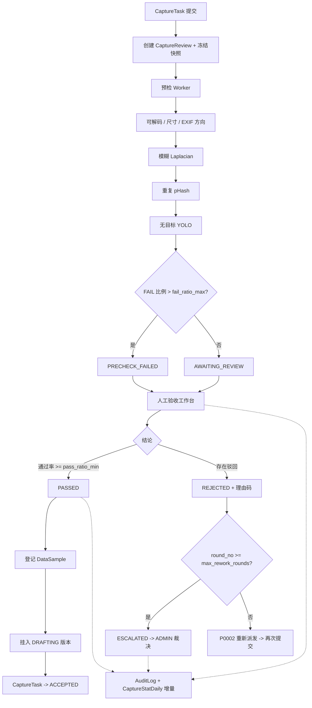
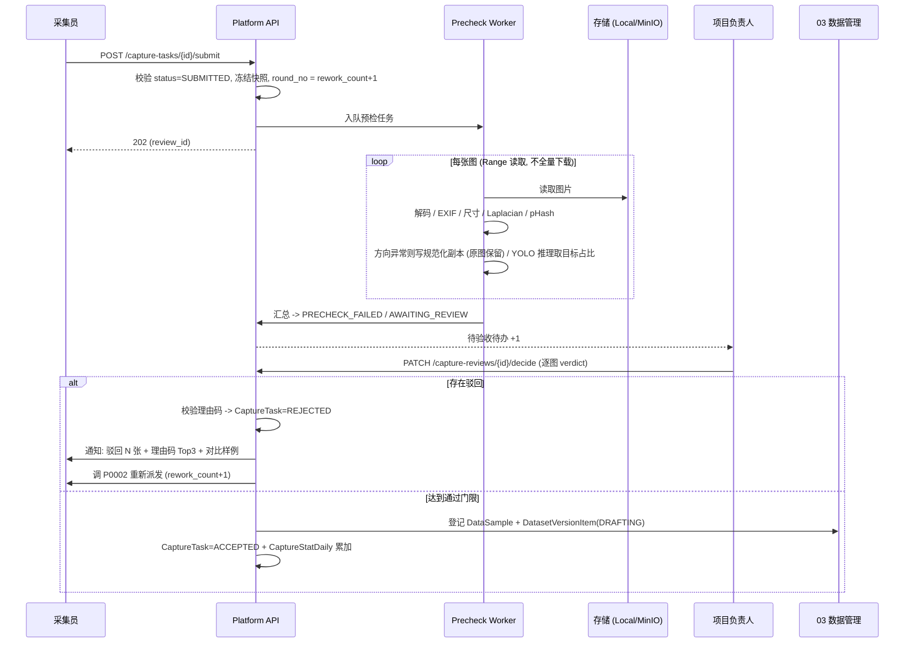
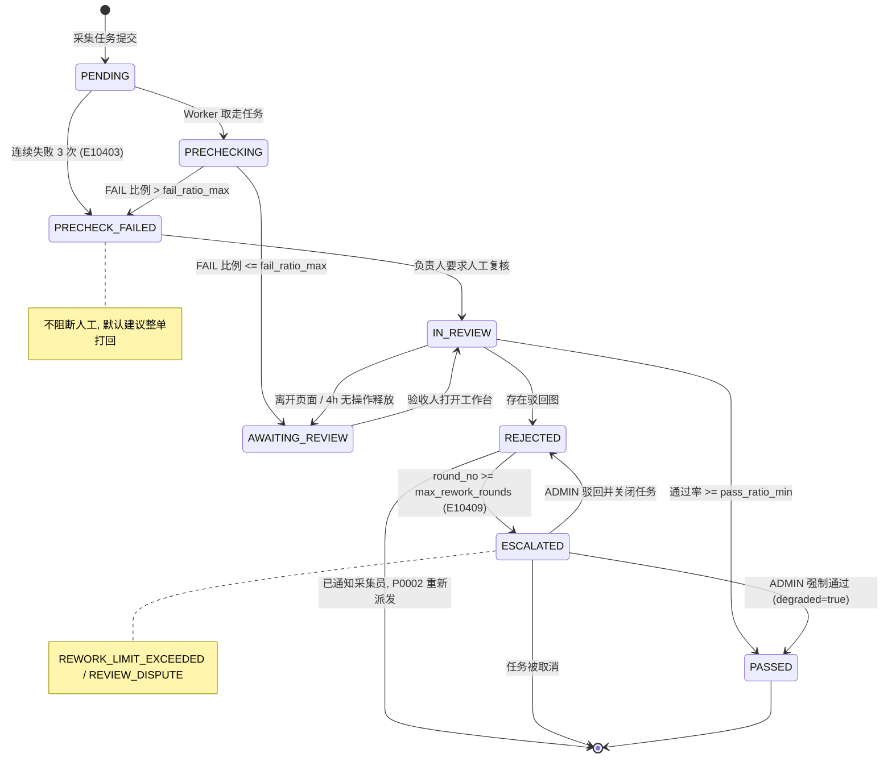
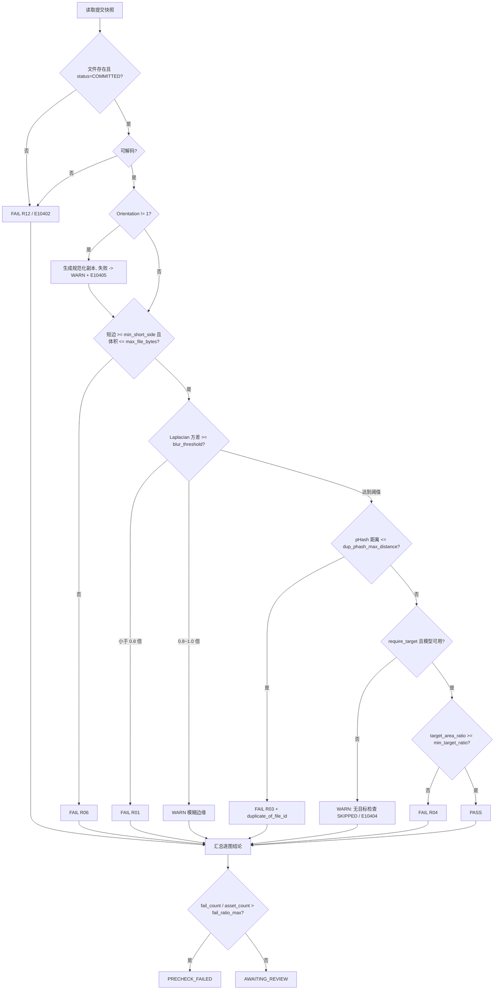
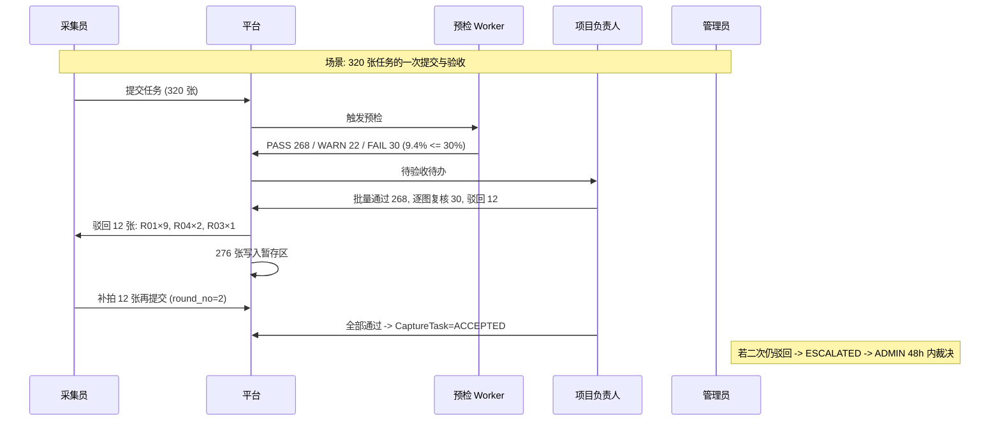

# PRD: P0004_采集产物验收 (Capture Acceptance)

| 属性 | 内容 |
| :--- | :--- |
| **文档编号** | P0004 |
| **项目名称** | 轻眸识刻 |
| **功能模块** | M01_采集产物验收 |
| **当前版本** | v1.0.0 |
| **文档状态** | Draft |
| **作者** | 轻眸识刻 Team |
| **最后更新** | 2026-10-01 |

## 1. 全局说明

> [!IMPORTANT]
> **核心定位**: 采集员提交后先过**自动预检**（可解码、尺寸、EXIF 方向、模糊、重复、无目标），再进**人工验收**。双环节都通过才写入**数据集暂存区**；不通过的按**理由码**打回重采，超限自动升级给 ADMIN 裁决。
> **边界**: 本模块不做清洗算子（P0023）、不做存储绑定（P0040）、不做标注质检（P0063）。验收结论落 `CaptureReview`；任务状态推进由本模块**触发**、由 P0002 **执行**。

### 1.1 名词解释

| 术语 | 含义 |
| :--- | :--- |
| **CaptureReview（验收单）** | 针对 `CaptureTask` **一次提交**建立的单据；打回后重新提交会新建下一轮，`round_no` 递增。与 04 的 `AnnotationReview` **不是同一实体**：后者审标注单图，本实体审采集素材 |
| **预检 (Precheck)** | 后端 Worker 逐图的自动质量判定，输出 `PASS / WARN / FAIL / SKIPPED` |
| **理由码 (Reason Code)** | 打回原因的结构化编码 `R01~R12`，回给采集员并用于统计归因 |
| **重采 / 升级 (Rework / Escalation)** | 被打回产物重新拍摄提交（上限 `PrecheckPolicy.max_rework_rounds`）；超限或结论争议时验收单转 `ESCALATED`，由 ADMIN 裁决 |
| **暂存区 / 基线模型** | 暂存区 = 目标 `Dataset` 的 `DRAFTING` 版本，通过图以 `DatasetVersionItem` 挂入等待清洗与冻结；基线模型 = 用于"无目标"检测的已发布 `ModelVersion`（YOLO 检测），不存在时该项降级 `SKIPPED` |
| **模糊度 / pHash** | Laplacian 方差（越低越模糊，无量纲）；64bit 感知哈希（汉明距离越小越相似） |
| **自动放行 (Auto-Pass)** | 预检 `PASS` 的图直接记 `PASS` 而不占人工工时；默认关闭 |

### 1.2 统一异常处理 (E-code)

| Code | 场景 | 处理策略 |
| :--- | :--- | :--- |
| `E10401` | 任务状态非 `SUBMITTED` 时提交验收 | 拒绝，提示 "当前状态不允许提交验收：{status}" |
| `E10402` | 产物损坏或不可解码 | 该图 `FAIL` + 理由码 `R12`，附 `precheck_metrics.decode_error` |
| `E10403` | 预检超时（单任务 > 15min）或连续失败 3 次 | 整单转 `PRECHECK_FAILED`，保留已完成部分的逐图结论 |
| `E10404` | 无可用基线模型 / 模型未 `PUBLISHED` | 无目标检查置 `SKIPPED`（**不阻断**），验收单与人工界面显式标注 |
| `E10405` | EXIF 规范化副本写入失败（存储只读 / 磁盘满） | 降级 `WARN`，`normalized_file_id = NULL`，转人工目视确认方向 |
| `E10406` | 越权验收（非项目负责人 / 非 ADMIN） | 403，提示 "仅项目负责人或管理员可验收" |
| `E10407` | 并发验收冲突（他人已在 `IN_REVIEW`） | 后到者进入只读态，提示当前验收人 `{name}` |
| `E10408` | 理由码缺失或非法 | 阻断打回，提示 "请为每张驳回图选择理由码" |
| `E10409` | 重采次数达上限 | 转 `ESCALATED`（`REWORK_LIMIT_EXCEEDED`）并通知 ADMIN |
| `E10410` | 升级后 48h 无人裁决 | 生成 `Alert(WARNING)` 并置顶 ADMIN 待办，**不自动放行** |
| `E10411` | 通过后写入暂存区失败 | 回滚至 `AWAITING_REVIEW`，保留 `error_code`，允许 `[重试入库]` |
| `E10412` | 样本登记冲突（同 `file_id` 已登记） | 幂等跳过，记 info 级 `duplicate_registration` |
| `E10413` | 审计写入失败 | 降级写本地日志，前端提示 "审计记录延迟" |
| `E10414` | 预检中间产物磁盘剩余 < 1GB | 暂停预检队列 + `Alert(CRITICAL)`，已入队任务保持 `PENDING` |

## 2. 项目背景

### 2.1 背景 (Context)
轻眸识刻 第一阶段为**食品包装生产日期区域检测**积累数据。2~3 人小团队（含兼职采集员）用手机 / RN App 现场拍摄，单任务动辄数百张。P0002 负责派发、P0003 负责上传，但**没有验收环节**时，糊图、重复图、无目标图会直接进数据集：标注工时被浪费，错误以数据形式固化进模型。

### 2.2 问题陈述 (Problem Statement)
1. **无客观标准**: "这张行不行"全靠负责人肉眼，300 张要 40 分钟。
2. **重复图污染**: 连拍相邻帧高度相似，进训练集造成 train/val 泄漏。
3. **EXIF 旋转坑**: 竖拍图 `Orientation=6`，标注器与训练侧方向不一致，框整体偏 90°。
4. **打回无据**: 采集员只收到"重拍"，同类错误反复出现。
5. **返工无终点**: 无限打回使任务永远"进行中"，项目进度不收敛。

### 2.3 目标与成功指标 (Goals & Success Metrics)
*   **北极星指标**: 入库交付合格率 `accepted / submitted` ≥ **85%**（首月目标，随 SOP 成熟提升）。
*   **次要指标**: 自动预检覆盖率 **100%**；模糊 / 重复 / 尺寸异常自动召回率 ≥ **90%**；单任务 300 张人工验收 < **10 分钟**；打回理由码填写率 **100%**。

### 2.4 风险与规避 (Risks & Mitigation)

| 风险 | 影响 | 规避 |
| :--- | :--- | :--- |
| 阈值过严误杀可用图 / 无基线模型 | 采集员白跑现场；无目标检查形同虚设 | 阈值进 `PrecheckPolicy` 可配，区分 `WARN` 与 `FAIL`；无模型时置 `SKIPPED` 并强制人工目视确认 |
| 人工验收变橡皮图章 / 规范化副本致存储翻倍 | 质量把关失效；磁盘吃紧 | 自动放行默认关闭，逐图记 `reviewed_by` / `reviewed_at` 可审计；副本仅对 `Orientation != 1` 的图生成（实测 < 30%），体积进统计 |
| 打回风暴引发抵触 | 兼职流失 | 上限 2 轮 + 打回时给对比样例图 + 理由码聚合提示 |

## 3. 价值模型

*   **方案**: "机器先过一遍，人只做决策"。Worker 逐图产出可解释度量（Laplacian 方差、pHash、目标面积占比、尺寸、EXIF 方向），按阈值给 `PASS/WARN/FAIL`；人在聚合工作台批量放行、逐图驳回，驳回必挂理由码；通过即入暂存区，驳回即带理由码回到采集员待办。
*   **目标**: ①把不可用图挡在数据集之外；②把验收从一次性事件变成**过程数据**（合格率、理由码分布）以反哺 SOP；③让打回有明确终点，项目进度可收敛。

## 4. 项目范围

### 4.1 功能结构图



### 4.2 In Scope (包含范围)
1. 提交触发与提交清单**快照冻结**（`file_id + sha256`，防提交后换文件）；自动预检六项（可解码性、EXIF 方向、尺寸 / 体积、模糊、重复、无目标）。
2. 门禁判定：按 `FAIL` 比例决定"直接打回"或"进人工"；人工验收工作台提供分组视图、批量通过、逐图驳回、WARN 高亮、重复组与重采对比。
5. 打回理由码（12 类，必填）、采集员待办通知、重采轮次管控与升级裁决（含规则临时放宽）。
7. 验收记录、逐图结论与 `AuditLog` 追溯；通过后登记 `DataSample` 并挂入 `DRAFTING` 版本。

### 4.3 Out of Scope (不包含范围)
*   **清洗与增强**（去重合并、裁剪、缩放）→ P0023；**类别映射** → P0024；**标注与质检** → P0060 / P0063。
*   **存储绑定与对象键策略** → P0040；本模块只消费已 `COMMITTED` 的 `ManagedFile`。
*   **版本冻结 / Tag / 版本对比** → P0041；本模块只写 `DRAFTING` 版本。
*   **模型驱动的拍摄质量打分**：只用模型判断"有无目标"，不评构图与美观。
*   **实时视频验收**：视频在 P0003 侧抽帧后逐帧走同一流程。

## 5. 业务流程

### 5.1 端到端验收流程



### 5.2 验收状态机 (CaptureReview)



**与 `CaptureTask.status` 映射**（取值 `PENDING/CLAIMED/IN_PROGRESS/SUBMITTED/ACCEPTED/REJECTED/CANCELLED`）：

| CaptureReview.status | CaptureTask.status | 说明 |
| :--- | :--- | :--- |
| `PENDING` / `PRECHECKING` / `PRECHECK_FAILED` / `AWAITING_REVIEW` / `IN_REVIEW` | `SUBMITTED` | 验收中，任务锁定，不可增删产物 |
| `PASSED` | `ACCEPTED` | 本模块触发 |
| `REJECTED` | `REJECTED` | 本模块触发；重新派发由 P0002 执行 |
| `ESCALATED` | `SUBMITTED` + `escalated=true` | 阻塞态，等待 ADMIN |

> `capture_tasks.rework_count` 由 P0002 维护（打回时 +1），本模块只读；恒有 `round_no = rework_count + 1`。

### 5.3 自动预检判定链



**重复比对范围**: 同一 `CaptureProject` 最近 30 天的 pHash 集合（含历史已入库图），内存常驻（10 万条 × 64bit ≈ 800KB）。一组只保留**最早提交者**；若保留者被人工驳回，**次早者自动提升**，避免整组作废。不跨项目比对（不同 SKU 可能复用同款包装）。

### 5.4 打回与升级
人工驳回 → 校验理由码（缺失 `E10408` 阻断）→ `CaptureReview=REJECTED`、`CaptureTask=REJECTED`。随后：`round_no >= max_rework_rounds` 则 `ESCALATED`（`E10409`，`Alert(WARNING)`，停止自动派发）；否则由 P0002 重新派发并 `rework_count+1`，采集员待办展示"驳回图 + 理由码 + 同类合格参考图 + SOP 段落"。ADMIN 在 48h 内三选一裁决：**强制通过**（`PASSED` + `degraded=true`，入库但计入降级指标）/ **驳回并关闭**（`REJECTED` + `CaptureTask=CANCELLED`）/ **放宽规则重采**（`rule_override` 的 1~2 个阈值临时生效并重新派发，**不写回规则表**）。超时 `E10410` 置顶待办。

## 6. 用户分析

### 6.1 用户画像 (User Personas)

| 角色 | 职责 | 核心诉求 | 痛点 |
| :--- | :--- | :--- | :--- |
| **采集员**（兼职拍摄） | 按 SOP 拍摄提交 | 告诉我哪张不行、为什么，别整批重拍 | 打回原因模糊，重拍后仍不知道标准 |
| **项目负责人**（TRAINER，`CaptureProject.owner_id`） | 定 SOP 与验收规则，把关入库 | 300 张 10 分钟看完 | 逐张肉眼；重复图肉眼难辨；EXIF 问题到标注阶段才暴露 |
| **管理员**（ADMIN） | 处理超限升级、磁盘与告警 | 重采 3 轮还不过的任务必须有人拍板 | 长尾任务挂着无人认领 |
| **下游消费者**（标注员 / 训练侧，间接） | 消费入库数据 | 图方向正确、无重复、无糊图 | 数据问题在训练指标上才暴露 |

### 6.2 用户链路图 (User Journey Map)



## 7. 功能需求

### M01.F01 提交触发与快照冻结 (Submit Trigger)
*   **用户故事**: 作为采集员，我提交任务后希望验收立即开始，以便尽快知道结果。
*   **逻辑与业务规则**:
    *   **前置条件**: `CaptureTask.status = SUBMITTED`；至少 1 个 `CaptureAsset` 且其 `ManagedFile.status = COMMITTED`。
    *   **主流程**: ①校验状态与产物非空（否则 `E10401`）→ ②冻结 `submit_snapshot`（`[{asset_id, file_id, sha256, size_bytes}]`，创建后不可变）→ ③`round_no = rework_count + 1` → ④建 `CaptureReview(status=PENDING)` 并入队预检 → ⑤返回 `202 + review_id`。
    *   **后置条件**: 任务锁定（`SUBMITTED` 期间不可增删产物），采集员侧显示"验收中"。
    *   **幂等**: `UNIQUE(capture_task_id, round_no)`；重复提交返回既有 `review_id`。
*   **验收标准**:
    ```gherkin
    场景: 提交触发验收
      Given 采集任务 task-0007 状态为 SUBMITTED 且有 320 个 COMMITTED 产物
      When 采集员点击 [提交验收]
      Then 创建 CaptureReview (round_no=1, status=PENDING)
      And 返回 review_id 且预检任务进入队列

    场景: 重复提交幂等
      Given 任务 task-0007 已存在 round_no=1 的验收单
      When 采集员重复点击 [提交验收]
      Then 返回同一 review_id 且不新建验收单
    ```
*   **边界情况与异常处理**:

    | 场景 | 处理 |
    | :--- | :--- |
    | 任务无产物 | 拒绝，提示 "该任务没有可验收的产物" |
    | 仍存在 `PENDING` 的 `ManagedFile` | 拒绝 `E10401`，提示 "仍有 N 个文件上传未完成" |
    | 并发重复提交 | 唯一约束兜底，后到者返回既有单 |
    | 提交后文件被外部删除 | 预检发现缺失 → 该图 `FAIL/R12 + E10402` |

### M01.F02 自动预检：基础与图像质量 (Automated Precheck)
*   **用户故事**: 作为项目负责人，我希望坏图、被旋转的图、糊图与重复图在入库前被处理或挡下，以便标注框不错位、训练集不泄漏。
*   **逻辑与业务规则**:
    *   **预检开关**: `auto_precheck_enabled=false` → 整单跳过预检直接进 `AWAITING_REVIEW`；`precheck_flags` 逐项为 false 时对应检查置 `SKIPPED`。
    *   **可解码性**: 解码失败 → `FAIL/R12 + E10402`，`precheck_metrics.decode_ok = false`。
    *   **尺寸 / 体积**: `min(w,h) >= min_short_side`（默认 720）且 `size_bytes <= max_file_bytes`（默认 20MB），否则 `FAIL/R06`。
    *   **EXIF 方向**: `Orientation=1` 直接过；`∈ {3,6,8}` 生成**规范化副本**（按方向旋转像素 + 清空 Orientation，写为新 `ManagedFile(owner_type=CAPTURE_TASK, status=COMMITTED)`，对象键 `{path_prefix}/CAPTURE_TASK/{task_id}/normalized/{uuid}.jpg`），**原图保留不删**；`∈ {2,4,5,7}`（镜像类）→ `WARN/R07` 转人工。**不原地改写**已 `COMMITTED` 文件，以保护 `etag` 与上传幂等；入库优先采用 `normalized_file_id`。
    *   **模糊度**: 长边缩放至 1024px → 灰度化 → `cv2.Laplacian(img, CV_64F).var()`（缩放保证跨机型可比）。`>= blur_threshold`（默认 100.0）→ `PASS`；`[blur*0.8, blur)` → `WARN`；`< blur*0.8` → `FAIL/R01`。
    *   **重复图**: 32×32 灰度 → DCT → 取左上 8×8 → 与中位数比较生成 64bit pHash；与同项目近 30 天集合比对的汉明距离 `d <= dup_phash_max_distance`（默认 6）→ `FAIL/R03`，`d ∈ (6,10]` → `WARN`；`duplicate_of_file_id` 指向保留者，`precheck_metrics.dup_distance` 记录距离。
    *   **门禁汇总**: `fail_count / asset_count > fail_ratio_max`（默认 0.30）→ `PRECHECK_FAILED`，否则 `AWAITING_REVIEW`。
*   **验收标准**:
    ```gherkin
    场景: 竖拍模糊图被规范化并挡下
      Given 某图 EXIF Orientation=6, 分辨率 3024x4032, laplacian_var=42.7
      And 项目 blur_threshold=100.0
      When 执行预检
      Then 生成规范化副本 (4032x3024) 且原图不变
      And 该图 precheck_result=FAIL, reason_code=R01, normalized_file_id 指向副本

    场景: 连拍重复图被识别且保留先入者
      Given 项目内已存在图 A 的 pHash 且新图 B 与 A 距离为 3
      When 执行预检
      Then 图 B precheck_result=FAIL, reason_code=R03, duplicate_of_file_id = A

    场景: 尺寸不足被挡下
      Given 某图分辨率 640x480, min_short_side=720
      When 执行预检
      Then precheck_result=FAIL 且 reason_code=R06
    ```
*   **边界情况与异常处理**:

    | 场景 | 处理 |
    | :--- | :--- |
    | PNG / 无 EXIF | 视为 `Orientation = 1`，进入后续检查 |
    | S3 只读凭证致副本写入失败 | 降级 `WARN`（`E10405`），`normalized_file_id = NULL` |
    | 磁盘剩余 < 1GB | `E10414` 暂停预检队列 + `Alert(CRITICAL)`，已入队任务保持 `PENDING` |
    | pHash 集合 > 200 万条 | 降级为按 `CaptureBatch` 分片比对，记录 `compare_scope` |
    | 纯色 / 空白图 pHash 恒等 | 判 `R04`（无目标）优先于 `R03` |
    | 副本体积 > 原图 2 倍 | 记 `normalized_size_warn`，在统计中暴露 |

### M01.F03 无目标检测 (Target Presence Check)
*   **用户故事**: 作为项目负责人，我希望没拍到日期区域的图被标出，以便采集员知道要靠近拍。
*   **逻辑与业务规则**:
    *   **前置条件**: `require_target = true` 且存在 `status=PUBLISHED` 的基线 `ModelVersion`，其标签覆盖项目目标类别。
    *   推理: `conf_threshold`（默认 0.25），`target_area_ratio = Σ(box_area) / (w × h)`；`>= min_target_ratio`（默认 0.02）→ `PASS`，`> 0` 但不足 → `WARN`，`= 0` → `FAIL/R04`。
    *   推理结果**不落 `PreAnnotation`、不产生标注**，仅取面积占比用于判定。
    *   无模型时整项 `SKIPPED + E10404`，验收单与人工界面强制提示"无目标检查不可用"，人工阶段须逐图目视确认。
*   **验收标准**:
    ```gherkin
    场景: 未拍到目标
      Given require_target=true 且基线模型可用, 某图推理结果为空
      When 执行预检
      Then precheck_result=FAIL, reason_code=R04

    场景: 无基线模型时降级
      Given 平台不存在 PUBLISHED 的基线模型
      When 执行预检
      Then 该项 precheck_result=SKIPPED
      And 验收单标记 "无目标检查不可用 (E10404)" 且人工界面提示逐图确认
    ```

### M01.F04 人工验收工作台 (Manual Review Workbench)
*   **用户故事**: 作为项目负责人，我希望在一屏内过完一批图并做决策，以便验收不成为瓶颈。
*   **逻辑与业务规则**:
    *   **权限**: `CaptureProject.owner_id` 本人或 `ADMIN` 可判定，`VIEWER` 只读；`IN_REVIEW` 锁 4h，他人进入只读（`E10406` / `E10407`）。
    *   **视图**: 网格默认 6 列，按 `FAIL → WARN → PASS` 分组排序；`PASS` 组默认折叠且支持整组通过；重复图按 `duplicate_of_file_id` 成组展示；分页 200/页，批量语义为"当前页选中"，禁止无界全选。
    *   **操作**: 单图 `通过 / 驳回(选理由码)`；批量 `全部通过 / 批量驳回`；快捷键 `1=通过 2=驳回 J/K=翻页 Esc=清选`。
    *   **自动放行**: `auto_pass_enabled=true` 时 `PASS` 组自动记 `human_verdict=PASS, auto_passed=true, reviewed_by=null`，但比例不得超过 `auto_pass_max_ratio`（默认 0.9），超出部分强制人工。
    *   **通过门限**: 通过图数 `>= asset_count × pass_ratio_min`（默认 0.5）方可 `PASSED`，否则整单 `REJECTED`（不做"半批入库"，避免任务状态反复）。
    *   **后置**: 写 `CaptureReviewItem.human_verdict` 与 `CaptureReview.status`，触发 F05 或 F07 链路。
*   **验收标准**:
    ```gherkin
    场景: 批量通过 + 逐图驳回
      Given 验收单 review-0031 有 320 张图, FAIL 30 张
      When 验收人整组通过 PASS 组, 并对 FAIL 组驳回 12 张 (R01/R04/R03)
      Then CaptureReview.status=REJECTED 且 CaptureTask.status=REJECTED
      And 12 张 human_verdict=REJECT 且 reason_code 非空

    场景: 通过门限不满足
      Given 320 张中仅 140 张通过 (43.75% < 50%)
      When 提交判定
      Then CaptureReview.status=REJECTED 且提示 "通过率不足 50%, 整单打回"

    场景: 并发验收互斥
      Given 验收人 A 已使 review-0031 处于 IN_REVIEW
      When 验收人 B 打开同一验收单
      Then B 只读并提示 "当前验收人: A (E10407)"
    ```
*   **边界情况与异常处理**:

    | 场景 | 处理 |
    | :--- | :--- |
    | 验收人离开未提交 | 4h 释放 `IN_REVIEW` 锁；判定草稿保留 24h |
    | 提交时单据被并发修改 | 乐观锁版本冲突 → 409，重载并保留草稿 |
    | 图片加载失败 | 占位图 + 重试按钮，不阻塞其他图判定 |
    | 判定中途入库失败 | `E10411` 回滚至 `AWAITING_REVIEW`，判定草稿保留 |

### M01.F05 打回理由码与重采升级 (Rejection & Rework Escalation)
*   **用户故事**: 作为采集员，我希望被打回时看到明确原因与示例；作为管理员，我希望反复不合格的任务升级到我这里。
*   **逻辑与业务规则**:
    *   驳回必须挂理由码（缺失 `E10408` 阻断）；`R12` 需补充说明 ≥ 10 字。
    *   理由码：`R01` 模糊/失焦（自动）、`R02` 曝光异常、`R03` 重复/近似重复（自动）、`R04` 无目标或占比过低（自动/人工）、`R05` 目标被遮挡/截断、`R06` 尺寸/体积不合格（自动）、`R07` EXIF 方向异常未纠正（自动）、`R08` 角度不符 SOP、`R09` 背景/光照不符 SOP、`R10` 元数据缺失（SKU/批次/拍摄时间）、`R11` 混入非目标 SKU、`R12` 其他（必填说明）。
    *   **通知**: 任务名、驳回张数、理由码 Top3 及张数、驳回图与同类合格图对比、SOP 段落链接。
    *   **重采上限**: `PrecheckPolicy.max_rework_rounds` 默认 **2**（可配 1~3）。`round_no >= max_rework_rounds` 且本轮仍驳回 → `ESCALATED + E10409 + Alert(WARNING, CAPTURE_ESCALATION)`，停止自动派发；裁决规则见 5.4。
    *   全过程写 `AuditLog`，动作码用 `RESOURCE.VERB` 格式（SysW 契约）：`CAPTURE_REVIEW.REJECT` / `CAPTURE_REVIEW.ESCALATE` / `CAPTURE_REVIEW.RESOLVE_ESCALATION` / `CAPTURE_REVIEW.OVERRIDE_RULE` / `CAPTURE_REVIEW.CREATE` / `CAPTURE_REVIEW.PASS`。
*   **验收标准**:
    ```gherkin
    场景: 未选理由码无法打回
      Given 验收人对某图点击 [驳回]
      When 未选理由码直接提交
      Then 提交被阻断并提示 "请为每张驳回图选择理由码 (E10408)"

    场景: 超出重采上限自动升级
      Given max_rework_rounds=2, 验收单 round_no=2 且本轮驳回 3 张
      When 提交打回
      Then CaptureReview.status=ESCALATED, escalate_reason=REWORK_LIMIT_EXCEEDED
      And 生成 WARNING 级 Alert 且不再自动派发

    场景: 管理员强制通过
      Given 验收单 review-0044 处于 ESCALATED
      When ADMIN 选择 [强制通过]
      Then CaptureReview.status=PASSED 且 degraded=true
      And 通过图正常写入暂存区, AuditLog 记录裁决人与时间
    ```

### M01.F06 验收记录与审计 (Review Records & Audit)
*   **用户故事**: 作为管理员，我希望每条验收结论都能追溯人、时间与依据，以便质量事故可定位。
*   **逻辑与业务规则**:
    *   每次提交产生独立验收单，历史轮次**不覆盖**；列表支持按项目 / 任务 / 采集员 / 状态 / 时间筛选。
    *   逐图 `precheck_result` 与 `human_verdict` **分离存储**；人工推翻预检时置 `override = true` 并记 `reviewed_by` / `reviewed_at`。
    *   审计事件写 `AuditLog`；写入失败降级本地日志（`E10413`），不影响主流程。
    *   保留期：验收单与逐图记录 **2 年**；`submit_snapshot.sha256` **永久保留**（用于检测提交后文件被替换）。
    *   规则变更**不回算**历史验收单；`precheck_engine_version` 落库以支持口径追溯。
*   **验收标准**:
    ```gherkin
    场景: 人工推翻预检结论
      Given 某图 precheck_result=WARN
      When 验收人判其 REJECT (R02)
      Then human_verdict=REJECT 且 override=true
      And 记录 human_reviewer_id 与 reviewed_at

    场景: 裁决可追溯
      Given 验收单 review-0044 被 ADMIN 强制通过
      When 查询 AuditLog (target_type=CaptureReview, target_id=review-0044)
      Then 返回 CAPTURE_REVIEW.RESOLVE_ESCALATION 事件, 含 operator_id / decided_at / decision=FORCE_PASS
    ```

### M01.F07 通过后写入数据集暂存区 (Commit to Dataset Staging)
*   **用户故事**: 作为项目负责人，我希望通过的图直接进目标数据集暂存区，以便后续清洗标注无需二次搬运。
*   **逻辑与业务规则**:
    *   **前置条件**: `CaptureReview.status = PASSED` 且项目绑定的目标数据集（`capture_projects.target_dataset_id`，请求 P0001 扩展）非空。
    *   **主流程**: ①取 `human_verdict=PASS` 的 item → ②选入库文件（优先 `normalized_file_id`，否则 `file_id`），校验 `ManagedFile.status=COMMITTED && deleted_at IS NULL` → ③经 03 数据管理接口登记 `DataSample`（`source_type=CAPTURE`、`capture_task_id = capture_task.id`）→ ④挂 `DatasetVersionItem(version_id = 目标数据集 DRAFTING 版本, split = UNASSIGNED)`（切分由后续 Split 阶段决定，验收不参与）→ ⑤`CaptureTask.status=ACCEPTED` 并触发 `CaptureStatDaily` 增量累加。
    *   **幂等**: 以 `(capture_task_id, file_id)` 为幂等键，重复登记返回既有 `sample_id`（`E10412`）。
    *   **失败**: 任一步失败 → `E10411`，整体回滚 `CaptureReview.status → AWAITING_REVIEW` 并落 `error_code`，页面提供 `[重试入库]`。
    *   **未指定目标数据集**: 仅保持文件 `COMMITTED`，页面提示 "通过 N 张，未指定目标数据集，暂未入库"。
*   **验收标准**:
    ```gherkin
    场景: 通过图写入暂存区
      Given 验收单 review-0031 判定 PASSED 且 288 张通过
      And CaptureProject.target_dataset_id 指向数据集 ds-date-region
      When 执行入库
      Then 创建 288 条 DataSample (source_type=CAPTURE, capture_task_id=task-0007)
      And 挂入 ds-date-region 的 DRAFTING 版本 (split=UNASSIGNED)
      And CaptureTask.status=ACCEPTED 且 CaptureStatDaily 当日 accepted_assets += 288

    场景: 入库失败可重试且幂等
      Given 存储连接不可用
      When 执行入库
      Then CaptureReview.status 回到 AWAITING_REVIEW 且 error_code=E10411
      When 存储恢复后再次触发入库 (288 条已部分写入)
      Then 不产生重复 DataSample, 幂等返回既有 sample_id
    ```

## 8. 技术架构与数据模型

### 8.1 数据实体

#### Table: `capture_reviews`

| 字段名 | 类型 | 必填 | 说明 | 约束 |
| :--- | :--- | :--- | :--- | :--- |
| `id` | UUID | Y | 主键 | PK |
| `capture_task_id` | UUID | Y | 所属采集任务 | FK → `capture_tasks.id`；UNIQUE(`capture_task_id`, `round_no`) |
| `capture_project_id` | UUID | Y | 冗余项目 ID | FK → `capture_projects.id`，加速按项目查询 |
| `round_no` | Int | Y | 验收轮次 | ≥ 1，= `rework_count + 1` |
| `submit_snapshot` | JSONB | Y | 提交清单快照 | `[{asset_id, file_id, sha256, size_bytes}]`，创建后不可变 |
| `asset_count` | Int | Y | 本轮提交产物数 | ≥ 1 |
| `status` | Enum | Y | 验收状态 | `PENDING`/`PRECHECKING`/`PRECHECK_FAILED`/`AWAITING_REVIEW`/`IN_REVIEW`/`PASSED`/`REJECTED`/`ESCALATED` |
| `precheck_status` | Enum | Y | 预检执行状态 | `NOT_STARTED`/`RUNNING`/`DONE`/`FAILED` |
| `precheck_engine_version` | String | Y | 预检算法版本 | 如 `precheck-v1.0`，支撑口径追溯 |
| `pass_count` / `reject_count` / `warn_count` / `auto_passed_count` | Int | Y | 通过 / 驳回 / 预检 WARN / 自动放行计数 | default 0，用于监控放行比例 |
| `reason_codes` | JSONB | N | 打回理由分布 | `{"R01": 9, "R04": 2}` |
| `degraded` | Bool | Y | 是否降级入库 | 强制通过时 true，default false |
| `escalate_reason` | Enum | N | 升级原因 | `REWORK_LIMIT_EXCEEDED`/`REVIEW_DISPUTE`/`PRECHECK_ENGINE_FAILED` |
| `decided_by` / `decided_at` | UUID / Timestamp | N | 升级裁决人与裁决时间 | FK → `users.id` |
| `rule_override` | JSONB | N | 裁决时的临时规则覆盖 | 仅记录，不写回 `precheck_policies` |
| `human_reviewer_id` | UUID | N | 人工验收人 | FK → `users.id` |
| `review_started_at` / `reviewed_at` | Timestamp | N | 进入 `IN_REVIEW` / 判定完成 | 支撑 4h 锁释放 |
| `error_code` | String | N | 最近一次异常码 | 如 `E10411` |
| `created_at` / `updated_at` / `deleted_at` | Timestamp | Y/N | 通用字段 | 软删除 |

**Index**: `(capture_project_id, status)`；`(status, created_at)` 支撑待办查询。

#### Table: `capture_review_items`

| 字段名 | 类型 | 必填 | 说明 | 约束 |
| :--- | :--- | :--- | :--- | :--- |
| `id` | UUID | Y | 主键 | PK |
| `review_id` | UUID | Y | 所属验收单 | FK → `capture_reviews.id`，ON DELETE CASCADE |
| `asset_id` | UUID | Y | 采集产物 | FK → `capture_assets.id`；UNIQUE(`review_id`, `asset_id`) |
| `file_id` / `normalized_file_id` | UUID | Y / N | 原文件与 EXIF 规范化副本 | FK → `managed_files.id`；入库优先使用副本 |
| `precheck_result` | Enum | Y | 预检结论 | `PASS`/`WARN`/`FAIL`/`SKIPPED` |
| `precheck_metrics` | JSONB | N | 预检度量 | `{laplacian_var, phash, dup_distance, duplicate_of, width, height, exif_orientation, target_area_ratio, decode_ok}` |
| `duplicate_of_file_id` | UUID | N | 重复组保留者 | 仅 `R03` 时非空 |
| `auto_passed` | Bool | Y | 是否自动放行 | default false |
| `human_verdict` | Enum | Y | 人工结论 | `UNREVIEWED`/`PASS`/`REJECT` |
| `reason_code` / `reason_note` | String / Text | N | 理由码与补充说明 | `REJECT` 时 `reason_code` 非空；`R12` 时 `reason_note` ≥ 10 字 |
| `override` | Bool | Y | 是否推翻预检 | default false |
| `reviewed_by` / `reviewed_at` | UUID / Timestamp | N | 判定人与时间 | FK → `users.id` |
| `created_at` / `updated_at` / `deleted_at` | Timestamp | Y/N | 通用字段 | 软删除 |

**Index**: `(review_id, precheck_result)`、`(review_id, human_verdict)`。

#### 引用的外部实体（本模块不拥有）

| 实体 | 使用方式 |
| :--- | :--- |
| `CaptureTask` | 读 `status`/`rework_count`/`capture_project_id`；验收结论时写 `ACCEPTED` / `REJECTED` |
| `CaptureProject` | 读 `owner_id`（验收权限判定）、`target_dataset_id`（入库目标，请求 P0001 扩展）、`locked_sop_version`（通知中的 SOP 段落指向 `capture_sops` 对应版本） |
| `CaptureAcceptanceRule` | 只读 `precheck_flags`（开哪些检测项）与 `pass_rate_threshold`（项目收尾口径）；**数字阈值一律读本模块 `PrecheckPolicy`，不重复定义** |
| `CaptureAsset` / `ManagedFile` | 读产物清单与已 `COMMITTED` 文件；`CaptureAsset` 模块内扩展 `normalized_file_id` 与状态取值 `SUPERSEDED`；可新建规范化副本（`owner_type=CAPTURE_TASK`） |
| `Dataset` / `DatasetVersion` / `DatasetVersionItem` / `DataSample` | 经 03 数据管理接口写 `DRAFTING` 版本；`DataSample.capture_task_id` 指回任务；凡预检判为不可解码或严重失效的图，若已被登记为 `DataSample` 则同步置 `DataSample.is_broken = true`（复用 03 的字段，本模块不自建同名概念） |
| `AuditLog` / `Alert` | 写审计事件；生成 `CAPTURE_ESCALATION` 与磁盘告警 |

#### Table: `precheck_policies`（本模块自有：单次预检与自动通过的执行策略）

> 与 P0001 的分工：`capture_acceptance_rules` 管"项目要交付什么"（`precheck_flags` 开关、`pass_rate_threshold` 收尾口径），本表管"这一单怎么判"（阈值与自动放行）。

| 字段名 | 类型 | 必填 | 说明 | 约束 |
| :--- | :--- | :--- | :--- | :--- |
| `id` | UUID | Y | 主键 | PK |
| `project_id` | UUID | Y | 所属项目 | FK → `capture_projects.id`；UNIQUE(`project_id`) |
| `blur_threshold` / `dup_phash_max_distance` / `dup_compare_window_days` | Numeric / Int / Int | Y | 模糊及格线；判重汉明距离阈值；比对历史窗口 | 默认 100.0 / 6 / 30 |
| `require_target` / `baseline_model_version_id` / `min_target_ratio` | Bool / UUID / Numeric | Y / N / Y | 无目标检查是否要求命中、所用 `ModelVersion`、目标面积占比下限 | 默认 true / NULL / 0.02 |
| `min_short_side` / `max_file_bytes` | Int | Y | 短边像素下限；单文件体积上限 | 默认 720 / 20971520（20MB） |
| `fail_ratio_max` / `pass_ratio_min` | Numeric | Y | 直接判 `PRECHECK_FAILED` 的失败比例；整单通过的最低通过率 | 0~1，默认 0.30 / 0.50 |
| `auto_pass_enabled` / `auto_pass_max_ratio` | Bool / Numeric | Y | 自动放行开关与比例上限 | 默认 false / 0.90 |
| `max_rework_rounds` / `escalate_timeout_hours` | Int | Y | 重采轮次上限；升级裁决时限 | 1~3；默认 2 / 48 |
| `updated_by` / `created_at` / `updated_at` | UUID / Timestamp | Y | 最后修改人与通用字段 | FK → `users.id` |

> 开关顺序：`capture_acceptance_rules.auto_precheck_enabled=false` → 整单跳过预检；`precheck_flags` 逐项 false → 该项 `SKIPPED`；具体数字一律取本表。

### 8.2 预检执行架构
*   **队列**: 复用 DB 表（`capture_reviews.precheck_status=PENDING`）+ `SELECT ... FOR UPDATE SKIP LOCKED`，**不引入 Kafka / Redis**（单机约束）。
*   **Worker 流程**: 1~2 进程 × 4 线程池 → `Range 读取 → 解码 → 度量链(EXIF/尺寸/Laplacian/pHash) → 可选 YOLO 推理(模型常驻显存, batch=8) → 逐图写 capture_review_items`。
*   **缓存**: pHash 索引按"项目 × 30 天"内存分桶；`PrecheckPolicy` 按项目缓存（TTL 5min），规则变更后失效。
*   **心跳与恢复**: Worker 每 15s 更新状态时间戳；90s 无心跳视为死亡，任务回队，最多 3 次，超限 `E10403`。
*   **权限与幂等**: Worker 只写 `capture_review_items` 与验收单状态列，无业务库写权限；`UNIQUE(review_id, asset_id)` 保证重复投递不产生重复结论。

## 9. UI/UX 规格说明

### 9.1 验收工作台

```text
+-----------------------------------------------------------------------------------+
|  验收工作台 / 项目: 生产日期-蒙牛 / 任务 task-0007 (第 1 轮)             [返回]     |
+-----------------------------------------------------------------------------------+
|  提交 320 | 预检 PASS 268 WARN 22 FAIL 30 | FAIL 比例 9.4% (< 30%)                |
|  [ ] 全选  [全选通过]  [批量驳回 ▼]    已判定 0/320                   [提交判定]  |
|  筛选: (o) 全部   ( ) FAIL 30   ( ) WARN 22   ( ) PASS 268   ( ) 重复组 4         |
|  +---------+  +---------+  +---------+  +---------+  +---------+  +---------+     |
|  | [FAIL]  |  | [FAIL]  |  | [WARN]  |  | [WARN]  |  | [PASS]  |  | [PASS]  |     |
|  | R01 模糊|  | R03 重复|  | R07 方向|  | 模糊边缘|  |         |  |         |     |
|  | var=42.7|  | d=3 <- A|  | Ori=5   |  | var=85  |  |         |  |         |     |
|  |[通过][驳]| |[通过][驳]| |[通过][驳]| |[通过][驳]| |[通过][驳]| |[通过][驳]|     |
|  +---------+  +---------+  +---------+  +---------+  +---------+  +---------+     |
|  ...                                                      [ 1 / 54 页 ]     [>] |
+-----------------------------------------------------------------------------------+
|  驳回理由 (已选 12):  R01 模糊 x9 | R04 无目标 x2 | R03 重复 x1     [+ 添加理由]  |
|                                                       [取消] [确认打回 12 张]     |
+-----------------------------------------------------------------------------------+
```

### 9.2 升级裁决面板 (ADMIN)

```text
+---------------------------------------------------------------------------+
|  待裁决升级 (1)                                                  [刷新]   |
+---------------------------------------------------------------------------+
|  任务 task-0012  项目: 生产日期-伊利  第 2 轮仍驳回 5 张                  |
|  升级原因: REWORK_LIMIT_EXCEEDED         已等待: 6h / 48h                 |
|  驳回历史: R1 驳回 21 张 | R2 驳回 5 张 (R01 x3, R05 x2)                  |
|  采集员: 王强                     项目负责人: 李工                        |
|  ---------------------------------------------------------------------    |
|  (o) 强制通过 (降级入库, 计入 degraded 指标, 不计入一次通过率)            |
|  ( ) 驳回并关闭任务 (CaptureTask -> CANCELLED)                            |
|  ( ) 放宽规则后重采:  blur_threshold [100.0 -> 70.0]  max_rework_rounds +1 |
|      (rule_override 仅本次生效, 不写回 precheck_policies)                 |
|  备注: [__________________________________________]                       |
|                                            [取消]     [提交裁决]          |
+---------------------------------------------------------------------------+
```

### 9.3 交互元素

| 元素 | 类型 | 状态 | 行为 |
| :--- | :--- | :--- | :--- |
| 网格图卡片 | Card | Default / Selected / Rejected | 单击选中，双击看大图；驳回后置灰并显示理由码角标 |
| 批量驳回 | Button | Disabled(未选中) | 打开理由码选择器，确认后逐图写 `human_verdict=REJECT` |
| 提交判定 | Button | Loading(入库中) | 触发 F05 / F07 链路；失败弹 `E10411` 与 [重试入库] |
| 重采对比视图 / 升级裁决面板 | Modal / Radio + Button | 仅 ADMIN 可裁决（`ESCALATED`） | 对比视图：左驳回原图、右同 SKU 合格参考图、下方 SOP 段落；裁决面板：强制通过 / 驳回并关闭 / 放宽规则重采（`blur_threshold`、`max_rework_rounds` 临时调整），输入任务名二次确认 |

## 10. 非功能性需求 (NFR)
*   **性能**: 单图预检（不含 YOLO）P95 < **120ms**，含 YOLO < **250ms**（单卡）；320 张端到端 < **90s**；工作台首屏（200 张缩略图）< **2s**（缩略图 256px 长边 WebP）；判定提交响应 < **500ms**（入库异步，先返受理）。
*   **可靠性**: 预检任务至少一次投递 + 幂等写；Worker 崩溃由 90s 心跳检测并回队（≤ 3 次）；入库以 `(capture_task_id, file_id)` 幂等，重试不产生重复样本。
*   **安全**: 验收权限 = `CaptureProject.owner_id` 或 `ADMIN`，`VIEWER` 只读；所有判定写 `AuditLog`；图片访问走签名 URL / 本地鉴权中间件，不复用他人 URL。
*   **兼容性**: 解码支持 JPEG / PNG / WEBP / HEIC（转码后）；EXIF `Orientation` 1~8 全覆盖；浏览器 Chrome / Edge 最新两个大版本（桌面端）。
*   **可扩展性**: 单项目产物上限 **50 万张**；pHash 内存索引上限 200 万条（超出降级分片比对）；Worker 可单机多进程水平扩展；检查项为插件式"度量计算器链"，新增检查不改主流程。
*   **可维护性**: `precheck_engine_version` 随验收单落库，阈值调整可回溯；规则变更不回算历史结论。

## 附录: 已确认的设计决策

| 决策项 | 结论 |
| :--- | :--- |
| 验收粒度 | 任务级验收单（`CaptureReview`）+ 图级判定（`CaptureReviewItem`） |
| 预检失败是否阻断人工 | **不阻断**，默认建议整单打回，负责人仍可人工复核 |
| 无目标检测依赖 | 依赖 05 训练域 `ModelVersion(model_versions)`（**跨域外键 01 → 05**，`baseline_model_version_id`）；基线缺失或未 `PUBLISHED` 时**不阻塞采集**，该项降级 `SKIPPED`（`E10404`）+ 强制人工目视 |
| EXIF 处理 / 重复图保留 | **生成规范化副本**，不原地改写已 `COMMITTED` 文件（保护 etag 与上传幂等）；重复组保留最早提交者，保留者被驳回时次早者自动提升，不跨项目判重 |
| 通过门限与自动放行 | 通过率 < 50% 整单打回（不做"半批入库"）；自动放行默认关闭，开启时上限 90%，超出部分强制人工 |
| 重采上限与时限 | 默认 2 轮（1~3 可配）；超限转 `ESCALATED`，裁决时限 48h，超时不自动放行 |
| 与相邻模块的边界 | 验收只做**准入判定**（清洗归 P0023）；重新派发与 `rework_count` 由 P0002 执行；复用 `DataSample` / `DatasetVersionItem`，只写 `DRAFTING` 版本，不冻结、不切分（`split=UNASSIGNED`） |
| 阈值承载实体 | 自建 `PrecheckPolicy(precheck_policies)`（按 `project_id` 唯一）承载 13 个阈值，**不塞进 P0001 的 `capture_acceptance_rules`**（后者是项目收尾口径，两者变更频率与责任人不同）；本表只判"采集素材是否达标、要不要打回重采"，**不参与数据集清洗**——02 的近重复并簇阈值归 `CleaningRule(cleaning_rules)`，两套策略不同（采集偏召回、清洗偏精确），需复用时请**引用**本实体而非复制数字 |
| 与 P0001 的字段分工 | 复用 `capture_projects.target_dataset_id`（入库目标，为空不入库）与 `capture_acceptance_rules.precheck_flags`（检测项开关）；数字阈值不重复定义 |
| `CaptureAsset` 扩展 | 追加 `normalized_file_id`（UUID NULL）与状态取值 `SUPERSEDED`（被规范化副本取代） |
| 中间件选型 / 追溯口径 | 不引入 Kafka / Redis，队列用 DB 表 + `SKIP LOCKED`；`submit_snapshot.sha256` 永久保留，用于检测提交后文件被替换 |

## 关联文档
*   **P0001_采集项目与 SOP**: 提供 `CaptureProject`（含 `owner_id` / `target_dataset_id` / `locked_sop_version`）、`CaptureSop`、目标类别与目标量、`CaptureAcceptanceRule.precheck_flags`
*   **P0002_采集任务派发**: 消费 `REJECTED` 并重新派发；维护 `rework_count`
*   **P0003_移动端采集与上传**: 产出 `CaptureAsset` 与已 `COMMITTED` 的 `ManagedFile`
*   **P0005_采集统计**: 消费验收结果计算合格率、返工率与理由码分布
*   **P0023_导入预检与清洗** / **P0040_存储配置与桶绑定** / **P0041_数据集与版本**: 清洗算子；副本写入介质；暂存区版本冻结

## Changelog

| 版本 | 日期 | 作者 | 变更说明 |
| :--- | :--- | :--- | :--- |
| v0.1.0-draft | 2026-10-01 | 轻眸识刻 Team | 初稿：预检 + 人工双环节、理由码、重采升级、暂存区入库 |
| v1.0.0 | 2026-10-01 | 轻眸识刻 Team | 定稿：状态机、阈值表、`E104xx` 异常码与数据实体；对齐实体命名契约 |
