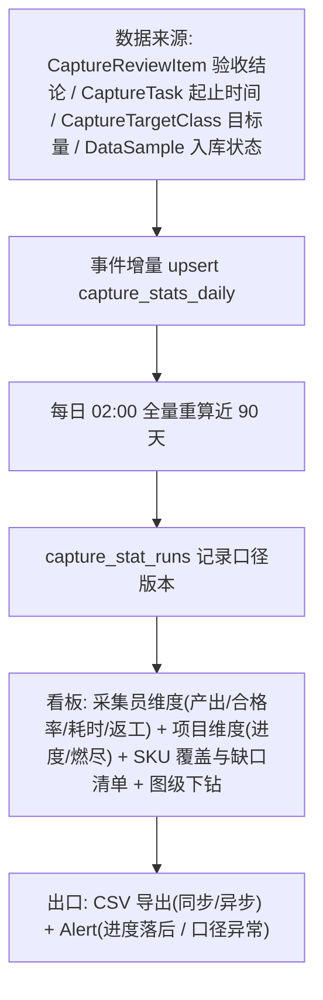
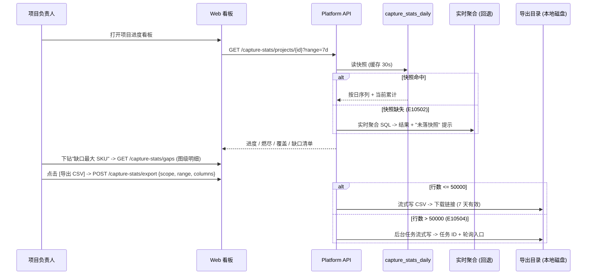
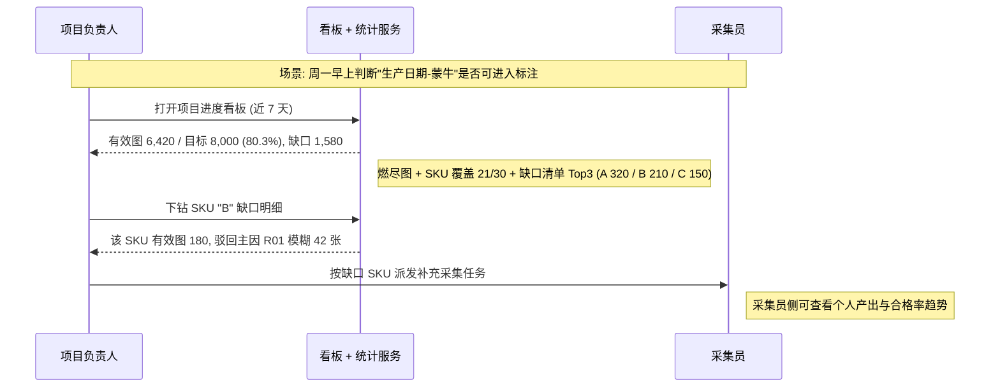

# PRD: P0005_采集统计 (Capture Statistics)

| 属性 | 内容 |
| :--- | :--- |
| **文档编号** | P0005 |
| **项目名称** | 轻眸识刻 |
| **功能模块** | M01_采集统计 |
| **当前版本** | v1.0.0 |
| **文档状态** | Draft |
| **作者** | 轻眸识刻 Team |
| **最后更新** | 2026-10-01 |

## 1. 全局说明

> [!IMPORTANT]
> **核心定位**: 提供**采集员维度**（人均产出、合格率、平均耗时、返工次数）与**项目维度**（进度、已覆盖 SKU、缺口清单）的双维统计，并给出**唯一口径**的指标公式。所有数字可下钻到图级明细，可导出 CSV。
> **边界**: 只统计**采集与验收**链路的数据，不统计标注/训练（见 P0066 / P0084）。统计是**只读视图**：任何指标异常都不得反向修改验收结论。

### 1.1 名词解释

| 术语 | 含义 |
| :--- | :--- |
| **采集员维度 (Operator Scope)** | 以 `user_id` 为聚合主体：产出、合格率、耗时、返工 |
| **项目维度 (Project Scope)** | 以 `capture_project_id` 为聚合主体：进度、SKU 覆盖、缺口 |
| **有效图 (Valid Asset)** | 同时满足"人工通过 + 已入库 + 未被剔除"的图，是**所有合格率类指标的分子来源**（见 F04） |
| **SKU / 采集主体** | `CaptureSubject`，一个待采的包装主体（如"蒙牛 250ml 纯牛奶 生产日期面"） |
| **缺口 (Gap)** | `max(0, SKU 目标图数 − 该 SKU 有效图数)`，正数才进入缺口清单 |
| **覆盖 (Coverage)** | 某 SKU 的有效图数达到 `COVERAGE_MIN_SHOTS`（本模块统计常量，默认 50，可在统计设置中调整），即视为"已覆盖" |
| **人天 (Person-Day)** | `有效作业时长 / 8h`；有效作业时长剔除任务内 > 20min 无心跳的空闲段 |
| **口径版本 / 快照** | 口径版本 = 指标定义版本号，随 daily 快照落库，避免历史数字被新口径静默改写；快照 = `CaptureStatDaily` 的一行（日 × 维度 × 主体），看板默认读快照，必要时回退实时聚合 |

### 1.2 统一异常处理 (E-code)

| Code | 场景 | 处理策略 |
| :--- | :--- | :--- |
| `E10501` | 统计聚合任务失败（SQL 超时 / 数据异常） | 保留上一次成功快照，看板标注"数据截至 {time}"，任务重试 3 次 |
| `E10502` | 指定日期无快照 | 回退实时聚合并在页面提示 "实时口径，未落快照"，同时补跑聚合 |
| `E10503` | 时间窗非法（start > end / 跨度 > 366 天 / 非法日期） | 400，提示 "时间范围不合法，最长 366 天" |
| `E10504` | 导出行数 > **50,000** | 转异步导出，返回任务 ID 与轮询入口 |
| `E10505` / `E10506` | CSV 写入失败（磁盘满、权限）/ 导出文件已过期（7 天 GC） | 提示 "导出失败：存储写入异常" 并保留中间文件；过期访问返回 410 "请重新导出" |
| `E10507` | 越权查看其他采集员明细 | 403，提示 "仅本人、项目负责人或管理员可查看明细" |
| `E10508` | 项目未配置目标量 → 进度分母为 0 | 进度显示 `—` 并提示 "未配置目标量 (E10508)"，不显示 0% 或 100% |
| `E10509` | 缺口计算依赖的类别映射缺失 | 缺口清单标注"该 SKU 未绑定 LabelClass，未计入覆盖"，并 `Alert(WARNING)` |
| `E10510` | 同项目同窗口并发重算 | 后者 409 并提示 "该项目正在重算中" |
| `E10511` / `E10512` | 采集员已停用 / 任务心跳缺失致工时不可算 | 历史数据仍计入并打 `INACTIVE`（不计入"在岗"筛选）；`active_seconds=0` 并计入 `no_heartbeat_tasks` |

## 2. 项目背景

### 2.1 背景 (Context)
采集是 轻眸识刻 的冷启动源头。2~3 人团队里既有全职也有兼职，项目负责人需要回答三个问题：**这周谁产出了多少、合格率如何？项目还差多少张、差在哪些 SKU？** 没有统计时只能靠翻任务列表和聊天记录，判断滞后且不可复现。同时，交接给标注与训练前必须有一个可对外的"数据到底够不够"的唯一答案——而"够不够"取决于口径：同一批图按"提交数"算达标、按"有效数"算就缺口巨大。

### 2.2 问题陈述 (Problem Statement)
1. **口径不一**: 有人按提交张数算进度，有人按验通过张数算，会议上的数字对不上。
2. **无法定位短板**: 只知道"总缺 800 张"，不知道缺在哪个 SKU、谁拍得慢。
3. **耗时不可见**: 采集员效率靠感觉；返工到底发生在谁身上、因为什么，无数据。
4. **手工统计**: 负责人每周手工导出 Excel 汇总，耗时且易错。
5. **口径漂移**: 改了阈值或打回规则后，历史数字被重新算出不同结果，无法追溯。

### 2.3 目标与成功指标 (Goals & Success Metrics)
*   **北极星指标**: 项目负责人**不再手工统计**——进度看板与缺口清单可直接作为派发依据（周活跃看板使用率 100%）。
*   **次要指标**: 看板数据延迟 < **30s**（事件驱动）；每日 02:00 全量校正成功率 **100%**；任意指标可下钻到图级明细；CSV 导出 5 万行 < **10s**；口径版本化后历史数字**零静默变更**。

### 2.4 风险与规避 (Risks & Mitigation)

| 风险 | 影响 | 规避 |
| :--- | :--- | :--- |
| 口径被误读（提交数当合格数） | 决策错误 | 所有指标在 UI 上带 `?` 提示展示分子/分母；`formula_version` 落库 |
| 实时聚合拖慢主库 | 采集与验收变慢 | 看板默认读日快照；实时聚合只走覆盖索引且缓存 30s~5min |
| 迟到数据（补录、跨天验收） | 当日数字偏小 | 每日全量重算近 90 天；快照记录 `recomputed_at` |
| 采集员抵触绩效统计 / 导出大表打爆内存 | 数据造假（凑数量）；单机 OOM | 产出与合格率**必须同屏展示**，降级入库单独计列；CSV 流式写（游标逐批取），> 5 万行转异步 |

## 3. 价值模型

*   **方案**: 以 `CaptureStatDaily` 为唯一数字源：验收事件实时增量累加，每日凌晨全量校正，看板与导出都读同一份事实表；所有指标以**公式表**形式固化并带版本号，图级明细可下钻验证。
*   **目标**: ①一个数字说话——进度 = 有效图 / 目标图，全员同一口径；②从"缺多少"细化到"缺哪个 SKU、谁返工最多"；③绩效统计与质量指标绑定，避免唯数量论。

## 4. 项目范围

### 4.1 功能结构图



### 4.2 In Scope (包含范围)
1. 采集员维度统计：人均产出、合格率、平均耗时、返工次数与返工理由分布。
2. 项目维度统计：进度、燃尽、每日提交量、按 SKU 的覆盖与缺口清单。
3. **指标口径与有效数据定义**（公式、分子分母、排除项、版本号）；刷新机制（事件驱动增量 + 每日全量校正 + 手动重算）。
4. 看板字段与图表（表格 / 柱状 / 折线 / 燃尽 / 堆叠条）；明细下钻到图级记录（含预检度量与人工结论）。
5. CSV 导出（维度可选、列可配、同步 / 异步）。
8. 越权控制与降级入库、停用采集员等特殊数据的显式标注。

### 4.3 Out of Scope (不包含范围)
*   **标注与训练统计**（人均标注量、mAP 曲线）→ P0066 / P0084；本模块不跨域汇总。
*   **绩效考评与奖惩流程**：只出数据，不做打分排名制度（避免内卷导向，人工判断）。
*   **实时（秒级）流式统计 / 成本核算**：看板延迟 30s 可接受，不引入流计算组件；人力与存储成本核算留待后续版本。
*   **修改验收结论**：统计只读；发现异常一律回到 P0004 走复核流程。
*   **历史数据回溯重算全量**（> 90 天）：仅按需手动触发，不自动。

## 5. 业务流程

### 5.1 统计聚合与刷新链路

```mermaid
flowchart TD
    E1[验收单判定 PASSED / REJECTED] --> E2{事件类型}
    E2 -->|ACCEPTED| U1[upsert 当日 OPERATOR: accepted_assets += n]
    E2 -->|REJECTED| U2[upsert 当日 OPERATOR: rejected_assets += n, rework_tasks += 1]
    U1 & U2 --> U3[upsert 当日 PROJECT 行] --> C1[失效缓存: 进度 30s / 覆盖 5min]
    C1 --> V1[看板读快照, 缺失则实时聚合 E10502]

    T1[每日 02:00] --> T2[按 Asia/Shanghai 日切重算近 90 天] --> T3[校验: 与实时聚合差异 > 1% 标记 discrepancy]
    T3 --> T4[写 capture_stat_runs + recomputed_at, 差异行 Alert(WARNING)]
```

### 5.2 看板与导出流程



### 5.3 有效图判定链（所有合格率类指标的共同口径）

```mermaid
flowchart TD
    A[某 CaptureReviewItem] --> B{human_verdict = PASS 且<br/>CaptureReview.status = PASSED?}
    B -->|否| X[排除: 不计入任何合格分子]
    B -->|是| D{入库文件 COMMITTED 且未软删除?}
    D -->|否| X
    D -->|是| E{对应 DataSample 仍在<br/>目标 DatasetVersion 中?}
    E -->|否| X2[排除: 已被清洗剔除]
    E -->|是| F{review.degraded = true?}
    F -->|是| G[计入有效图 + degraded 标记<br/>不进"一次通过率"分子]
    F -->|否| H[计入有效图]
    G & H --> Z[按 capture_project_id<br/>capture_subject_id / operator_id 汇总]
```

*   原图与其 EXIF 规范化副本**只计一次**（以入库文件为准，即 `normalized_file_id` 优先）。
*   同一 `file_id` 出现在多条 `CaptureReviewItem` 时按 `(asset_id)` 去重。

## 6. 用户分析

### 6.1 用户画像 (User Personas)

| 角色 | 职责 | 核心诉求 | 痛点 |
| :--- | :--- | :--- | :--- |
| **项目负责人**（TRAINER） | 盯进度、决定下一轮派什么 | "还差多少张、缺在哪些 SKU、谁该多派" | 数字口径不一；缺口不可定位；手工汇总 |
| **采集员**（兼职） | 拍摄与提交 | "我这周拍了多少、合格率多少、为什么被打回" | 只知道自己被驳回，不知道整体质量 |
| **管理员**（ADMIN） | 看资源与告警 | "项目进度是否落后、数据是否够训练" | 缺少可信的项目级视图 |
| **下游（算法/训练）** | 判断数据是否够训 | "这个版本有多少有效图、类别分布如何" | 不知道该信提交数还是有效数 |

### 6.2 用户链路图 (User Journey Map)



## 7. 功能需求

### M01.F01 采集员维度看板 (Operator Dashboard)
*   **用户故事**: 作为项目负责人，我希望看到每位采集员的产出与质量，以便合理派单与辅导。
*   **逻辑与业务规则**:
    *   **可见范围**: `ADMIN` 与项目负责人可见全部采集员；采集员仅可见**本人**行；`VIEWER` 仅可见聚合值（不可见人均明细）→ 越权访问 `E10507`。
    *   **字段**: 采集员、在岗状态（`ACTIVE` / `INACTIVE`，`E10511`）、提交任务数、提交图数、有效图数、交付合格率、一次通过率、返工人数占比、平均单图作业耗时、平均任务周期、Top3 打回理由码。
    *   **图表**: ①人均日产出柱状图（Top N，可切"按图 / 按任务"）；②合格率趋势折线（7 / 14 / 30 天）；③"产出 × 合格率"四象限散点（用于识别"拍得多但通过率低"的人）；④返工理由堆叠条。
    *   **排序与筛选**: 默认按"有效图数"降序；支持按项目、时间窗（近 7 / 14 / 30 天、自定义 ≤ 366 天，非法 `E10503`）、在岗状态筛选。
    *   **口径**: 全部指标取自 1.1 / F04 公式表，UI 上每个指标带 `?` 悬浮展示"分子 / 分母 / 口径版本"。
*   **验收标准**:
    ```gherkin
    场景: 查看采集员产出与合格率
      Given 项目"生产日期-蒙牛"近 7 天有 3 位采集员的验收记录
      When 项目负责人打开采集员维度看板
      Then 每行展示有效图数、交付合格率、返工率与平均单图耗时
      And 每列标题悬浮显示分子/分母与口径版本

    场景: 采集员只能看本人
      Given 采集员王强已登录
      When 打开采集员维度看板
      Then 仅显示王强本人一行
      And 尝试访问他人明细返回 403 (E10507)
    ```
*   **边界情况与异常处理**:

    | 场景 | 处理 |
    | :--- | :--- |
    | 采集员本周无任何提交 | 仍显示该行，产出为 0，合格率显示 `—`（分母为 0） |
    | 采集员已停用 | 保留历史行并打 `INACTIVE`；默认筛选"在岗"时隐藏 |
    | 任务心跳缺失 / 单人任务量 < 5 张 | `active_seconds=0` 计入 `no_heartbeat_tasks`，耗时列显示 `—` 并提示 `E10512`；样本过小的合格率加"样本过小"标注 |

### M01.F02 项目维度进度看板 (Project Progress Dashboard)
*   **用户故事**: 作为项目负责人，我希望一眼看到项目完成度与剩余量，以便决定是否继续派单。
*   **逻辑与业务规则**:
    *   **进度分子**: 项目内**有效图**总数；**分母**: `capture_projects.min_total_shots`（P0001 维护，= 主体数 × `min_shots_per_subject`）。分母为 0 / 未配置 → 显示 `—` + `E10508`，不显示 0% 或 100%。
    *   **字段**: 项目名、目标图数、有效图数、进度百分比、缺口总数、已覆盖 SKU（`x / y`）、进行中任务数、已完成任务数、降级入库图数（独立计列）、最近 7 天日均有效产出、**预计达成日期**（`剩余缺口 / 近 7 天日均产出`，日均 = 0 时显示 `—`）。
    *   **图表**: ①进度条（有效 / 目标）；②燃尽图（剩余缺口随时间下降的实测线 + 目标斜率）；③每日提交量柱状（叠加有效 / 驳回堆叠）；④按 SKU 的堆叠条（已覆盖 / 缺口），点击跳 F03。
    *   **多项目视图**: 项目列表页展示全部 `ACTIVE` 项目的进度条与缺口总数，用于排优先级；`PAUSED` / `COMPLETED` 项目默认折叠。
    *   **口径**: 进度只认**有效图**，不认提交数；此规则在页面顶部以一行说明常驻展示。
*   **验收标准**:
    ```gherkin
    场景: 查看项目进度
      Given 项目 min_total_shots=8000, 当前有效图 6420
      When 打开项目进度看板
      Then 显示进度 80.3% 与缺口 1580
      And 燃尽图显示近 7 天剩余缺口的下降趋势

    场景: 目标量未配置
      Given 项目未配置 min_total_shots (NULL 或 0)
      When 打开项目进度看板
      Then 进度显示 "—" 并提示 "未配置目标量 (E10508)"
      And 缺口清单入口置灰
    ```
*   **边界情况与异常处理**:

    | 场景 | 处理 |
    | :--- | :--- |
    | 有效图数 > 目标数（超额采集） | 进度封顶显示 100% 并注明实际值（如 `6,420 / 8,000` 与 `超额 +20`） |
    | 近 7 天无产出 | 预计达成日期显示 `—`，并 `Alert(WARNING, CAPTURE_PROGRESS_STALLED)` |
    | 快照缺失 / 项目已完成但仍持续验收 | 回退实时聚合 + `E10502` 提示；已完成项目的验收数据仍计入并另行提示 |

### M01.F03 SKU 覆盖与缺口清单 (SKU Coverage & Gap List)
*   **用户故事**: 作为项目负责人，我希望知道哪些 SKU 还没拍够，以便精准补拍而不是笼统加量。
*   **逻辑与业务规则**:
    *   **覆盖判定**: 某 `CaptureSubject`（SKU）的有效图数 `>= COVERAGE_MIN_SHOTS`（本模块统计常量，默认 50）→ 已覆盖；否则未覆盖。注意与 P0001 的 `capture_acceptance_rules.min_shots_per_subject`（任务派发的单 SKU 最少合格张数）**语义不同、各自配置**。
    *   **缺口**: `gap = max(0, target_count(subject) − valid_assets(subject))`，`target_count` 取自 `CaptureTargetClass.target_count`（按项目 × 类别）；未绑定 `LabelClass` 的 SKU 不计入覆盖并提示 `E10509`。
    *   **清单字段**: SKU 名称、绑定类别、目标图数、有效图数、缺口数、缺口占比、最近提交时间、主因理由码、负责采集员、`[补采]` 操作。
    *   **排序**: 默认缺口降序；支持按"缺口占比""最近无产出天数"排序（用于优先处理长期停滞的 SKU）。
    *   **下钻**: 点击行 → 图级明细（file_id、缩略图、预检度量、人工结论、理由码），可据此直接调整拍摄指导意见（回写 SOP 由 P0001 负责）。
    *   **缓存**: SKU 覆盖与缺口为全项目聚合，缓存 5min；手动 `[刷新]` 立即重算（同项目并发重算 `E10510`）。
*   **验收标准**:
    ```gherkin
    场景: 缺口清单排序与下钻
      Given SKU-A 缺口 320, SKU-B 缺口 210, SKU-C 缺口 150
      When 打开缺口清单
      Then 默认按缺口降序: SKU-A, SKU-B, SKU-C
      When 点击 SKU-C 行
      Then 展示该 SKU 的图级明细与主因理由码分布

    场景: 未绑定类别的 SKU
      Given 某 CaptureSubject 未绑定 LabelClass
      When 计算覆盖
      Then 该 SKU 标注 "未计入覆盖" 并生成 WARNING 告警 (E10509)
    ```
*   **边界情况与异常处理**:

    | 场景 | 处理 |
    | :--- | :--- |
    | 目标 SKU 列表为空 | 显示"未配置采集目标"，引导跳 P0001 |
    | 同一 SKU 跨项目 | 按 `(capture_project_id, subject_id)` 独立计算，不合并 |
    | 长尾 SKU > 500 / 某 SKU 已达成仍继续采 | 分页 100/页且导出走异步（`E10504`）；已达成的 SKU 缺口为 0、置灰并归入"已覆盖"分组 |

### M01.F04 指标口径与有效数据定义 (Metric Definitions)
*   **用户故事**: 作为负责人/开发者，我希望每个指标都有唯一、可复核的公式，以便跨人跨时间对得上数字。
*   **逻辑与业务规则**: 设时间窗 `T`（左闭右开，按 **Asia/Shanghai** 日切），`submitted(T)` / `accepted(T)` / `rejected(T)` 见下表原子量定义；分母为 0 的指标一律显示 `—`，**不显示 0 或 100%**。
    *   **原子量定义**：

        | 原子量 | 定义（分子口径） |
        | :--- | :--- |
        | `submitted_assets(T)` | `T` 内创建的 `CaptureReview.asset_count` 之和（排除 `status=CANCELLED` 的验收单） |
        | `passed_precheck_assets(T)` | 上述单据中 `CaptureReviewItem.precheck_result=PASS` 的图数（`WARN` 不计入） |
        | `accepted_assets(T)` | 上述单据中 `human_verdict=PASS` 的图数（含自动放行，`auto_passed=true`） |
        | `valid_assets(T)` | 上述通过图中满足 5.3 全部条件的图数（去重后） |
        | `rejected_assets(T)` | 上述单据中 `human_verdict=REJECT` 的图数 |
        | `tasks_submitted(T)` / `tasks_accepted(T)` | `T` 内有提交 / 验收通过记录的 `CaptureTask` 去重数 |
        | `rework_tasks(T)` | `T` 内提交且 `CaptureReview.round_no > 1` 的 `CaptureTask` 去重数 |
        | `active_seconds(T)` | `Σ(capture_tasks.submitted_at − capture_tasks.claimed_at)`，逐任务剔除 > 20min 无心跳空闲段；心跳缺失任务记 0（`E10512`） |
        | `person_days(T)` | `active_seconds(T) / 28800`（8 小时 = 1 人天） |

    *   **指标公式（分子 / 分母）**：

        | 指标 | 公式 | 说明 |
        | :--- | :--- | :--- |
        | 预检通过率 | `passed_precheck_assets / submitted_assets` | 衡量拍摄基本功 |
        | 人工合格率 | `accepted_assets / (accepted_assets + rejected_assets)` | 只看进入人工验收的图 |
        | **交付合格率** | `valid_assets / submitted_assets` | **项目进度的口径基础** |
        | 一次通过率 | `round_no=1 单据中 accepted_assets / submitted_assets` | 衡量 SOP 清晰度（越低说明标准传达不到位） |
        | 降级入库占比 | `review.degraded=true 的 accepted_assets / accepted_assets` | 强制通过的图，独立可见 |
        | 人均日产出 | `accepted_assets / person_days` | 单位：张/人天 |
        | 单图平均作业耗时 | `active_seconds / accepted_assets` | 单位：秒/张（已剔除空闲段） |
        | 平均任务周期 | `Σ(submitted_at − claimed_at) / tasks_submitted` | 含空闲段，反映端到端时长 |
        | 返工率 | `rework_tasks / tasks_submitted` | 任务级；图级返工率另见 `rejected_assets / submitted_assets` |
        | 平均返工次数 | `Σ max(0, round_no − 1) / tasks_submitted` | 返工深度（每任务平均被打回轮数） |
        | 项目进度 | `valid_assets(project) / min_total_shots(project)` | 分母为 0 → `—`（`E10508`） |
        | SKU 覆盖率 | `已覆盖 SKU 数 / 目标 SKU 数`，已覆盖 = `valid_assets(subject) >= COVERAGE_MIN_SHOTS` | 目标 SKU 来自 `CaptureTargetClass` |
        | 缺口数 | `Σ_subject max(0, target_count − valid_assets)` | 只累加正数 |
        | 存储占用 | `Σ size_bytes(有效图入库文件)` | 用于容量规划 |

    *   **有效图（Valid Asset）判定**：同时满足 ①`human_verdict=PASS`；②`CaptureReview.status=PASSED`；③入库 `ManagedFile.status=COMMITTED` 且 `deleted_at IS NULL`；④对应 `DataSample` 仍存在于目标 `DatasetVersion`（未被后续清洗剔除）；⑤原图与 EXIF 规范化副本按入库文件**只计一次**。**排除**：`WARN`/`SKIPPED` 未人工确认、`REJECT`、软删除、已从版本中被清洗剔除的图。
    *   **口径版本**: 当前 `FORMULA_VERSION = "v1"`；任何公式或排除项变更必须递增版本号，历史快照保留原版本号，**不重算改写**。
*   **验收标准**:
    ```gherkin
    场景: 交付合格率与提交数口径不同
      Given 近 7 天 submitted_assets=1000, accepted_assets=820, 其中被清洗剔除 30
      When 查看交付合格率
      Then 显示 79.0% (790/1000)
      And 悬浮提示展示分子 790、分母 1000 与 FORMULA_VERSION=v1

    场景: 零分母不显示 0%
      Given 某采集员近 7 天没有进入人工验收的图
      When 查看看板
      Then 其合格率显示 "—"
      And 不显示 0% 或 100%
    ```
*   **边界情况与异常处理**:

    | 场景 | 处理 |
    | :--- | :--- |
    | 验收单被 `CANCELLED` / 自动放行的图 | 整单排除在所有原子量之外；自动放行图计入 `accepted_assets` 且可按 `auto_passed` 单列 |
    | 图在验收后从数据集被清洗剔除 | 从 `valid_assets` 剔除，但**保留**在 `accepted_assets`（人工确实通过过） |
    | 跨天验收（周一提交、周二通过） | 计入**验收日**的 `accepted_assets`；`submitted_assets` 计提交日（两列不强制同日对齐） |
    | 公式版本混用 | 页面标注每个数字的口径版本；跨版本对比时提示"口径不一致" |

### M01.F05 进度刷新与统计快照 (Refresh & Snapshots)
*   **用户故事**: 作为负责人，我希望看板数字既新鲜又稳定，以便我随时用它开会而不担心数字跳变。
*   **逻辑与业务规则**:
    *   **增量刷新（事件驱动）**: 验收单状态变更（`PASSED` / `REJECTED`）即时 `upsert` 当日 `capture_stats_daily`；看板**前端轮询 30s**（或 SSE 推送），因此"进度刷新频率 = 事件发生 + ≤ 30s"。
    *   **缓存 TTL**: 项目进度 30s；SKU 覆盖与缺口 5min；采集员日明细 60s。`[刷新]` 按钮走强制重算（绕过缓存）。
    *   **全量校正**: 每日 **02:00** 重算近 **90 天**（处理迟到验收、补录、清洗剔除），结果写 `recomputed_at`；快照与实时聚合差异 > **1%** 的行生成 `Alert(rule_code=CAPTURE_STAT_DISCREPANCY, level=WARNING)`。
    *   **幂等**: `UNIQUE(stat_date, scope_type, scope_id)`，聚合可重复执行而不重复累加。
    *   **回退**: 指定日期无快照时实时聚合 + `E10502`，并异步补跑该日聚合。
    *   **手动重算**: 项目负责人可对单项目、单窗口触发重算；并发重算 `E10510`。
    *   **显示规则**: 看板顶部常驻 "数据截至 {snapshot_time}｜口径 {FORMULA_VERSION}"；回退实时计算时改为"实时口径（未落快照）"。
*   **验收标准**:
    ```gherkin
    场景: 验收通过后看板更新
      Given 项目进度看板已打开且当前有效图 6420
      When 另一名负责人完成一批 288 张的验收通过
      Then 30 秒内看板有效图变为 6708, 进度同步变化

    场景: 每日全量校正
      Given 昨日有 30 张图因清洗被从数据集剔除
      When 02:00 全量重算执行完成
      Then 相关日期的 valid_assets 下调, recomputed_at 更新
      And 差异 > 1% 的行生成 WARNING 告警

    场景: 快照缺失回退
      Given 查询窗口内某日无 capture_stats_daily 记录
      When 打开看板
      Then 返回实时聚合结果并提示 "实时口径, 未落快照 (E10502)"
    ```
*   **边界情况与异常处理**:

    | 场景 | 处理 |
    | :--- | :--- |
    | 聚合任务失败 | 保留上次成功快照，标注"数据截至"，重试 3 次（`E10501`） |
    | 跨日边界（23:59 提交、00:01 通过） | 提交计前一日、通过计后一日，页面注明 |
    | 服务器时区非 UTC+8 / 手动重算与定时任务撞车 | 强制以 `Asia/Shanghai` 日切；数据库按"同项目同窗口"互斥，后者 `E10510` |

### M01.F06 明细下钻与筛选 (Drill-down)
*   **用户故事**: 作为负责人，我希望从任何数字跳到构成它的图，以便验证统计并定位问题样本。
*   **逻辑与业务规则**:
    *   **下钻路径**: 指标数字 → 明细列表 → 单图详情（缩略图、预检度量、人工结论、理由码、所属任务与验收单）。
    *   **筛选维度**: 项目、SKU/主体、采集员、时间窗、`precheck_result`、`human_verdict`、`reason_code`、是否 `auto_passed`、是否 `degraded`、是否已被清洗剔除。
    *   **权限**: 与 F01 一致（本人 / 项目负责人 / ADMIN）；`VIEWER` 仅聚合视图（`E10507`）。
    *   **一致性**: 明细条数必须与所选指标的分子一致；不一致时页面提示"明细与统计口径不一致，已触发重算"，并异步触发该窗口重算。
*   **验收标准**:
    ```gherkin
    场景: 从返工率下钻到具体图
      Given 看板显示采集员王强返工率 22%
      When 点击该数字
      Then 展示构成该指标的驳回图列表
      And 明细条数与分子一致, 且可按理由码二次筛选
    ```
*   **边界情况与异常处理**:

    | 场景 | 处理 |
    | :--- | :--- |
    | 明细为空但指标非 0 | 判定为口径不一致，提示并触发重算 |
    | 明细超过 1 万条 / 图已被软删除 | 分页 100/页，禁止一次性加载；已删图仍显示占位记录并标注"文件已删除"，保证分子可复算 |

### M01.F07 CSV 导出 (CSV Export)
*   **用户故事**: 作为负责人，我希望把统计导出为 CSV，以便在 Excel 里做二次分析或汇报。
*   **逻辑与业务规则**:
    *   **导出维度**: ①采集员汇总；②项目汇总；③SKU 缺口清单；④图级明细（列最多，行最多）。
    *   **CSV 规格**: UTF-8 **with BOM**（Excel 直接打开不乱码）、逗号分隔、字段含逗号/引号时按 RFC 4180 转义、时间 `ISO 8601`（`2026-10-01T14:22:00+08:00`）、布尔用 `true/false`。
    *   **列定义（图级明细为例）**: `capture_project_id, capture_project_name, capture_task_id, round_no, submitter, reviewed_by, asset_id, file_id, filename, subject_name, precheck_result, laplacian_var, dup_distance, exif_orientation, target_area_ratio, human_verdict, reason_code, auto_passed, degraded, reviewed_at, formula_version`。
    *   **行数门限**: `<= 50,000` 同步返回（流式写、游标分批 1,000 行）；`> 50,000` 转异步导出（`E10504`），完成后在看板通知并给下载入口。
    *   **文件生命周期**: 落在本机 `{data_root}/exports/stats/{export_id}.csv`，**登记为临时文件而非 `ManagedFile`**（不属于数据集资产），保留 **7 天** 后 GC；过期访问 `E10506`。
    *   **权限**: 导出内容受 F01 可见范围约束；采集员导出的明细仅含本人数据。
    *   **审计**: 每次导出写 `AuditLog(action=CAPTURE_STATS.EXPORT)`（动作码用 `RESOURCE.VERB`，SysW 契约），记录维度、时间窗、行数、操作人。
*   **验收标准**:
    ```gherkin
    场景: 同步导出图级明细
      Given 筛选结果为 12,480 行
      When 点击 [导出 CSV]
      Then 10 秒内生成文件并开始下载
      And 文件首行为列名, 编码 UTF-8 with BOM, 中文列值不乱码
      And AuditLog 记录本次导出

    场景: 超量转异步
      Given 筛选结果为 180,000 行
      When 点击 [导出 CSV]
      Then 返回异步任务 ID 与轮询入口 (E10504)
      And 完成后在看板内通知并提供下载链接
    ```
*   **边界情况与异常处理**:

    | 场景 | 处理 |
    | :--- | :--- |
    | 导出过程中数据变化 | 以导出开始的快照时刻为准，`formula_version` 写入每行，保证可复核 |
    | 磁盘剩余 < 500MB / 文件名含非法字符 | 拒绝导出并 `Alert(CRITICAL)`（`E10505`）；文件名统一规范化为 `capture-stats_{scope}_{yyyyMMddHHmm}.csv` |
    | 导出文件被提前删除 | 返回 `E10506`，提示重新导出 |

## 8. 技术架构与数据模型

### 8.1 数据实体

#### Table: `capture_stats_daily`

| 字段名 | 类型 | 必填 | 说明 | 约束 |
| :--- | :--- | :--- | :--- | :--- |
| `id` | UUID | Y | 主键 | PK |
| `stat_date` | Date | Y | 统计日（Asia/Shanghai） | UNIQUE(`stat_date`, `scope_type`, `scope_id`) |
| `scope_type` | Enum | Y | 聚合维度 | `OPERATOR` / `PROJECT` |
| `scope_id` | UUID | Y | 维度主体 | `OPERATOR` → `users.id`；`PROJECT` → `capture_projects.id` |
| `capture_project_id` | UUID | N | 项目 ID | `OPERATOR` 行冗余，便于按项目过滤 |
| `operator_id` | UUID | N | 采集员 ID | `PROJECT` 行为 NULL |
| `submitted_tasks` / `submitted_assets` | Int | Y | 提交任务数 / 图数 | default 0 |
| `accepted_tasks` / `accepted_assets` | Int | Y | 通过任务数 / 图数 | default 0 |
| `valid_assets` | Int | Y | 有效图数（F04 口径） | default 0 |
| `rejected_assets` / `rework_tasks` | Int | Y | 驳回图数 / 返工任务数 | default 0 |
| `first_pass_assets` | Int | Y | 一次通过（`round_no=1`）图数 | default 0 |
| `degraded_assets` | Int | Y | 降级入库图数（强制通过产物） | 独立计列，可单独审计 |
| `auto_passed_assets` | Int | Y | 自动放行图数 | 用于监控放行比例 |
| `active_seconds` | BigInt | Y | 有效作业时长（秒，剔除空闲段） | default 0 |
| `no_heartbeat_tasks` | Int | Y | 心跳缺失任务数 | 工时不可算的任务计数（`E10512`） |
| `target_assets` | Int | N | 目标图数（`PROJECT` 行） | 进度分母，空值触发 `E10508` |
| `covered_subjects` / `target_subjects` | Int | N | 已覆盖 / 目标 SKU 数（`PROJECT` 行） | 供覆盖率计算 |
| `gap_detail` | JSONB | N | 缺口快照 | `[{subject_id, target_count, valid_assets, gap}]`，按缺口降序 |
| `formula_version` | String | Y | 口径版本 | 当前 `v1` |
| `recomputed_at` | Timestamp | N | 最近一次全量校正时间 | 支撑"数据截至"展示 |
| `created_at` / `updated_at` | Timestamp | Y | 通用字段 | 快照不软删除，按 `stat_date` 归档 |

**Index**: `(capture_project_id, stat_date)`；`(operator_id, stat_date)`；`(scope_type, stat_date)`。

#### Table: `capture_stat_runs`

| 字段名 | 类型 | 必填 | 说明 | 约束 |
| :--- | :--- | :--- | :--- | :--- |
| `id` | UUID | Y | 主键 | PK |
| `run_type` | Enum | Y | 触发方式 | `SCHEDULED` / `MANUAL` / `BACKFILL` |
| `scope_type` | Enum | Y | 聚合维度 | `OPERATOR` / `PROJECT` / `ALL` |
| `scope_id` | UUID | N | 目标项目 / 采集员 | 全量运行时为 NULL |
| `window_start` / `window_end` | Date | Y | 重算窗口 | 跨度 ≤ 366 天（`E10503`） |
| `status` | Enum | Y | 执行状态 | `RUNNING` / `SUCCEEDED` / `FAILED` / `CANCELLED` |
| `row_count` | Int | Y | 写入行数 | |
| `max_diff_ratio` | Numeric | N | 与实时聚合的最大差异 | > 0.01 时生成告警 |
| `formula_version` | String | Y | 口径版本 | |
| `error_code` | String | N | 失败异常码 | 如 `E10501` |
| `started_at` / `finished_at` | Timestamp | Y/N | 起止时间 | |

**Index**: `(status, started_at)`；`(scope_type, scope_id, window_start)`。

#### 引用的外部实体（本模块只读）

| 实体 | 使用方式 |
| :--- | :--- |
| `CaptureReview` / `CaptureReviewItem` | 唯一验收事实来源：提交数、预检结论、人工结论、理由码、`round_no`、`degraded` |
| `CaptureTask` / `CaptureAssignmentLog` | `capture_project_id`、`capture_subject_id`、`claimed_at` / `started_at` / `submitted_at` / `accepted_at`、`rework_count`；派单明细（`ASSIGN`/`CLAIM`/`RELEASE`/`TRANSFER`/`TIMEOUT_RECLAIM`）用于作业时长与回收统计 |
| `CaptureProject` | 提供 `min_total_shots`（进度分母）、`status`、`owner_id`（权限） |
| `CaptureSubject` / `CaptureTargetClass` | 提供 SKU 清单与 `target_count`（每项目 × 类别目标图数） |
| `DataSample` / `DatasetVersionItem` / `ManagedFile` | 判定有效图：是否在版本中、是否 `COMMITTED`、文件体积 |
| `User` / `Role` / `AuditLog` / `Alert` | 采集员可见范围与角色判定；导出审计；进度停滞、口径差异、映射缺失告警 |

### 8.2 聚合与查询策略

*   **写路径**: 事件驱动 upsert（`ON CONFLICT (stat_date, scope_type, scope_id) DO UPDATE` 增量累加）→ 幂等且低成本；02:00 全量重算用 `INSERT ... ON CONFLICT DO UPDATE`（覆盖式，非累加）。
*   **读路径**: 看板优先读 `capture_stats_daily`（覆盖索引 + 30s 缓存）；窗口内缺行则回退实时聚合（`E10502`）。
*   **实时聚合 SQL 约束**: 只走 `capture_review_items(review_id, human_verdict)`、`capture_reviews(capture_project_id, status)` 等既有索引，禁止全表排序；结果上限按项目分页。
*   **导出路**: 游标分批（1,000 行/批）流式写文件，**不把结果集全部载入内存**；异步任务复用同一实现，进度写 `capture_stat_runs.row_count`。
*   **存储**: 快照保留 **2 年**；`gap_detail` JSONB 仅保留最近 90 天以控制体积。

## 9. UI/UX 规格说明

### 9.1 项目进度看板

```text
+-----------------------------------------------------------------------------------+
|  采集统计 / 项目: 生产日期-蒙牛   时间窗: [近 7 天 ▼]   [刷新] [导出 CSV]          |
|  数据截至 2026-10-01 09:30 | 口径 v1 | 进度 = 有效图 / 目标图（不按提交数）       |
+-----------------------------------------------------------------------------------+
|  目标 8,000    有效 6,420    缺口 1,580    已覆盖 SKU 21/30    预计达成 2026-10-12 |
|  ████████████████████████░░░░░░░░  80.3%                                          |
+-----------------------------------------------------------------------------------+
|  燃尽图 (剩余缺口)                        |  每日提交量 (有效/驳回堆叠)             |
|  1600 |*                    |  400 |##                                  |
|   800 |      * * *          |  200 |######                              |
|     0 +-----------------    |    0 +------------------                     |
+-----------------------------------------------------------------------------------+
|  缺口清单 (Top 5, 按缺口降序)                                        [全部 30 个]  |
|  SKU                    | 类别      | 目标 | 有效 | 缺口 | 主因   | 负责    | 操作 |
|  ----------------------+----------+-----+-----+-----+-------+--------+------|
|  蒙牛-250ml-日期面      | date_text | 400 |  80 | 320 | R01   | 王强   | [补采]|
|  伊利-1000ml-日期面     | date_text | 350 | 140 | 210 | R04   | 李娜   | [补采]|
|  光明-200ml-日期面      | date_text | 300 | 150 | 150 | R03   | 王强   | [补采]|
+-----------------------------------------------------------------------------------+
|  提示: 进度落后于时间进度 12%，建议优先补采缺口 Top3 的 SKU          [下钻明细]    |
+-----------------------------------------------------------------------------------+
```

### 9.2 采集员维度看板

```text
+-----------------------------------------------------------------------------------+
|  采集统计 / 采集员维度   项目: [全部 ▼]  时间窗: [近 30 天 ▼]   [导出 CSV]        |
+-----------------------------------------------------------------------------------+
|  采集员  | 状态    | 任务 | 提交 | 有效 | 交付合格率 | 一次通过 | 单图耗时 | 返工 |
|  -------+--------+-----+-----+-----+-----------+---------+---------+-----|
|  王强    | ACTIVE |  24 | 3120| 2680| 85.9%     | 71.2%   | 38s     |  5  |
|  李娜    | ACTIVE |  18 | 2400| 2160| 90.0%     | 82.5%   | 41s     |  2  |
|  赵敏    | INACTIVE| 9  | 1080|  742| 68.7%     | 55.1%   |   —     |  6  |
+-----------------------------------------------------------------------------------+
|  人均日产出 (Top N)          |  产出 × 合格率 四象限        |  返工理由分布        |
|  王强  █████████ 67 张/人天   |   李娜 ●        王强 ●        |  R01 ███████ 42      |
|  赵敏  ███ 25 张/人天         |   (纵轴: 合格率, 横轴: 产出)  |  R04 ███ 19          |
+-----------------------------------------------------------------------------------+
|  提示: 赵敏 单图耗时为 "—"（9 个任务中 4 个心跳缺失, E10512）；已停用, 不计入在岗 |
+-----------------------------------------------------------------------------------+
```

### 9.3 交互元素

| 元素 | 类型 | 状态 | 行为 |
| :--- | :--- | :--- | :--- |
| 指标数字 | Text + Tooltip | Hover | 悬浮展示分子、分母、口径版本与"下钻"入口 |
| 时间窗选择器 | Select + DatePicker | Default / Invalid | 非法范围（> 366 天 / start > end）即时提示（`E10503`） |
| 刷新按钮 | Button | Default / Loading | 强制重算并绕过缓存；同项目并发时提示 `E10510` |
| 缺口行 [补采] | Button | Default / Disabled（已覆盖） | 跳转 P0002 派发页并预填 SKU 与建议张数 |
| 导出 CSV | Button | Default / Loading / Async | 行数 > 5 万转异步并给轮询入口（`E10504`） |

## 10. 非功能性需求 (NFR)
*   **性能**: 项目看板首屏 P95 < **800ms**（命中快照）；回退实时聚合 P95 < **2s**；采集员维度 30 天看板 P95 < **500ms**；单项目聚合（10 万图规模）< **5s**；CSV 5 万行导出 < **10s**。
*   **一致性**: 看板数字与图级明细必须可复算一致（同口径同窗口）；差异 > 1% 触发告警并重算。
*   **可靠性**: 聚合失败保留上次快照并标注时间；每日全量校正成功率 100%（失败自动重试 3 次）；快照幂等可重复执行。
*   **安全与兼容性**: 采集员仅见本人明细，`VIEWER` 仅见聚合；导出受同权限约束并写 `AuditLog`，CSV 临时文件不进 `ManagedFile`（7 天后 GC）；CSV 为 UTF-8 with BOM（兼容 Excel / Numbers / pandas），时间统一 `ISO 8601 +08:00`，浏览器支持 Chrome / Edge 最新两个大版本。
*   **可扩展性**: 单项目 50 万图、50 万条 `capture_review_items` 规模下指标计算 < 5s；新增指标只需扩展公式表与快照列，不改聚合链路；预留按 `CaptureBatch` / 采集地点维度扩展。
*   **可维护性**: 公式与排除项集中在 F04 单一章节维护，代码侧对应 `FORMULA_VERSION` 常量；口径变更必须递增版本并保留历史快照。

## 附录: 已确认的设计决策

| 决策项 | 结论 |
| :--- | :--- |
| 进度口径 | **有效图 / 目标图**，不使用提交数；有效图定义见 F04 与 5.3 |
| 有效图判定 | 人工通过 + 验收单 `PASSED` + 文件 `COMMITTED` 未删 + 仍在目标版本中；原图与规范化副本只计一次 |
| 零分母展示 / 自动放行与降级入库 | 零分母一律显示 `—`（`E10508`），不显示 0% 或 100%；自动放行与降级入库计入 `accepted_assets` 但独立计列（`auto_passed_assets` / `degraded_assets`），可单独审计 |
| 刷新频率 | 事件驱动增量 + 前端轮询 30s；项目进度缓存 30s、缺口清单 5min；每日 02:00 全量校正近 90 天 |
| 日切与时区 / 口径版本 | 强制 `Asia/Shanghai` 日切（提交计提交日、通过计验收日）；`FORMULA_VERSION="v1"`，变更递增版本，历史快照不重算改写 |
| 工时口径 | `active_seconds` 剔除任务内 > 20min 无心跳空闲段；心跳缺失任务计 0 并显式标注（`E10512`） |
| 聚合表设计 | `capture_stats_daily` 为唯一数字源（`UNIQUE(stat_date, scope_type, scope_id)`）；`capture_stat_runs` 记录每次重算 |
| 缺口计算 | `max(0, target_count − valid_assets)`，`target_count` 读 `capture_target_classes.target_count`（NULL 时不单独约束）；未绑定类别的 SKU 不计入覆盖（`E10509`） |
| 覆盖阈值归属 | `COVERAGE_MIN_SHOTS`（默认 50）是**本模块统计常量**，与 P0001 的 `min_shots_per_subject`（派发用的单 SKU 最少合格张数）语义不同，不共用配置 |
| 导出文件归属 / 中间件选型 | 导出落 `{data_root}/exports/stats/`，登记为临时文件，**不写 `ManagedFile`**（不属数据集资产），保留 7 天；不引入流计算 / OLAP 组件，单机 PostgreSQL 聚合 + 应用层缓存即可 |
| 与相邻模块的边界 | 统计只读验收结论，异常一律回 P0004 复核；本模块只覆盖采集与验收，标注绩效归 P0066，两者不合并排名 |

## 关联文档
*   **P0001_采集项目与 SOP**: 提供 `capture_projects.min_total_shots`（进度分母）、`CaptureSubject`（SKU，含 `subject_key` / `group_name`）与 `CaptureTargetClass.target_count`（每 项目×类别 目标图数，NULL = 不单独约束）
*   **P0002_采集任务派发**: 缺口清单的 `[补采]` 入口与派发依据
*   **P0003_移动端采集与上传**: 提供任务心跳与作业时长原始数据
*   **P0004_采集产物验收**: 全部验收事实来源（提交、预检、人工结论、理由码、重采轮次）
*   **P0041_数据集与版本** / **P0023_导入预检与清洗**: 决定图是否仍在版本中（有效图的第 ④ 条）
*   **P0066_标注统计与绩效** / **P0131_审计日志** / **P0132_告警中心**: 标注绩效（独立口径）；导出审计；进度与口径告警

## Changelog

| 版本 | 日期 | 作者 | 变更说明 |
| :--- | :--- | :--- | :--- |
| v0.1.0-draft | 2026-10-01 | 轻眸识刻 Team | 初稿：双维看板、指标公式、缺口清单、CSV 导出 |
| v1.0.0 | 2026-10-01 | 轻眸识刻 Team | 定稿：`E105xx` 异常码、`capture_stats_daily` / `capture_stat_runs` 实体与口径版本 |
