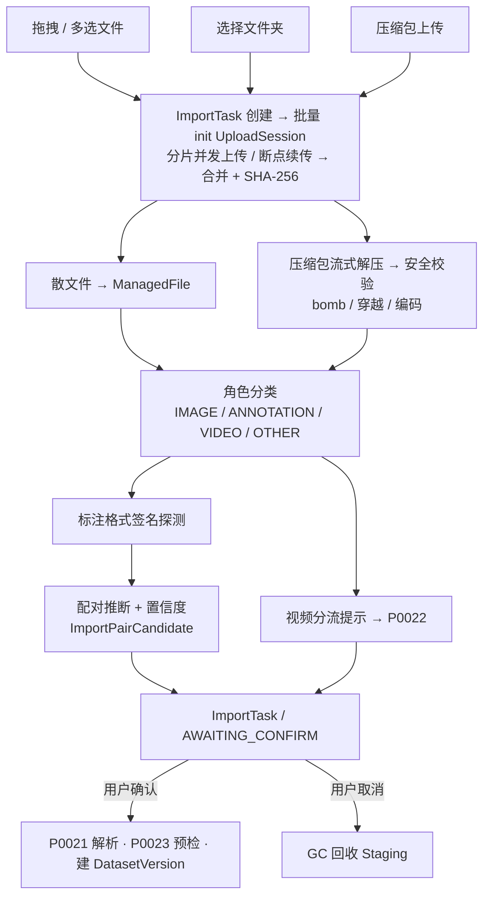
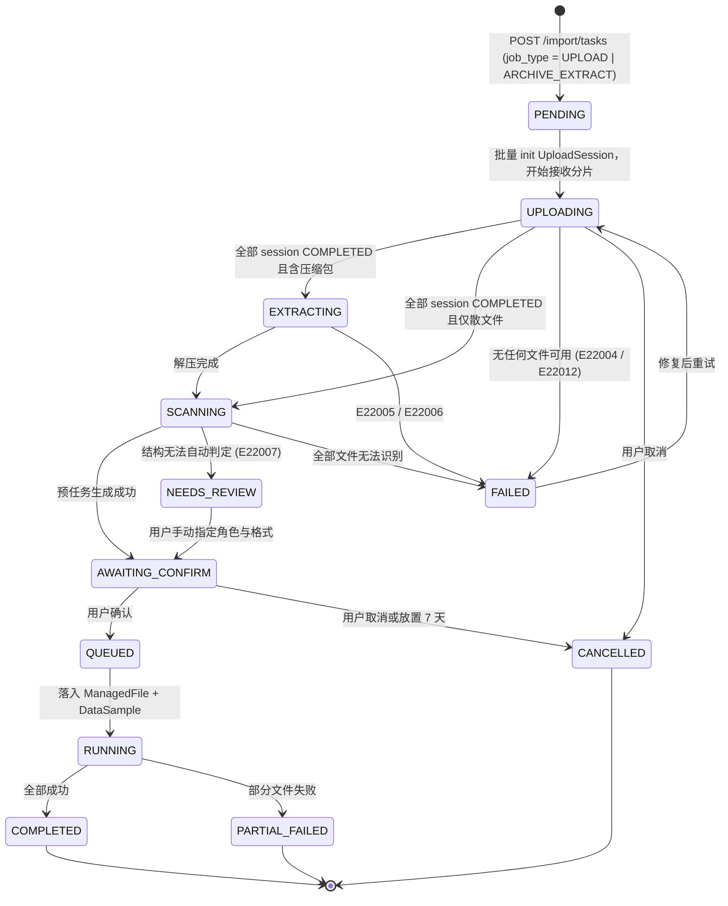
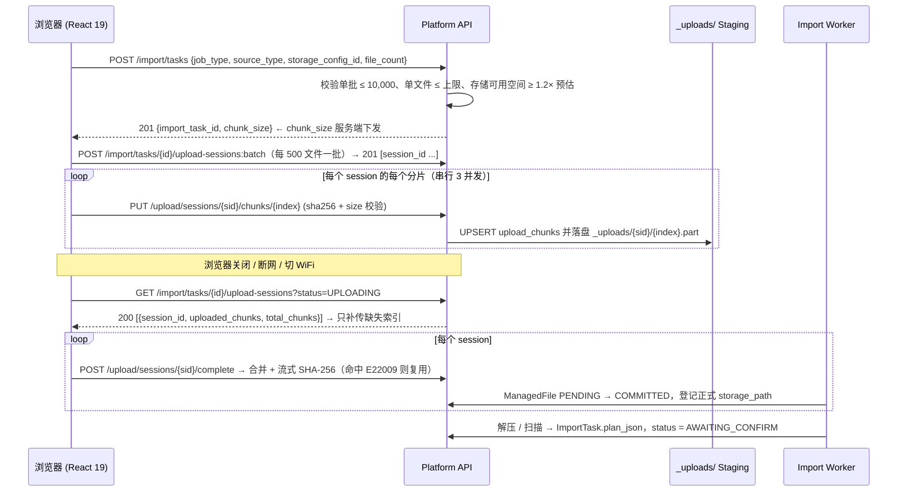
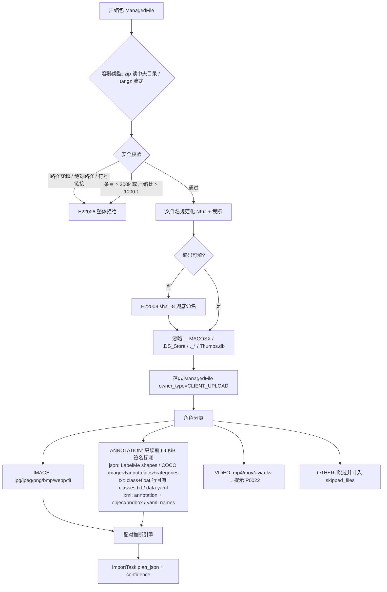
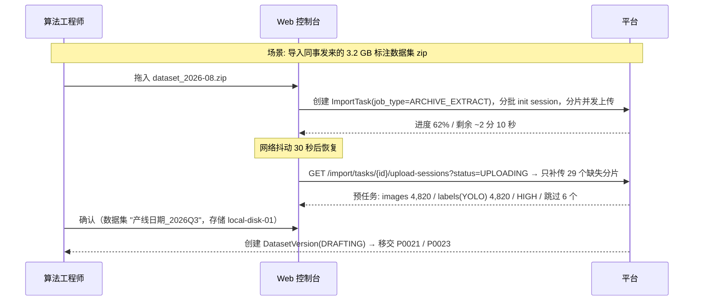
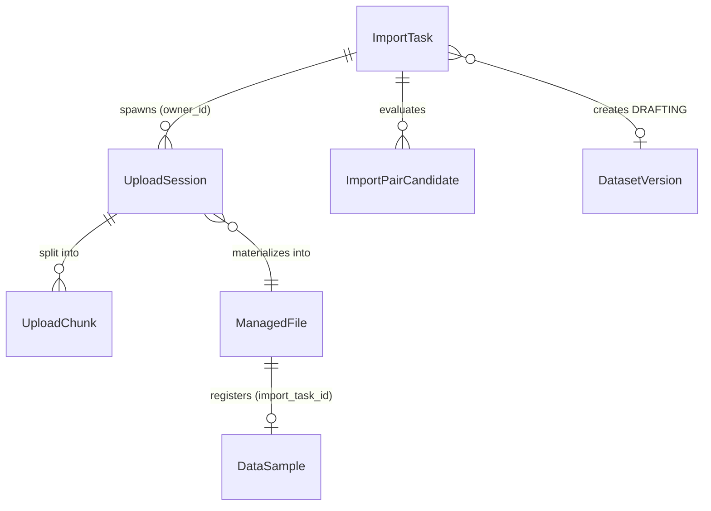

# PRD: P0020_本地上传与压缩包导入 (Local Upload & Archive Import)

| 属性 | 内容 |
| :--- | :--- |
| **文档编号** | P0020 |
| **功能模块** | M02_数据导入 |
| **当前版本** | v1.0.0 |
| **文档状态** | Draft |
| **作者** | FoodYolo Team |
| **最后更新** | 2026-10-01 |

---

## 1. 全局说明

> [!IMPORTANT]
> **核心定位**: 数据导入的**入口层**——把散落在本地磁盘、网盘下载、同事打包发来的图片与压缩包，变成平台可管理的 `ManagedFile` 与一份待用户确认的 `ImportTask`（`job_type = UPLOAD | ARCHIVE_EXTRACT`）。本模块只做**搬运与结构识别**：损坏/重复检测归 P0023，类别映射归 P0024。

### 名词解释

*   **ImportTask（导入任务）**: 一切"把文件弄进来"的批次任务，`job_type ∈ UPLOAD | ARCHIVE_EXTRACT | FORMAT_PARSE | FRAME_EXTRACT | PREFLIGHT | CLEAN`。本模块产出前两类，是**批次层**唯一状态载体。
*   **UploadSession / UploadChunk（上传会话 / 分片）**: **单个文件**的上传过程与其分片（CollectA 在 P0003 冻结定义，本模块复用）。`client_asset_uid`（客户端 UUIDv4）为幂等键，`UNIQUE(session_id, chunk_index)` 使重传天然幂等，`expires_at = created_at + 24h`。
*   **ImportPlan（导入预任务）**: `ImportTask.plan_json` 的结构化识别结果（文件角色、配对、推断格式、告警），用户确认前 `status = AWAITING_CONFIRM`。
*   **Pairing（配对推断）**: 从目录结构推断"哪张图对应哪个标注文件"，输出 `ImportPairCandidate` 与 `confidence`。
*   **ManagedFile（托管文件）**: 平台统一存储抽象。本模块产物 `owner_type = CLIENT_UPLOAD`，`status = PENDING → COMMITTED`；Staging 在 `_uploads/{session_id}/`，`COMMITTED` 后键为 `{path_prefix}/CLIENT_UPLOAD/{import_task_id}/...`。
*   **Zip Bomb / Path Traversal / 小文件风暴**: 压缩比爆炸撑爆磁盘 / 条目名含 `../` 写出目标目录外 / 单批上万张小图把上传通道打爆。
*   **DataSample（数据样本）**: 单条数据（一张图或一帧），由 03 数据管理在文件 `COMMITTED` 后登记，`import_task_id` 指回本批次。

### 统一异常处理

| Code | 场景 | 处理策略 |
| :--- | :--- | :--- |
| `E22001` | 文件类型不受支持 | 跳过并计入 `skipped_files`，向导显示"已跳过 N 个不支持的文件" |
| `E22002` | 分片校验失败（`sha256` 不符） | 丢弃该分片并返回 409 要求重传；同一 session 连续失败 3 次转 `ABORTED` |
| `E22003` | 会话过期（创建后超 24h）或 Staging 已被 GC | 返回 410，提示"上传会话已过期，请重新选择文件" |
| `E22004` | 目标存储空间不足 | 写入前预检（需 ≥ 1.2 × 预估占用），不足则拒绝并提示清理或扩容 |
| `E22005` | 压缩包损坏（CRC 失败、截断）/ 加密包 | 损坏：保留已解条目并提示"损坏于条目 X"；加密包：整体拒绝，提示解密后重传 |
| `E22006` | 压缩包安全拦截（bomb / 穿越 / 符号链接逃逸） | 整体拒绝，不写入任何条目，记录 `reject_reason` |
| `E22007` | 目录结构无法识别（无图片，或标注无对应图片） | 预任务仍创建，`status = NEEDS_REVIEW`，向导强制用户手动指定角色 |
| `E22008` | 文件名编码非法（非 UTF-8 且无法按 GBK 解码） | 保留 `raw_name_hex` 供回溯，落盘名用 `file_{sha1-8}` |
| `E22009` | 幂等命中：同 `(total_size_bytes, content_sha256)` 已存在 | 复用已有 `ManagedFile`，不重复占空间，`ImportTask.reused_count++` |
| `E22010` | 单批文件数超限（> 10,000） | 拒绝提交，提示分批上传或打包为压缩包 |
| `E22011` | 客户端断连 / 单分片 300s 无进展 | 分片重试 3 次（1s/2s/4s 退避）；仍失败则仅该 session 需续传，不中断整批 |
| `E22012` | 存储写入失败（权限、只读挂载、IO 错误） | `ImportTask` 转 `FAILED`，保留已成功分片，修复后重试合并 |

---

## 2. 项目背景

### 背景 (Context)

FoodYolo 首个任务是食品包装生产日期识别。真实数据来源里"采集"只是其中一条，**更多数据是存量文件**：产线工程师手机导出发到工作群的 zip；外包标注团队交付的 `images/ + labels/` 目录；旧项目遗留的 LabelMe / VOC 目录；手持设备录的产线视频（走 P0022）。共同点：**格式靠猜、结构靠人肉整理、体量大而碎**。

### 问题陈述 (Problem Statement)

1.  **上传不可靠**: 8 GB 压缩包在内网要传十几分钟，断网即归零，浏览器关闭即前功尽弃。
2.  **结构靠人整理**: 图片与标注的对应关系藏在目录命名习惯里，人工搬运到规范目录耗时且易错。
3.  **大批小文件打爆浏览器 / 压缩包是黑盒**: 逐帧导出的数据集动辄 5 万张小图，逐文件一次 HTTP 请求扛不住；解压前不知道包内是什么；同事互传同一批图导致平台内多份物理副本。

### 目标与成功指标 (Goals & Success Metrics)

*   **北极星指标**: 从"用户选定文件"到"结构识别完成、可确认导入"的**人工整理步骤为 0**，结构可自动推断的场景占比 ≥ 85%。
*   **次要指标**: 断点续传成功率 ≥ 99%；1 GB 压缩包解压 + 扫描 ≤ 90 秒（单机本盘）；重复导入的物理副本数下降 ≥ 60%；单批 10,000 小文件上传成功率 ≥ 99.5%。

### 风险与规避 (Risks & Mitigation)

| 风险 | 影响 | 规避方案 |
| :--- | :--- | :--- |
| 异常压缩包（炸弹/穿越） | 磁盘打满或越权写入 | 条目数/体积/压缩比三重上限 + 路径白名单，命中整体拒绝（`E22006`） |
| 小文件风暴 | 上传接口被打爆、DB 写放大 | 前端 > 500 文件时建议打包；服务端每 500 个 session 一事务批量创建 |
| Staging 残留占满磁盘 / 文件名编码混乱 | 后续上传失败；落盘失败或乱码 | session 完成即删分片、GC 回收过期会话；统一规范化管道（NFC → 替换非法字符 → 255 字节截断保留扩展名） |

---

## 3. 价值模型

*   **方案**: **会话化、分片化、可续传**的上传通道 + **压缩包流式解压** + **目录结构识别引擎**，识别结果固化为 `ImportTask.plan_json` 供一键确认。
*   **目标**: 把"整理数据目录"从用户身上移除；上传从"一次赌博"变为可中断可后台；同一份数据在平台内只保留一份物理副本。

---

## 4. 项目范围

### 功能结构图



### In Scope（包含范围）

1.  三种上传方式（拖拽、多选批量、文件夹上传保留相对路径）+ 服务端下发分片大小的断点续传，单文件独立 `UploadSession`，页面关闭后可续传。
2.  大文件策略：单文件 ≤ 20 GB（本地磁盘）/ ≤ 5 GB（S3 兼容存储），带进度与预估剩余时间；小文件批量策略：单批 ≤ 10,000 文件，≤ 64 MiB 单分片直传，每 500 个 session 批量创建。
5.  压缩包导入与安全校验：`.zip` / `.tar` / `.tar.gz` / `.tgz` 流式解压；条目 ≤ 200,000、解压后 ≤ 50 GB、单条目 ≤ 20 GB、压缩比 ≤ 1000:1、拒绝路径穿越与符号链接。
6.  目录结构识别与配对推断：图片 / 标注（COCO/YOLO/VOC/LabelMe 签名探测）/ `classes.txt` / `data.yaml` / 视频；忽略 `__MACOSX/`、`.DS_Store`、`._*`、`Thumbs.db`；六条配对规则输出 HIGH/MEDIUM/LOW 置信度。
7.  导入预任务与幂等：生成 `plan_json` 供确认，确认后移交 P0021/P0023 并创建草稿 `DatasetVersion`；`(total_size_bytes, content_sha256)` 命中复用 `ManagedFile`。

### Out of Scope（不包含范围）

*   **远程拉取**（HF Hub / HTTP / S3 路径）与**嵌套压缩包递归解压**（仅列清单提示用户单独上传）：后续单独排期。
*   **损坏 / 重复 / 无目标图片检测**（P0023）、**类别映射**（P0024）、**视频解码与抽帧**（P0022）：本模块只做分流与 `raw_label` 原样带出。
*   **跨设备断点续传**：`UploadSession` 绑定 `created_by`，不支持跨机继续。

---

## 5. 业务流程

### 5.1 ImportTask 批次状态机



> [!NOTE] **两级状态**: 批次看 `ImportTask.status`，文件看 `UploadSession.status ∈ INIT | UPLOADING | COMPLETING | COMPLETED | EXPIRED | ABORTED`（CollectA 冻结枚举）；批次失败只看"是否还有可用文件"，不因单文件失败而失败。

### 5.2 分片上传与断点续传



### 5.3 压缩包解压与结构识别



### 5.4 配对推断规则（自上而下，命中即停；`LOW` 强制逐项确认、`MEDIUM` 默认勾选可展开检查、`HIGH` 直接通过）

| 优先级 | 规则 | 判定 | 置信度 |
| :--- | :--- | :--- | :--- |
| R1 | 同名同目录 | `a.jpg` 与 `a.txt` / `a.xml` / `a.json`（同 stem） | HIGH |
| R2 | 平行目录 | `images/`(或 `JPEGImages/`) 与 `labels/`(或 `Annotations/`) 同 stem 对齐 | HIGH |
| R3 | 单标注文件覆盖全集 | 仅一个 COCO JSON，其 `images[].file_name` 覆盖全部图片 | HIGH |
| R4 | 前缀分组 | `批次A_001.jpg` ↔ `批次A_001.xml`（stem 去空白、大小写不敏感后相等） | MEDIUM |
| R5 | 数量守恒 | 标注数 = 图片数，排序后一一对应（告警"按文件名排序配对"） | LOW |
| R6 | 无法配对 | 图片进 `unpaired_images`，标注进 `orphan_annotations` | — |


---

## 6. 用户分析

### 6.1 用户画像 (User Personas)

*   **算法工程师 (TRAINER) —— 主要用户**。职责：把外部数据导进来跑通训练。诉求："我拿到一个 8 GB 的 zip，想在十分钟内看到它变成可训练的数据集版本。"痛点：断网重传、目录要靠手工对齐、上传完才发现标签没配上。
*   **数据管理员 (ADMIN) —— 次要用户**。职责：维护存储、清理残留、处理导入失败工单。诉求："哪些上传卡住了、占多大空间、能否一键回收。"痛点：Staging 残留不可见、失败任务缺现场信息。
*   **标注员 (ANNOTATOR) —— 间接用户**。职责：对导入图片做标注。诉求：图片、已有标注、类别体系能对上。痛点：归一化与像素坐标混用导致框偏移（本模块必须杜绝，见 P0021）。

### 6.2 用户链路图 (User Journey Map)



---

## 7. 功能需求

### M02.F01 拖拽、批量与小文件上传 (Drag, Batch & Small-file Upload)

*   **用户故事**: 作为算法工程师，我希望把一堆文件（含上万张逐帧小图）直接拖进浏览器就能上传，以便不用任何命令行工具。
*   **逻辑与业务规则**:
    *   **前置条件**: 角色 ∈ {ADMIN, TRAINER}；存在可用 `StorageConfig`（P0040）。
    *   **主流程**: 1. 拖入/选择 → 2. 前端按扩展名分流统计 → 3. 确认条显示"将上传 N 个文件，共 X GB" → 4. 创建 `ImportTask` 并分批 init `UploadSession` → 5. 并发上传 → 6. 生成预任务。
    *   **分档与小文件风暴**: `≤ 64 MiB` 单分片直传（`total_chunks = 1`），大文件按服务端下发 `chunk_size` 切分；文件数 > 500 且平均 < 512 KiB 时提示"打包为 zip 可提速 5~10 倍"，浏览器侧并发 ≤ 8，进度按"已完成文件数 / 总数"聚合。
    *   **上限与后置**: 单批 ≤ 10,000 文件（超出 `E22010`）、单文件 ≤ 20 GB、0 字节文件跳过并计数；全部 session `COMPLETED` 后 `ImportTask.status = AWAITING_CONFIRM`。
*   **验收标准**:
    ```gherkin
    场景: 批量上传 10,000 张小图
      Given 用户拥有 TRAINER 角色且存在可用存储配置 local-disk-01
      When 用户拖入 10,000 个平均 200 KiB 的 jpg 并点击 [开始上传]
      Then 服务端每 500 个文件一批创建 UploadSession
      And 页面显示聚合进度 "已完成 6,500 / 10,000"
      And 完成后 ImportTask.plan_json.counts.images = 10000
    ```
*   **边界情况与异常处理**:

    | 场景 | 处理 |
    | :--- | :--- |
    | 超过 10,000 个文件 | 拒绝提交 `E22010`，提示分批或打包 |
    | 拖入目录 / 含 0 字节文件 | 目录拖拽不支持时提示改用 [选择文件夹]；0 字节文件跳过并记 `zero_byte_files` |
    | 部分小文件失败 | 只重试失败项对应的 `UploadSession`，不重传全批 |
    | 同名文件重复拖入 | 按 `client_asset_uid` / `content_sha256` 幂等，`reused_count++` |

### M02.F02 文件夹上传与目录保持 (Folder Upload)

*   **用户故事**: 作为算法工程师，我希望直接选一个本地目录上传并保留结构，以便不用自己压包。
*   **逻辑与业务规则**:
    *   **前置条件**: 浏览器支持 `File System Access API`，否则回退 `<input webkitdirectory>`。
    *   **主流程**: 1. `showDirectoryPicker()` → 2. 递归枚举（`webkitGetAsEntry()` 回退）→ 3. 每文件写 `client_rel_path` → 4. init session → 5. 上传。
    *   **规则与后置**: 保留 `client_rel_path` 供配对与回溯（本模块追加的可空字段），配对完成后才扁平化；目录层级 ≤ 32（超出 `E22007`）；黑名单目录名（`.git/`、`node_modules/`、`__pycache__/`）跳过；不跟随符号链接。
*   **验收标准**:
    ```gherkin
    场景: 上传 images/ 与 labels/ 目录
      Given 本地目录为 dataset/images/*.jpg 与 dataset/labels/*.txt
      When 用户选择该目录上传
      Then 图片与标签全部落盘为 ManagedFile
      And 全部 ImportPairCandidate 由规则 R2 命中，confidence = HIGH
    ```
*   **边界情况与异常处理**:

    | 场景 | 处理 |
    | :--- | :--- |
    | 枚举过程中文件被外部删除 | 跳过该文件并计入 skipped_files，不中断整批 |
    | 目录层级 > 32 / 计数不符 | 超层级子树跳过并返回 `E22007`；计数差异以服务端为准并记入 `plan_json.warnings` |

### M02.F03 分片上传与断点续传 (Chunked Upload & Resume)

*   **用户故事**: 作为算法工程师，我希望大文件上传中断后从断点继续，以便弱网或长传不白费。
*   **逻辑与业务规则**:
    *   **分片策略**: 服务端下发 `chunk_size`（默认 4 MiB；文件 > 100 MiB 用 8 MiB；上限 32 MiB）；`size ≤ 64 MiB` 单分片直传。并发 3（可配 1~6）。
    *   **完整性**: 分片带 `sha256`（前端 `crypto.subtle.digest`）；合并时服务端流式计算整文件 SHA-256 并与 `content_sha256` 复核，不符则以**服务端值**为准，记 `etag_mismatch`，写为 `ManagedFile.etag`。
    *   **续传判定与过期**: 以服务端 `UploadChunk` 记录为准（不信任客户端自报），只补传缺失索引、重传按 `UNIQUE(session_id, chunk_index)` UPSERT；`expires_at = created_at + 24h`，过期分片由 GC 回收（`E22003`），暂停单个 session 不占用并发槽位。
*   **验收标准**:
    ```gherkin
    场景: 断网后续传 3.2 GB 压缩包
      Given 某 UploadSession 已完成 512/800 个分片
      When 网络中断 30 秒后恢复且用户点击 [继续上传]
      Then 客户端只请求缺失的分片索引
      And 续传完成后服务端计算的 sha256 与整文件一致
      And UploadSession.uploaded_chunks = 800
    ```
*   **边界情况与异常处理**:

    | 场景 | 处理 |
    | :--- | :--- |
    | 分片 `sha256` 不符 | 返回 409 丢弃并重传（`E22002`） |
    | 同索引重复上传 / 服务重启 | 重复分片按唯一键 UPSERT 幂等；会话表与分片文件在浏览器关闭或服务重启后均可恢复续传 |
    | 会话过期后续传 | 返回 410 `E22003`，引导重新上传该文件 |

### M02.F04 压缩包解压 (Archive Extraction)

*   **用户故事**: 作为算法工程师，我希望把 zip 丢进来就能自动展开，以便不用在本机解压再传。
*   **逻辑与业务规则**:
    *   **支持容器**: `.zip` / `.tar` / `.tar.gz` / `.tgz`；rar/7z 返回 `E22001` 并提示先转 zip。
    *   **流式解压**: 边读边写 `ManagedFile`，不先全量解压到本地临时目录；zip 读中央目录随机访问，tar 用 `r|gz` 流式。
    *   **硬门槛与忽略项**: 条目 ≤ 200,000；解压后 ≤ 50 GB；单条目 ≤ 20 GB；压缩比 > 1000:1 → `E22006`；忽略 `__MACOSX/`、`.DS_Store`、`._*`、`Thumbs.db`。
    *   **嵌套、冲突与损坏**: 嵌套包不递归解压（`plan_json.nested_archives` 列清单提示）；包内路径大小写冲突自动加 `_1`、`_2` 后缀；CRC 失败保留已解条目（`E22005`），加密包整体拒绝。
*   **验收标准**:
    ```gherkin
    场景: 解压含 GBK 文件名的 zip
      Given 一个 zip 内条目名为 GBK 编码的 "产线照片/包装A_001.jpg"
      And 该 zip 未设置 UTF-8 标志位
      When 上传并解压
      Then 条目以正确中文名落盘（NFC 规范化）
      And ManagedFile.original_filename 保留原始解码结果
      And ImportTask.plan_json 记录 encoding_detected = "GBK"
    ```
*   **边界情况与异常处理**:

    | 场景 | 处理 |
    | :--- | :--- |
    | 条目名含 `../` 或绝对路径 | 整体拒绝 `E22006`，不写入任何条目 |
    | 条目为符号链接 / 包内只有视频 | 符号链接跳过并告警不跟随；仅含视频时 `status = NEEDS_REVIEW` 并提示转 P0022 |
    | 包内多份 COCO JSON | 全部识别，预任务提示"检测到 N 份标注，将由 P0021 合并" |
    | 解压中磁盘写满 | 中止解压，保留已解部分，返回 `E22004` |

### M02.F05 目录结构识别与配对推断 (Structure Recognition & Pairing)

*   **用户故事**: 作为算法工程师，我希望平台自己看懂"哪张图配哪个标签"，以便确认即可导入。
*   **逻辑与业务规则**:
    *   **前置条件**: 落盘完成且存在 ≥ 1 个图片文件，否则 `E22007`。
    *   **角色分类**: 见 5.3；标注格式探测**只读文件前 64 KiB**，避免大 JSON 全量载入。
    *   **配对与输出**: 按 R1→R6 命中即停（5.4），写 `ImportPairCandidate`；同目录多个 COCO JSON 按 `images[].file_name` 归并；`plan_json` 含 `counts`、`detected_format`、`confidence_summary`、`unpaired_images`、`orphan_annotations`、`category_draft`、`warnings[]`，后置 `ImportTask.status = AWAITING_CONFIRM`。
*   **验收标准**:
    ```gherkin
    场景: 识别 LabelMe 目录并自动配对
      Given 每个 a.jpg 旁有同名 a.json 且 json 含 shapes 数组
      When 执行结构识别
      Then detected_format = "LABELME"
      And 全部 ImportPairCandidate 由 R1 命中，confidence = HIGH
      And plan_json.warnings 为空
    ```
*   **边界情况与异常处理**:

    | 场景 | 处理 |
    | :--- | :--- |
    | 图片数 ≠ 标注数 | 未配对者进 `unpaired_images` / `orphan_annotations`，预任务告警 |
    | 混入 COCO 与 VOC 两种格式 | `detected_format = MIXED`，向导强制用户选择主格式或分批导入 |
    | `a.jpg` 与 `a.JPG` 并存 / 仅含 `classes.txt` | stem 归一化冲突记 `case_conflict` 要求改名；仅发现类别定义时提示"未发现标注文件" |

### M02.F06 导入预任务确认与上传队列 (Import Confirmation & Upload Queue)

*   **用户故事**: 作为算法工程师，我希望导入前看到一份"会发生什么"的报告并能暂停/取消上传，以便避免导错、导重、导一半。
*   **逻辑与业务规则**:
    *   **预任务展示**: 推断格式与证据、各角色文件计数、配对摘要（规则 + 置信度 + 占比）、跳过项、告警、预估占用 vs 目标存储剩余空间。
    *   **用户必填**: 数据集名（1~64 字符，禁 `/ \ : * ? " < > |`）、目标 `StorageConfig`、配对规则覆盖（存在 LOW 时必填）、是否创建草稿版本。
    *   **提交**: 置 `status = QUEUED` → 入导入队列 → 创建 `DatasetVersion(status = DRAFTING)`（P0041）→ 移交 P0021/P0023；重复提交返回 200 而非新建。
    *   **取消与队列视图**: `status = CANCELLED` 时名下全部 `UploadSession` 转 `ABORTED`、未 `COMMITTED` 的 `ManagedFile` 由 GC 删除；"进行中的上传"卡片展示进度，单用户同时 1 个活跃 `ImportTask`，ADMIN 可见全部 session 与 Staging 占用，预任务放置 > 7 天自动取消。
*   **验收标准**:
    ```gherkin
    场景: 确认预任务并创建草稿版本
      Given 预任务显示 4,820 张图片、4,820 个 YOLO 标签、confidence HIGH
      When 用户填写数据集名 "产线日期_2026Q3" 并点击 [确认导入]
      Then ImportTask.status = QUEUED
      And 创建 DatasetVersion(status = DRAFTING) 并关联该 Dataset
      And ImportTask 被派发到导入队列执行

    场景: 取消进行中的上传
      Given 一个 ImportTask 处于 UPLOADING，名下 1,200 个 UploadSession 已完成 480 个
      When 用户点击 [取消上传]
      Then ImportTask.status = CANCELLED
      And 名下未完成的 UploadSession.status = ABORTED
      And Staging 目录 _uploads/{session_id}/ 被异步删除
    ```
*   **边界情况与异常处理**:

    | 场景 | 处理 |
    | :--- | :--- |
    | 确认时目标存储不可用 | 拒绝提交（`E22004`/`E22012`），预任务保持 AWAITING_CONFIRM |
    | 确认时源文件已被 GC | 返回 `E22003`，提示重新上传 |
    | 取消时正在合并 | 合并完成后立即删除产物并标记 CANCELLED |
    | 两标签页上传 / GC 与合并竞争 | 第二标签页提示"已有进行中的上传"可接管或排队；GC 只回收 `created_at + 24h` 且状态非 `COMPLETING` 的 session |

---

## 8. 技术架构与数据模型

### 8.1 数据实体

#### UploadSession（`upload_sessions`）—— CollectA 在 P0003 冻结定义，本模块复用并追加 2 个可空字段

| 字段名 | 类型 | 必填 | 说明 | 约束 |
| :--- | :--- | :--- | :--- | :--- |
| `id` / `client_asset_uid` | UUID | Y | 主键 / 客户端 UUIDv4 | `client_asset_uid` 重传改名不变 |
| `owner_type` / `owner_id` | Enum / UUID | Y | 归属 | 本模块 `CLIENT_UPLOAD` → `import_tasks.id` |
| `storage_config_id` | UUID | Y | 目标存储 | FK → StorageConfig |
| `file_name` / `mime_type` | String | Y | 文件名 / MIME | 文件名 NFC 规范化；MIME 按 magic 校验，不信任扩展名 |
| `client_rel_path` / `raw_name_hex` | String | N | **本模块追加**：相对路径 / 原始名 hex | 层级 ≤ 32；编码异常回溯 |
| `total_size_bytes` | BigInt | Y | 文件大小 | ≥ 1 |
| `content_sha256` | String(64) | N | 客户端声明校验值 | 服务端合并时复核，以服务端为准 |
| `chunk_size` | Int | Y | 分片字节 | 服务端下发（默认 4 MiB；> 100 MiB 用 8 MiB） |
| `total_chunks` / `uploaded_chunks` | Int | Y | 分片总数 / 已接收数 | 按 `UNIQUE(session_id, chunk_index)` 去重 |
| `status` | Enum | Y | 状态 | `INIT`/`UPLOADING`/`COMPLETING`/`COMPLETED`/`EXPIRED`/`ABORTED` |
| `staging_path` | String | Y | 暂存目录 | `_uploads/{session_id}/` |
| `expires_at` / `completed_at` | Timestamp | N | 过期 / 完成时间 | 创建 + 24h |
| `created_by` / `created_at` / `updated_at` / `deleted_at` | UUID / Timestamptz | Y | 创建者与通用审计字段 | FK → User；`deleted_at` 软删除 |

UploadChunk（`upload_chunks`，CollectA 冻结定义）：`id / session_id / chunk_index / offset_bytes / size_bytes / sha256 / etag / status(RECEIVED|VERIFIED) / received_at`，`UNIQUE(session_id, chunk_index)`。

> [!NOTE]
> **本模块不新增 "UploadFile" 实体**：批次内文件清单 = `ImportTask` 名下 `UploadSession` 的集合，避免与 CollectA 的逐文件会话造成双真源。

#### ImportTask（`import_tasks`）

| 字段名 | 类型 | 必填 | 说明 | 约束 |
| :--- | :--- | :--- | :--- | :--- |
| `id` | UUID | Y | 主键 | PK |
| `job_type` | Enum | Y | 任务种类 | `UPLOAD`/`ARCHIVE_EXTRACT`（本模块）；`FORMAT_PARSE`/`FRAME_EXTRACT`/`PREFLIGHT`/`CLEAN` 由 P0021/P0022/P0023 写入 |
| `source_type` | Enum | Y | 来源方式 | `UPLOAD_FILE`/`UPLOAD_FOLDER`/`ARCHIVE` |
| `detected_format` | Enum | N | 推断格式 | `COCO`/`YOLO`/`VOC`/`LABELME`/`MIXED`/`NONE` |
| `plan_json` / `plan_status` | JSONB / Enum | Y | 预任务载荷 / 结论 | 见 8.2；`READY`/`NEEDS_REVIEW` |
| `stage` / `progress` | String / Float | N | 阶段文案 / 进度 0~100 | 进度展示 |
| `image_count` / `annotation_count` / `unpaired_count` / `skipped_count` / `reused_count` | Int | N | 图片数 / 标注文件数 / 配对失败 / 跳过 / 幂等复用数 | ≥ 0 |
| `estimated_bytes` | BigInt | N | 预估落盘占用 | 预检需 ≥ 1.2× |
| `dataset_id` / `dataset_version_id` | UUID | N | 目标数据集与草稿版本 | FK |
| `status` | Enum | Y | 任务状态 | `PENDING`/`UPLOADING`/`EXTRACTING`/`SCANNING`/`NEEDS_REVIEW`/`AWAITING_CONFIRM`/`QUEUED`/`RUNNING`/`COMPLETED`/`PARTIAL_FAILED`/`FAILED`/`CANCELLED` |
| `warnings` | JSONB | N | 告警项 | `[{code, message, sample}]` |
| `created_by` / `created_at` / `updated_at` / `deleted_at` | UUID / Timestamptz | Y | 创建者与通用审计字段 | FK → User；`deleted_at` 软删除 |

#### ManagedFile（`managed_files`，本模块写入 `owner_type = CLIENT_UPLOAD`）

| 字段名 | 类型 | 必填 | 说明 | 约束 |
| :--- | :--- | :--- | :--- | :--- |
| `id` | UUID | Y | 主键 | PK |
| `owner_type` / `owner_id` | Enum / UUID | Y | 归属 | 本模块 `CLIENT_UPLOAD` → `import_tasks.id` |
| `storage_config_id` | UUID | Y | 存储配置 | FK → StorageConfig |
| `storage_path` | String | Y | 相对路径 | Staging 在 `_uploads/`；`COMMITTED` 后 `{path_prefix}/CLIENT_UPLOAD/{import_task_id}/...` |
| `size_bytes` / `mime_type` / `etag` | BigInt / String | Y | 大小 / MIME / 内容摘要 | `etag` = 服务端 SHA-256 内容摘要（即契约中的 `content_hash`）；同一物理对象在全平台**只登记一条** `ManagedFile`，跨模块按该摘要复用 |
| `original_filename` | String | N | 原始文件名 | 展示用 |
| `status` / `created_at` / `updated_at` | Enum / Timestamptz | Y | 状态与通用审计字段 | `PENDING` → `COMMITTED` → `DELETED` |

#### ImportPairCandidate（`import_pair_candidates`，模块内实体）

| 字段名 | 类型 | 必填 | 说明 | 约束 |
| :--- | :--- | :--- | :--- | :--- |
| `id` / `import_task_id` | UUID | Y | 主键 / 所属任务 | FK → ImportTask |
| `image_file_id` / `annotation_file_id` | UUID | Y/N | 图片 / 标注文件 | FK → ManagedFile；标注为空 = 未配对图片 |
| `rule` | Enum | N | 命中规则 | `R1_SAME_DIR`/`R2_PARALLEL_DIR`/`R3_SINGLE_JSON`/`R4_PREFIX_GROUP`/`R5_ORDER`/`R6_NONE` |
| `confidence` | Enum | N | 置信度 | `HIGH`/`MEDIUM`/`LOW` |
| `created_at` / `updated_at` | Timestamptz | Y | 通用字段 | |

### 8.2 `plan_json` 结构

```json
{
  "detected_format": "YOLO", "format_evidence": ["labels/*.txt class+float 行", "classes.txt: 3 lines"],
  "counts": {"images": 4820, "annotations": 4820, "videos": 0, "other": 6, "skipped": 6},
  "confidence_summary": {"HIGH": 4820, "MEDIUM": 0, "LOW": 0},
  "unpaired_images": [], "orphan_annotations": [], "nested_archives": [],
  "category_draft": [{"index": 0, "raw_label": "date_region"}, {"index": 1, "raw_label": "logo"}],
  "estimated_bytes": 3435973836, "target_free_bytes": 128849018880,
  "warnings": [{"code": "E22001", "message": "6 个文件类型不受支持", "sample": ["docs/readme.txt"]}],
  "plan_status": "READY"
}
```

### 8.3 实体关系



---

## 9. UI/UX 规格说明

### 9.1 上传入口与进度

```text
+---------------------------------------------------------------------+
|  导入数据 > 本地上传                                        [取消]   |
+---------------------------------------------------------------------+
|   +-------------------------------------------------------------+   |
|   |   把文件拖到这里，或  [ 选择文件 ]  [ 选择文件夹 ]          |   |
|   |  支持 .jpg .png .webp .tif / .zip .tar.gz                   |   |
|   |       .json .xml .txt .yaml / .mp4 .mov .avi .mkv           |   |
|   |  单批 ≤ 10,000 个文件    单文件 ≤ 20 GB                     |   |
|   +-------------------------------------------------------------+   |
|   已选择 4,832 个文件，共 3.2 GB                          [清空]    |
|   图片 4,820 | 标签 8 | 其他 4     ⚠️ 6 个不支持的文件将跳过        |
|   💡 文件数较多，打包为 zip 可提速 5~10 倍                           |
|   目标存储 *  [ local-disk-01 (剩余 120 GB)                v ]      |
|                                          [取消]   [开始上传]        |
+---------------------------------------------------------------------+
|  进行中的上传                                                       |
|  📦 dataset_2026-08.zip  3.2 GB  18.4 MB/s  剩余 ~2 分        [暂停]|
|     ████████████████████░░░░░░░░░░░░░░  62%  (分片 512/800)        |
|  ⚠️ network_hiccup.bin   1.1 GB  已暂停（网络中断）          [继续]  |
|     ██████████░░░░░░░░░░░░░░░░░░░░░░░░  28%  已传 77 片，无需重传  |
+---------------------------------------------------------------------+
```

### 9.2 预任务确认页

```text
+---------------------------------------------------------------------+
|  导入预任务确认                                                     |
+---------------------------------------------------------------------+
|  来源: 本地上传 (dataset_2026-08.zip)    任务: task_9f3a...         |
|  推断格式: YOLO      证据: 行匹配 class+float / classes.txt         |
+---------------------------------------------------------------------+
|  目录结构   dataset_2026-08/labels/ 4,820 txt, images/ 4,820 jpg     |
|               ├── classes.txt 3 行    └── docs/ 6 个文件 [已跳过]   |
|  配对结果   规则 R2 平行目录  4,820  HIGH ██████████ 100%           |
|             未配对图片 0    孤儿标注 0                              |
|  类别草稿 (待 P0024 映射)  0→date_region  1→logo  2→barcode         |
|  预估占用 3.2 GB      目标存储剩余 120 GB             ✅ 充足       |
+---------------------------------------------------------------------+
|  数据集名称 *  [ 产线日期_2026Q3 ]  目标存储 * [ local-disk-01 v ]  |
|  [x] 导入后创建草稿版本（可在数据管理中冻结）                       |
|                                    [取消]   [确认导入]              |
+---------------------------------------------------------------------+
```

### 9.3 交互元素与表单

| 元素 | 类型 | 状态 | 行为 |
| :--- | :--- | :--- | :--- |
| 拖拽区 | Dropzone | Idle / DragOver / Disabled | onDrop: 前端过滤 + 计数预览 |
| 选择文件夹 / 开始上传 | Button | Default / Unsupported / Disabled | `showDirectoryPicker()`，不支持则置灰并 Tooltip；文件数为 0 或 > 10,000 时禁用上传 |
| 暂停/继续 | Toggle | Uploading / Paused | onToggle: 暂停或恢复该 session 的分片调度 |
| 确认导入 | Button | Enabled / Disabled | 存在 LOW 置信度且未逐项确认时 Disabled |

| 字段 | 类型 | 校验规则 | 默认值 |
| :--- | :--- | :--- | :--- |
| 数据集名称 | Input | required, 1~64 字符, 禁 `/ \ : * ? " < > \|` | - |
| 目标存储 | Select | required，必须可用（P0040） | 默认存储配置 |
| 配对规则覆盖 / 创建草稿版本 / 并发分片数 | Radio / Checkbox / Number | 存在 LOW/MEDIUM 时必选配对规则；并发 1~6 | 自动推断 / 勾选 / 3 |

---

## 10. 非功能性需求 (NFR)

*   **性能**: 批量 init P95 < 300 ms（500 个 session）；单分片 PUT P95 < 200 ms（4 MiB，本盘）；解压 + 扫描吞吐 ≥ 60 MB/s（1 GB 包 ≤ 90 秒）；10,000 文件结构识别 ≤ 20 秒（只读前 64 KiB）；预任务查询 P95 < 500 ms。
*   **可靠性**: 分片重试 3 次指数退避；`UploadSession` 与 `ImportTask` 状态在服务重启后可从 DB 恢复；任何失败路径都不得留下 `COMMITTED` 的半成品 `ManagedFile`。
*   **安全**: 仅 `ADMIN`/`TRAINER` 可上传，`ANNOTATOR`/`VIEWER` 只读；`UploadSession` 绑定 `created_by`，越权返回 403；压缩包三重上限 + 路径白名单 + 拒绝符号链接；MIME 以 magic number 校验；Staging 不可经静态文件服务访问。
*   **兼容性与可扩展性**: Chrome/Edge ≥ 110 文件夹上传体验最优，Safari ≥ 16.4 / Firefox ≥ 110 降级为 `<input webkitdirectory>`，断点续传依赖 `crypto.subtle`（目标浏览器均支持）；单批上限可配置且不影响既有任务，压缩包解析器按容器类型注册（`ArchiveReader`），配对规则以策略列表实现。

---

## 附录: 已确认的设计决策

| 决策项 | 结论 |
| :--- | :--- |
| 实体命名 | 契约名：`ImportTask(import_tasks)` / `UploadSession(upload_sessions)` / `UploadChunk(upload_chunks)` / `ManagedFile` / `ImportPairCandidate`；**不新增 UploadFile** |
| 两级粒度 | `UploadSession` = 单文件（CollectA P0003 冻结）；批次 = `ImportTask`。本模块对其追加 `client_rel_path` / `raw_name_hex` |
| E 码 | `E` + 模块号 + P 编号后两位 + 流水；本模块 `E22001`~`E22012`（P0021 = `E22101`+，P0022 = `E22201`+，P0023 = `E22301`+，P0024 = `E22401`+） |
| Feature ID | 每篇文档从 `F01` 重启：本模块 `M02.F01`~`M02.F06` |
| 分片大小 | 服务端下发（默认 4 MiB；> 100 MiB 用 8 MiB），`≤ 64 MiB` 单分片直传；并发 3（可配 1~6） |
| 幂等键 | `(total_size_bytes, content_sha256)` + `client_asset_uid` |
| 解压方式与硬上限 | 流式边解边落 `ManagedFile`；条目 ≤ 200,000 / 解压后 ≤ 50 GB / 单条目 ≤ 20 GB / 压缩比 ≤ 1000:1；嵌套包不递归 |
| 配对置信度 | HIGH/MEDIUM/LOW；LOW 强制人工逐项确认 |
| 职责边界 | 只识别与分流：抽帧归 P0022、EXIF/重复/损坏检测归 P0023、类别映射归 P0024；原始文件名由 `ManagedFile.original_filename` 保留、`UploadSession.raw_name_hex` 供编码异常回溯 |
| 会话归属 | 绑定 `created_by`，不支持跨设备续传；单用户同时 1 个活跃 `ImportTask` |

---

## 关联文档

*   **P0003_移动端采集与上传**: 端侧上传，`UploadSession` / `UploadChunk` 定义方
*   **P0021_标准数据集格式导入**: 消费配对结果与 `category_draft`
*   **P0022_视频抽帧**: 接收本模块分流出的视频文件
*   **P0023_导入预检与清洗** / **P0024_类别映射与标签对齐**: 消费 `ManagedFile` 与 `raw_label`；**P0040/P0041/P0046**: 存储配置、草稿版本、Staging 回收
*   **P0040_存储配置与桶绑定** / **P0041_数据集与版本** / **P0046_数据回收与 GC**

---

## Changelog

| 版本 | 日期 | 作者 | 变更说明 |
| :--- | :--- | :--- | :--- |
| v0.1.0 | 2026-10-01 | FoodYolo Team | 初稿：上传会话、分片续传、压缩包解压、结构识别与导入预任务 |
| v0.2.0 | 2026-10-01 | FoodYolo Team | 对齐共享实体命名契约与 E 码格式；`UploadSession` 改为复用 CollectA 单文件定义 |
