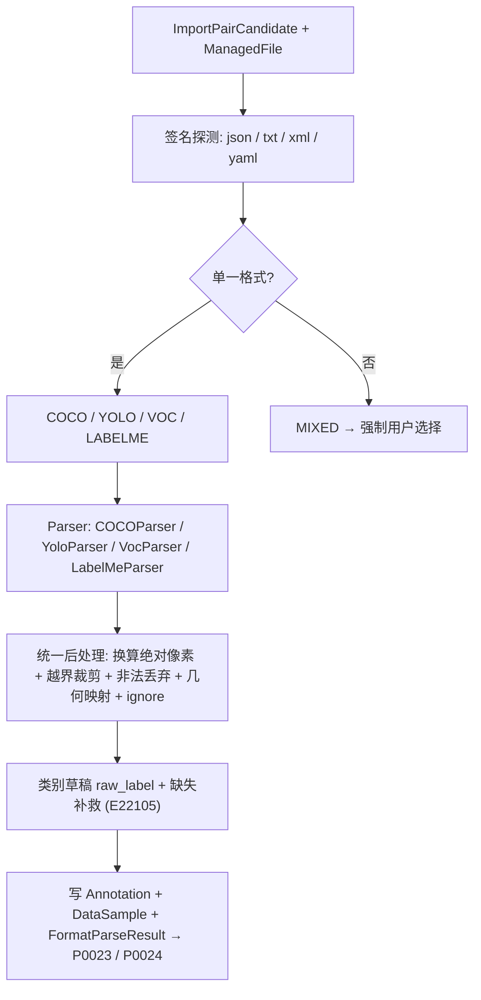
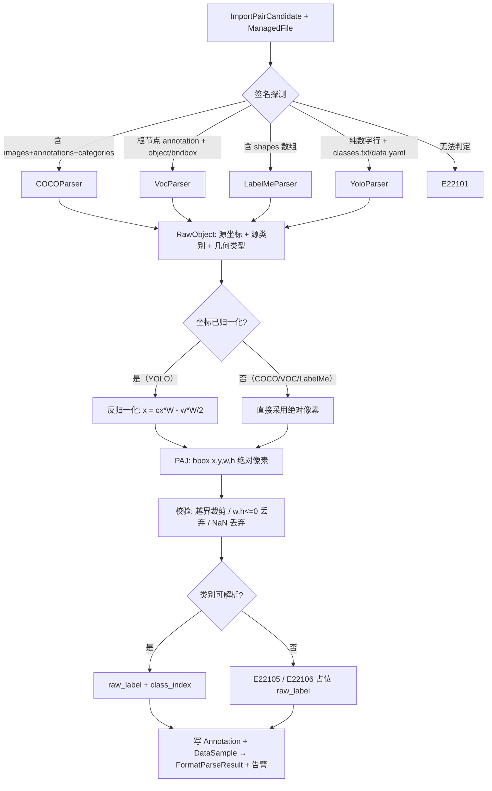
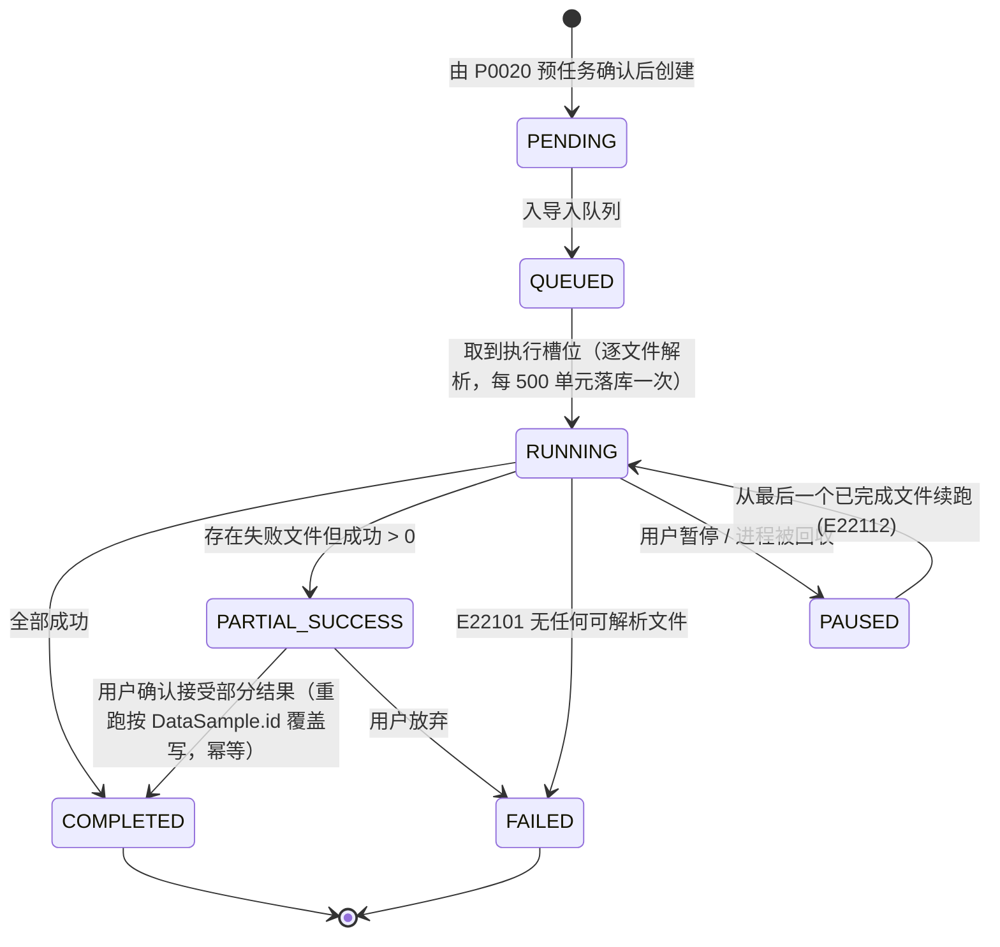
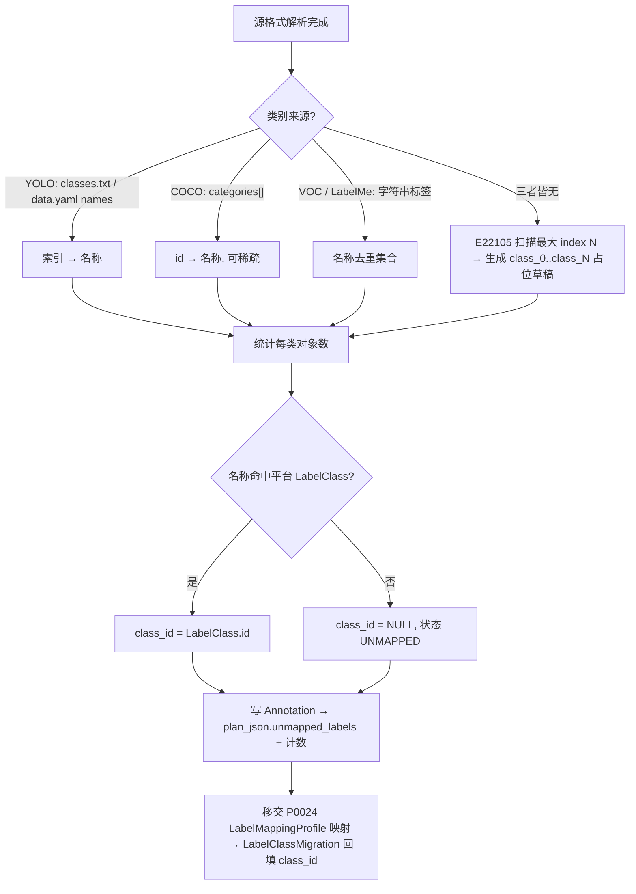
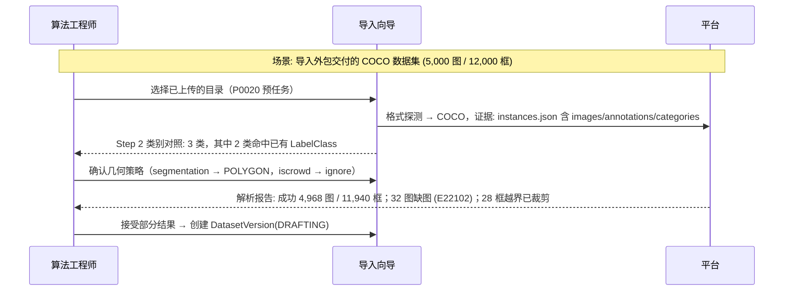
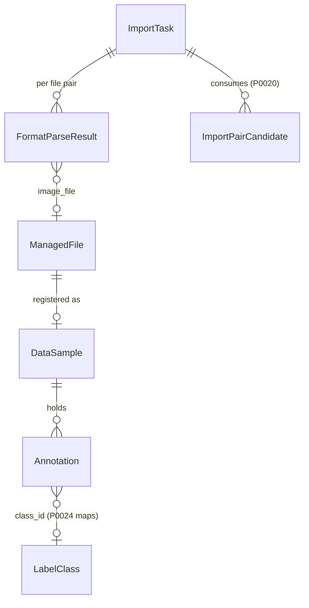

# PRD: P0021_标准数据集格式导入 (Standard Dataset Format Import)

| 属性 | 内容 |
| :--- | :--- |
| **文档编号** | P0021 |
| **功能模块** | M02_数据导入 |
| **当前版本** | v1.0.0 |
| **文档状态** | Draft |
| **作者** | FoodYolo Team |
| **最后更新** | 2026-10-01 |

---

## 1. 全局说明

> [!IMPORTANT]
> **核心定位**: 把四种主流检测格式（**COCO JSON / YOLO txt / Pascal VOC XML / LabelMe JSON**）解析为平台统一内部标注格式 **PAJ (Platform Annotation JSON)**。PAJ 采用 **COCO 语义的绝对像素坐标**——首个 Trainer Backend 为 YOLOX（Apache-2.0），训练侧原生吃 COCO，内部存绝对像素可避免"归档归一化、训练再乘回去"的反复舍入；**归一化只发生在 YOLO 边界**（公式见 8.3）。
> 本模块只做"源格式 → 内部格式"的单向解析与校验：类别到 `LabelClass` 的映射归 P0024，损坏/重复检测归 P0023，导出回标准格式归 P0045。

### 名词解释

*   **PAJ (Platform Annotation JSON)**: 平台内部标注格式，一图一文档，几何坐标为**绝对像素**，`class_id` 指向 `LabelClass`（未映射时为 `NULL` 并保留 `raw_label`）。
*   **ImportTask（导入任务）**: 批次执行载体（P0020 定义）。解析以 `job_type = FORMAT_PARSE` 记录在同一批次上，复用其 `stage` / `progress` / `warnings`。
*   **Geometry Type（几何类型）**: `BBOX` / `POLYGON` / `KEYPOINT` / `OBB`，与 04 标注中心 P0060 共用枚举。
*   **归一化 / 反归一化**: 像素坐标 ÷ 图片尺寸得到 `[0,1]` 浮点（YOLO 原生表示）；反之为反归一化。
*   **`iscrowd` / `difficult`**: COCO 与 VOC 的"不可分割区域"与"难样本"标记，统一映射为 `ignore = true`（保留但不参与 loss）。
*   **`raw_label` / `UNMAPPED`**: 源文件中的原始标签名或索引（原样保留，作为 P0024 映射输入）；已解析但 `class_id` 未确定的对象状态。
*   **OBB / COCO 目录约定**: 旋转框（YOLO-OBB 原生四点归一化，平台存 `cx,cy,w,h,angle`）；COCO 标准结构为 `images/` + `annotations/*.json`，`file_name` 相对 `images/`。

### 统一异常处理

| Code | 场景 | 处理策略 |
| :--- | :--- | :--- |
| `E22101` | 目录内无任何可识别标注文件（或全部为空） | `ImportTask.status = FAILED`，提示"未找到可解析的标注文件" |
| `E22102` | 标注引用的图片不存在（COCO `image_id`、VOC `filename` 找不到文件） | 该 image 及其全部对象跳过并计入 `orphan_annotations`；部分成功继续 |
| `E22103` | JSON 解析失败（语法错误、BOM/编码异常、非对象根节点） | 该文件标记 `FAILED` 并记录首行错误位置；不阻断其余文件 |
| `E22104` | XML 解析失败（非法实体、缺少 `<bndbox>`、坐标非数值） | 该 `<object>` 跳过；整个文件无可用 object 时该文件 `FAILED` |
| `E22105` | 类别定义缺失（无 `classes.txt` / `data.yaml`，COCO `categories` 为空） | 生成 `class_0..class_N` 占位草稿，`plan_status = NEEDS_REVIEW`，向导强制确认 |
| `E22106` | 类别索引越界（YOLO `class` ≥ `names` 长度；COCO `category_id` 不在 `categories`） | 该行/对象跳过并计入 `warnings`，写 `raw_label = "unknown:{index}"` |
| `E22107` | 坐标非法（`w`/`h ≤ 0`、NaN、±Inf、非数值） | 丢弃该对象并计入 `invalid_objects`；不写库 |
| `E22108` | 图片实际尺寸与标注声明不一致（COCO `width/height`、LabelMe `imageWidth/Height`） | 以**实际探测尺寸**为准并覆盖声明值，记 `size_mismatch` 告警 |
| `E22109` | 坐标越出图片边界 | 裁剪（clamp）到 `[0, W] × [0, H]`；裁剪后 `w`/`h ≤ 0` 则丢弃该对象 |
| `E22110` | 混合格式目录（同时存在 COCO 与 VOC 等） | `detected_format = MIXED`，向导强制选择主格式或分批导入 |
| `E22111` | 不支持的几何类型（LabelMe `circle`/`line`/`linestrip`） | 默认丢弃并计数；用户可在向导中选择"降级为外接 BBOX" |
| `E22112` | 解析中断（进程被杀 / 磁盘满 / 超时） | 已完成部分标记 `PARTIAL_SUCCESS`，可按 `FormatParseResult` 断点续跑 |

---

## 2. 项目背景

### 背景 (Context)

FoodYolo 的存量数据来自多家外包与历史项目，格式高度分散：公开数据集多为 COCO；标注团队内部工具链习惯 YOLO txt；老项目与高校团队用 Pascal VOC；个人标注常用 LabelMe。它们虽然"看起来都是框"，但**坐标约定、类别定义方式、几何类型各不相同**。

### 问题陈述 (Problem Statement)

1.  **归一化与像素混用是最大的坑**: YOLO 是归一化中心点，COCO/VOC/LabelMe 是绝对像素左上角；用错会导致框整体偏移或缩成小点，且训练前不可见。
2.  **类别定义没有唯一出处**: COCO 用 `categories[].id`（可稀疏），YOLO 用行号索引（依赖外部 `classes.txt` / `data.yaml`），VOC/LabelMe 用字符串标签，三者不能直接对齐。
3.  **几何类型与失败语义不统一**: COCO 有 `segmentation`，LabelMe 有 `polygon`/`point`，YOLO 有 OBB 与分割变体，VOC 只有矩形；一份 5,000 图的 COCO 里若有 30 张图缺图、200 个 `w <= 0` 的框，传统做法是整批失败或静默丢弃。

### 目标与成功指标 (Goals & Success Metrics)

*   **北极星指标**: 四种格式的**零手工转换**导入成功率 ≥ 98%（判据：解析对象数与源文件对象数一致，忽略 `ignore=true` 与越界裁剪对象）。
*   **次要指标**: 坐标换算往返误差 ≤ 0.01 px；10 万对象解析 ≤ 30 秒；`UNMAPPED` 对象在预处理报告中 100% 可见；任一非法单文件不导致整批失败。

### 风险与规避 (Risks & Mitigation)

| 风险 | 影响 | 规避方案 |
| :--- | :--- | :--- |
| 坐标约定误判 | 训练集整体错位，指标假性归零 | 量纲自检：数值全部 ≤ 1.0 且存在非整数 → `NORMALIZED`，否则 `PIXEL`，结论写入 `FormatParseResult.coord_convention` |
| 类别索引与名称错配 | 类别全错但看不出来 | 保留 `raw_label`，向导展示"索引 → 名称 → 样本数"对照表强制确认 |
| 巨型 COCO JSON 载入内存 / 多文件类别 id 冲突 | 单机 OOM；合并后类别串味 | 流式解析按 `images[]` 分片落库（内存 ≤ 512 MiB）；按 `(name, supercategory)` 归一化并重映射 `category_id`，冲突写 `warnings` |
| VOC 1-based 闭区间 ±1px | 框边缘轻微偏移 | 统一按 `xmax - xmin` 计算宽，误差 ≤ 1 px，记 `coord_convention = VOC_1BASED` 供 P0045 回写 |

---

## 3. 价值模型

*   **方案**: **格式探测 + 可插拔 Parser + 统一后处理 + PAJ 落库**的解析管线。Parser 只负责"源格式 → 原始对象"，坐标换算、越界裁剪、类别缺失补救、告警聚合由统一后处理层完成。
*   **目标**: 用户只需在向导确认"格式、类别对照、几何降级策略"三件事；任何单文件异常都不让整批失败，且异常明细可下钻。

---

## 4. 项目范围

### 功能结构图



### In Scope（包含范围）

1.  四种格式解析器：COCO JSON（含 `segmentation` 多边形）、YOLO txt（BBOX / OBB / 分割变体，`classes.txt` 与 `data.yaml` 两种类别来源）、Pascal VOC XML、LabelMe JSON。
2.  格式自动探测与 `MIXED` 场景的强制决策；量纲自检（`PIXEL` / `NORMALIZED` / `VOC_1BASED`）。
3.  坐标归一化 / 反归一化与统一绝对像素内部格式；几何类型映射（`rectangle → BBOX`、`polygon → POLYGON`、`point → KEYPOINT`、YOLO 四点 → `OBB`）；`iscrowd` / `difficult` → `ignore`。
4.  类别定义缺失的补救（占位草稿 + 强制确认），输出 `raw_label` 供 P0024 映射。
5.  逐文件容错与部分成功语义，输出 `FormatParseResult` 明细；多份 COCO JSON 合并与类别 id 重映射。
6.  大字面量文件的内存保护（流式解析，内存上限 512 MiB）。

### Out of Scope（不包含范围）

*   **类别映射到 `LabelClass`**：归 P0024；本模块只产出 `raw_label` 与占位草稿，**不创建** `LabelClass`。
*   **导出为标准格式**（P0045）、**图像技术校验**（P0023）：本模块的 `coord_convention` 为前者提供回写依据。
*   **不支持的格式**: RLDS / TFRecord / HDF5 / Zarr / 自定义格式；**COCO RLE 掩码解码**（`iscrowd=1` 的 RLE 只保留 `bbox` 并置 `ignore`）；**关键点骨架拓扑**（只存点与可见性）。

---

## 5. 业务流程

### 5.1 格式转换总流程



### 5.2 解析任务状态机（`ImportTask.job_type = FORMAT_PARSE`）



### 5.3 类别定义缺失的补救流程



---

## 6. 用户分析

### 6.1 用户画像 (User Personas)

*   **算法工程师 (TRAINER) —— 主要用户**。职责：把外部数据集转成可训练版本。诉求："我不管你内部怎么存，别把框搞歪、别把类别搞乱，异常要告诉我。"痛点：坐标约定错误导致指标异常却查不出原因。
*   **数据管理员 (ADMIN) —— 次要用户**。职责：接收外包交付、核对质量。诉求："我要一份逐文件解析明细，能直接发给外包要求返工。"痛点：只有"导入失败"四个字，没有明细。
*   **标注员 (ANNOTATOR) —— 间接用户**。职责：在已有标注上修正。诉求：导入的框、多边形、关键点能在标注器正常打开与编辑，`ignore` 对象不干扰画布。

### 6.2 用户链路图 (User Journey Map)



---

## 7. 功能需求

### M02.F01 格式探测、向导与部分成功 (Format Detection, Wizard & Partial Success)

*   **用户故事**: 作为算法工程师，我希望平台自动判断格式、单文件异常不阻断整批，并在无法判断时让我选。
*   **逻辑与业务规则**:
    *   **探测顺序**: 逐文件只读前 64 KiB——根对象含 `images`+`annotations`+`categories` → COCO；含 `shapes` → LabelMe；XML 根节点为 `annotation` 且含 `<object><bndbox>` → VOC；文本行匹配 `^\d+(\s+-?\d*\.?\d+)+$` 且存在 `classes.txt`/`data.yaml` → YOLO。
    *   **量纲自检**: 数值全部 ∈ `[0,1]` 且存在非整数 → `coord_convention = NORMALIZED`；否则 `PIXEL`。写入 `FormatParseResult`。
    *   **混合、失败与幂等**: 多格式共存 → `MIXED`（`E22110`）强制选择，无法判定 → `E22101`；成功 > 0 且失败 > 0 → `PARTIAL_SUCCESS` 可选接受；一个"文件对"为一个执行单元、每 500 单元落库一次，重跑按 `DataSample.id` 覆盖写，`progress` 按"已处理单元 / 总数"上报，可暂停续跑（`E22112`）。
*   **验收标准**:
    ```gherkin
    场景: 识别 COCO 数据集并接受部分结果
      Given 目录中含 instances.json（根对象含 images、annotations、categories）
      And 其中 32 张图引用了不存在的图片文件
      When 执行格式探测与解析
      Then detected_format = "COCO" 且 coord_convention = "PIXEL"
      And ImportTask.status = PARTIAL_SUCCESS
      And FormatParseResult 中 4,968 条 status = SUCCESS、32 条 error_code = E22102
    ```
*   **边界情况与异常处理**:

    | 场景 | 处理 |
    | :--- | :--- |
    | 目录同时含 COCO 与 VOC | `MIXED`（`E22110`），强制二选一或分批导入 |
    | JSON 前 64 KiB 被截断（超大单行） | 回退为流式探测前 1 MiB，仍无法判定则 `E22101` |
    | 解析中进程被 OOM Kill / 磁盘写满 | 已完成文件不回滚，重启后从最后一个成功单元续跑（`E22112` / `E22004`） |

### M02.F02 COCO JSON 解析 (COCO Parser)

*   **用户故事**: 作为算法工程师，我希望直接导入标准 COCO JSON（含 `bbox` 与 `segmentation`），以便复用公开数据集与外包交付。
*   **逻辑与业务规则**:
    *   **坐标**: `bbox = [x, y, w, h]` 为**绝对像素、左上原点**，恒等映射为 PAJ 的 BBOX。
    *   **图片定位**: `images[].file_name` 相对 `annotations/*.json` 的 `../images/`；找不到时回退为按 basename 在已配对文件中全局匹配，仍找不到 → `E22102`。
    *   **类别**: `category_id` 可稀疏（1/3/7），按 `categories[].id → name` 建映射；`categories` 为空但 `annotations` 有 `category_id` → `E22105`。
    *   **几何标记与合并**: 多边形数组形式的 `segmentation` 额外产出 `POLYGON`，`iscrowd = 1` → `ignore = true`，RLE 只保留 `bbox`；多份 JSON 按 `(name, supercategory)` 归一化类别并重映射 `category_id`，`image_id` 冲突重新编号，`date_captured` 写入 `DataSample.captured_at`。
*   **验收标准**:
    ```gherkin
    场景: 导入含稀疏 category_id 的 COCO 数据集
      Given categories 为 [{id:1,name:"date_region"},{id:3,name:"logo"}]
      And annotations 中 category_id 取值为 1 与 3
      When 执行解析
      Then 产出两类 raw_label："date_region" 与 "logo"
      And 不存在 category_id = 2 的空类别
    ```
*   **边界情况与异常处理**:

    | 场景 | 处理 |
    | :--- | :--- |
    | `image_id` 指向不存在的图片 | 该 annotation 跳过，计入 `orphan_annotations`（`E22102`） |
    | `bbox` 宽或高 ≤ 0 | 丢弃该对象，计入 `invalid_objects`（`E22107`） |
    | 巨型 JSON（> 2 GB） | 流式解析，内存上限 512 MiB，超限报 `E22112` |

### M02.F03 YOLO txt 解析 (YOLO txt Parser)

*   **用户故事**: 作为算法工程师，我希望导入 YOLO 格式的 `labels/*.txt` 与 `classes.txt`/`data.yaml`，以便直接使用标注团队交付。
*   **逻辑与业务规则**:
    *   **坐标**: `cx cy w h` 为**归一化 `[0,1]`**（中心点 + 宽高），反归一化公式见 8.3；类别号为**行号索引**（0-based），名称来自 `classes.txt` 行序或 `data.yaml` 的 `names`（list 或 dict）。
    *   **行形态判定**（类别号之后的数值个数）: 4 → `BBOX`；8 → 依 `data.yaml::task` 或向导选择（`obb` → OBB；`segment` → 四点 POLYGON；未声明默认 OBB 并告警）；偶数 ≥ 10 → `POLYGON`；其他 → `E22111`。
    *   **类别缺失与容错**: 无 `classes.txt` 且无 `data.yaml` → 扫描最大索引生成占位草稿（`E22105`），索引 ≥ 名称数量 → `E22106`；空行与 `#` 注释行跳过，`\t` 或多空格分隔均可；标签文件为空视为"该图无目标"（`annotation_status = UNLABELED`），图片无对应 txt 走 `ImportPairCandidate.rule = R6_NONE`。
*   **验收标准**:
    ```gherkin
    场景: 解析 YOLO bbox 行
      Given labels/2026-08-01_A_001.txt 内容为 "0 0.5234 0.4815 0.1823 0.0556"
      And classes.txt 第 1 行为 date_region，对应图片尺寸为 1920x1080
      When 执行解析
      Then 生成 1 个 BBOX 对象，raw_label = "date_region"
      And bbox = [829.92, 489.996, 350.016, 60.048]（绝对像素）
    ```
*   **边界情况与异常处理**:

    | 场景 | 处理 |
    | :--- | :--- |
    | 数值 > 1.0（误写为像素） | 量纲自检判为像素，记 `coord_convention_anomaly` 并在向导告警 |
    | `data.yaml` 的 `names` 为 dict（稀疏索引） | 按 key 建索引映射，缺失 key → `E22105` 占位 |
    | 未声明 `task` 且行内 8 个数值 | 默认按 OBB 解析，预任务告警提示可改判为四点 POLYGON |

### M02.F04 Pascal VOC XML 解析 (VOC Parser)

*   **用户故事**: 作为算法工程师，我希望导入老项目的 VOC XML 标注，以便不丢弃历史数据。
*   **逻辑与业务规则**:
    *   **坐标**: `<bndbox>` 的 `xmin/ymin/xmax/ymax` 为**绝对像素、1-based 闭区间**（VOC 原始约定）；按 `w = xmax - xmin`、`h = ymax - ymin` 转 BBOX（差异 ≤ 1 px），记 `coord_convention = VOC_1BASED`。
    *   **图片定位**: `<filename>`（必要时拼 `<folder>`）在配对目录与 `JPEGImages/` 中查找；`<path>` 忽略（跨机器不可靠）。
    *   **尺寸、标记与类别**: `<size>` 仅作参考、以实际探测为准（`E22108`）；`difficult = 1` → `ignore = true`，`truncated` / `pose` 保留在 `Annotation.meta_json`；`<object><name>` 字符串去重集合 → `raw_label`。
*   **验收标准**:
    ```gherkin
    场景: 解析 VOC bndbox
      Given Annotations/a.xml 含 <bndbox><xmin>830</xmin><ymin>490</ymin><xmax>1180</xmax><ymax>550</ymax></bndbox>
      When 执行解析
      Then 生成 BBOX 对象，bbox = [830, 490, 350, 60]
      And coord_convention = "VOC_1BASED"
    ```
*   **边界情况与异常处理**:

    | 场景 | 处理 |
    | :--- | :--- |
    | `xmax ≤ xmin` | 丢弃该 object 并计入 `invalid_objects`（`E22107`） |
    | XML 无 `<size>` 节点 | 以实际图片尺寸补齐尺寸字段 |
    | `<object>` 无 `<name>` / 同文件重复 `<filename>` | 前者跳过并记 `E22105`；后者以配对结果为准 |

### M02.F05 LabelMe JSON 解析 (LabelMe Parser)

*   **用户故事**: 作为算法工程师，我希望导入 LabelMe 标注（矩形、多边形、点），以便复用个人与小型团队的标注。
*   **逻辑与业务规则**:
    *   **坐标**: `shapes[].points` 为**绝对像素**；`rectangle` 两点为左上与右下。
    *   **几何映射**: `rectangle` → `BBOX`；`polygon` → `POLYGON`（点数 ≥ 3）；`point` → `KEYPOINT`（单点 + `visibility = 2`）；`circle`/`line`/`linestrip` → 默认丢弃（`E22111`），可选降级为外接 BBOX。
    *   **定位与其余字段**: `imagePath`（可含子目录）相对 JSON 所在目录，`imageData` 非空时忽略，`imageWidth`/`imageHeight` 与实际不符以实际为准（`E22108`）；`flags` / `group_id` 保留到 `Annotation.meta_json`，`label` → `raw_label`，面积 < 1 px² 或自交的多边形标 `degraded = true` 但仍导入（交 04 质检判定）。
*   **验收标准**:
    ```gherkin
    场景: 导入含矩形与多边形的 LabelMe 文件
      Given a.json 含 rectangle(date, [[830,490],[1180,550]]) 与 polygon(logo, 5 个点)
      When 执行解析
      Then 生成 1 个 BBOX 与 1 个 POLYGON 对象
      And raw_label 分别为 "date" 与 "logo"
    ```
*   **边界情况与异常处理**:

    | 场景 | 处理 |
    | :--- | :--- |
    | `shape_type = circle` | 默认丢弃（`E22111`），可选降级为外接 BBOX |
    | `points` 为空数组 | 丢弃该 shape 并计入 `invalid_objects` |
    | `imagePath` 指向不存在的文件 | `E22102`，该 JSON 整体跳过 |

### M02.F06 坐标换算与类别缺失补救 (Coordinate Conversion & Category Fallback)

*   **用户故事**: 作为算法工程师，我希望归一化与像素坐标统一且可反向换算、类别缺失时给出可操作补救，以便导入结果可信。
*   **逻辑与业务规则**:
    *   **存储口径**: PAJ 一律存**绝对像素 `float64`**；归一化值仅在 YOLO 边界出现（公式与精度见 8.3）。
    *   **越界与类别补救**: clamp 到 `[0, W] × [0, H]`，裁剪后 `w ≤ 0` 或 `h ≤ 0` → 丢弃（`E22109` / `E22107`）；类别缺失时生成 `class_{i}` 占位草稿 + `plan_status = NEEDS_REVIEW` + 向导强制确认，输出 `raw_label` 交 P0024，**本模块不创建 `LabelClass`**。
    *   **未映射对象**: `class_id = NULL`、状态 `UNMAPPED`，报告中单列；训练前未解决则该对象被忽略（不报错但计数可见）。
*   **验收标准**:
    ```gherkin
    场景: 未映射类别进入报告
      Given 一份 COCO 数据集含类别 "expiry-date"，平台 LabelClass 中不存在该名称
      When 解析完成
      Then 该对象 class_id = NULL 且 raw_label = "expiry-date"
      And plan_json.unmapped_labels 包含 {"raw_label": "expiry-date", "object_count": 812}
      And ImportTask.plan_status = "NEEDS_REVIEW"
    ```
*   **边界情况与异常处理**:

    | 场景 | 处理 |
    | :--- | :--- |
    | 归一化值略超 `[0,1]`（如 1.0002） | 容忍 1e-3 容差，clamp 后继续；超出更多则 `E22109` |
    | 图片尺寸未知（无法探测） | 该对象标 `PENDING_SIZE`，待 P0023 探测后回填；期间不参与训练 |

---

## 8. 技术架构与数据模型

### 8.1 平台内部格式 PAJ (Platform Annotation JSON)

一图一文档，坐标**绝对像素 `float64`**，与 COCO 语义一致（便于向 YOLOX 训练侧直出 COCO）。

```json
{
  "schema": "foodyolo.annotation/v1",
  "image": {"width": 1920, "height": 1080, "file_name": "2026-08-01_A_001.jpg"},
  "source": "IMPORT:YOLO",
  "objects": [
    {"object_id": "0f3c1a52-...", "geometry_type": "BBOX", "class_id": 3,
     "raw_label": "date_region", "class_index": 0,
     "bbox": [829.92, 489.996, 350.016, 60.048],
     "ignore": false, "score": null, "transcription": null}
  ]
}
```

| 字段 | 类型 | 必填 | 说明 | 约束 |
| :--- | :--- | :--- | :--- | :--- |
| `schema` / `source` | String / Enum | Y | 格式版本 / 来源 | 固定 `foodyolo.annotation/v1`；来源 `IMPORT:COCO`/`IMPORT:YOLO`/`IMPORT:VOC`/`IMPORT:LABELME`/`MANUAL`/`PRE_ANNOTATION` |
| `image.width` / `image.height` | Int | Y | 实际像素尺寸 | 由图片头部探测，**非**标注声明值 |
| `objects[].object_id` | UUID | Y | 对象唯一 id | 重跑覆盖写时保持稳定 |
| `objects[].geometry_type` | Enum | Y | 几何类型 | `BBOX`/`POLYGON`/`KEYPOINT`/`OBB` |
| `objects[].class_id` | Int | N | 平台 `LabelClass.id` | 未映射为 `NULL` → 状态 `UNMAPPED` |
| `objects[].raw_label` | String | Y | 源标签名或索引原样值 | 供 P0024 映射，解析期禁止改写 |
| `objects[].bbox` | Float[4] | Cond. | `[x, y, w, h]` 绝对像素 | `BBOX`/`OBB` 必填，`w, h > 0` |
| `objects[].segmentation` | Float[][] | Cond. | 多边形点列绝对像素 | `POLYGON` 必填，点数 ≥ 3 |
| `objects[].keypoints` | Object | Cond. | `{x, y, visibility}` | `KEYPOINT` 必填，`visibility ∈ 0/1/2` |
| `objects[].obb` | Float[5] | Cond. | `[cx, cy, w, h, angle_deg]` | `OBB` 必填，`angle ∈ (-90, 90]` |
| `objects[].ignore` | Bool | Y | 是否忽略 | 来自 `iscrowd=1` / `difficult=1` |
| `objects[].score` / `transcription` | Float / String | N | 置信度 / 字符转写 | 导入恒为 `null`；分别由 04 P0064、P0065 填写 |

### 8.2 四种外部格式的字段结构

#### COCO JSON

| 字段 | 层级 | 类型 | 必填 | 说明 / 约束 |
| :--- | :--- | :--- | :--- | :--- |
| `images[].id` | images | Int | Y | 图片唯一 id（JSON 内唯一） |
| `images[].file_name` | images | String | Y | 相对路径，基准目录默认 `../images/` |
| `images[].width` / `height` / `date_captured` | images | Int / String | Y / N | 像素尺寸与实际不符时以实际为准（`E22108`）；`date_captured`（ISO8601）→ `DataSample.captured_at` |
| `annotations[].id` / `image_id` | annotations | Int | Y | 标注唯一 id；`image_id` 悬空则 `E22102` |
| `annotations[].category_id` | annotations | Int | Y | FK → `categories[].id`，**可稀疏** |
| `annotations[].bbox` | annotations | Float[4] | Y | `[x, y, w, h]` **绝对像素**，左上原点 |
| `annotations[].area` / `iscrowd` | annotations | Float / Int | N | 面积仅用于一致性校验；`iscrowd = 1` → `ignore = true` |
| `annotations[].segmentation` | annotations | Array | N | 多边形点列（绝对像素）→ `POLYGON`；RLE 不解析 |
| `categories[].id` / `name` / `supercategory` | categories | Int / String | Y/Y/N | `name` → `raw_label`；`supercategory` 用于多文件合并去重 |

#### YOLO txt

| 文件 | 说明 |
| :--- | :--- |
| `labels/<stem>.txt` | 每行一条标注，空白分隔，无表头，与同 stem 图片配对 |
| `classes.txt` | 每行一个类别名，**行号（0-based）= class index** |
| `data.yaml` | `names`（list 或 dict）、`nc`、`task`（`detect`/`obb`/`segment`）、`train`/`val` 路径 |

| 行变体 | 排列 | 数值含义 | 映射 |
| :--- | :--- | :--- | :--- |
| bbox | `class cx cy w h` | 归一化 `[0,1]` 中心点 + 宽高 | `BBOX` |
| OBB | `class x1 y1 x2 y2 x3 y3 x4 y4` | 归一化四点（顺时针） | `OBB`（转 `cx,cy,w,h,angle`） |
| 分割 | `class x1 y1 ... xn yn`（n ≥ 3） | 归一化多边形点 | `POLYGON` |

#### Pascal VOC XML

| 节点 | 类型 | 必填 | 说明 / 约束 |
| :--- | :--- | :--- | :--- |
| `annotation/filename` / `folder` | String | Y / N | 图片文件名与目录提示，用于定位 |
| `annotation/size/width` `height` `depth` / `segmented` | Int | N | 参考尺寸以实际为准（`E22108`）；`segmented = 1` 表示存在分割信息，平台不解析 VOC 分割 |
| `annotation/object/name` | String | Y | 类别名 → `raw_label`；缺失则 `E22105` |
| `annotation/object/pose` / `truncated` | String / Int | N | 保留到 `Annotation.meta_json` |
| `annotation/object/difficult` | Int | N | `1` → `ignore = true` |
| `annotation/object/bndbox/xmin` `ymin` `xmax` `ymax` | Int | Y | **绝对像素，1-based 闭区间**；`w = xmax - xmin` |

#### LabelMe JSON

| 字段 | 类型 | 必填 | 说明 / 约束 |
| :--- | :--- | :--- | :--- |
| `version` / `imagePath` / `imageData` | String | N / Y / N | 工具版本仅元数据；`imagePath` 相对 JSON 目录可含子目录；`imageData` 非空时忽略 |
| `imageWidth` / `imageHeight` | Int | Y | 声明尺寸，与实际不符以实际为准（`E22108`） |
| `shapes[].label` | String | Y | 类别名 → `raw_label` |
| `shapes[].points` | Float[2][] | Y | **绝对像素**点列；`rectangle` 为两点 |
| `shapes[].shape_type` | Enum | Y | `rectangle`/`polygon`/`point`/`circle`/`line`/`linestrip` |
| `shapes[].flags` / `group_id` | Object / Int | N | 保留到 `Annotation.meta_json` |

### 8.3 坐标换算规则与算例

**统一口径**: 内部 PAJ 存绝对像素；`W`、`H` 为图片实际像素尺寸；`float64` 存储，JSON 输出保留 2 位小数。

| 方向 | 公式 |
| :--- | :--- |
| YOLO → PAJ（反归一化） | `x = (cx - w/2) * W`，`y = (cy - h/2) * H`，`box_w = w * W`，`box_h = h * H` |
| PAJ → YOLO（归一化） | `cx = (x + box_w/2) / W`，`cy = (y + box_h/2) / H`，`w = box_w / W`，`h = box_h / H` |
| VOC → PAJ | `x = xmin`，`y = ymin`，`box_w = xmax - xmin`，`box_h = ymax - ymin` |
| LabelMe rectangle → PAJ | `x = min(x1,x2)`，`y = min(y1,y2)`，`box_w = \|x2-x1\|`，`box_h = \|y2-y1\|` |
| COCO → PAJ | 恒等（同为 `[x, y, w, h]` 绝对像素） |
| OBB 四点 → `cx,cy,w,h,angle` | `cx = mean(xi)`，`cy = mean(yi)`，`w/h` 取相邻边长的两组均值，`angle = atan2` 归一化到 `(-90, 90]` |

**精度策略**: 内部 `float64` 无舍入，输出 JSON 保留 2 位小数、归一化输出 6 位小数；往返误差：6 位小数 ≤ 5e-7（@1920 px 约 0.001 px），VOC 整数化往返 ≤ 1 px 且由 `coord_convention` 标记。

**同一目标在五种表示中的对照**: 图片 `2026-08-01_A_001.jpg`（`1920 × 1080`），目标为包装上的日期区域（`x≈829.92, y≈490, w≈350, h≈60`）。

| 格式 | 表示 | 值 |
| :--- | :--- | :--- |
| YOLO txt | `class cx cy w h`（归一化） | `0 0.523438 0.481481 0.182292 0.055556` |
| COCO JSON | `bbox [x, y, w, h]`（绝对像素） | `[829.92, 489.996, 350.016, 60.048]` |
| VOC XML | `xmin/ymin/xmax/ymax`（整数，1-based） | `830 / 490 / 1180 / 550` |
| LabelMe JSON | `points [[x1,y1],[x2,y2]]`（绝对像素） | `[[829.92, 489.996], [1179.936, 550.044]]` |
| **PAJ（内部）** | `bbox [x, y, w, h]` 绝对像素 `float64` | `[829.92, 489.996, 350.016, 60.048]` |

**逐步换算（输入一行 YOLO 标注 → 输出一行标准格式）**

输入: `labels/2026-08-01_A_001.txt` 内容 `0 0.5234 0.4815 0.1823 0.0556`；`classes.txt` 第 1 行 `date_region`；图片实际尺寸 `1920 × 1080`。

1. 解析行 → `class_index = 0`，`cx = 0.5234`，`cy = 0.4815`，`w = 0.1823`，`h = 0.0556`；数值个数 4 → `BBOX`。
2. 类别映射 → `raw_label = "date_region"`（`class_index 0` → `classes.txt[0]`）。
3. 反归一化 → `box_w = 0.1823 × 1920 = 350.016`；`box_h = 0.0556 × 1080 = 60.048`；`x = 0.5234 × 1920 − 350.016/2 = 1004.928 − 175.008 = 829.920`；`y = 0.4815 × 1080 − 60.048/2 = 520.020 − 30.024 = 489.996`。
4. 校验 → `w > 0`、`h > 0`、`x + w = 1179.936 ≤ 1920`、`y + h = 550.044 ≤ 1080`，无需裁剪。
5. **输出 PAJ 片段** → `{"geometry_type":"BBOX","raw_label":"date_region","bbox":[829.92, 489.996, 350.016, 60.048],"ignore":false}`
6. 训练侧 COCO 片段（由 P0045/P0100 生成）→ `{"id":10241,"image_id":4820,"category_id":1,"bbox":[829.92,489.996,350.016,60.048],"area":21017.76,"iscrowd":0}`
7. 反向导出 YOLO → `cx = (829.92 + 175.008)/1920 = 0.523400`，`cy = (489.996 + 30.024)/1080 = 0.481500`，`w = 350.016/1920 = 0.182300`，`h = 60.048/1080 = 0.055600` → 与输入一致（6 位小数往返无损）。

### 8.4 数据实体

复用契约实体 `ImportTask`（`job_type = FORMAT_PARSE`）/ `ManagedFile` / `DataSample` / `DatasetVersion` / `DatasetVersionItem` / `Annotation`（04 定义）/ `LabelClass`，仅新增一个模块内实体保存逐文件明细。

#### FormatParseResult（`format_parse_results`，模块内实体）

| 字段名 | 类型 | 必填 | 说明 | 约束 |
| :--- | :--- | :--- | :--- | :--- |
| `id` | UUID | Y | 主键 | PK |
| `import_task_id` | UUID | Y | 所属导入任务 | FK → ImportTask |
| `image_file_id` / `annotation_file_id` | UUID | N | 图片 / 标注文件 | FK → ManagedFile；COCO 合并文件按图拆分 |
| `format` / `coord_convention` | Enum | Y | 源格式 / 坐标口径 | `COCO`/`YOLO`/`VOC`/`LABELME`；`PIXEL`/`NORMALIZED`/`VOC_1BASED` |
| `object_count` / `ignored_count` / `invalid_objects` / `clamped_objects` | Int | Y | 成功 / 忽略 / 非法丢弃 / 越界裁剪对象数 | ≥ 0 |
| `unmapped_labels` | JSONB | N | 未映射标签及计数 | `[{raw_label, count}]` |
| `status` / `error_code` / `error_message` | Enum / String / Text | Y/N | 结果与首条错误 | `SUCCESS`/`PARTIAL_SUCCESS`/`FAILED`/`SKIPPED`；码取 `E22101`~`E22112` |
| `created_at` / `updated_at` | Timestamptz | Y | 通用审计字段 | |



---

## 9. UI/UX 规格说明

### 9.1 格式确认与类别对照（向导 Step 2）

```text
+-------------------------------------------------------------------------+
|  导入向导 (2/4) 格式与类别                                              |
+-------------------------------------------------------------------------+
|  探测结果: COCO  证据: instances.json 含 images+annotations+categories  |
|  坐标口径: PIXEL（绝对像素）   图片基准目录: ../images/                 |
+-------------------------------------------------------------------------+
|  类别对照 (12,000 个对象)                     [全部按名称自动匹配]      |
|  | 源类别名     | 对象数 | 平台 LabelClass | 状态            |          |
|  | date_region  |  8,412 | date_region     | ✅ 已匹配       |          |
|  | logo         |  2,776 | logo            | ✅ 已匹配       |          |
|  | expiry-date  |    812 | (未匹配)        | ⚠️ 待映射(P0024)|          |
+-------------------------------------------------------------------------+
|  策略: segmentation→[(•)保留 POLYGON ( )忽略]  iscrowd=1→[(•)标记 ignore]|
|        越界坐标  →[(•)裁剪到边界 ( )丢弃该对象]                        |
|  ⚠️ 32 张图片引用缺失 (E22102)，28 个框越界已裁剪 (E22109)              |
|                                    [上一步]   [开始解析]                |
+-------------------------------------------------------------------------+
```

### 9.2 解析报告

```text
+-------------------------------------------------------------------------+
|  解析报告  task_9f3a...  COCO  状态: ⚠️ 部分成功                        |
+-------------------------------------------------------------------------+
|  执行单元 5,000 (成功 4,968 / 失败 32)  对象 12,000 (有效 11,940 / 忽略 32 / 丢弃 28)|
|  ███████████████████████████████████░░  99.4%                           |
+-------------------------------------------------------------------------+
|  错误明细                                            [下载 CSV]         |
|  | 文件                        | 码     | 详情                   |      |
|  | images/2026-07-14_B_007.jpg | E22102 | 标注引用的图片不存在   |      |
|  | annotations/instances.json  | E22107 | 第 8841 行 bbox 宽为 0 |      |
+-------------------------------------------------------------------------+
|  未映射类别: expiry-date (812 个对象) [去映射 → P0024]                  |
|                                 [放弃]   [接受部分结果]                 |
+-------------------------------------------------------------------------+
```

### 9.3 交互元素与表单

| 元素 | 类型 | 状态 | 行为 |
| :--- | :--- | :--- | :--- |
| 主格式选择 | Radio | Enabled / Hidden | 仅 `MIXED` 时显示，选择后决定 Parser |
| 类别对照表 | Table + Select | 只读 / 可编辑 | 每行可选已有 `LabelClass`，未选项交 P0024 |
| 几何策略 / 开始解析 / 接受部分结果 | Radio / Button | Default / Loading / PARTIAL_SUCCESS 可见 | `segmentation` 与 `iscrowd` 各一组；创建 `ImportTask(job_type=FORMAT_PARSE)`，接受部分结果则置 `COMPLETED` |
| 下载错误明细 | Button | Enabled | 导出 `FormatParseResult` CSV |

| 字段 | 类型 | 校验规则 | 默认值 |
| :--- | :--- | :--- | :--- |
| 主格式 | Radio | required（`MIXED` 时） | 探测结果 |
| 图片基准目录 / 越界与无效对象处理 | Input / Radio | 相对路径存在性校验；处理策略 required | `../images/`（COCO 约定）/ 裁剪 / 丢弃 |
| 类别默认映射 | Checkbox | — | 勾选（按名称精确匹配） |

---

## 10. 非功能性需求 (NFR)

*   **性能与精度**: 10 万对象解析 ≤ 30 秒（单机），COCO 大 JSON 流式解析内存 ≤ 512 MiB，单文件解析 P95 < 200 ms（1,000 对象以内）；坐标统一 `float64`，归一化往返相对误差 ≤ 5e-7，VOC 整数化往返 ≤ 1 px 且由 `coord_convention` 标记，**任何路径都不得出现归一化值与像素值混存**。
*   **安全与可靠性**: 解析进程禁用 XML 外部实体（`resolve_entities = False`）防 XXE，JSON 深度限制 64 层，单文件 ≤ 2 GB；单文件失败不阻断整批、部分成功可续跑，`FormatParseResult` 逐单元持久化，进程被杀后不丢已完成结果。
*   **兼容性**: 覆盖 COCO 2017 与 Lvis 风格差异（多边形 / RLE 均可识别，RLE 不解析）；覆盖 YOLOv5/v8 的 bbox 与 OBB 变体；VOC 兼容 `annotation` / `Annotation` 根节点；LabelMe ≥ 4.x 与 5.x。
*   **可扩展性**: Parser 以注册表实现（`FormatParser` 接口：`probe()` + `iter_objects()`），新增格式（如 CVAT XML）无需改动后处理层；几何类型与坐标口径各自独立可扩展。

---

## 附录: 已确认的设计决策

| 决策项 | 结论 |
| :--- | :--- |
| 内部格式 | **PAJ**，绝对像素 `float64`，COCO 语义；归一化仅存在于 YOLO 边界且**不落库**（派生量） |
| 训练侧对接 | 直出 COCO（YOLOX 原生）；注释文件由平台生成 `instances_{train,val,test}2017.json`，对应 Exp 的 `train_ann` / `val_ann` / `test_ann` 与 `data_dir`；`data.yaml` 仅作为 YOLO 导入时的类别来源，**不是平台产物** |
| 类别归属 | 只产出 `raw_label` + 占位草稿；`LabelClass` 创建与映射归 P0024，回填由 `LabelClassMigration` 执行 |
| VOC 坐标约定 | 1-based 闭区间，`w = xmax - xmin`，误差 ≤ 1 px，记 `coord_convention = VOC_1BASED` |
| COCO RLE / 稀疏 category_id | RLE 不解析（保留 `bbox` 并置 `ignore`）；稀疏 id 按 `id → name` 精确映射，不假设连续 |
| YOLO 行形态歧义 / 几何降级 | 4 → BBOX；8 → 依 `data.yaml::task`，未声明默认 OBB 并告警；偶数 ≥ 10 → POLYGON；`circle`/`line`/`linestrip` 默认丢弃，可降级为外接 BBOX |
| 部分成功 / E 码 / Feature ID | 成功 > 0 即 `PARTIAL_SUCCESS` 可接受或放弃（明细可导出 CSV）；E 码 = `E22101`~`E22112`；Feature ID = `M02.F01`~`M02.F06` |

---

## 关联文档

*   **P0020_本地上传与压缩包导入**: 提供 `ImportPairCandidate` 与预任务确认
*   **P0022_视频抽帧**: 抽帧产物与本模块共用 PAJ 与 `DataSample` 契约
*   **P0023_导入预检与清洗** / **P0024_类别映射与标签对齐**: 消费 `FormatParseResult` 明细与 `raw_label`
*   **P0060_标注器与标注几何**: `geometry_type` 枚举与 `Annotation` 字段定义方；**P0045_数据集导出**: 依据 `coord_convention` 回写 COCO / YOLO / VOC

---

## Changelog

| 版本 | 日期 | 作者 | 变更说明 |
| :--- | :--- | :--- | :--- |
| v0.1.0 | 2026-10-01 | FoodYolo Team | 初稿：四格式解析、PAJ 内部格式、坐标换算与算例、部分成功语义 |
