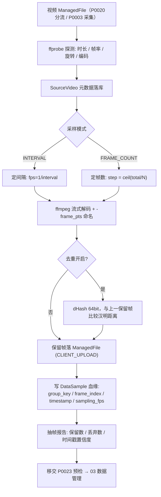
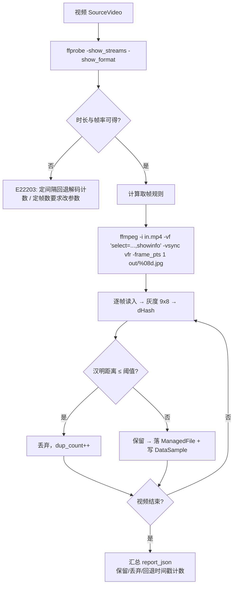
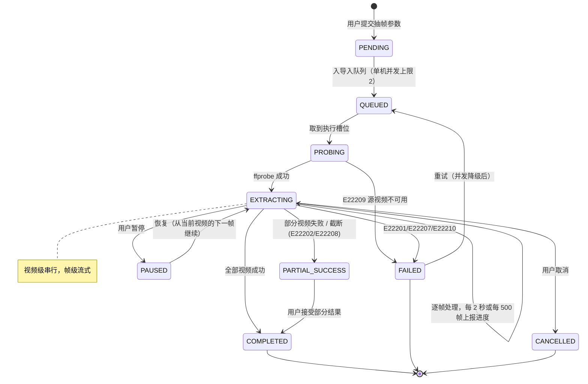
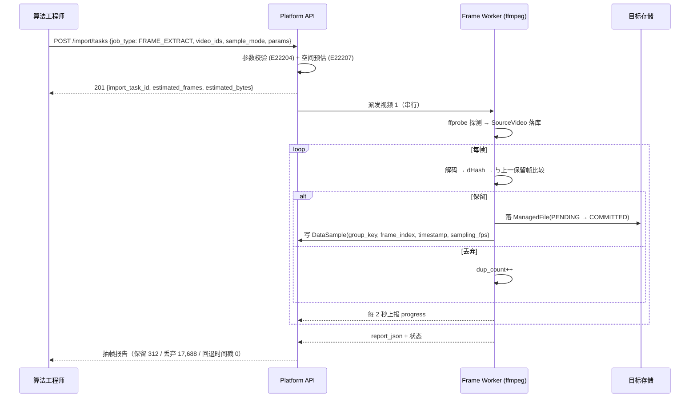
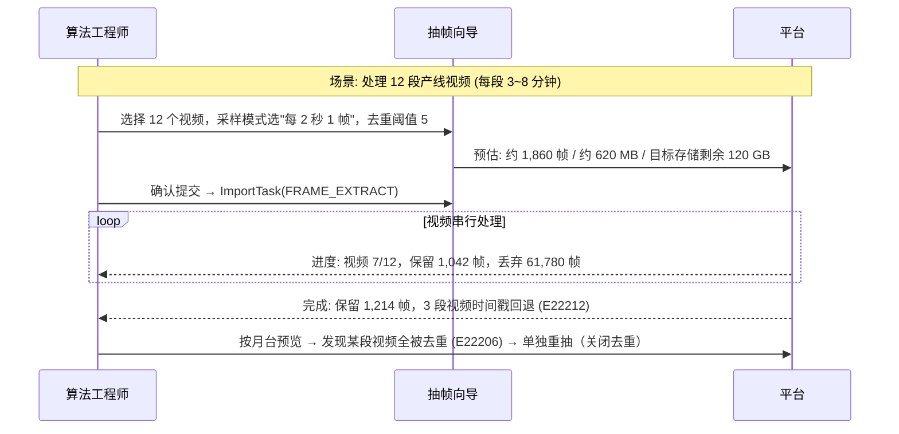
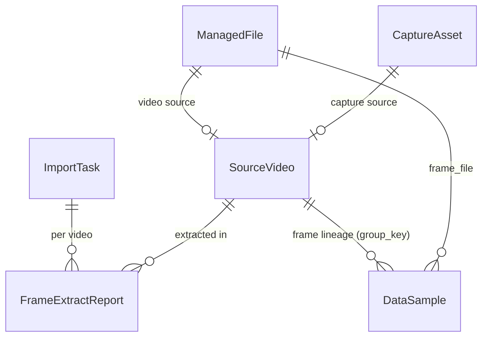

# PRD: P0022_视频抽帧 (Video Frame Extraction)

| 属性 | 内容 |
| :--- | :--- |
| **文档编号** | P0022 |
| **功能模块** | M02_数据导入 |
| **当前版本** | v1.0.0 |
| **文档状态** | Draft |
| **作者** | FoodYolo Team |
| **最后更新** | 2026-10-01 |

---

## 1. 全局说明

> [!IMPORTANT]
> **核心定位**: 把"拍摄/收到的产线视频"转成可标注的图像样本——支持**定间隔抽帧**与**定帧数抽帧**，内置**相邻帧去重**，并为每一帧落**可回溯的血缘**（`group_key + frame_index + timestamp + sampling_fps`）。
> **血缘是硬要求**: 同一段视频抽出的帧互为近邻，必须能识别同源，否则训练集切分时相邻帧会同时落进 train/val 造成指标虚高。`group_key` 是 06 流水线防泄漏切分（同版本同组不得跨 split）的唯一依据。
> 本模块的产出与 P0021 共用 PAJ 标注契约与 `DataSample`；清洗与重复检测归 P0023。

### 名词解释

*   **抽帧任务**: `ImportTask(job_type = FRAME_EXTRACT)`，一个批次可含多个源视频，每个视频是一个执行单元。
*   **定间隔抽帧 (Interval Sampling)**: 按固定时间间隔取帧，如"每 2 秒 1 帧"，与视频帧率无关，输出帧数随视频时长线性增长。
*   **定帧数抽帧 (Frame-count Sampling)**: 在整段视频上均匀取 N 帧（`step = ceil(total_frames / N)`），输出帧数恒定，与时长无关。
*   **`frame_index`**: **解码后**的帧序号（0-based，按显示顺序），不是关键帧序号，也不是文件字节位置。
*   **`pts` (Presentation Timestamp)**: 帧的显示时间戳。`timestamp = pts × time_base`（毫秒）。VFR 视频中帧序号与时间不是线性关系，必须存 `pts`。
*   **CFR / VFR**: 恒定帧率 / 可变帧率。VFR（手机录屏、部分监控流）下 `frame_index × (1/fps)` 推算时间会漂移。
*   **相邻帧去重**: 用感知哈希（dHash 64-bit）比较**当前帧与上一保留帧**的汉明距离，距离 ≤ 阈值判定为重复而丢弃。
*   **`group_key`**: 同源分组键 = `source_videos.id`（由采集来的视频则为 `CaptureAsset.id`），同组样本在版本切分中必须同进同出。
*   **`sampling_fps`**: 本视频的有效采样率 = 保留帧数 / 时长，写回 `DataSample` 供审计与复现。
*   **旋转元数据 (rotation)**: MP4 的 `rotate` 标记（手机竖拍常见 90/270）。ffmpeg 默认 `autorotate` 生效，抽出的帧尺寸与源分辨率可能互换。

### 统一异常处理

| Code | 场景 | 处理策略 |
| :--- | :--- | :--- |
| `E22201` | 容器或编码不受支持（非 ffmpeg 可解） | 该视频标记 `FAILED`，提示"不支持的视频格式"，其他视频继续 |
| `E22202` | 视频损坏 / 截断（moov 缺失、尾部截断） | 尽力抽到可解码部分并标 `PARTIAL_SUCCESS`，报告"第 X 秒后无法解码" |
| `E22203` | 元数据缺失（时长或帧率无法探测） | 定间隔模式回退为"解码计数"；定帧数模式需用户改参数（`E22204`） |
| `E22204` | 抽帧参数非法（间隔 ≤ 0、目标帧数 ≤ 0 或 > 100,000、step 计算为 0） | 拒绝提交并提示参数范围；定帧数模式下 `N > total_frames` 时退化为"每帧 1 张" |
| `E22205` | VFR 时间戳异常（pts 非单调、缺失、time_base 异常） | 丢弃该帧的 pts，改用 `frame_index / avg_fps` 推算并标 `pts_fallback = true`（`E22212`） |
| `E22206` | 去重阈值过松导致几乎全部被去重（保留帧数 < 源帧数 × 1%） | 停止并按"阈值可能过低"告警，保留已抽帧，提示用户降低阈值或关闭去重 |
| `E22207` | 目标存储空间不足 | 抽帧前按 `帧数 × 单帧预估大小 × 1.2` 预检，不足则拒绝（`E22004` 同源语义） |
| `E22208` | 抽帧任务超时（单视频 > 2 小时） | 中止该视频、保留已抽帧并标 `PARTIAL_SUCCESS`，可手动续抽 |
| `E22209` | 源视频不可用（已被 GC、路径失效、权限拒绝） | 跳过该视频并告警，不阻断其余视频 |
| `E22210` | 解码进程被 OOM Kill / 信号终止 | 该视频标 `FAILED` 并降级并发（`concurrency` 减 1）后重试一次 |
| `E22211` | 旋转元数据未应用，抽出帧宽高与源声明不一致 | 以**实抽帧尺寸**为准并记 `applied_rotation`，覆盖源的 `width/height` |
| `E22212` | 抽帧结果时间戳与源不一致（回退推算命中） | 记 `pts_fallback = true`，该帧 `timestamp` 置信度标 `ESTIMATED` |

---

## 2. 项目背景

### 背景 (Context)

食品包装产线上，手持设备与固定工位摄像头录下的视频是最容易拿到的数据：一次巡检 5 分钟、一段直播回放 40 分钟。但视频不是训练样本——**一秒钟 30 帧里，相邻帧几乎是同一张图**。以一个典型场景为例：

*   10 分钟 60 fps 的产线视频 = 36,000 帧，全部导出约 11 GB，其中 95% 以上是冗余；
*   真正有信息价值的变化（生产日期字样进入视野、包装换批次、光照变化）可能只占几十帧。

### 问题陈述 (Problem Statement)

1.  **冗余淹没有效样本**: 全量导出的帧直接进标注队列，标注员 90% 的时间在重复劳动。
2.  **没有时间轴就找不回原始片段**: 标注员看到一帧有问题，无法回答"这是哪段视频的第几秒"，无法回溯重抽或补抽。
3.  **大视频直接爆内存**: 用 OpenCV 之类逐帧读入内存、或先解码到临时目录，2 小时 4K 视频能把单机拖死。
4.  **参数一次定死、无法重抽**: 抽稀了想补帧、抽密了想减帧，都要从头再来。
5.  **相邻帧污染验证集**: 同源相邻帧被随机分到 train 与 val，mAP 虚高，模型上线即打脸。

### 目标与成功指标 (Goals & Success Metrics)

*   **北极星指标**: 抽出的帧进入标注队列后，**标注员的单帧有效产出无重复劳动**——去重后保留帧的相邻帧哈希距离均 > 阈值（默认 5）。
*   **次要指标**: 抽帧吞吐 ≥ 2× 实时（1080p，单机 CPU）；抽帧进程常驻内存 ≤ 512 MiB（与视频时长无关）；`group_key` 覆盖率 100%（FRAME_EXTRACT 产出的每个 `DataSample` 必有）；时间戳回溯准确率 ≥ 99%（`pts_fallback = false` 比例）。

### 风险与规避 (Risks & Mitigation)

| 风险 | 影响 | 规避方案 |
| :--- | :--- | :--- |
| 去重阈值过低（阈值小）导致帧几乎全留 | 标注成本不降 | 阈值默认 5，且保留率 < 1% 时反向告警（`E22206`）；向导展示"预计保留帧数" |
| VFR 视频时间戳漂移 | 回溯定位错 | 一律以 `pts` 为准；VFR 时禁用"按帧序推算时间"的优化路径 |
| 大帧 × 大帧数打满磁盘 | 后续抽帧失败 | 提交前按"帧数 × 单帧预估 × 1.2"预检剩余空间（`E22207`） |
| 抽帧进程 OOM | 任务失败、机器受影响 | 流式逐帧处理，不整段解码进内存；解码并发默认 1（最多 2） |
| 同源帧跨 split 泄漏 | 验证指标虚高 | `group_key` 强制写入，交由 06 流水线按组切分 |

---

## 3. 价值模型

*   **方案**: 以 ffmpeg 解码为单一执行单元，**参数化抽帧 + 流式哈希去重 + 血缘落库**三件事一体：解码出来的帧流式过一遍 dHash 去重器，保留帧直接落 `ManagedFile` 并写 `DataSample` 血缘，原始视频只作为 `SourceVideo` 元数据保留。
*   **目标**: 5 分钟 60 fps 视频（18,000 帧）可在 1 分钟内变成 200~400 张去重样本，且每张都能回答"来自哪个视频、第几帧、第几毫秒"。

---

## 4. 项目范围

### 功能结构图



### In Scope（包含范围）

1.  定间隔抽帧（按秒间隔）与定帧数抽帧（均匀 N 帧），两种模式可对同一视频分别执行并合并。
2.  ffprobe 元数据探测（时长、帧率、总帧数、旋转、编码、分辨率）与 VFR 判定。
3.  相邻帧去重（dHash 64-bit + 汉明距离阈值，默认 5），可关闭。
4.  帧血缘落库：`group_key` / `frame_index` / `timestamp`(ms) / `sampling_fps` / `pts_fallback`。
5.  抽帧任务队列：多视频串行/小并发执行、进度上报、暂停、取消、失败重试与续抽。
6.  流式资源控制：单视频解码常驻内存 ≤ 512 MiB，与时长无关；解码并发 ≤ 2。
7.  写盘前空间预估与预检（`帧数 × 单帧预估 × 1.2`）。
8.  旋转元数据处理与实抽尺寸回写。

### Out of Scope（不包含范围）

*   **视频转码 / 压缩 / 拼帧**：不做码率转换与视频编辑；仅抽帧。
*   **目标检测 / 自动裁剪**：不在本模块做内容识别；如后续接入 AI 预标注（P0064），属标注中心。
*   **音频轨处理**：忽略音频流。
*   **抽帧后再抽帧的两级血缘**：帧不二次抽帧（`group_key` 只在视频层）。
*   **分布式抽帧**：单机串行/小并发；不做多机分片（受单机 Local-First 约束）。

---

## 5. 业务流程

### 5.1 抽帧执行流程



### 5.2 抽帧任务状态机（`ImportTask.job_type = FRAME_EXTRACT`）



### 5.3 抽取与去重交互



---

## 6. 用户分析

### 6.1 用户画像 (User Personas)

*   **算法工程师 (TRAINER) —— 主要用户**。职责：把产线视频转成可标注样本。诉求："给我每 2 秒一张，重复的别给我，而且我要知道每张来自哪个视频第几秒。"痛点：抽帧工具要么不支持时间戳回溯，要么去重参数玄学。
*   **数据管理员 (ADMIN) —— 次要用户**。职责：管理磁盘与任务。诉求："抽之前告诉我大概占多少空间，别抽到一半盘满了。"痛点：抽帧任务无预估、无进度、失败无现场。
*   **标注员 (ANNOTATOR) —— 间接用户**。职责：标注抽出的帧。诉求：相邻帧不要重复出现；同一批次内的帧最好来自同一段视频，便于连续标注时保持上下文。

### 6.2 用户链路图 (User Journey Map)



---

## 7. 功能需求

### M02.F01 定间隔抽帧 (Interval Sampling)

*   **用户故事**: 作为算法工程师，我希望"每 N 秒取一帧"，以便用固定时间粒度覆盖整段视频（数据变化慢的产线场景）。
*   **逻辑与业务规则**:
    *   **参数**: `interval_sec`（0.05~600，默认 2）；等价 `target_fps = 1 / interval_sec`。
    *   **实现**: `ffmpeg -vf "fps=1/{interval_sec}"`；输出帧数 ≈ `duration_sec / interval_sec`（首帧为第 0 秒附近）。
    *   **元数据缺失时回退**: `duration` 不可得时以解码帧计数 + `avg_fps` 推算时间（标 `pts_fallback`）。
    *   **上限**: 单视频输出帧数 ≤ 100,000，超出则要求用户增大间隔（`E22204`）。
    *   **后置**: 每帧产出一条 `DataSample`（含 `frame_index`、`timestamp`）与一个 `ManagedFile(status = COMMITTED)`。
*   **验收标准**:
    ```gherkin
    场景: 对 5 分钟视频按每 2 秒抽帧
      Given 一段时长为 300 秒、60 fps 的 CFR 视频，去重关闭
      When 以 interval_sec = 2 提交抽帧
      Then 输出帧数为 150（允许 ±1）
      And 每帧 DataSample.sampling_fps ≈ 0.5
      And 第 10 帧的 timestamp ≈ 20000 ms（±1 帧时长）
    ```
*   **边界情况与异常处理**:

    | 场景 | 处理 |
    | :--- | :--- |
    | `interval_sec × 输出帧数 >` 视频时长 | 正常，最后一帧取到视频末尾附近 |
    | 间隔小于帧间隔（如 60 fps 取 0.01 秒） | 等价于逐帧导出，提示"间隔小于帧率，将导出全部帧" |
    | 时长探测为 0 | 走 `E22203` 回退路径，按解码计数取帧 |
    | 视频含多视频轨 | 只取第一条视频流，其余忽略并告警 |

### M02.F02 定帧数抽帧 (Frame-count Sampling)

*   **用户故事**: 作为算法工程师，我希望"不管视频多长，只均匀取 N 帧"，以便在有限标注预算下覆盖整段视频。
*   **逻辑与业务规则**:
    *   **参数**: `target_frames`（1~100,000，默认 300）；`step = max(1, ceil(total_frames / target_frames))`。
    *   **实现**: `ffmpeg -vf "select='not(mod(n,{step}))'" -vsync vfr`；`n` 为解码帧序号。
    *   **退化规则**: `target_frames ≥ total_frames` 时 `step = 1`（逐帧导出）并提示；`total_frames` 不可得时先按 `duration × avg_fps` 估算，抽完以实际为准修正 `sampling_fps`。
    *   **上限**: 输出帧数 ≤ 100,000；超出拒绝（`E22204`）。
    *   **后置**: 与 F01 相同的血缘落库；不同模式对同一视频可分别执行，帧按 `(group_key, frame_index)` 去重（同一帧不重复入库）。
*   **验收标准**:
    ```gherkin
    场景: 对 5 分钟 60fps 视频均匀取 300 帧
      Given 一段 18,000 帧的 CFR 视频
      When 以 target_frames = 300 提交抽帧
      Then 计算 step = 60
      And 输出帧数为 300
      And 相邻保留帧的 frame_index 差值恒为 60
    ```
*   **边界情况与异常处理**:

    | 场景 | 处理 |
    | :--- | :--- |
    | `target_frames > total_frames` | `step = 1` 并提示"目标帧数超过视频总帧数，将逐帧导出" |
    | VFR 视频 | `n` 仍为解码序，`timestamp` 取真实 `pts`；禁用按帧序推算时间的优化 |
    | 再次以不同 `target_frames` 抽同一视频 | 已入库帧按 `(group_key, frame_index)` 跳过，只补新增帧 |
    | 视频极长（> 4 小时） | 要求用户显式确认，且 `E22208` 超时阈值放宽到 4 小时 |

### M02.F03 相邻帧去重 (Adjacent-frame Deduplication)

*   **用户故事**: 作为算法工程师，我希望自动丢掉与上一张几乎一样的帧，以便标注预算花在真正有变化的画面上。
*   **逻辑与业务规则**:
    *   **算法**: 帧缩放到 9×8 灰度 → 逐行相邻像素比较得 64-bit dHash；与**上一保留帧**比较汉明距离（不与被丢弃帧比，避免链式漂移）。
    *   **阈值**: `hamming_threshold`（0~32，默认 5）；0 表示只丢完全相同的帧；可关闭去重（`dedup_enabled = false`）。
    *   **尺度**: 哈希计算在小图上完成（不保留原图解码缓冲），单帧额外内存 < 4 MB。
    *   **保护**: 保留率 < 源帧数的 1% 时中止并报 `E22206`（提示阈值可能过低或画面静止）。
    *   **落库**: 丢弃帧不产生 `ManagedFile`/`DataSample`，仅计入 `report_json.dup_count`；保留帧的 `dedup_prev_hash` 记录用于审计。
*   **验收标准**:
    ```gherkin
    场景: 静态画面视频去重
      Given 一段 600 帧的固定机位视频，画面几乎无变化
      When 以 hamming_threshold = 5 抽帧去重
      Then 保留帧数显著少于 600
      And 任意两个保留帧的哈希汉明距离 > 5
      And report_json.dup_count + 保留帧数 = 600
    ```
*   **边界情况与异常处理**:

    | 场景 | 处理 |
    | :--- | :--- |
    | 几乎全部被去重（保留率 < 1%） | 中止并报 `E22206`，保留已抽帧，提示降低阈值或关闭去重 |
    | 阈值非法（> 32 或负数） | 提交时拒绝（`E22204`） |
    | 光照渐变导致哈希缓慢漂移 | 因"只与上一保留帧比较"，漂移会被逐步吸收，不会一次性丢失整段 |
    | 纯色帧（哈希全 0）与任意纯色帧距离为 0 | 视为重复丢弃；若用户需要保留纯色样本可关闭去重 |

### M02.F04 帧血缘与时间戳回溯 (Frame Lineage & Timestamp Tracing)

*   **用户故事**: 作为算法工程师，我希望每一帧都能回答"来自哪个视频、第几帧、第几毫秒"，以便回溯原片、补抽和做防泄漏切分。
*   **逻辑与业务规则**:
    *   **血缘字段**（写入 `DataSample`，由本模块的 `FRAME_EXTRACT` 产出）: `group_key`（= `source_videos.id`，采集来源则为 `CaptureAsset.id`）、`frame_index`（解码序，0-based）、`timestamp`（毫秒整数）、`sampling_fps`（本视频有效采样率）、`pts_fallback`（布尔）、`source_video_id`。
    *   **时间戳来源优先级**: ① ffmpeg `-frame_pts 1` 输出的文件名（即真实 `pts`，配 `time_base` 换算毫秒）；② `showinfo` 日志中的 `pts_time`；③ 两者都不可得时按 `frame_index / avg_fps` 推算并标 `pts_fallback = true`（`E22212`）。
    *   **防泄漏**: `group_key` 为必需字段；06 流水线按 `(version_id, group_key)` 保证同源同组不跨 `TRAIN`/`VAL`/`TEST`（违反即 `E34111`）。
    *   **回溯能力**: 提供"按 `(source_video_id, timestamp)` 打开原片片段"的能力，片段由前端基于 `SourceVideo.managed_file_id` 的 presign 地址 + `#t=` 参数播放。
*   **验收标准**:
    ```gherkin
    场景: 帧血缘完整可回溯
      Given 一段 300 秒视频抽帧保留 150 帧
      When 抽帧完成
      Then 每个 DataSample 的 group_key 均等于该视频的 source_videos.id
      And 每个 DataSample 的 timestamp 单调递增且 ∈ [0, 300000]
      And 无帧的 pts_fallback = true（CFR 且元数据完整）
    ```
*   **边界情况与异常处理**:

    | 场景 | 处理 |
    | :--- | :--- |
    | VFR 且 `pts` 非单调 | 该帧标 `E22205` 并回退推算，`timestamp_confidence = ESTIMATED` |
    | 视频旋转 90/270 | 抽出帧尺寸与源声明互换，按实抽尺寸回写并记 `applied_rotation`（`E22211`） |
    | 源视频被 GC 删除 | `SourceVideo` 保留元数据，回溯入口置灰并提示"原片已回收" |
    | 同一帧被两种模式抽取（interval + frame_count） | 按 `(group_key, frame_index)` 唯一，第二次跳过不新增 |

### M02.F05 抽帧任务队列与流式资源控制 (Job Queue & Streaming Resource Control)

*   **用户故事**: 作为数据管理员，我希望抽帧任务可排队、可暂停、可看进度，且不会把机器跑挂。
*   **逻辑与业务规则**:
    *   **队列**: 抽帧任务进导入队列；`ImportTask.status` 见 5.2；单机解码并发默认 **1**（可配 1~2），视频级串行、帧级流式。
    *   **进度**: 每 2 秒或每 500 帧上报一次 `ImportTask.progress`，含"已完成视频数 / 总数、已保留帧数、已丢弃帧数、当前视频名"。
    *   **内存控制**: ffmpeg 逐帧输出经管道流式读取，**不整段解码进内存**、不落全量临时目录；常驻内存 ≤ 512 MiB（与视频时长无关）；单帧处理完立即释放解码缓冲。
    *   **暂停/取消/重试**: 暂停保存当前视频与帧序号，恢复从下一帧继续（已入库帧不重复）；取消保留已抽帧并释放进程；失败按"并发降级一次后再重试一次"策略（`E22210`）。
    *   **空间预检**: 提交前按 `预估帧数 × 单帧预估字节 × 1.2` 与目标存储剩余空间比较，不足则拒绝（`E22207`）。
*   **验收标准**:
    ```gherkin
    场景: 抽帧过程中暂停并恢复
      Given 一个抽帧任务正在处理 12 段视频中的第 7 段，已保留 1,042 帧
      When 用户点击 [暂停] 后再次点击 [恢复]
      Then 恢复后从第 7 段的下一帧继续
      And 已入库的 1,042 帧不重复落库
      And ImportTask.progress 连续不回退
    ```

    ```gherkin
    场景: 磁盘不足时拒绝提交
      Given 预估抽帧产出约 620 MB，目标存储剩余 400 MB
      When 用户提交抽帧任务
      Then 返回 E22207 并提示"存储空间不足，请清理或更换目标存储"
      And 不创建抽帧任务
    ```
*   **边界情况与异常处理**:

    | 场景 | 处理 |
    | :--- | :--- |
    | ffmpeg 进程被 OOM Kill | 该视频 `FAILED`（`E22210`），并发降为 1 后重试一次 |
    | 单视频超过 2 小时未完成 | 中止该视频，保留已抽帧并标 `PARTIAL_SUCCESS`（`E22208`） |
    | 用户取消后立刻重新提交同一视频 | 已入库帧按 `(group_key, frame_index)` 跳过，只补缺失 |
    | 抽帧中目标存储被卸载 | 任务 `FAILED`（`E22012` 语义），已落盘 ManagedFile 保持 `COMMITTED` |

---

## 8. 技术架构与数据模型

### 8.1 数据实体

#### SourceVideo（`source_videos`，模块内实体）

| 字段名 | 类型 | 必填 | 说明 | 约束 |
| :--- | :--- | :--- | :--- | :--- |
| `id` | UUID | Y | 主键，同时作为帧的 `group_key` | PK |
| `managed_file_id` | UUID | N | 视频文件 | FK → ManagedFile（上传来源）；采集来源可为空 |
| `capture_asset_id` | UUID | N | 采集资产 | FK → CaptureAsset（P0003）；与上一字段二选一 |
| `duration_ms` | BigInt | N | 时长 | 探测失败为 NULL |
| `avg_fps` / `nb_frames` | Float / BigInt | N | 平均帧率 / 总帧数 | 探测失败为 NULL |
| `is_vfr` | Bool | Y | 是否可变帧率 | 由 `r_frame_rate ≠ avg_frame_rate` 判定 |
| `rotation_degrees` | Int | Y | 容器旋转元数据 | 0/90/180/270 |
| `codec` / `width` / `height` | String / Int | N | 编码与实抽尺寸 | 抽帧后按实际值回写（`E22211`） |
| `probe_json` | JSONB | N | ffprobe 原始输出摘要 | 审计与复现 |
| `status` | Enum | Y | 状态 | `PROBED`/`EXTRACTING`/`EXTRACTED`/`PARTIAL`/`FAILED` |
| `created_at` / `updated_at` / `deleted_at` | Timestamptz | Y/N | 通用字段 | `deleted_at` 软删除 |

#### DataSample 上由本模块写入的字段（契约实体，仅列本模块负责部分）

| 字段名 | 类型 | 必填 | 说明 | 约束 |
| :--- | :--- | :--- | :--- | :--- |
| `import_task_id` | UUID | Y | 批次 | FK → ImportTask（`FRAME_EXTRACT`） |
| `file_id` | UUID | Y | 帧文件 | FK → ManagedFile（`owner_type = CLIENT_UPLOAD`，`COMMITTED`） |
| `group_key` | UUID | Y | 同源分组键 | = `source_videos.id`；同版本同组不得跨 split |
| `frame_index` | Int | Y | 解码帧序号（0-based） | 与 `group_key` 组成唯一键 |
| `timestamp` | Int | Y | 帧时间戳（毫秒） | 单调不减；`pts_fallback` 时为估算值 |
| `sampling_fps` | Float | N | 有效采样率 = 保留帧数 / 时长(s) | 抽帧完成后回写 |
| `source_video_id` | UUID | Y | 来源视频 | FK → SourceVideo |
| — | — | — | 版本侧快照 | `DatasetVersionItem.group_key` 是版本创建时对该字段的**快照副本**；约束落在版本侧：同一 `version_id` 内同组不得跨 `split` |
| `pts_fallback` | Bool | Y | 时间戳是否回退推算 | 为真时置信度 `ESTIMATED`（`E22212`） |

#### ImportTask 上由本模块使用的字段

`job_type = FRAME_EXTRACT`；`stage`（如"视频 7/12 · 保留 1,042 帧"）、`progress`、`status`（见 5.2）、`plan_json.extract_params`（`sample_mode` / `interval_sec` / `target_frames` / `dedup_enabled` / `hamming_threshold` / `jpeg_quality`）、`warnings`。帧级汇总写在模块内的抽帧报告：

| 实体 | 关键字段 |
| :--- | :--- |
| `FrameExtractReport`（`frame_extract_reports`，模块内实体） | `id` / `import_task_id` / `source_video_id` / `sample_mode` / `source_frames` / `kept_count` / `dup_count` / `pts_fallback_count` / `applied_rotation` / `single_frame_bytes` / `output_bytes` / `status` / `error_code`(取 `E22201`~`E22212`) / `created_at` / `updated_at` |

### 8.2 ffmpeg 命令模板

| 场景 | 命令 |
| :--- | :--- |
| 探测 | `ffprobe -v error -print_format json -show_streams -show_format in.mp4` |
| 定间隔（每 2 秒） | `ffmpeg -nostdin -i in.mp4 -an -vf "fps=1/2,showinfo" -vsync vfr -frame_pts 1 -q:v 2 out/%08d.jpg` |
| 定帧数（step=60） | `ffmpeg -nostdin -i in.mp4 -an -vf "select='not(mod(n,60))',showinfo" -vsync vfr -frame_pts 1 -q:v 2 out/%08d.jpg` |
| 单帧按时间戳取（回溯补抽） | `ffmpeg -nostdin -ss 12.345 -i in.mp4 -frames:v 1 -q:v 2 out/00000001.jpg` |

*   `-frame_pts 1` 使输出文件名即真实 `pts`（需除以 `time_base` 换算毫秒），是时间戳优先来源；`showinfo` 日志作为交叉校验。
*   输出经管道（`-f image2pipe`）逐帧读取，避免落全量临时目录；`-vsync vfr` 保证 VFR 视频不插帧。
*   `-q:v 2` 对应约 95 的 JPEG 质量——生产日期为小字目标，压缩过高会损伤可读性。

### 8.3 实体关系



---

## 9. UI/UX 规格说明

### 9.1 抽帧配置向导

```text
+---------------------------------------------------------------------+
|  视频抽帧配置                                                       |
+---------------------------------------------------------------------+
|  已选视频 12 个，总时长 62 分 18 秒                                 |
+---------------------------------------------------------------------+
|  采样模式 *  (•) 定间隔   [ 2        ] 秒 / 帧                      |
|              ( ) 定帧数   [ 300      ] 帧 / 视频                    |
|  去重 *      [x] 开启    汉明距离阈值 [ 5 ]  (0~32)                 |
|  输出质量    [ 95 ] JPEG 质量                                       |
|  目标存储 *  [ local-disk-01 (剩余 120 GB)              v ]         |
+---------------------------------------------------------------------+
|  预估: 1,860 帧 / 约 620 MB / 预计耗时 ~7 分钟                      |
|  ⚠️ 3 段视频为 VFR，时间戳将按 pts 记录（可能标记 ESTIMATED）         |
+---------------------------------------------------------------------+
|                                    [取消]   [提交抽帧]              |
+---------------------------------------------------------------------+
```

### 9.2 抽帧进度与报告

```text
+---------------------------------------------------------------------+
|  抽帧任务  task_7c21...                        状态: 🔵 进行中      |
+---------------------------------------------------------------------+
|  ████████████████████░░░░░░░░░░░░░░░░  58%                          |
|  视频 7/12 · 当前: line_2026-08-01_C.mp4                            |
|  已保留 1,042 帧    已丢弃 61,780 帧    去重率 98.3%                |
+---------------------------------------------------------------------+
|  视频明细                                                           |
|  | 视频                  | 时长   | 保留 | 丢弃  | 时间戳 | 状态 |  |
|  | line_2026-08-01_A.mp4 | 5:12   |  156 | 9,204 | pts    | ✅   |  |
|  | line_2026-08-01_B.mp4 | 8:03   |  241 | 14,279| 回退   | ⚠️   |  |
|  | line_2026-08-01_C.mp4 | 3:47   |  -   |   -   | -      | 🔵   |  |
+---------------------------------------------------------------------+
|  ⚠️ B 段视频时间戳回退推算 (E22212)，回溯定位精度 ±1 帧              |
|                                    [暂停]  [取消]  [下载报告 CSV]  |
+---------------------------------------------------------------------+
```

### 9.3 交互元素与表单

| 元素 | 类型 | 状态 | 行为 |
| :--- | :--- | :--- | :--- |
| 采样模式 | Radio | Interval / FrameCount | 切换后实时重算预估帧数与空间 |
| 去重开关 / 阈值 | Checkbox + Number | Enabled / Disabled | 关闭时阈值输入置灰 |
| 提交抽帧 | Button | Default / Loading / Disabled | 空间不足或参数非法时 Disabled |
| 暂停 / 恢复 / 取消 | Button | 按状态显示 | 暂停保存当前视频与帧序号 |
| 去原片查看 | Link | Enabled / Disabled | 打开 `SourceVideo` 的 presign 地址并跳转到 `#t={timestamp/1000}` |

| 字段 | 类型 | 校验规则 | 默认值 |
| :--- | :--- | :--- | :--- |
| 间隔秒数 | Number | required（定间隔），0.05~600 | 2 |
| 目标帧数 | Number | required（定帧数），1~100,000 | 300 |
| 汉明距离阈值 | Number | 0~32 整数 | 5 |
| JPEG 质量 | Number | 50~100 | 95 |
| 目标存储 | Select | required，可用（P0040） | 默认存储配置 |

---

## 10. 非功能性需求 (NFR)

*   **性能**: 抽帧吞吐 ≥ 2× 实时（1080p H.264，单机 CPU）；ffprobe 探测 P95 < 1 秒/视频；进度上报间隔 2 秒；单帧 dHash 计算 < 3 ms。
*   **内存与磁盘**: 抽帧进程常驻内存 ≤ 512 MiB（与视频时长无关，逐帧流式）；解码并发 ≤ 2；提交前空间预检（`帧数 × 单帧预估 × 1.2`）。
*   **可靠性**: 单视频失败不阻断批次；暂停/取消后已入库帧不重复；时间戳有 `pts` 优先、回退可标记；`group_key` 覆盖率 100%（缺 `group_key` 的帧视为不合格并拒绝入库）。
*   **安全**: 抽帧任务仅 `ADMIN` / `TRAINER` 可提交；`SourceVideo.managed_file_id` 的 presign 地址有效期 ≤ 15 分钟且限本人；ffmpeg 以受限子进程运行（`-nostdin`、无 shell 拼接、参数白名单校验，防命令注入）。
*   **兼容性**: 容器 MP4 / MOV / AVI / MKV；编码 H.264 / H.265 / MPEG-4 / VP9；VFR 视频正常处理；旋转元数据 0/90/180/270。
*   **可扩展性**: 采样模式与去重算法以策略注册（`Sampler` / `DedupStrategy` 接口），新增"按场景变化抽帧（scene detect）"无需改动执行器；输出编码（JPEG/PNG/WebP）可配置。

---

## 附录: 已确认的设计决策

| 决策项 | 结论 |
| :--- | :--- |
| 抽样算法 | dHash 64-bit，与**上一保留帧**比较（非链式），汉明距离阈值默认 5，可关闭 |
| 时间戳来源 | 首选 `-frame_pts` 文件名（真实 `pts`），次选 `showinfo`，最后按帧序推算并标 `pts_fallback` |
| `frame_index` 语义 | **解码后**的显示序号（0-based），非关键帧序号；唯一键为 `(group_key, frame_index)` |
| 血缘字段 | `DataSample.group_key / frame_index / timestamp(ms) / sampling_fps / source_video_id / pts_fallback`；`group_key` 缺失的帧拒绝入库 |
| 防泄漏 | `group_key` 供 06 流水线按组切分，同版本同组不得跨 `TRAIN`/`VAL`/`TEST` |
| 并发与内存 | 视频级串行、帧级流式；解码并发默认 1（最多 2）；常驻内存 ≤ 512 MiB |
| 输出编码 | 默认 JPEG `-q:v 2`（≈95）；生产日期为小字目标，不允许低质量抽帧 |
| 重抽语义 | 同一视频可换参数重抽，已入库 `(group_key, frame_index)` 跳过，只补新增帧 |
| E 码 / Feature ID | 本模块 `E22201`~`E22212`；Feature ID 每篇从 `F01` 重启 = `M02.F01`~`M02.F05` |

---

## 关联文档

*   **P0003_移动端采集与上传**: `CaptureAsset` 作为采集来源视频的血缘根
*   **P0020_本地上传与压缩包导入**: 视频文件的上传入口与分流提示
*   **P0021_标准数据集格式导入**: 共用 PAJ 与 `DataSample` 契约
*   **P0023_导入预检与清洗**: 抽帧产物的模糊/重复/损坏检测
*   **P0041_数据集与版本** / **P0100_流水线阶段与算子**: `group_key` 驱动的防泄漏切分

---

## Changelog

| 版本 | 日期 | 作者 | 变更说明 |
| :--- | :--- | :--- | :--- |
| v0.1.0 | 2026-10-01 | FoodYolo Team | 初稿：定间隔/定帧数抽帧、相邻帧去重、帧血缘与时间戳回溯、流式资源控制 |
