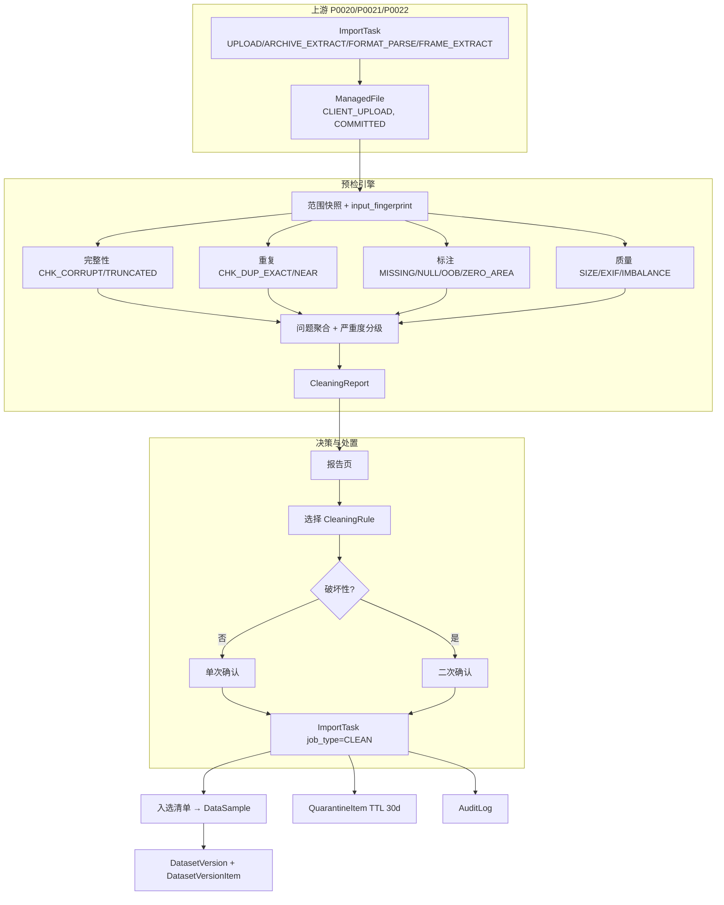
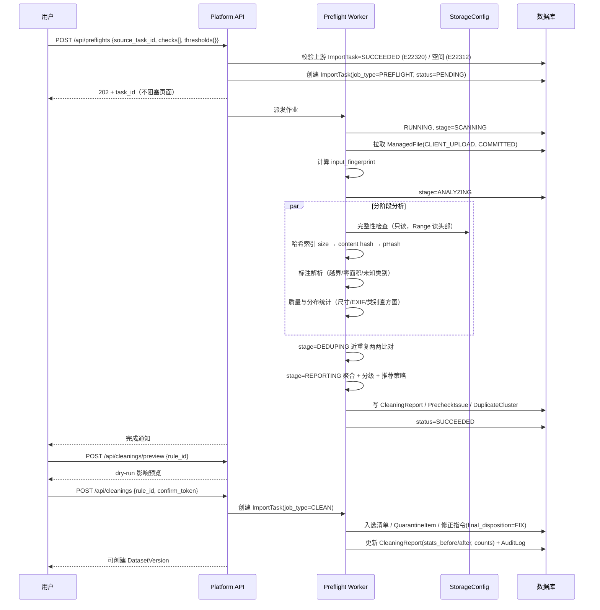
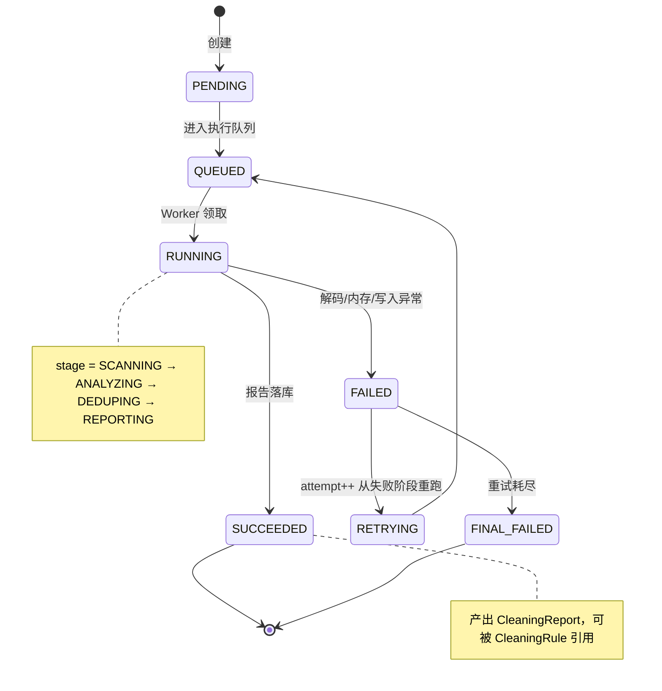
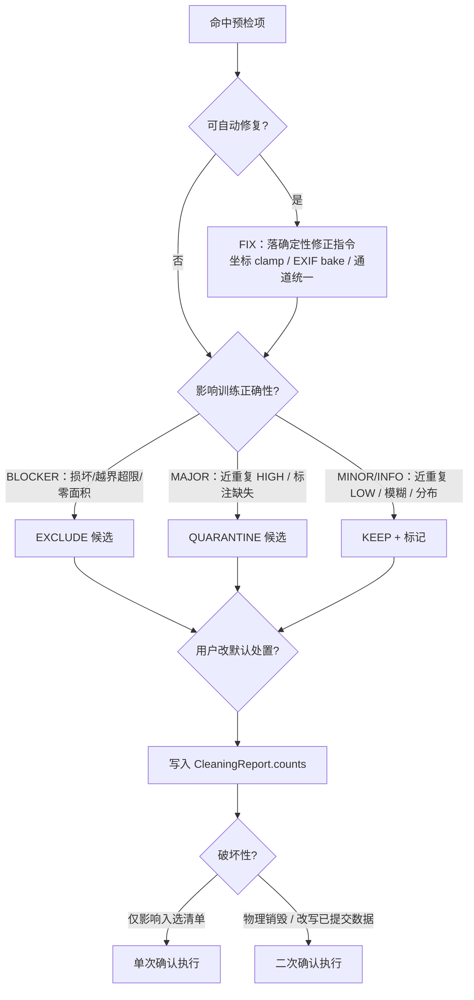
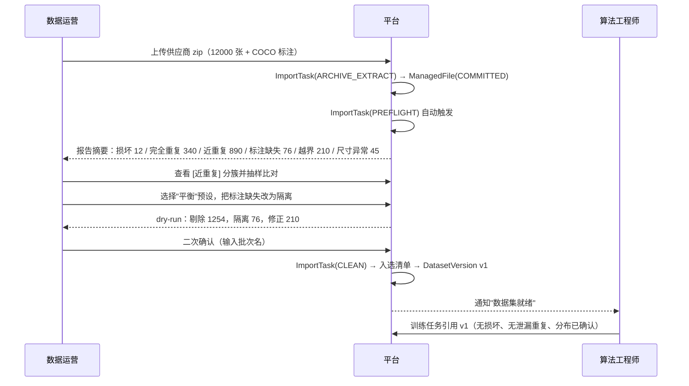
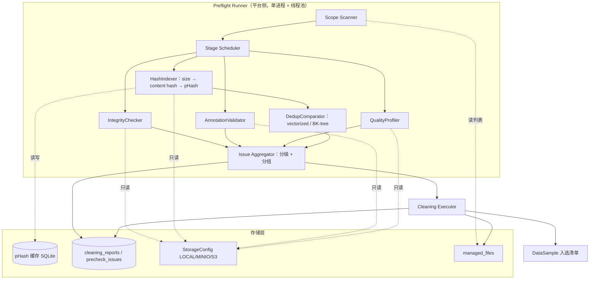

# PRD: P0023_导入预检与清洗 (Import Precheck & Cleaning)

| 属性 | 内容 |
| :--- | :--- |
| **文档编号** | P0023 |
| **功能模块** | M02_数据导入 |
| **当前版本** | v1.0.0 |
| **文档状态** | Draft |
| **作者** | IngestB |
| **最后更新** | 2026-10-01 |

---

## 1. 全局说明

> [!IMPORTANT]
> **核心定位**: 数据进入平台之前先做一次**体检**。P0023 在导入暂存区对文件与标注做静态分析，产出**可解释、可导出、可复现**的报告，把"要不要这批数据""丢掉哪些"变成有证据的决策。预检产出的是**证据**，不是**判决**——任何剔除都来自用户显式选择的策略，且默认**不做物理删除**。

### 1.1 名词解释

| 术语 | 说明 |
| :--- | :--- |
| **ImportTask** | 契约实体 `import_tasks`，"把文件弄进来"的唯一批次任务。本模块复用 `job_type=PREFLIGHT | CLEAN` 两个取值，不新建批次实体。 |
| **暂存区 (Staging)** | 已 `status=COMMITTED` 但未被任何 `DatasetVersion` 引用的 `ManagedFile`（`owner_type=CLIENT_UPLOAD`）。清理它不损伤已发布数据。 |
| **预检项 (Check)** | 一种检测规则，如 `CHK_DUP_EXACT`。规则集固定、阈值可调，不开放用户脚本。 |
| **PrecheckIssue** | 命中某个预检项后产生的一条记录，带 `severity` 与 `evidence`。 |
| **处置 (Disposition)** | `KEEP` / `EXCLUDE` / `QUARANTINE` / `FIX` 四选一。 |
| **入选清单 (Selected Set)** | 清洗后真正会创建 `DataSample` 并进入 `DatasetVersion` 的文件集合。剔除者不进此清单，但物理对象仍在。 |
| **隔离区 (Quarantine)** | 命中 `MAJOR` 级问题、等待人工确认的数据逻辑池（`QuarantineItem`），不搬动物理对象，TTL 30 天。 |
| **背景图 (Background)** | 有意保留的负样本：标签文件存在但对象数为 0。 |
| **pHash** | DCT 感知哈希：缩放 32×32 灰度 → DCT → 取左上 8×8 → 与中位数比较，得 64 bit 指纹。 |
| **汉明距离** | 两个 64 bit pHash 异或后的置位数，0~64，越小越相似。 |
| **EXIF Orientation** | JPEG/TIFF tag `0x0112`，取值 1~8，描述"像素存储方向"与"显示方向"的差异。 |
| **越界框** | 归一化坐标超出 `[0,1]` 的标注框。 |

### 1.2 统一异常处理

E 码规范为 5 位：`E` + 模块号(1) + P 编号后两位(2) + 流水(2)。P0023 占用 `E22301~E22320`。分 `WARN`（可继续）与 `BLOCK`（阻断）两级。

| Code | 级别 | 场景 | 处理策略 |
| :--- | :--- | :--- | :--- |
| `E22301` | BLOCK | 文件无法解码（头部损坏、魔数不匹配、非图像伪装扩展名） | 标记 `CHK_CORRUPT/BLOCKER`，默认 `QUARANTINE`，不阻断整体预检 |
| `E22302` | BLOCK | 图片截断（校验头通过但像素解码失败） | 同 `E22301`，`evidence` 记录解码失败位置 |
| `E22303` | WARN | 检出完全重复文件（字节级哈希相同） | 报告分簇，默认每组保留首张，其余 `EXCLUDE` |
| `E22304` | WARN | 检出近重复文件（pHash 汉明距离命中阈值） | 聚类，`HIGH` 档默认 `QUARANTINE` 待人工确认 |
| `E22305` | WARN | 空标注（标签文件存在但对象数为 0） | 标记 `CHK_NULL_ANNOTATION`，由用户决定是否算背景图 |
| `E22306` | WARN | 标注文件缺失（有图无标签） | 默认 `QUARANTINE`（**不**当作背景图） |
| `E22307` | WARN | 类别分布不均衡超阈 | 报告 `class_distribution` 与建议，不改变数据 |
| `E22308` | WARN | 图像尺寸 / 长宽比 / 体积异常 | 按规则分别处置，`CHK_SIZE_LARGE` 默认 `QUARANTINE` |
| `E22309` | WARN | EXIF Orientation != 1，需像素重写 | 无标注图自动 `FIX`；有标注图 `QUARANTINE` 待人工 |
| `E22310` | WARN | 标注越界 / 零面积 / 退化细条 / 未知类别 | `FIX`（可修正）或 `EXCLUDE`（不可修正） |
| `E22311` | BLOCK | 预检 Worker 崩溃或阶段超时 | 任务置 `FAILED`，保留已完成阶段结果，支持从失败阶段重跑 |
| `E22312` | BLOCK | 目标 `StorageConfig` 剩余空间不足 | 启动前拒绝，提示清理暂存区或扩容 |
| `E22313` | BLOCK | 试图对 `DatasetVersion.status=FROZEN` 执行原地清洗 | 拒绝，提示"版本不可变，请创建新版本" |
| `E22314` | WARN | 报告导出失败（磁盘满 / 渲染异常） | 报告仍可在线查看，提示后重试 |
| `E22315` | BLOCK | 路径穿越（zip slip）或文件名含非法字符 | 拒绝该条目并记 `AuditLog` 安全事件 |
| `E22316` | BLOCK | 清洗二次确认未通过（短语不匹配 / 未勾选风险确认） | 取消清洗，不产生任何变更 |
| `E22317` | BLOCK | 清洗将导致入选样本为 0，或某 `LabelClass` 实例归零 | 拒绝执行，要求调整策略 |
| `E22318` | WARN | 预检范围含 0 个有效 `ManagedFile` | 返回空报告并提示检查范围条件 |
| `E22319` | BLOCK | 幂等 / 并发冲突：同范围清洗正在执行或重复提交 | 返回进行中的 `ImportTask(job_type=CLEAN)` |
| `E22320` | BLOCK | 前置 `ImportTask.status != SUCCEEDED` | 拒绝发起预检，提示等待上游完成 |

---

## 2. 项目背景

### 2.1 背景 (Context)

轻眸识刻 面向 2~3 人小团队，首个任务是从食品包装照片中检测**生产日期区域**。数据来源很杂：手机散图、老项目的 COCO 标注、供应商 zip 包、相机连拍近似帧。P0020/P0021/P0022 把文件搬进暂存区后，若无预检，脏数据会直接被固化成**不可变的 `DatasetVersion`**，而纠正成本是"重新导入 + 重新标注"。

### 2.2 问题陈述 (Problem Statement)

1. **脏数据不可见**：损坏图、截断 JPEG 中途让 DataLoader 抛异常，训练跑到第 3 个 epoch 才失败。
2. **重复样本虚增规模**：连拍与重复解压产生大量近重复图，训练集泄漏到验证集把 mAP 抬高，指标失去意义。
3. **无目标图两极分化**：背景图有助于抑制误报，但占比过高会稀释正样本密度。
4. **几何错误静默进训练**：零面积框、越界框在坐标变换与 loss 计算中产生无效梯度甚至 NaN。
5. **方向不一致**：EXIF 未归一化的图在标注工具中显示方向与训练解码方向相反，标注框整体错位 90°，缩略图上难以发现。
6. **决策无证据**：拿不出可交付给同事与数据提供方的报告。

### 2.3 目标与成功指标 (Goals & Success Metrics)

* **北极星指标**：进入训练的 `DatasetVersion` 中零个 `BLOCKER` 级问题。
* **次要指标**：8 类检查全覆盖且每项可导出证据；单图预检 P95 < **40 ms**；10,000 张完整预检（含 pHash 两两比对）< **3 分钟**；清洗导致不可恢复数据丢失 = **0**。

### 2.4 风险与规避 (Risks & Mitigation)

| 风险 | 影响 | 规避方案 |
| :--- | :--- | :--- |
| 近重复阈值过松 | 误杀有效样本 | 双档阈值：`≤4` 自动候选、`5~8` 仅提示；`HIGH` 档只隔离不删除 |
| 阈值过严 | 重复图漏检，训练集泄漏 | 输出完整聚类簇供人工复核；可调阈值重跑，不重传数据 |
| 自动 EXIF 修正破坏标注 | 框与像素方向不一致 | 有标注的图**永不自动 bake**，一律隔离待人工确认 |
| 预检耗时阻塞导入 | 用户等待焦虑 | 独立异步 `ImportTask`，报告先出摘要；可"跳过预检"但需管理员 + 审计 |
| 隔离区膨胀 | 磁盘写满 | `QuarantineItem` 30 天 TTL，由 P0046 GC 回收；单次清洗上限告警 |
| 两次预检不可比 | 无法判断数据是否改善 | 报告带 `input_fingerprint`，支持报告对比视图 |

---

## 3. 价值模型

* **方案**：在"文件落为 `ManagedFile(COMMITTED)`"与"创建 `DataSample` / `DatasetVersion`"之间插入**预检网关**。网关内置 8 类固定检查项输出结构化报告；用户在报告上选择处置策略，一键生成清洗方案，预览后执行。清洗结果决定**入选清单**，据此生成新的 `DatasetVersion`。
* **目标**：把"数据能不能用"从主观经验变成可复现的流水线步骤，使训练失败中"数据原因"占比从约 40% 降到 5% 以下。

### 3.1 业界对标 (Industry Reference Mapping)

| 业界概念 | 来源 | 本平台检查项 | 差异说明 |
| :--- | :--- | :--- | :--- |
| `missingAnnotations` | Roboflow Health Check | `CHK_MISSING_LABEL` | 一致 |
| `nullAnnotations` | Roboflow Health Check | `CHK_NULL_ANNOTATION` | 一致，另区分"有意背景图"与"漏标" |
| `classDistribution` | Roboflow Health Check | `CHK_CLASS_IMBALANCE` / `CHK_RARE_CLASS` / `CHK_DOMINANT_CLASS` | 平台给出不均衡比阈值而非仅展示分布 |
| `exact_duplicates` | FiftyOne | `CHK_DUP_EXACT` | 平台用文件字节哈希 |
| `near_duplicates` | FiftyOne | `CHK_DUP_NEAR` | 平台用 pHash + 汉明距离（轻量、无需模型） |
| `mistakenness` | FiftyOne | ❌ 不实现 | 需模型推理，属训练后分析（P0100 难例回流） |

---

## 4. 项目范围

### 4.1 功能结构图



### 4.2 In Scope (包含范围)

1. 预检范围定义：按来源 `ImportTask`、目录前缀、显式文件列表圈定 `ManagedFile` 集合。
2. 8 类检查项：损坏/截断、完全重复、近重复、无目标与标注缺失、类别不均衡、尺寸异常、EXIF 旋转、标注越界与零面积。
3. 结构化报告：摘要 + 分组明细 + 去重聚类 + 分布 + 单文件证据；导出 JSON / CSV / Markdown。
4. 处置策略 `CleaningRule`：四种动作可逐项配置，内置严格 / 平衡 / 宽松三套预设。
5. 一键清洗：应用策略 → dry-run 预览 → 确认 → 执行 → 更新 `CleaningReport`。
6. 隔离与恢复：`QuarantineItem` 逻辑隔离，30 天内可一键恢复。
7. 二次确认：任何物理销毁或已提交数据改写必须二次确认。

### 4.3 Out of Scope (不包含范围)

* **模型相关质量评估**：`mistakenness`、置信度分布、难例挖掘（属 P0100 难例回流）。
* **标注语义正确性**：预检只发现**几何与结构**错误，无法判断"框画歪了"（由 P0063 质检负责）。
* **图像增强/修复**：不做去噪、超分、自动白平衡；只做 EXIF 归一化与通道统一这类**语义中性**变换。
* **跨版本去重**：近重复只在本次范围内比对（跨版本见 P0041）。
* **自定义检查脚本**：检查项固定，只开放阈值。
* **自动决策**：平台永不自动删除。

---

## 5. 业务流程

### 5.1 预检与清洗流程



### 5.2 预检任务状态机（`ImportTask.job_type=PREFLIGHT`）



### 5.3 单条问题的处置决策路径



---

## 6. 用户分析

### 6.1 用户画像 (User Personas)

* **算法工程师 (`TRAINER`)**：把数据集训成模型，对指标负责。诉求"不想在 epoch 3 才发现 200 张图解码失败，也不想验证集混进训练集的连拍帧导致 mAP 虚高"；痛点是脏数据在训练阶段才暴露，定位成本极高。
* **数据运营 / 标注负责人 (`ADMIN`)**：把外部数据搬进平台并保证可用。诉求"一键看到哪些有问题、证据是什么，然后决定丢哪些"；痛点是没有证据就没法跟数据提供方交涉。
* **标注员 (`ANNOTATOR`)**：修正与补标。诉求"别让我翻 5000 张图找那 30 张无标注的"；痛点是预检结果没变成可领取的任务切片。

### 6.2 用户链路图 (User Journey Map)



---

## 7. 功能需求

### M02.F01 预检范围与任务创建 (Preflight Scope & Task Creation)

* **用户故事**: 作为数据运营，我希望在导入向导中选择对哪些文件做预检，以便不用为了一小撮数据等全量扫描。

* **逻辑与业务规则**:
  * 前置：来源 `ImportTask.status = SUCCEEDED`（否则 `E22320`）；角色 `ADMIN`/`TRAINER`；空间校验通过（`E22312`）。
  * 范围来源三选一：`source_task_id`（上游任务输出的 `ManagedFile` 集合）/ 目录前缀 / 显式 `ManagedFile.id` 列表。
  * 文件集选取：仅 `owner_type=CLIENT_UPLOAD` 且 `status=COMMITTED`，天然排除软删除（`deleted_at != NULL`）对象。
  * 默认开启：`CHK_CORRUPT`、`CHK_TRUNCATED`、`CHK_DUP_EXACT`、`CHK_DUP_NEAR`、`CHK_MISSING_LABEL`、`CHK_NULL_ANNOTATION`、`CHK_OOB_BOX`、`CHK_ZERO_AREA`、`CHK_EXIF_ROTATE`；默认关闭（成本高）：`CHK_BLUR`、`CHK_EXPOSURE`。
  * 范围指纹：`input_fingerprint = sha256(concat(sorted(managed_file.id + ":" + etag + ":" + size_bytes)))`，写入 `ImportTask.plan_json` 与 `CleaningReport`；同指纹重复发起时提示可复用。
  * 后置：创建 `ImportTask(job_type=PREFLIGHT, status=PENDING)` 并异步派发。

* **验收标准**:

```gherkin
场景: 对导入批次发起预检
  Given 来源 ImportTask status = SUCCEEDED，输出 12000 个 COMMITTED 的 ManagedFile
  When 用户点击 [预检]
  Then 创建 ImportTask 且 job_type=PREFLIGHT, status=PENDING
  And plan_json 写入 input_fingerprint 与阈值快照
  And 2 秒内返回 task_id，不阻塞页面

场景: 前置任务未完成
  Given 来源 ImportTask status = RUNNING
  When 用户发起预检
  Then 返回 E22320 且不创建任何预检任务
```

* **边界情况与异常处理**:

| 场景 | 处理 |
| :--- | :--- |
| 范围为 0 个有效 `ManagedFile` | 返回 `E22318`，报告为空并提示检查范围条件 |
| 预检中新文件写入 | fingerprint 固定的范围不感知新文件，提示"范围已冻结，需重新预检" |
| 同范围并发两次预检 | 第二次返回进行中任务；强制重跑时前一个置 `FINAL_FAILED` |
| `ANNOTATOR`/`VIEWER` 访问 | 403，前端隐藏入口（RBAC 由 P0130 判定） |
| Worker 在 ANALYZING 崩溃 | 置 `FAILED`，保留已完成阶段结果，`attempt++` 后从该阶段重跑（`E22311`） |
| MinIO 读抖动 | 单文件读重试 3 次（指数退避）；仍失败记 `STORAGE_READ_ERROR`，不中断整体预检 |

---

### M02.F02 文件完整性与可解码性检查 (Integrity & Decodability)

* **用户故事**: 作为算法工程师，我希望导入前就剔除解码失败的文件，以便训练任务不会中途崩溃。

* **逻辑与业务规则**:
  * 三级递进检测，任一级失败即终止该文件后续检查：
    1. **字节层**：`size_bytes == 0`；扩展名与魔数（`FFD8FF` / `89504E47` / `47494638` / `49492A00`）是否匹配。
    2. **头部层**：`Pillow.Image.open().verify()`，只校验容器与头部。
    3. **像素层**：重新打开并 `load()` 强制全量解码，捕获 `OSError: image file is truncated`。
  * 对象存储适配：全程只读；用 Range 请求读前 64 KiB 做魔数与尺寸判定，避免整对象下载即可提前拦截超大/损坏文件。
  * 证据：失败阶段、异常类型与消息、`ManagedFile.id`、`storage_path`、`size_bytes`、扩展名与实际魔数。

* **阈值表**:

| 检查项 | 参数 | 默认阈值 | 可调范围 | 判定结果 | 理由 |
| :--- | :--- | :--- | :--- | :--- | :--- |
| `CHK_CORRUPT` | `size_bytes` | `== 0` | 不可调 | `BLOCKER` | 0 字节对象必然不可解码 |
| `CHK_CORRUPT` | 魔数匹配 | 扩展名与魔数一致 | 不可调 | `MAJOR`；可解码时降级 `MINOR` | 抓"?jpg 实为 PNG/WebP"的伪装，否则下游走错解码分支 |
| `CHK_TRUNCATED` | `verify()` | 必须通过 | 不可调 | `BLOCKER` | 头部校验是像素解码前置 |
| `CHK_TRUNCATED` | `load()` | 必须通过 | 不可调 | `BLOCKER` | **只做 verify 会漏掉截断图**：JPEG 截断时头部与 SOI/EOI 齐全，只有真正解码才发现 |
| `CHK_CORRUPT` | 解码超时 | `5 s` | 1~30 s | `MAJOR`，`reason=TIMEOUT` | 99% 图片 < 4000×3000，正常解码 < 300 ms；5 s 已是 16 倍余量 |
| `CHK_CORRUPT` | 解码后像素方差 | `== 0` | 不可调 | `MINOR` | 全黑/全白通常是导出失败产物，对训练无害 |

* **验收标准**:

```gherkin
场景: 检出截断的 JPEG
  Given ManagedFile mf_012 头部完整但在像素数据中截断
  When 执行完整性检查
  Then 产生 PrecheckIssue: check_code=CHK_TRUNCATED, severity=BLOCKER, default_disposition=QUARANTINE
  And evidence 含 failed_stage="PIXEL_DECODE" 与 message="image file is truncated"

场景: 零字节对象
  Given ManagedFile mf_003 的 size_bytes = 0
  When 执行完整性检查
  Then 产生 CHK_CORRUPT / BLOCKER / reason=EMPTY_FILE
  And 跳过该文件后续所有检查项
```

* **边界情况与异常处理**:

| 场景 | 处理 |
| :--- | :--- |
| 对象在预检期间被 GC 删除 | 捕获 404/`NoSuchKey`，记 `OBJECT_MISSING`/`MAJOR` |
| Range 请求返回 416 | 回退整对象下载；仍失败记 `RANGE_UNSUPPORTED` 并降级 |
| 超大对象可能 OOM | 先读头部尺寸，总像素 > 1.5 亿则**不解码**，直接判 `CHK_SIZE_LARGE/MAJOR` |
| TIFF 多页 | 只检查第 1 页，evidence 标注 `page_count` |
| 无扩展名 | 仅按魔数判定，不匹配则 `NOT_AN_IMAGE`/`MAJOR` |
| 分片上传残留半成品 | 以 `status=COMMITTED` 为唯一准入，`PENDING` 对象不参与预检 |

---

### M02.F03 完全重复与近重复检测 (Exact & Near Duplicate Detection)

* **用户故事**: 作为算法工程师，我希望平台自动找出重复与近似重复的图，以便验证集不会被训练集"泄漏"污染。

* **逻辑与业务规则**:
  * **完全重复（两级剪枝）**：先按 `size_bytes` 分桶，桶内再算内容哈希。默认 `SHA-256`（取前 16 字节足够区分），可选 `MD5` 兼容历史清单；`size_bytes` 不同者必然不同，直接跳过哈希。
  * **近重复**：计算 64 bit pHash（灰度 → 32×32 → DCT → 左上 8×8 → 与中位数比较）；比对 `d = popcount(h1 XOR h2)`；加速按 pHash 高 16 bit 建桶只比相邻桶。`n ≤ 50,000` 用 NumPy 向量化两两比对（50k²/2 ≈ 1.25G 次 XOR，约 15~30 s）；`n > 50,000` 切 BK-tree。
  * **聚类**：以 `d ≤ d_high` 为边做并查集得 `DuplicateCluster`；簇内按 `(capture_time, file_name)` 排序，保留首张为 representative。
  * **为何用 pHash 而非 embedding**：单机、2~3 人团队、无外网依赖，pHash 无需模型、几毫秒一张、纯 CPU；代价是对大角度旋转与大幅裁剪不鲁棒，而"同批连拍 / 同素材重导出"场景中这类情况罕见。
  * 一个文件同时命中完全重复与近重复时，只保留严重度更高的 issue，`evidence.related_checks` 记全部命中项。
  * **判定证据**：`evidence` 至少含 `content_hash`（十六进制）、`phash`、`hamming_distance`、`cluster_id`、`related_checks`，保证人工可独立复算同一结论。

* **阈值表**:

| 检查项 | 参数 | 默认阈值 | 可调范围 | 判定结果 | 理由 |
| :--- | :--- | :--- | :--- | :--- | :--- |
| `CHK_DUP_EXACT` | 内容哈希 | 完全相同 | 不可调 | `MAJOR`，`EXCLUDE`（每组留首张） | 字节级相同无信息增量，保留即引入权重偏置 |
| `CHK_DUP_NEAR` | 汉明距离 `d` | `d = 0` | 0~2 | `HIGH` | pHash 相同但字节不同 → 同图不同编码/压缩质量，实质重复 |
| `CHK_DUP_NEAR` | `d` | `1 ≤ d ≤ 4`（`d_high`） | 1~6 | `HIGH`，默认 `QUARANTINE` | 64 bit 随机指纹期望汉明距离为 32（`B(64,0.5)`，`σ=4`）；`d ≤ 4` 即偏离均值 `7σ`，随机误报 < 1e-11，同时覆盖 JPEG 重压缩、轻微裁剪（<5%）、亮度微调 |
| `CHK_DUP_NEAR` | `d` | `5 ≤ d ≤ 8`（`d_low`） | 4~12 | `LOW`，默认 `KEEP + 标记` | `d ≤ 8` 约 `2σ`，召回更高的同时出现误报（同构图不同包装、同产品不同批次）；按惯例仅提示 |
| `CHK_DUP_NEAR` | `d` | `≥ 9` | 不可调 | 不视为重复 | 超过 `2σ` 误报快速上升，误并簇会严重误导用户 |
| `CHK_DUP_NEAR` | `max_cluster_size` | `50` | 10~500 | `MAJOR` 提示 | 单簇 > 50 张几乎必然是抽帧未去重或目录被重复解压 |
| `CHK_DUP_NEAR` | 哈希算法 | `pHash` | pHash/dHash/aHash | — | pHash 对缩放与亮度最稳；dHash 对渐变图更敏感 |

> 阈值随 `ImportTask.plan_json` 快照落库并在报告回显，保证同阈值同数据可得同一份报告（哈希算法本身确定性）。

* **验收标准**:

```gherkin
场景: 检出完全重复文件
  Given 12000 个 ManagedFile 中有 3 个内容完全相同但 storage_path 不同
  When 执行重复检测
  Then 生成 1 个 DuplicateCluster(type=EXACT, size=3)
  And representative 为文件名排序最靠前的一个
  And 其余 2 个 default_disposition = EXCLUDE

场景: 近重复分档
  Given 两张图经 JPEG 重压缩后 pHash 汉明距离为 3
  When 执行近重复检测
  Then 生成 DuplicateCluster(type=NEAR, min_hamming=3, level=HIGH)
  And 两图 default_disposition = QUARANTINE
  And 报告页展示并排比对与距离数值

场景: 大规模自动切换算法
  Given 预检范围为 80000 个 ManagedFile
  When 进入 DEDUPING 阶段
  Then 使用 BK-tree 而非两两比对，evidence 记 dedup_method="BK_TREE"
```

* **边界情况与异常处理**:

| 场景 | 处理 |
| :--- | :--- |
| 图片无法解码 | 无法算 pHash，跳过并继承 `CHK_CORRUPT` 结论，记 `NO_HASH` |
| 单色图（方差为 0） | pHash 趋同会误并簇，**排除出近重复比对**，改由 `CHK_CORRUPT` 处理 |
| 两两比对矩阵内存不足 | 按可用内存分块计算；仍失败切 BK-tree（`E22311` 兜底） |
| 视频抽帧连续帧 | 属预期近重复；报告提示"本簇 47 张，疑似抽帧残留"，建议在 P0022 源头去重 |
| 同时属完全重复与近重复簇 | 完全重复优先，近重复簇从属其超集，不重复计数 |
| 用户调整 `d_high` 重跑 | 生成新 `CleaningReport`，旧报告保留可对比，各带阈值快照 |

---

### M02.F04 标注完整性与几何合法性检查 (Annotation Integrity & Geometry)

* **用户故事**: 作为数据运营，我希望预检能区分"真的没有目标"和"忘了标"，并挑出坐标错误的框，以便交出去的训练集是干净的。

* **逻辑与业务规则**:
  * 三态区分（判定基准为标注解析结果与 `DataSample.annotation_status`）：

    | 状态 | 判定条件 | 语义 | 默认处置 |
    | :--- | :--- | :--- | :--- |
    | 有标注 | 标签文件存在且对象数 > 0 | 正常 | `KEEP` |
    | 空标注 (null) | 标签文件存在，对象数 == 0 | 有意背景图，或标注中断 | `KEEP + 标记` |
    | 标注缺失 (missing) | 标签文件不存在 | 极可能漏标 | `QUARANTINE` |

    > **为何拆开 missing 与 null**：`null` 是有效负样本可直接进训练；`missing` 若当背景图入库，会把"漏标的目标"教成背景，直接损害 recall。业界（Roboflow）同样区分 `missingAnnotations` 与 `nullAnnotations`。
  * 平台内部统一为归一化 `cx, cy, w, h ∈ [0,1]`。`FIX` 类修正必须**确定性、幂等、可回放**，不改语义（不做智能裁剪）；修正后若框退化为零面积，则从 `FIX` 降级为 `EXCLUDE`。
  * 未知类别：类别标识超出 `LabelClass` 声明范围时**整体**标记该文件，需 P0024 类别映射介入。
  * **判定证据**：`evidence` 至少含 `coord_space`（`NORMALIZED`/`PIXEL`）、`original_bbox`、`overflow`、`label_file_path`、`object_count`；`FIX` 项另含 `fixed_bbox`，使修正前后可比对。

* **阈值表**:

| 检查项 | 参数 | 默认阈值 | 可调范围 | 判定结果 | 理由 |
| :--- | :--- | :--- | :--- | :--- | :--- |
| `CHK_MISSING_LABEL` | 图片是否有对应标注 | 必须存在 | 不可调 | `MAJOR` / `QUARANTINE` | 与 `null` 区分，避免漏标图污染背景负样本 |
| `CHK_NULL_ANNOTATION` | 每图目标数 | `== 0` | 不可调 | `MINOR` / `KEEP` | 背景图有价值不剔除，但需人工确认 |
| `CHK_BACKGROUND` | 背景图占比 | `> 20%` | 5%~50% | `MINOR` / `KEEP + 告警` | 占比过高稀释正样本密度；食品日期检测建议 ≤ 10%，20% 是"需要看一眼"的位置 |
| `CHK_OOB_BOX` | 越界容差 `ε` | `0.005` | 0~0.02 | 在 ε 内 → `FIX`（clamp） | `ε=0.005` 对应 1920 px 宽约 9.6 px，覆盖标注工具浮点舍入与手工拖拽误差；训练侧普遍会把坐标裁到 `[0,1]`，此处提前对齐 |
| `CHK_OOB_BOX` | 越界幅度 | `ε < overflow ≤ 0.02` | 0.005~0.1 | `MINOR` / `FIX` 并记原值 | 2% 以内多为手抖拖出边界，clamp 后语义不变 |
| `CHK_OOB_BOX` | 越界幅度 | `overflow > 0.02` | 不可调 | `BLOCKER` / `QUARANTINE` | 大幅落在图外通常是坐标空间搞错（像素坐标当归一化），clamp 会造出错误框 |
| `CHK_ZERO_AREA` | 归一化面积 `w*h` | `< 1e-4` | 1e-6~1e-2 | `MAJOR` / `EXCLUDE` | 1920×1080 下 `1e-4` ≈ 207 px²；更小的目标在 `input_size=640` 下不足 4 像素，既不可学也多是无意义误点 |
| `CHK_ZERO_AREA` | 像素面积 | `< 4 px²` | 不可调 | `MAJOR` / `EXCLUDE` | 1~3 像素的框在 stride-8/16/32 特征层（FPN P3/P4/P5）上无法产生有效正样本 |
| `CHK_DEGENERATE_BOX` | 最短边 | `< 2 px` | 1~5 px | `MAJOR` / `EXCLUDE` | 细条框（`w=0.0001, h=0.9`）使 IoU 计算不稳定，产生异常梯度 |
| `CHK_UNKNOWN_CLASS` | 类别标识范围 | 必须落在 `LabelClass` 内 | 不可调 | `BLOCKER` / 阻塞 | 类别语义未知无法训练，必须先完成映射 |
| `CHK_DUP_BOX` | 同类框 IoU | `> 0.98` | 0.9~1.0 | `MINOR` / `KEEP + 标记` | 99% 重叠多为重复点击；不能自动删（可能是小目标包含于大目标），仅提示 |
| `CHK_ORPHAN_LABEL` | 标注是否有对应图片 | 必须存在 | 不可调 | `MINOR` / `EXCLUDE` | 孤立标注无法参与训练 |

* **验收标准**:

```gherkin
场景: 区分空标注与标注缺失
  Given 100 个 ManagedFile 中 12 个无标注文件、8 个标注文件为空
  When 执行标注完整性检查
  Then 产生 12 条 CHK_MISSING_LABEL (MAJOR) 与 8 条 CHK_NULL_ANNOTATION (MINOR)
  And 两类问题在报告中分列不同分组

场景: 小幅越界自动修正，大幅越界隔离
  Given 框 A 为 cx=0.998, cy=0.5, w=0.02, h=0.1（溢出 0.008）；框 B 为 cx=1.5
  When 执行几何检查
  Then 框 A 判定 overflow ≤ 0.02，default_disposition=FIX，evidence 保留 original_bbox 与 fixed_bbox
  And 框 B 判定 overflow > 0.02，CHK_OOB_BOX / BLOCKER / QUARANTINE

场景: 零面积框被剔除
  Given 一个框 w=0.00005, h=0.00004（归一化面积 2e-9）
  When 执行几何检查
  Then 判定 CHK_ZERO_AREA / MAJOR / EXCLUDE
  And 该文件若仅剩此框，则整图转为 CHK_NULL_ANNOTATION
```

* **边界情况与异常处理**:

| 场景 | 处理 |
| :--- | :--- |
| 标注编码非 UTF-8 / 含 BOM | UTF-8 → GBK 回退；仍失败记 `LABEL_PARSE_ERROR`/`BLOCKER` |
| 标注行数超限 | 流式解析，超过 100,000 行截断并记 `LABEL_TOO_LARGE` |
| YOLO txt 行格式非法（字段数 != 5） | 该行跳过并计入 `CHK_LABEL_MALFORMED`，其余行继续 |
| 标注名与图片名大小写不匹配 | 大小写不敏感文件系统上视为匹配，告警"跨平台可能失效" |
| 同图多份标注来源并存 | 按 P0021 推断格式优先，其余记 `CHK_MULTI_LABEL_SOURCE/MINOR` |
| 坐标实为像素制（全部 > 1.5） | 按图片尺寸归一化后重检，evidence 记 `coord_space=PIXEL` |

---

### M02.F05 图像质量与分布检查 (Quality & Distribution)

* **用户故事**: 作为算法工程师，我希望知道数据集的分辨率与类别分布是否健康，以便在训练前预判模型能不能学好。

* **逻辑与业务规则**:
  * 尺寸：读头部尺寸（不解码像素），算 `min_side`/`max_side`/`aspect_ratio`；用中位数 + MAD 标记离群分辨率（比 `μ±3σ` 稳健）。
  * EXIF：读 tag `0x0112`（6 = 顺时针 90°，8 = 逆时针 90°，2/4 为镜像，5/7 为转置）。`FIX` = **记录**「按 orientation 旋转 + 剥离 EXIF」的确定性修正指令（不在清洗阶段重写像素；像素变换在导出/训练前置按指令物化）。
  * **关键约束**：有标注的图重写像素必须同步变换框坐标。为免自动变换引入隐性错误，策略为**有标注 → 一律 `QUARANTINE` 待人工选择；无标注 → 自动 `FIX`**。
  * 通道：灰度/单通道提示；带 alpha 的 PNG 提示需合成到白底（食品包装黑底会显著改变外观）。
  * 分布：统计每个 `LabelClass` 实例数，算不均衡比、稀有类、主导类，并给出切分后预估（8:2 切分下稀有类验证实例 = `floor(count*0.2)`，若 < 5 明确警告"验证集指标不可信"）。该预估**按 `DataSample.group_key` 分组后再切分**（与 P0041 的防泄漏约束一致：同一 `version_id` 内同一 `group_key` 不得跨 `split`），否则会把同源连拍帧同时算进 TRAIN 与 VAL，高估稀有类的验证集实例数。
  * 模糊与曝光默认关闭，仅作提示级信号，不影响处置。
  * **判定证据**：`evidence` 至少含该文件的 `width`/`height`/`aspect_ratio`/`orientation`/`channel_count`；分布类检查另含 `median`/`mad`/`class_counts`（键为 `LabelClass.id`）与触发阈值，使结论可用同一份报告复算。

* **阈值表**:

| 检查项 | 参数 | 默认阈值 | 可调范围 | 判定结果 | 理由 |
| :--- | :--- | :--- | :--- | :--- | :--- |
| `CHK_SIZE_SMALL` | `min(H,W)` | `< 64 px` | 32~256 px | `MAJOR` / `QUARANTINE` | 训练默认 `input_size=640`（YOLOX 参数面），主干下采样最大 stride 32 → 原图短边 < 64 px 时最小特征层上不足 2 个格点，目标不可学 |
| `CHK_SIZE_LARGE` | `max(H,W)` | `> 8192 px` | 4096~16384 px | `MAJOR` / `QUARANTINE` | 8192²×3 ≈ 200 MB 解码内存，易 OOM；训练时整体缩放到 640，收益为零 |
| `CHK_SIZE_LARGE` | 总像素 | `> 1.5e8` | 5e7~5e8 | `BLOCKER`，**不解码** | 预检必须避免为检查而 OOM，只读头部即可判定 |
| `CHK_ASPECT` | `max/min` | `> 10:1` | 5:1~50:1 | `MINOR` / `KEEP + 标记` | 极窄条图在统一缩放下严重形变；包装日期通常接近 4:3~16:9 |
| `CHK_OUTLIER_RESOLUTION` | 与中位数比值 | `> 4×` 或 `< 1/4` | 2×~10× | `MINOR` / `KEEP + 标记` | 用中位数 + 比值：分辨率分布常左偏含极端值，均值/标准差会被单张超大图拉偏 |
| `CHK_SUSPICIOUS_TINY` | `size_bytes` | `< 5 KiB` | 1~50 KiB | `MINOR` / `KEEP + 标记` | 5 KiB 以下的 JPEG 在 1000 px 量级必然严重块状压缩，通常来自缩略图误入 |
| `CHK_EXIF_ROTATE` | `Orientation` | `!= 1` | 不可调 | 无标注 → `FIX`；有标注 → `QUARANTINE` | 6/8 会让标注与像素方向差 90°；自动变换有标注图风险高于收益 |
| `CHK_CHANNEL` | 通道数 | `!= 3` | 不可调 | `MINOR`；灰度占比 > 50% → `MAJOR` | 检测网络输入需 3 通道；单通道会被自动复制，但大批量灰度说明数据链路有误 |
| `CHK_CHANNEL` | alpha 通道 | `RGBA` | 不可调 | `MINOR` | 透明背景合成后可能变黑，与采集场景不一致 |
| `CHK_CLASS_IMBALANCE` | `max/min`（仅计 > 0 的类） | `> 20` | 5~100 | `MAJOR` / `KEEP + 告警` | YOLO 系检测器在 1:20 以上不均衡时少数类 mAP 显著下降，需过采样或类别加权 |
| `CHK_CLASS_IMBALANCE` | `max/min` | `> 50` | 不可调 | `BLOCKER` | 1:50 时少数类在每个 batch 出现概率极低，等于没训 |
| `CHK_RARE_CLASS` | 单类实例数 | `< 50` | 10~500 | `MAJOR` | 按 8:2 切分仅约 10 个验证实例；低于此该类 mAP 波动大于 0.1，指标不可用于决策 |
| `CHK_DOMINANT_CLASS` | 单类占比 | `> 90%` | 50%~99% | `MAJOR` | 模型可能靠"全预测该类"获得较低 loss，掩盖其他类完全失效 |
| `CHK_DENSITY` | 每图平均实例数 | `< 1.0` 或 `> 30` | 0.5~60 | `MINOR` | 过稀疏浪费算力；过密集说明数据与真实场景不符 |
| `CHK_BLUR`（可选） | 拉普拉斯方差 | `< 60` | 20~200 | `MINOR` | < 60 通常肉眼可见模糊；阈值强依赖分辨率，故默认关闭避免误导 |
| `CHK_EXPOSURE`（可选） | 过曝/欠曝占比 | `> 40%` | 10%~80% | `MINOR` | 包装反光与阴影常见，过度报警会淹没真问题 |

* **验收标准**:

```gherkin
场景: 有标注的旋转图不自动修正
  Given 一张图 EXIF Orientation = 8 且已有 3 个 Annotation
  When 执行质量检查
  Then 产生 CHK_EXIF_ROTATE / MAJOR / QUARANTINE
  And 报告提示"自动旋转需同步变换 3 个标注框，请人工确认"

场景: 无标注的旋转图自动修正
  Given 一张 4032×3024 的 JPEG，Orientation = 6，无任何标注
  When 执行质量检查
  Then 产生 CHK_EXIF_ROTATE / MINOR / FIX
  And FIX 记录修正指令：顺时针旋转 90°、剥离 EXIF（物化发生在导出/训练前置）

场景: 类别严重不均衡
  Given 类别分布 date_region: 8200, logo: 300, qr_code: 90
  When 执行分布检查
  Then max/min ≈ 91 > 50，产生 CHK_CLASS_IMBALANCE / BLOCKER
  And qr_code 实例数 90 ≥ 50，不产生 CHK_RARE_CLASS
```

* **边界情况与异常处理**:

| 场景 | 处理 |
| :--- | :--- |
| EXIF 段损坏 | 视为 `Orientation=1`，记 `EXIF_UNREADABLE`/`MINOR` |
| 同批 EXIF 混杂 | 视为正常（多设备采集）；仅同子目录内混杂时提升告警 |
| 全批同一极小分辨率 | 触发 `CHK_SIZE_SMALL`；占比 > 80% 时额外提示"整批分辨率不足" |
| `LabelClass` 声明但无样本 | `CHK_RARE_CLASS` 升级 `BLOCKER`，提示"空类别会产生永不收敛的类" |
| 仅 1 个类别 | 跳过不均衡比计算，提示确认是否为单类检测任务 |
| 分辨率离群仅 1 张 | 仍标记但不告警，避免单点噪声触发通知 |

---

### M02.F06 预检报告与导出 (Precheck Report & Export)

* **用户故事**: 作为数据运营，我希望拿到一份能直接发给数据提供方的报告，以便推动源头修正。

* **逻辑与业务规则**:
  * 报告载体为契约实体 `CleaningReport(cleaning_reports)`，同时承载预检结果（摘要、分布、推荐策略）与后续清洗执行结果（`stats_before` / `stats_after` / `counts`）。
  * 严重度汇总：按 `BLOCKER/MAJOR/MINOR/INFO` 统计文件数，**去重计数**——一个文件命中多项只在最高严重度档计一次，明细全部保留。
  * 推荐策略（只推荐不自动应用）：**严格** = `BLOCKER` + `MAJOR` 全部 `EXCLUDE`/`QUARANTINE`；**平衡**（默认）= `BLOCKER`→`EXCLUDE`、`MAJOR`→`QUARANTINE`、`MINOR`→`KEEP + 标记`；**宽松** = 仅处理 `BLOCKER`。
  * 导出格式：

    | 格式 | 用途 | 内容 |
    | :--- | :--- | :--- |
    | JSON | 程序消费 / 存档 | 完整结构，含全部 `evidence`；超限自动分片 |
    | CSV | 表格分析 | 一行一个问题：`managed_file_id, check_code, severity, default_disposition, reason` |
    | Markdown | 沟通交付 | 摘要 + 分布表 + Top 问题 + 聚类列表（不含逐文件明细） |

  * **导出物一律不进 `ManagedFile`**：报告的权威副本是 `CleaningReport` 内的 JSONB，导出是按需流式生成的下载，不落对象存储、不登记文件、不需要 `owner_type`。依据全局原则——`ManagedFile` 只承载**不可重算的原始资产与交付物**；可随时重算、且库中已有权威副本的中间结论，不占用文件生命周期与引用计数。
  * 因此 `CleaningReport` **不设** `export_refs` 字段；报告不参与 P0046 的孤儿回收，也不出现在任何文件列表或引用计数中。**不新增 `IMPORT_TASK` 之类的 owner_type**——宁可没有归档，也不要一个语义错误的归属。
  * **本模块自身不产生物理文件**：`KEEP`/`EXCLUDE`/`QUARANTINE` 只改数据库记录，`FIX` 只落修正指令（见 M02.F07）。这是 `ManagedFile` 边界原则的直接结论——可重算的派生结果不占用文件生命周期。若上下游另有物理文件登记，仍须遵守单一登记铁律：一个物理对象只登记一条 `ManagedFile`，他处用 `managed_file_id` 引用，`content_hash` 用于识别同一物理对象。
  * **流水线场景的桥接口径**：独立运行的预检/清洗任务确实不写对象存储；但 Clean 作为**流水线阶段**运行、物化产生图片时，这些物化产物是物理对象，**归 `owner_type = PIPELINE_STAGE_RUN`（`owner_id = pipeline_stage_run_id`）**——这正是该取值承载「非训练阶段产物」的用途。不要误以为物化产物无处归属。
  * 报告对比：同范围不同阈值的两次报告可对比，展示各检查项命中数变化与新增命中文件。

* **验收标准**:

```gherkin
场景: 查看报告摘要
  Given ImportTask(job_type=PREFLIGHT) status = SUCCEEDED
  When 用户打开报告页
  Then 1 秒内展示 BLOCKER 210 / MAJOR 1254 / MINOR 890 / INFO 45
  And 展示推荐策略与影响预估

场景: 导出 Markdown 报告
  Given 报告已就绪
  When 用户点击 [导出 Markdown]
  Then 流式返回 .md 文件供下载
  And 不产生任何 ManagedFile 记录，CleaningReport 也不记录文件引用
  And 文件含摘要、类别分布表、重复聚类 Top 20，不含逐文件明细

场景: 导出失败不丢报告
  Given 目标 StorageConfig 剩余空间不足
  When 用户点击 [导出 CSV]
  Then 返回 E22314，报告仍可在线查看
```

* **边界情况与异常处理**:

| 场景 | 处理 |
| :--- | :--- |
| issue 数 > 100 万 | 明细分片存储；页面只给汇总 + 抽样，完整数据走导出 |
| 引用的 `ManagedFile` 已被软删除 | 报告标记 `file_status=DELETED`，不影响可读性 |
| 同一文件命中 20 条 issue | 明细全留，摘要只按最高严重度计 1 次 |
| 导出文件名冲突 | 自动追加时间戳后缀 |
| 报告被清洗记录引用后尝试删除 | 禁止（外键约束），提示"已被清洗记录引用" |

---

### M02.F07 一键清洗与二次确认 (One-Click Cleaning & Confirmation)

* **用户故事**: 作为数据运营，我希望选好策略后一键执行清洗，但在真正删数据前平台必须再问我一次，以便我不会手滑毁掉数据。

* **逻辑与业务规则**:
  * 四类固定动作（不可扩展）：

    | 动作 | 语义 | 可逆性 | 结果 |
    | :--- | :--- | :--- | :--- |
    | `KEEP` | 保留并打标记 | 可逆 | 进入入选清单 |
    | `EXCLUDE` | 从入选清单移除，`ManagedFile` 保持 `COMMITTED` 不动 | 可逆 | 不进 `DatasetVersion` |
    | `QUARANTINE` | 从入选清单移除并建 `QuarantineItem`（TTL 30 天） | 30 天内可逆 | 待人工 |
    | `FIX` | **只落确定性修正指令**（EXIF bake / 坐标 clamp / 通道统一），不生成新物理对象 | 可逆（撤销指令即可） | 原对象进入入选清单；修正内容在导出/训练前置按指令物化（见下方「物化契约」） |

  * **物化契约（硬约束，违反即产生真 bug）**：`FIX` 指令由下游在**物化点**执行，物化必须同时满足三条：
    1. **同一实现**：训练前置物化与导出物化**走同一段代码**，不得各写一份——否则训练看到的像素与导出的数据集不一致，模型效果无法复现到交付物。
    2. **纯函数**：物化结果 `= f(源文件 bytes, 指令列表)`，无时间 / 环境 / 随机性依赖；指令列表按固定的「像素变换 → 坐标变换」顺序执行。
    3. **可追溯**：物化产物的 `content_hash` 与所用指令列表必须写入导出 manifest 与 `DatasetVersion` 的元数据，保证「这份数据是怎么来的」可回溯——这是本项目可复现性的根基。
  * Dry-run 预览必须展示：剔除 `N` / 隔离 `M` / 修正 `K` / 保留 `J`；清洗后类别分布变化（前 → 后）；入选样本数与预估切分；若入选样本 < 10 或某 `LabelClass` 实例 = 0 直接拒绝（`E22317`）。
  * **二次确认触发条件**（满足其一）：① 涉及**物理销毁**（用户在隔离区选择"立即销毁"）；② 目标数据已被 `DatasetVersion` 引用；③ 单次剔除比例 `> 30%`。
  * 二次确认形式：输入确认短语（来源批次名，精确匹配）+ 勾选风险确认；不匹配返回 `E22316` 且不产生任何变更；`confirm_token_hash` 仅存 `sha256(phrase + salt)`。
  * **不可变版本保护**：对 `DatasetVersion.status = FROZEN` 的数据清洗一律拒绝（`E22313`），正确路径是"清洗 → 新建版本"（P0041）。
  * **引用保护**：已被 `DatasetVersionItem` 引用的 `ManagedFile`，`EXCLUDE` 只从未入选清单移除，不物理删除；确需销毁走 P0046。
  * 执行记录：创建 `ImportTask(job_type=CLEAN)`，更新 `CleaningReport` 的 `stats_before`/`stats_after`/`counts`/`destructive`/`operator_id`，并写 `AuditLog`。
  * 幂等：以 `(preflight_task_id, cleaning_rule.fingerprint)` 为键，重复提交返回既有任务（`E22319`）。

* **验收标准**:

```gherkin
场景: 应用"平衡"预设并预览
  Given 报告显示 BLOCKER 210 / MAJOR 1254 / MINOR 890
  When 用户选择 [平衡] 预设
  Then 展示 dry-run：EXCLUDE 210 / QUARANTINE 1254 / FIX 340 / KEEP 10196
  And 展示清洗后的类别分布

场景: 剔除比例过高触发二次确认
  Given 预览显示将剔除 4200 个（占 35%）
  When 用户点击 [执行清洗] 并输入错误的确认短语
  Then 返回 E22316，清洗不执行，无任何变更

场景: 拒绝原地清洗已冻结版本
  Given DatasetVersion v1 status = FROZEN，含 12000 个 DatasetVersionItem
  When 用户尝试对 v1 执行清洗
  Then 返回 E22313 并提示"版本不可变，请创建新版本"
  And 提供 [创建新版本] 快捷入口

场景: 清洗后类别归零被拒
  Given 策略将 LabelClass qr_code 的全部 90 个实例剔除
  When 用户点击执行
  Then 返回 E22317

场景: 隔离区恢复
  Given QuarantineItem 中有 30 天内的 200 条记录
  When 用户点击 [恢复全部]
  Then 相关 ManagedFile 回到入选清单，status 更新为 RESTORED
  And 写 AuditLog
```

* **边界情况与异常处理**:

| 场景 | 处理 |
| :--- | :--- |
| 清洗中途存储满 | 已完成部分不回滚（入选清单为逻辑集合），置 `FAILED`，提示后续跑 |
| 重复提交同一策略 | 幂等键拦截，返回已有 `ImportTask(job_type=CLEAN)`（`E22319`） |
| `FIX` 修正指令落库失败 | 中止该文件、其余继续，报告记 `fix_failed_count`，原对象不受影响 |
| 单次剔除 > 90% | 升格高危操作，要求 `ADMIN` 且必须二次确认 |
| 用户选择"立即销毁" | `ManagedFile.status=DELETED` + 物理删除，必须二次确认，审计记 `destroyed_bytes` |
| 同一文件同时命中坐标 clamp 与 EXIF bake | 合并为**有序**指令列表，固定按「像素变换 → 坐标变换」执行，避免顺序歧义 |
| 清洗期间他人正在标注被剔除样本 | 未入选样本对标注任务不可见，避免标注被"洗掉" |

---

## 8. 技术架构与数据模型

### 8.1 数据实体

> 所有表统一携带 `id` (UUID PK) / `created_at` / `updated_at` / `deleted_at`（nullable，软删除），下表不再重复。

#### `import_tasks`（契约实体，本模块使用 `job_type=PREFLIGHT | CLEAN`）

| 字段名 | 类型 | 必填 | 说明 | 约束 |
| :--- | :--- | :--- | :--- | :--- |
| `job_type` | Enum | Y | 任务类型 | `UPLOAD`/`ARCHIVE_EXTRACT`/`FORMAT_PARSE`/`FRAME_EXTRACT`/`PREFLIGHT`/`CLEAN` |
| `plan_json` | JSONB | N | 执行计划 | 预检：`checks` 阈值快照 + `input_fingerprint` |
| `plan_status` | Enum | N | 计划状态 | `DRAFT`/`CONFIRMED`/`SUPERSEDED` |
| `stage` | String(32) | N | 当前阶段 | `SCANNING`/`ANALYZING`/`DEDUPING`/`REPORTING`/`APPLYING` |
| `progress` | Float | N | 进度 0~100 | |
| `status` | Enum | Y | 状态 | `PENDING`/`QUEUED`/`RUNNING`/`SUCCEEDED`/`FAILED`/`RETRYING`/`FINAL_FAILED` |
| `attempt` | Int | Y | 尝试次数 | 默认 1 |
| `source_task_id` | UUID | N | 上游任务 | FK → `import_tasks.id` |
| `input_fingerprint` | String(64) | N | 范围指纹 | sha256 |
| `error_code` | String(6) | N | 异常码 | `E223xx` |

#### `cleaning_reports`

| 字段名 | 类型 | 必填 | 说明 | 约束 |
| :--- | :--- | :--- | :--- | :--- |
| `preflight_task_id` | UUID | Y | 预检任务 | FK，UNIQUE |
| `cleaning_task_id` | UUID | N | 清洗任务 | FK，应用后回填 |
| `cleaning_rule_id` | UUID | N | 使用的策略 | FK |
| `summary` | JSONB | Y | 严重度汇总 + 各检查项命中数 | |
| `class_distribution` | JSONB | Y | 类别实例数分布 | 键为 `LabelClass.id` |
| `size_distribution` | JSONB | Y | 分辨率直方图、中位数、MAD | |
| `recommended_policy` | Enum | Y | 推荐预设 | `STRICT`/`BALANCED`/`LOOSE` |
| `issue_count` | Int | Y | 问题总数 | ≥ 0 |
| `stats_before` / `stats_after` | JSONB | N | 清洗前后统计 | 样本数 + 类别分布 |
| `counts` | JSONB | N | 各动作数量 | `{keep, exclude, quarantine, fix}` |
| `destructive` | Bool | Y | 是否破坏性 | 默认 false |
| `confirm_token_hash` | String(64) | N | 确认短语哈希 | 仅存哈希 |
| `operator_id` | UUID | N | 操作人 | FK → `users.id` |

#### `precheck_issues`

| 字段名 | 类型 | 必填 | 说明 | 约束 |
| :--- | :--- | :--- | :--- | :--- |
| `report_id` | UUID | Y | 所属报告 | FK |
| `managed_file_id` | UUID | Y | 目标文件 | FK → `managed_files.id` |
| `check_code` | Enum | Y | 检查项 | `CHK_*` |
| `severity` | Enum | Y | 严重度 | `BLOCKER`/`MAJOR`/`MINOR`/`INFO` |
| `reason` | String(64) | N | 细分原因 | 如 `TIMEOUT`/`MAGIC_MISMATCH` |
| `evidence` | JSONB | Y | 证据 | 判定所需最小信息，可复现 |
| `default_disposition` | Enum | Y | 建议处置 | `KEEP`/`EXCLUDE`/`QUARANTINE`/`FIX` |
| `final_disposition` | Enum | N | 用户确认后处置 | 覆盖默认值 |
| `cluster_id` | UUID | N | 所属重复簇 | FK → `duplicate_clusters.id` |

> 唯一索引 `(report_id, managed_file_id, check_code)`。

#### `duplicate_clusters`

| 字段名 | 类型 | 必填 | 说明 | 约束 |
| :--- | :--- | :--- | :--- | :--- |
| `report_id` | UUID | Y | 所属报告 | FK |
| `type` | Enum | Y | 重复类型 | `EXACT`/`NEAR` |
| `level` | Enum | N | 近重复档位 | `HIGH`/`LOW`（`EXACT` 为 NULL） |
| `min_hamming` | Int | N | 簇内最小汉明距离 | 0~64 |
| `size` | Int | Y | 簇内文件数 | ≥ 2 |
| `representative_file_id` | UUID | Y | 保留代表文件 | FK → `managed_files.id` |

#### `quarantine_items`

| 字段名 | 类型 | 必填 | 说明 | 约束 |
| :--- | :--- | :--- | :--- | :--- |
| `report_id` | UUID | Y | 来源报告 | FK |
| `managed_file_id` | UUID | Y | 被隔离文件 | FK，UNIQUE |
| `issue_ids` | UUID[] | Y | 关联问题 | FK → `precheck_issues.id` |
| `expires_at` | Timestamp | Y | TTL 到期 | 默认创建 + 30 天 |
| `status` | Enum | Y | 状态 | `QUARANTINED`/`RESTORED`/`DESTROYED` |

#### `cleaning_rules`

| 字段名 | 类型 | 必填 | 说明 | 约束 |
| :--- | :--- | :--- | :--- | :--- |
| `name` | String(64) | Y | 策略名 | 团队内唯一 |
| `preset` | Enum | Y | 预设档 | `STRICT`/`BALANCED`/`LOOSE`/`CUSTOM` |
| `rules` | JSONB | Y | `check_code → disposition` 映射 | 覆盖预设 |
| `fingerprint` | String(64) | Y | 策略指纹 | sha256(preset + rules)，用于幂等 |
| `created_by` | UUID | Y | 创建人 | FK → `users.id` |

### 8.2 预检引擎架构



* **执行位置**：预检/清洗是**平台侧作业**，不占用 GPU、不创建 K8s Job；Worker 随 轻眸识刻 后端部署（裸机进程或 k3s 中的平台 Deployment），与训练执行层（P0082 的 `K8sJobExecutor`）互不干涉。
* **单进程 + 线程池**：单机不做分布式；解码用 `ThreadPoolExecutor`（Pillow 解码释放 GIL），比对用 NumPy 向量化。
* **阶段不共享内存大对象**：每阶段产出落库，阶段失败可重跑（`E22311`）。
* **只读原则**：预检绝不写源对象；`FIX` 只落修正指令（`final_disposition=FIX` + 参数），不产生新物理对象。像素级物化统一发生在导出/训练前置，属 P0041/P0045 的职责。

---

## 9. UI/UX 规格说明

### 9.1 预检报告页

```text
+-----------------------------------------------------------------------------------------+
|  预检报告 · batch_20261001_a                                    [导出 ▾]  [一键清洗]     |
+-----------------------------------------------------------------------------------------+
|  范围 12,000 文件 · 完成 14:20 · 耗时 2m41s · 阈值 pHash d_high<=4                       |
+-----------------------------------------------------------------------------------------+
|  BLOCKER  210 |  MAJOR 1,254 |  MINOR 890 |  INFO 45                                    |
+-----------------------------------------------------------------------------------------+
|  检查项                | 命中数 | 严重度  | 默认处置    | 操作                            |
|  ----------------------+--------+---------+-------------+---------------------------------|
|  损坏 / 截断           |     12 | BLOCKER | QUARANTINE  | [查看证据] [改处置]              |
|  完全重复              |    340 | MAJOR   | EXCLUDE     | [查看簇]                        |
|  近重复 (d<=4)         |    890 | MAJOR   | QUARANTINE  | [查看簇]                        |
|  近重复 (5<=d<=8)      |    430 | MINOR   | KEEP+标记   | [查看簇]                        |
|  标注缺失              |     76 | MAJOR   | QUARANTINE  | [查看列表]                      |
|  空标注 (背景图)       |    180 | MINOR   | KEEP+标记   | [查看列表]                      |
|  标注越界              |    210 | MAJOR   | FIX         | [预览修正]                      |
|  零面积框              |     34 | MAJOR   | EXCLUDE     | [查看列表]                      |
|  尺寸异常              |     45 | MAJOR   | QUARANTINE  | [查看列表]                      |
|  EXIF 旋转             |    128 | MINOR   | FIX         | [预览修正]                      |
|  类别不均衡            |      1 | BLOCKER | 仅告警      | [查看分布]                      |
+-----------------------------------------------------------------------------------------+
|  类别分布 (清洗前)   date_region 8,200 (82.1%) | logo 300 (3.0%) | qr_code 90 (0.9%)      |
|  (另有 3 类无样本 · 不均衡比 91:1 超阈)                                                  |
+-----------------------------------------------------------------------------------------+
|  推荐策略: [严格] [平衡 ✓] [宽松]                                        [自定义规则]    |
+-----------------------------------------------------------------------------------------+
```

### 9.2 一键清洗二次确认

```text
+-------------------------------------------------------------------------+
|  执行清洗 · 二次确认                                              [✕]   |
+-------------------------------------------------------------------------+
|  影响预览 (dry-run)                                                      |
|   剔除 EXCLUDE       210                                                 |
|   隔离 QUARANTINE  1,254                                                 |
|   修正 FIX           340                                                 |
|   保留 KEEP       10,196                                                 |
|                                                                          |
|  清洗后入选 11,790 张（原 12,000）· date_region 8,140 / logo 298         |
|                                                                          |
|  ⚠️ 本次为破坏性操作                                                     |
|     • 剔除比例 17.8%，将隔离 1,464 个文件（TTL 30 天）                   |
|     • 涉及 1 个已提交的 DatasetVersion 引用                              |
|                                                                          |
|  请输入批次名以确认:  [ batch_20261001_a                        ]        |
|  [ ] 我确认以上数据将被移出本次入选范围；隔离数据 30 天后自动销毁        |
+-------------------------------------------------------------------------+
|                                      [取消]   [确认执行（禁用→启用）]    |
+-------------------------------------------------------------------------+
```

### 9.3 交互元素与表单

| 元素 | 类型 | 状态 | 行为 |
| :--- | :--- | :--- | :--- |
| `[预检]` 按钮 | Button | Default/Loading/Disabled | 创建 `ImportTask(job_type=PREFLIGHT)`；`ANNOTATOR`/`VIEWER` 时 Disabled |
| 严重度卡片 | Card | Default/Selected | 筛选下方明细表 |
| 处置下拉 | Select | Default | 覆盖 `final_disposition`，实时重算 dry-run |
| 确认短语输入 | Input | Valid/Invalid | 精确匹配来源批次名，否则禁用确认按钮 |
| `[确认执行]` 按钮 | Button | Disabled→Enabled | 需短语匹配 + 风险勾选，提交后 Loading |
| 隔离区 `[恢复]` | Button | Default | `QuarantineItem.status=RESTORED`，回入选清单 |

| 字段 | 类型 | 校验规则 | 默认值 |
| :--- | :--- | :--- | :--- |
| 预检范围 | Radio | 必选（来源任务 / 目录前缀 / 文件列表） | 当前来源 `ImportTask` |
| 检查项开关 | Checkbox 组 | 至少启用 1 项 | 9 项默认开启 |
| `d_high` | Number | 1~6，整数 | 4 |
| `d_low` | Number | `d_high+1` ~ 12 | 8 |
| 背景图占比告警 | Number | 5~50 (%) | 20 |
| 越界容差 `ε` | Number | 0~0.02 | 0.005 |
| 尺寸下限 | Number | 32~256 px | 64 |
| 不均衡比告警 | Number | 5~100 | 20 |
| 确认短语 | Text | 精确匹配来源批次名 | 空 |

---

## 10. 非功能性需求 (NFR)

* **性能**：单文件完整检查（不含近重复）P95 < 40 ms；10,000 张全流程 < 3 分钟，50,000 张 < 15 分钟；pHash 吞吐 ≥ 200 张/秒（Apple M1 单线程）；报告首屏 < 1 s。
* **可靠性**：阶段失败可从失败阶段重跑，已完成阶段不重算；独立运行时本模块**不写对象存储**，`FIX` 仅落修正指令，物理对象始终归原 owner 管理，故清洗本身不具备破坏性；作为流水线阶段运行时，物化产物登记为 `PIPELINE_STAGE_RUN`，并遵守 M02.F07 的物化契约（同一实现 / 纯函数 / 可追溯）。所有清洗动作写 `AuditLog`（含 `task_id`、操作人、动作、文件数、字节数）。
* **安全**：预检只读、不执行文件内容（无 `exec`、无外部进程）；拒绝 `../`、绝对路径、符号链接逃逸（`E22315`）；确认短语仅存哈希；隔离区对象不暴露公开 URL，预览走带签名与过期时间的只读 URL；仅 `ADMIN`/`TRAINER` 可清洗，物理销毁仅 `ADMIN`。
* **兼容性**：读取支持 JPEG/PNG/BMP/WebP/TIFF；修正指令物化输出统一为 JPEG（质量 95）或 PNG（有 alpha 时）；存储后端统一经 `StorageDriver` 访问 `LOCAL`/`MINIO`/`S3`；浏览器支持 Chrome/Edge 最近两个大版本。
* **可扩展性**：检查项以插件式注册（`Check` 接口，`run(ManagedFile) -> PrecheckIssue[]`），新增检查不改 Runner；pHash 缓存与报告分片支持 100 万级文件；超过 50,000 张自动切 BK-tree；隔离区可绑定独立 `StorageConfig`。
* **可观测性**：暴露 `stage`/`progress`/阶段耗时/内存峰值；超阈值写 `Alert`（P0132）。

---

## 附录

### A. 已确认的设计决策

| 决策项 | 结论 |
| :--- | :--- |
| 实体归属 | 复用契约实体 `ImportTask(job_type=PREFLIGHT/CLEAN)`、`CleaningReport`、`CleaningRule`；模块内新增 `PrecheckIssue` / `DuplicateCluster` / `QuarantineItem` |
| 预检输入 | 上游 `ImportTask` 输出的 `ManagedFile`（`owner_type=CLIENT_UPLOAD`，`status=COMMITTED`） |
| 执行时机 | 上游任务成功后的独立异步作业，不阻塞导入向导；可跳过但需管理员 + 审计 |
| 完全重复判定 | 文件字节级内容哈希（默认 SHA-256，可选 MD5），先用 `size_bytes` 分桶剪枝 |
| 近重复判定 | 64 bit pHash + 汉明距离；`d=0` 与 `1~4` 为 HIGH，`5~8` 为 LOW，`≥9` 不判重 |
| 不用 embedding 的理由 | 单机、无外网依赖、纯 CPU、毫秒级；代价是旋转/裁剪不鲁棒，可接受 |
| `missing` 与 `null` 区分 | **必须区分**：`missing` 是漏标（隔离），`null` 是有效背景负样本（保留 + 标记） |
| EXIF 自动修正 | **无标注图自动 bake，有标注图一律隔离待人工** |
| 越界容差 | `ε = 0.005`（clamp 修正），越界 > `0.02` 转 BLOCKER 隔离 |
| 零面积下限 | 归一化面积 `< 1e-4` 或像素面积 `< 4 px²` → 剔除 |
| 清洗动作集 | 固定四项 `KEEP`/`EXCLUDE`/`QUARANTINE`/`FIX`，不可扩展 |
| `FIX` 的落点 | 只落确定性**修正指令**（`PrecheckIssue.final_disposition=FIX` + 参数），**不生成新 `ManagedFile`**；像素变换在导出/训练前置物化。依据 `ManagedFile` 边界原则，同时避免误用 `CLIENT_UPLOAD`（其语义严格限定为「客户端上传的暂存对象」） |
| 物化产物的归属 | 独立运行的预检/清洗不写对象存储；Clean 作为流水线阶段运行时，物化产物归 `ManagedFile(owner_type=PIPELINE_STAGE_RUN, owner_id=pipeline_stage_run_id)`。**不为此新增第 9 个 owner_type** |
| 物化契约 | 硬约束三条：① 训练前置与导出**共用同一实现**；② 纯函数 `f(源 bytes, 指令列表)`，无时间/环境依赖，固定「像素变换 → 坐标变换」顺序；③ 产物 `content_hash` 与指令列表写入导出 manifest 与 `DatasetVersion` 元数据，保证可复现与可回溯 |
| 默认删除策略 | **不做物理删除**；`EXCLUDE` 仅移出入选清单，`QUARANTINE` 建逻辑隔离记录，TTL 30 天 |
| 二次确认触发 | 物理销毁、涉及已提交 `DatasetVersion`、剔除比例 > 30% 三者之一 |
| 二次确认形式 | 确认短语（精确匹配）+ 勾选风险确认；仅存 `sha256(phrase+salt)` |
| 已冻结版本清洗 | 一律拒绝（`E22313`），必须走"清洗 → 新建版本" |
| 跨版本去重 / `mistakenness` | Out of Scope，分别由 P0041 与 P0100 承担 |
| 报告导出格式 | JSON（程序）/ CSV（分析）/ Markdown（沟通）；**均为按需流式下载，不登记 `ManagedFile`** |
| **全局原则：`ManagedFile` 的边界** | `ManagedFile` 只承载**不可重算的原始资产与交付物**；可随时重算、且库中已有权威副本的中间结论（如预检/清洗报告）不进 `ManagedFile`，不占用文件生命周期与引用计数，也不为其新增 `owner_type` |
| 阈值可复现 | 阈值随 `ImportTask.plan_json` 快照落库；同阈值同数据必得同报告 |

### B. 关联文档

* **P0020_本地上传与压缩包导入**：产生预检输入与批次任务。
* **P0021_标准数据集格式导入**：标注解析规则，预检依赖其 `raw_label` 与解析产物。
* **P0022_视频抽帧**：抽帧去重与近重复检测互补（源头去重 + 兜底）。
* **P0024_类别映射与标签对齐**：`CHK_UNKNOWN_CLASS` 的处置出口。
* **P0040_存储配置与桶绑定**：`StorageConfig` 与对象键规则来源。
* **P0041_数据集与版本**：入选清单据此生成新的不可变 `DatasetVersion`。
* **P0046_数据回收与 GC**：`QuarantineItem` TTL 到期后的回收。
* **P0061_类别体系管理**：`LabelClass` 权威来源，决定 `CHK_UNKNOWN_CLASS` 判定。
* **P0100_流水线阶段与算子**：`Clean` 阶段复用本模块算子与阈值字典。
* **P0131_审计日志** / **P0132_告警中心**：清洗销毁落点与性能水位告警。

### C. Changelog

| 版本 | 日期 | 作者 | 变更说明 |
| :--- | :--- | :--- | :--- |
| v1.0.0 | 2026-10-01 | IngestB | 初稿：9 类检查项、阈值字典、报告结构、清洗与二次确认 |
| v1.0.1 | 2026-10-01 | IngestB | 对齐全局契约：`ImportTask`/`CleaningReport`/`CleaningRule`/`ManagedFile`/`DataSample`/`DatasetVersion`；E 码改为 `E22301~E22320`；Feature 重置为 `M02.F01~F07`；训练侧表述改为 YOLOX 参数面（`input_size`） |
| v1.0.2 | 2026-10-01 | IngestB | 报告导出不占用 `ManagedFile`；补充"一个物理对象只登记一条 `ManagedFile`"铁律；分布预估改为按 `DataSample.group_key` 分组后切分，与 P0041 防泄漏约束对齐 |
| v1.0.3 | 2026-10-01 | IngestB | 按裁定删除"归档到平台"分支与 `CleaningReport.export_refs` 字段：报告是可重算的派生结论，一律不登记 `ManagedFile`、不需要 `owner_type`，也不新增 `IMPORT_TASK`；全局原则写入附录 |
| v1.0.4 | 2026-10-01 | IngestB | `FIX` 由「生成新物理对象」改为「只落确定性修正指令」：本模块不写对象存储，像素变换下移到导出/训练前置物化，既符合 `ManagedFile` 边界原则，也避免误用 `CLIENT_UPLOAD` |
| v1.0.5 | 2026-10-01 | IngestB | 补齐流水线桥接口径（Clean 作为流水线阶段时，物化产物归 `PIPELINE_STAGE_RUN`）；写入物化契约三条硬约束（同一实现 / 纯函数 / 可追溯），防止训练像素与导出数据集不一致 |
