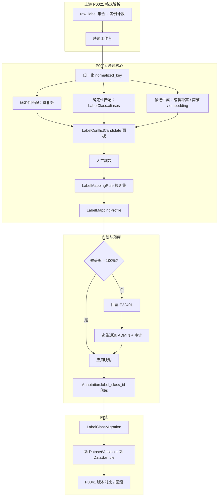
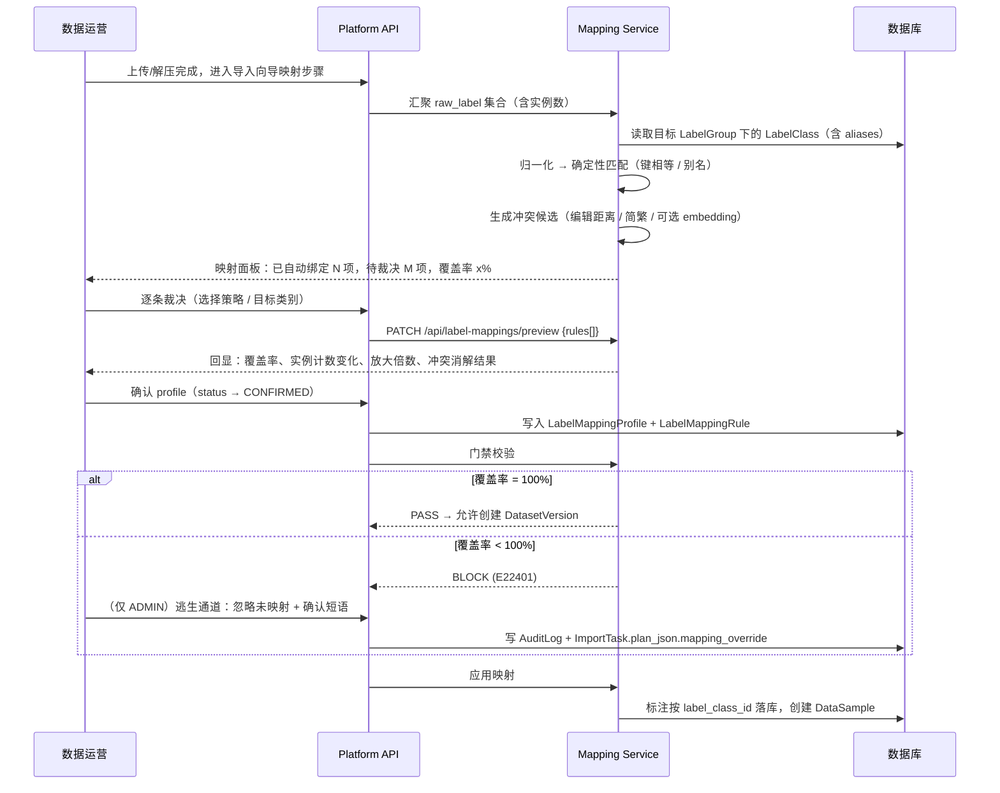
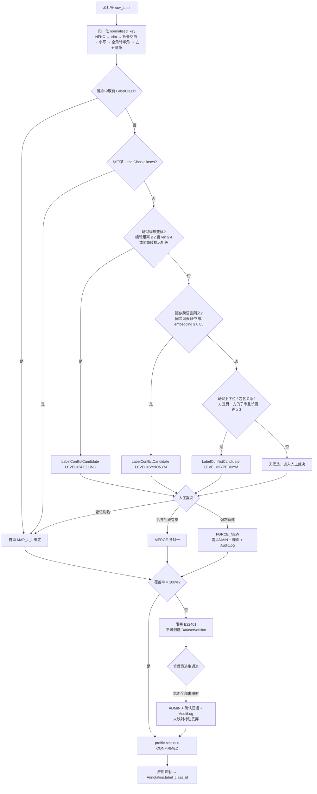
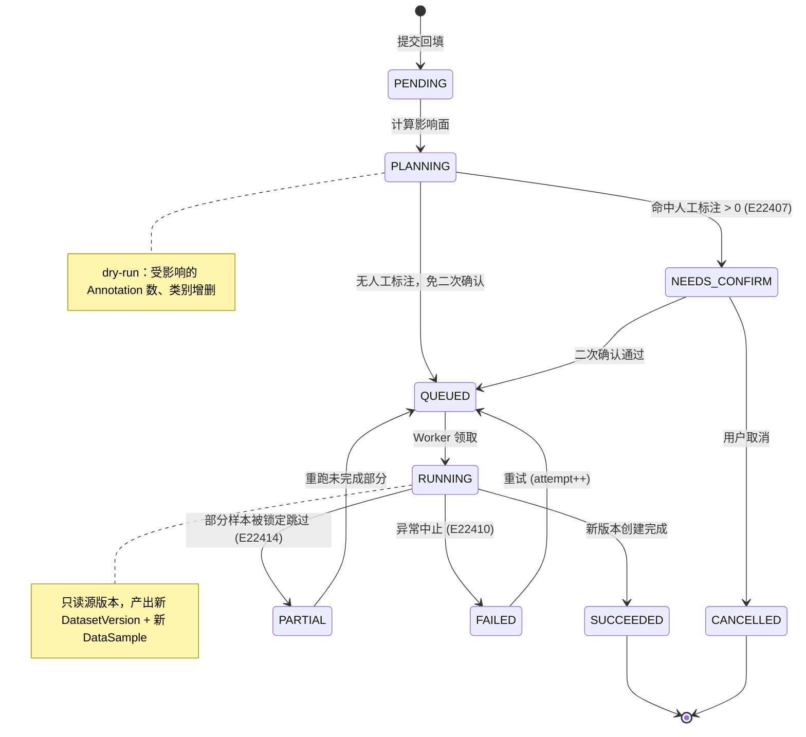
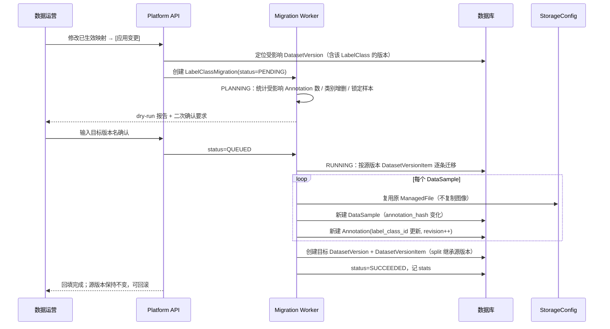
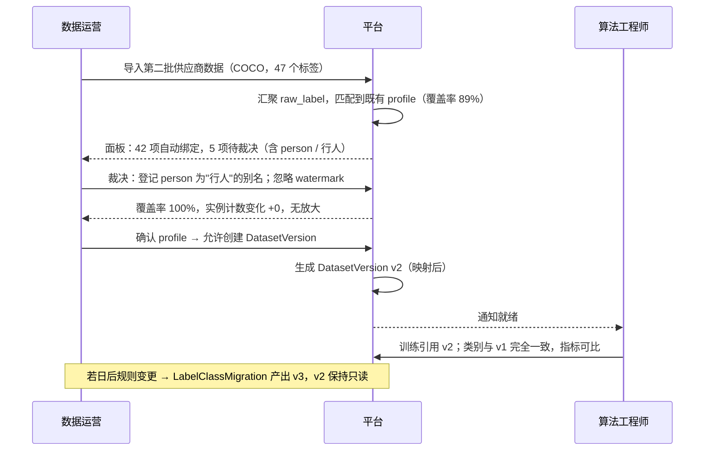
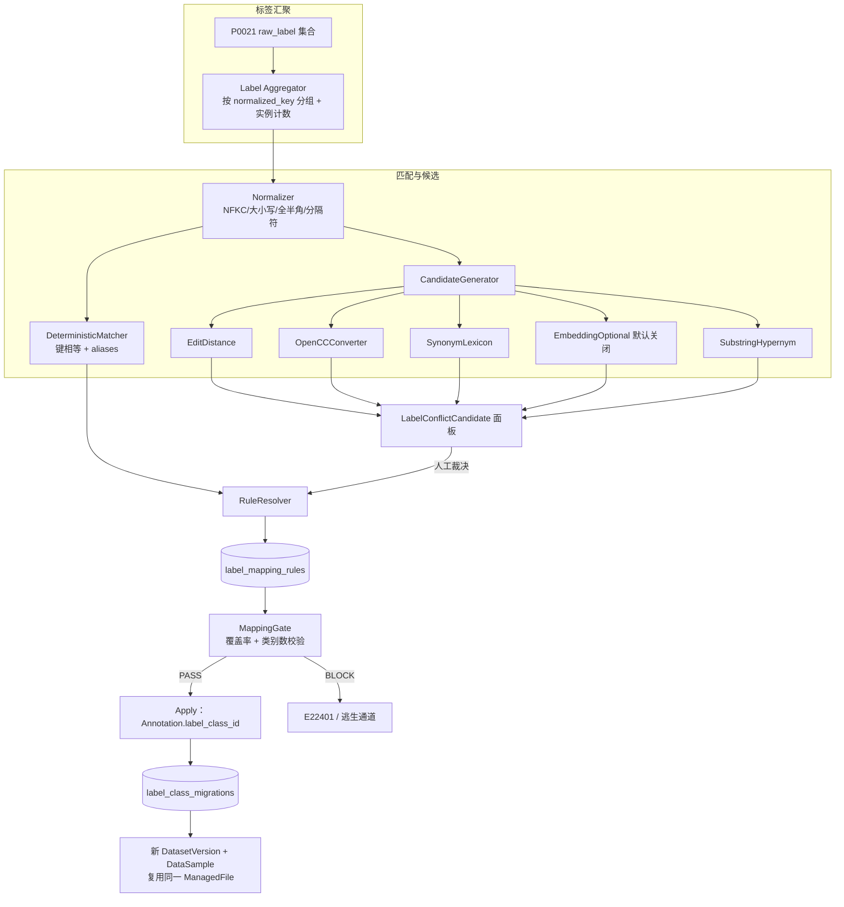

# PRD: P0024_类别映射与标签对齐 (Label Mapping & Alignment)

| 属性 | 内容 |
| :--- | :--- |
| **文档编号** | P0024 |
| **功能模块** | M02_数据导入 |
| **当前版本** | v1.0.0 |
| **文档状态** | Draft |
| **作者** | IngestB |
| **最后更新** | 2026-10-01 |

---

## 1. 全局说明

> [!IMPORTANT]
> **核心定位**: 外部数据集带进来的标签名（`person`、`日期`、`date region`、`DATE_REGION`）是**别人的语言**，平台训练用的是**自己的类别体系**。P0024 负责把前者翻译成后者，并且在翻译之前把"这两个标签其实是同一个东西"这类冲突找出来。
>
> 它是导入链路上的**守门人**：只要还有源标签没被裁决，就不允许生成 `DatasetVersion`。宁可挡住，也不让语义混乱的数据流进训练。

### 1.1 名词解释

| 术语 | 说明 |
| :--- | :--- |
| **源标签 (raw_label)** | 外部标注文件中出现的原始类别字符串，由 P0021 解析时原样保留。它不是平台实体，只是文本。 |
| **LabelClass** | 契约实体 `label_classes`，平台的类别，归属某个 `LabelGroup`。 |
| **LabelGroup** | 契约实体 `label_groups`，类别分组（如"日期区域类""印刷缺陷类"）。 |
| **归一化键 (normalized_key)** | 对源标签名做 NFKC → 去首尾空白 → 折叠连续空白 → 转小写 → 全角转半角 → 删除 `_ - .` 与空白后得到的键。用于判定"是否同名"。 |
| **别名 (alias)** | 挂在 `LabelClass` 上的历史名/同义名列表，映射时自动命中。合并操作会把被合并的名字登记为别名。 |
| **映射策略 (Strategy)** | `MAP_1_1` / `MAP_1_N` / `MERGE` / `IGNORE` / `CREATE_NEW` 五种之一。 |
| **LabelMappingProfile** | 一套可命名、可复用、可导出的映射规则集合。 |
| **覆盖率 (Coverage)** | 被源标签实例数加权的映射完成度：`Σ(已裁决标签的实例数) / Σ(全部源标签实例数)`。 |
| **语义冲突 (Semantic Conflict)** | 两个不同的源标签指向同一概念（`person` / `行人`），或同一个标签的不同写法被当成两个（`Person` / `person`）。 |
| **阻塞门禁 (Mapping Gate)** | 覆盖率 < 100% 且未走逃生通道时，禁止创建 `DatasetVersion` 的强制校验。 |
| **回填 (Backfill)** | 映射变更后，把新语义应用到**已存在**的标注上的后台作业，由契约实体 `LabelClassMigration(label_class_migrations)` 承载。 |
| **逃生通道 (Escape Hatch)** | 管理员显式放弃未映射标注、强行放行的操作，须输入确认短语并写 `AuditLog`。 |

### 1.2 统一异常处理

E 码规范为 5 位：`E` + 模块号(1) + P 编号后两位(2) + 流水(2)。P0024 占用 `E22401~E22419`。

| Code | 级别 | 场景 | 处理策略 |
| :--- | :--- | :--- | :--- |
| `E22401` | BLOCK | 存在未裁决的源标签，映射覆盖率 < 100% | 阻塞 `DatasetVersion` 创建，前端红色横幅 + 一键跳转映射页 |
| `E22402` | WARN | 映射目标 `LabelClass` 不存在或已软删除 | 该条规则标红，要求重选目标，不参与覆盖率计算 |
| `E22403` | WARN | 检出语义冲突候选，需人工裁决 | 生成 `LabelConflictCandidate`，在冲突面板逐条裁决后才计入已裁决 |
| `E22404` | BLOCK | 新建类别的归一化键与既有 `LabelClass` 冲突 | 拒绝新建，强制二选一：登记为别名（`ALIAS`）或合并（`MERGE`） |
| `E22405` | BLOCK | 映射配置导入格式非法 / `schema_version` 不兼容 | 拒绝导入并说明不兼容项，不产生部分写入 |
| `E22406` | BLOCK | 映射后有效类别数 < 2 | 拒绝创建版本，提示单类检测任务需显式确认 |
| `E22407` | BLOCK | 回填将改写已有人工标注，需二次确认 | 弹出二次确认，要求输入目标版本名 |
| `E22408` | BLOCK | 不可逆操作被拒（拆分已合并类别 / 删除被引用的 `LabelClass`） | 拒绝执行并给出替代路径（新建类别 + 重新映射） |
| `E22409` | WARN | 配置指纹与源标签集合不匹配 | 展示覆盖率与未命中标签，允许"应用并补齐" |
| `E22410` | BLOCK | 回填任务失败或部分失败 | 已完成部分保留；源版本未改动，可安全重跑或放弃 |
| `E22411` | BLOCK | 权限不足（修改类别体系 / 强制新建） | 返回 403，提示需 `ADMIN`（`TRAINER` 可映射到既有类别但不可新建） |
| `E22412` | WARN | 标签名非法（超长 / 非法字符 / 保留名 / 全空白） | 拒绝该名字，要求人工给出合规名 |
| `E22413` | BLOCK | 同一源标签同时命中多份生效配置 | 拒绝自动应用，要求在冲突面板指定唯一归属 |
| `E22414` | WARN | 目标样本被 `AnnotationTaskItem` 锁定（`lease_expires_at > now`） | 跳过该批并标记待处理，回填结束前不修改其标注 |
| `E22415` | WARN | `MAP_1_N` 导致实例计数放大超阈 | 需显式确认（勾选"我了解类别计数被放大"）后才可应用 |
| `E22416` | WARN | 源标签集合为空 | 无可映射内容，直接放行并提示"该批次无标注" |
| `E22417` | WARN | 冲突候选计算超时或降级 | 仅保留确定性检测（归一化键 + 别名），跳过近似匹配，提示人工复核 |
| `E22418` | WARN | 新建类别时颜色 / 快捷键自动分配冲突 | 自动改用下一个可用值，并在 UI 标注"已自动调整" |
| `E22419` | WARN | 映射配置导出失败（流式生成异常） | 配置仍在库中可用，提示重试导出 |

---

## 2. 项目背景

### 2.1 背景 (Context)

同一个概念，外部数据集会写成各种样子：`date`、`Date`、`DATE`、`date_region`、`date region`、`生产日期`、`日期区域`。而平台侧的 `LabelClass` 必须收敛到一套受控词表，否则：

* 训练时多个类语义重复 → 同一目标被拆到两个类，每个类都学不好；
* 指标看板上出现 `person` 与 `行人` 两行，无法判断真实分布；
* 质检与标注员无所适从，快捷键与颜色重复。

P0021 只负责"把外部标注解析出来"，因此它输出的是**原样保留的 `raw_label` + 占位类别**；真正的语义收敛是 P0024 的职责。

### 2.2 问题陈述 (Problem Statement)

1. **拼写变体泛滥**：大小写、空格、下划线、全半角差异让同一概念裂成多个类。
2. **跨语言同义**：英文标签与中文标签指向同一目标，机器无法自动判定"这是同一个东西"。
3. **一对多语义**：源数据的粗粒度标签在平台上必须拆成多个细粒度类（或一份标注要供多个下游任务用），简单的一对一映射装不下。
4. **映射结果不可复用**：同一个数据供应商的第二批数据，标签规则与第一批完全一致，却要人工再点一遍。
5. **未映射标签静默丢失或静默入库**：不阻塞就丢数据，阻塞了又没有逃生通道，用户会绕开平台。
6. **改映射等于改历史**：映射规则调一次，已标注的几千条数据全部语义错位，且没有回滚点。

### 2.3 目标与成功指标 (Goals & Success Metrics)

* **北极星指标**：进入训练的 `DatasetVersion` 中**未映射标注数 = 0**。
* **次要指标**：
  * 重复导入同一供应商数据时，映射工作量下降 ≥ **90%**（靠 profile 复用，人工仅确认差异项）。
  * 归一化键层面的同名冲突识别率 **100%**（确定性规则，不允许漏）。
  * 回填前后可完全回滚：源版本字节级不变。
  * 映射向导在 100 个源标签、20 个目标类别的规模下，人工完成时间中位数 < **5 分钟**。

### 2.4 风险与规避 (Risks & Mitigation)

| 风险 | 影响 | 规避方案 |
| :--- | :--- | :--- |
| 自动匹配误判（把两个不同的类并成一个） | 数据集语义被破坏且难发现 | 近似匹配只产出**候选**，绝不自动应用；只有归一化键相等与别名命中才自动绑定 |
| 一对多放大实例计数 | 类别统计与损失权重失真 | 应用前展示放大倍数，超阈需显式确认（`E22415`） |
| 回填中途失败留下半完成状态 | 数据不可用 | 回填产出**新版本**，源版本只读；失败则放弃新版本即可 |
| 用户绕过映射直接建版本 | 门禁形同虚设 | 门禁在服务端校验，不只在前端；绕过只能走 `ADMIN` 逃生通道并留审计 |
| 跨语言同义漏检 | 类别冗余 | 可选启用本地多语言 embedding **仅作提示**；同时强制要求人工过一遍未绑定标签列表 |
| 配置跨环境迁移后失效 | 目标类别不存在 | 导入时校验 `schema_version` 与目标 `LabelGroup`，缺失项列表化并阻止整体导入 |

---

## 3. 价值模型

* **方案**：在格式解析（P0021）之后、样本入库之前插入**映射工作台**。工作台三件事：① 用归一化键 + 别名表做确定性自动绑定；② 用编辑距离 + 简繁转换 + 可选 embedding 生成**冲突候选**交人裁决；③ 把人裁决的结果固化成 `LabelMappingProfile` 供复用。映射结果决定标注落在哪个 `LabelClass` 上，并由**门禁**保证不留未裁决项。
* **目标**：把"外部标签 → 平台类别"从每次重新拍脑袋，变成一次裁决、长期复用的可审计配置。

---

## 4. 项目范围

### 4.1 功能结构图



### 4.2 In Scope (包含范围)

1. **标签发现**：汇总一批数据中出现的全部 `raw_label` 及其实例数、出现文件数。
2. **确定性自动匹配**：归一化键相等、`LabelClass.aliases` 命中。
3. **五种策略**：`MAP_1_1` / `MAP_1_N` / `MERGE` / `IGNORE` / `CREATE_NEW`。
4. **语义冲突检测**：大小写/分隔符/全半角、简繁、编辑距离近似、跨语言同义候选。
5. **未映射阻塞**：服务端门禁 + 前端阻塞提示 + 管理员逃生通道（含审计）。
6. **配置保存与复用**：命名 profile、指纹匹配、导入/导出 JSON、跨批次复用。
7. **存量回填**：映射变更后由 `LabelClassMigration` 产出新版本，含 dry-run 与二次确认。
8. **不可逆保护**：被引用的 `LabelClass` 禁止物理删除；已合并类别禁止静默拆分。

### 4.3 Out of Scope (不包含范围)

* **类别体系的日常维护**（新建分组、改颜色、改快捷键的全量管理界面）——由 P0061 负责；本模块只做映射所需的新建入口。
* **标注本身的语义正确性**——映射只决定"这条标注属于哪个类"，不判断"框画得对不对"（P0063）。
* **自动语义推断模型训练**——不使用用户数据训练分类器；只用确定性与通用相似度。
* **层级类别体系（父子类继承）**：v1 的 `LabelClass` 是平铺的，不做 taxonomy 继承；检测到上下位关系只提示，不建模。
* **跨数据集全局类别统一**：不做平台级"大一统词表"合并，类别体系按 `LabelGroup` 归属。

---

## 5. 业务流程

### 5.1 映射向导流程



### 5.2 映射决策树



### 5.3 回填任务状态机（`LabelClassMigration`）



### 5.4 回填流程



---

## 6. 用户分析

### 6.1 用户画像 (User Personas)

* **数据运营 (`ADMIN`)**：负责把外部数据接进来。诉求"上一批供应商数据的映射规则，这一批直接复用，只处理新增的那几个标签"；痛点是每次导入都要重新点几十个下拉框，且没人记得上次怎么映射的。
* **标注负责人 (`ADMIN` / `TRAINER`)**：对类别体系的一致性负责。诉求"别让 `person` 和 `行人` 同时存在于一个数据集里"；痛点是冲突要靠人肉发现，发现时已经标了几千条。
* **算法工程师 (`TRAINER`)**：诉求"类别数别莫名其妙变多，验证集指标要可比"；痛点是改一次映射，历史标注全错位且没有回滚点。

### 6.2 用户链路图 (User Journey Map)



---

## 7. 功能需求

### M02.F01 标签发现与映射向导 (Label Discovery & Mapping Wizard)

* **用户故事**: 作为数据运营，我希望一眼看到这批数据里到底有哪些标签、各有多少个，以便判断映射工作量和风险。

* **逻辑与业务规则**:
  * **前置条件**：P0021 已完成格式解析，产出 `raw_label` 集合；用户具备 `ADMIN` 或 `TRAINER` 角色。
  * **汇聚口径**：按 `normalized_key` 分组展示，但**保留全部原始写法**（`raw_variants[]`）——因为用户需要看到 `Person` 和 `person` 确实同时存在。
  * **统计字段**：`instance_count`（标注框/多边形数）、`file_count`（出现的文件数）、`sample_path`（各取一个示例文件用于预览）、`first_seen_order`。
  * **排序**：默认按 `instance_count` 降序（先处理影响面大的标签）。
  * **目标类别来源**：向导顶部选择目标 `LabelGroup`；切换分组会**清空**不兼容的已选目标并提示。
  * **覆盖率展示**：`coverage = Σ(已裁决标签的 instance_count) / Σ(全部标签的 instance_count)`，实时随裁决更新；`raw_label` 实例数为 0 的标签不计入分母。
  * **后置条件**：用户可保存为 `DRAFT` 状态的 `LabelMappingProfile` 稍后继续。

* **验收标准**:

```gherkin
场景: 汇聚并展示标签清单
  Given 一批数据解析出 raw_label "person" 出现 3200 次、"Person" 出现 40 次、"行人" 出现 1100 次
  When 用户进入映射向导
  Then 展示 2 个归一化分组：
    | normalized_key | raw_variants  | instance_count |
    | person         | person, Person | 3240          |
    | 行人            | 行人            | 1100          |
  And 按 instance_count 降序排列

场景: 切换目标类别分组会清空不兼容选择
  Given 当前已把 "date" 映射到 LabelGroup "日期区域类" 下的 LabelClass "date_region"
  When 用户把目标 LabelGroup 改为 "印刷缺陷类"
  Then 已选目标被清空
  And 提示"已切换类别分组，原映射目标不兼容需重选"
```

* **边界情况与异常处理**:

| 场景 | 处理 |
| :--- | :--- |
| `raw_label` 集合为空 | 返回 `E22416`，直接放行导入并提示"该批次无标注" |
| 标签数 > 500 | 分页展示，默认只展开 Top 50；提供搜索与"仅看待裁决"过滤 |
| `raw_label` 为空字符串或纯空白 | 归为特殊分组 `__EMPTY__`，默认策略 `IGNORE`，须人工确认（`E22412`） |
| 标签名超长（> 128 字符） | 展示截断并标红，`CREATE_NEW` 时拒绝（`E22412`） |
| 同一 `normalized_key` 下原始写法 > 20 种 | 折叠展示前 5 种 + "另 15 种"，避免撑爆 UI |
| 用户中途离开未保存 | 向导支持保存 `DRAFT` profile；未保存时关闭页面二次提示 |

---

### M02.F02 映射策略配置 (Mapping Strategies)

* **用户故事**: 作为数据运营，我希望为每个源标签选择"变成平台上的什么"，以便不同的外部语义都能落到正确的类别上。

* **逻辑与业务规则**:
  * 五种策略，语义与落库结果如下：

    | 策略 | 基数 | 语义 | 落库结果 | 典型场景 | 风险 |
    | :--- | :--- | :--- | :--- | :--- | :--- |
    | `MAP_1_1` | 1→1 | 一对一，最常用 | 标注的 `label_class_id` 指向目标类 | `date` → `date_region` | 无 |
    | `MAP_1_N` | 1→N | 一个源标签拆成 N 个平台类别 | 每个标注实例复制为 N 份几何相同、`source=MAPPED_SPLIT` 的 `Annotation` | 一个日期框既要作为检测类 `date_region`，又要作为 OCR 数据源类 `text_region` | 实例计数被放大 N 倍，类别统计与损失权重失真 |
    | `MERGE` | N→1 | 多个源标签合并到一个平台类别 | 多个源标签的标注统一指向同一 `label_class_id`；被合并的名字登记为该类的 `aliases` | `person` 与 `行人` 合并到 `行人` | 原本有区分度的语义被抹平 |
    | `IGNORE` | 1→0 | 丢弃该源标签的全部标注 | 不产生 `Annotation` | `watermark`、`ignore`、`*` 等非目标类 | 静默丢数据，必须在报告中显式统计丢弃数 |
    | `CREATE_NEW` | 1→1 | 以源标签名新建 `LabelClass` | 新建类并绑定 | 外部有平台尚未定义的 `qr_code` | 类别体系膨胀；名字不干净 |

  * **`CREATE_NEW` 的名字处理**：默认取原始写法中最常见的一种（出现次数最多，平局取最长）；用户可改为显示名（`display_name`）而不改 `name`。
  * **`MAP_1_N` 的放大保护**：应用前计算 `amplification = 策略产生的 Annotation 总数 / 原 Annotation 总数`；`amplification > 1.2` 或单标签 `N ≥ 3` 时触发 `E22415`，需勾选确认。
  * **`MERGE` 的可逆性**：被合并的源名写入目标 `LabelClass.aliases`，且原决策保留在 `LabelMappingRule` 中，因此**可反查**；但原 `LabelClass` 一旦被物理删除则不可逆（见 M02.F06 保护规则）。
  * **`IGNORE` 的强制可见**：应用后 `CleaningReport` 与导入报告必须展示"因 IGNORE 丢弃的标注数 / 占比"，不允许静默。
  * **冲突规则**：同一个源标签在同一 profile 内**只能有一条生效规则**（唯一索引 `(profile_id, normalized_key)`），命中多份配置时返回 `E22413`。

* **验收标准**:

```gherkin
场景: 一对一映射
  Given 源标签 "date" 实例数 8200
  When 用户选择策略 MAP_1_1，目标 LabelClass = "date_region"
  Then 规则保存为 (normalized_key="date", strategy=MAP_1_1, target_class_ids=["date_region"])
  And 覆盖率随该标签的实例数提升

场景: 一对多映射触发确认
  Given "date_region" 与 "text_region" 两个目标类，源标签 "date" 实例数 8200
  When 用户选择策略 MAP_1_N 并选中两个目标
  Then 预览展示 amplification = 2.0
  And 返回 E22415，要求勾选"我了解类别计数被放大"
  And 未勾选时 [应用] 按钮 Disabled

场景: 合并标签并登记别名
  Given 源标签 "person"(3240) 与 "行人"(1100)，目标类 "行人"(existing)
  When 用户对 "person" 选择策略 MERGE，目标 = "行人"
  Then "person" 被写入 LabelClass("行人").aliases
  And 两个源标签的标注合并计数为 4340
  And 规则保留可反查的 original_label 信息

场景: 忽略标签必须可见
  Given 源标签 "watermark" 实例数 96
  When 用户选择策略 IGNORE
  Then 导入报告中展示"IGNORE 丢弃标注 96 条（占 0.8%）"
  And 不产生对应 Annotation
```

* **边界情况与异常处理**:

| 场景 | 处理 |
| :--- | :--- |
| 目标 `LabelClass` 被软删除 | 标红该规则并返回 `E22402`，不计入覆盖率 |
| `MAP_1_N` 选中同一个类两次 | 去重后按一次处理，提示"已自动去重" |
| `IGNORE` 掉全部标签 | 覆盖率分母归零、有效类别数 0 → `E22406` 拒绝创建版本 |
| `MERGE` 的两个源标签实例计数都很大 | 提示合并后该类成为主导类，可能触发 `CHK_DOMINANT_CLASS`（P0023） |
| `CREATE_NEW` 名字与既有类归一化键相同 | 拒绝并返回 `E22404`，提供 `ALIAS` / `MERGE` 两个替代动作 |
| 一条规则同时被两份 profile 生效 | 返回 `E22413`，要求指定唯一归属 |

---

### M02.F03 语义冲突检测与裁决 (Semantic Conflict Detection)

* **用户故事**: 作为标注负责人，我希望平台把"这俩可能是一个意思"标出来，以便我在数据入库前就把重复类别收敛掉。

* **逻辑与业务规则**:
  * **五级冲突，按确定性从高到低**：

    | 级别 | 名称 | 判定依据 | 处理 | 是否自动应用 |
    | :--- | :--- | :--- | :--- | :--- |
    | L1 | 同名 | `normalized_key` 完全相等（大小写 / 空格 / 下划线 / 连字符 / 全半角差异归一后相同） | 自动 `MAP_1_1` 绑定同一目标 | **是**（确定性） |
    | L2 | 别名 | 命中 `LabelClass.aliases` 中任一条目 | 自动绑定到该 `LabelClass` | **是**（用户显式登记过） |
    | L3 | 词形变体 | 编辑距离 ≤ **2** 且两串长度均 ≥ **4**；或简繁转换（OpenCC）后相等 | 生成 `SPELLING` 候选 | 否，必须人工裁决 |
    | L4 | 跨语言同义 | 内置同义词表命中；或可选 embedding 余弦 ≥ **0.85** | 生成 `SYNONYM` 候选 | 否 |
    | L5 | 上下位 / 包含 | 一方是另一方的子串且长度差 ≥ **3**（如 `text` 与 `date_region` 不算，`date` 与 `date_region` 算） | 生成 `HYPERNYM` 候选 | 否 |

  * **归一化算法（确定性，必须先跑）**：NFKC 规范化 → 去除首尾空白 → 连续空白折叠为单个 → 转小写 → 全角转半角 → 删除 `_` `-` `.` 与空格。归一化后相等即判定 L1，**不允许存在两个归一化键相同的 `LabelClass`**（数据库唯一约束 `(label_group_id, normalized_key)`）。
  * **冲突候选只提示不执行**：L3~L5 一律产出 `LabelConflictCandidate`，交人在冲突面板逐条裁决为 `ALIAS`（登记别名）/ `MERGE`（合并）/ `FORCE_NEW`（强制新建，需 `ADMIN` + 填写理由 + 写 `AuditLog`）/ `KEEP_SEPARATE`（确认是两个不同概念，长期保留）。
  * **误报成本不对称**：把两个不同的类合并（假阳性）比漏掉一个同义类（假阴性）后果更严重——前者污染标签语义且难以察觉，后者只是多一个类。因此 L3~L5 的阈值一律**偏保守**，宁可漏报也不自动合并。
  * **embedding 选项默认关闭**：启用需在系统设置中开启并加载本地多语言模型（离线，约 470 MB，不依赖外网）。任何 embedding 命中**仅生成候选**，绝不自动应用——向量相似不等于语义同一。
  * **裁决结果持久化**：`KEEP_SEPARATE` 也写库，避免下次导入时同一对标签反复报警。

* **阈值表**:

| 检测 | 参数 | 默认阈值 | 可调范围 | 判定 | 理由 |
| :--- | :--- | :--- | :--- | :--- | :--- |
| 归一化键相等 | — | 必须相等 | 不可调 | L1，自动绑定 | 纯字符串确定性规则，无歧义，是唯一允许自动应用的一类 |
| 别名命中 | `LabelClass.aliases` | 命中即绑定 | 不可调 | L2，自动绑定 | 别名是用户自己登记过的，等价于已裁决 |
| 编辑距离 | `distance` | `≤ 2` | 1~3 | L3 候选 | 距离 2 能覆盖 `data`/`date`、`labal`/`label` 这类单字符错写与相邻换位；放到 3 会开始把 `cat`/`car`/`can` 这类真正不同的短词串起来 |
| 编辑距离 | `min_length` | `≥ 4` | 3~6 | 长度不足则跳过 | 长度 < 4 时编辑距离 2 的相对差异超过 50%（`cat`→`car`），误报率极高，直接不做 |
| 简繁 | OpenCC 转换 | 转换后相等 | 不可调 | L3 候选 | 简繁差异是纯字符映射，确定性高；但仍需人工确认（`面` 与 `麵` 在不同语境语义不同） |
| 同义词表 | 内置词表 | 精确命中 | 不可调 | L4 候选 | 词表由团队维护（`person`↔`行人`、`car`↔`车辆`），命中即为强提示 |
| embedding | 余弦相似度 | `≥ 0.85` | 0.75~0.95 | L4 候选 | 多语言句向量对同义短词的相似度集中在 0.8~0.9 区间；取 0.85 是召回与误报的折中，且**该值仅决定是否提示**，不决定是否合并。任何情况下都需人工裁决 |
| 上下位 | 子串长度差 | `≥ 3` | 3~8 | L5 候选 | 长度差 < 3 时子串关系多为偶然（`car` 与 `card`），提示价值低 |

* **验收标准**:

```gherkin
场景: 大小写变体被自动收敛
  Given 源标签 "Person"(40) 与 "person"(3200)
  When 执行冲突检测
  Then 两者归一化键均为 "person"，判定 L1
  And 自动绑定到同一目标 LabelClass，不产生待裁决项

场景: 生成拼写候选但不自动应用
  Given 源标签 "date"(8200) 与 "dat"(12)
  When 执行冲突检测
  Then 生成 LabelConflictCandidate(level=SPELLING, a="date", b="dat", distance=1)
  And 覆盖率不因该候选自动提升，需人工裁决

场景: 跨语言同义需人工裁决
  Given 源标签 "person"(3240) 与 "行人"(1100)，两者均未映射
  When 启用同义词表检测
  Then 生成 LabelConflictCandidate(level=SYNONYM, match_by="LEXICON")
  When 用户裁决为 MERGE，目标 "行人"
  Then "person" 写入 "行人" 的 aliases，规则可反查

场景: 短标签不做编辑距离检测
  Given 源标签 "cat"(30) 与 "car"(20)
  When 执行冲突检测
  Then 不生成 SPELLING 候选（长度 < 4）
  And 两者各需人工裁决

场景: 确认保留为两个不同概念
  Given 候选对 "date" / "data"
  When 用户裁决为 KEEP_SEPARATE 并填写理由
  Then 写入 LabelConflictCandidate(decision=KEEP_SEPARATE)
  And 下次导入同一对标签时不再重复报警
```

* **边界情况与异常处理**:

| 场景 | 处理 |
| :--- | :--- |
| 候选对数过多（> 200） | 面板按实例数加权排序，默认只展示 Top 50，支持批量"全部保持独立" |
| embedding 模型未下载 | 该检测项自动禁用并在 UI 提示，不影响 L1~L3（离线优先，不阻塞流程） |
| 候选计算超时 | 降级为仅跑 L1 + L2（确定性），返回 `E22417` 并提示人工复核 |
| `FORCE_NEW` 后与既有类仍同归一化键 | 被 `E22404` 阻止；强制新建只对**不同键**生效 |
| 简繁转换后相等但语义不同 | 仍标为 L3 候选，人工可裁为 `KEEP_SEPARATE`（例如"面"与"麵"） |
| 同一标签与多个标签构成候选 | 面板以星型分组展示，裁决一次可影响多条边 |

---

### M02.F04 未映射阻塞与逃生通道 (Unmapped Blocking & Escape Hatch)

* **用户故事**: 作为算法工程师，我希望未映射的标签会挡住导入，以便不会有标注在我不知情的情况下消失或被塞进错误的类。

* **逻辑与业务规则**:
  * **门禁条件（服务端强制）**：创建 `DatasetVersion` 前校验
    `Σ(未裁决源标签的 instance_count) == 0` **且** profile 已 `CONFIRMED` **且** 有效类别数 ≥ 2。
    不满足则返回 `E22401`（类别数不足时为 `E22406`），**不创建任何 `DatasetVersionItem`**。
  * **阻塞提示形态**：
    * 向导页顶部红色横幅："仍有 2 个标签未处理，共 4,340 条标注无法入库"；
    * 横幅内附"仅看待裁决"快捷入口与实例数；
    * 尝试点击 [创建数据集版本] 时按钮 Disabled 并给出 tooltip 原因码。
  * **门禁不可被前端绕过**：校验在服务端执行；即便用户直接调 API 也会被拒。
  * **逃生通道（仅 `ADMIN`）**：
    * 动作 = "忽略全部未映射标签并继续"；
    * 必须输入确认短语 `IGNORE UNMAPPED`（精确匹配，全大写）+ 勾选"我确认这些标注将被永久丢弃"；
    * 结果写入 `ImportTask.plan_json.mapping_override = {by, at, ignored_labels[], ignored_instance_count}` 与 `AuditLog`；
    * 导入报告与 `CleaningReport` 必须显式统计丢弃量，不允许静默；
    * 被忽略的 `raw_label` 仍保留在报告里，便于事后补标。
  * **阻塞与预检的关系**：若同一批次同时存在 `CHK_UNKNOWN_CLASS`（P0023），两者共用同一个阻塞面板入口——预检报告里的未知类别项点击后直达映射向导。
  * **`TRAINER` 与 `ADMIN` 的权限差异**：`TRAINER` 可以把源标签映射到**既有** `LabelClass`，但不能新建类别、不能走逃生通道。

* **验收标准**:

```gherkin
场景: 未映射标签阻塞版本创建
  Given profile 覆盖率 96%，仍有 "logo"(300) 未裁决
  When 用户点击 [创建数据集版本]
  Then 服务端返回 E22401
  And 不创建任何 DatasetVersionItem
  And 前端横幅显示"仍有 1 个标签未处理，共 300 条标注无法入库"

场景: 管理员走逃生通道
  Given 用户角色为 ADMIN，覆盖率 96%
  When 用户点击 [忽略未映射并继续] 并输入 "IGNORE UNMAPPED"
  Then 放行创建 DatasetVersion
  And ImportTask.plan_json.mapping_override 记录被忽略标签与实例数
  And 写 AuditLog（操作人 / 时间 / 被忽略标签列表）
  And 导入报告展示"因未映射丢弃 300 条标注（占 3.8%）"

场景: 逃生通道确认短语错误
  Given 用户输入 "ignore unmapped"（小写）
  When 提交
  Then 返回 E22401，不放行，不产生任何变更

场景: TRAINER 不能新建类别
  Given 用户角色为 TRAINER，源标签 "qr_code" 在平台上不存在
  When 用户尝试选择策略 CREATE_NEW
  Then 返回 E22411，提示需 ADMIN 权限
  And 提供 [登记为其他类别别名] 的替代入口
```

* **边界情况与异常处理**:

| 场景 | 处理 |
| :--- | :--- |
| 映射后有效类别数 < 2 | `E22406` 拒绝创建版本，提示单类检测任务需显式确认后再提交 |
| 全部标签被 `IGNORE` | 视为"无标注批次"，提示该批次只能用于无监督/背景样本，需显式确认 |
| 门禁通过与预检阻塞同时存在 | 合并为一个阻塞面板，按"映射 → 预检"顺序引导，不重复报警 |
| 未映射标签实例数为 0 | 不计入门禁分母（有名字但没标注，不影响入库） |
| 逃生通道被反复使用 | 每次调用写审计；连续 3 次触发平台 `Alert`（P0132），提示流程可能有问题 |
| 用户直接调 API 绕过前端 | 服务端门禁同样生效；逃生通道需携带确认短语，缺少即 `E22401` |

---

### M02.F05 映射配置保存、复用与移植 (Profile Persistence & Reuse)

* **用户故事**: 作为数据运营，我希望把映射结果存下来，下一批同源数据一键复用，以便不用每次重新点几十个下拉框。

* **逻辑与业务规则**:
  * **配置结构**：`LabelMappingProfile`（头部：名称、目标 `LabelGroup`、指纹、状态、`schema_version`）+ `LabelMappingRule`（每条：`normalized_key`、`raw_variants[]`、策略、`target_class_ids[]`、`created_class_id`、`note`）。
  * **源指纹**：`source_fingerprint = sha256(concat(sorted(normalized_key)))`，只由**标签名集合**决定，与实例数无关——这样同一供应商的下一批数据（数量不同、标签相同）能命中。
  * **复用判定**：
    * **完全命中**（指纹相等）：展示"该批次标签集合与 profile X 完全一致"，一键应用，人工仅需扫一眼；
    * **部分命中**（交集非空）：展示覆盖率与未命中标签列表，提供"应用并补齐"（复制规则 + 只对未命中项要求裁决）；
    * **不命中**：走新建流程。
  * **profile 冻结**：profile 一旦被用于创建 `DatasetVersion`，其 `status` 从 `CONFIRMED` 变为 `LOCKED`；后续修改生成**副本**（新 `profile_id`，`derived_from` 指向原 profile）。这保证历史版本能追溯"当时用的是哪套规则"。
  * **导入 / 导出**：导出为 JSON（`schema_version` + 规则 + 类别引用按 `normalized_key` 而非 UUID，便于跨环境迁移）。导出物**按需生成、流式下载，不登记 `ManagedFile`**——映射配置是可重算的派生结论，其权威副本就是 `label_mapping_profiles` / `label_mapping_rules` 本身。导入时校验：
    1. `schema_version` 兼容 → 否则 `E22405`，整体拒绝不做部分写入；
    2. 目标 `LabelGroup` 存在 → 否则列出缺失项；
    3. 目标 `LabelClass` 逐条按 `normalized_key` 解析，缺失项进入"待创建"列表由用户决定 `CREATE_NEW` 或重选。
  * **删除保护**：被 `DatasetVersion` 引用过的 profile 只允许软删除，不允许物理删除。

* **验收标准**:

```gherkin
场景: 完全命中复用
  Given profile "供应商A-食品日期" 的 source_fingerprint = abc123
  And 新批次标签集合的指纹也为 abc123
  When 用户进入映射向导
  Then 提示"与 profile 供应商A-食品日期 完全一致"
  And 提供 [一键应用] 与 [查看规则明细]

场景: 部分命中并补齐
  Given profile 含 47 条规则，新批次含 50 个标签（新增 3 个）
  When 用户选择 [应用并补齐]
  Then 47 条规则直接复用，覆盖率显示为 89%
  And 仅 3 个新增标签进入待裁决列表

场景: 已用 profile 被冻结
  Given profile P1 已用于创建 DatasetVersion v2
  When 用户修改 P1 的某条规则
  Then 系统创建副本 P2（derived_from=P1），P1 保持 LOCKED 不变
  And DatasetVersion v2 仍指向 P1，可追溯

场景: 导入不兼容的配置
  Given 导入的 JSON schema_version = 2，平台当前支持 1
  When 用户导入该文件
  Then 返回 E22405 并说明不兼容项
  And 不产生任何部分写入

场景: 导入时目标类别缺失
  Given 配置文件引用 LabelClass "date_region"，但目标 LabelGroup 下不存在
  When 用户导入
  Then 列出缺失类别清单，进入"待创建"列表
  And 用户可选择 CREATE_NEW 或重选目标后完成导入
```

* **边界情况与异常处理**:

| 场景 | 处理 |
| :--- | :--- |
| 指纹相同但目标 `LabelGroup` 不同 | 视为不兼容，提示需先切换分组或新建 profile |
| profile 名称重复 | 拒绝，提示"名称已存在"（团队内唯一） |
| 配置文件引用的类别已被软删除 | 该条规则标红，按 `E22402` 处理，不阻断整体导入 |
| 导出的 JSON 超过 1 MiB | 正常（纯文本规则），不做分片；若超过 5 MiB 提示规则过多、建议拆分 profile |
| 用户删除被引用的 profile | 仅软删除；物理删除返回 `E22408` |
| 同一批次同时命中两份 profile | 返回 `E22413`，要求指定唯一归属 |

---

### M02.F06 存量标注回填与不可逆保护 (Backfill & Irreversibility Protection)

* **用户故事**: 作为标注负责人，我希望改了映射规则之后能把已有标注跟着改过来，但在动到人工标注之前必须有确认和回滚点。

* **逻辑与业务规则**:
  * **触发场景**：`MERGE`（合并两个已有类）、`MAP_1_N` 增删目标、`CREATE_NEW` 后回填、类别重命名。凡影响已落库 `Annotation.label_class_id` 的变更，都必须走 `LabelClassMigration`。
  * **不可变原则（硬约束）**：回填**不修改任何已发布版本**。正确路径是：复制 → 改写 → 产出**新的 `DatasetVersion`**；源版本与其 `DatasetVersionItem`、`DataSample`、`Annotation` 字节级不变。
  * **图像不复制**：新 `DataSample` 复用同一个 `ManagedFile`（按 `etag` 内容寻址），只新建样本行与标注行；`DataSample.annotation_hash` 变化本身就是版本差异的判据。
  * **split 继承（默认）**：新版本的 `DatasetVersionItem.split` **按源版本样本逐个继承**，不重新切分。理由：重新切分会让训练集/验证集洗牌，使"v2 相比 v1 涨了 1 个点"无法判断是数据变化还是切分变化。用户可显式选择"重新切分"，此时必须提示指标不可比。
  * **切分不变量（全局口径，回填必须满足）**：`DataSample.group_key` 是样本来源身份的唯一真源（视频 / 采集批次 / 会话 / SKU）；`DatasetVersionItem.group_key` 是**创建版本时的快照副本**（保持已冻结版本自洽，不依赖上游变更）。约束落在版本侧——**同一 `version_id` 内同一 `group_key` 不得跨 `split`**。
    * `INHERIT` 逐样本继承源版本的 `split` 与 `group_key`，天然满足该不变量，是回填默认值；
    * `RESPLIT` 必须**按 `group_key` 分组后整组切分**（同组样本整体进入同一个 `split`），否则同源相邻帧会同时落进 TRAIN 与 VAL 造成泄漏，触发版本校验错误并拒绝提交。
  * **dry-run 必须展示**：受影响的 `Annotation` 条数、受影响的 `DataSample` 数、涉及的新增/消失 `LabelClass`、类别分布变化（前 → 后）、被 `AnnotationTaskItem` 锁定的样本数。
  * **二次确认触发**：dry-run 显示受影响的**人工标注**（`Annotation.source` 非 `PRE_ANNOTATION` 且 `revision > 1`）条数 > 0 时，必须输入目标版本名确认（`E22407`）。
  * **回滚**：源版本未被改动，回滚 = 把下游引用切回源版本 + 软删除目标版本。无需样本级映射表。
  * **回填产物**：`LabelClassMigration` 记录 `source_version_id` / `target_version_id` / `status` / `stats_before` / `stats_after` / `attempt` / `operator_id`。逐样本对应关系不落库（回滚不需要它），仅输出聚合统计。
  * **并发保护**：目标样本若正被 `AnnotationTaskItem` 锁定（`status=IN_PROGRESS` 且 `lease_expires_at > now`），跳过该批（`E22414`），任务置 `PARTIAL`，等标注任务结束后可重跑未完成部分。
  * **回填期间的可写性**：回填作业是只读源版本 + 只写新版本，因此**不影响正在进行的标注工作**；被跳过的锁定样本在解锁后由重跑补齐。
  * **不可逆操作的显式拒绝**：
    * 拆分一个已 `MERGE` 的类别：若原源标签信息仅存在于 `aliases` 与 `LabelMappingRule`（即可反查）→ **允许**，通过新建类别 + 重新映射实现；若原 `LabelClass` 已被物理删除 → **拒绝**（`E22408`），只能人工重标；
    * 删除被 `Annotation` 或 `LabelMappingRule.target_class_ids` 引用的 `LabelClass` → **拒绝**（`E22408`），只允许软删除并标记为 `DEPRECATED`（不再出现在新建映射的候选列表中，但历史数据仍可解析）。

* **验收标准**:

```gherkin
场景: 回填产出新版本且源版本不变
  Given DatasetVersion v1 含 12000 个 DataSample，使用 LabelClass "date"
  When 执行 MERGE（"date" → "date_region"）的回填
  Then 创建 LabelClassMigration(source=v1, status=SUCCEEDED)
  And 生成 DatasetVersion v2，其 DataSample.annotation_hash 已变化
  And v1 的 DataSample / Annotation 记录未被修改
  And v2 的 DatasetVersionItem.split 与 v1 逐样本一致

场景: 影响人工标注需二次确认
  Given dry-run 显示受影响的人工标注 3200 条
  When 用户提交回填但输入了错误的目标版本名
  Then 返回 E22407，不执行回填
  When 用户输入正确的 "v2" 并确认
  Then 任务进入 QUEUED 并执行

场景: 拒绝删除被引用的类别
  Given LabelClass "logo" 被 300 条 Annotation 引用
  When 用户尝试物理删除 "logo"
  Then 返回 E22408
  And 提供 [改为废弃（DEPRECATED）] 替代路径

场景: 锁定样本被跳过
  Given 其中 40 个样本正被 AnnotationTaskItem 锁定
  When 执行回填
  Then 这 40 个样本被跳过，任务置 PARTIAL 并记录 skipped_count=40
  And 其余样本正常回填

场景: 回滚
  Given 回填产出 v2 后用户发现映射有误
  When 用户点击 [回滚到 v1]
  Then 下游引用切回 v1，v2 被软删除
  And v1 的 DatasetVersionItem 未发生变化
```

* **边界情况与异常处理**:

| 场景 | 处理 |
| :--- | :--- |
| 回填中途 Worker 崩溃 | 置 `FAILED`，已建样本行保留但不挂到任何版本（孤儿），重跑时按内容哈希幂等复用或由 GC 回收 |
| 同一 `LabelClassMigration` 重复提交 | 以 `(source_version_id, target_rule_fingerprint)` 幂等，返回既有任务 |
| `MAP_1_N` 回填使标注总数翻倍 | 前置校验放大倍数并提示；超 `1.2` 倍需确认（`E22415`） |
| 源版本为 `FROZEN` | 允许（回填只读源版本）；但**不允许**把新版本自动置为 `FROZEN`，保持 `READY` 由用户决定 |
| 目标版本名与既有版本冲突 | 自动追加 `-mapped-N` 后缀，并在确认弹窗中展示最终名称 |
| 回填后有效类别数 < 2 | 拒绝并返回 `E22406` |
| 回填期间映射规则又被修改 | 任务绑定提交时的规则指纹，运行中的任务不受影响；新规则需新提交一次回填 |

---

## 8. 技术架构与数据模型

### 8.1 数据实体

> 所有表统一携带 `id` (UUID PK) / `created_at` / `updated_at` / `deleted_at`（nullable，软删除），下表不再重复。

#### `label_mapping_profiles`

| 字段名 | 类型 | 必填 | 说明 | 约束 |
| :--- | :--- | :--- | :--- | :--- |
| `name` | String(64) | Y | 配置名称 | 团队内唯一 |
| `label_group_id` | UUID | Y | 目标类别分组 | FK → `label_groups.id` |
| `source_fingerprint` | String(64) | Y | 源标签集合指纹 | sha256(sorted(normalized_key)) |
| `status` | Enum | Y | 状态 | `DRAFT`/`CONFIRMED`/`LOCKED` |
| `schema_version` | Int | Y | 配置格式版本 | 当前为 1 |
| `derived_from` | UUID | N | 派生自哪个 profile | 修改已 `LOCKED` 的配置时生成副本 |
| `reuse_count` | Int | Y | 复用次数 | 默认 0 |
| `created_by` | UUID | Y | 创建人 | FK → `users.id` |

#### `label_mapping_rules`

| 字段名 | 类型 | 必填 | 说明 | 约束 |
| :--- | :--- | :--- | :--- | :--- |
| `profile_id` | UUID | Y | 所属配置 | FK，与 `normalized_key` 组成唯一索引 |
| `normalized_key` | String(128) | Y | 源标签归一化键 | 同一 profile 内唯一 |
| `raw_variants` | Text[] | Y | 全部原始写法 | 至少 1 项 |
| `strategy` | Enum | Y | 映射策略 | `MAP_1_1`/`MAP_1_N`/`MERGE`/`IGNORE`/`CREATE_NEW` |
| `target_class_ids` | UUID[] | N | 目标类别 | `IGNORE` 时为空；`MERGE`/`MAP_1_N` 可多项 |
| `created_class_id` | UUID | N | `CREATE_NEW` 新建的类别 | FK → `label_classes.id` |
| `instance_count` | Int | Y | 该标签的标注实例数 | ≥ 0，用于覆盖率加权 |
| `amplification` | Float | N | `MAP_1_N` 的放大倍数 | 用于 `E22415` 判定 |
| `decision_source` | Enum | Y | 决策来源 | `AUTO_KEY`/`AUTO_ALIAS`/`MANUAL`/`PROFILE_REUSE` |
| `note` | Text | N | 备注 | |

#### `label_conflict_candidates`

| 字段名 | 类型 | 必填 | 说明 | 约束 |
| :--- | :--- | :--- | :--- | :--- |
| `profile_id` | UUID | Y | 所属配置 | FK |
| `level` | Enum | Y | 冲突级别 | `SPELLING`/`SYNONYM`/`HYPERNYM` |
| `key_a` | String(128) | Y | 归一化键 A | |
| `key_b` | String(128) | Y | 归一化键 B | |
| `match_by` | Enum | Y | 判定手段 | `EDIT_DISTANCE`/`OPENCC`/`LEXICON`/`EMBEDDING`/`SUBSTRING` |
| `score` | Float | N | 相似度或距离 | 编辑距离为整数、embedding 为余弦 |
| `decision` | Enum | N | 人工裁决 | `ALIAS`/`MERGE`/`FORCE_NEW`/`KEEP_SEPARATE` |
| `decided_by` / `decided_at` | UUID / Timestamp | N | 裁决人与时间 | `FORCE_NEW` 必填理由见 `note` |

#### `label_class_migrations`（契约实体）

| 字段名 | 类型 | 必填 | 说明 | 约束 |
| :--- | :--- | :--- | :--- | :--- |
| `source_version_id` | UUID | Y | 源版本（只读） | FK → `dataset_versions.id` |
| `target_version_id` | UUID | N | 产出目标版本 | FK，成功后回填 |
| `rule_fingerprint` | String(64) | Y | 触发本次迁移的规则指纹 | 与 `source_version_id` 组成幂等键 |
| `status` | Enum | Y | 状态 | `PENDING`/`PLANNING`/`NEEDS_CONFIRM`/`QUEUED`/`RUNNING`/`SUCCEEDED`/`PARTIAL`/`FAILED`/`CANCELLED` |
| `attempt` | Int | Y | 尝试次数 | 默认 1 |
| `split_policy` | Enum | Y | 切分策略 | `INHERIT`（默认）/`RESPLIT` |
| `stats_before` / `stats_after` | JSONB | N | 类别分布前后对比 | 键为 `LabelClass.id` |
| `affected_annotation_count` | Int | N | 受影响标注数 | dry-run 结果 |
| `skipped_count` | Int | Y | 因锁定跳过的样本数 | 默认 0 |
| `destructive` | Bool | Y | 是否需二次确认 | 命中人工标注时为 true |
| `confirm_token_hash` | String(64) | N | 确认短语哈希 | 仅存哈希 |
| `operator_id` | UUID | Y | 操作人 | FK → `users.id` |
| `error_code` | String(6) | N | 异常码 | `E224xx` |

#### 引用契约实体的字段约定（本模块依赖，归属方定义）

| 实体 | 本模块依赖的字段 | 归属 |
| :--- | :--- | :--- |
| `label_classes` | `id` / `label_group_id` / `name` / `display_name` / `normalized_key`（唯一，与 `label_group_id` 组合）/ `aliases[]` / `color` / `keybinding` / `status`（`ACTIVE`/`DEPRECATED`） | P0061 |
| `annotations` | `id` / `sample_id` / `label_class_id` / `geometry` / `source`（`MANUAL`/`PRE_ANNOTATION`/`MAPPED_SPLIT`/`MAPPED_REMAP`）/ `revision` | P0060 / P0064 |
| `data_samples` | `id` / `dataset_id` / `file_id` / `annotation_hash` / `import_task_id` | P0040 域 |
| `dataset_version_items` | `version_id` / `sample_id` / `split`（`TRAIN`/`VAL`/`TEST`/`UNASSIGNED`）/ `group_key`（创建版本时的快照；同一 `version_id` 内不得跨 `split`） | P0041 |
| `annotation_task_items` | `status` / `lease_owner` / `lease_expires_at`（锁定判定用） | P0062 |

### 8.2 映射服务架构



* **执行位置**：标签汇聚与门禁在导入流程内联执行（同步、毫秒级）；冲突候选计算与回填是**平台侧异步作业**，不占用 GPU、不创建 K8s Job，与训练执行层（P0082 的 `K8sJobExecutor`）互不干涉。
* **确定性优先**：任何能自动应用的判定必须来自键相等或别名命中；其余一律产出候选交人裁决。
* **离线可用**：embedding 选项依赖本地模型文件，默认关闭；关闭时全部功能（除该可选检测外）不受影响。

---

## 9. UI/UX 规格说明

### 9.1 映射向导（主面板）

```text
+-------------------------------------------------------------------------------------------+
|  类别映射 · 导入批次 batch_20261001_b           目标类别分组: [ 日期区域类 ▾ ]  覆盖率 89% |
+-------------------------------------------------------------------------------------------+
|  [!] 仍有 2 个标签未处理，共 4,340 条标注无法入库                    [仅看待裁决]         |
+-------------------------------------------------------------------------------------------+
|  源标签                      实例数   策略        目标类别                操作             |
|  ---------------------------+--------+-----------+-----------------------+----------------|
|  person / Person            3,240    MAP_1_1 ▾   行人 (自动·别名)         [改]            |
|  date                       8,200    MAP_1_1 ▾   date_region (自动·同名)  [改]            |
|  行人                        1,100    MERGE   ▾   行人                   [改]            |
|  logo                         300    —待裁决—    (未选择)               [处理]          |
|  qr_code                       90    —待裁决—    (未选择)               [处理]          |
|  watermark                     96    IGNORE  ▾   —                      [改]            |
+-------------------------------------------------------------------------------------------+
|  [!] 冲突候选 (3)                                                                         |
|    · date  ↔ dat        编辑距离 1     [登记别名] [合并] [强制新建] [保持独立]            |
|    · person ↔ 行人      同义词表命中   [登记别名] [合并] [强制新建] [保持独立]            |
|    · date  ↔ date_region 包含关系      [登记别名] [合并] [强制新建] [保持独立]            |
+-------------------------------------------------------------------------------------------+
|  映射预览: 实例计数 12,000 → 12,000 (×1.00) · 有效类别 3 个 · IGNORE 丢弃 96 (0.8%)       |
+-------------------------------------------------------------------------------------------+
|  [ 保存为草稿 ]  [ 另存为配置… ]  [ 导出配置 ]        [ 应用并创建数据集版本 ]（Disabled） |
+-------------------------------------------------------------------------------------------+
```

### 9.2 回填二次确认

```text
+-------------------------------------------------------------------------+
|  应用映射变更 · 回填确认                                          [✕]   |
+-------------------------------------------------------------------------+
|  变更: 源标签 "date" 由 date_region 合并到 生产日期                       |
|  源版本: v1 (12,000 样本)   →   目标版本: [ v2-mapped              ]      |
|                                                                          |
|  dry-run 影响面                                                          |
|    受影响 Annotation        8,200                                        |
|    其中人工标注             3,200   ⚠️                                   |
|    新增 LabelClass              1                                        |
|    消失 LabelClass              1                                        |
|    被标注任务锁定样本          40   （将跳过，任务置 PARTIAL）            |
|    类别分布 date_region 8,200 → 生产日期 8,200                            |
|                                                                          |
|  切分策略:  ( • ) 继承源版本切分（推荐，指标可比）                        |
|            (   ) 重新切分（⚠️ 训练/验证归属会洗牌，指标不可比）           |
|                                                                          |
|  [ ] 我确认将改写 3,200 条人工标注                                                   |
|  请输入目标版本名以确认:  [                ]                             |
+-------------------------------------------------------------------------+
|                                    [取消]   [确认回填（禁用→启用）]      |
+-------------------------------------------------------------------------+
```

### 9.3 交互元素与表单

| 元素 | 类型 | 状态 | 行为 |
| :--- | :--- | :--- | :--- |
| 目标类别分组下拉 | Select | Default | 切换后清空不兼容映射并提示 |
| 策略下拉 | Select | Default / Invalid | 目标类被软删除时标红（`E22402`） |
| 冲突裁决按钮组 | ButtonGroup | Default / Decided | 写入 `LabelConflictCandidate.decision` 并即时重算覆盖率 |
| `[忽略未映射并继续]` | Button | ADMIN 可见 / 其他角色 Hidden | 打开逃生通道弹窗，需输入 `IGNORE UNMAPPED` |
| `[应用并创建数据集版本]` | Button | Disabled / Enabled / Loading | 覆盖率 100% 且类别数 ≥ 2 才启用 |
| 确认短语输入 | Input | Valid / Invalid | 精确匹配（逃生通道全大写；回填匹配目标版本名） |
| 切分策略单选 | Radio | Default | 选 `RESPLIT` 时弹出指标不可比的二次提示 |

| 字段 | 类型 | 校验规则 | 默认值 |
| :--- | :--- | :--- | :--- |
| 目标类别分组 | Select | 必选 | 数据集默认分组 |
| 策略 | Select | 必选 | 自动匹配结果，否则空 |
| 目标类别 | MultiSelect | `MAP_1_1`/`MERGE` 选 1；`MAP_1_N` 选 ≥ 2 且去重 | 空 |
| 新建类别名 | Input | 1~64 字符，归一化键不得与既有类冲突（`E22404`），非法字符拒绝（`E22412`） | 源标签最常见写法 |
| 强制新建理由 | Textarea | `FORCE_NEW` 时必填，≥ 10 字符 | 空 |
| 编辑距离阈值 | Number | 1~3 | 2 |
| 最短参与长度 | Number | 3~6 | 4 |
| embedding 相似度阈值 | Number | 0.75~0.95 | 0.85（需先开启 embedding 选项） |
| 切分策略 | Radio | 必选 | 继承源版本切分 |

---

## 10. 非功能性需求 (NFR)

* **性能**：标签汇聚（1,000 个 `raw_label`）< 200 ms；确定性匹配 < 100 ms；冲突候选生成在 1,000×200 规模下 < 2 s；回填吞吐 ≥ 500 条标注/秒（纯 DB 写入，不复制图像）。
* **可靠性**：门禁在服务端强制，前端仅是提示；回填以 `(source_version_id, rule_fingerprint)` 幂等，重复提交返回既有任务；回填源版本只读，任何失败均可安全放弃或重跑；所有映射变更与逃生通道操作写 `AuditLog`。
* **安全**：`CREATE_NEW`、`FORCE_NEW`、逃生通道限 `ADMIN`；`TRAINER` 只能映射到既有类别；确认短语仅存 `sha256(phrase + salt)`；映射配置文件导入前做结构校验，拒绝执行任何内容（纯 JSON 解析，无代码执行）；`E22411` 统一返回 403 不泄露内部结构。
* **兼容性**：配置文件 `schema_version` 向前兼容策略为"拒绝不兼容版本并列出差异"，不做静默降级；类别引用在导出文件中以 `normalized_key` 而非 UUID 表示，保证跨环境迁移可用。
* **可扩展性**：匹配器（`Matcher` 接口）与候选生成器（`CandidateGenerator` 接口）均可插拔；未来接入层级类别体系时，`HYPERNYM` 候选可直接升级为父子关系而不改表结构；embedding 模型可替换而无需改判定流程。
* **可观测性**：暴露覆盖率、待裁决数、IGNORE 丢弃量、回填进度与跳过数；逃生通道连续使用触发 `Alert`（P0132）。

---

## 附录

### A. 已确认的设计决策

| 决策项 | 结论 |
| :--- | :--- |
| 实体归属 | 复用契约实体 `LabelClass` / `LabelGroup` / `LabelClassMigration` / `Annotation` / `DataSample` / `DatasetVersion`；模块内新增 `LabelMappingProfile` / `LabelMappingRule` / `LabelConflictCandidate` |
| 只有确定性判定可自动应用 | 仅 `normalized_key` 相等（L1）与 `aliases` 命中（L2）；其余一律产出候选交人裁决 |
| 归一化算法 | NFKC → trim → 折叠空白 → 小写 → 全角转半角 → 删除 `_ - .` 与空格；同一 `LabelGroup` 内归一化键唯一 |
| 编辑距离阈值 | `≤ 2` 且两串长度均 `≥ 4`；短标签不做该检测 |
| 跨语言同义 | 内置词表优先；embedding 默认关闭、仅作提示、阈值 0.85 |
| 误报成本取向 | 假阳性（错误合并）后果重于假阴性，故所有近似匹配阈值偏保守 |
| 门禁位置 | 服务端强制（覆盖率 100% + profile `CONFIRMED` + 有效类别数 ≥ 2），前端仅提示 |
| 逃生通道 | 仅 `ADMIN`，需输入 `IGNORE UNMAPPED`，写 `AuditLog`，且报告必须显式统计丢弃量 |
| 五种策略 | `MAP_1_1` / `MAP_1_N` / `MERGE` / `IGNORE` / `CREATE_NEW`，不可扩展 |
| `MAP_1_N` 保护 | 放大倍数 > 1.2 或单标签 N ≥ 3 需显式确认（`E22415`） |
| 配置冻结 | profile 被用于创建版本后置 `LOCKED`，后续修改生成副本（`derived_from`） |
| 配置指纹 | 仅由标签名集合决定（与实例数无关），保证同源下一批可命中 |
| 回填原则 | **不修改已发布版本**；复制 → 改写 → 产出新版本，源版本字节级不变 |
| 图像处理 | 回填不复制图像，新 `DataSample` 复用同一 `ManagedFile` |
| 切分策略 | 默认继承源版本 `split`；`RESPLIT` 需显式选择并提示指标不可比 |
| 切分不变量 | 同版本内同一 `group_key` 不得跨 `split`；`INHERIT` 天然满足，`RESPLIT` 必须按 `group_key` 整组切分（防泄漏），否则拒绝提交 |
| 回滚方式 | 源版本未改动，回滚 = 切回源版本 + 软删目标版本；不落样本级映射表 |
| 类别删除保护 | 被 `Annotation` 或规则引用的 `LabelClass` 禁止物理删除，只允许软删除并置 `DEPRECATED` |
| **全局原则：`ManagedFile` 的边界** | `ManagedFile` 只承载**不可重算的原始资产与交付物**；可随时重算、且库中已有权威副本的中间结论（映射配置及其导出物、报告）不进 `ManagedFile`，不占用文件生命周期与引用计数，也不为其新增 `owner_type` |
| 层级类别 | v1 不做 taxonomy 继承，上下位关系只提示不建模 |

### B. 关联文档

* **P0020_本地上传与压缩包导入** / **P0022_视频抽帧**：同样调用映射工作台，产出的 `raw_label` 由本模块收敛。
* **P0021_标准数据集格式导入**：上游，产出 `raw_label` + 占位类别；本模块是其语义收敛出口。
* **P0023_导入预检与清洗**：`CHK_UNKNOWN_CLASS` 与该模块的门禁共用阻塞面板入口；两者都必须在创建 `DatasetVersion` 前完成。
* **P0041_数据集与版本**：回填产出新版本、版本对比与回滚的承载方。
* **P0060_标注器与标注几何** / **P0064_AI 预标注**：`Annotation.source` 与 `revision` 的归属方，回填需保持其语义。
* **P0061_类别体系管理**：`LabelClass` / `LabelGroup` 的权威定义方（颜色、快捷键、`DEPRECATED` 状态）。
* **P0062_标注任务与派单**：`AnnotationTaskItem` 的租约锁定，决定回填的跳过判定。
* **P0131_审计日志** / **P0132_告警中心**：映射变更、逃生通道、回填的审计与告警落点。

### C. Changelog

| 版本 | 日期 | 作者 | 变更说明 |
| :--- | :--- | :--- | :--- |
| v1.0.0 | 2026-10-01 | IngestB | 初稿：五种映射策略、五级冲突检测与阈值表、映射决策树、门禁与逃生通道、配置复用、回填与不可逆保护 |
| v1.0.1 | 2026-10-01 | IngestB | 对齐全局契约：回填改用 `LabelClassMigration`；E 码改为 `E22401~E22419`；Feature 重置为 `M02.F01~F06`；`DataSample` 采用 `import_task_id` 外键 |
| v1.0.2 | 2026-10-01 | IngestB | 回填新增切分不变量：同版本内同一 `group_key` 不得跨 `split`；`INHERIT` 天然满足，`RESPLIT` 必须按 `group_key` 整组切分以防泄漏；同步补全 `DatasetVersionItem` 依赖字段 |
| v1.0.3 | 2026-10-01 | IngestB | 明确配置导出物为按需流式下载、不登记 `ManagedFile`（可重算派生结论）；`E22419` 去掉"归档"措辞；全局原则写入附录 |
