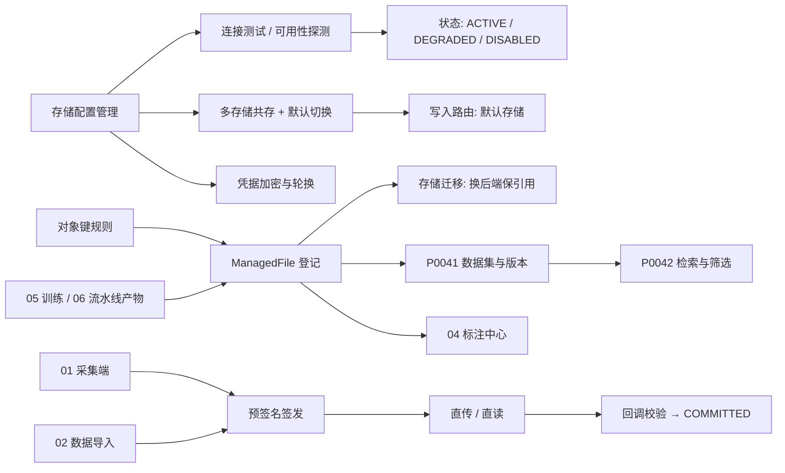
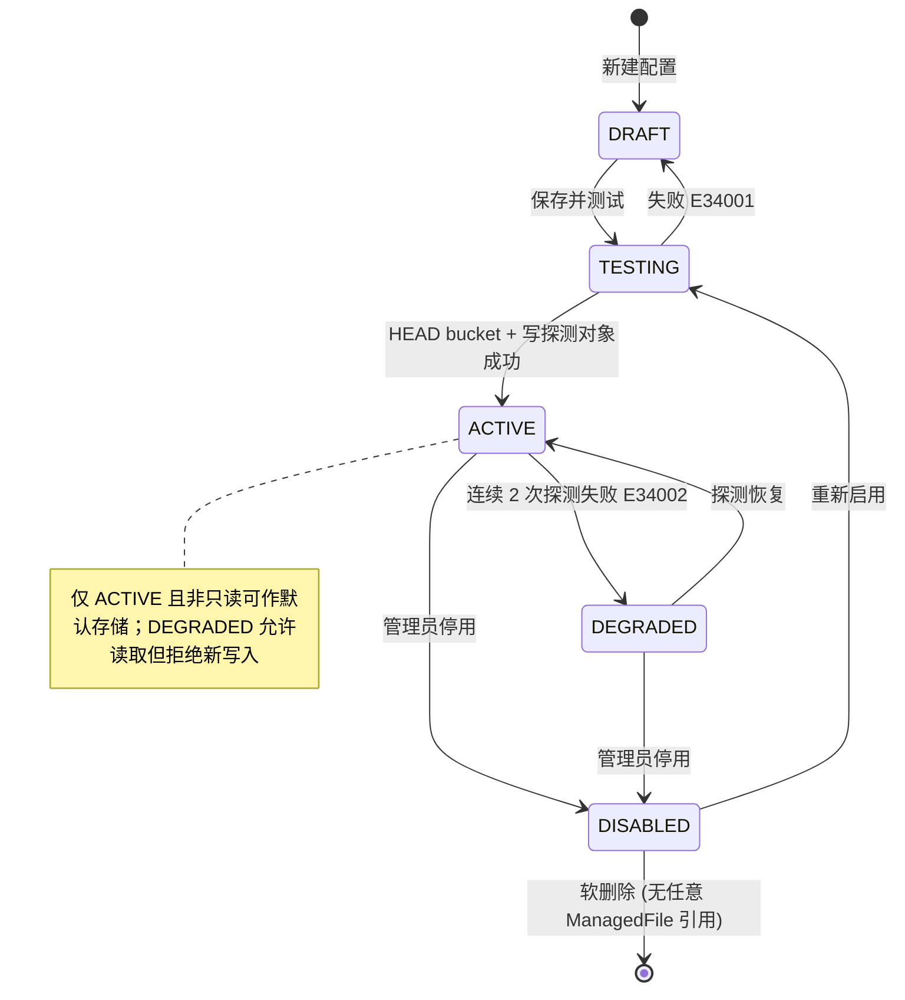
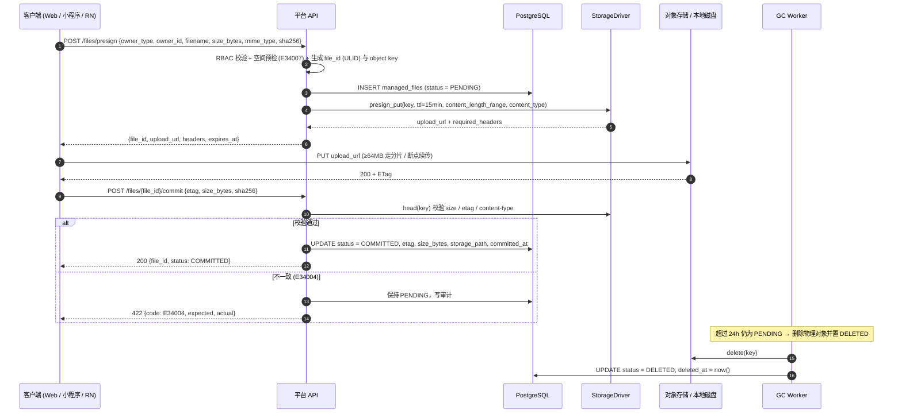
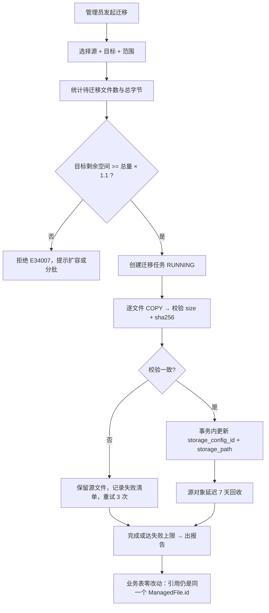
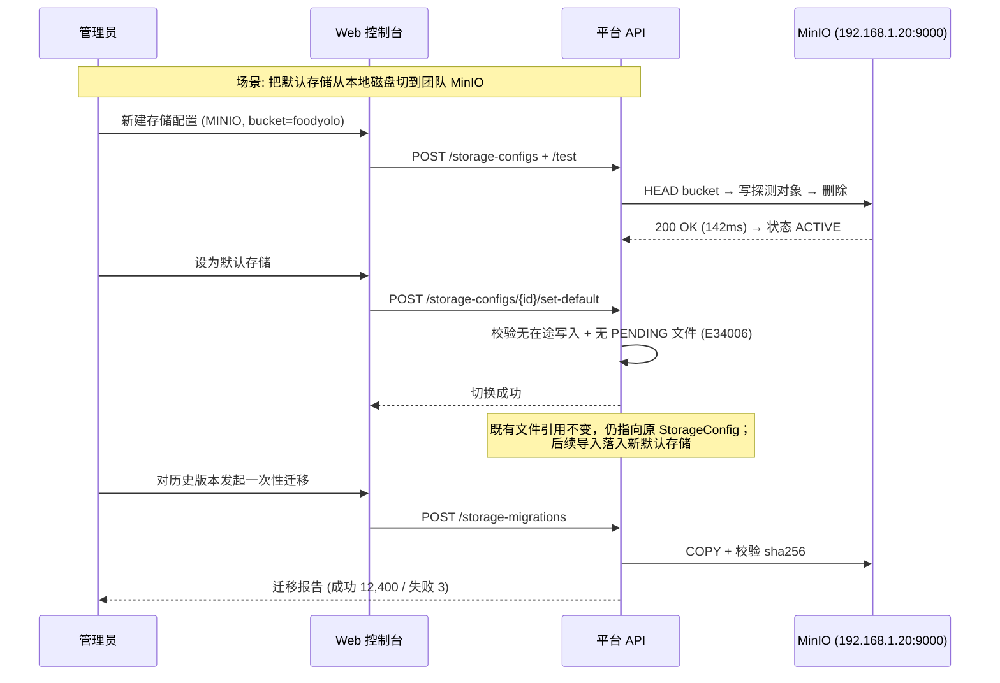
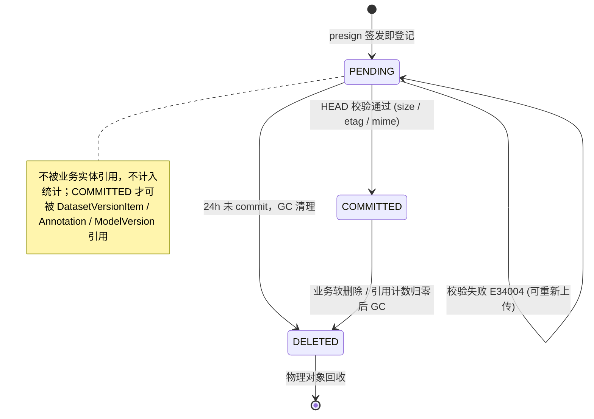

# PRD: P0040_存储配置与桶绑定 (Storage Config & Bucket Binding)

| 属性 | 内容 |
| :--- | :--- |
| **文档编号** | P0040 |
| **功能模块** | M03_数据管理 |
| **当前版本** | v1.0.0 |
| **文档状态** | Approved |
| **作者** | FoodYolo Team |
| **最后更新** | 2026-10-01 |

---
## 1. 全局说明

> [!IMPORTANT]
> **核心定位**: 数据管理模块的物理底座。样本图片、标注文件、模型权重、训练与流水线产物，全部只通过 `ManagedFile` 被引用；文件物理落在哪里，由 `StorageConfig` 决定。**任何业务表都不允许出现绝对路径或 `s3://` 字面量。**

### 名词解释
*   **StorageConfig (存储配置)**: 一套可写入的物理存储后端实例，`type ∈ LOCAL / MINIO / S3`，可并存多套。
*   **Bucket Binding (桶绑定)**: 配置与具体 bucket（LOCAL 下为 `root_path` 目录）的绑定。同一 endpoint 的不同 bucket 视为多条配置。
*   **Object Key (对象键)**: 与物理位置解耦的逻辑路径。LOCAL 映射为 `{root_path}/{key}`，S3 映射为 `{bucket}/{key}`。
*   **ManagedFile (托管文件)**: 平台对物理文件的唯一引用；下游实体仅持 `ManagedFile.id`。
*   **StorageDriver (存储驱动)**: 后端统一 SPI，内置 `LocalDriver` / `S3Driver`（S3 协议覆盖 MinIO 与 AWS S3）。
*   **Presigned URL (预签名 URL)**: 用存储凭据签发的临时直传 / 下载链接，客户端全程不持有长期密钥。
*   **Path Prefix (键前缀)**: 桶内业务命名空间，用于与其他系统共用一个 bucket。
*   **Default Storage (默认存储)**: 新写入对象的落点，全局唯一；**Degraded (降级)** 指探测连续失败后拒绝新写入但允许读取的状态。
*   **Shard (分片目录)**: 由 `file_id` 前 4 位十六进制拆出的两级目录，规避单目录十万级文件的性能退化。

### 统一异常处理 (E340xx)
| Code | 场景 | 处理策略 |
| :--- | :--- | :--- |
| `E34001` | 存储连接失败（endpoint 不可达 / 凭据错误 / bucket 不存在 / 无权限） | 内联报错并回显驱动原始 message；配置停留 `DRAFT` |
| `E34002` | 存储后端不可用（探测连续失败，已 `DEGRADED`） | 写操作拒绝；读走降级路径（下载接口 503 + 重试建议） |
| `E34003` | 预签名 URL 过期或签名不匹配 | 403 + `expired`；前端自动重签一次，二次失败提示重试 |
| `E34004` | 上传校验失败（size / etag / mime 不符或对象缺失） | 保持 `PENDING` 并写审计，对象由 GC 清理，提示重传 |
| `E34005` | 凭据解密失败（主密钥轮换或环境变量缺失） | 配置置 `DEGRADED`，引导重录 secret_key；禁止回退为空凭据 |
| `E34006` | 默认存储切换被拒（存在在途写入任务或 `PENDING` 文件） | 列出阻塞任务，只允许"等待完成"，不提供强切 |
| `E34007` | 存储空间不足（磁盘剩余 < 5% 或桶配额超限） | 签发 URL 前预检即拒绝并触发 `Alert`；已签发 URL 允许完成 |
| `E34008` | 对象不存在 / 已被 GC | 404 + `file_missing`，上层置 `ManagedFile.status = DELETED` |
| `E34009` | 键冲突（同 key 已存在且非幂等写入） | 拒绝并返回既有 `file_id`，改为幂等复用而非覆盖 |

---
## 2. 项目背景

### 背景 (Context)
FoodYolo 是 Local-First 单机部署，但有**三类写入者**：采集端（小程序 / RN App）拍完即传、导入模块（上传、解压、抽帧）批量落盘、训练与流水线产出权重与报表。2~3 人团队的真实环境是混合的：工作站 NVMe 放热数据、群晖 NAS 放归档，条件好一点会上单节点 MinIO。若业务表直接存 `s3://foodyolo/datasets/xxx/a.jpg` 或 `/Users/zhang/data/xxx.jpg`，必然出现：换机器挂载点变了全库失效；换桶要写脚本改全库；前端直传必须把密钥塞进浏览器或小程序包。

### 问题陈述 (Problem Statement)
1.  **路径硬编码**：业务表存物理路径，存储迁移 = 全库数据失效。
2.  **凭据泄露面**：客户端直传需要显式签名，密钥进入不可信环境。
3.  **故障无感知**：NAS 掉线或 MinIO 重启，用户只看到"图片裂了"，无从判断数据没了还是服务挂了。
4.  **多存储无法共存**：热数据放本地、冷数据放 NAS 无处分层，也没有"默认落点"。
5.  **上传中断即重传**：≥2GB 压缩包弱网断一次就从零开始。

### 目标与成功指标 (Goals & Success Metrics)
*   **北极星指标**: **存储切换或迁移后，业务侧 0 代码改动、引用 0 失效** —— `ManagedFile` 引用不变率 100%。
*   **次要指标**: 新建配置 → 可用 < 2 分钟；连接测试 P95 < 3s；上传成功率 > 99%（含弱网重试）且 ≥2GB 支持分片续传；凭据 100% 加密且 API / 日志不回显明文；后端故障发现 < 60s。

### 风险与规避 (Risks & Mitigation)
| 风险 | 影响 | 规避方案 |
| :--- | :--- | :--- |
| 单机磁盘写满 | 采集、导入、训练同时挂 | 签发 URL 前空间预检（< 5% 拒绝，E34007）；探测上报水位触发 `Alert` |
| 本地目录十万级文件 | 目录遍历退化 | object key 强制两级十六进制分片（见 8.3） |
| 单节点 MinIO 无冗余 | 磁盘坏 = 数据永久丢失 | 明示不做冗余，配置页展示"单节点无副本"警示，引导异地备份 |
| 凭据轮换致在途上传 403 | 用户上传中断 | 已签名 URL 在 TTL 内有效，轮换只影响此后新签发的 URL |
| 默认存储切换与写入并发 | 数据被拆到两个后端 | 切换前检查在途任务与 `PENDING` 文件，非空则拒绝（E34006） |

---
## 3. 价值模型

*   **方案**: 四层解耦 —— `StorageConfig`（在哪存）+ `StorageDriver`（怎么存）+ object key 规则（叫什么名）+ `ManagedFile`（谁在引用）。业务实体只写 `ManagedFile.id`，物理迁移只改 `managed_files.storage_config_id` 与 `storage_path`。
*   **目标**:

| 指标 | 现状（无本模块） | 目标 |
| :--- | :--- | :--- |
| 更换存储后端 | 改代码 + 刷数据 | 后台加配置 + 切默认，0 停机 |
| 客户端持有密钥 | 必然 | 0，全部走预签名 |
| 上传失败恢复 | 整文件重传 | 分片续传，仅补失败分片；故障 60s 内自动识别并告警 |

---
## 4. 项目范围

### 功能结构图


### In Scope (包含范围)
1.  **存储配置 CRUD**：LOCAL / MINIO / S3 后端的创建、编辑、停用、删除。
2.  **连接测试与可用性探测**：保存时同步测试；运行期 30s 周期探测，连续失败自动降级。
3.  **多存储共存与默认存储切换**：多套配置并行，全局唯一默认存储，切换带前置校验。
4.  **对象键规则**：统一 key 生成器与分片规则，LOCAL 与 S3 共用同一套 key。
5.  **预签名上传**：`presign → PUT → commit → COMMITTED`，支持分片与断点续传。
6.  **预签名下载**：带 TTL 的临时下载链接，写审计日志。
7.  **凭据加密与轮换**：AES-256-GCM 加密，主密钥来自环境变量，支持 key_id 轮换。
8.  **存储迁移**：把指定范围文件从后端 A 搬到 B，只改引用不改业务表。

### Out of Scope (不包含范围)
*   CDN 分发、跨区域复制、生命周期归档（Glacier / 低频存储）。
*   多租户桶隔离（单机产品，不做按用户分桶）。
*   KMS / HSM 级密钥托管；仅做本地主密钥对称加密。
*   S3 Object Versioning、合规保留策略、WORM。
*   NAS 的挂载与权限治理 —— NAS 以 `LOCAL` 类型接入其挂载点，挂载是运维前置条件。
*   存储层内容去重（秒传 / 硬链接 / 块级去重）；重复导入由数据层 `DataSample.content_hash` 拦截。

---
## 5. 业务流程

### 5.1 存储配置状态机


### 5.2 预签名上传与落库流程


### 5.3 存储迁移（换后端保引用）


### 5.4 可用性探测
每 30s 对 `ACTIVE` / `DEGRADED` 配置执行一次探测（超时 5s）：`LOCAL` = `statvfs` + 写读删探测文件；`S3/MINIO` = `HEAD bucket` + `PUT/DELETE _healthcheck/probe`。成功则 `consecutive_failures = 0`（若原为 `DEGRADED` 回 `ACTIVE` 并发恢复通知）；失败则计数 +1，≥ 2 置 `DEGRADED` 并触发 `Alert`。`DRAFT` 配置不参与。

---
## 6. 用户分析

### 6.1 用户画像 (User Personas)
*   **运维 / 平台管理员 (ADMIN)** —— 团队那台工作站的"机主"。**职责**: 决定数据放哪、装 MinIO、配 NAS 挂载、盯磁盘水位。**诉求**: "换存储别让我改数据；密钥别出现在前端；坏了先告诉我。"**痛点**: 手工维护路径映射表；故障时没有统一视图判断哪一层挂了。
*   **算法 / 数据工程师 (TRAINER)** —— 存储的**间接**使用者。**职责**: 提交导入、训练、导出。**诉求**: "我只选数据集版本，存储别让我关心。"**痛点**: 大压缩包中断后从零开始；不确定训练容器能否读到数据。
*   **采集端用户 (ANNOTATOR / C 端)** —— 完全无感知。**诉求**: 上传快、弱网能续传、别重复登录。**痛点**: 90% 时失败重传。

### 6.2 用户链路图 (User Journey Map)


## 7. 功能需求

### M03.F01 存储配置管理 (Storage Config CRUD)
*   **用户故事**: 作为管理员，我希望用表单接入本地磁盘或 S3 兼容对象存储，以便决定数据物理落点而不改动代码。
*   **逻辑与业务规则**: **前置条件** 角色为 `ADMIN`。**主流程** 1) 选择类型；2) 填写差异化字段（见 8.1）；3) secret_key 加密落库，响应只回 `secret_key_last4`；4) 保存后立即连接测试；5) 通过置 `ACTIVE`，否则停留 `DRAFT` 并内联报错。**校验** `name` 平台唯一（1–64）；`LOCAL.root_path` 必须存在、可写、非 `/` 或用户主目录根；`bucket` 为 `[a-z0-9-]{3,63}`；`path_prefix` 不以 `/` 起止；`is_default=true` 时配置必须 `ACTIVE` 且非只读。**后置条件** 配置落库、密文存储、写审计。
*   **验收标准**:

```gherkin
场景: 创建 MinIO 存储配置并测试通过
  Given 管理员角色，MinIO 可达且 bucket "foodyolo" 已存在
  When 提交 type=MINIO, endpoint=http://192.168.1.20:9000, bucket=foodyolo, access_key=minio, secret_key=****
  Then 配置状态为 ACTIVE
  And 返回体只含 secret_key_last4 而不含明文 secret_key
  And storage_configs.secret_key_enc 以 "v1:" 前缀密文存储
```
*   **边界情况与异常处理**:

| 场景 | 处理 |
| :--- | :--- |
| 编辑时留空 secret_key | 视为"保持原值"，不覆盖密文；前端仅展示 `****{last4}` |
| 删除仍被 `ManagedFile` 引用的配置 | 拒绝删除并提示引用数，提供"先迁移"入口；仅允许停用 |
| endpoint 使用自签名证书 | `verify_tls=false` 可关闭校验，保存时提示风险并在列表页打标 |
| 同一 endpoint 重复录入 | 允许（不同 bucket 是不同配置），列表按 `endpoint + bucket` 归组 |

### M03.F02 连接测试与可用性探测 (Connectivity Test & Health Probe)
*   **用户故事**: 作为管理员，我希望随时知道每套存储在不在线，而不是等用户反馈图片打不开。
*   **逻辑与业务规则**: **前置条件** 配置已存在（`DRAFT` 不参与定时探测）。**主流程** 1) 手动测试按 5.4 的方式执行并返回结论、耗时、剩余空间与脱敏后的驱动错误；2) 定时探测每 30s 执行同样动作，只记录不阻塞业务；3) 连续 2 次失败置 `DEGRADED` 并告警，1 次成功回 `ACTIVE` 并发恢复通知。**后置条件** 写 `storage_probes`（保留 30 天）并更新配置的 `last_probe_at / last_probe_ok / consecutive_failures`。
*   **验收标准**:

```gherkin
场景: 存储掉线自动降级
  Given 配置 A 处于 ACTIVE
  When MinIO 容器停止且连续两次探测失败
  Then 配置 A 变为 DEGRADED 并触发一条 Alert
  And 新上传请求返回 E34002，而既有对象的下载仍可成功

场景: 只读挂载被判为只读可用
  Given 探测时 PUT 失败但 HEAD bucket 成功
  Then 配置标记 read_only=true 且状态保持 ACTIVE
  And 该配置不可被设为默认存储
```
*   **边界情况与异常处理**:

| 场景 | 处理 |
| :--- | :--- |
| 网络抖动致探测长挂起 | 单次超时 5s，超时计一次失败，避免拖垮 30s 周期 |
| 桶配额满但 1KB 探测对象仍可写 | 属误判；写入前预检以 `used/capacity` 为准而非探测结果 |
| 探测对象数膨胀 | 固定 key `_healthcheck/probe`，每次覆盖再删除，不累积 |
| NAS 休眠盘首次访问需 20s | 首次失败不立即降级（需连续 2 次），给休眠盘留一个恢复周期 |

### M03.F03 多存储共存与默认存储切换 (Multi-Storage & Default Switch)
*   **用户故事**: 作为管理员，我希望热数据落本地、归档落 NAS，并能随时切换新数据的默认落点。
*   **逻辑与业务规则**: **前置条件** 目标配置 `ACTIVE` 且非只读。**主流程** 1) 存储列表选目标 `[设为默认]`；2) 检查在途写入（导入任务 `RUNNING`、`PENDING` 文件数 > 0、训练产物未提交）；3) 全空则事务内置旧默认 `false`、新配置 `true`；4) 写审计与通知。**路由规则** 未显式指定 `storage_config_id` 的写入落默认存储，显式指定则按指定（冷数据归档场景）。**后置条件** 全局唯一默认；既有 `ManagedFile.storage_config_id` 不变。
*   **验收标准**:

```gherkin
场景: 无在途任务时切换默认存储
  Given 默认存储为 "本地 NVMe" 且无进行中的写入任务
  When 管理员点击 "MinIO 共享" 的 [设为默认]
  Then 默认存储切换为 "MinIO 共享"
  And 既有 12,400 个 ManagedFile 的 storage_config_id 保持不变
  And 之后新上传的对象落在 MinIO

场景: 存在在途导入任务时拒绝切换
  Given 有一个 ImportTask 处于 RUNNING
  When 管理员尝试切换默认存储
  Then 返回 E34006 并列出阻塞任务，默认存储不变
```
*   **边界情况与异常处理**:

| 场景 | 处理 |
| :--- | :--- |
| 切换瞬间有上传正在 PUT | 预签名 URL 已签发仍落旧存储；`commit` 回填签发时确定的 `storage_config_id`，不会写错表 |
| 新默认存储掉线且无其它 ACTIVE 存储 | 新写入全部失败并告警；文档明示至少保留一套本地兜底 |
| 删除默认存储 | 拒绝；必须先指定另一套为默认 |

### M03.F04 对象键规则与 ManagedFile 登记 (Object Key & ManagedFile Registration)
*   **用户故事**: 作为开发者，我希望对象键有唯一且可预测的生成规则，以便迁移、对账与排查都能按规律定位文件。
*   **逻辑与业务规则**: **前置条件** 存在至少一套 ACTIVE 存储；调用方给出 `owner_type` + `owner_id`。**生成规则** `file_id` 为 ULID(26 小写)，`shard = file_id[0:2] + "/" + file_id[2:4]`，模板如下。

| owner_type | 键模板（`{prefix?}` 为 path_prefix，可选） | 示例 |
| :--- | :--- | :--- |
| `DATASET_VERSION` | `{prefix?}/dataset-versions/{dataset_id}/{version_no}/{purpose}/{shard}/{file_id}.{ext}` | `foodyolo/prod/dataset-versions/9f1c…/v3/images/ab/cd/abcd1234….jpg` |
| `CAPTURE_TASK` | `{prefix?}/captures/{capture_task_id}/{client_id}/{yyyymmdd}/{shard}/{file_id}.{ext}` | `captures/7a2b…/rn-0012/20261001/0f/31/0f31c9a8….jpg` |
| `CLIENT_UPLOAD` | `{prefix?}/_uploads/{yyyymm}/{dd}/{upload_session_id}/{shard}/{file_id}.{ext}` | `_uploads/202610/01/01J9K3M4/ab/cd/abcd1234….zip` |
| `TRAIN_TASK` | `{prefix?}/train-tasks/{train_task_id}/attempt-{n}/{artifact}/{filename}` | `train-tasks/3c9f…/attempt-2/best_ckpt.pth` |
| `MODEL_VERSION` | `{prefix?}/models/{model_id}/{version_no}/{filename}` | `models/55aa…/v4/best.onnx` |
| `EVALUATION_TASK` | `{prefix?}/evaluations/{evaluation_task_id}/{artifact}/{shard}/{file_id}.{ext}` | `evaluations/77c1…/metrics/2d/44/2d44ab….png`（平台自绘的 `PR_curve.png` / `confusion_matrix.png` / `eval_<epoch>.json`） |
| `PIPELINE_STAGE_RUN` | `{prefix?}/pipeline-runs/{pipeline_run_id}/{stage}/{shard}/{file_id}.{ext}` | `pipeline-runs/8b7e…/export/2d/44/2d44ab….json`（导出清单与校验报告） |

*   **归属规则**: 训练类产物（`latest_ckpt.pth` / `best_ckpt.pth` / `epoch_<n>_ckpt.pth` / `train_log.txt` / `tensorboard/`）**一律 `owner_type=TRAIN_TASK`**，即使由流水线触发也不改归属；可部署物（`*.onnx` / `*.engine` / `*.tflite` / OpenVINO 目录）归 `MODEL_VERSION`；数据集导出包（zip/tar）及其 `manifest.json` 归 `DATASET_VERSION`；`PIPELINE_STAGE_RUN` 只承载非训练阶段的清单、报告与校验结果（Import / Dedup / Clean / Split / Augment / Export）。流水线触发的训练由 `PipelineStageRun.train_task_id` 引用，不重复登记文件。
*   **铁律**: **一个物理文件只登记一条 `ManagedFile`**（由 `(storage_config_id, storage_path)` 唯一索引兜底）；别处需要引用时用 `managed_file_id` 外键，不得再建记录；`content_hash` 仅用于识别同一物理对象。
*   **约束**: key 总长 ≤ 512；字符集 `[a-z0-9._/-]`；**原始文件名不进入 key**（避免中文、空格、重名冲突），仅取清洗后扩展名；`purpose ∈ images / labels / masks / meta / weights / reports`。**登记规则** 写入前插入 `managed_files`（`PENDING`），写入成功后 `commit` 置 `COMMITTED`。**后置条件** `(storage_config_id, storage_path)` 唯一，重复返回 `E34009` 与既有 `file_id`。
*   **验收标准**:

```gherkin
场景: 生成版本图片对象键
  Given dataset_id=9f1c…, version_no=v3, file_id=01J9K3ABCD…, ext=jpg
  When 以 owner_type=DATASET_VERSION, purpose=images 申请对象键
  Then 键为 {prefix}/dataset-versions/9f1c…/v3/images/01/j9/01j9k3abcd….jpg
  And 键中不含原始文件名 "生产日期 2026-10-01 正面.jpg"
```
*   **边界情况与异常处理**:

| 场景 | 处理 |
| :--- | :--- |
| 同批次并发写入撞 key | ULID 单调性保证不撞；唯一索引兜底，冲突返回 E34009 |
| 扩展名异常（`.JPG` / `.tar.gz`） | 统一小写；多段扩展名整体保留；无法识别时用 `bin` |
| 分片产生大量空目录 | 分片固定两级，单目录最多 256 个子目录，不做惰性清理 |
| 需要覆盖同一逻辑文件（重新导出） | 不允许覆盖：生成新 `file_id`，旧记录由引用计数与 GC 处理 |

### M03.F05 预签名上传与回调校验 (Presigned Upload & Commit)
*   **用户故事**: 作为采集端 / 导入端，我希望拿到临时地址直传文件，上传完由后端校验并记账。
*   **逻辑与业务规则**: **前置条件** 调用方对 `owner_type` 有写权限；目标存储 `ACTIVE` 且非只读；空间充足。**主流程** 1) `POST /files/presign` 生成 `file_id` 与 key，插入 `PENDING`，返回 URL 与必带头（TTL 15 分钟）；2) 客户端 `PUT`（≥64MB 走分片，单片 8MB）；3) `POST /files/{id}/commit` 提交 etag/size/sha256；4) 后端 `HEAD` 校验；5) 通过置 `COMMITTED`，否则保持 `PENDING` 返回 `E34004`。**幂等** 同一 `PENDING` 可重复申请 URL（重签作废旧签名）；`commit` 幂等，重复调用返回首次结果。**后置条件** `COMMITTED` 含 `etag / size_bytes / storage_path / mime_type / committed_at`。
*   **验收标准**:

```gherkin
场景: 上传成功后登记为 COMMITTED
  Given 客户端持有 file_id "01J9K3…" 与有效 upload_url
  When PUT 完成返回 ETag，客户端提交 commit {size_bytes: 2456789, sha256: …}
  Then 后端 HEAD 校验一致，managed_files.status 变为 COMMITTED

场景: 大小不一致拒绝提交
  Given 客户端声明 size_bytes=2456789 但对象实际为 1844672
  When 调用 commit
  Then 返回 E34004，包含 expected=2456789 actual=1844672
  And managed_files.status 仍为 PENDING
```
*   **边界情况与异常处理**:

| 场景 | 处理 |
| :--- | :--- |
| 弱网断连（小程序电梯 / 地库） | 分片续传：客户端记录已完成 part，重连后仅补未完成部分 |
| 客户端伪造 `owner_id` 或路径 | key 由服务端生成；`presign` 阶段做 RBAC 与归属校验 |
| 用户整批重试导致重复上传 | 存储层不做内容去重，由 `DataSample.content_hash` 在数据层幂等拦截 |
| 上传中途 App 被杀 | `PENDING` + 已上传分片保留 24h，超期由 GC 清理 |
| 只 PUT 不 commit | 记录停留 `PENDING` 不计入统计；GC 24h 后置 `DELETED` |

### M03.F06 预签名下载与访问控制 (Presigned Download)
*   **用户故事**: 作为标注员 / 预览页，我希望拿到带时效的下载地址看图，而不是把密钥带到浏览器。
*   **逻辑与业务规则**: **前置条件** 请求者对目标 `ManagedFile` 所属资源有读权限（按数据集 / 项目 RBAC）。**主流程** 1) `GET /files/{file_id}/presign?ttl=600`；2) 校验权限与 `status = COMMITTED`；3) `S3/MINIO` 返回预签名 GET URL，`LOCAL` 返回带 HMAC token 的代理下载路由；4) 写审计（谁、何时、读了哪个文件）。**TTL** 缩略图 300s / 原图 600s / 导出包 3600s，上限 24h。**后置条件** 审计落库，URL 过期即失效需重新申请。
*   **验收标准**:

```gherkin
场景: 标注员获取图片下载链接
  Given 标注员属于数据集 "生产日期-2026Q4" 的标注任务
  When 请求 file_id "01J9K3…" 的下载 URL (ttl=600)
  Then 返回 presigned URL 与 expires_at，并写一条读取审计
```
*   **边界情况与异常处理**:

| 场景 | 处理 |
| :--- | :--- |
| 画廊一次请求 200 张缩略图 | 批量接口 `POST /files/presign/batch` 一次签发，单批上限 500 |
| LOCAL 无法真正预签名 | 走"代理下载路由 + HMAC token"，语义等价，能力以 Range 请求为限 |
| 存储 `DEGRADED` | 仍可读则允许；完全不可达返回 E34002 |
| `ManagedFile.status = DELETED` | 返回 E34008，前端展示占位图并提示"文件已回收" |
| URL 被泄露给外部 | 短 TTL + 审计可追溯；不做 IP 绑定（内网单机场景收益低、误伤高） |

### M03.F07 凭据加密存储与轮换 (Credential Encryption & Rotation)
*   **用户故事**: 作为管理员，我希望数据库被拷走时密钥不可直接使用，并且能定期更换主密钥。
*   **逻辑与业务规则**: **前置条件** 环境变量 `FOODYOLO_MASTER_KEY` 已配置（32 字节 base64）。**加密方案** AES-256-GCM，存储格式 `v1:{key_id}:{nonce_b64}:{ciphertext_b64}`，支持多代主密钥并存（`FOODYOLO_MASTER_KEY_RING`）。**轮换流程** 1) 新主密钥入 keyring 并设为写入默认；2) 后台逐条"解密后重加密"；3) 完成后可移除旧密钥。**读取规则** 解密失败（key_id 不在 keyring）→ `E34005`，配置置 `DEGRADED`，禁止回退空凭据或匿名访问。**后置条件** 任何 API 响应、日志、审计、错误堆栈中不出现明文 secret。
*   **验收标准**:

```gherkin
场景: 密钥不以明文出现在任何输出
  Given 管理员创建或编辑存储配置
  When 查询配置详情、查看审计日志、触发一次连接失败
  Then 所有输出中 secret_key 均以 ****{last4} 呈现
  And 错误信息不含 access_key / secret_key 明文
```
*   **边界情况与异常处理**:

| 场景 | 处理 |
| :--- | :--- |
| 主密钥被误提交进 Git | 启动时检测主密钥是否等于示例值并告警；`.env` 在 `.gitignore` 中 |
| 轮换任务中途重启 | 已重加密记录带新 `key_id`；按 `key_id != 当前写入 key_id` 续跑，幂等 |
| MinIO 使用默认凭据 minioadmin | 允许但创建时提示"检测到默认凭据，建议修改" |
| 同一凭据被多套配置共用 | 允许；轮换按配置逐条重加密，互不影响 |
| 管理员丢失主密钥 | 已加密凭据无法恢复，需重新录入 secret_key；文档明示备份主密钥 |

### M03.F08 存储迁移与引用保持 (Storage Migration)
*   **用户故事**: 作为管理员，我希望把历史数据从本地磁盘搬到 MinIO，而不影响任何已有的数据集版本和训练任务。
*   **逻辑与业务规则**: **前置条件** 源与目标均 `ACTIVE`；调用者 `ADMIN`；无进行中的写入任务。**主流程** 1) 选择范围（`owner_type` / `dataset_version_id` / 源配置 + 时间区间）；2) 预检目标容量 ≥ 总量 × 1.1；3) 逐文件 `COPY` 后校验 `size + sha256`；4) 通过后更新 `storage_config_id`、`storage_path`、`etag`；5) 源对象延迟 7 天回收。**后置条件** `ManagedFile.id` 与所有业务引用完全不变；输出成功 / 失败 / 跳过清单。
*   **验收标准**:

```gherkin
场景: 迁移某数据集版本并保持引用
  Given 数据集版本 v3 的 5,000 个文件位于 LOCAL 存储
  When 管理员迁移该版本到 MinIO 存储
  Then 5,000 条 ManagedFile 的 storage_config_id 变为 MinIO 配置
  And DatasetVersionItem 与 Annotation 的引用保持不变
  And 抽样下载校验 sha256 一致

场景: 目标空间不足
  Given 目标存储剩余 80GB 而待迁移总量 200GB
  When 提交迁移任务
  Then 直接拒绝并返回 E34007，且不产生任何 COPY 动作
```
*   **边界情况与异常处理**:

| 场景 | 处理 |
| :--- | :--- |
| 部分文件校验失败 | 每文件重试 3 次；仍失败则跳过并保留源文件，出失败清单，引用不更新 |
| 迁移中 MinIO 掉线 | 任务转 `PAUSED`，恢复后从断点续跑，不做半更新 |
| 迁移期间用户删除数据集 | 删除先软删；迁移对 `DELETED` 文件自动跳过 |
| 迁移后需要回滚 | 支持反向迁移（目标 → 源），同样只改引用；源对象未被 GC 时无需重新搬运 |

---
## 8. 技术架构与数据模型

### 8.1 数据实体

#### Table: `storage_configs`
| 字段名 | 类型 | 必填 | 说明 | 约束 |
| :--- | :--- | :--- | :--- | :--- |
| `id` | UUID | Y | 主键 | PK |
| `name` | String(64) | Y | 配置名 | UNIQUE, 1–64 |
| `type` | Enum | Y | `LOCAL` / `MINIO` / `S3` | — |
| `root_path` | String(512) | N | LOCAL 物理根 | `type=LOCAL` 必填，绝对路径 |
| `endpoint` | String(255) | N | S3 兼容端点 | `type∈{MINIO,S3}` 必填（AWS 可留空） |
| `region` / `bucket` | String(32) / String(63) | N | 区域 / 桶名 | 默认 `us-east-1`；`[a-z0-9-]{3,63}` |
| `access_key` | String(255) | N | 访问键（非密钥，明文） | — |
| `secret_key_enc` | Text | N | 加密后的密钥 | `v1:{key_id}:{nonce}:{ct}` |
| `secret_key_last4` | String(4) | N | 末四位展示 | 只读派生 |
| `path_prefix` | String(255) | N | 桶内命名空间 | 不以 `/` 起止 |
| `use_ssl` / `verify_tls` | Bool | Y | HTTPS / 校验证书 | 默认 true |
| `addressing_style` | Enum | Y | `PATH` / `VIRTUAL` | MinIO 默认 `PATH` |
| `is_default` | Bool | Y | 是否默认存储 | 部分唯一索引 `WHERE is_default AND deleted_at IS NULL` |
| `status` / `read_only` | Enum / Bool | Y | 状态 / 只读标记 | `DRAFT`/`ACTIVE`/`DEGRADED`/`DISABLED` |
| `capacity_bytes` / `used_bytes` | BigInt | N | 容量 / 已用 | LOCAL 由探测更新 |
| `last_probe_at` / `last_probe_ok` / `consecutive_failures` | — | N / Y | 探测状态与连续失败计数 | 默认 0 |
| `created_by` / `created_at` / `updated_at` / `deleted_at` | — | Y/N | 审计字段 | — |

#### Table: `managed_files`
| 字段名 | 类型 | 必填 | 说明 | 约束 |
| :--- | :--- | :--- | :--- | :--- |
| `id` | String(26) | Y | ULID 主键，进入对象键 | PK |
| `owner_type` | Enum | Y | `DATASET_VERSION`/`MODEL_VERSION`/`TRAIN_TASK`/`CAPTURE_TASK`/`CLIENT_UPLOAD`/`EVALUATION_TASK`/`PIPELINE_STAGE_RUN`/`AUDIT_LOG` | — |
| `owner_id` | UUID | N | 归属实体 id | `CLIENT_UPLOAD` 时为空，commit 后回填 |
| `storage_config_id` | UUID | Y | 所属存储 | FK → `storage_configs.id` |
| `storage_path` | String(512) | Y | 对象键 | UNIQUE(`storage_config_id`,`storage_path`) |
| `size_bytes` | BigInt | N | 字节数 | commit 后回填 |
| `mime_type` | String(128) | N | MIME | commit 校验用 |
| `etag` | String(128) | N | 对象 ETag / LOCAL sha256 | commit 后回填 |
| `content_hash` | String(64) | N | sha256 | 数据层去重与迁移校验 |
| `status` / `committed_at` | Enum / timestamptz | Y / N | `PENDING`/`COMMITTED`/`DELETED`；校验通过时间 | — |
| `created_by` / `created_at` / `updated_at` / `deleted_at` | — | Y/N | 审计字段 | GC 置 `deleted_at` |

#### Table: `storage_probes` / `storage_migrations`
| 表 | 字段 | 类型 | 说明 |
| :--- | :--- | :--- | :--- |
| `storage_probes` | `id` / `storage_config_id` | UUID | PK / FK |
| | `probed_at` | timestamptz | 探测时间（索引 DESC） |
| | `ok` / `latency_ms` / `free_bytes` | Bool / Int / BigInt | 结果、耗时、剩余空间 |
| | `error_code` / `error_message` | String(16) / Text | 失败码（E34001/E34002/E34007）与脱敏原始信息 |
| `storage_migrations` | `id` / `source_config_id` / `target_config_id` | UUID | PK / FK / FK |
| | `scope` | JSONB | `{owner_type, dataset_version_id?, from?, to?}` |
| | `status` | Enum | `PENDING`/`RUNNING`/`PAUSED`/`SUCCEEDED`/`PARTIAL_FAILED`/`FAILED` |
| | `total_files` / `moved_files` / `failed_files` / `total_bytes` | — | 进度计数 |
| | `report_path` | String(512) | 失败清单对象键（指向 ManagedFile） |

### 8.2 StorageDriver SPI
| 方法 | 入参 | 返回 | 语义 |
| :--- | :--- | :--- | :--- |
| `presign_put` | key, ttl, content_length_range, content_type | url + headers + expires_at | 签发直传地址 |
| `presign_get` | key, ttl, response_headers? | url + expires_at | 签发下载地址（LOCAL 返回代理 token URL） |
| `head` | key | size, etag, content_type | 存在性与校验 |
| `stat` | — | capacity, used, read_only | 健康与容量（S3 可能返回 null） |
| `copy` | src_key, dst_driver, dst_key | ok | 迁移用 |

### 8.3 对象键生成规则（示例）
```text
# 规则：{prefix?}/{owner_type 目录}/{owner_id 或业务标识}/{purpose|artifact}/{shard}/{file_id}.{ext}
# file_id = ULID(26)，shard = file_id[0:2] / file_id[2:4]

S3  (bucket=foodyolo, prefix=foodyolo/prod)
  foodyolo/prod/dataset-versions/9f1c1e2a/v3/images/ab/cd/abcd1234efgh5678ijkl90.jpg
  foodyolo/prod/dataset-versions/9f1c1e2a/v3/labels/ab/cd/abcd1234efgh5678ijkl90.txt
  foodyolo/prod/models/55aa66bb/v4/best.onnx
  foodyolo/prod/train-tasks/3c9f7d21/attempt-2/best_ckpt.pth
LOCAL (prefix 为空, root_path=/mnt/data/foodyolo)
  key   dataset-versions/9f1c1e2a/v3/images/ab/cd/abcd1234….jpg
  物理  /mnt/data/foodyolo/dataset-versions/…/abcd1234….jpg · /mnt/data/foodyolo/captures/7a2b…/0f31c9a8….jpg

CLIENT_UPLOAD 临时区（commit 后由业务方 COPY 到最终 key 并新建 ManagedFile）
  _uploads/202610/01/01J9K3M4N5P6Q7R8S9T0/ab/cd/abcd1234….zip
```

### 8.4 ManagedFile 生命周期状态机


---
## 9. UI/UX 规格说明

### 9.1 存储配置列表
```text
+----------------------------------------------------------------------------------+
|  系统管理 > 存储配置                                        [+ 新建存储] [刷新]   |
+----------------------------------------------------------------------------------+
|  ● 本地 NVMe (默认)   LOCAL  /mnt/data/foodyolo  1.2TB/2.0TB  ACTIVE      [编辑] |
|  ○ MinIO 共享  MINIO 192.168.1.20:9000  320GB/1.0TB  ACTIVE (bucket/prefix=foodyolo/prod) [设为默认][编辑]|
|  ○ 群晖归档           LOCAL  /Volumes/archive    4.8TB/8TB    DEGRADED           |
|    └ ⚠ 连续 3 次探测失败: no such file or directory     [重测] [编辑] [停用]      |
+----------------------------------------------------------------------------------+
```

### 9.2 新建 / 编辑存储配置
```text
+------------------------------------------------------------------+
|  新建存储配置                                            [✕]     |
+------------------------------------------------------------------+
|  类型 *   ( ) 本地磁盘   (•) MinIO / S3 兼容                      |
|  名称 *   [ MinIO 共享                                          ] |
|  端点 *   [ http://192.168.1.20:9000 ] 区域 [ us-east-1 ] 访问键 * [ minio ]|
|  密钥 *   [ ••••••••••••••••                        ] [👁]        |
|  ⚠ 密钥留空表示保持原密钥（编辑时）                               |
|  前缀     [ foodyolo/prod                                        ] |
|  [x] HTTPS   [x] 校验 TLS 证书   寻址 (•) PATH ( ) VIRTUAL        |
+------------------------------------------------------------------+
|  [测试连接]  ✅ 连通 142ms · bucket 存在 · 可写 · 剩余 680GB       |
+------------------------------------------------------------------+
|  [x] 设为默认存储（需要无进行中写入任务）  [取消] [保存并测试]     |
+------------------------------------------------------------------+
```

### 9.3 交互元素
| 元素 | 类型 | 状态 | 行为 |
| :--- | :--- | :--- | :--- |
| 类型单选 | RadioGroup | Default / Disabled(编辑时锁定) | 切换字段可见性；`LOCAL` 隐藏 endpoint 与 bucket |
| 测试连接 | Button | Default / Loading / Success / Error | 调 `/storage-configs/{id}/test`，就地展示结论与耗时 |
| 保存并测试 | Button | Default / Loading / Disabled | 先落库再测试；失败保留 `DRAFT` 并内联错误 |
| 设为默认 | Button | Default / Disabled(非 ACTIVE 或已是默认) | 调 `set-default`；E34006 时弹窗列出阻塞任务 |
| 密钥输入 | Password | Default / Focus | 不回显；展示为 `****abcd` |
| 探测状态徽标 | Badge | ACTIVE / DEGRADED / DISABLED / DRAFT | 悬浮显示最近 5 次探测结果与延迟 |

### 9.4 表单字段校验
| 字段 | 类型 | 校验规则 | 默认值 |
| :--- | :--- | :--- | :--- |
| 名称 | Input | required, 1–64, 唯一 | - |
| 端点 | Input | required(MinIO/S3), 合法 URL 含 scheme | `http://localhost:9000` |
| 桶名 | Input | required(MinIO/S3), `[a-z0-9-]{3,63}` | `foodyolo` |
| 密钥 | Password | required(新建), 8–255 | - |
| 访问键 | Input | required(MinIO/S3), 1–255 | - |
| 前缀 | Input | 可选, 不以 `/` 起止, `[a-z0-9/_-]` | 空 |

---
## 10. 非功能性需求 (NFR)

*   **性能 (Performance)**: `GET /storage-configs` P95 < 100ms（配置数 ≤ 10）；`POST /files/presign` P95 < 150ms；批量签发 500 条 P95 < 800ms；单机支持 20 并发分片上传（受磁盘 IO 与单节点 MinIO 限制，不追求更高）。
*   **安全 (Security)**: 仅 `ADMIN` 可管理存储配置；凭据 AES-256-GCM 加密，主密钥仅经环境变量注入，不落库、不进镜像、不进日志；预签名 URL TTL 默认 15 分钟（上传）/ 10 分钟（下载），签发与使用均写审计；禁止将 bucket 配置为公开读。
*   **兼容性 (Compatibility)**: MinIO ≥ `RELEASE.2023-01-01`；AWS S3( SigV4 )；Ceph RGW 等其它 S3 兼容实现尽力兼容但不承诺；本地文件系统支持 ext4 / APFS / NTFS 及网络挂载（探测超时 5s）；浏览器 Chrome / Edge 最新两个大版本。
*   **可靠性 (Reliability)**: 探测周期 30s、单次超时 5s、连续 2 次失败降级；客户端上传指数退避（最多 3 次）；迁移任务断点续跑且幂等；服务重启后 `PENDING` 记录与探测状态均可恢复。
*   **可扩展性 (Scalability)**: `StorageDriver` 插件式，新增后端只需实现 7 个方法；单配置目标 ≤ 200 万对象，超过时按数据集分配置；`managed_files` 目标 ≤ 500 万行，超量后按 `created_at` 分区（预留，首版不实现）。

---
## 附录: 已确认的设计决策

| 决策项 | 结论 |
| :--- | :--- |
| 存储抽象 | `StorageConfig` + `StorageDriver` SPI + 统一 object key + `ManagedFile` 四层；业务表只存 `ManagedFile.id` |
| 支持后端 | 本地磁盘（`LOCAL`）与 S3 兼容对象存储（`MINIO` / `S3`），首版不接其它云厂商专有 API |
| 客户端上传方式 | 一律预签名直传（LOCAL 为签名代理路由），客户端永不持有长期密钥 |
| 凭据加密 | AES-256-GCM，格式 `v1:{key_id}:{nonce}:{ct}`，主密钥来自 `FOODYOLO_MASTER_KEY` |
| ManagedFile 状态 | 严格三态 `PENDING → COMMITTED → DELETED`；上传失败不引入独立失败态，由 GC 收敛 |
| `owner_type` 取值 | `DATASET_VERSION` / `MODEL_VERSION` / `TRAIN_TASK` / `CAPTURE_TASK` / `CLIENT_UPLOAD` / `PIPELINE_STAGE_RUN` / `EVALUATION_TASK` / `AUDIT_LOG` |
| 默认存储切换 | 全局唯一，切换前必须无在途写入任务（E34006），不提供强切 |
| 存储迁移 | 只改 `managed_files.storage_config_id/storage_path`，业务引用不变；源对象延迟 7 天回收 |
| 只读存储 | 允许接入（可读不可写），仅禁止设为默认存储 |
| 存储层内容去重 | **不做**：同一图片进入两个数据集各存一份物理对象；重复导入由 `DataSample.content_hash` 幂等拦截，避免 GC 引用计数复杂化。**一个物理文件只登记一条 `ManagedFile`**，别处引用走 `managed_file_id` 外键 |
| 多租户 / CDN / 生命周期归档 | 明确不做 |

---
## 关联文档

*   **P0020 / P0021 / P0022**：导入写入方，使用 `presign → commit` 落盘并创建 `ManagedFile`
*   **P0041_数据集与版本**：以 `ManagedFile` 为样本物理载体，版本快照引用 `DataSample.file_id`
*   **P0042_数据检索与筛选**：预览图走批量 presign 下载
*   **P0046_数据回收与 GC**：`PENDING` 超时清理、孤儿对象回收、引用计数归零后的物理删除
*   **P0085 / P0086**：训练与评估产物经 `TRAIN_TASK` / `MODEL_VERSION` / `EVALUATION_TASK` 类文件回传
*   **P0132_告警中心**：存储 `DEGRADED` 与空间水位告警的接收方

---
## Changelog

| 版本 | 日期 | 作者 | 变更说明 |
| :--- | :--- | :--- | :--- |
| v0.1.0-draft | 2026-10-01 | FoodYolo Team | 初稿：存储配置、探测、预签名、键规则 |
| v1.0.0 | 2026-10-01 | FoodYolo Team | 补齐多存储切换、凭据轮换、存储迁移；异常码收敛为 `E340xx`；`owner_type` 全集定为 8 值（含 `EVALUATION_TASK`/`AUDIT_LOG`）；明确训练/部署/导出产物的归属规则与「一个物理文件一条记录」铁律 |
