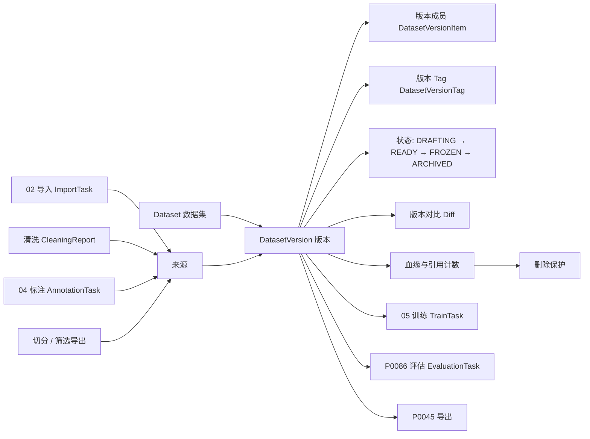
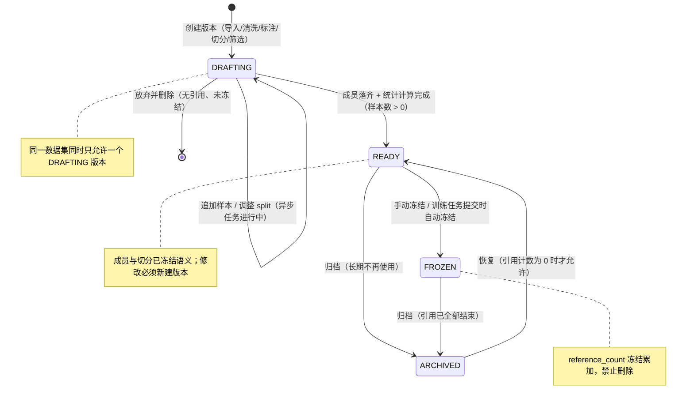
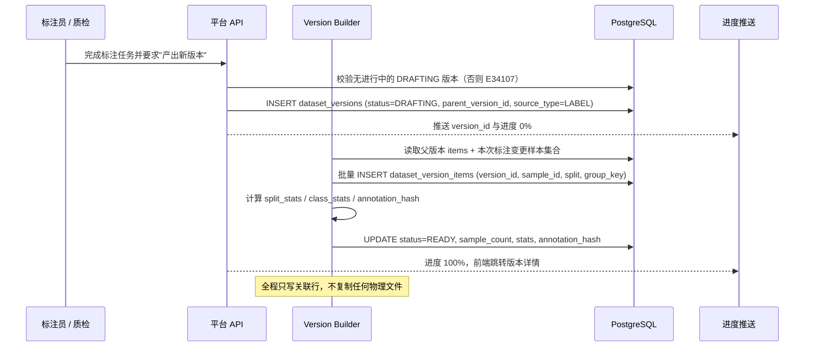
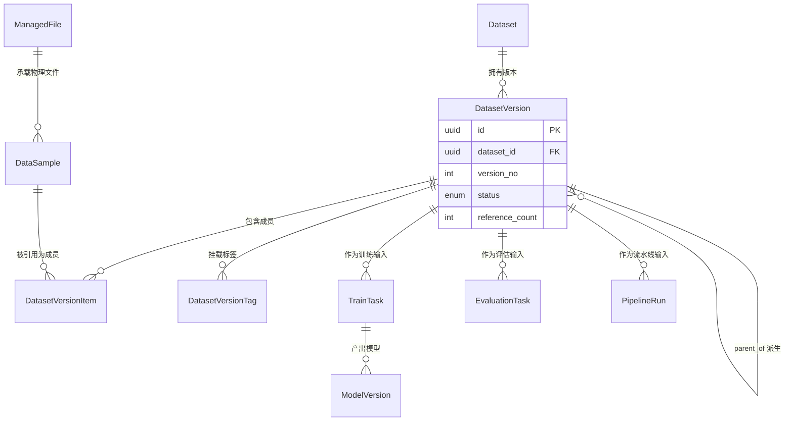
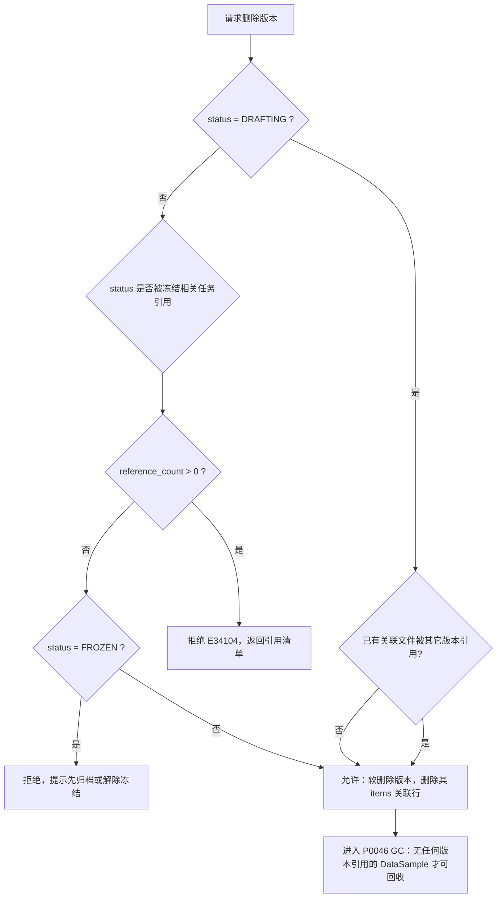
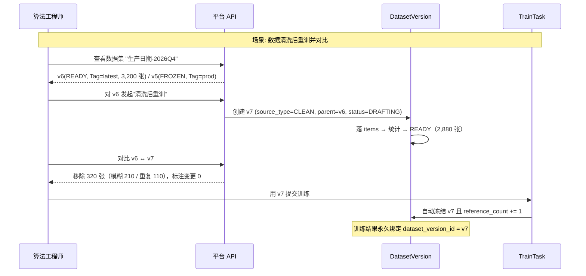
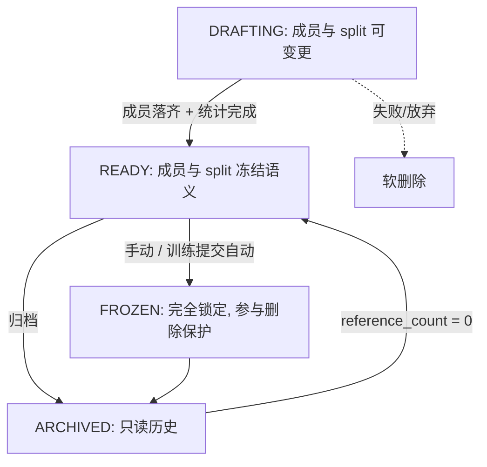

# PRD: P0041_数据集与版本 (Dataset & Version)

| 属性 | 内容 |
| :--- | :--- |
| **文档编号** | P0041 |
| **功能模块** | M03_数据管理 |
| **当前版本** | v1.0.0 |
| **文档状态** | Approved |
| **作者** | 轻眸识刻 Team |
| **最后更新** | 2026-10-01 |

---
## 1. 全局说明

> [!IMPORTANT]
> **核心定位**: 数据资产的可复现基线。`Dataset` 是逻辑容器，`DatasetVersion` 是**不可变快照**。任何导入、清洗、标注、切分、筛选都会产出**新版本**，旧版本永不原地修改 —— 训练结果因此永远可追溯、可复现。

### 名词解释
*   **Dataset (数据集)**: 逻辑容器，承载名称、描述、任务类型提示与版本序列；本身不存样本。
*   **DatasetVersion (数据集版本)**: 一次不可变快照，由 `DatasetVersionItem` 集合 + 统计元数据 + 标注指纹构成。
*   **DatasetVersionItem (版本成员)**: 版本与样本的关联记录，携带 `split`（`TRAIN`/`VAL`/`TEST`/`UNASSIGNED`）与 `group_key`；**DataSample (数据样本)** 指单张图 / 单帧，物理文件由 `ManagedFile` 承载，跨版本复用且不复制文件。
*   **不可变快照 (Immutable Snapshot)**: 版本一旦进入 `READY`，成员集合与切分归属冻结；变更只能产生新版本。
*   **冻结 (Freeze)**: 把 `READY` 版本显式锁定为 `FROZEN`，禁止任何成员变更，并参与删除保护。
*   **血缘 (Lineage)**: 版本之间的派生关系与版本被训练 / 评估 / 导出的引用关系。
*   **引用计数 (reference_count)**: 指向该版本的训练任务、评估任务、流水线运行、导出任务数量之和。
*   **Tag (版本标签)**: 挂在版本上的稳定别名（如 `prod`、`baseline-2026Q4`），用于脚本与文档引用"当前该用哪版"。
*   **版本对比 (Version Diff)**: 两个版本之间的样本新增、移除、标注变更与切分变更统计。
*   **group_key (分组键)**: 视频 id / 采集批次 id / 会话 id；同一 `group_key` 的样本必须整体落在同一 `split`，防泄漏。

### 统一异常处理 (E341xx)
| Code | 场景 | 处理策略 |
| :--- | :--- | :--- |
| `E34101` | 数据集名非法或重复 | 表单内联提示，拒绝创建；名称 1–64 字符且全局唯一 |
| `E34102` | 版本不存在或已被 GC | 404 + `version_not_found`；前端回到数据集详情页 |
| `E34103` | 版本已 `READY`/`FROZEN`，被尝试修改成员 | 拒绝并提示"请基于该版本创建新版本"，返回可跳转的 `new_version` 入口 |
| `E34104` | 版本被引用（`reference_count > 0`）或处于 `FROZEN`，被尝试删除 | 拒绝删除，返回引用清单（任务类型 + 任务名 + 状态） |
| `E34105` | Tag 冲突（同一数据集内重名）或命中保留字 | 拒绝；保留字 `latest`、`draft`、`frozen`、`archived` |
| `E34106` | 版本样本数为 0 时尝试置 `READY` | 拒绝；允许保留为 `DRAFTING` 或直接删除 |
| `E34107` | 并发状态冲突（同一数据集已有 `DRAFTING` 版本 / 冻结时状态已变） | 返回冲突版本 id，前端提示"刷新后重试"，不覆盖 |
| `E34108` | 跨数据集版本对比 | 拒绝；对比仅在同一个 `Dataset` 内的版本间进行 |
| `E34109` | 向 `ARCHIVED` 版本发起引用（训练 / 评估 / 导出） | 拒绝并列出可用版本；归档版本只能用于历史追溯 |
| `E34110` | 版本成员引用已软删除的样本 | 创建时拒绝并报告缺失样本数；已存在的历史版本保留引用并标记 `sample_deleted` |
| `E34111` | 切分违反分组约束（同一 `group_key` 跨 `split`） | 拒绝提交切分；列出声明的冲突组 |

---
## 2. 项目背景

### 背景 (Context)
食品包装生产日期识别的工作流是**反复迭代**的：先导入 800 张手机拍摄图，标注 300 张发现部分反光严重，清洗掉一批，再补采 200 张，然后调切分比例重训。如果没有版本概念，"上周那版数据是什么"只能靠 memory；重训一次却复现不出上次的 mAP 是常态。更糟的是标注返工：标注员把 300 个框全部重画后，历史版本的标注结果被覆盖，之前解释不通的指标永远说不清了。

### 问题陈述 (Problem Statement)
1.  **不可复现**：数据集被原地修改，训练任务无法回溯当时到底用了哪些样本、什么标注。
2.  **误删**：清理磁盘时删掉"看起来没人用"的版本，结果某次历史训练的依据没了。
3.  **语义失焦**：`v3` 是什么？没有备注与 Tag，只能靠时间戳猜。
4.  **变更不可见**：新版本究竟是多了 200 张还是某些框被改了，没人能回答。
5.  **切分泄漏**：同一视频抽出的相邻帧被随机分到 train 与 val，验证指标虚高。

### 目标与成功指标 (Goals & Success Metrics)
*   **北极星指标**: **任意一次训练任务都能 100% 追溯到唯一的不可变版本**（含样本集合、切分、标注指纹）。
*   **次要指标**:
    *   版本创建（纯元数据，复制引用而非文件）P95 < **2s**；百万级样本的大版本异步创建 < 5 分钟。
    *   版本删除保护 **0 误删**（被引用或已冻结的版本一律拒绝删除）。
    *   版本对比在 10 万样本规模下 P95 < **5s**。
    *   切分分组约束违反导致的返工 = 0。

### 风险与规避 (Risks & Mitigation)
| 风险 | 影响 | 规避方案 |
| :--- | :--- | :--- |
| 版本爆炸（每次标注都建版本） | 元数据与存储引用膨胀 | `DatasetVersionItem` 只存关联行；同数据集内标签页默认只展示"有 Tag 或 7 天内"的版本，其余折叠 |
| 大版本创建阻塞请求 | 接口超时 | > 5 万样本走异步任务，返回 `task_id` 并推 SSE 进度 |
| 冻结后仍需修正标注 | 用户绕过平台手改库 | 冻结不可逆；修正走"新版本"路径（`source_type=LABEL`），并在对比页体现差异 |
| 训练任务持有 `READY` 版本，用户又新建版本 | 训练输入漂移 | 训练提交时自动冻结所引用版本（`reference_count += 1` 且置 `FROZEN`） |
| 删除数据集时忽略版本引用 | 历史训练断链 | 删除数据集前置检查：任一版本 `reference_count > 0` 即拒绝（E34104） |
| 样本被软删但版本仍引用 | 训练时读不到文件 | 训练前预检：缺失样本 > 0 时告警并列出缺失清单，不静默跳过 |

---
## 3. 价值模型

*   **方案**: `Dataset`（逻辑容器）+ `DatasetVersion`（不可变快照）+ `DatasetVersionItem`（成员与切分）+ `DatasetVersionTag`（稳定别名）+ 引用计数驱动的删除保护。样本物理文件跨版本复用，版本之间只增加关联行，**不复制文件**。
*   **目标**:

| 指标 | 现状（无版本管理） | 目标 |
| :--- | :--- | :--- |
| 训练可复现 | 靠记忆 | 版本 id + 标注指纹，一键定位 |
| 数据变更可见性 | 无 | 版本对比给出新增 / 移除 / 标注变更统计 |
| 误删风险 | 高 | 冻结 + 引用计数双重保护 |
| 验证集可信度 | 相邻帧泄漏 | `group_key` 整组切分，泄漏 0 |

---
## 4. 项目范围

### 功能结构图


### In Scope (包含范围)
1.  **数据集管理**：创建、重命名、描述、任务类型提示、软删除与恢复。
2.  **版本创建**：来源为导入 / 清洗 / 标注 / 切分 / 筛选导出 / 复制父版本；一律走快照。
3.  **冻结与锁定**：手动冻结 + 训练提交时自动冻结；冻结后成员与切分不可变。
4.  **血缘与引用**：父版本链、被训练 / 评估 / 流水线 / 导出的引用清单；删除保护。
5.  **Tag 与备注**：版本别名、备注、按 Tag 解析"当前应使用的版本"。
6.  **版本对比**：新增 / 移除 / 标注变更 / 切分变更统计，支持按类别与 split 下钻。
7.  **归档与恢复**：`ARCHIVED` 版本只读保留，可恢复到 `READY`（需解除引用保护）。
8.  **并发与幂等**：同一数据集单 `DRAFTING` 约束、状态迁移的乐观锁、创建接口幂等。

### Out of Scope (不包含范围)
*   版本分支 / 合并（Git 式的多线演进与冲突合并）—— 单机团队用线性版本链足够。
*   跨数据集迁移与合并（由 P0045 导出 + P0020 重新导入完成）。
*   样本级的历史版本回滚（回滚 = 用旧版本成员集合创建新版本，不提供原地撤销）。
*   物理文件的时间点快照（文件由 `ManagedFile` 托管，不做 COW / 快照卷）。
*   自动语义去重（内容相同的样本由 `DataSample.content_hash` 在导入侧拦截，版本侧不做二次判断）。

---
## 5. 业务流程

### 5.1 版本状态机


### 5.2 版本创建流程（以标注产出为例）


### 5.3 血缘与引用关系（erDiagram）


### 5.4 删除保护判定


---
## 6. 用户分析

### 6.1 用户画像 (User Personas)
*   **算法工程师 (TRAINER)**: **职责** 选版本、调参、训模型、对比实验。**诉求** "我要的是确定的那一版数据，重训结果必须和上次一致。"**痛点** 数据集被同事改了导致旧实验无法复现；不知道验证集指标可信不可信。
*   **标注 / 质检员 (ANNOTATOR)**: **职责** 在切片上标注与返工。**诉求** "返工后的标注要能作为新版本固定下来，别把我这版覆盖掉。"**痛点** 返工后历史标注消失；同一批图反复重标。
*   **数据管理员 (ADMIN / TRAINER 兼职)**: **职责** 清理磁盘、整理 Tag、控制版本数量。**诉求** "删之前告诉我谁在用。"**痛点** 删完才发现被某个历史训练任务引用。

### 6.2 用户链路图 (User Journey Map)


---
## 7. 功能需求

### M03.F01 数据集创建与管理 (Dataset Management)
*   **用户故事**: 作为算法工程师，我希望建立逻辑数据集容器，把同一业务目标的数据聚合在一起，以便按业务而不是按文件目录管理数据。
*   **逻辑与业务规则**: **前置条件** 角色为 `TRAINER` 或 `ADMIN`。**主流程** 1) 创建时填写名称、描述、任务类型提示（`DETECTION`/`OCR`/`OBB`/`KEYPOINT`，可空且**不构成约束**）；2) 立即生成 `v1` 的 `DRAFTING` 版本；3) 列表按最后更新时间排序，显示版本数、样本数、最新 Tag。**校验** 名称 1–64 且全局唯一（E34101）；删除为软删除，需二次确认并展示引用检查结果。**后置条件** `datasets` 落库，`deleted_at` 用于恢复。
*   **验收标准**:

```gherkin
场景: 创建数据集并自动生成初始版本
  Given 角色为 TRAINER
  When 提交数据集名 "生产日期-2026Q4"，任务类型提示 DETECTION
  Then datasets 新增一条记录且唯一
  And 自动创建 version_no=1、status=DRAFTING 的版本
  And 数据集列表显示 "0 张 / 1 个版本"

场景: 重名数据集被拒
  Given 已存在数据集 "生产日期-2026Q4"
  When 再次以同名创建
  Then 返回 E34101 并提示名称已存在
```
*   **边界情况与异常处理**:

| 场景 | 处理 |
| :--- | :--- |
| 用户把两个业务混在一个数据集 | 允许但不鼓励：建议按"一类识别目标"建数据集，用描述与 Tag 区分 |
| 恢复已删除数据集 | 恢复 `deleted_at = NULL`；已推进的版本号不回退 |
| 删除仍有版本的数据集 | 软删除数据集与其下版本；任一版本 `reference_count > 0` 时拒绝，返回引用清单（E34104） |
| 任务类型提示写错 | 可修改，仅影响新建版本的默认取值，不追溯历史版本 |

### M03.F02 版本创建与不可变快照 (Version Creation & Immutable Snapshot)
*   **用户故事**: 作为算法工程师，我希望任何数据变更都产出新版本，而不是覆盖旧数据，以便每次实验结果都能回溯到确定的数据集合。
*   **逻辑与业务规则**: **前置条件** 目标数据集存在且无进行中的 `DRAFTING` 版本（否则 E34107）。**主流程** 1) 选择来源 `source_type ∈ IMPORT / CLEAN / LABEL / SPLIT / FILTER`，并指定 `parent_version_id`（首版为空）；2) 插入 `DRAFTING` 版本；3) `Version Builder` 计算成员增量并批量写入 `dataset_version_items`（复用 `DataSample`，**不复制物理文件**）；4) 计算 `sample_count`、`split_stats`、`class_stats`、`annotation_hash`；5) 置 `READY`。**样本数 > 5 万** 走异步任务并推 SSE 进度。**不可变规则** 版本进入 `READY` 后，成员增删与 split 变更一律拒绝（E34103），必须新建版本。**幂等** 同一 `(dataset_id, source_type, source_ref)` 24h 内重复请求返回既有版本。
*   **验收标准**:

```gherkin
场景: 标注产出新版本
  Given 数据集 A 的 v5 已完成一轮标注返工（120 个框被修改）
  When 从标注任务产出新版本，source_type=LABEL, parent_version_id=v5
  Then 生成 v6 且 status=READY
  And v6 的 sample_count 与 v5 相同，annotation_hash 不同
  And v5 的成员与标注指纹保持不变

场景: 修改已 READY 的版本被拒
  Given v6 处于 READY
  When 请求向 v6 追加 50 个样本
  Then 返回 E34103 并提示基于 v6 创建新版本
```
*   **边界情况与异常处理**:

| 场景 | 处理 |
| :--- | :--- |
| 创建过程中服务重启 | `DRAFTING` 版本保留，`Version Builder` 重启后按 `version_id` 断点续跑（items 写入幂等，`ON CONFLICT DO NOTHING`） |
| 冻结与 Builder 竞争 | `DRAFTING` 版本冻结按钮禁用，先等 `READY`，避免与 Builder 写入竞争 |
| 成员包含已软删样本 | 创建时拒绝并报告缺失数量（E34110）；历史版本保留旧引用并标记 |
| 源版本本身是 `ARCHIVED` | 允许复制（历史追溯场景），新版本状态正常流转 |
| 同一来源重复触发 | 24h 幂等窗内返回既有 `version_id`，不产生重复版本 |

### M03.F03 冻结与锁定 (Freeze & Lock)
*   **用户故事**: 作为算法工程师，我希望把用作训练输入的版本锁死，以便任何人（包括我自己）都不能在不经意间改动它。
*   **逻辑与业务规则**: **前置条件** 版本处于 `READY`。**主流程** 1) 版本详情页 `[冻结]`，或训练 / 评估任务提交时由平台自动冻结；2) 置 `FROZEN`，写 `frozen_at`、`frozen_by` 与审计；3) 该版本此后拒绝一切成员与 split 变更（E34103），仅允许追加 / 移除 Tag（写审计）。**解冻规则** 不提供解冻；需要变更时基于该版本新建版本。**后置条件** 冻结版本进入删除保护范围（E34104）。
*   **验收标准**:

```gherkin
场景: 训练提交时自动冻结
  Given v7 处于 READY 且被选为训练输入
  When 提交 TrainTask
  Then v7 置为 FROZEN 且 reference_count + 1
  And 此后对 v7 的成员变更请求返回 E34103

场景: 冻结版本不可删除
  Given v7 为 FROZEN 且 reference_count=1
  When 管理员请求删除 v7
  Then 返回 E34104 并列出引用该版本的训练任务
```
*   **边界情况与异常处理**:

| 场景 | 处理 |
| :--- | :--- |
| 训练任务被取消 | `reference_count` 减 1（引用由任务状态驱动）；版本保持 `FROZEN`，不自动回到 `READY` |
| 误冻结仍在调整的版本 | 冻结不可逆；引导基于该版本新建版本继续调整，不提供解锁后门 |
| 用户误冻结一个还在调整的版本 | 冻结不可逆；提示"可基于该版本创建新版本继续调整"，避免提供解锁后门 |

### M03.F04 血缘引用与删除保护 (Lineage & Delete Protection)
*   **用户故事**: 作为数据管理员，我希望删除前就知道谁在引用这个版本，以便清理磁盘时不会误删训练依据。
*   **逻辑与业务规则**: **前置条件** 版本存在。**主流程** 1) 版本详情展示血缘：`parent_version_id` 链（向上）与派生版本（向下）；2) 展示引用清单：`TrainTask` / `EvaluationTask` / `PipelineRun` / 导出任务，含状态与创建时间；3) `reference_count` = 上述有效引用数（终态失败 / 删除的任务不计）；4) 删除请求先做保护判定（见 5.4）。**保护规则** `reference_count > 0` 或 `status = FROZEN` 一律拒绝删除（E34104）；`ARCHIVED` 版本被引用时拒绝训练 / 评估（E34109）。
*   **验收标准**:

```gherkin
场景: 删除被引用版本被拒
  Given v5 被 2 个 TrainTask 与 1 个 EvaluationTask 引用
  When 请求删除 v5
  Then 返回 E34104，响应包含 3 条引用清单
  And v5 状态与成员保持不变

场景: 删除无引用且未冻结的版本成功
  Given v6 处于 READY、reference_count=0、无 Tag
  When 请求删除 v6
  Then 版本软删除，其 dataset_version_items 关联行被清理
  And 未被任何版本引用的 DataSample 进入 P0046 GC 候选
```
*   **边界情况与异常处理**:

| 场景 | 处理 |
| :--- | :--- |
| 训练任务已删除但引用计数未减 | `reference_count` 由任务状态变更事件驱动；另设每日对账任务重算计数（幂等） |
| 版本被流水线 `PipelineRun` 引用 | 同上计入 `reference_count`，避免绕过保护 |
| 用户要求"强制删除" | 不提供强删；引导先取消 / 归档引用任务，或先把版本归档（引用结束后才允许归档删除） |

### M03.F05 Tag 与版本备注 (Version Tag & Note)
*   **用户故事**: 作为算法工程师，我希望给版本起稳定别名（如 `prod`），以便脚本和文档引用"当前该用哪版"而不用记版本号。
*   **逻辑与业务规则**: **前置条件** 版本存在（任意状态，含 `FROZEN`/`ARCHIVED`）。**主流程** 1) 在版本详情添加 Tag（1–32 字符，`[a-z0-9-._]`）；2) 同一数据集内 Tag 唯一（E34105），保留字 `latest`/`draft`/`frozen`/`archived` 不可占用；3) Tag 可"移动"到新版本：添加时若已存在于其它版本，默认报冲突，用户可选择 `--move` 语义（旧版本移除 + 新版本添加，写双条审计）。**备注** 每个版本可写 500 字以内 `note`，用于记录来源与用途。**后置条件** Tag 变更均写审计，可通过 `GET /datasets/{id}/versions/by-tag/{tag}` 解析。
*   **验收标准**:

```gherkin
场景: 移动 Tag 到新版本
  Given v5 持有 Tag "prod"
  When 对 v6 执行 add tag "prod" 并选择 move 语义
  Then v6 持有 "prod"，v5 不再持有
  And 审计记录两条（v5 移除、v6 添加）

场景: Tag 重名被拒
  Given v5 已持有 "prod"
  When 对 v6 添加 "prod" 且未选择 move
  Then 返回 E34105 并提示该 Tag 当前指向 v5
```
*   **边界情况与异常处理**:

| 场景 | 处理 |
| :--- | :--- |
| 归档版本仍持有 Tag | 允许保留；解析到归档版本时接口附带 `archived=true` 提示 |
| 备注写错想改 | 可直接编辑 `note`（不影响不可变语义），写审计 |
| 用户用 Tag 当版本号（`v1`/`v2`） | 允许但不推荐；保留字校验拦住 `latest` 等易混淆命名 |
| 同一 Tag 被并发写 | 依赖 `UNIQUE(dataset_id, tag)` 索引，冲突方返回 E34105 |

### M03.F06 版本对比 (Version Diff)
*   **用户故事**: 作为算法工程师，我希望对比两个版本，知道新版本到底改了什么，以便判断这次指标变化的归因。
*   **逻辑与业务规则**: **前置条件** 两个版本属于**同一数据集**（否则 E34108）。**主流程** 1) 选择基准版本与目标版本；2) 以 `sample_id` 做集合差求"新增 / 移除"；3) 对交集样本比较 `annotation_hash`，不同者计入"标注变更"；4) 比较 `split` 归属，变化者计入"切分变更"；5) 汇总类别级差异（各类别框数增减）。**性能策略** 仅比较 `dataset_version_items` 与样本指纹列，不读取图片。**后置条件** 默认直接返回 JSON 摘要（不落盘）；用户可下载 CSV 明细；当对比由流水线触发并需留档时，报告登记为 `ManagedFile(owner_type=PIPELINE_STAGE_RUN, owner_id=stage_run_id)`，UI 侧一次性对比不产生 `ManagedFile`。
*   **验收标准**:

```gherkin
场景: 对比清洗前后版本
  Given v6 有 3,200 个样本，v7 有 2,880 个样本，其中 120 个样本标注被修改
  When 对比 v6(基准) 与 v7(目标)
  Then 报告 added=0, removed=320, annotation_changed=120, split_changed=0
  And 移除样本按原因聚合（模糊 210 / 重复 110 来自 CleaningReport）

场景: 跨数据集对比被拒
  Given v6 属于数据集 A，v9 属于数据集 B
  When 请求对比 v6 与 v9
  Then 返回 E34108
```
*   **边界情况与异常处理**:

| 场景 | 处理 |
| :--- | :--- |
| 两版本差异超过 50 万行 | 只返回统计摘要，明细改为分页 / 导出 CSV，避免一次性渲染 |
| `annotation_hash` 因类别重命名全量变化 | 报告附带"疑似类别体系变更"提示，引导核对 LabelClass 迁移记录 |
| 对比跨越归档版本 | 允许（归档版本只读，可对比），报告标注来源版本状态 |
| 交集样本的标注数据已被物理删除 | 标记为 `annotation_missing`，计入"无法判定"而非"未变更" |

### M03.F07 归档与恢复 (Archive & Restore)
*   **用户故事**: 作为数据管理员，我希望把不再使用但需留痕的版本归档，以便版本列表清爽，同时历史训练仍可追溯。
*   **逻辑与业务规则**: **前置条件** 版本处于 `READY` 或 `FROZEN`。**主流程** 1) `[归档]` 置 `ARCHIVED`；2) 归档版本不出现在训练的版本下拉默认列表（可通过"显示归档"开关选择），不可作为新任务输入（E34109）；3) 恢复时校验 `reference_count = 0`，置 `READY`（若原本由训练冻结则回到 `FROZEN`，由 `frozen_at` 是否存在判定）。**后置条件** 归档版本仍参与版本对比与历史血缘展示。
*   **验收标准**:

```gherkin
场景: 归档版本不可作为新训练输入
  Given v4 处于 ARCHIVED
  When 提交以 v4 为输入的 TrainTask
  Then 返回 E34109，并列出该数据集可用的 READY / FROZEN 版本

场景: 恢复归档版本
  Given v4 处于 ARCHIVED 且 reference_count=0
  When 管理员点击 [恢复]
  Then v4 回到 READY（或原为冻结则回 FROZEN）并可被训练选中
```
*   **边界情况与异常处理**:

| 场景 | 处理 |
| :--- | :--- |
| 归档版本仍被训练任务引用 | 允许归档，历史引用不受影响；任务重跑时需重新选择版本 |
| 恢复后又想归档 | 幂等允许，写审计 |
| 恢复时已有新的 `DRAFTING` 版本 | 允许恢复（状态无冲突），因为 `DRAFTING` 唯一约束只针对 `DRAFTING` 版本 |

### M03.F08 并发写入与幂等 (Concurrency & Idempotency)
*   **用户故事**: 作为开发者，我希望并发的版本创建不会互相覆盖或被重复创建，以便数据管理在多人协作下仍然稳定。
*   **逻辑与业务规则**: **约束** `UNIQUE(dataset_id) WHERE status='DRAFTING' AND deleted_at IS NULL` —— 同一数据集同时只能有一个草稿版本，冲突返回 E34107 与既有草稿 id。**幂等键** `(dataset_id, source_type, source_ref, 24h)` 重复请求返回既有版本。**乐观锁** 状态迁移使用 `UPDATE ... WHERE id=? AND status=?`，影响行数为 0 即判定并发冲突（E34107）。**items 写入** 使用 `ON CONFLICT (version_id, sample_id) DO NOTHING`，保证 Builder 重跑幂等。
*   **验收标准**:

```gherkin
场景: 并发创建版本只成功一个
  Given 数据集 A 当前无 DRAFTING 版本
  When 两个请求同时创建版本
  Then 一个成功，另一个返回 E34107 与成功方的 version_id
  And 数据库仅存在一条 DRAFTING 记录

场景: Builder 重跑幂等
  Given v8 的 Builder 在写入第 500 行后中断
  When Builder 重启并从头重跑
  Then 已写入的 500 行不被重复插入，最终 items 数与预期一致
```
*   **边界情况与异常处理**:

| 场景 | 处理 |
| :--- | :--- |
| 两个来源并发产出 | 后到者失败并提示"存在未完成的草稿版本（来源 LABEL）"，需先完成或放弃 |
| `source_ref` 为空（手动建空版本） | 幂等键退化为 `(dataset_id, source_type)`，24h 内只允许一个手动版本 |
| 状态迁移与训练冻结同时发生 | 乐观锁保证只有一个生效，失败方返回 E34107 并提示刷新 |

---
## 8. 技术架构与数据模型

### 8.1 数据实体

#### Table: `datasets`
| 字段名 | 类型 | 必填 | 说明 | 约束 |
| :--- | :--- | :--- | :--- | :--- |
| `id` | UUID | Y | 主键 | PK |
| `name` | String(64) | Y | 数据集名 | UNIQUE（含未删除记录），1–64 |
| `description` / `task_type` | Text / Enum | N | 描述；任务类型提示 `DETECTION`/`OCR`/`OBB`/`KEYPOINT` | 提示不构成约束 |
| `sample_count` / `version_count` | Int | Y | 去重样本数 / 版本数（含归档） | 由版本统计聚合维护 |
| `latest_version_id` | UUID | N | 最新版本 | 派生于最大 `version_no` |
| `created_by` / `created_at` / `updated_at` / `deleted_at` | — | Y / N | 审计与软删除 | 全表统一 |

#### Table: `dataset_versions`
| 字段名 | 类型 | 必填 | 说明 | 约束 |
| :--- | :--- | :--- | :--- | :--- |
| `id` | UUID | Y | 主键 | PK |
| `dataset_id` | UUID | Y | 所属数据集 | FK，与 `version_no` 联合唯一 |
| `version_no` | Int | Y | 版本号 | 自增、不复用；展示为 `v{n}` |
| `status` | Enum | Y | `DRAFTING`/`READY`/`FROZEN`/`ARCHIVED` | 部分唯一索引：每数据集仅一个 `DRAFTING` |
| `source_type` | Enum | Y | `IMPORT`/`CLEAN`/`LABEL`/`SPLIT`/`FILTER` | — |
| `source_ref` | JSONB | N | `{import_task_id?, annotation_task_id?, cleaning_report_id?, filter_id?}` | 用于幂等键与溯源 |
| `parent_version_id` | UUID | N | 父版本 | FK → 自身；首版为空 |
| `sample_count` | Int | Y | 成员数 | `READY` 时 > 0（E34106） |
| `split_stats` | JSONB | Y | `{train, val, test, unassigned}` | 与 items 聚合一致 |
| `class_stats` | JSONB | N | 各类别框数 | 供对比与看板 |
| `annotation_hash` | String(64) | N | 全版本标注指纹 | 由成员 `annotation_hash` 排序后聚合，用于快速 diff |
| `reference_count` | Int | Y | 有效引用数 | 事件驱动 + 每日对账 |
| `frozen_at` / `frozen_by` | timestamptz / UUID | N | 冻结信息 | 存在即视为冻结来源；本表含 `created_at`/`updated_at`/`deleted_at` |
| `note` | Text | N | 版本备注 | ≤ 500 字 |

#### Table: `data_samples`（由 01 采集 / 02 导入写入，本模块只读引用）
| 字段名 | 类型 | 必填 | 说明 | 约束 |
| :--- | :--- | :--- | :--- | :--- |
| `id` | String(26) | Y | ULID 主键 | PK |
| `dataset_id` | UUID | Y | 所属数据集 | FK → `datasets.id` |
| `file_id` | String(26) | Y | 物理文件 | FK → `managed_files.id` |
| `import_task_id` / `capture_task_id` | UUID | N | 来源批次（二者互斥、可空） | FK → `import_tasks` / `capture_tasks` |
| `original_filename` | String(255) | N | 原始文件名（保留中文） | 供 P0042 文本搜索 |
| `width` / `height` / `size_bytes` / `format` | Int / Int / BigInt / String(8) | N | 分辨率、字节数、格式 | — |
| `content_hash` | String(64) | Y | sha256 | UNIQUE(`dataset_id`, `content_hash`) |
| `annotation_status` | Enum | Y | `UNLABELED`/`LABELED`/`VERIFIED`/`REJECTED` | 由 04 标注回写 |
| `annotation_hash` | String(64) | N | 标注指纹 | 版本 diff 的比对依据 |
| `group_key` | String(64) | N | **来源身份真源**：视频 id / 采集批次 id / 会话 id / SKU | 防泄漏切分的依据；版本侧快照复制到 `DatasetVersionItem.group_key` |
| `frame_index` / `timestamp` / `sampling_fps` / `source_video_id` / `pts_fallback` | Int / Float / Float / UUID / Bool | N | 抽帧血缘字段（仅抽帧来源样本） | 由 02 抽帧写入，用于回溯原始视频时间点 |
| `is_negative` / `is_broken` / `is_hard_example` | Bool | Y | 标记位 | 默认 false |
| `created_at` / `updated_at` / `deleted_at` | — | Y / N | 审计与软删除 | 软删后进入 P0046 GC 候选 |

#### Table: `dataset_version_items` / `dataset_version_tags`
| 表 | 字段 | 类型 | 说明 |
| :--- | :--- | :--- | :--- |
| `dataset_version_items` | `version_id` / `sample_id` | UUID | 联合主键；FK → `dataset_versions` / `data_samples` |
| | `split` | Enum | `TRAIN`/`VAL`/`TEST`/`UNASSIGNED`，默认 `UNASSIGNED` |
| | `group_key` | String(64) | 版本创建时从 `DataSample.group_key` **快照复制**（保持已冻结版本自洽）；同一 `version_id` 内同一 `group_key` 不得跨 `split`（E34111） |
| | `added_at` | timestamptz | 加入该版本的时间 |
| `dataset_version_tags` | `id` | UUID | PK |
| | `dataset_id` / `version_id` | UUID | FK；`UNIQUE(dataset_id, tag)` |
| | `tag` | String(32) | `[a-z0-9-._]`，保留字除外（E34105） |
| | `created_by` / `created_at` | — | 审计 |

### 8.2 版本状态与不可变边界


---
## 9. UI/UX 规格说明

### 9.1 数据集详情与版本时间线
```text
+----------------------------------------------------------------------------------+
|  数据管理 > 生产日期-2026Q4            [导入] [新建版本▾] [训练] [设置]           |
|  3,200 张 · 6 个版本 · 最新 v6(latest, READY) · 更新于 12 分钟前                  |
+----------------------------------------------------------------------------------+
|  版本时间线                                                   [显示归档] [对比]   |
|  ┌──────────────────────────────────────────────────────────────────────────────┐|
|  │ v6  READY    latest          3,200 张  T/V/T 2560/480/160   LABEL     [详情] │|
|  │ v5  FROZEN   prod            3,200 张  T/V/T 2560/480/160   LABEL  🔒 [详情] │|
|  │     └ 被 2 个训练任务引用 · FROZEN 于 2026-09-28                          │|
|  │ v4  ARCHIVED                 2,880 张  T/V/T 2304/432/144   CLEAN    [详情] │|
|  └──────────────────────────────────────────────────────────────────────────────┘|
|  引用检查: 删除 v5 将被拒绝（2 个训练任务 + 1 个评估任务引用）                     |
+----------------------------------------------------------------------------------+
```

### 9.2 版本对比
```text
+----------------------------------------------------------------------------------+
|  版本对比   基准 [ v6 ▾ ]  →  目标 [ v7 ▾ ]                     [导出 JSON]      |
+----------------------------------------------------------------------------------+
|  样本: 3,200 → 2,880        新增 0   移除 320   标注变更 120   切分变更 0         |
|  移除原因: 模糊 210 · 重复 110 · 无目标 0                                        |
|  类别变化: production_date 3,480 → 3,120 (-360)  ·  other 0 → 0                  |
|  ┌──────────────────────────────────────────────────────────────────────────────┐|
|  │ 类型     样本        变化                          [仅看差异 ☑]              │|
|  │ 移除 img_00412 模糊(方差21.4) · 标注变更 img_00981 框数 2→3              │|
|  └──────────────────────────────────────────────────────────────────────────────┘|
+----------------------------------------------------------------------------------+
```

### 9.3 交互元素
| 元素 | 类型 | 状态 | 行为 |
| :--- | :--- | :--- | :--- |
| 新建版本 | Dropdown | Default / Disabled(存在 DRAFTING) | 选择来源（清洗 / 标注 / 切分 / 筛选）；禁用时悬浮提示冲突草稿 id |
| 冻结 | Button | Default / Disabled(非 READY) / Loading | 二次确认后置 `FROZEN`，提示不可逆 |
| 删除版本 | Button | Default / Disabled(FROZEN 或 reference_count>0) | 点击前先调引用检查，被引用时展示清单 |
| 添加 Tag | Input + Button | Default / Error(重名) | 冲突时弹出"移动到本版本"选项 |
| 对比 | Button | Disabled(未选中两个版本) | 打开对比页，跨数据集选中时禁用并提示 |
| 归档/恢复 | Button | 依状态切换 | 恢复前校验 `reference_count = 0` |

### 9.4 表单字段校验
| 字段 | 类型 | 校验规则 | 默认值 |
| :--- | :--- | :--- | :--- |
| 数据集名称 | Input | required, 1–64, 全局唯一 | - |
| Tag | Input | 1–32, `[a-z0-9-._]`, 数据集内唯一 | - |
| 任务类型提示 | Select | 可选 | `DETECTION` |

---
## 10. 非功能性需求 (NFR)

*   **性能 (Performance)**: 版本创建（元数据路径）P95 < 2s；> 5 万样本走异步并推 SSE；版本列表 P95 < 200ms；10 万样本对比 P95 < 5s（仅读 `dataset_version_items` 与指纹列，不读图片）。
*   **一致性 (Consistency)**: `reference_count` 与任务状态强一致（事件驱动 + 每日对账兜底）；`split_stats`/`sample_count` 只能由 Builder 写入，外部禁止直接 UPDATE。
*   **安全 (Security)**: 数据集与版本的读写受数据集级 RBAC 约束（`TRAINER` 可建版本与冻结，`ANNOTATOR` 只能产出标注来源的版本，`VIEWER` 只读）；冻结与删除写审计；Tag 变更写审计。
*   **可靠性 (Reliability)**: Builder 支持断点续跑且写入幂等；状态迁移使用乐观锁；软删除数据保留 30 天后由 P0046 回收。
*   **可扩展性 (Scalability)**: 单数据集目标 ≤ 100 万样本、≤ 200 个版本；`dataset_version_items` 预留按 `version_id` 分区（首版不实现）；版本链保持线性，不引入分支合并。

---
## 附录: 已确认的设计决策

| 决策项 | 结论 |
| :--- | :--- |
| 版本模型 | `Dataset` 逻辑容器 + `DatasetVersion` 不可变快照；成员关系放 `DatasetVersionItem`，不冗余在版本主表 |
| 版本号 | 数据集内自增整数，不复用；展示为 `v{n}`；不提供用户自定义版本号 |
| 一切变更产新版本 | 导入 / 清洗 / 标注 / 切分 / 筛选均产出新版本；平台不提供原地修改 |
| 冻结语义 | `READY → FROZEN` 单向不可逆；训练与评估提交时自动冻结输入版本 |
| 删除保护 | `reference_count > 0` 或 `FROZEN` 一律拒绝删除；不提供强删后门 |
| Tag | 独立表 `DatasetVersionTag`，数据集内唯一，支持 move 语义，保留字 `latest`/`draft`/`frozen`/`archived` |
| 草稿并发 | 每数据集同时仅一个 `DRAFTING` 版本（部分唯一索引），冲突返回 E34107 |
| 幂等 | `(dataset_id, source_type, source_ref)` 24h 幂等窗 |
| 切分防泄漏 | `DatasetVersionItem.group_key` 整组划分；违反返回 E34111 |
| 归档 | 只读历史，不可作为新任务输入（E34109），`reference_count = 0` 时方可恢复 |

---
## 关联文档

*   **P0020 / P0021 / P0022**：导入产出 `DatasetVersion(source_type=IMPORT)`
*   **P0023 导入预检与清洗**：清洗报告驱动 `source_type=CLEAN` 版本
*   **P0040_存储配置与桶绑定**：样本文件经 `ManagedFile` 托管，版本只引用不复制
*   **P0042_数据检索与筛选**：筛选结果可导出为新版本（`source_type=FILTER`）
*   **P0045_数据集导出**：以版本为单位导出为标准格式
*   **P0062 / P0063**：标注任务与质检产出 `source_type=LABEL` 版本
*   **P0082 / P0086**：训练与评估提交时自动冻结输入版本并累加 `reference_count`

---
## Changelog

| 版本 | 日期 | 作者 | 变更说明 |
| :--- | :--- | :--- | :--- |
| v0.1.0-draft | 2026-10-01 | 轻眸识刻 Team | 初稿：数据集、版本、Tag、对比 |
| v1.0.0 | 2026-10-01 | 轻眸识刻 Team | 补齐冻结、血缘删除保护、并发幂等；异常码收敛为 `E341xx`；明确 `group_key` 真源在 `DataSample`、版本侧为快照副本 |
