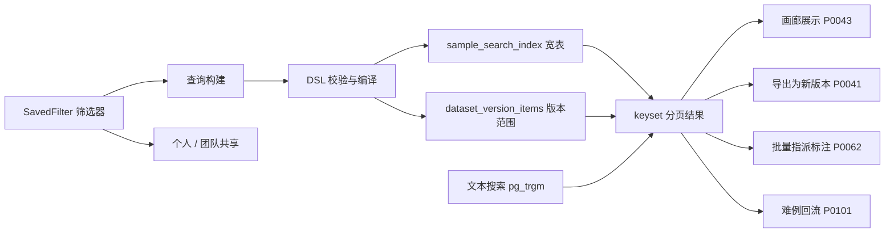
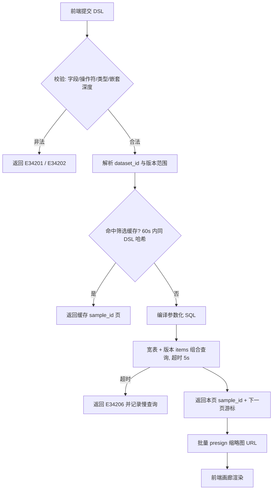
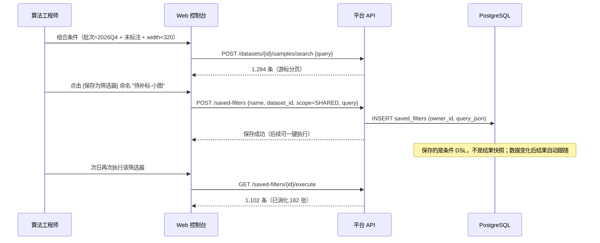
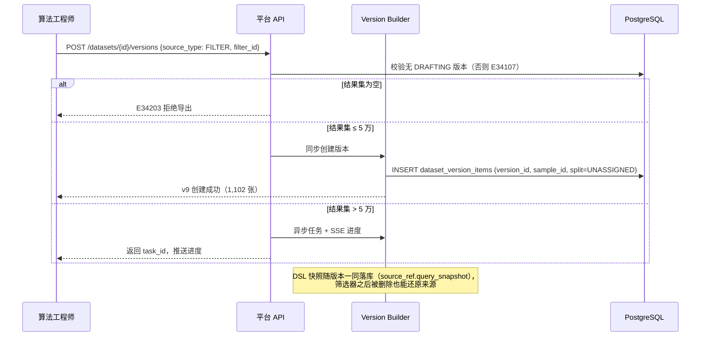
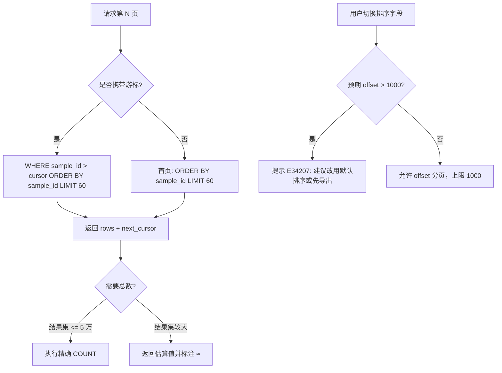
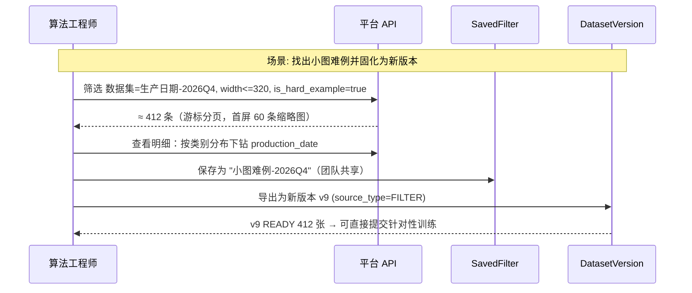
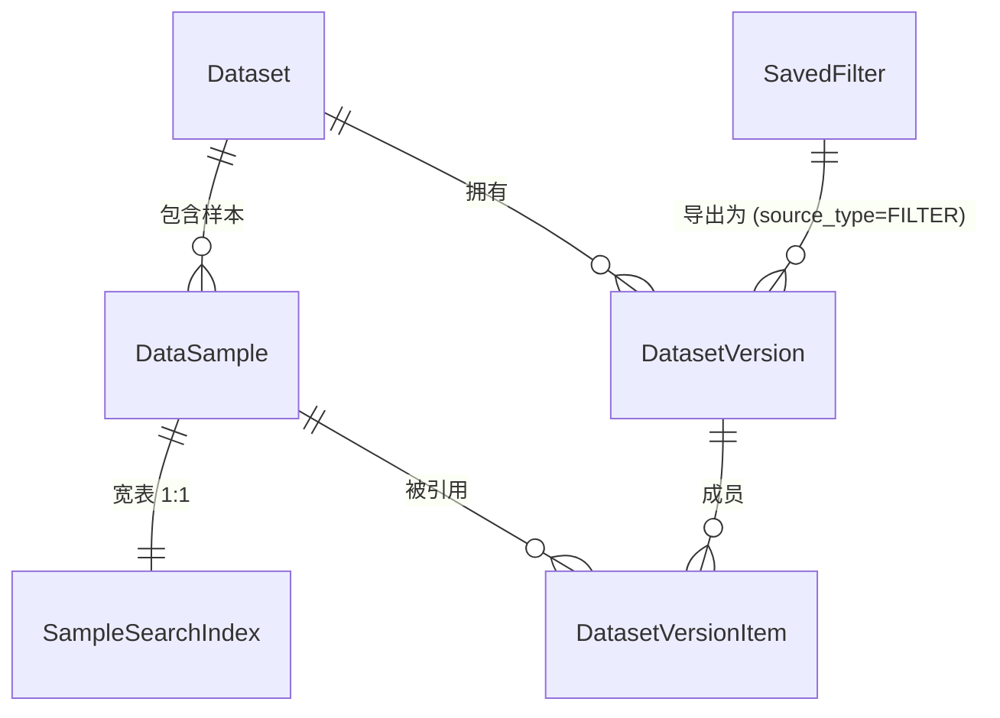

# PRD: P0042_数据检索与筛选 (Data Search & Filtering)

| 属性 | 内容 |
| :--- | :--- |
| **文档编号** | P0042 |
| **功能模块** | M03_数据管理 |
| **当前版本** | v1.0.0 |
| **文档状态** | Approved |
| **作者** | 轻眸识刻 Team |
| **最后更新** | 2026-10-01 |

---
## 1. 全局说明

> [!IMPORTANT]
> **核心定位**: 数据量的放大器。十万级样本里"找出某个批次、分辨率过低、尚未标注、且含 `production_date` 类别的图"必须是一次查询，而不是人工翻页。检索结果是**动作入口**：可直接导出为新数据集版本、指派标注任务、或送入难例回流。

### 名词解释
*   **筛选条件 (Filter Clause)**: 单个维度断言，形如 `{field, op, value}`。
*   **条件组 (Filter Group)**: 条件与子组的逻辑组合，仅支持一层嵌套（`AND` 内嵌 `OR`），避免不可控的查询复杂度。
*   **查询 DSL**: 前端提交的 JSON 结构（见 8.1），由后端编译为参数化 SQL。
*   **筛选器 (SavedFilter)**: 命名并保存的查询 DSL，**存条件不存结果**；个人私有或团队共享。
*   **样本索引宽表 (`sample_search_index`)**: 为筛选预计算的反范式表，承载类别、标注状态、尺寸、来源、批次、难例标记等列。
*   **keyset 分页**: 基于游标（上一页最后一个 `sample_id`）的分页，避免 `OFFSET` 深分页退化。
*   **结果集快照**: 通过"导出为新版本"把当前结果固化为 `DatasetVersion(source_type=FILTER)`。
*   **难例 (Hard Example)**: 被标注、质检或训练后挖掘标记为"模型易错"的样本，`is_hard_example=true`。
*   **负样本 / 损坏标记**: `is_negative`（显式无目标，来自标注）与 `is_broken`（文件不可读 / 严重模糊，来自预检或标注）。

### 统一异常处理 (E342xx)
| Code | 场景 | 处理策略 |
| :--- | :--- | :--- |
| `E34201` | 筛选条件非法（字段不存在、操作符与类型不匹配、UUID 格式错） | 400 并指出出错条件的下标与字段名；前端高亮该条件 |
| `E34202` | 条件嵌套或数量超限（OR 嵌套 > 1 层，或条件数 > 30） | 拒绝执行并提示上限；引导拆分为两个筛选器 |
| `E34203` | 结果集为空时请求导出为版本 | 拒绝；提示"当前条件无匹配样本，请放宽条件" |
| `E34204` | 结果集超过 50 万条 | 拒绝直接导出；提示缩小范围，或确认后走异步导出 |
| `E34205` | 筛选器重名（同 owner 同 scope 内） | 拒绝保存；提示已存在同名筛选器并给出覆盖选项 |
| `E34206` | 查询超过 5s 未返回 | 中断查询返回超时；提示缩小时间区间或先按批次筛选 |
| `E34207` | 深分页或非默认排序超限（`offset > 1000` 或对非 `sample_id` 字段深翻页） | 拒绝并提示改用默认排序的游标分页，或导出后再处理 |
| `E34208` | 导出任务引用的筛选器已被删除 | 导出任务标记失败；若已缓存 DSL 快照则继续执行而不报错 |
| `E34209` | 版本范围与数据集不匹配（指定版本不属于该数据集） | 拒绝；提示重新选择版本 |

---
## 2. 项目背景

### 背景 (Context)
轻眸识刻 的典型数据体量是：单个数据集 3,000–50,000 张，全平台累计 10 万–50 万张。数据来源混杂（手机拍摄、压缩包导入、视频抽帧），质量参差。算法工程师的日常动作几乎都从一个查询开始："上次那批反光的多少张"、"320×320 以下的还有多少没标"、"`production_date` 类别的框少于 1 个的有哪些"、"最近一周采集、还没进训练集的"。没有筛选，这些只能靠翻页和导出 CSV 人肉处理。

### 问题陈述 (Problem Statement)
1.  **结果不可达**：画廊只能顺序翻页，找不到"特定那批"样本。
2.  **维度割裂**：类别、标注状态、来源、尺寸分散在不同表里，无法组合查询。
3.  **重复劳动**：每次都要重新点一遍条件，没有可复用的"筛选器"。
4.  **结果无法沉淀**：筛出来的子集只能看，不能变成新的数据集版本继续流转。
5.  **深分页崩溃**：10 万条数据下 `OFFSET 90000` 直接超时。

### 目标与成功指标 (Goals & Success Metrics)
*   **北极星指标**: **常用数据子集可被一条保存的筛选器稳定复现**，且从筛选到产出新版本 < 3 分钟。
*   **次要指标**:
    *   3 个维度以内的组合筛选 P95 < **300ms**（50 万样本规模）。
    *   列表首屏（含缩略图 URL）P95 < **500ms**。
    *   深分页（第 1 万条以后）单页响应 P95 < **300ms**（keyset 分页，与深度无关）。
    *   筛选器复用率 > 60%（统计被 2 次以上执行的筛选器占比）。

### 风险与规避 (Risks & Mitigation)
| 风险 | 影响 | 规避方案 |
| :--- | :--- | :--- |
| 任意组合查询导致慢查询 | 数据库抖动、页面卡死 | 强制 5s 超时（E34206）+ 只允许一层 OR 嵌套 + 宽表预计算 + 组合索引覆盖常用路径 |
| 宽表与主表不一致 | 筛选结果与实际样本不符 | 由 `DataSample` 与标注事件的同事务触发器 / 事件消费者维护；每日对账任务校验并重建差异行 |
| 导出 50 万条为版本 | Builder 长时间占用 | 超过 5 万走异步并推 SSE；超过 50 万要求二次确认（E34204） |
| 中文文本搜索命中率低 | 用户以为数据缺失 | 明确以 `pg_trgm` trigram 实现，界面提示"中文短语建议 2 字以上或改用批次 / Tag 精确筛选" |
| 筛选器被滥用（每人上百个） | 列表膨胀 | 个人筛选器上限 50 个，团队共享上限 100 个；超限提示整理 |
| 统计总数口径漂移 | 用户对"共 N 条"产生怀疑 | 总数默认展示估算值并标注 `≈`；精确总数仅在 ≤ 5 万条时计算 |

---
## 3. 价值模型

*   **方案**: 查询 DSL（一层嵌套）→ 编译器 → `sample_search_index` 宽表 + 组合索引 → keyset 分页返回 `sample_id` 列表 → 前端按需批量 presign 缩略图。筛选器保存为命名 DSL；结果集可一键固化为 `DatasetVersion(source_type=FILTER)`。
*   **目标**:

| 指标 | 现状（仅顺序翻页） | 目标 |
| :--- | :--- | :--- |
| 定位一个子集 | 人工翻页 / 导出 CSV | 一条筛选器，秒级返回 |
| 子集复用 | 每次重点一遍 | 保存为筛选器，一键执行 |
| 子集流转 | 无 | 导出为新版本 → 标注 / 训练 |
| 深分页 | `OFFSET` 超时 | 游标分页，与深度无关 |

---
## 4. 项目范围

### 功能结构图


### In Scope (包含范围)
1.  **多维组合筛选**：类别、尺寸、来源 / 批次、标注状态、导入时间、难例、负样本 / 损坏、切分、版本范围。
2.  **逻辑组合**：`AND` / `OR`，仅允许一层嵌套，条件数上限 30。
3.  **文本搜索**：文件名、批次名、筛选器名、Tag、样本备注。
4.  **筛选器保存与复用**：个人 / 团队共享，动态执行（存条件不存结果）。
5.  **结果集导出为新数据集版本**：`source_type=FILTER`。
6.  **分页与性能策略**：keyset 游标分页、估算总数、组合索引与宽表预计算。
7.  **批量操作入口**：全选当前结果集，跳转标注指派 / 导出 / 难例标记。

### Out of Scope (不包含范围)
*   自定义 SQL / 子查询 / 跨表 join 暴露给用户（安全与性能双重风险）。
*   向量检索 / 以图搜图 / 相似度检索（第二阶段若接 OCR 与嵌入模型再评估）。
*   三段以上嵌套布尔表达式（如 `(A AND (B OR C)) AND (D OR E)`）。
*   结果集聚合分析看板（由 P0044 统计看板承担）。
*   跨数据集联合查询（一个筛选器绑定一个数据集；跨数据集需人工分次执行）。
*   实时全文检索引擎（Elasticsearch / Meilisearch）—— 单机规模下 PostgreSQL `pg_trgm` 足够。

---
## 5. 业务流程

### 5.1 查询执行流程


### 5.2 筛选器保存与复用


### 5.3 结果集导出为新版本


### 5.4 分页与总数策略


---
## 6. 用户分析

### 6.1 用户画像 (User Personas)
*   **算法工程师 (TRAINER)**: **职责** 定位特定子集做训练 / 难例分析。**诉求** "我要那批 320 以下的小图，看看模型在它们上面漏检多少。"**痛点** 只能翻页找；找到后无法把子集固定下来做实验。
*   **标注 / 质检员 (ANNOTATOR)**: **职责** 领取待标样本与返工样本。**诉求** "给我所有未标注的、且不是模糊的图。"**痛点** 批次混乱、返工样本与新增样本混在一起。
*   **数据管理员 (ADMIN)**: **职责** 盘点数据资产、决定清理对象。**诉求** "哪些批次重复率最高、哪些是损坏图。"**痛点** 只能靠导入报告，无法增量复核。

### 6.2 用户链路图 (User Journey Map)


---
## 7. 功能需求

### M03.F01 多维组合筛选 (Multi-dimension Filtering)
*   **用户故事**: 作为算法工程师，我希望按多个维度组合筛选样本，以便精确定位要处理的那批数据。
*   **逻辑与业务规则**: **前置条件** 用户对该数据集有读权限。**主流程** 1) 选择维度（默认按"标注状态 + 批次 + 时间"组合）；2) 提交 DSL；3) 后端校验并编译为参数化 SQL；4) 返回分页结果与筛选摘要。**支持维度**（全部可作为 `AND` 子句）:

| 维度 | 字段 | 类型 / 操作符 | 说明 |
| :--- | :--- | :--- | :--- |
| 类别 | `label_class_ids` | UUID[] / `in`、`not_in` | 命中任一类别即匹配；`not_in` 用于"无该类别标注" |
| 分辨率 | `width`、`height` | Int / `eq`、`gte`、`lte`、`between` | 支持预设（<320 / 320–640 / 640–1280 / >1280） |
| 文件大小 | `size_bytes` | BigInt / `between` | 用于排查异常大图 |
| 标注状态 | `annotation_status` | Enum[] / `in` | `UNLABELED`/`LABELED`/`VERIFIED`/`REJECTED` |
| 来源类型 | `source_type` | Enum[] / `in` | `CAPTURE`（采集）/ `IMPORT`（导入） |
| 批次 | `import_task_id`、`capture_task_id` | UUID[] / `in` | 指定批次或采集任务 |
| 时间 | `created_at` | timestamptz / `gte`、`lte` | 相对（近 7/30 天）或绝对区间 |
| 难例 | `is_hard_example` | Bool / `eq` | 难例回流与训练挖掘产出 |
| 负样本 / 损坏 | `is_negative`、`is_broken` | Bool / `eq` | 分别来自标注结论与预检结果 |
| 转写 | `has_transcription` | Bool / `eq` | 是否存在字符转写（OCR 阶段供数） |
| 切分 | `split` | Enum[] / `in` | `TRAIN`/`VAL`/`TEST`/`UNASSIGNED`，需指定版本范围 |
| 版本范围 | `dataset_version_id` | UUID / `eq` | 限定在该版本成员内检索（E34209 校验归属） |
| 分组 | `group_key` | String / `eq`、`prefix` | 定位同一视频 / 批次 / 会话组的全部样本；真源为 `DataSample.group_key`（版本内快照见 `DatasetVersionItem.group_key`） |

*   **后置条件**: 返回 `sample_id` 列表、`next_cursor`、命中总数（估算或精确）、筛选摘要文本。
*   **验收标准**:

```gherkin
场景: 组合筛选小图未标注样本
  Given 数据集 "生产日期-2026Q4" 有 50,000 个样本
  When 提交 query: width <= 320 AND annotation_status in ["UNLABELED"] AND created_at >= 2026-09-01
  Then 返回匹配样本的首页 60 条与 next_cursor
  And 命中数展示为估算值（带 ≈ 前缀）
  And 响应时间 P95 < 300ms

场景: 非法字段被拒
  Given 前端拼写了不存在的字段 "resolution"
  When 提交查询
  Then 返回 E34201 并指出下标与字段名
  And 不执行任何 SQL
```
*   **边界情况与异常处理**:

| 场景 | 处理 |
| :--- | :--- |
| 条件组合导致全表扫描 | 5s 超时返回 E34206，并记录慢查询用于后续补索引 |
| 指定版本范围但不属于该数据集 | 拒绝（E34209），前端重置版本选择器 |
| 样本在版本内但已被软删除 | 结果中包含并标记 `deleted`，缩略图显示占位；导出为版本时跳过（E34110） |
| 类别被重命名 / 合并 | 按 `LabelClassMigration` 结果同步宽表的 `label_class_ids`，旧筛选器自动跟随 |

### M03.F02 条件组与逻辑组合 (Filter Groups & Boolean Logic)
*   **用户故事**: 作为算法工程师，我希望用"或"把两个条件并起来，以便表达"未标注 或 被标记为难例"这类诉求。
*   **逻辑与业务规则**: **结构** 顶层 `and` 数组，其元素为条件或 `or` 组；**仅允许一层嵌套**，`or` 组内不得再含组。**上限** 条件总数 ≤ 30，`or` 组 ≤ 5 个，每组条件 ≤ 10 个。**语义** 组内 `or`、组间 `and`；空条件数组视为全量（前端需二次确认，避免误拉全表）。**编译** 生成 `(cond1 OR cond2) AND cond3` 形式的参数化 SQL，所有值走绑定参数。
*   **验收标准**:

```gherkin
场景: 一层 OR 组合
  Given 条件: (annotation_status = UNLABELED OR is_hard_example = true) AND width <= 640
  When 提交查询
  Then 正确编译为带括号的 AND/OR 表达式
  And 结果等于两组并集后与 width 条件的交集

场景: 超限拒绝
  Given 提交了 35 个条件
  When 执行查询
  Then 返回 E34202 并提示上限 30
```
*   **边界情况与异常处理**:

| 场景 | 处理 |
| :--- | :--- |
| 用户尝试三层嵌套 | 前端不提供该交互，API 直接拒绝（E34202） |
| 所有条件被清空 | 视为全量查询，前端弹确认框并默认限制在当前数据集且 ≤ 100 万行 |
| 条件值含大量 UUID（如 500 个批次） | 单条件值上限 500 个，超出提示改用时间区间或筛选器组合 |
| 同一字段重复出现 | 允许（等价于更细的 AND 约束），不做去重也不报错 |

### M03.F03 文本搜索 (Text Search)
*   **用户故事**: 作为标注员，我希望按文件名或批次名搜索，以便快速找到某人发来的那批图。
*   **逻辑与业务规则**: **前置条件** 已选定数据集。**搜索字段** 样本原始文件名（`data_samples.original_filename`）、批次名（`import_tasks.name` / `capture_tasks.name`）、数据集 Tag、版本备注、筛选器名。**实现** `pg_trgm` 扩展 + GIN 索引；查询长度 ≥ 2 字符，最长 64；匹配模式为 `ILIKE '%kw%'`（trigram 加速）或 `prefix` 精确前缀。**结果** 与结构化条件取 `AND`。**限制** 不搜索标注文本内容（`Annotation.transcription` 由 P0065 的专用检索承担）。
*   **验收标准**:

```gherkin
场景: 按文件名片段搜索
  Given 样本文件名包含 "20261001_线上_正面_0042.jpg"
  When 搜索关键字 "线上"
  Then 命中该样本且返回高亮片段
  And 搜索结果可与结构化条件叠加

场景: 关键字过短被拒
  Given 搜索关键字为 "线"
  When 提交搜索
  Then 返回 E34201（最小长度 2）并提示改用前缀匹配
```
*   **边界情况与异常处理**:

| 场景 | 处理 |
| :--- | :--- |
| 中文短语命中率低 | 界面提示"中文建议 2 字以上"；同时提供批次 / Tag 的精确下拉作为替代路径 |
| 关键字含 `%` 或 `_` | 作为普通字符转义（`ESCAPE '\'`），不产生通配行为 |
| 搜索命中过多（> 10 万） | 只返回估算总数，结果仍需配合结构化条件收敛 |
| 文件名未保留（导入时被清洗） | `original_filename` 保留原始名，key 中才剔除，因此搜索仍可用 |

### M03.F04 筛选器保存与复用 (Saved Filters)
*   **用户故事**: 作为算法工程师，我希望把常用筛选条件存下来共享给同事，以便团队用同一口径反复取数。
*   **逻辑与业务规则**: **前置条件** 查询合法（可先执行一次）。**主流程** 1) `[保存为筛选器]`，填名称（1–64）与可见范围 `PRIVATE` / `SHARED`；2) 落库 `query_json`、`dataset_id`、`owner_id`；3) 列表页可一键执行、重命名、复制他人共享筛选器（复制为个人）。**语义** 筛选器**始终动态**：保存的是条件而非结果快照；数据变化后结果自动跟随。**上限** 个人 50 个 / 团队共享 100 个，超限拒绝并要求整理。**冲突** 同一 owner 同 scope 内重名拒绝（E34205）。
*   **验收标准**:

```gherkin
场景: 保存并复用团队筛选器
  Given 用户组合了 "批次=2026Q4 AND 未标注"
  When 保存为 SHARED 筛选器 "待标注-2026Q4"
  Then saved_filters 新增记录，团队其他成员可见
  And 次日执行返回新的、已变化的样本集合（动态语义）

场景: 重名筛选器被拒
  Given 当前用户已有同名筛选器
  When 再次保存同名
  Then 返回 E34205 并提供"覆盖"与"改名"两个选项
```
*   **边界情况与异常处理**:

| 场景 | 处理 |
| :--- | :--- |
| 筛选器引用的版本已删除 | 执行时忽略失效版本条件并提示"版本条件已失效"，不整体报错 |
| 共享筛选器被创建者删除 | 他人已复制的副本不受影响；执行原筛选器返回 404 |
| 筛选器引用的类别已合并 | 由 `LabelClassMigration` 回填 `query_json` 中的类别 id，并写审计 |
| 达到数量上限 | 拒绝创建并列出"最久未使用"的 5 个供清理 |

### M03.F05 结果集导出为新数据集版本 (Export Result Set as Version)
*   **用户故事**: 作为算法工程师，我希望把筛出来的子集固化成新版本，以便对它单独训练与评估。
*   **逻辑与业务规则**: **前置条件** 结果集非空（E34203）；目标数据集无 `DRAFTING` 版本（E34107）。**主流程** 1) `[导出为新版本]`，可选填版本备注；2) 记录 `source_type=FILTER`、`source_ref={filter_id?, query_snapshot}`；3) 结果集 ≤ 5 万同步创建，> 5 万异步 + SSE；4) 成员 `split` 默认 `UNASSIGNED`，随后由流水线切分阶段赋值。**上限** > 50 万要求二次确认（E34204）。**后置条件** 新版本进入 `READY`（或 `DRAFTING` → `READY`），可在训练中选用。
*   **验收标准**:

```gherkin
场景: 导出筛选结果为新版本
  Given 筛选结果 1,102 条且目标数据集无草稿版本
  When 执行导出为新版本
  Then 生成 v9（source_type=FILTER，sample_count=1102，split 全为 UNASSIGNED）
  And source_ref.query_snapshot 保存了当时的 DSL
  And 之后删除原筛选器不影响 v9 的可追溯性

场景: 空结果集导出被拒
  Given 筛选结果为 0 条
  When 点击导出为新版本
  Then 返回 E34203，不创建版本
```
*   **边界情况与异常处理**:

| 场景 | 处理 |
| :--- | :--- |
| 导出过程中数据发生变化（新样本入库） | 以导出任务启动时刻的 DSL 快照执行为准，语义等同"事务性取数" |
| 结果集含已软删样本 | 跳过并计入 `skipped_deleted`，在结果报告中展示 |
| > 50 万条 | 返回 E34204 要求二次确认；确认后强制异步并提示预计耗时 |
| 同一筛选器连续导出多次 | 每次都产出新版本（数据可能已变化），不做幂等合并 |

### M03.F06 分页与性能策略 (Pagination & Performance)
*   **用户故事**: 作为用户，我希望翻到第 200 页依然流畅，而不是卡住或超时。
*   **逻辑与业务规则**: **默认排序** `ORDER BY sample_id ASC`（ULID 单调，天然按入库顺序），游标 = 上一页最后一个 `sample_id`，查询 `WHERE sample_id > cursor ... LIMIT 60`，**与页深无关**。**其它排序** 支持 `size_bytes`、`width`、`created_at`，但仅允许 `offset ≤ 1000`；超出返回 E34207。**总数** 结果集 ≤ 5 万时精确 `COUNT(*)`（结果缓存 60s）；更大时返回估算值（由 `EXPLAIN` 行估算或 `datasets.sample_count` 按条件覆盖率折算）并标注 `≈`。**缓存** 相同 DSL 哈希 + 相同版本范围的首页结果缓存 60s。**宽表** 所有筛选列冗余在 `sample_search_index`，避免 join `data_samples` 与 `annotations`。
*   **验收标准**:

```gherkin
场景: 深分页保持稳定延迟
  Given 结果集 50 万条，用户翻到第 8,300 条之后
  When 携带游标请求下一页
  Then 返回 60 条与新的 next_cursor
  And 响应 P95 < 300ms，SQL 计划为索引扫描而非全表排序

场景: 非默认排序深翻页被拒
  Given 用户按 size_bytes 排序并请求 offset=5000
  When 提交请求
  Then 返回 E34207 并建议改用默认排序或先导出
```
*   **边界情况与异常处理**:

| 场景 | 处理 |
| :--- | :--- |
| 宽表与主表数据不一致 | 每日对账重建差异行；对账期间结果以宽表为准，并记录告警 |
| 缓存导致新上传样本不可见 | 缓存 TTL 仅 60s，且"我刚刚上传的"入口不受缓存影响（按 uploader + 时间直查） |
| 用户连点下一页导致游标重复 | 游标幂等：同一游标重复请求返回同一页 |
| 统计估算与实际偏差大 | UI 明确标注 `≈`；用户点"精确统计"时才走 `COUNT`（> 5 万时提示可能耗时） |

### M03.F07 批量操作入口 (Bulk Actions on Result Set)
*   **用户故事**: 作为标注主管，我希望把筛选结果直接派成标注任务，以便不必先导出再导入。
*   **逻辑与业务规则**: **前置条件** 当前结果集已确定（建议先导出为版本以保证集合稳定）。**支持动作** ①批量指派标注任务（P0062，传 `sample_id` 列表或版本 id）；②批量导出为新版本（F05）；③批量标记 / 取消难例；④批量标记损坏（`is_broken=true`，需 `TRAINER` 及以上）。**规模约束** 直接对"当前结果集"操作时上限 5 万；超过时要求先导出为版本再以版本为操作对象。**审计** 所有批量动作写 `audit_logs`，记录条件摘要与影响条数。
*   **验收标准**:

```gherkin
场景: 批量指派标注任务
  Given 筛选出 1,102 条未标注样本
  When 选择"指派标注任务"并指定标注员与截止日期
  Then 生成 AnnotationTask 且其 AnnotationTaskItem 覆盖这 1,102 个 sample_id
  And 审计记录筛选条件摘要与条数

场景: 超过规模上限
  Given 当前结果集 8 万条且未导出为版本
  When 尝试直接批量指派
  Then 拒绝并提示"请先导出为版本（上限 5 万/次）或以版本为对象操作"
```
*   **边界情况与异常处理**:

| 场景 | 处理 |
| :--- | :--- |
| 批量操作期间样本被删除 | 该条跳过并计入失败清单，不影响其余样本 |
| 结果集来自共享筛选器，他人同时修改了数据 | 以执行时刻的结果集为准；建议先导出为版本固定集合 |
| 批量标记损坏误操作 | 支持按 `audit_logs` 中的批次 id 反向取消标记 |
| 批量操作部分失败 | 返回部分成功报告（成功 / 跳过 / 失败清单），任务状态标 `PARTIAL_FAILED` |

---
## 8. 技术架构与数据模型

### 8.1 查询 DSL 与数据实体

```json
{
  "dataset_id": "9f1c1e2a-…",
  "version_scope": {"dataset_version_id": "b73d…"},
  "text": {"q": "线上", "fields": ["original_filename", "batch_name"]},
  "query": {
    "and": [
      {"field": "width", "op": "lte", "value": 320},
      {"field": "created_at", "op": "gte", "value": "2026-09-01T00:00:00Z"},
      {"or": [
        {"field": "annotation_status", "op": "in", "value": ["UNLABELED"]},
        {"field": "is_hard_example", "op": "eq", "value": true}
      ]}
    ]
  },
  "order": {"by": "sample_id", "dir": "asc"},
  "cursor": "01J9K3M4N5P6Q7R8S9T0",
  "limit": 60
}
```

#### Table: `sample_search_index`（筛选宽表，按样本 1:1）
| 字段名 | 类型 | 必填 | 说明 | 约束 |
| :--- | :--- | :--- | :--- | :--- |
| `sample_id` | String(26) | Y | 主键，指向 `DataSample` | PK |
| `dataset_id` | UUID | Y | 所属数据集 | btree，与 `sample_id` 组成常用前缀 |
| `original_filename` | String(255) | N | 原始文件名（保留中文） | GIN trigram |
| `width` / `height` | Int | N | 分辨率 | btree(`width`) |
| `size_bytes` | BigInt | N | 文件大小 | btree |
| `annotation_status` | Enum | Y | `UNLABELED`/`LABELED`/`VERIFIED`/`REJECTED` | btree |
| `label_class_ids` | UUID[] | N | 命中的类别集合 | GIN |
| `box_count` | Int | N | 框总数 | btree |
| `source_type` | Enum | Y | `CAPTURE` / `IMPORT` | btree |
| `import_task_id` / `capture_task_id` | UUID | N | 来源批次 | btree |
| `group_key` | String(64) | N | 视频 / 批次 / 会话分组键（真源 `DataSample.group_key`） | btree（支持前缀匹配） |
| `is_hard_example` / `is_negative` / `is_broken` | Bool | Y | 标记位 | 部分索引 `WHERE ... = true` |
| `has_transcription` | Bool | Y | 是否存在字符转写 | 部分索引 |
| `created_at` | timestamptz | Y | 入库时间 | btree DESC |
| `indexed_at` | timestamptz | Y | 宽表刷新时间 | 用于对账 |

#### Table: `saved_filters`
| 字段名 | 类型 | 必填 | 说明 | 约束 |
| :--- | :--- | :--- | :--- | :--- |
| `id` | UUID | Y | 主键 | PK |
| `name` | String(64) | Y | 筛选器名 | UNIQUE(`owner_id`,`scope`,`name`) |
| `dataset_id` | UUID | N | 绑定数据集（空 = 通用条件片段） | FK |
| `owner_id` | UUID | Y | 创建者 | FK → `users.id` |
| `scope` | Enum | Y | `PRIVATE` / `SHARED` | 上限：个人 50 / 共享 100 |
| `query_json` | JSONB | Y | 查询 DSL（不含分页游标与排序） | 条件数 ≤ 30 |
| `exec_count` / `last_executed_at` | Int / timestamptz | Y / N | 使用统计 | 用于清理最久未使用者 |
| `created_at` / `updated_at` / `deleted_at` | — | Y / N | 审计与软删除 | — |

### 8.2 版本范围与检索的关系


---
## 9. UI/UX 规格说明

### 9.1 筛选面板与结果网格
```text
+----------------------------------------------------------------------------------+
|  数据管理 > 生产日期-2026Q4 > 数据浏览        [筛选器: 待补标-小图 ▾] [保存筛选器]|
+-------------------------------------+--------------------------------------------+
|  维度                                |  ≈ 1,284 条 · 默认排序(sample_id) ▾        |
|  [x] 批次  2026Q4 线上             |  ┌───────┬───────┬───────┬───────┐        |
|  [x] 标注状态  未标注               |  │ 缩略图 │ 缩略图 │ 缩略图 │ 缩略图 │        |
|  [x] 分辨率  <= 320                |  │ 0042   │ 0043   │ 0044   │ 0045   │        |
|  [ ] 类别  (选择…)                 |  │ 320×180│ 288×160│ 320×240│ 256×144│        |
|  [ ] 时间  近 7 天 ▾               |  ├───────┼───────┼───────┼───────┤        |
|  [x] 难例  [ ] 负样本  [ ] 损坏     |  │ 缩略图 │ 缩略图 │ 缩略图 │ 缩略图 │        |
|  [x] 版本范围  v6 ▾                 |  └───────┴───────┴───────┴───────┘        |
|  ────────────────                   |  [已选 0 个]  [全选本页] [全选 1,284 条]   |
|  [+ 添加条件组 (OR)]                |  [导出为新版本] [指派标注] [标记难例]      |
+-------------------------------------+--------------------------------------------+
|  ‹ 上一页   next_cursor=01J9…(第 21 页)                             下一页 ›      |
+----------------------------------------------------------------------------------+
```

### 9.2 筛选器下拉
```text
+------------------------------------------+
|  筛选器                          [管理]   |
+------------------------------------------+
|  ★ 待补标-小图        私 · 1,284  ≈   执行 |
|  ★ 待标注-2026Q4      团队 · 3,208 ≈  执行 |
|  ★ 小图难例-2026Q4    团队 · 412   ≈  执行 |
|  ─────────────────────────────────────   |
|  ⚙ 忽略失效版本条件的提示                  |
+------------------------------------------+
```

### 9.3 交互元素
| 元素 | 类型 | 状态 | 行为 |
| :--- | :--- | :--- | :--- |
| 维度勾选 | Checkbox + 控件 | Default / Active / Disabled(无权限维度) | 勾选即加入 DSL 并触发防抖查询（400ms） |
| 添加条件组 | Button | Disabled(已有 5 个 OR 组) | 新增 `or` 组，组内最多 10 个条件 |
| 保存筛选器 | Button | Default / Error(重名) | 弹窗填名称与可见范围；重名时提供覆盖 / 改名 |
| 全选全部结果 | Button | Default / Disabled(无结果) | 选择"当前条件命中的全部 N 条"，批量动作按此集合执行 |
| 导出为新版本 | Button | Default / Loading(异步) / Disabled(空结果) | 调版本接口；> 5 万转 SSE 进度 |
| 翻页 | Button | Default / Disabled(无游标) | 游标分页；切换非默认排序时提示深分页限制 |
| 精确统计 | Link | Default / Loading | 触发 `COUNT(*)`，> 5 万时二次确认 |

### 9.4 表单字段校验
| 字段 | 类型 | 校验规则 | 默认值 |
| :--- | :--- | :--- | :--- |
| 文本搜索 | Input | 2–64 字符；`%`/`_` 转义 | 空 |
| 时间区间 | DateRange | 起 ≤ 止，跨度 ≤ 365 天 | 近 30 天 |
| 分辨率区间 | NumberRange | 0–20000，起 ≤ 止 | 空 |
| 类别多选 | MultiSelect | ≤ 50 项 | 空 |
| 筛选器名称 | Input | required, 1–64, 同 owner/scope 唯一 | - |

---
## 10. 非功能性需求 (NFR)

*   **性能 (Performance)**: ≤ 3 维度组合筛选 P95 < 300ms（50 万样本）；首屏（含 60 个缩略图 URL）P95 < 500ms；深分页与深度无关（keyset）；查询硬超时 5s；精确 `COUNT(*)` 仅在结果集 ≤ 5 万时执行，首页结果缓存 60s。
*   **安全 (Security)**: 查询一律编译为参数化 SQL，禁止字符串拼接；结果集受数据集级 RBAC 过滤（用户只能在有权限的数据集内检索）；共享筛选器只共享条件，不绕过数据集权限；全部批量动作写审计。
*   **兼容性 (Compatibility)**: 依赖 PostgreSQL `pg_trgm` 与 GIN 索引；浏览器支持 Chrome / Edge 最新两个大版本；移动端不提供筛选面板（仅展示只读结果）。
*   **可靠性 (Reliability)**: 宽表与主表每日对账并可重建；慢查询记录（DSL + 计划 + 耗时）保留 7 天用于补索引；游标分页幂等，重复游标返回同一页。
*   **可扩展性 (Scalability)**: `sample_search_index` 目标 ≤ 500 万行，超量后按 `dataset_id` 分区；新增筛选维度 = 宽表加列 + 加索引，不改 DSL 结构；DSL 版本号字段为未来扩展（如向量检索）预留。

---
## 附录: 已确认的设计决策

| 决策项 | 结论 |
| :--- | :--- |
| 查询表达能力 | 仅一层 `OR` 嵌套、条件数 ≤ 30；不开放自定义 SQL |
| 检索实现 | PostgreSQL `sample_search_index` 宽表 + 组合索引 + `pg_trgm` 文本搜索；不引入独立检索引擎 |
| 筛选器语义 | **动态**：保存条件而非结果快照；需要固定集合时导出为 `DatasetVersion(source_type=FILTER)` |
| 筛选器可见性 | `PRIVATE` / `SHARED` 两级，个人上限 50、共享上限 100 |
| 分页策略 | 默认 `sample_id` keyset 游标分页（与深度无关）；非默认排序限 `offset ≤ 1000` |
| 总数口径 | ≤ 5 万精确 `COUNT`；更大返回估算值并标 `≈`，用户可显式触发精确统计 |
| 导出规模 | ≤ 5 万同步、> 5 万异步 + SSE、> 50 万需二次确认（E34204） |
| 批量动作规模 | 直接对结果集操作上限 5 万；更大需先导出为版本 |
| 文本搜索范围 | 文件名 / 批次名 / Tag / 备注；不搜索标注文本（由 P0065 承担） |
| 向量检索 / 以图搜图 | 明确不做，第二阶段按需评估 |

---
## 关联文档

*   **P0041_数据集与版本**：结果集导出为 `DatasetVersion(source_type=FILTER)`；版本范围筛选依赖 `DatasetVersionItem`
*   **P0043_数据预览与画廊**：消费本模块返回的 `sample_id` 列表与批量 presign URL
*   **P0044_数据统计看板**：聚合口径同样基于 `sample_search_index`，避免两套统计
*   **P0045_数据集导出**：对导出为新版本后的版本做标准格式导出
*   **P0062 标注任务与派单**：接收本模块的批量指派集合
*   **P0065 字符转写与 OCR 标注**：`has_transcription` 维度的数据来源

---
## Changelog

| 版本 | 日期 | 作者 | 变更说明 |
| :--- | :--- | :--- | :--- |
| v0.1.0-draft | 2026-10-01 | 轻眸识刻 Team | 初稿：组合筛选、筛选器、分页 |
| v1.0.0 | 2026-10-01 | 轻眸识刻 Team | 补齐逻辑组合上限、结果集导出为版本、宽表与性能策略；异常码收敛为 `E342xx`；`group_key` 维度对齐 `DataSample` 真源 |
