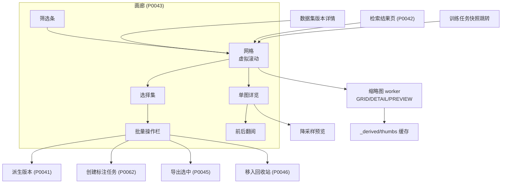
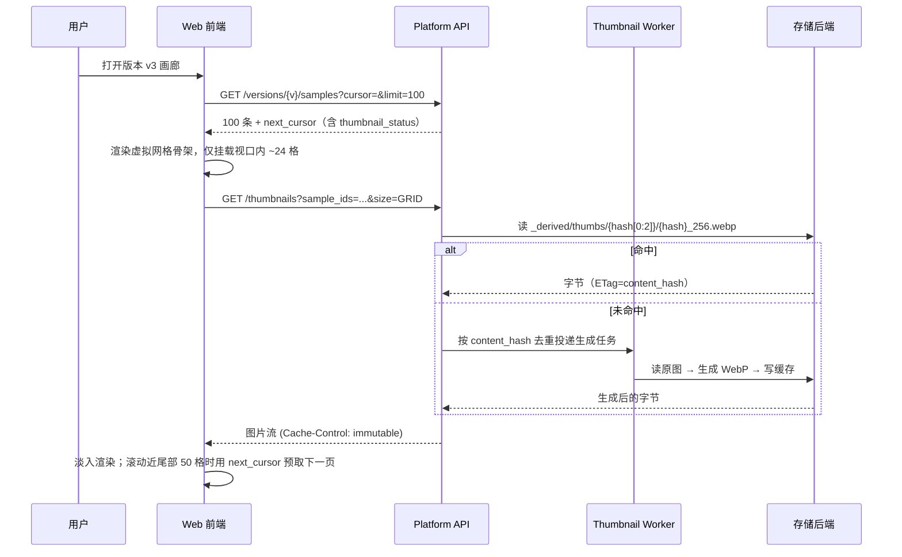
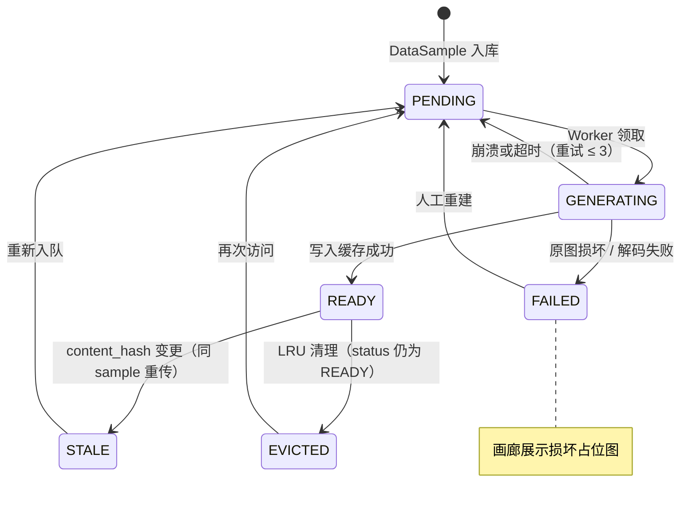
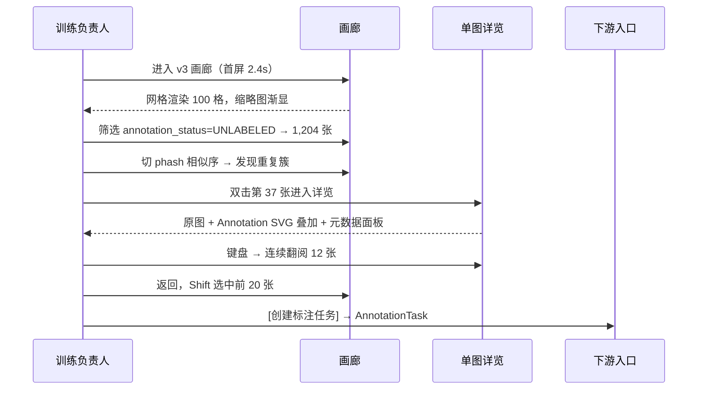

# PRD: P0043_数据预览与画廊 (Data Preview & Gallery)

| 属性 | 内容 |
| :--- | :--- |
| **文档编号** | P0043 |
| **项目名称** | 轻眸识刻 |
| **功能模块** | M03_数据管理 |
| **当前版本** | v1.0.0 |
| **文档状态** | Draft |
| **作者** | DataB |
| **最后更新** | 2026-10-01 |

---

## 1. 全局说明

> [!IMPORTANT]
> **核心定位**: 数据管理的「眼睛」。让 2~3 人团队在被导入的几十万张图片里，**3 秒看清一个版本里有什么**——缩略图秒开、原图可放大细看、标注可叠加核对、可批量圈选后直接进入下游动作（派生版本 / 派单 / 导出 / 删除）。

### 1.1 名词解释

| 术语 | 解释 |
| :--- | :--- |
| **DataSample（数据样本）** | 平台内可寻址的最小数据单元（一张图 / 抽帧后的一帧）。`data_samples` 通过 `file_id` 绑定 `ManagedFile`。本模块历史文档中的 "Asset" 已废弃。 |
| **DatasetVersion（数据集版本）** | 不可变快照，`status ∈ DRAFTING / READY / FROZEN / ARCHIVED`。画廊**永远在某个版本内浏览**，不存在跨版本混看。 |
| **DatasetVersionItem（版本成员项）** | `dataset_version_items(version_id, sample_id, split, group_key)`，画廊样本列表即由它 JOIN `data_samples` 得出。 |
| **Thumbnail（缩略图）** | 派生文件，两档：`GRID`（长边 256px WebP）与 `DETAIL`（长边 1024px WebP）。 |
| **content_hash** | 原图字节 sha256，同时作为缩略图文件名与 HTTP `ETag`，实现永久缓存。 |
| **Cursor Pagination（游标分页）** | 以 `(sort_key, sample_id)` 翻页替代 `OFFSET`，避免深分页全表扫描。 |
| **Virtual Scrolling（虚拟滚动）** | 只挂载视口 ±1 屏的网格单元 DOM，其余以占位撑高。 |
| **Overlay（标注叠加层）** | 覆盖在位图之上、随位图同源缩放的 SVG 图层，用于渲染 bbox / polygon / keypoint / OBB。 |
| **Selection Set（选择集）** | 一次浏览会话内勾选的样本集合，服务端以 `selection_sets` 行登记快照。 |
| **降采样预览** | 对长边 > 4096px 的图按需生成的中间图，避免浏览器直接解码超大位图。 |
| **Reading Order（翻阅序）** | 当前筛选下的稳定排序，默认 `created_at ASC, sample_id ASC`，可切 `phash 相似序` / `标注状态序`。 |

**规模假设**: 单版本典型 5 万、上限 50 万样本；单图典型 1920px / 1.5 MB，异常上限 20000px / 200 MB；并行浏览 ≤ 3 人；缩略图磁盘预算 ≈ 原图总量 8%。

### 1.2 统一异常处理（E34301–E34313）

| Code | 场景 | 处理策略 |
| :--- | :--- | :--- |
| `E34301` | 样本已被删除或不存在 | 画廊平滑摘除该格；详情页提示"该图片已被删除"并跳到相邻项 |
| `E34302` | 无该数据集读取权限 | 403，展示权限申请引导，不泄露数据集名称 |
| `E34303` | 原图损坏导致缩略图生成失败 | 渲染损坏占位图，不阻断同屏其他图片；计入 P0044 损坏文件数 |
| `E34304` | 存储不可达（MinIO 掉线 / 挂载丢失） | 缩略图 3 次重试（200ms/600ms/1.8s）后降级占位 + `[重试]` |
| `E34305` | 超出浏览器解码上限（长边 > 20000px 或 > 200 MB） | 拒绝原图直出，仅提供降采样预览与下载原件 |
| `E34306` | 选择集超过上限（10,000） | 阻止继续勾选，引导改用"全选筛选结果" |
| `E34307` | 游标失效（版本/筛选/排序变更） | 静默重置到第一页并 Toast 提示 |
| `E34308` | 翻阅时目标缺失（并发删除） | 自动跳过继续；连续 5 项缺失则中断并提示刷新 |
| `E34309` | 缩略图缓存目录不可写 | 降级为实时生成（限流 2 QPS）+ 告警，不阻断浏览 |
| `E34310` | 批量操作部分失败 | 返回 `{succeeded[], failed[{sample_id, code}]}`，失败项保留在选择集 |
| `E34311` | 缩略图生成队列积压 > 10 万条 | 网格显示"缩略图生成中 (x%)"，用低清占位渐显 |
| `E34312` | 选择 `phash 相似序` 但版本未算 phash | 回退默认序并提示"该版本尚未计算相似度索引" |
| `E34313` | 同一版本内同一 `group_key` 跨 `split` | 拒绝该次切分设置；提示"同一防泄漏分组必须归入同一 split" |

---

## 2. 项目背景

### 背景 (Context)
数据经 P0020~P0023 导入、由 P0041 固化为 `DatasetVersion` 后，团队面临的问题是**"我信任这批数据吗？"**：食品包装照片是否模糊、是否重复、生产日期区域是否被框全。这些判断只能靠**看**，表格与数字解决不了。

### 问题陈述 (Problem Statement)
1. **没有可视化入口**：数据只以文件名出现，无法快速判断质量，导致"带病训练"，一次 8 小时 GPU 白跑。
2. **大列表卡死**：5 万张图直接铺 ``，浏览器一次性发起 5 万请求，页面白屏。
3. **原图太大**：手机拍摄的 4000×3000 JPEG 直出，滚动解码瞬时上百 MB，3 分钟 OOM。
4. **标注看不见**：训练负责人无法在不打开标注器的情况下核对框是否贴合。
5. **批次操作低效**：挑出 300 张可疑图去重标，只能一张张点开。

### 目标与成功指标 (Goals & Success Metrics)
*   **北极星指标**: 进入版本到看见第一屏缩略图 **< 3 秒**（P95，冷缓存）。
*   **次要指标**: 缩略图缓存命中率 > 95%；滚动帧率 ≥ 55 FPS（5 万样本）；详览可缩放 < 1.5s（P95）；缩略图磁盘放大系数 < 8%。

### 风险与规避 (Risks & Mitigation)
| 风险 | 影响 | 规避方案 |
| :--- | :--- | :--- |
| 缩略图生成抢占 IO | 导入变慢 | worker 并发 ≤ 2，检测到 `ImportTask` 运行降到 1 |
| 超大版本卡顿 | 无法使用 | 强制虚拟滚动 + 游标分页，DOM 单元硬上限 200 |
| 缓存目录膨胀 | 磁盘写满 | 纳入 P0046 的 `derived_cache_gc`（90 天 LRU） |
| 原图直出崩溃浏览器 | 体验崩塌 | 长边 > 4096 一律走降采样预览，原图仅下载 |

---

## 3. 价值模型

*   **方案**: "派生缩略图 + 游标分页 + 虚拟滚动 + SVG 标注叠加"四件套。缩略图首次访问**懒生成**并永久缓存；原图永不直接进入网格；标注以向量层叠加，缩放不糊。
*   **目标**: 把"看数据"从"开文件夹翻照片"变成"3 秒扫一屏、10 分钟核完一个版本"，并让**批量圈选**成为所有下游动作的统一起点。

---

## 4. 项目范围

### 4.1 功能结构图



### 4.2 In Scope / Out of Scope

**In Scope**: ① 画廊网格（虚拟滚动、懒加载、稳定翻页）② 单图详览（缩放拖拽、标注叠加、元数据面板）③ 版本内前后翻阅（`←/→`、`J/K`、±3 预取）④ 批量选中（单击 / `Shift` 区间 / `Ctrl` 多选 / 全选筛选结果）⑤ 批量操作入口（派生版本、建标注任务、导出、删除、打标签、设置切分）⑥ 缩略图生成与缓存 ⑦ 渲染上限与降级。

**Out of Scope**: 图片编辑（裁剪/旋转/调色）；画廊内修改标注（叠加层只读，需进 P0060）；视频播放（抽帧后以 `VIDEO_FRAME` 图片入库）；跨版本双栏 diff（属 P0041）；在线质量评分（模糊/重复检测在 P0023 完成）；移动端 Web 画廊（端侧由 P0120/P0121 自裁）。

---

## 5. 业务流程

### 5.1 画廊首屏加载



### 5.2 缩略图生命周期



---

## 6. 用户分析

### 6.1 用户画像

| 角色 | 核心诉求 | 痛点 |
| :--- | :--- | :--- |
| **训练负责人 (TRAINER)** | "10 分钟内确认 5 万张图没有一片模糊、日期框没漏框" | 没有批量看图与圈选入口，只能抽样打开标注器 |
| **标注员 (ANNOTATOR)** | "先扫一眼这批图长什么样" | 标注器只能一张张切，缺全局感知 |
| **管理员 (ADMIN)** | "找出重复和损坏的图批量删掉" | 只能按文件名猜，删错还要恢复 |
| **只读访客 (VIEWER)** | 查看与评审 | 无（但不得有勾选后执行写操作的能力） |

### 6.2 用户链路图



---

## 7. 功能需求

### M03.F01 画廊网格 (Gallery Grid)

*   **用户故事**: 作为训练负责人，我希望以网格方式快速浏览一个版本的全部样本，滚动不卡、图片渐显，以便在几分钟内建立对数据质量的整体判断。
*   **逻辑与业务规则**:
    *   **前置条件**: 用户对该数据集具备 `VIEWER` 及以上权限；`DatasetVersion.status ∈ {DRAFTING, READY, FROZEN}`。
    *   **主流程**: ① 请求 `limit=100` 游标分页（`dataset_version_items` JOIN `data_samples`）② 按容器宽度计算列数（单元最小宽 180px，最多 12 列）③ 虚拟滚动挂载视口 ±1 屏 ④ 单元进入视口前 200px 触发缩略图（`IntersectionObserver`，`rootMargin: 200px`）⑤ 加载前显示主色占位（`DataSample.dominant_color`）⑥ 滚近尾部 50 格时预取下一页。
    *   **单元信息密度**: `仅缩略图` / `缩略图 + 文件名` / `缩略图 + 状态角标 + 类别色点`（默认最后一档）。角标取 `DataSample.annotation_status`：`UNLABELED` 灰、`LABELED` 蓝、`VERIFIED` 绿、`REJECTED` 红；右下角显示该样本在当前版本的 `Annotation` 条数。
    *   **后置条件**: 浏览位置（version_id + 游标 + 排序）写 `view_preferences`，下次进入可恢复。
    *   **权限**: `VIEWER` 可浏览与详览，但网格**不显示勾选框**。
*   **验收标准**:

```gherkin
场景: 5 万样本版本的网格首屏
  Given 版本 v3 的 dataset_version_items 含 50,000 行且缩略图冷缓存
  When 用户打开画廊
  Then 3 秒内渲染出第一屏网格骨架
  And DOM 中的网格单元节点数 ≤ 200
  And 视口内格子 1 秒内开始渐显

场景: 滚动不重复请求
  Given 用户已加载前 200 条
  When 用户向下滚动 3 屏
  Then 只发起 1 次新的游标分页请求
  And 已加载的缩略图命中 HTTP 缓存不再请求
```

*   **边界情况与异常处理**:

| 场景 | 处理 |
| :--- | :--- |
| 版本为空（0 条 members） | 空态插画 + "该版本无数据，前往 P0042 检索或重新导入" |
| 滚动极快（甩动） | 用 `AbortController` 取消未进入视口的请求，避免请求风暴 |
| 筛选结果在浏览中变化 | 保留滚动位置，Toast 提示"筛选已更新，共 x 张"，用户主动刷新才重排 |
| 窗口缩放导致列数突变 | 保持"首张可见图"位置不变，重算偏移 |

### M03.F02 单图详览 (Sample Detail Viewer)

*   **用户故事**: 作为训练负责人，我希望双击后能放大细看像素级细节并看到已有标注是否贴合，以便判断这张图是否需要返工。
*   **逻辑与业务规则**:
    *   **前置条件**: 用户有该版本读取权限。
    *   **主流程**: ① 打开全屏遮罩（右侧 320px 元数据面板）② 先显示 `DETAIL` 缩略图，同时异步请求原图或降采样预览 ③ 位图用 CSS `transform: translate/scale`，滚轮以光标为锚点缩放，拖拽平移 ④ 叠加层为同尺寸 SVG，`viewBox="0 0 {width} {height}"`，线宽用 `vector-effect: non-scaling-stroke` ⑤ 缩放范围 `fit`~`16x`，双击在 `fit` 与 `1:1` 间切换。
    *   **元数据面板**: 文件名、分辨率、格式、大小、`content_hash` 前 16 位、来源（`capture_task_id` / `import_task_id` 指向的 `CaptureTask` / `ImportTask`）、EXIF 关键项（拍摄时间 / 型号 / GPS）、入库时间、所属版本、`split`、标注摘要（按 `LabelClass` 计数 + `Annotation.transcription`）、相似图入口。
    *   **原图直出规则**: 长边 ≤ 4096px 且 ≤ 30 MB 直出；否则用降采样预览（长边 ≤ 4096）并提示"当前为降采样预览，下载可获取原件"。
    *   **叠加开关**: 显示标注（默认开）/ 类别名（默认关）/ 转写（默认关，仅 `transcription` 非空可用）/ 高亮当前类别。
    *   **后置条件**: 无写入。**权限**: `VIEWER` 可看全部；`[编辑标注]` 仅 `ANNOTATOR`/`TRAINER`/`ADMIN` 可见，跳转 P0060 并带 `sample_id` 定位。
*   **验收标准**:

```gherkin
场景: 大图缩放与标注对齐
  Given 样本 S 为 4032x3024，含 2 条 bbox 类型的 Annotation
  When 用户打开详览并放大到 400%
  Then 叠加层 bbox 仍与图中目标严格对齐
  And 框线保持 2px 屏幕像素不随缩放变粗

场景: 超大图降级
  Given 样本长边 12000px、大小 180MB 的 PNG
  When 用户打开详览
  Then 加载降采样预览（长边 4096）
  And 面板提示"当前为降采样预览"并提供 [下载原件]
```

*   **边界情况与异常处理**:

| 场景 | 处理 |
| :--- | :--- |
| 原图读取失败（`E34304`） | 显示 DETAIL 缩略图 + 错误条 + `[重试]`，不空白 |
| 标注坐标越界 | 按图片边界裁剪显示，面板标注"1 条标注超出画布" |
| 非 Web 友好格式（CMYK / 16-bit TIFF） | 服务端转码 PNG 预览，面板标注"已转码预览" |
| `file_id` 指向的 ManagedFile 已 `DELETED` | 显示"原件已回收"占位，若有缩略图则展示缩略图 |

### M03.F03 版本内前后翻阅 (Sequential Navigation)

*   **用户故事**: 作为标注员，我希望在详览里用键盘连续翻看，不用退回网格再点开，以便快速扫过整批数据。
*   **逻辑与业务规则**:
    *   **前置条件**: 详览已打开且存在翻阅上下文（进入时的筛选条件 + 阅读序 + 游标）。
    *   **主流程**: ① `→`/`J` 下一张，`←`/`K` 上一张，`Esc` 返回网格，`Space` 切原图/适配 ② 前端维护 `[idx-3, idx+3]` 的 DETAIL 预取窗口 ③ 到当前页边界时以游标双向各取 100 条补充 ④ 切换时叠加层与元数据同步刷新，未就绪则显示骨架。
    *   **上下文继承**: 翻阅严格遵循进入详览时的筛选与排序；进入后改筛选会使上下文失效，弹窗确认"重新开始翻阅？"。
    *   **边界行为**: 到首/末张时不再前进并轻提示，**不循环**。
    *   **后置条件**: 位置写入 `view_preferences.last_sample_id`。
*   **验收标准**:

```gherkin
场景: 键盘连续翻阅流畅
  Given 用户在详览第 100 张且已预取 97~103
  When 连续按 → 5 次
  Then 每次切换 ≤ 200ms 显示下一张
  And 不出现空白加载态

场景: 翻阅不跳过筛选外数据
  Given 当前筛选为 annotation_status=UNLABELED，共 1,204 张
  When 翻阅到第 1,204 张后再按 →
  Then 提示"已到末尾"且不跳到已标注图片
```

*   **边界情况与异常处理**:

| 场景 | 处理 |
| :--- | :--- |
| 下一张被并发删除（`E34308`） | 跳过并 Toast"1 张已被删除"；连续 5 张缺失则中断 |
| 预取窗口全部未就绪 | 显示当前样本 DETAIL 缩略图，不阻塞键盘操作 |
| 版本状态被并发改为 `ARCHIVED` | 上下文失效，提示"版本状态已变更，请刷新" |

### M03.F04 批量选中与批量操作 (Selection & Bulk Actions)

*   **用户故事**: 作为管理员，我希望在画廊里成片勾选可疑图片并一次性处理，以便不用逐张点开。
*   **逻辑与业务规则**:
    *   **前置条件**: 用户角色 ≥ `TRAINER`（`VIEWER` 无勾选框）。
    *   **交互方式**: 单击勾选；`Shift`+单击做锚点到当前的区间全选（跨页有效）；`Ctrl/Cmd`+单击追加/移除；空白处拖拽框选；**全选**选中当前筛选结果全集。
    *   **选择集模型**: `SelectionSet.mode ∈ {EXPLICIT, FILTER}`；`EXPLICIT` 存 `sample_ids`（≤ 10,000，`E34306`）；`FILTER` 以 `{filter_hash, filter_expr, excluded_ids}` 表达，不传输 id。
    *   **批量操作入口**: 派生新版本（P0041，原版本不变）/ 创建标注任务（P0062）/ 导出选中（先建瞬态 FROZEN 版本，走 P0045）/ 移入回收站（走 P0046 影响面预览 + 二次确认）/ 打标签 / 设置切分（更新 `dataset_version_items.split`，**按 `group_key` 整体归边**防泄漏；同版本内同 `group_key` 跨 split 直接拒绝并返回 `E34313`）。
    *   **后置条件**: 提交后选择集默认清空；有失败项时仅保留失败项。
    *   **权限**: `VIEWER` 无选择集；`ANNOTATOR` 只能创建标注任务，不能删除或导出。
*   **验收标准**:

```gherkin
场景: 全选筛选结果不传输 id
  Given 当前筛选结果共 47,320 张
  When 用户点击 [全选筛选结果]
  Then 操作栏显示 "已选择 47,320 张"
  And SelectionSet.mode = FILTER，页面内存增量 < 1 MB

场景: 批量删除走影响面预览
  Given 用户选中 5,000 张并点击 [移入回收站]
  When 系统返回影响面预览
  Then 显示受影响版本、关联 TrainTask、占用空间
  And 要求输入数据集名称确认
  And 用户取消后不产生任何删除
```

*   **边界情况与异常处理**:

| 场景 | 处理 |
| :--- | :--- |
| 选择集中部分样本被并发删除 | 提交前服务端校验，返回 `failed[]`（`E34301`），提示"3 张已被删除，其余继续" |
| 选择集跨多个版本（`FILTER`） | 允许；导出时按版本分组创建多个瞬态版本，产出多个导出任务 |
| 拖拽框选误触发原生图片拖拽 | 网格容器 `draggable=false` + `preventDefault` |
| 10,000 张批量打标签超时 | 转异步任务，操作栏显示进度，结果写 `AuditLog` |

### M03.F05 缩略图生成与缓存 (Thumbnail Pipeline)

*   **用户故事**: 作为开发者，我希望缩略图按需生成并永久缓存，以便第二次浏览几乎零延迟，同时不把磁盘撑爆。
*   **逻辑与业务规则**:
    *   **前置条件**: `DataSample.file_id` 指向的 `ManagedFile.status = COMMITTED` 且 `mime_type` 以 `image/` 开头。
    *   **派生规格**:

        | 档位 | 长边 | 格式 | 质量 | 命名 | 用途 |
        | :--- | :--- | :--- | :--- | :--- | :--- |
        | `GRID` | 256px | WebP | 78 | `{hash[0:2]}/{hash}_256.webp` | 画廊网格 |
        | `DETAIL` | 1024px | WebP | 82 | `{hash[0:2]}/{hash}_1024.webp` | 详览渐显 |
        | `PREVIEW` | 4096px | JPEG | 88 | `{hash[0:2]}/{hash}_4096.jpg` | 超大图降采样 |

    *   **生成时机**: **懒生成**。首次请求 `GRID` 时投递；`DETAIL` 进详览时投递；`PREVIEW` 仅对长边 > 4096px 的图生成。
    *   **去重与缓存**: 任务以 `(content_hash, size)` 唯一去重；缓存落 `{StorageConfig.path_prefix}/_derived/thumbs/`，**不产生 `ManagedFile`**，纳入 P0046 的 `derived_cache_gc`；响应带 `ETag: {content_hash}-{size}` 与 `Cache-Control: public, max-age=31536000, immutable`。
    *   **失效与清理**: 仅当 `content_hash` 变更时置 `STALE`；每日 04:00 清理 90 天未访问的 `DETAIL`/`PREVIEW`（`GRID` 不清理），只删文件不改 `sample_thumbnails.status`。
    *   **失败语义**: 失败重试 3 次（退避 2s/10s/60s），仍失败置 `FAILED` 且**不再自动重试**，画廊显示损坏占位，并计入 P0044 损坏文件数。
*   **验收标准**:

```gherkin
场景: 懒生成与二次命中
  Given 版本 v3 从未被浏览过
  When 用户打开画廊
  Then 仅视口附近的缩略图进入生成队列，队列长度 ≤ 300
  When 5 分钟后再次打开同一画廊
  Then 全部命中缓存且首屏就绪 < 1 秒

场景: 生成失败不阻塞
  Given 一张图片文件已损坏
  When 缩略图生成重试 3 次均失败
  Then sample_thumbnails.status = FAILED
  And 画廊其他图片不受影响
```

*   **边界情况与异常处理**:

| 场景 | 处理 |
| :--- | :--- |
| 缓存目录磁盘写满 | 停止生成，画廊降级占位 + 顶部提示；触发 `Alert`（P0132） |
| 原图小于目标尺寸 | 不放大；`GRID` 档允许放大以统一观感，记 `upscaled=true` |
| EXIF 含旋转标记 | 生成时按 EXIF 旋转；`DataSample.width/height` 落库时已按视觉方向归一 |
| Worker 崩溃 | 任务超时 120s 回 `PENDING`；服务启动时扫描超时的 `GENERATING` 重新入队 |

### M03.F06 渲染上限与降级 (Render Limits & Degradation)

*   **用户故事**: 作为开发者，我希望明确渲染上限，以便任何规模的数据下页面都不崩溃。
*   **逻辑与业务规则**（硬性上限，代码中以常量集中定义）:

    | 限制项 | 阈值 | 超限行为 |
    | :--- | :--- | :--- |
    | 网格 DOM 单元数 | 200 | 强制虚拟滚动，仅挂载视口 ±1 屏 |
    | 单次分页条数 | 100（默认）/ 300（上限） | 请求超限则截断到 300 |
    | 缩略图并发请求 | 8（`GRID`）/ 2（`DETAIL`） | 超出进入前端队列，按视口优先级排队 |
    | 详览位图解码上限 | 长边 4096px 或 33 MP | 超过走 `PREVIEW` 降采样 |
    | 浏览器原图直出上限 | 长边 20000px 或 200 MB | 拒绝（`E34305`），仅提供下载 |
    | 选择集上限 | 10,000（`EXPLICIT`） | 阻止并引导切为 `FILTER` 模式 |
    | 相似序结果集 | 20,000 | 超出按 phash 分桶，仅对当前桶排序 |
    | 详情面板标注列表 | 200 条 | 折叠为"共 N 条，显示前 200" |

    *   **内存保护**: 切换第 N 张时释放第 N-3 张之前的位图解码缓存（`URL.revokeObjectURL`），常驻位图 ≤ 3 张。
    *   **降级顺序**: 缩略图缺失 → 主色占位；原图不可用 → DETAIL；DETAIL 不可用 → GRID；全不可用 → 损坏占位 + 重试。
*   **验收标准**:

```gherkin
场景: 超大版本仍可浏览
  Given 版本含 500,000 条 dataset_version_items
  When 用户打开画廊并快速滚动 30 秒
  Then 页面内存稳定在 500 MB 以内
  And 无卡死或白屏且滚动 FPS ≥ 45

场景: 原图直出保护
  Given 一张 24000x12000 的 PNG
  When 用户尝试打开详览
  Then 不请求原图，改用 PREVIEW 降采样
  And 提示"原图超出浏览器解码上限，已使用降采样预览"
```

*   **边界情况与异常处理**:

| 场景 | 处理 |
| :--- | :--- |
| 高 DPI 屏（devicePixelRatio = 3） | 请求 `GRID@2x`（512px）；DSF ≤ 1.5 时用 256px |
| 浏览器不支持 WebP | 服务端按 `Accept` 协商回退 JPEG，缓存路径加 `_jpg` 后缀 |
| 网络为 2G / 省流量模式 | 不加载 `DETAIL`，只显示 `GRID` 并阻止自动预取 |
| 页面切到后台标签 | 暂停预取与缩略图请求，减少无谓 IO |

---

## 8. 技术架构与数据模型

> **命名契约**: 采用全局实体命名契约。`DataSample` / `DatasetVersionItem` 由 P0041 定义，带 ★ 者为 P0043 提出的补充字段（需回写 P0041 定稿）。本模块新增 `SampleThumbnail` / `SelectionSet` / `ViewPreference`。通用字段 `id / created_at / updated_at / deleted_at` 全表统一。

### 8.1 数据实体

**Table: `data_samples`（DataSample，P0041 定义，摘录画廊相关字段）**

| 字段名 | 类型 | 必填 | 说明 | 约束 |
| :--- | :--- | :--- | :--- | :--- |
| `id` | UUID | Y | 主键 | PK |
| `dataset_id` | UUID | Y | 所属数据集 | FK → datasets |
| `file_id` | UUID | Y | 绑定 `ManagedFile` | FK |
| `width` / `height` | Int | Y | 视觉宽高（已应用 EXIF 旋转） | > 0 |
| `format` | Enum | Y | `JPEG`/`PNG`/`WEBP`/`BMP`/`TIFF`/`GIF` | |
| `size_bytes` | BigInt | Y | 原图字节数 | > 0 |
| `source_type` | Enum | Y | `CAPTURE`/`UPLOAD`/`ARCHIVE`/`VIDEO_FRAME`/`STANDARD_DATASET` | 取值由 P0003/P0020-P0022 定稿 |
| `capture_task_id` | UUID | N | 来源采集任务 | FK；与 `import_task_id` 二选一 |
| `import_task_id` | UUID | N | 来源导入任务（含抽帧、解压、格式解析） | FK；**不使用多态 `batch_id`** |
| `annotation_status` | Enum | Y | `UNLABELED`/`LABELED`/`VERIFIED`/`REJECTED` | INDEX，默认 `UNLABELED` |
| `annotation_hash` | String(64) | N | 标注内容哈希 | |
| `is_hard_example` | Bool | Y | 难例回流标记 | 默认 false |
| `group_key` | String | N | **防泄漏分组身份的唯一真源**（同视频 / 同采集批次 / 同会话 / 同 SKU），由 P0022/P0003 写入 | INDEX |
| `frame_index` / `timestamp` / `sampling_fps` / `source_video_id` / `pts_fallback` | — | N | 抽帧血缘字段，**全部挂 DataSample**（由 P0022 写入） | |
| ★ `content_hash` | String(64) | Y | 原图 sha256（缩略图缓存键） | INDEX |
| ★ `phash` | BigInt | N | 感知哈希（相似序依据） | INDEX |
| ★ `dominant_color` | String(7) | N | 主色 `#RRGGBB` | |
| ★ `exif` | JSONB | N | EXIF 子集（拍摄时间/型号/GPS/Orientation） | |

**Table: `dataset_version_items`（DatasetVersionItem，P0041 定义）**

| 字段名 | 类型 | 必填 | 说明 | 约束 |
| :--- | :--- | :--- | :--- | :--- |
| `id` | UUID | Y | 主键 | PK |
| `version_id` | UUID | Y | 所属版本 | FK, UNIQUE(`version_id`,`sample_id`) |
| `sample_id` | UUID | Y | 成员样本 | FK → data_samples |
| `split` | Enum | Y | `TRAIN`/`VAL`/`TEST`/`UNASSIGNED` | 默认 `UNASSIGNED` |
| `group_key` | String | N | **版本创建时从 `DataSample.group_key` 拷贝的快照副本**（保证已冻结版本自洽）；同一 `version_id` 内同一 `group_key` 不得跨 `split` | INDEX |

**Table: `sample_thumbnails`（SampleThumbnail，本模块新增）**

| 字段名 | 类型 | 必填 | 说明 | 约束 |
| :--- | :--- | :--- | :--- | :--- |
| `id` / `sample_id` | UUID | Y | 主键 / 所属样本 | UNIQUE(`sample_id`,`size`) |
| `size` | Enum | Y | `GRID`/`DETAIL`/`PREVIEW` | |
| `format` | Enum | Y | `WEBP`/`JPEG` | |
| `width` / `height` / `byte_size` | Int/BigInt | Y | 派生图尺寸与大小 | |
| `cache_path` | String | Y | 相对 `_derived/thumbs/` 的路径 | |
| `status` | Enum | Y | `PENDING`/`GENERATING`/`READY`/`FAILED`/`STALE`/`EVICTED` | INDEX |
| `upscaled` | Bool | Y | 是否由放大小图得到 | 默认 false |
| `retry_count` | Int | Y | 已重试次数 | ≤ 3 |
| `last_accessed_at` / `generated_at` | timestamptz | N | LRU 依据 / 生成时间 | |

**Table: `selection_sets`（SelectionSet，本模块新增）**

| 字段名 | 类型 | 必填 | 说明 | 约束 |
| :--- | :--- | :--- | :--- | :--- |
| `id` | UUID | Y | 主键 | PK |
| `version_id` | UUID | N | 来源版本（`FILTER` 跨版本时为空） | FK |
| `mode` | Enum | Y | `EXPLICIT`/`FILTER` | |
| `sample_ids` | JSONB | N | `EXPLICIT` 模式 id 数组 | ≤ 10,000 |
| `filter_hash` / `filter_expr` / `excluded_ids` | — | N | `FILTER` 模式的条件与排除项 | |
| `resolved_count` | Int | Y | 提交时解析出的实际数量 | |
| `created_by` | UUID | Y | 创建者 | FK → users |
| `expires_at` | timestamptz | Y | 有效期 | 默认 +24h |

**Table: `view_preferences`（ViewPreference，本模块新增）**

| 字段名 | 类型 | 必填 | 说明 | 约束 |
| :--- | :--- | :--- | :--- | :--- |
| `id` / `user_id` / `version_id` | UUID | Y | 主键 / 用户 / 版本 | UNIQUE(`user_id`,`version_id`) |
| `last_sample_id` | UUID | N | 最后浏览的样本 | |
| `sort_mode` | Enum | Y | `READING`/`PHASH`/`ANNOTATION_STATUS` | |
| `cell_density` | Enum | Y | `MINIMAL`/`WITH_NAME`/`FULL` | |

---

## 9. UI/UX 规格说明

### 9.1 画廊网格

```text
+---------------------------------------------------------------------------+
| 数据集: 包装日期检测  版本: v3 (FROZEN, tag=baseline)  [切换版本 ▾]        |
| 筛选: annotation_status=UNLABELED ✕ | source_type=CAPTURE ✕ | 阅读序 ▾    |
| 共 1,204 张 · 已选 20 张                    [全选筛选结果] [缩略图密度 ▾]  |
+---------------------------------------------------------------------------+
| +---------+  +---------+  +---------+  +---------+  +---------+           |
| | ●3   ☑  |  | ●0   ☐  |  | ●2   ☐  |  | ●1   ☐  |  | ●4   ☐  |           |
| | [thumb] |  | [thumb] |  | [thumb] |  | [加载中] |  | [主色块] |           |
| | IMG_0421|  | IMG_0422|  | IMG_0423|  | IMG_0424|  | IMG_0425|           |
| +---------+  +---------+  +---------+  +---------+  +---------+           |
|  灰=UNLABELED 蓝=LABELED 绿=VERIFIED 红=REJECTED     ● 类别色点           |
+---------------------------------------------------------------------------+
| 已选 20 张 [派生版本][创建标注任务][导出][打标签][设置切分][移入回收站]     |
+---------------------------------------------------------------------------+
```

### 9.2 交互元素与快捷键

| 元素 | 类型 | 状态 | 行为 |
| :--- | :--- | :--- | :--- |
| 网格单元 | Grid Cell | Default/Hover/Selected/Loading/Error | 单击=详览；`Ctrl`+单击=追加；`Shift`+单击=区间 |
| 缩略图密度 | Segmented | MINIMAL/WITH_NAME/FULL | 切换后重建虚拟列表并保持滚动锚点 |
| 排序选择器 | Select | READING/PHASH/ANNOTATION_STATUS | 变更后回第一页（`E34307`） |
| 底部操作栏 | Action Bar | Hidden/Visible | 选择集非空时滑入 |
| 详览缩放控件 | Slider + Buttons | fit ~ 16x | 以画布中心为锚点缩放 |
| 叠加开关 | Checkbox Group | On/Off | 切换 SVG 图层可见性 |
| 损坏占位 | Placeholder | Error | "图片损坏"图标 + `[查看详情]` |

快捷键：`←`/`K` 上一张，`→`/`J` 下一张，`Esc` 关闭/清空选择，`Space` 适应窗口 ↔ 100%，`0` 适应窗口，`1` 100%，`A` 全选筛选结果，`Shift`+`A` 清空选择，`G` 切换密度。

---

## 10. 非功能性需求 (NFR)

*   **性能 (Performance)**: 画廊 TTI P95 < 3s（冷缓存 / 5 万样本 / 本地存储）；缩略图接口 P95 < 80ms（本地命中）/ < 400ms（MinIO）；缩略图首次生成 P95 < 1.2s/张；详览可缩放 P95 < 1.5s；连续翻阅切换 < 200ms；滚动 FPS ≥ 55。
*   **容量 (Capacity)**: 单版本可浏览上限 50 万样本，超出引导按来源/时间分批；缩略图缓存体积 ≤ 原图总量 8%。
*   **安全 (Security)**: 图片访问必须经鉴权接口，**不暴露存储直链**；如必须直链，预签名 URL ≤ 5 分钟。权限矩阵：`VIEWER` 只读；`ANNOTATOR` 只读 + 建标注任务；`TRAINER` 全部批量操作（除物理删除）；`ADMIN` 全部。元数据面板不展示 `storage_path` 与 `StorageConfig` 凭据。
*   **可靠性 (Reliability)**: 单图失败不影响同屏其他图片（逐格错误边界）；worker 崩溃后 120s 内自动重新入队；存储不可用时降级为占位图并给出明确原因，不表现为空白页。
*   **兼容性 (Compatibility)**: 支持 Chrome / Edge / Safari 最新两个大版本；不支持 IE 与移动端 Web（窄屏仅提供简化列表视图）。格式支持 JPEG / PNG / WebP / BMP / GIF（首帧）/ TIFF（服务端转码）。
*   **可扩展性 (Scalability)**: 缩略图 worker 并发与限流可配置（默认并发 2、QPS 20）；新增派生档位只需在档位表登记。

---

## 附录: 已确认的设计决策

| 决策项 | 结论 |
| :--- | :--- |
| 实体命名 | 严格遵守全局契约：`DataSample` / `DatasetVersion` / `DatasetVersionItem` / `ManagedFile` / `StorageConfig` / `Annotation` / `AnnotationTask` / `TrainTask` / `LabelClass`；**不使用 "Asset" 作为实体名** |
| 来源字段 | `DataSample` 用 `capture_task_id` / `import_task_id` 两个可空外键，**不使用多态 `batch_id`** |
| 异常码格式 | `E` + 模块号(1) + P 编号后两位(2) + 流水(2)；本文档占用 `E34301`–`E34313` |
| 切分与防泄漏 | `split ∈ {TRAIN, VAL, TEST, UNASSIGNED}`；**`DataSample.group_key` 是分组身份唯一真源**，`DatasetVersionItem.group_key` 是版本创建时的快照副本；批量设置切分按 `group_key` 整体归边，同版本内同组跨 split 拒绝（`E34313`） |
| 浏览粒度 | 画廊**必须**绑定 `DatasetVersion`，不提供跨版本混看 |
| 缩略图生成时机 | **懒生成**（首次访问触发），不做导入期全量预生成 |
| 缩略图档位与命名 | `GRID` 256px WebP / `DETAIL` 1024px WebP / `PREVIEW` 4096px JPEG；以 `content_hash` 命名，天然去重与永久缓存 |
| 缓存目录 | `{StorageConfig.path_prefix}/_derived/thumbs/`，**不产生 ManagedFile**，纳入 P0046 的 `derived_cache_gc` |
| 分页方式 | 服务端**游标分页**，禁用 `OFFSET` 深分页 |
| 渲染上限 | DOM 单元硬上限 200；原图直出阈值长边 4096px 且 ≤ 30 MB；解码硬上限 20000px / 200 MB |
| 详览是否可改标注 | **不可**，只读叠加；修改跳转 P0060 |
| 选择集上限 | `EXPLICIT` 10,000；`FILTER` 模式以条件表达式表达，无 id 传输 |
| 批量导出路径 | 先创建**瞬态 FROZEN 版本**再导出，保证 manifest 与版本哈希绑定（P0045） |
| LRU 清理范围 | 仅清理 90 天未访问的 `DETAIL`/`PREVIEW`；`GRID` 不清理 |
| 缩略图失败语义 | 重试 3 次后永久 `FAILED`，不自动重试，需人工重建 |
| 移动端 | 不做移动端 Web 画廊；端侧预览由 P0120 / P0121 自行裁剪 |

---

## 关联文档

*   **P0041_数据集与版本**: `DatasetVersion` / `DatasetVersionItem` / `DatasetVersionTag` 定义与不可变语义
*   **P0042_数据检索与筛选**: 画廊筛选条件与阅读序来源
*   **P0044_数据统计看板**: 缩略图失败数、损坏文件数汇入统计口径
*   **P0045_数据集导出**: 选择集 → 瞬态版本 → 导出任务
*   **P0046_数据回收与GC**: 批量删除影响面预览、`_derived/` 缓存回收
*   **P0060_标注器与标注几何 / P0062_标注任务与派单**: 详览"编辑标注"跳转与批量派单
*   **P0132_告警中心**: 缩略图缓存磁盘写满、存储不可达告警

---

## Changelog

| 版本 | 日期 | 作者 | 变更说明 |
| :--- | :--- | :--- | :--- |
| v1.0.0 | 2026-10-01 | DataB | 初稿：画廊网格、单图详览、前后翻阅、批量选中、缩略图管线与缓存、渲染上限 |
| v1.1.0 | 2026-10-01 | DataB | 对齐 `group_key` 归属裁定（`DataSample` 为真源、版本侧为快照副本）；新增 `E34313`（同版本内相同 `group_key` 跨 split）；补充抽帧血缘字段归属 |
