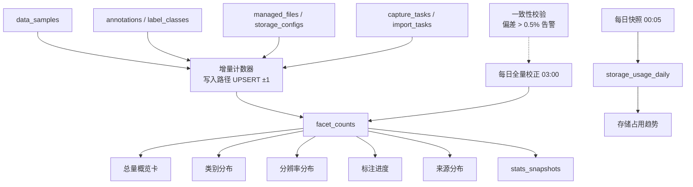
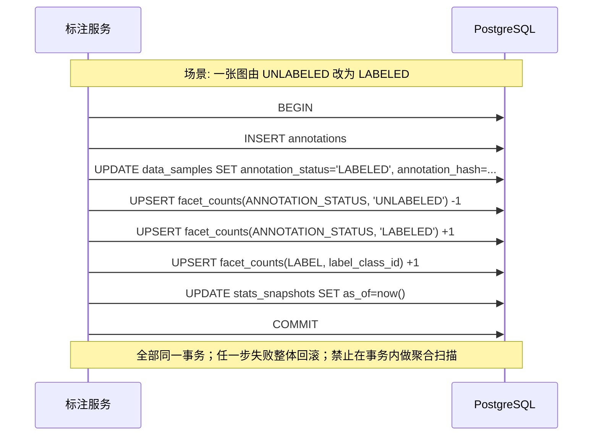
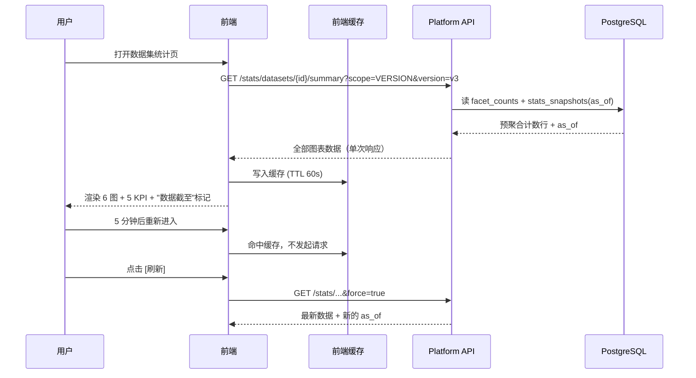
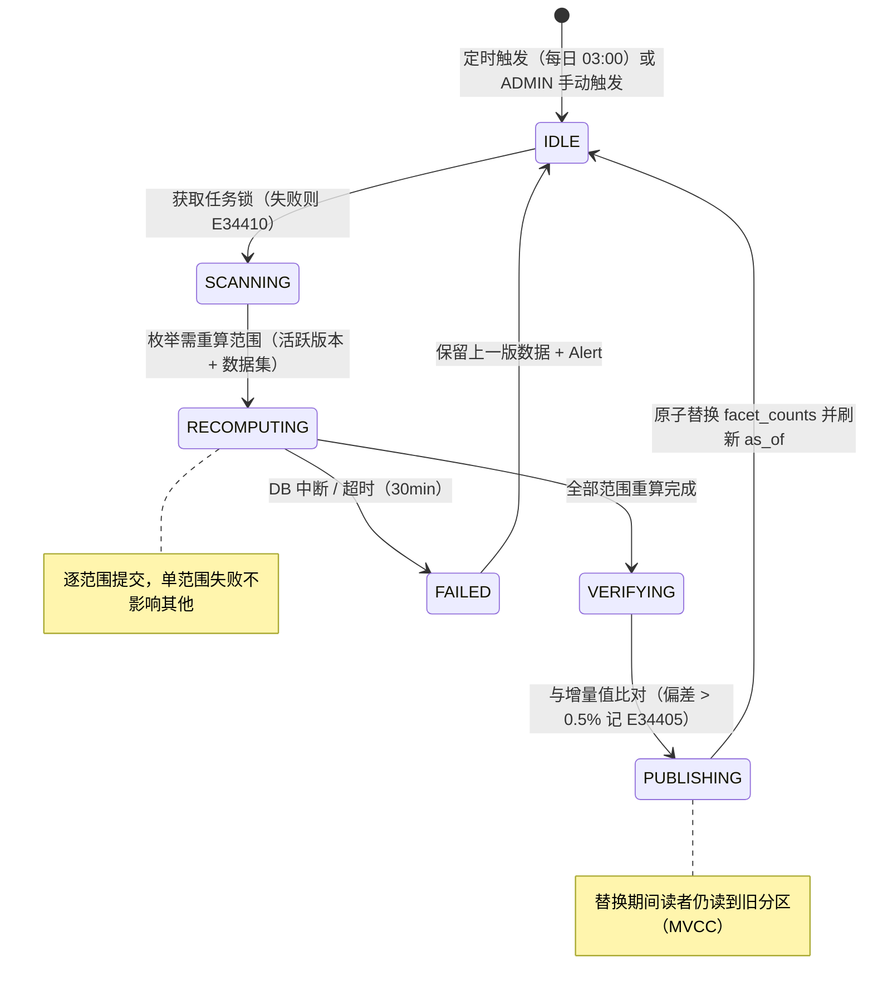
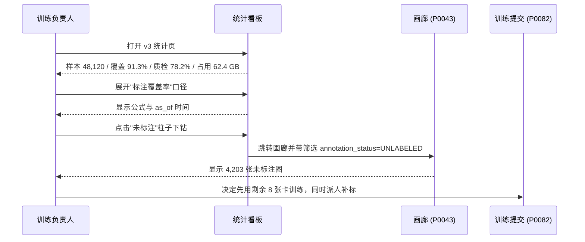

# PRD: P0044_数据统计看板 (Data Statistics Dashboard)

| 属性 | 内容 |
| :--- | :--- |
| **文档编号** | P0044 |
| **项目名称** | 轻眸识刻 |
| **功能模块** | M03_数据管理 |
| **当前版本** | v1.0.0 |
| **文档状态** | Draft |
| **作者** | DataB |
| **最后更新** | 2026-10-01 |

---

## 1. 全局说明

> [!IMPORTANT]
> **核心定位**: 数据资产的**体检报告**。回答"够不够、偏不偏、能不能开训"三个问题——数量够不够、类别分布偏不偏、标注覆盖到没到开训线、磁盘还撑不撑得住。
>
> **口径纪律**: 每个数字都可在 UI 上悬停查看定义；**同一指标只允许一个口径**，禁止在不同图表对同一名词给出两种算法。

### 1.1 名词解释

| 术语 | 解释 |
| :--- | :--- |
| **统计范围 (Scope)** | `scope_type ∈ {DATASET, VERSION, GLOBAL}`；默认进入 **VERSION** 视角。 |
| **口径 (Metric Definition)** | 指标的计算公式与过滤条件，权威定义见 8.2 口径表，UI 悬停复用同一份文案。 |
| **Facet Count（维度计数）** | 预聚合行 `(scope_type, scope_id, facet_type, facet_key) → count`。看板读它，不实时跑 `GROUP BY`。 |
| **增量维护** | 数据变更时在同一事务内 `UPSERT ±1` 更新 `facet_counts`。 |
| **全量校正** | 每日 03:00 按源表重算 `facet_counts`，修正增量维护的漂移。 |
| **版本去重占用** | 版本内样本引用的 `ManagedFile` 按 `id` 去重后的 `size_bytes` 之和。 |
| **物理占用** | 存储上实际占用的字节，按 `ManagedFile.id` 去重，分列 `COMMITTED` / `PENDING` / 回收站。 |
| **估算值 (Estimated)** | 范围超 50 万样本或存储不可达时的采样/记账值，图表必须打 `估算` 角标。 |
| **as_of（数据截至时间）** | 看板顶部时间戳，等于最近一次增量更新或全量校正的时间。 |

**规模假设**: 全局样本典型 50 万、上限 300 万；单版本典型 5 万、上限 50 万；`LabelClass` 典型 3~10、上限 200；每日新增典型 2 万；并发访问 ≤ 3 人。

### 1.2 统一异常处理（E34401–E34410）

| Code | 场景 | 处理策略 |
| :--- | :--- | :--- |
| `E34401` | 统计范围不存在（数据集/版本已删除） | 404，回退数据集列表并提示"该统计范围已不存在" |
| `E34402` | 统计尚未生成（新版本创建 < 5 分钟） | 空态"统计准备中"，10s 轮询 ≤ 5 次 |
| `E34403` | 指标查询超时（> 5s） | 降级展示最近一次快照并标注 "数据截至 {as_of}" |
| `E34404` | 快照生成失败（DB 中断 / OOM） | 保留上一版快照可读，写 `Alert`，不展示半截数据 |
| `E34405` | 增量计数与全量重算偏差 > 0.5% | **以全量值为准**，记录事件并写审计日志，不向用户报错 |
| `E34406` | 无统计查看权限 | 403；`VIEWER` 可见聚合数据，隐藏存储明细 |
| `E34407` | 版本样本数 > 50 万 | 采样估算（`TABLESAMPLE` 10%），图表打 `估算` 角标 |
| `E34408` | 存储后端不可达 | 用 `ManagedFile.size_bytes` 记账值并标注"估算（存储不可达）" |
| `E34409` | 时间范围非法（起止倒置 / > 365 天） | 自动纠正为最近 90 天并 Toast 提示 |
| `E34410` | 重算任务已有实例在运行 | 409"已有重算任务在执行（{progress}）"，不重复入队 |

---

## 2. 项目背景

### 背景 (Context)
数据来自多个入口：手机采集（`CaptureTask`）、本地上传与解压（`ImportTask`）、视频抽帧、标准数据集导入，经 P0041 固化为 `DatasetVersion`。团队在提交 `TrainTask` 前必须回答：**够不够**（总量与标注覆盖率）、**偏不偏**（类别失衡、单一拍摄批次占比过高）、**撑不撑得住**（磁盘还能放几个版本）。

### 问题陈述 (Problem Statement)
1. **凭感觉开训**：没有覆盖率数据，训练完才发现验证集混着未标注图。
2. **分布失衡无人知**：批次偏差（同一手机、同一天、同一光照）导致过拟合，无法量化。
3. **口径混乱**："有多少数据"在不同页面给出不同答案，无法决策。
4. **实时聚合拖垮数据库**：在 300 万行 `data_samples` 上 `GROUP BY label_class` 需 8 秒以上。
5. **磁盘写满才被发现**：没有趋势图，无法预判"再导两个版本就爆盘"。

### 目标与成功指标 (Goals & Success Metrics)
*   **北极星指标**: 训练负责人在提交 `TrainTask` 前 **100%** 通过看板确认标注覆盖率 ≥ 阈值。
*   **次要指标**: 看板首屏（6 图 + 5 KPI）P95 < 1.5s；增量与全量偏差 < 0.5%；磁盘预警提前量 ≥ 7 天；100% 图表可展开查看口径。

### 风险与规避 (Risks & Mitigation)
| 风险 | 影响 | 规避方案 |
| :--- | :--- | :--- |
| 增量计数漂移 | 数字不可信 | 每日 03:00 全量校正；偏差 > 0.5% 告警并以全量值覆盖 |
| 预聚合表膨胀 | 写入变慢 | 清理 `ARCHIVED` 版本与已删除范围的 facet 行（纳入 P0046） |
| 统计拖慢写入路径 | 标注卡顿 | 增量只做单行 `UPSERT ±1`，禁止在写入事务内聚合扫描 |
| 新指标未登记口径 | 前后端打架 | 口径表即契约，任何新指标必须先登记 |

---

## 3. 价值模型

*   **方案**: 建立 **`facet_counts`（维度计数）+ `stats_snapshots`（每日快照）+ `storage_usage_daily`（存储趋势）** 三层结构。写入路径只做 O(1) 计数增减，读取路径只查预聚合表，每日一次全量重算做校正。
*   **目标**: 把"这批数据能不能训"从主观判断变成可量化、可追溯、可对比的体检报告，且**不影响写入路径性能**。

---

## 4. 项目范围

### 4.1 功能结构图



### 4.2 In Scope / Out of Scope

**In Scope**: ① 总量概览卡（总量、已标、覆盖率、质检通过率、版本去重占用）② 类别分布（框数 / 覆盖图数）③ 分辨率分布（长边分桶直方图）④ 标注进度（四态 + `split` 交叉）⑤ 来源分布（`source_type` + Top 5 批次 + 集中度告警）⑥ 存储占用趋势（按日折线 + 30 天预测）⑦ 口径定义与刷新策略 ⑧ `ADMIN` 手动重算。

**Out of Scope**: 采集人员绩效（人均产出 / 合格率 / 打回率 → **P0005**）；标注员绩效（人均产量 / 耗时 / 正确率 → **P0066**）；训练指标曲线（mAP / loss → P0084）；秒级实时刷新（最小粒度 = 主动刷新 + 60s 缓存）；BI 式自由拖拽报表；转写文本的词频/格式分析（P0065）。

---

## 5. 业务流程

### 5.1 增量计数维护（写入路径）



### 5.2 看板加载与刷新



### 5.3 统计重算状态机



---

## 6. 用户分析

### 6.1 用户画像

| 角色 | 核心诉求 | 痛点 |
| :--- | :--- | :--- |
| **训练负责人 (TRAINER)** | "一眼看出覆盖率够不够、类别有没有偏" | 覆盖率只能人工抽样估算；开训后发现验证集混着未标注图 |
| **管理员 (ADMIN)** | "知道还有几天写满、谁最占空间" | `df -h` 只看到总数，不知道是谁占的 |
| **标注员 (ANNOTATOR)** | "还有多少没标？" | 无（只读展示剩余量） |
| **只读访客 (VIEWER)** | "一份能贴进周报的数字" | 无；不可见存储明细与重算按钮 |

### 6.2 用户链路图



---

## 7. 功能需求

### M03.F01 总量概览卡 (Overview KPI Cards)

*   **用户故事**: 作为训练负责人，我希望一进页面就看到 5 个关键数字，以便 5 秒内判断该版本的数据成熟度。
*   **逻辑与业务规则**:
    *   **前置条件**: 目标范围存在且统计已生成，否则 `E34402`。
    *   **展示指标（顺序固定）**: 样本总数（点击→画廊无筛选）/ 标注覆盖率（→筛选 `annotation_status != UNLABELED`）/ 质检通过率（→筛选 `VERIFIED`）/ 类别数（→展开类别分布）/ 版本去重占用（→展开存储趋势）。
    *   **颜色阈值（可配置）**: 覆盖率 `<70%` 红、`70~90%` 黄、`≥90%` 绿；质检通过率 `<60%` 红、`60~85%` 黄、`≥85%` 绿。
    *   **页头**: 固定展示 `数据截至 {as_of}` + `[刷新]`；估算时追加 `估算` 角标。占用按 `StorageConfig` 的拆分仅 `TRAINER`/`ADMIN` 可见（`E34406`）。
    *   **后置条件**: 无写入。
*   **验收标准**:

```gherkin
场景: 查看总量概览
  Given 版本 v3 有 48,120 条 dataset_version_items
  And facet_counts 中 UNLABELED=4,203、VERIFIED=34,410
  When 训练负责人打开统计页
  Then 显示 "样本总数 48,120" 与 "标注覆盖率 91.3%"（绿色）
  And 显示 "质检通过率 78.2%" 与 "数据截至" 时间戳

场景: 点击覆盖率下钻
  Given 概览卡显示覆盖率 91.3%
  When 用户点击该卡片
  Then 跳转 P0043 画廊且筛选 annotation_status=UNLABELED
  And 画廊结果数为 4,203
```

*   **边界情况与异常处理**:

| 场景 | 处理 |
| :--- | :--- |
| 版本为空（0 条） | 卡片显示 `0`，覆盖率显示 `—`（不显示 `0%`，避免误读为"标了但标错"） |
| 统计尚未生成（`E34402`） | 骨架屏 + "统计准备中"，10s 轮询最多 5 次后改手动刷新 |
| 存储后端不可达（`E34408`） | 占用显示记账值并标注"估算（存储不可达）" |
| 样本数超 50 万（`E34407`） | 采样估算，相关图表统一打 `估算` 角标 |

### M03.F02 类别分布 (Class Distribution)

*   **用户故事**: 作为训练负责人，我希望看到每个类别的框数与覆盖图数，以便发现类别失衡并据此补标或调采样。
*   **逻辑与业务规则**:
    *   **前置条件**: 范围内至少 1 条 `Annotation`。
    *   **图表形态**: 横向柱状图，可切换 **框数（`count(annotations)`）** 与 **覆盖图数（`count(distinct sample_id)`）**；按所选指标降序。
    *   **多标签说明**: 一图可含多类别，`image_count` 之和**大于**样本总数，UI 必须加脚注。
    *   **颜色**: 使用 `LabelClass.color`（P0061 统一定义）；hover 展开按 `geometry_type`（`BBOX`/`POLYGON`/`KEYPOINT`/`OBB`）的细分。
    *   **截断**: 类别数 > 20 只显示 Top 20 + `其他 (n)`，可展开。
    *   **后置条件**: 无写入。
*   **验收标准**:

```gherkin
场景: 类别分布与脚注
  Given 版本 v3 含 6 个 LabelClass 的标注
  When 用户打开类别分布
  Then 按框数降序展示 6 根柱子且颜色等于各自 LabelClass.color
  And 脚注显示 "一张图可含多个类别，覆盖图数之和可能大于样本总数"

场景: 类别过多时折叠
  Given 版本含 46 个 LabelClass
  When 打开类别分布
  Then 只显示 Top 20 与 "其他 (26)" 柱
  And 点击"其他"可展开完整列表
```

*   **边界情况与异常处理**:

| 场景 | 处理 |
| :--- | :--- |
| 无任何标注 | 空态"该版本尚无标注数据" + 链接创建 `AnnotationTask` |
| 类别已删除但历史标注仍在 | 归入 `已废弃类别` 分组展示，不丢计数 |
| `LabelClass.color` 未设置 | 回退系统调色板按索引分配，不出现透明柱 |
| 类别数为 0 但有未标注图 | 展示"0 个类别"并提示"请先定义类别体系（P0061）" |

### M03.F03 分辨率分布 (Resolution Distribution)

*   **用户故事**: 作为训练负责人，我希望看到分辨率分布，以便决定 YOLOX 的 `input_size` 与是否需要降采样。
*   **逻辑与业务规则**:
    *   **分桶规则**（按 `max(width, height)`，即长边）:

        | 桶 | 长边范围 | 标签 |  | 桶 | 长边范围 | 标签 |
        | :--- | :--- | :--- | :--- | :--- | :--- | :--- |
        | 1 | `[0, 640)` | `< 640` |  | 4 | `[1920, 2560)` | `1080p ~ 2K` |
        | 2 | `[640, 1280)` | `640 ~ 720p` |  | 5 | `[2560, 3840)` | `2K ~ 4K` |
        | 3 | `[1280, 1920)` | `720p ~ 1080p` |  | 6 | `[3840, +∞)` | `≥ 4K` |

    *   **坐标归一化**: 宽高为**视觉方向**（已应用 EXIF Orientation），与画廊 / 导出 / 训练保持一致。
    *   **辅助信息**: 展示最小 / 中位 / 最大长边与最大图尺寸，便于发现可能导致 OOM 的异常超大图。
    *   **适配提示**: `≥ 4K` 桶占比 > 30% 时提示"高分辨率样本占比较高，建议 `input_size ≥ 1280`（YOLOX 后端）或启用降采样算子（P0100 Clean 阶段）"。
    *   **后置条件**: 无写入。
*   **验收标准**:

```gherkin
场景: 分辨率直方图
  Given 版本含 10,000 张图，其中 6,200 张长边为 1920
  When 打开分辨率分布
  Then "720p ~ 1080p" 桶计数为 6,200
  And 图表下方显示中位长边 1920

场景: EXIF 旋转归一
  Given 一张 4032x3024 且 Orientation=6（旋转 90°）的图
  When 统计其分辨率
  Then 按视觉尺寸 3024x4032 计入 "≥ 4K" 桶
  And 与画廊中显示的尺寸一致
```

*   **边界情况与异常处理**:

| 场景 | 处理 |
| :--- | :--- |
| 宽高为 0 的异常记录 | 归入"未知"独立桶，脚注提示"3 张尺寸未知（文件损坏）" |
| 存在超长边（> 20000px） | 在提示区单列"1 张超大图（12000px），建议清理" |
| 全部样本在同一桶 | 退化为单柱，仍显示比例 100% |
| 样本数超大走估算 | 抽样 10% 后按比例还原，图表打 `估算` 角标 |

### M03.F04 标注进度 (Annotation Progress)

*   **用户故事**: 作为训练负责人，我希望看到已标 / 未标 / 已质检 / 打回的比例与绝对数量，以便判断能否开训、还需投入多少工时。
*   **逻辑与业务规则**:
    *   **状态口径**: 直接取 `DataSample.annotation_status`，四态互斥且完备：`UNLABELED` / `LABELED` / `VERIFIED` / `REJECTED`。
    *   **定义澄清**: "已标注" = `LABELED + VERIFIED + REJECTED`；"已质检" = `VERIFIED`；"待质检" = `LABELED`。UI 悬停必须说明该关系。
    *   **展示形态**: ① 堆叠水平进度条（灰 / 蓝 / 绿 / 红），段内显示数量 ② 按 `DatasetVersionItem.split`（`TRAIN`/`VAL`/`TEST`/`UNASSIGNED`）× 四态的交叉计数矩阵 ③ 剩余工作量估算 = `UNLABELED + REJECTED`，按最近 7 天日均产量（只读引用 P0066 的 `AnnotationStatDaily`）给出人日；**历史不足则隐藏该行，不猜测**。
    *   **后置条件**: 无写入。工时估算仅 `TRAINER`/`ADMIN` 可见。
*   **验收标准**:

```gherkin
场景: 标注进度条
  Given UNLABELED=4,203 / LABELED=9,507 / VERIFIED=34,410 / REJECTED=0
  When 打开标注进度
  Then 进度条按 8.7% / 19.8% / 71.5% / 0% 分段着色并显示绝对数量
  And 悬停显示 "已标注 = LABELED + VERIFIED + REJECTED"

场景: 历史数据不足时不估算
  Given 该团队没有任何标注历史
  When 查看进度卡
  Then 不显示工时估算行，也不显示占位符或 0
```

*   **边界情况与异常处理**:

| 场景 | 处理 |
| :--- | :--- |
| 存在 `split=UNASSIGNED` 的样本 | 单独一行展示并提示"未切分样本不会进入训练集" |
| 打回率 > 20% | 进度条上方警示"打回率偏高，建议检查质检标准（P0063）" |
| 四态计数之和 ≠ 样本总数（漂移） | 触发 `E34405`，展示前以总数校准（`UNLABELED = total − 其他三态`） |
| 版本被并发新增样本 | 展示 `as_of` 并提示"数据截至 ...，刷新可获取最新" |

### M03.F05 来源分布 (Source Distribution)

*   **用户故事**: 作为训练负责人，我希望看到数据来自哪些采集任务与导入批次，以便识别批次偏差并在切分时防泄漏。
*   **逻辑与业务规则**:
    *   **展示形态**: ① 按 `source_type`（`CAPTURE`/`UPLOAD`/`ARCHIVE`/`VIDEO_FRAME`/`STANDARD_DATASET`）的环形图 ② Top 5 来源批次柱状图 ③ 集中度指标 `Top1 批次占比`。
    *   **批次解析**: 按来源外键分组——`capture_task_id` 非空按它分组（取 `CaptureTask.name`，回退 id 前 8 位）；否则按 `import_task_id` 分组（取 `ImportTask.name`）；解析失败显示 `未知批次 ({外键前 8 位})`。**不使用多态 `batch_id`**。
    *   **告警**: `Top1 批次占比 > 40%` 时提示"单一来源占比过高，建议切分时按 `DataSample.group_key`（批次 / 视频）分组（P0100 防泄漏切分）"。
    *   **口径**: 按**样本数**统计，不按 `ManagedFile` 数。
    *   **后置条件**: 无写入。
*   **验收标准**:

```gherkin
场景: 来源类型分布
  Given 版本含 CAPTURE 42,100 张、VIDEO_FRAME 6,020 张
  When 打开来源分布
  Then 环形图显示两段，比例为 87.5% / 12.5% 并显示绝对数量

场景: 批次集中度告警
  Given Top1 批次 "2026-09-12-下午强光" 占 52%
  When 渲染来源分布
  Then 显示提示 "单一来源占比过高，建议切分时按 DataSample.group_key 分组"
```

*   **边界情况与异常处理**:

| 场景 | 处理 |
| :--- | :--- |
| 两个来源外键均为空（历史数据） | 归入 `无来源标记` 分组，计数不丢失 |
| 批次数量极多（> 1000） | 只查 Top 5 + `其他`，其余不列举（避免全表 GROUP BY） |
| `source_type` 出现未知枚举值 | 归入 `其他` 并在日志告警（枚举扩展需同步口径表） |
| 采样估算模式 | 打 `估算` 角标，脚注说明 Top 顺序可能与精确值不同 |

### M03.F06 存储占用趋势 (Storage Usage Trend)

*   **用户故事**: 作为管理员，我希望看到按天的存储曲线与预测，以便在爆盘前清理数据或扩容。
*   **逻辑与业务规则**:
    *   **前置条件**: 存在 ≥ 1 天的 `storage_usage_daily` 快照；首次部署当天立即生成基线快照。
    *   **快照**: 每日 **00:05** 生成前一日快照，字段见 8.1。
    *   **展示**: ① 折线：`committed_bytes`（业务数据）/ `trash_bytes`（回收站未物理删除）/ `pending_bytes`（上传中）② 柱状叠加：当日新增与删除 ③ 预测线：按最近 7 日 `added_bytes` 均值外推 30 天（虚线），给出"预计 {N} 天后达到配额 {X}%"。
    *   **时间范围**: 默认最近 30 天，可选 7/30/90/365；非法范围按 `E34409` 纠正。
    *   **容量上限**: 取 `StorageConfig.quota_bytes`；未配置时隐藏预测线并提示"未配置容量配额"。
    *   **权限**: 完整明细（含 `storage_path` / 端点）仅 `TRAINER`/`ADMIN`；`VIEWER` 只见总量曲线。
*   **验收标准**:

```gherkin
场景: 存储趋势与预测
  Given 最近 7 日日均新增 2.1 GB，当前占用 62.4 GB，配额 200 GB
  When 打开存储占用趋势
  Then 折线显示最近 30 天占用曲线并外推 30 天
  And 显示 "预计 45 天后达到配额 80%"

场景: 快照缺失某天
  Given 09-03 因服务停机没有快照
  When 查看趋势
  Then 折线在该日断点显示，不做插值
  And 脚注提示 "10-03 无快照"
```

*   **边界情况与异常处理**:

| 场景 | 处理 |
| :--- | :--- |
| 存储后端不可达（`E34408`） | 用记账值绘制并标注"估算（存储不可达）"，同时发出 `Alert` |
| 未配置 `quota_bytes` | 不绘制预测线，提示"未配置容量配额，无法预测" |
| `trash_bytes` 持续增长 | 警示"回收站占用持续增长，GC 可能未执行（P0046）" |
| 记账值与磁盘实际可用空间偏差 > 5% | 提示"可能存在孤儿文件"，引导运行 P0046 对账 |

---

## 8. 技术架构与数据模型

> **命名契约**: 采用全局实体命名契约。本模块**新增** `FacetCount` / `StatsSnapshot` / `StorageUsageDaily` / `StatsRebuildRun` 四张表。通用字段 `id / created_at / updated_at / deleted_at` 全表统一。

### 8.1 数据实体

**Table: `facet_counts`（FacetCount）**

| 字段名 | 类型 | 必填 | 说明 | 约束 |
| :--- | :--- | :--- | :--- | :--- |
| `id` | UUID | Y | 主键 | PK |
| `scope_type` | Enum | Y | `GLOBAL`/`DATASET`/`VERSION` | UNIQUE 组成 |
| `scope_id` | UUID | N | `DATASET`/`VERSION` 时必填 | UNIQUE 组成 |
| `facet_type` | Enum | Y | `TOTAL`/`ANNOTATION_STATUS`/`LABEL`/`LABEL_IMAGE`/`RESOLUTION_BUCKET`/`SOURCE_TYPE`/`SOURCE_BATCH` | UNIQUE 组成 |
| `facet_key` | String | Y | 维度取值（状态名 / `label_class_id` / 桶标签 / `source_type` / 来源外键值）；`TOTAL` 用 `_` | UNIQUE 组成 |
| `count` | BigInt | Y | 计数 | ≥ 0 |
| `is_estimated` | Bool | Y | 是否采样估算 | 默认 false |
| `updated_at` | timestamptz | Y | 最近更新时间 | INDEX |

**Unique**: `(scope_type, scope_id, facet_type, facet_key)`；**Index**: `(scope_type, scope_id, facet_type)`。

**Table: `stats_snapshots`（StatsSnapshot）**

| 字段名 | 类型 | 必填 | 说明 | 约束 |
| :--- | :--- | :--- | :--- | :--- |
| `id` / `scope_type` / `scope_id` | UUID/Enum | Y | 主键与范围 | UNIQUE(`scope_type`,`scope_id`,`snapshot_date`) |
| `snapshot_date` | Date | Y | 快照日期 | |
| `payload` / `as_of` | JSONB/timestamptz | Y | 当日指标固化值 / 对应数据时间 | |
| `source` | Enum | Y | `INCREMENTAL`/`FULL_RECOMPUTE`/`ESTIMATED` | |

**Table: `storage_usage_daily`（StorageUsageDaily）**

| 字段名 | 类型 | 必填 | 说明 | 约束 |
| :--- | :--- | :--- | :--- | :--- |
| `id` / `storage_config_id` | UUID | Y | 主键 / 存储配置 | UNIQUE(`storage_config_id`,`snapshot_date`) |
| `snapshot_date` | Date | Y | 快照日期 | |
| `committed_bytes` / `pending_bytes` / `trash_bytes` | BigInt | Y | 业务占用 / 上传中 / 回收站占用 | ≥ 0 |
| `file_count` / `quota_bytes` | BigInt | Y/N | `COMMITTED` 文件数 / 快照时配额 | ≥ 0 |
| `added_bytes` / `removed_bytes` | BigInt | Y | 当日新增 / 物理删除 | ≥ 0 |
| `is_estimated` | Bool | Y | 存储不可达时由记账值推算 | 默认 false |

**Table: `stats_rebuild_runs`（StatsRebuildRun，运维可见）**

| 字段名 | 类型 | 必填 | 说明 | 约束 |
| :--- | :--- | :--- | :--- | :--- |
| `id` / `trigger` | UUID/Enum | Y | 主键 / `SCHEDULED`/`MANUAL` | |
| `status` | Enum | Y | `IDLE`/`SCANNING`/`RECOMPUTING`/`VERIFYING`/`PUBLISHING`/`FAILED` | INDEX |
| `scope_total` / `scope_done` / `drift_events` | Int | Y | 待重算范围数 / 已完成 / 偏差超阈值数（`E34405`） | 默认 0 |
| `error_message` / `started_at` / `finished_at` | Text/timestamptz | N | 失败原因 / 起止时间 | |

### 8.2 指标口径表（唯一权威来源，UI 悬停复用本表文案）

| 指标 | 口径（公式） | 数据源 | 维护方式 | 前端缓存 TTL |
| :--- | :--- | :--- | :--- | :--- |
| 样本总数 | `count(dataset_version_items) where version_id=V and deleted_at is null` | `facet_counts(facet=TOTAL)` | 增量 ±1；每日全量校正 | 60s |
| 已标注数 | 样本总数 − UNLABELED 数 | `facet_counts(ANNOTATION_STATUS)` | 状态迁移时 −1/+1 | 60s |
| 标注覆盖率 | `已标注数 / 样本总数`（总数为 0 时显示 `—`） | 派生 | 客户端计算 | 60s |
| 质检通过率 | `VERIFIED / (LABELED + VERIFIED + REJECTED)`（分母 0 时 `—`） | 派生 | 客户端计算 | 60s |
| 类别框数 | `count(annotations) group by label_class_id` | `facet_counts(facet=LABEL)` | `Annotation` 增删时 ±1 | 300s |
| 类别覆盖图数 | `count(distinct annotations.sample_id) group by label_class_id` | `facet_counts(facet=LABEL_IMAGE)` | 样本由"无此类"变"有此类"时 +1 | 300s |
| 分辨率分桶 | `bucket(max(width,height))`，边界见 F03 | `facet_counts(RESOLUTION_BUCKET)` | 样本入库时 +1（不可变） | 300s |
| 来源分布 | 类型维度按 `source_type`；批次维度按 `coalesce(capture_task_id, import_task_id)` | `facet_counts(SOURCE_TYPE / SOURCE_BATCH)` | 样本入库时 +1（不可变） | 3600s |
| 版本去重占用 | `sum(distinct managed_files.size_bytes) where owner_type='DATASET_VERSION' and owner_id=V and status='COMMITTED'` | `managed_files` JOIN 版本成员 | 版本冻结时计算并固化 | 3600s |
| 物理占用 | `sum(size_bytes) group by storage_config_id, status` | `managed_files` | 每日 00:05 快照 | 600s |
| 存储趋势 | 同"物理占用"，按 `snapshot_date` 序列 | `storage_usage_daily` | 每日快照 | 600s |
| 数据截至时间 | `max(facet_counts.updated_at, stats_snapshots.published_at)` | 派生 | — | 不缓存 |

**刷新策略**: ① 写入时增量（`TOTAL`/`ANNOTATION_STATUS`/`LABEL`/`LABEL_IMAGE`/`RESOLUTION_BUCKET`/`SOURCE_*`，业务事务内 `UPSERT`，**禁止聚合扫描**）② 每日 03:00 全量校正（偏差 > 0.5% 记 `E34405` 并以全量值为准）③ 每日 00:05 存储快照 ④ 用户主动刷新绕过前端缓存 ⑤ `ADMIN` 手动重算（`E34410` 防重入）。不可变维度（分辨率桶、来源）**只增不减**，仅在物理删除时由全量校正回收。

### 8.3 与采集统计（P0005）的口径边界

> 两者共享物理数据，但**视角、责任人与刷新节奏不同**，因此**不共用统计表**：P0005 不得读 `facet_counts`，P0044 不得读采集作业表做聚合。

| 对比维度 | P0005 采集统计 | P0044 数据统计看板 |
| :--- | :--- | :--- |
| 视角 | 作业视角（谁拍的、验收过没过） | 资产视角（平台里有什么、能不能训） |
| 核心对象 | `CaptureProject` / `CaptureTask` / 采集员 | `DataSample` / `DatasetVersion` / `Annotation` |
| 关键指标 | 人均产出、合格率、打回率、项目进度 | 总量、类别分布、分辨率分布、标注进度、来源分布、存储趋势 |
| 时间口径 | 按任务下发 / 提交时间 | 按入库时间与每日快照 |
| 是否含未入库数据 | **含**（提交即统计） | **不含**（仅统计已进入版本的数据） |
| 统计粒度与责任人 | 项目 / 任务 / 人；采集负责人 | 全局 / 数据集 / 版本；数据与训练负责人 |
| 重叠处理 | 采集合格率只在 P0005 定义 | `source_type=CAPTURE` 只表示来源是采集，**不重复计算合格率** |

---

## 9. UI/UX 规格说明

### 9.1 统计看板主视图

```text
+-------------------------------------------------------------------------------+
| 数据统计  [数据集: 包装日期检测 ▾] [版本: v3 ▾] [范围: 版本 ▾]        [刷新]  |
| 数据截至 2026-10-01 03:00:12（增量已计入）                                    |
+-------------------------------------------------------------------------------+
| +--------------+ +--------------+ +--------------+ +----------+ +-----------+ |
| | 样本总数     | | 标注覆盖率   | | 质检通过率   | | 类别数   | | 版本占用  | |
| | 48,120       | | 91.3%        | | 78.2%        | | 6        | | 62.4 GB   | |
| |              | | ████████░░   | | ████████░░   | |          | |           | |
| |              | | 未标 4,203   | | 待质检 9,507 | |          | |           | |
| +--------------+ +--------------+ +--------------+ +----------+ +-----------+ |
+-------------------------------------------------------------------------------+
| 类别分布 (框数 ▾ | 覆盖图数)                   | 标注进度                     |
| 日期区     ████████████████████ 46,890         | ███████░░░██░░░████░░░       |
| 生产日期   ████████ 18,204                     | 灰4,203 蓝9,507 绿34,410     |
| 批号       ██████ 12,881                       | split  TRAIN  VAL  TEST UNASGN|
| 其他 (3)   ██ 4,996                            | UNLABELED 3,301  902    0   0 |
| 注: 一图可含多类别，覆盖图数之和可大于总数     | VERIFIED 27,587 6,823   0   0 |
+-------------------------------------------------------------------------------+
| 分辨率 中位长边 1920 / 最大 4032 | 来源 CAPTURE 87.5% · VIDEO_FRAME 12.5%        |
| <640 █112  1080p ████ 41,208    | ⚠ Top1 批次占比 52%，建议按 group_key 切分    |
+-------------------------------------------------------------------------------+
| 存储占用趋势 (最近 30 天 ▾)                                                   |
| 200GB ┤·····················╌╌╌╌╌╌╌╌ 配额      预计 45 天后达到配额 80%        |
|  62GB ┤        ╱╲    ╱────────●   ●COMMITTED 62.4GB ●回收站 12.3GB            |
|       └────────────────────────────  [前往回收站清理 →]                        |
+-------------------------------------------------------------------------------+
```

### 9.2 交互元素

| 元素 | 类型 | 状态 | 行为 |
| :--- | :--- | :--- | :--- |
| 范围选择器 | Select ×3 | 数据集 / 版本 / 范围类型 | 切换后重载全部图表并重置缓存 |
| KPI 卡片 | Card | 正常 / 警示 / 估算 | 单击下钻到 P0043 对应筛选；hover 显示口径 |
| 图表柱 / 扇区 | Chart Element | Default/Hover/Selected | 单击下钻并带对应筛选条件 |
| 口径提示 / 时间范围 | Tooltip / Segmented | 7/30/90/365 天 | hover 显示公式、数据源与 `as_of`；时间范围仅影响存储趋势图 |
| 重算按钮 | Button | 仅 ADMIN 可见 | 触发全量重算，显示进度（`E34410` 防重入） |
| 估算角标 | Badge | 条件渲染 | 样本数 > 50 万或存储不可达时出现在图表右上角 |

**重算表单**: 范围（当前版本 / 整个数据集 / 全局，默认当前版本）、是否强制忽略防重入（仅 `ADMIN`，默认 false）、备注（≤ 200 字，写 `AuditLog`）。

---

## 10. 非功能性需求 (NFR)

*   **性能**: 看板首屏接口 P95 < 300ms（全读预聚合，单次 HTTP）；单次增量计数额外耗时 P95 < 5ms；单版本（5 万样本）全量校正 < 20s，全局（300 万）< 30min（超时判失败并单独降级）；存储快照 < 60s。
*   **一致性**: 增量计数与真实数据偏差 < 0.5%，超限以全量值覆盖并告警（`E34405`）；`as_of` 与实际数据时间差 ≤ 24h（正常 ≤ 5min）。
*   **安全**: 统计接口按数据集做 RBAC 过滤，不可见无权限数据集的数量；存储明细（`storage_path` / 端点 / 凭据）不下发给 `VIEWER`；手动重算写 `AuditLog`。
*   **可靠性**: 统计失败不得影响业务写入（增量在业务事务内，但失败只回滚该事务）；重算崩溃后已提交范围保留、未完成范围下次重跑，不暴露半截数据；存储不可达时降级为记账值，不阻断页面。
*   **兼容性**: 图表库支持 Chrome / Edge / Safari 最新两个大版本，不使用 WebGPU 渲染路径；数值格式化遵循 `zh-CN`（千分位），字节单位自动进位。
*   **可扩展性**: 新增 `facet_type` 只需登记枚举与口径表，无需改表结构；`facet_counts` 行数预估单版本 ~250 行、全平台 100 版本 < 3 万行，无需分区。

---

## 附录: 已确认的设计决策

| 决策项 | 结论 |
| :--- | :--- |
| 实体命名 | 采用全局契约；本模块新增 `FacetCount` / `StatsSnapshot` / `StorageUsageDaily` / `StatsRebuildRun` |
| 来源外键 | `DataSample` 来源用 `capture_task_id` / `import_task_id` 双可空外键，**不使用多态 `batch_id`** |
| 异常码格式 | `E` + 模块号(1) + P 编号后两位(2) + 流水(2)；本文档占用 `E34401`–`E34410` |
| 统计实现 | **预聚合 `facet_counts` + 写入时增量 + 每日全量校正**，绝不实时 `GROUP BY` |
| 增量更新位置 | 与业务写入**同一事务**，只做单行 `UPSERT`，不做聚合扫描 |
| 校正与快照时间 | 全量校正每日 **03:00**（逐范围提交）；存储快照每日 **00:05** |
| 偏差阈值 | 相对偏差 > **0.5%** 时以全量值为准并告警（`E34405`） |
| 标注状态口径 | 直接用 `DataSample.annotation_status` 四态（`UNLABELED`/`LABELED`/`VERIFIED`/`REJECTED`），互斥完备 |
| 已标注定义 | `LABELED + VERIFIED + REJECTED`；已质检 = `VERIFIED`；UI 必须显式说明 |
| 覆盖率空值语义 | 分母为 0 时显示 `—` 而非 `0%` |
| 分辨率口径 | 按长边分桶，宽高为**已应用 EXIF 旋转**的视觉尺寸，与画廊 / 导出 / 训练一致 |
| 类别分布双指标 | 框数与覆盖图数可切换；多标签重复计数必须加脚注 |
| 来源集中度告警 | Top1 批次占比 > **40%** 时提示按 `group_key` 分组切分 |
| 大类目截断 | 类别数 > 20 显示 Top 20 + `其他 (n)` |
| 估算触发条件 | 样本数 > **50 万** 或存储不可达；估算值必须打角标 |
| 切分枚举 | `split ∈ {TRAIN, VAL, TEST, UNASSIGNED}`；**防泄漏分组真源为 `DataSample.group_key`**，`DatasetVersionItem.group_key` 是版本创建时的快照副本，同版本内同组不得跨 split |
| 训练后端 | 首个 Trainer Backend 为 **YOLOX（Apache-2.0）**；分辨率建议按 `input_size` 表述，不出现 Ultralytics 专有参数名与产物名 |
| 跨模块口径边界 | 与 P0005 **不共用统计表**（P0005 为作业/人视角含未入库数据，本模块为资产/版本视角仅已入库）；工时估算**只读引用** P0066 的 `AnnotationStatDaily`，历史不足则隐藏该行 |
| 自定义报表 | 不做（单机小团队，固定 6 图） |

---

## 关联文档

*   **P0005_采集统计**: 作业与人视角统计，口径边界见 8.3
*   **P0023_导入预检与清洗**: 损坏文件、重复文件来源
*   **P0040_存储配置与桶绑定**: `StorageConfig.quota_bytes` 与探活时间
*   **P0041_数据集与版本**: `DatasetVersion` / `DatasetVersionItem`（含 `group_key`）定义
*   **P0042_数据检索与筛选 / P0043_数据预览与画廊**: 图表下钻目标与筛选条件构造
*   **P0046_数据回收与GC**: 回收站占用（`trash_bytes`）与对账
*   **P0061_类别体系管理 / P0066_标注统计与绩效**: `LabelClass.color` 与日均产量只读来源
*   **P0132_告警中心**: 统计漂移、存储不可达、回收站异常增长的告警出口

---

## Changelog

| 版本 | 日期 | 作者 | 变更说明 |
| :--- | :--- | :--- | :--- |
| v1.0.0 | 2026-10-01 | DataB | 初稿：6 张图表口径表、增量 + 每日校正双轨刷新、与 P0005 口径边界、预聚合四表；异常码 `E34401`–`E34410`；`group_key` 真源对齐为 `DataSample` |
