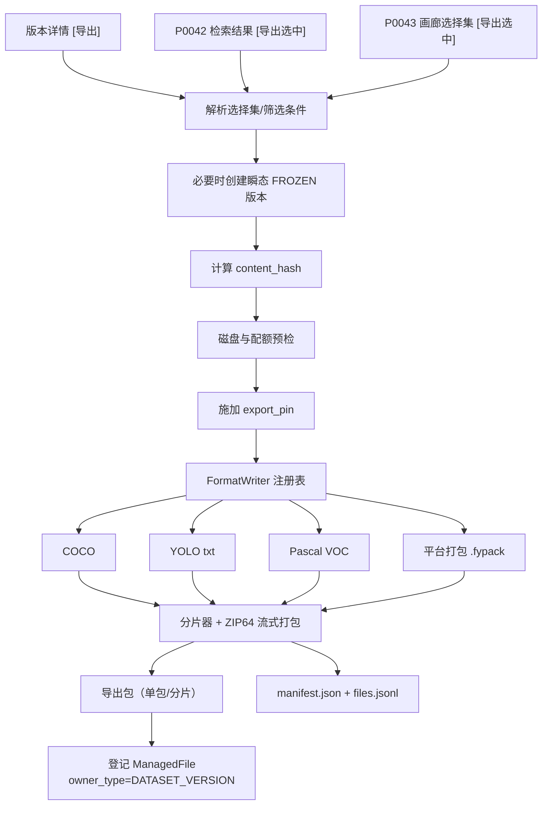
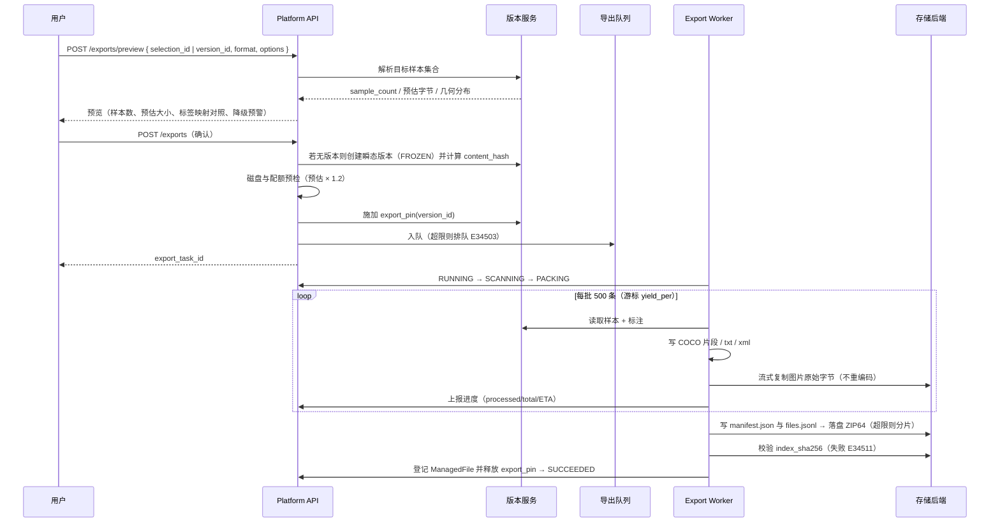
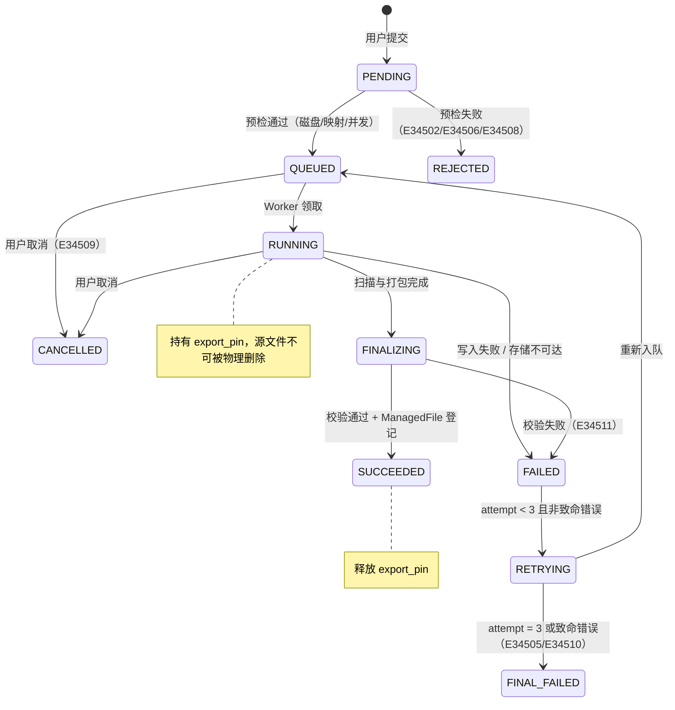
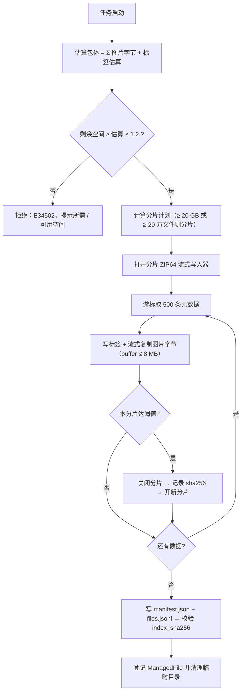
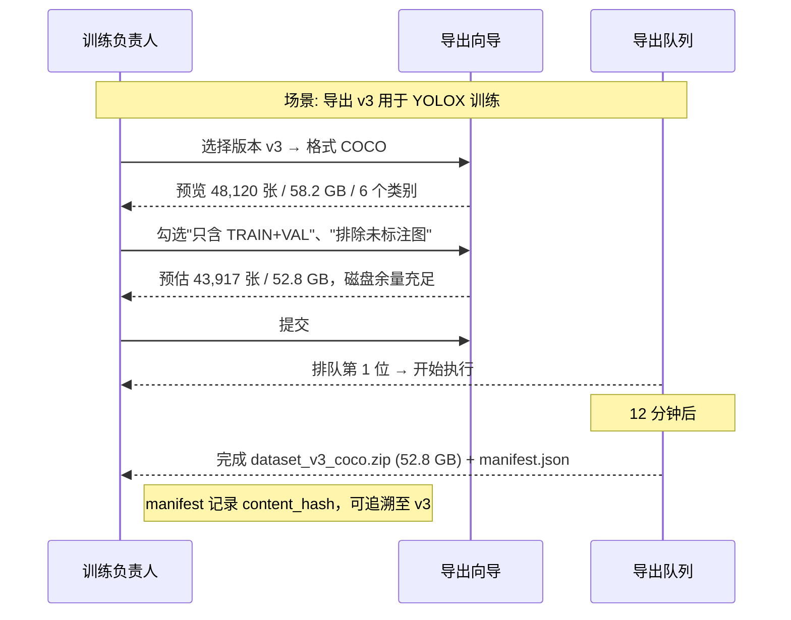
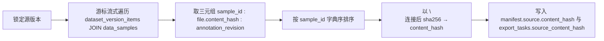

# PRD: P0045_数据集导出 (Dataset Export)

| 属性 | 内容 |
| :--- | :--- |
| **文档编号** | P0045 |
| **项目名称** | 轻眸识刻 |
| **功能模块** | M03_数据管理 |
| **当前版本** | v1.0.0 |
| **文档状态** | Draft |
| **作者** | DataB |
| **最后更新** | 2026-10-01 |

---

## 1. 全局说明

> [!IMPORTANT]
> **核心定位**: 把 `DatasetVersion` **原子地、可复现地**导出成外部工具能读的标准格式，或导出成平台自有打包格式用于迁移与备份。
>
> **两条铁律**:
> 1. **导出必绑定版本**：任何导出都落在一个 `DatasetVersion` 上，导出包内嵌该版本的 `content_hash`，使"这份包来自哪个版本"可被机器校验而非靠文件名猜。
> 2. **导出不改数据**：纯读操作，不产生样本、不修改标注；导出期间对源版本加 **`export_pin`**，使 P0046 的物理删除前置条件校验失败，从而保护在途导出。

### 1.1 名词解释

| 术语 | 解释 |
| :--- | :--- |
| **ExportTask（导出任务）** | 一次导出的执行单元，状态机见 5.2；产物为导出包 + manifest。 |
| **导出包** | 产物集合：单个压缩包、分片压缩包（`part-001.zip`…）或未压缩目录。 |
| **Manifest（导出清单）** | 包根目录的 `manifest.json`，记录源版本哈希、选项、计数与分片校验和，**字段表见 8.1**。 |
| **版本哈希 content_hash** | `DatasetVersion` 的内容指纹，算法见 F04；导出清单必须记录它。 |
| **瞬态版本 (Ad-hoc Version)** | 从 P0042/P0043 的选择集直接导出时自动创建并立即冻结的一次性 `DatasetVersion`，保证"导出必有版本"。 |
| **export_pin（导出锁）** | 任务存续期对源版本施加的逻辑锁，使 P0046 硬删除校验失败；任务结束即释放。 |
| **分片 (Sharding)** | 包体超 `max_package_bytes` 或文件数阈值时自动切包，由 `parts[]` 串联。 |
| **标签映射 (Label Mapping)** | 把 `LabelClass` 映射为目标格式的类别索引与名称（重命名 / 合并 / 丢弃），**不修改平台数据**。 |
| **几何降级** | 目标格式不支持某几何类型时的近似转换（如 VOC 不支持 OBB → 外接矩形），必须写 `warnings[]`。 |

**规模假设**: 单次导出典型 5 万样本 / 60 GB，上限 50 万样本 / 2 TB；单包上限默认 20 GB 或 20 万文件；并发全局 3 / 单用户 1；导出进程内存硬上限 256 MB。

### 1.2 统一异常处理（E34501–E34512）

| Code | 场景 | 处理策略 |
| :--- | :--- | :--- |
| `E34501` | 源版本不存在或已被删除 | 404，提示"源版本已不存在，请刷新数据集" |
| `E34502` | 目标存储空间不足 | 提交前预检（预估 × 1.2），失败则拒绝创建任务并给出所需/可用空间 |
| `E34503` | 导出并发超限 | 429 + 队列位置；全局 3 / 单用户 1 |
| `E34504` | 单张图片读取失败 | **不中断**，记入 `manifest.errors[]` 与 `export_task_items`，继续导出 |
| `E34505` | 图片失败率 > 1% | 判定 `FINAL_FAILED`，保留部分产物供排查（标记不可用） |
| `E34506` | 包体超限且未开启分片 | 拒绝执行，提示开启分片或缩小范围 |
| `E34507` | 进程内存超过 256 MB | 自动降批大小与并发并重试一次；再次超限则失败 |
| `E34508` | 标签映射后有效类别数为 0 | 拒绝执行，回显哪些规则导致空集 |
| `E34509` | 用户取消 | 置 `CANCELLED`，清理临时目录与未完成分片，**释放 `export_pin`** |
| `E34510` | 重试时源版本哈希与首次不一致 | 中止并提示"源数据已变更或被破坏"，建议重建版本后导出 |
| `E34511` | 产物校验失败（`index_sha256` 不匹配） | `FINAL_FAILED`，产物移入隔离区并告警 |
| `E34512` | 临时目录清理失败（磁盘只读 / 权限） | 保留目录并告警；不影响已成功产物，但阻塞后续导出 |

---

## 2. 项目背景

### 背景 (Context)
轻眸识刻 第一阶段的落地任务是**食品包装生产日期区域检测**。平台内数据以自有格式（`DataSample` + `Annotation` + `ManagedFile`）存储，但外部世界需要标准格式：训练后端 **YOLOX 原生消费 COCO**；交付方与第三方工具常要求 Pascal VOC 或 YOLO txt；换机器、做备份时需要一份自带元信息、**可再导入**的打包格式。团队只有 2~3 人，没有能力维护导出脚本，必须由平台提供点点点即完成的路径。

### 问题陈述 (Problem Statement)
1. **导出即失联**：手工导出的包没有版本指纹，一周后没人知道 `dataset_v2_final_final.zip` 对应哪个版本。
2. **导出 OOM**：50 万条标注一次性 `json.dumps` 需数 GB 内存，进程被 OOM Killer 杀掉且无进度提示。
3. **几何静默丢失**：VOC 不支持旋转框，脚本直接丢弃，训练时才发现框全没了。
4. **未标注图污染训练集**：默认包含未标注图，YOLOX 会把它们当背景负样本，召回率异常。
5. **导出与删除打架**：导出过程中 GC 删文件，导出包缺图且无告警。
6. **磁盘被撑爆**：没有预检，写到一半才 `ENOSPC`。

### 目标与成功指标 (Goals & Success Metrics)
*   **北极星指标**: 任意导出包可通过其 `manifest.json` **独立还原源版本的哈希**，100% 可追溯到唯一 `DatasetVersion`。
*   **次要指标**: 导出进程峰值内存 < 256 MB（任意样本量）；标注一致率 100%（除 manifest 明确记录的降级）；50 万样本 / 2 TB 级导出成功率 > 99%；进度上报延迟 < 3s。

### 风险与规避 (Risks & Mitigation)
| 风险 | 影响 | 规避方案 |
| :--- | :--- | :--- |
| 几何降级信息丢失 | 训练结果异常 | 降级写 `warnings[]` + `dropped_annotation_count`，提交前弹窗预告 |
| 导出与 GC 竞争 | 产物缺图 | `export_pin` 逻辑锁 + P0046 硬删除前置条件校验 |
| 压缩包损坏 | 交付失败 | 分片各自记 `sha256`，`index_sha256` 自校验（`E34511`） |
| 导出占满 IO 影响标注 | 体验下降 | worker 并发 ≤ 3，检测到活跃 `ImportTask`/`TrainTask` 时降低读取速率 |

---

## 3. 价值模型

*   **方案**: **流式导出管线**——游标分批读元数据、增量写 JSON、边读边打包（ZIP64 流式）、图片原样字节复制不重编码。所有导出绑定 `DatasetVersion`，产物根目录携带 `manifest.json` 作为可复现凭证。
*   **目标**: 让"把数据交出去"和"把数据搬回来"都变成一次点击，且**无论数据多大都不撑爆内存**，产物永远可追溯到唯一版本。

---

## 4. 项目范围

### 4.1 功能结构图



### 4.2 In Scope / Out of Scope

**In Scope**: ① 四种格式（COCO / YOLO txt / Pascal VOC / 平台打包 `.fypack`）② 导出选项（未标注图、split、标签映射、压缩、转写、图片处理、分片、目标存储）③ 异步任务与进度（队列、ETA、取消、重试）④ 版本绑定（瞬态版本、`content_hash` 入 manifest、`export_pin` 保护）⑤ 大数据量导出（流式、分片、磁盘预检、内存上限）⑥ 导出历史与复用。

**Out of Scope**: 模型权重导出（→ P0112 端侧导出）；从标准格式**反向导入**（→ P0021）；公网直链 / 分享链接；用户自定义 FormatWriter 插件；导出时修改标注内容；增量 / 差异导出（差异集先物化为瞬态版本后全量导出）。

---

## 5. 业务流程

### 5.1 导出主流程



### 5.2 导出任务状态机



---

### 5.3 大数据量的内存与磁盘控制



## 6. 用户分析

### 6.1 用户画像

| 角色 | 核心诉求 | 痛点 |
| :--- | :--- | :--- |
| **训练负责人 (TRAINER)** | "要一份 COCO 格式、只含 TRAIN+VAL、不含未标注图的包，且能证明它来自 v3" | 手工写脚本，字段名与坐标格式总出错 |
| **管理员 (ADMIN)** | "把整个数据集打成平台格式，换机器后能原样导回来" | 只能直接拷贝数据库与目录，极易不一致 |
| **外部合作方（无平台账号）** | "包拿来就能用，别让我猜坐标是归一化还是像素" | 无（靠 manifest 与自解释的目录结构解决） |
| **标注员 (ANNOTATOR)** | 与导出无关，**不授予导出权限** | — |

### 6.2 用户链路图



---

## 7. 功能需求

### M03.F01 导出格式与几何映射 (Export Formats & Geometry Mapping)

*   **用户故事**: 作为训练负责人，我希望平台直接产出目标工具能读的标准格式，以便不用自己写转换脚本。
*   **逻辑与业务规则**:

    | 格式 | 目录结构 | 支持几何 | 类别表达 |
    | :--- | :--- | :--- | :--- |
    | `COCO` | `images/{split}/` + `annotations/instances_{split}2017.json` | BBOX / POLYGON / KEYPOINT / OBB（见下） | `categories[{id, name, supercategory}]`，`id` 从 1 起；注释文件名默认对接 YOLOX Exp 的 `train_ann`/`val_ann`/`test_ann` |
    | `YOLO_TXT` | `images/{split}/` + `labels/{split}/` + `keypoints/{split}/`（扩展） | BBOX / POLYGON / OBB / KEYPOINT（扩展） | `classes.txt`（行号即 `class_index`）；**不产出 `data.yaml`**，另给 `train.txt`/`val.txt` 路径清单 |
    | `PASCAL_VOC` | `JPEGImages/` + `Annotations/{name}.xml` + `ImageSets/Main/{split}.txt` | 仅 BBOX | XML `<name>` 为类别名 |
    | `PLATFORM_PACKAGE` | `manifest.json` + `images/` + `annotations/annotations.jsonl` + `labels/label_classes.json` + `splits/{split}.txt` + `transcriptions.jsonl` | 全部（含 `group_key`、`source_type`、`is_hard_example`） | `label_classes.json` 保留 `label_class_id` 与颜色 |

    *   **坐标系与精度**: COCO 用绝对像素 `[x_min, y_min, w, h]`（2 位小数）；YOLO txt 用归一化 `[0,1]`（6 位小数），多边形为 `<class> x1 y1 x2 y2 ...`；VOC 用绝对像素整数；OBB 在 COCO 写入 `segmentation`（四角点多边形）**并**附加 `attributes.obb=[cx,cy,w,h,angle_deg]`，在 YOLO txt 用 8 点归一化格式。
    *   **几何降级规则**（必须写入 `manifest.warnings[]` 与 `counters.dropped_annotation_count`）:

        | 源几何 | COCO | YOLO txt | VOC |
        | :--- | :--- | :--- | :--- |
        | BBOX | 原样 | 原样 | 原样 |
        | POLYGON | `segmentation` 原样 | 多边形行原样 | 降级为外接矩形 |
        | KEYPOINT | `keypoints` + `num_keypoints` + `categories.keypoints` | 写 `keypoints/{split}/` 扩展文件 | 降级为外接矩形 |
        | OBB | 多边形 + `attributes.obb` | 8 点格式 | 降级为外接矩形 |

    *   **标签映射**: `label_mapping[]` 支持 `KEEP` / `RENAME` / `MERGE_INTO` / `DROP`，**只作用于产物**；映射后类别索引按导出后类别名重新连续编号。转写仅 `PLATFORM_PACKAGE` 默认包含，其余格式需 `include_transcription=true` 时以旁挂 `transcriptions/{split}.jsonl` 产出。
    *   **后置条件**: 生成 manifest 与索引文件；不修改平台数据。**权限**: `TRAINER`/`ADMIN` 可导出。
*   **验收标准**:

```gherkin
场景: 导出 COCO 并保持类别索引稳定
  Given 版本 v3 含 6 个 LabelClass
  When 以 COCO 格式导出且不做标签映射
  Then annotations/instances_train2017.json 的 categories 含 6 项且 id 从 1 连续编号
  And 每条 annotation 的 bbox 为绝对像素 [x, y, w, h]

场景: VOC 几何降级留痕
  Given 版本含 120 条 OBB 标注
  When 导出为 PASCAL_VOC
  Then 120 条 OBB 被转为外接矩形
  And manifest.warnings 含 geometry_downgraded: 120
  And counters.dropped_annotation_count = 0
```

*   **边界情况与异常处理**:

| 场景 | 处理 |
| :--- | :--- |
| 映射后类别数为 0（`E34508`） | 提交前拒绝，回显导致空集的规则 |
| 图片宽高为 0（损坏） | 跳过并记入 `manifest.errors[]`，计入失败率 |
| 标注坐标越界 | 按图片边界裁剪写入，`warnings[]` 记 `out_of_bound_clipped` 计数 |
| 不同目录同名图 | 导出统一以 `{sample_id}.{ext}` 命名，`files.jsonl` 记录原始文件名 |

### M03.F02 导出选项 (Export Options)

*   **用户故事**: 作为训练负责人，我希望精确控制导出内容，以便只导出需要的部分，避免下载无用的几十 GB。
*   **逻辑与业务规则**:

    | 选项 | 字段名 | 类型 | 默认值 | 说明 |
    | :--- | :--- | :--- | :--- | :--- |
    | 导出格式 | `format` | Enum | `COCO` | `COCO`/`YOLO_TXT`/`PASCAL_VOC`/`PLATFORM_PACKAGE` |
    | 包含未标注图 | `include_unannotated` | Bool | `false` | 关闭时只导出 `annotation_status != UNLABELED` 的样本，避免污染训练集 |
    | 包含已确认无目标 | `include_negative_confirmed` | Bool | `false` | 仅当 `include_unannotated=true` 时可选 |
    | split 过滤 | `splits` | MultiSelect | 全部 | `TRAIN`/`VAL`/`TEST`/`UNASSIGNED` |
    | 标签映射 | `label_mapping` | Repeater | 空（全 KEEP） | 每行 `{label_class_id, action, target_name}` |
    | 包含转写 | `include_transcription` | Bool | 仅 `.fypack` 为 true | 见 F01 |
    | 图片处理 | `image_mode` | Enum | `ORIGINAL` | `ORIGINAL`（原字节复制，最快）/ `REENCODE`（统一转 JPEG，耗时且损质） |
    | 图片内容 | `include_images` | Enum | `COPY` | `COPY`（拷贝原图）/ `NONE`（仅标签交付） |
    | 压缩方式 / 级别 | `compress` / `compress_level` | Enum/Int | `ZIP` / `1` | `NONE`/`ZIP`/`TAR_GZ`；级别 0~9（图片已压缩，默认 1 最快） |
    | 单包上限 / 分片 | `max_package_bytes` / `shard_enabled` | BigInt/Bool | `20 GB` / `true` | 关闭分片则超限直接拒绝（`E34506`） |
    | 目标存储 / 输出前缀 | `target_storage_config_id` / `output_prefix` | Select/Text | 默认存储 / `exports/{dataset}/{version}` | 遵循 DataA 对象键规则 `{path_prefix}/DATASET_VERSION/{version_id}/exports/...` |
    | 保留失败临时目录 | `keep_temp_on_failure` | Bool | `false` | 仅排查时勾选 |

    *   **选项哈希**: `options_hash = sha256(canonical_json(options))`，用于复用检测与幂等重试。
    *   **后置条件**: 选项全量写入 `manifest.options`，保证产物自解释。
*   **验收标准**:

```gherkin
场景: 默认排除未标注图
  Given 版本 v3 含 48,120 张，其中 4,203 张 annotation_status=UNLABELED
  When 用户以默认选项导出
  Then 导出包内图片数为 43,917
  And manifest.counters.unannotated_image_count = 0

场景: 仅标签导出
  Given 用户选择 include_images=NONE
  When 导出完成
  Then 包内不含 images/ 目录
  And manifest 标注的 image_count 与实际标签文件数一致
  And manifest.warnings 含 images_omitted
```

*   **边界情况与异常处理**:

| 场景 | 处理 |
| :--- | :--- |
| 过滤 + 排除未标注后结果为 0 | 提交前拒绝并提示"当前条件下没有可导出的样本" |
| `splits` 全不勾选 | 视为全选并 Toast 提示，避免空包 |
| 输出路径已存在同名包 | 自动追加 `-2`、`-3` 后缀，不覆盖历史产物 |
| `REENCODE` 遇含透明通道的 PNG | 以白底合成，`warnings[]` 记 `alpha_flattened` |

### M03.F03 异步任务与进度 (Async Task & Progress)

*   **用户故事**: 作为用户，我希望提交后能离开页面，并在任务列表看到进度与剩余时间，以便不必干等。
*   **逻辑与业务规则**:
    *   **前置条件**: 选项校验、磁盘预检、并发校验均通过。
    *   **阶段与权重**: `SCANNING`（枚举元数据、建分片计划）5% → `PACKING` 92% → `FINALIZING`（写 manifest、校验、登记 `ManagedFile`）3%。
    *   **进度口径**: `processed_items / total_items`，`total_items` 在 `SCANNING` 结束时确定；`SCANNING` 期间显示"正在统计"。ETA 用最近 30 秒滑动窗口速率；样本数 < 1000 时显示"即将完成"。
    *   **队列与并发**: 全局运行 ≤ 3、单用户 ≤ 1；超出进入 `QUEUED` 并显示队列位置。
    *   **取消语义**: `QUEUED` 立即取消；`RUNNING` 为协作式，worker 在每批（500 条）边界检查取消标志，最迟 1 批后停止；已写分片删除，`export_pin` 释放。
    *   **重试语义**: `FAILED → RETRYING` 最多 3 次，`attempt` 累加（**不新建任务实体**）。致命错误不重试：`E34502`/`E34505`/`E34508`/`E34510`/`E34511`。
    *   **幂等**: 同一 `(version_id, format, options_hash)` 的重试在原任务上继续，覆盖未完成分片；重复提交被聚合到已有任务。
    *   **内存与磁盘控制**: 启动即估算包体并要求剩余空间 ≥ 估算 × 1.2（否则 `E34502`）；按 20 GB / 20 万文件计算分片计划，逐片打开 ZIP64 流式写入器；游标每批 500 条读元数据、增量写标签、以 ≤ 8 MB 缓冲流式复制图片字节；包体边写边 flush，**任何时刻驻留内存都不随样本量增长**。
*   **验收标准**:

```gherkin
场景: 进度与 ETA
  Given 导出 48,120 张，已处理 24,000 张
  When 用户查看任务详情
  Then 显示进度约 50%、ETA 与已用时间
  And 阶段显示 "PACKING"

场景: 取消运行中任务
  Given 任务处于 PACKING 且已写入 2 个分片
  When 用户点击 [取消]
  Then 最迟 1 批后停止，已写入分片与临时目录被清理
  And 源版本上的 export_pin 被释放，状态为 CANCELLED
```

*   **边界情况与异常处理**:

| 场景 | 处理 |
| :--- | :--- |
| Worker 崩溃（进程被杀） | 心跳超时 120s 后由守护进程置 `FAILED`，`attempt < 3` 则重试并清理残留分片 |
| 重试时源版本哈希变化（`E34510`） | 直接 `FINAL_FAILED`，提示重新创建版本 |
| 存储后端打包中途不可达 | `FAILED` 并保留临时目录，重试时续写；连续 3 次失败则 `FINAL_FAILED` |
| 用户重复提交相同参数 | 返回同一 `export_task_id` 并提示"已存在相同导出任务" |

### M03.F04 版本绑定与可复现性 (Version Binding & Reproducibility)

*   **用户故事**: 作为训练负责人，我希望任何一份导出包都能证明它来自哪个版本，以便三个月后还能复现同样的训练。
*   **逻辑与业务规则**:
    *   **绑定规则**: 每次导出必须有 `source_version_id`。从版本页导出直接用该版本；从 P0042/P0043 的选择集或筛选条件导出，或从 P0041 对比页导出差异集时，**先创建瞬态版本**（`name = "{dataset}-adhoc-{yyyyMMddHHmmss}"`，`status = FROZEN`），再按正常流程导出。
    *   **版本哈希算法**: `content_hash = sha256("\n".join(sort(f"{sample_id}:{file_content_hash}:{annotation_revision}")))`，其中 `annotation_revision` 为该样本 `Annotation.revision` 的最大值（无标注记 0）。算法版本随 `manifest.hash_algorithm_version` 冻结，**算法变更必须升 `manifest_version`**。
    *   **`export_pin` 语义**: 任务在 `RUNNING`/`FINALIZING` 期间持锁（`QUEUED` 不持锁，避免排队期白占保护）；锁记 `export_task_id` 与 `expires_at = now()+6h`，worker 每 5 分钟续期，防死锁。
    *   **重新导出复核**: 提供"按此 manifest 重新导出"入口，读取 `manifest.options` 与 `manifest.source` 重建；若重算哈希与 manifest 不一致，明确提示"源版本内容已变化，产物无法逐字节复现"，但**不阻塞**导出。
    *   **后置条件**: `export_tasks` 记录 `source_version_id` / `content_hash` / `options_hash` / `attempt`。
*   **验收标准**:

```gherkin
场景: 导出包自带版本指纹
  Given 用户导出 v3 版本为 COCO
  When 打开包内 manifest.json
  Then 含 source.dataset_version_id、source.version_no 与 source.content_hash
  And content_hash 与平台内该版本重算结果一致

场景: 导出锁保护
  Given 导出任务 T 处于 RUNNING，持有 v3 的 export_pin
  When 管理员尝试对 v3 的成员文件执行物理删除
  Then 删除被阻止并返回 E34604
  And 提示"有导出任务正在使用该版本"
```

*   **边界情况与异常处理**:

| 场景 | 处理 |
| :--- | :--- |
| 瞬态版本创建名称冲突 | 追加随机后缀（`-a1b2`）重试，最多 3 次 |
| 版本被标记 `ARCHIVED` | 仍允许导出，manifest 记 `source.archived=true` |
| 版本已被软删除 | 拒绝并提示先恢复（`E34501`） |
| `export_pin` 续期失败（DB 抖动） | 重试 3 次；仍失败则任务 `FAILED`，避免"无锁裸奔"被 GC 删文件 |

### M03.F05 导出历史与复用 (Export History & Reuse)

*   **用户故事**: 作为管理员，我希望看到某版本的历史导出记录并复用上次选项，以便例行备份时不用重新填表。
*   **逻辑与业务规则**:
    *   **历史列表**: 任务 id、触发者、时间、格式、选项摘要、样本数、包大小、耗时、状态、`content_hash` 前 12 位、操作（下载 / 复用选项 / 重新导出 / 取消 / 删除产物）。
    *   **复用检测**: 提交时若存在 `(source_version_id, format, options_hash)` 完全相同且 `SUCCEEDED` 的任务，且其产物 `ManagedFile.status = COMMITTED` 未被回收，则提示"已存在相同导出（{时间}，{大小}）"，可直接复用；用户可强制重新导出。
    *   **产物归属**: 导出包作为 `ManagedFile(owner_type = DATASET_VERSION, owner_id = source_version_id)` 纳入引用计数体系，生命周期由 P0046 管理；**不新增 owner_type**（如 `EXPORT`）。`ADMIN` 可在历史列表手动删除产物（走 P0046 影响面预览）。
    *   **后置条件**: 历史保留 365 天；产物被回收后记录保留但标记"产物已回收"。
*   **验收标准**:

```gherkin
场景: 复用相同导出
  Given 1 小时前已成功导出 v3 + COCO + 相同选项
  When 用户以完全相同的选项再次提交
  Then 提示 "已存在相同导出（52.8 GB，1 小时前）"
  And 提供 [直接使用] 与 [重新导出] 两个选项
  And 选择 [直接使用] 时不创建新的导出任务

场景: 产物被回收后复用失效
  Given 历史导出的产物已被 P0046 物理删除
  When 用户尝试复用
  Then 该记录标记 "产物已回收" 且只提供 [重新导出] 入口
```

*   **边界情况与异常处理**:

| 场景 | 处理 |
| :--- | :--- |
| 历史记录 > 500 条 | 服务端分页，默认 20 条/页 |
| 复用检测命中但产物正在被 GC 处理 | 不提示复用，直接新建任务（避免复用后立刻失效） |
| 强制重新导出且磁盘紧张 | 预检时把既有同参数产物计入可回收空间，提示"可删除旧产物释放 X GB" |

---

## 8. 技术架构与数据模型

> **命名契约**: 采用全局实体命名契约。导出**不引入**新的文件归属类型：导出包为 `ManagedFile`，`owner_type = DATASET_VERSION`、`owner_id = source_version_id`。本模块新增 `ExportTask` / `ExportTaskItem`。通用字段 `id / created_at / updated_at / deleted_at` 全表统一。

### 8.1 Manifest 字段表（导出清单 `manifest.json`）

> 导出包与平台之间的**唯一契约文件**，必须自带全部溯源信息。字段名一经发布不得重命名，只允许在 `manifest_version` 升级时变更。

| 字段 | 类型 | 必填 | 说明 |
| :--- | :--- | :--- | :--- |
| `manifest_version` | String | Y | 清单格式版本，当前 `"1.0"`；哈希算法或字段语义变更时递增 |
| `export_id` / `exported_at` / `exported_by` | UUID/timestamptz/UUID | Y | 导出任务 id、完成时间（UTC ISO 8601）、触发者 `users.id` |
| `source.dataset_id` / `source.dataset_name` | UUID/String | Y | 源数据集（名称供离线可读） |
| `source.dataset_version_id` / `source.version_no` / `source.version_tag` | UUID/Int/String | Y/N | 源版本 id、序号、`DatasetVersionTag`（无则 null） |
| `source.content_hash` | String(64) | Y | **版本内容哈希**，算法见 F04 |
| `source.hash_algorithm_version` | String | Y | 哈希算法版本，当前 `"1"` |
| `source.sample_count` / `source.archived` | Int/Bool | Y | 版本内样本总数（含未导出部分）/ 是否已归档 |
| `format` / `format_version` | Enum/String | Y | 导出格式；格式写法版本（COCO `2017`、VOC `2007`） |
| `options` / `options_hash` | Object/String(64) | Y | **导出选项全量回显**（字段名与 F02 一一对应）/ 规范化 JSON 的 sha256 |
| `classes[]` | Array | Y | `{class_index, label_class_id, source_name, export_name, color, deprecated}` |
| `label_mapping[]` | Array | Y | `{from_label_class_id, from_name, action, to_class_index}`，action ∈ `KEEP`/`RENAME`/`MERGE_INTO`/`DROP` |
| `counters.*` | Object | Y | 见下方「计数明细」 |
| `split_summary` | Object | Y | `{TRAIN, VAL, TEST, UNASSIGNED}` 各自图片数 |
| `parts[]` | Array | Y | 分片清单 `{part_index, file_name, byte_size, item_count, sha256}`；单包时长度为 1 |
| `index` | Object | Y | `{file: "files.jsonl", entry_count, sha256}` |
| `checksum.algorithm` / `checksum.index_sha256` | String | Y | `sha256` / `files.jsonl` 的 sha256（产物完整性自校验） |
| `checksum.manifest_self_hash` | String(64) | N | 去掉本字段后的规范化 sha256（二次校验用） |
| `storage.storage_config_id` / `storage.storage_path` / `storage.managed_file_id` | UUID/String/UUID | Y | 落点存储配置、包路径、对应 `ManagedFile.id` |
| `framework_hint.yolox` | Object | N | `format=COCO` 时给出可直接填入 YOLOX Exp 的 `{data_dir, train_ann, val_ann, test_ann}` 建议值；平台**只给建议，不生成 Exp**（Exp 由 P0083 管理） |
| `warnings[]` | Array | Y | `{code, count, message}`：`geometry_downgraded` / `out_of_bound_clipped` / `alpha_flattened` / `images_omitted` |
| `errors[]` / `errors_truncated` | Array/Bool | N/Y | 失败项 `{sample_id, code, message}`；> 1000 条仅写前 1000 并置 `errors_truncated=true` |
| `tool.exporter_version` / `tool.platform_version` | String | Y | 导出器与平台版本，便于问题定位 |
| `license_notice` | String | N | 数据使用与授权提示文本 |

**`counters` 明细**（字段表的一部分）:

| 字段 | 说明 |
| :--- | :--- |
| `image_count` / `annotated_image_count` / `unannotated_image_count` | 实际导出图片数 / 含 ≥1 条标注的图片数 / 未标注图片数 |
| `box_count` / `polygon_count` / `keypoint_count` / `obb_count` | 各类几何的标注条数（四类之和即导出标注总数） |
| `transcription_count` / `negative_confirmed_count` | 带 `transcription` 的标注数 / 已确认无目标样本数 |
| `dropped_annotation_count` | 因映射 `DROP` 或格式不支持而丢弃的标注数 |

**`files.jsonl` 每行字段**（大包必需；小包可内联进 `index.entries[]`）:

| 字段 | 必填 | 说明 |
| :--- | :--- | :--- |
| `path` / `role` | Y | 包内相对路径 / `IMAGE`/`LABEL`/`META` |
| `sample_id` / `split` / `group_key` | Y/Y/N | 对应 `DataSample.id`、切分、防泄漏分组键（原样带出） |
| `original_file_name` / `width` / `height` | N | 平台内原始文件名；图片尺寸（`role=IMAGE` 时必填） |
| `byte_size` / `content_hash` / `annotation_count` / `dropped_count` | Y/Y/N/N | 包内字节数 / 源文件 sha256 / 导出标注数 / 被丢弃数 |

### 8.2 数据实体

**Table: `export_tasks`（ExportTask）**

| 字段名 | 类型 | 必填 | 说明 | 约束 |
| :--- | :--- | :--- | :--- | :--- |
| `id` | UUID | Y | 主键 | PK |
| `source_version_id` / `source_content_hash` | UUID/String(64) | Y | 源版本（含瞬态版本）/ 导出时计算的版本哈希 | FK → dataset_versions |
| `format` | Enum | Y | `COCO`/`YOLO_TXT`/`PASCAL_VOC`/`PLATFORM_PACKAGE` | |
| `options` / `options_hash` | JSONB/String(64) | Y | 选项全量 / 复用检测键 | INDEX(`options_hash`) |
| `status` | Enum | Y | `PENDING`/`QUEUED`/`RUNNING`/`FINALIZING`/`SUCCEEDED`/`FAILED`/`RETRYING`/`FINAL_FAILED`/`CANCELLED`/`REJECTED` | INDEX |
| `stage` | Enum | N | `SCANNING`/`PACKING`/`FINALIZING` | |
| `attempt` | Int | Y | 重试次数 | 默认 0，≤ 3 |
| `total_items` / `processed_items` / `failed_items` | Int | N/Y/Y | 扫描后确定的总数 / 已处理 / 失败 | 默认 0 |
| `estimated_bytes` / `output_bytes` / `part_count` / `output_managed_file_id` | BigInt/BigInt/Int/UUID | N | 预估 / 产物实际大小 / 分片数 / 产物 `ManagedFile` | FK |
| `error_code` / `error_message` / `pin_expires_at` | String/Text/timestamptz | N | 失败码（`E345xx`）/ 详情 / 导出锁到期（worker 续期） | |
| `created_by` / `started_at` / `finished_at` | UUID/timestamptz | Y/N/N | 触发者与起止时间 | FK → users |

**Index**: `(source_version_id, created_at DESC)`（导出历史）。

**Table: `export_task_items`（ExportTaskItem，仅记异常项）**

| 字段名 | 类型 | 必填 | 说明 | 约束 |
| :--- | :--- | :--- | :--- | :--- |
| `id` / `export_task_id` | UUID | Y | 主键 / 所属任务 | FK, INDEX |
| `sample_id` | UUID | N | 失败样本 | FK → data_samples |
| `severity` / `code` / `message` | Enum/String/Text | Y/Y/N | `ERROR`/`WARNING`；`E345xx` 或 warning code；详情 | |

> 单条成功不落表；行数受 `errors_truncated` 约束（每任务 ≤ 10,000 行），避免小团队环境的表膨胀。

### 8.3 版本哈希计算与产物落位



| 产物属性 | 取值 | 说明 |
| :--- | :--- | :--- |
| `owner_type` / `owner_id` | `DATASET_VERSION` / `source_version_id` | **不新增 owner_type** |
| `storage_path` | `{path_prefix}/DATASET_VERSION/{version_id}/exports/{export_id}/{package_name}` | 遵循 DataA 对象键规则 |
| `status` | `PENDING → COMMITTED` | 打包时 `PENDING`，校验通过后 `COMMITTED` |
| `mime_type` / `etag` | `application/zip` / `application/x-tar` / `inode/directory`；包文件 sha256（分片为 `parts[]` 合并哈希） | |

---

## 9. UI/UX 规格说明

### 9.1 导出向导与任务详情

```text
+---------------------------------------------------------------------------+
|  导出数据集 · 包装日期检测 v3                                       [×]    |
+---------------------------------------------------------------------------+
|  格式 *   ( ) COCO   (•) YOLO txt   ( ) Pascal VOC   ( ) 平台打包          |
|           i YOLOX 原生消费 COCO；txt 供外部工具                            |
|  ──────────────────────────────────────────────────────────────────────── |
|   [ ] 包含未标注图 (4,203)   i 默认排除，避免污染训练集                    |
|   Split: [•]TRAIN 38,496  [•]VAL 9,624  [ ]TEST 0  [ ]未切分 0             |
|   图片: [原始字节复制 ▾] [拷贝原图 ▾]  压缩: [ZIP ▾] 级别 [1 ▾]            |
|   单包上限 [20 GB]  [•] 超限自动分片      目标存储 [本地磁盘 default ▾]     |
|  ──────────────────────────────────────────────────────────────────────── |
|  标签映射   日期区 [保持 ▾] | 生产日期 [合并到 ▾] 日期区 | 批号 [保持 ▾]    |
|  ⚠ 未映射类别将原样导出；Pascal VOC 将把 120 条旋转框降级为外接矩形         |
|  预估: 43,917 张 · 约 52.8 GB · 约 9 分钟 · 磁盘余量 180 GB ✅             |
+---------------------------------------------------------------------------+
|                                        [取消]   [导出预览]   [开始导出]     |
+---------------------------------------------------------------------------+
|  任务 #E-2043 (v3, hash a91f3c2e7d…)  🔵打包中 63%                        |
|  ✅扫描完成(43,917) → 🔵打包 26,860/43,917 · 210 项/秒 · part-001.zip 6.2GB|
|  已用 2:07 · 预计剩余 1:21 · 失败项 0 · export_pin 有效至 15:41            |
+---------------------------------------------------------------------------+
```

### 9.2 交互元素

| 元素 | 类型 | 状态 | 行为 |
| :--- | :--- | :--- | :--- |
| 格式选择 | Radio Group | 4 选 1 | 切换后重算预估与几何降级预警 |
| 样本预估条 | Info Bar | 计算中/就绪/超限 | 展示样本数、预估大小、耗时、磁盘余量与结论 |
| 标签映射表 | Table + Select | 每行独立 | 动作切换后即时更新"映射后类别数"与降级提示 |
| 开始导出 | Button | Default/Disabled/Loading | 预检失败时置灰并给出原因码 |
| 任务进度条 | Progress | 三阶段 | 展示当前分片、速度、ETA、失败项 |
| 取消按钮 | Button | 仅 QUEUED/RUNNING 可用 | 协作式取消，提示"最迟 1 批后停止" |
| 复用提示 / 失败清单 | Banner / Link | 条件渲染 | 命中相同 `options_hash` 时显示 [直接使用] / [重新导出]；有失败项时提供 CSV（`sample_id` + 错误码）下载 |

---

## 10. 非功能性需求 (NFR)

*   **性能**: `ORIGINAL` 模式吞吐 ≥ 150 张/秒（本地磁盘，含拷贝与标签写入）；预览接口 P95 < 1.5s（5 万样本）；进度上报延迟 < 3s 且刷新后状态不丢；版本哈希计算 5 万样本 < 5s、50 万样本 < 45s；导出连接池独立（≤ 2 连接），不影响标注写入路径。
*   **资源上限**: 进程峰值内存 < **256 MB**（超限 `E34507`）；单文件拷贝缓冲 ≤ 8 MB；临时目录峰值 ≤ 单包上限 + 1 GB；并发导出 ≤ 3、单用户 ≤ 1。
*   **安全**: 下载必须经鉴权接口，预签名 URL ≤ 15 分钟（大文件需重新签发）；导出操作写 `AuditLog`（格式、样本数、目标存储、产物大小）；包内不含平台凭据与 `storage_path` 以外的配置；`TRAINER`/`ADMIN` 可导出，`ANNOTATOR`/`VIEWER` 不可。
*   **可靠性**: 单图失败不中断（`E34504`），失败率 > 1% 才整体失败（`E34505`）；worker 崩溃 120s 内被识别并重试（`attempt` ≤ 3）；产物可用 `checksum.index_sha256` 与 `parts[].sha256` 独立校验；取消与失败路径必须清理临时目录并**释放 `export_pin`**。
*   **兼容性**: COCO 遵循 2017 版字段约定；VOC 遵循 2007 版 XML Schema；YOLO txt 遵循"`class cx cy w h` 归一化"通用约定（不绑定特定实现）；压缩包使用 **ZIP64**（支持 > 4 GB 单包与 > 65,535 条目）；产物文件名兼容 Windows（不使用 `:`/`*`/`?`/`"`/`<`/`>`/`|`）。
*   **可扩展性**: `FormatWriter` 为注册表模式，新增格式只需实现 `write(sample_batch) -> files` 与 `finalize() -> manifest 片段`；`manifest_version` 与 `hash_algorithm_version` 独立演进，保证老产物可读。

---

## 附录: 已确认的设计决策

| 决策项 | 结论 |
| :--- | :--- |
| 实体命名 | 采用全局契约；新增 `ExportTask` / `ExportTaskItem`；产物复用 `ManagedFile(owner_type=DATASET_VERSION)`，**不新增 owner_type** |
| 异常码格式 | `E` + 模块号(1) + P 编号后两位(2) + 流水(2)；本文档占用 `E34501`–`E34512` |
| 导出必须绑定版本 | 必须有 `source_version_id`；从检索结果 / 选择集导出时先创建**瞬态 FROZEN 版本** |
| 版本指纹 | manifest 记录 `source.content_hash`（`sample_id:file_hash:annotation_revision` 排序后 sha256），算法版本随 `manifest_version` 冻结 |
| 默认是否含未标注图 | **默认排除**（避免污染训练集），需显式勾选才包含 |
| 训练侧格式 | 平台训练后端（YOLOX）原生消费 **COCO**；YOLO txt 仅服务外部工具，**不产出 `data.yaml`**（改为 `classes.txt` + `train.txt`/`val.txt`） |
| COCO 文件命名 | 默认 `instances_train2017.json` / `instances_val2017.json` / `instances_test2017.json`，对齐 YOLOX Exp 的 `train_ann`/`val_ann`/`test_ann` 默认值；manifest 的 `framework_hint.yolox` 给出 `data_dir` 与三个注释文件的建议映射 |
| 框架细节不越界 | 导出**不生成** Exp 文件、不写入任何 YOLOX 超参；`eval_<epoch>.json`/`PR_curve.png`/`confusion_matrix.png` 是平台侧生成物（P0086），不是导出产物 |
| OBB 表达 | COCO 用多边形 `segmentation` + `attributes.obb`；YOLO txt 用 8 点归一化；VOC 降级外接矩形 |
| 关键点表达 | COCO 原生 `keypoints`；YOLO txt 走 `keypoints/{split}/` 扩展文件；VOC 降级外接矩形 |
| 几何降级 | 必须写 `manifest.warnings[]`，并在提交前向用户预告 |
| 标签映射作用域 | 仅作用于产物，**不修改平台 `LabelClass`**；映射结果写入 manifest。导出与 GC 的竞争由 `export_pin`（6h 到期，worker 每 5 分钟续期）解决 |
| 排队是否持锁 | 否，仅在 `RUNNING` 起持锁 |
| 大数量策略 | 游标流式读（500/批）+ 增量写 JSON + ZIP64 流式打包 + 图片原字节复制；内存硬上限 256 MB |
| 分片与压缩 | 分片默认开启（单包 > 20 GB 或 > 20 万文件），`parts[]` 记录每片 sha256；压缩级别默认 1（图片已压缩，提高级别只增 CPU） |
| 重试与产物保留 | `attempt` 累加最多 3 次（`E34502/E34505/E34508/E34510/E34511` 致命不重试）；产物由 P0046 引用计数管理，`ADMIN` 可手动删除 |
| 增量 / 差异导出 | 不做；版本差异通过先物化为瞬态版本后全量导出 |

---

## 关联文档

*   **P0041_数据集与版本**: `DatasetVersion` 不可变语义、Tag、瞬态版本创建
*   **P0042_数据检索与筛选 / P0043_数据预览与画廊 / P0044_数据统计看板**: 选择集与筛选条件下发、导出前的规模参考
*   **P0046_数据回收与GC**: `export_pin` 与硬删除前置条件、导出产物回收
*   **P0021_标准数据集格式导入**: 平台打包格式（`.fypack`）的逆向导入
*   **P0065_字符转写与 OCR 标注 / P0083_超参数与训练模板**: `transcription` 导出形态、训练侧消费 COCO 与 Exp 配置

---

## Changelog

| 版本 | 日期 | 作者 | 变更说明 |
| :--- | :--- | :--- | :--- |
| v1.0.0 | 2026-10-01 | DataB | 初稿：四种导出格式与几何映射、导出选项表、异步任务与进度、版本绑定与 manifest 字段表、流式导出防 OOM；异常码 `E34501`–`E34512`；COCO 命名与 `framework_hint.yolox` 对齐 YOLOX Exp |
