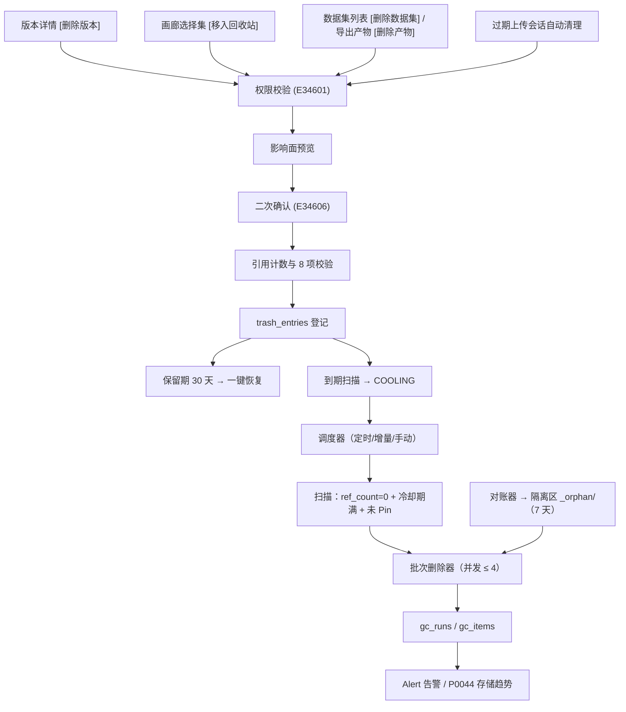
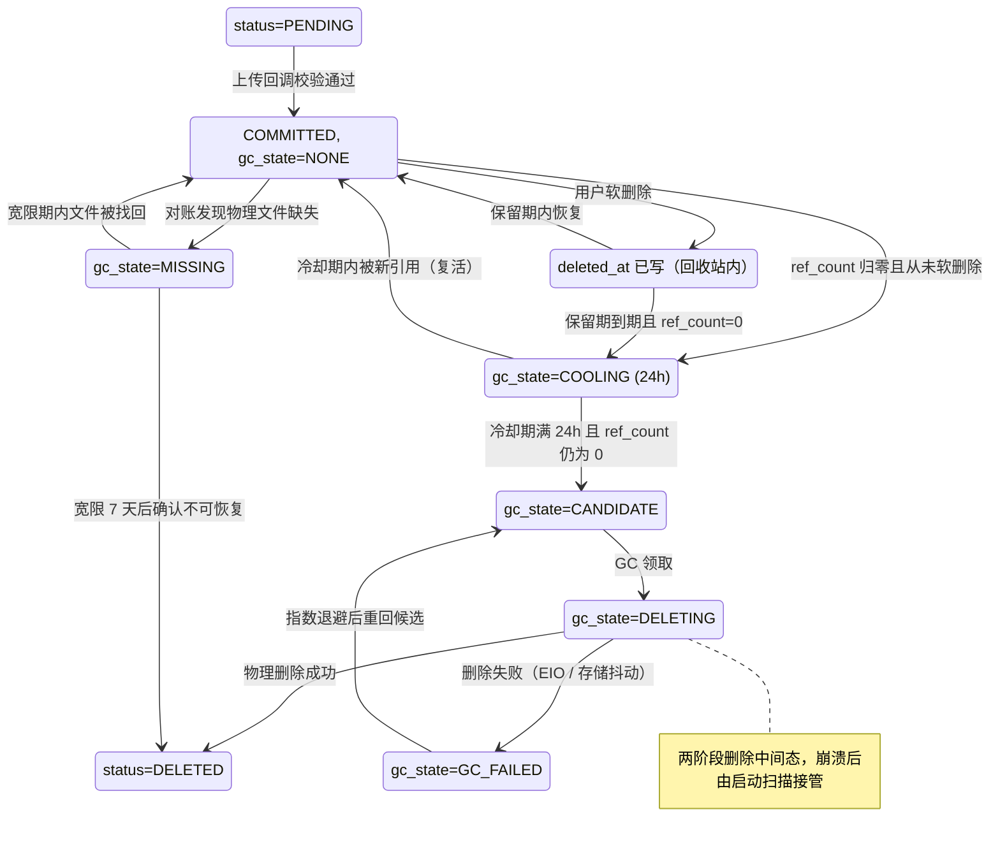
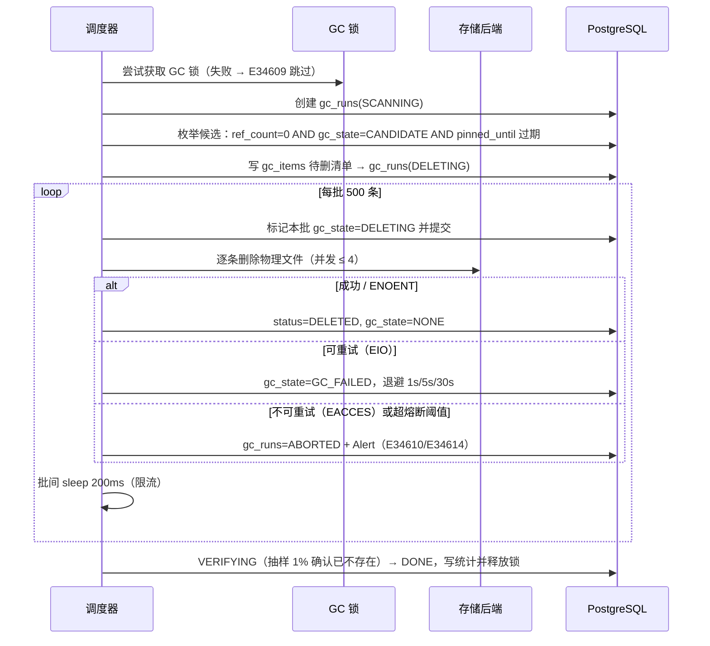
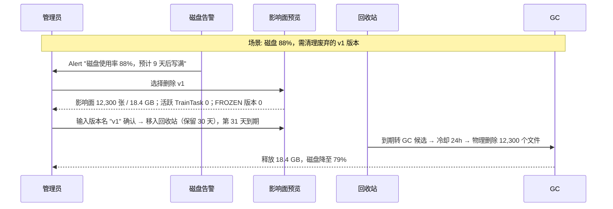

# PRD: P0046_数据回收与GC (Data Recycle & Garbage Collection)

| 属性 | 内容 |
| :--- | :--- |
| **文档编号** | P0046 |
| **项目名称** | 轻眸识刻 |
| **功能模块** | M03_数据管理 |
| **当前版本** | v1.0.0 |
| **文档状态** | Draft |
| **作者** | DataB |
| **最后更新** | 2026-10-01 |

---

## 1. 全局说明

> [!IMPORTANT]
> **核心定位**: 在**单机、磁盘有限、2~3 人**的现实约束下安全地回答两个问题：**删错了怎么办？**（软删除 + 回收站 + 一键恢复）、**什么时候可以真删？**（只有没有任何版本、任何活跃任务引用的文件才允许物理删除，且必须经过冷却期与影响面预览）。
>
> **不可动摇的原则**: 宁可磁盘紧张，也**绝不**因为"看起来没人用"而删除仍被 `DatasetVersion` 或活跃任务引用的文件。

### 1.1 名词解释

| 术语 | 解释 |
| :--- | :--- |
| **软删除** | 只写 `deleted_at` 并移入回收站，文件与元数据仍在，可恢复。 |
| **引用计数 / 归属** | `ManagedFile` 被多少条引用关系持有（物化列 `ref_count`，**真源是 `file_references` 表**）；`owner_type` / `owner_id` 表示"谁创建了它"，**归属本身自动构成一条引用**。 |
| **冷却期 (Cooling)** | 引用计数归零后的 **24 小时**保护窗口，期间任何新引用可"复活"文件。 |
| **GC 候选 / Pin** | 引用为 0、已过冷却期且未被 Pin 的文件可被物理删除；`pinned_until` 未过期前绝不进入候选。 |
| **孤儿文件 / 孤儿记录** | 存储有但 DB 无记录 / DB 有但物理文件不存在。 |
| **对账 / 隔离区** | 用存储对象清单与 DB 记录双向比对识别不一致；孤儿文件移入 `_orphan/{yyyy-mm-dd}/` 隔离 7 天后删除。 |
| **熔断 (Circuit Break)** | 连续失败达阈值时中止本轮 GC 并告警，防止失败雪崩打垮存储。 |

**规模假设**: 全局 `ManagedFile` 典型 50 万、上限 300 万行；单文件典型 1.5 MB；单轮扫描上限 50 万对象；每批 500 文件；每日删除典型 2,000 文件 / 3 GB；磁盘典型 2 TB，告警阈值 85%。

### 1.2 统一异常处理（E34601–E34615）

| Code | 场景 | 处理策略 |
| :--- | :--- | :--- |
| `E34601` | 无删除权限 | 403；需 `ADMIN`，或 `TRAINER` 且为数据集创建者 |
| `E34602` | 被 `status ∈ {DRAFTING, READY, FROZEN}` 的 `DatasetVersion` 引用 | 拒绝物理删除；提示先归档或解冻 |
| `E34603` | 被活跃 `TrainTask`（`PENDING`/`QUEUED`/`DISPATCHED`/`RUNNING`/`RETRYING`）引用 | 拒绝；列出任务 id 与状态 |
| `E34604` | 被运行中 `ExportTask` 引用（`export_pin` 未释放） | 拒绝；提示任务 id 与预计完成时间 |
| `E34605` | 被运行中 `PipelineStageRun` 引用 | 拒绝；提示阶段运行 id |
| `E34606` | 二次确认输入不匹配 | 不执行删除，保留预览对话框 |
| `E34607` / `E34608` | 恢复失败：物理文件已被 GC 删除 / 同名对象已存在 | 提示"文件已不可恢复"并引导重新导入；同名冲突时提供"自动改名恢复"与"取消" |
| `E34609` | GC 实例锁获取失败（已有运行中的 GC） | 跳过本次并记录原因，**不排队堆积** |
| `E34610` | 物理删除失败且不可重试（`EACCES` / 配置错误） | **立即熔断**本轮并告警，避免无效重试打爆磁盘 |
| `E34611` | 隔离区搬移失败（磁盘空间不足） | 保留原位 + 告警，本轮中止；**绝不直接删** |
| `E34612` | 存储后端不可达 | 暂停 GC 与对账，保留状态，**不把不可达当成文件缺失** |
| `E34613` | 引用计数与 `file_references` 实测不一致（漂移） | 以 `file_references` 为准校正 `ref_count`，记录事件并告警 |
| `E34614` | GC 连续失败达阈值（连续 50 个或失败率 > 20%） | 自动熔断，状态 `ABORTED`，暂停后续自动触发 6 小时 |
| `E34615` | 回收站条目已过期，无法恢复 | 提示"已超过保留期"，提供查看 GC 记录入口 |

---

## 2. 项目背景

### 背景 (Context)
`DatasetVersion` 不可变，意味着**每次导入、清洗、标注变更都产出新版本**，磁盘占用只增不减；而单机部署下磁盘就是一块 2 TB 的盘，写满即全线停摆。更棘手的是**引用关系交叉**：一份图片文件可能同时被 v3（`FROZEN` baseline）、v4（实验版本）与一个 `RUNNING` 的 `TrainTask` 使用，管理员想清理"看起来没人用"的旧数据时，任何误判都会让训练在下一批读图时崩掉。

### 问题陈述 (Problem Statement)
1. **没有删除入口**：唯一手段是 `rm -rf` 数据目录，数据库立刻与磁盘不一致，页面显示有数据但打不开图。
2. **误删不可逆**：删掉版本后无法恢复，只能重新导入 + 重新标注，人力成本极高。
3. **引用关系靠猜**：没人知道某张图还被哪些版本、哪些训练任务用着。
4. **孤儿文件累积**：上传中断、GC 崩溃、手工拷贝留下无主文件，可占总量 10%。
5. **查询拖垮数据库 / GC 与业务打架**：实时 `count(*)` 统计引用在 50 万文件下接口 3 秒以上；GC 删掉训练正在读的文件导致训练失败且无法定位原因。

### 目标与成功指标 (Goals & Success Metrics)
*   **北极星指标**: 因 GC 导致的数据事故 **= 0**（任何被版本或活跃任务引用的文件都不被物理删除）。
*   **次要指标**: 误删后 30 天内恢复成功率 100%（物理文件未被回收前提下）；影响面预览计算 P95 < 1s；引用计数与 `file_references` 实测偏差 = 0（每日对账）；孤儿文件占比 < 1%；GC 单轮不使在线接口 P95 恶化超过 20%。

### 风险与规避 (Risks & Mitigation)
| 风险 | 影响 | 规避方案 |
| :--- | :--- | :--- |
| 引用计数漂移 | 误删关键数据 | `file_references` 为唯一真源；每日对账校正；漂移即告警（`E34613`） |
| 删除过程中崩溃 | DB 与磁盘不一致 | 先标记 `gc_state=DELETING` 并提交，再删物理；启动时扫描超时记录重试 |
| GC 与训练抢 IO | 训练变慢或超时 | 批间限流；检测到活跃 `TrainTask`/`ImportTask`/`ExportTask` 时并发降到 1 |

---

## 3. 价值模型

*   **方案**: 用"**引用计数 + 冷却期 + 两阶段删除**"三件套把"删文件"变成可审计、可恢复、可回滚的流程：① 删除入口只做软删除并进回收站，保留期内一键恢复；② 物理删除前置条件是 `ref_count = 0` 且通过 **8 项校验**（F02）；③ 删除分两阶段（先标记再删物理），任何时刻崩溃都能自愈。

---

## 4. 项目范围

### 4.1 功能结构图



### 4.2 In Scope / Out of Scope

**In Scope**: ① 数据集 / 版本 / 样本 / 文件四类对象的软删除与恢复 ② **引用计数规则与 9 类引用来源** ③ **硬删除 8 项前置条件** ④ 影响面预览与分级二次确认 ⑤ GC 调度（定时全量 + 增量 + 手动）、批大小、并发、限流、熔断 ⑥ 对账与孤儿文件处理 ⑦ 物理删除失败与磁盘异常的分类处理。

**Out of Scope**: 内容级去重（`ManagedFile` **不做物理去重**，内容重复由数据层 `DataSample.content_hash` 标记）；用户级配额与计费（容量告警属 P0132）；异地备份与快照；训练产物保留策略（由 05 模块定义，本模块只提供"按引用计数可回收"的能力）；物理介质安全擦除（删除即 `unlink`）；跨存储迁移。

---

## 5. 业务流程

### 5.1 ManagedFile 生命周期状态机

> **契约约束**: `ManagedFile.status` 严格保持 `PENDING → COMMITTED → DELETED` 三态。GC 中间态放在独立列 `gc_state ∈ {NONE, COOLING, CANDIDATE, DELETING, GC_FAILED, MISSING}`，软删除用通用字段 `deleted_at` 表达。



---

### 5.2 GC 调度与执行



## 6. 用户分析

### 6.1 用户画像

| 角色 | 核心诉求 | 痛点 |
| :--- | :--- | :--- |
| **管理员 (ADMIN)** | "知道删了会破坏什么，删错了能捞回来" | `du -sh` 看不出引用关系；一次误删要重标一周 |
| **标注员 (ANNOTATOR)** | "正在标的这批图别被清掉" | 无（无删除权限，且活跃 `AnnotationTask` 的数据受保护） |
| **只读访客 (VIEWER)** | 查看回收站列表 | 无（不可见物理路径） |

### 6.2 用户链路图



---

## 7. 功能需求

### M03.F01 软删除与回收站 (Soft Delete & Recycle Bin)

*   **用户故事**: 作为管理员，我希望删除先进入回收站而不是直接销毁，以便发现删错时能恢复。
*   **逻辑与业务规则**:
    *   **前置条件**: 用户为 `ADMIN`，或 `TRAINER` 且是数据集创建者（`E34601`）。
    *   **可删除对象**:

        | 对象 | `entity_type` | 级联软删除范围 | 恢复粒度 |
        | :--- | :--- | :--- | :--- |
        | 数据集 / 数据集版本 | `DATASET` / `DATASET_VERSION` | 数据集级联其下所有版本与成员关系；版本级联其全部 `dataset_version_items` | 整体恢复 |
        | 样本 | `DATA_SAMPLE` | 该 `DataSample` 及在**所有版本**中的成员关系 | 按样本 |
        | 文件 | `MANAGED_FILE` | 该文件对应记录（含孤儿产物） | 按文件 |

    *   **级联规则**: 全部为**逻辑级联**（写 `deleted_at`），不做物理级联删除。样本级联最危险——样本若同时属于 v3 与 v4，删除会同时从两个版本消失，必须走影响面预览（F03）。
    *   **保留期**: 默认 **30 天**（可选 7/14/30/90），仅 `ADMIN` 可改；调整**只影响新条目**，已有条目按创建时的 `expire_at` 执行。
    *   **到期行为**: 每日 **01:00** 的 `trash_expiry_sweep` 扫描 `expire_at <= now()` 的条目：若引用计数仍 > 0（期间被新版本/任务引用）则**不转候选**并顺延 30 天；否则置 `gc_state=COOLING`。
    *   **恢复**: 保留期内一键恢复，校验物理文件存在性（`E34607`）与同名冲突（`E34608`）；过期后 `trash_entries` 元数据保留 **180 天**供审计（不可恢复，`E34615`）。
    *   **后置条件**: 写被删对象与 `file_references` 的 `deleted_at`，`ref_count` 相应递减。
*   **验收标准**:

```gherkin
场景: 删除版本进入回收站并可恢复
  Given 管理员删除版本 v1（12,300 张 / 18.4 GB）
  When 删除完成
  Then trash_entries 新增一行且 expire_at = deleted_at + 30 天
  And v1 与 version_items 的 deleted_at 已写入，ref_count 递减
  When 3 天后点击 [恢复]
  Then v1 的 deleted_at 被清空、成员关系还原、ref_count 恢复
  And P0043 画廊可正常浏览 v1

场景: 到期但被新引用则延期
  Given 某回收站条目已到期，但期间有文件被新 TrainTask 引用（ref_count = 1）
  When 每日 01:00 到期扫描运行
  Then 该文件不进入冷却，条目 expire_at 顺延 30 天
  And 记录延期原因
```

*   **边界情况与异常处理**:

| 场景 | 处理 |
| :--- | :--- |
| 删除数据集时含 `FROZEN` 版本 | **允许软删除**（可恢复），但预览必须显著标注；物理删除阶段仍受 `E34602` 保护 |
| 恢复时父对象已被永久删除 | 拒绝并提示"父数据集已不存在，请先恢复父对象" |
| 条目对应文件已在存储中缺失 | 允许恢复元数据，但在条目上显示"部分文件已在存储中缺失" |

### M03.F02 引用计数与硬删除前置条件 (Reference Counting & Hard-Delete Preconditions)

*   **用户故事**: 作为开发者，我希望有一套明确且可验证的规则判断"这份文件到底能不能删"，以便 GC 永不误伤。
*   **逻辑与业务规则**:
    *   **真源**: `file_references` 表；`managed_files.ref_count` 是物化冗余列，仅用于查询加速，不一致时**以 `file_references` 为准**（`E34613`）。
    *   **引用计数规则表**（`ref_kind` 全集）:

        | 引用来源 | `owner_type` | `ref_kind` | 挂载位置 | +1 时机 | −1 时机 | 阻止物理删除 |
        | :--- | :--- | :--- | :--- | :--- | :--- | :--- |
        | 版本成员（每个含该样本的版本各一条） | `DATASET_VERSION` | `VERSION_MEMBER` | `dataset_version_items → data_samples.file_id` | 样本被加入某版本 | 该版本被物理删除 | ✅（含软删除中的版本） |
        | 导出产物 | `DATASET_VERSION` | `EXPORT_PACKAGE` | `export_tasks.output_managed_file_id` | 导出成功登记产物 | 产物被删除 | ✅ |
        | 训练输入快照 | `TRAIN_TASK` | `TRAIN_INPUT` | `train_task_file_refs` | 任务提交时锁定版本 | 任务进入终态后**降级为历史引用** | ✅ 仅当任务非终态 |
        | 训练产物（`latest_ckpt.pth` / `best_ckpt.pth` / `epoch_<n>_ckpt.pth` / `last_mosaic_epoch_ckpt.pth` / `train_log.txt` / `tensorboard/`） | `TRAIN_TASK` | `TRAIN_OUTPUT` | 产物对象键前缀 | 产物上传登记 | 产物被删除 | ✅ **无论是否由流水线触发，一律归 `TRAIN_TASK`** |
        | 模型权重 | `MODEL_VERSION` | `MODEL_WEIGHT` | `model_versions.managed_file_id` | 模型版本发布 | 模型版本被删除 | ✅ |
        | 评估产物 | `EVALUATION_TASK` | `EVAL_ARTIFACT` | 评估产物登记 | 评估完成 | 评估记录被删除 | ❌ 可回收 |
        | 流水线阶段产物（**仅非训练阶段**：Import / Dedup / Clean / Split / Augment / Export 的清单、报告、导出包） | `PIPELINE_STAGE_RUN` | `PIPELINE_ARTIFACT` | 阶段产物登记 | 阶段成功 | 阶段运行记录被删除 | ✅ 仅当阶段运行中；**流水线触发的训练只用 `train_task_id` 引用，不重复登记文件** |
        | 审计冷归档 | `AUDIT_LOG` | `AUDIT_ARCHIVE` | 审计归档对象键前缀 | 归档生成 | 归档被删除 | ❌ 不由本模块回收（遵循 P0131 保留策略） |
        | 采集原始文件 | `CAPTURE_TASK` | `CAPTURE_SOURCE` | `data_samples.file_id` 的上游归属 | 采集产物落库 | 采集任务被删除 | ✅ |
        | 端直传暂存 | `CLIENT_UPLOAD` | `UPLOAD_STAGING` | `upload_sessions` | 分片上传开始 | 上传会话完成或超时 | ❌（超 24h 自动清理） |

    *   **维护时机**: 所有 `+1/−1` 必须与业务变更在**同一数据库事务**内完成（写 `file_references` 行并同步 `ref_count`）。**禁止直接 `UPDATE managed_files SET ref_count = ...`**。
    *   **硬删除前置条件（8 项，全部满足才允许物理删除）**:

        | # | 条件 | 失败码 |
        | :--- | :--- | :--- |
        | 1 | `ref_count = 0`（且实测 `file_references` 行数为 0，不一致时以实测为准） | —（不进入候选） |
        | 2 | 不存在 `status ∈ {DRAFTING, READY, FROZEN}` 的 `DatasetVersion` 通过 `VERSION_MEMBER` 引用它（`ARCHIVED` 不算阻止） | `E34602` |
        | 3 | 不存在非终态 `TrainTask`（`PENDING`/`QUEUED`/`DISPATCHED`/`RUNNING`/`RETRYING`）通过 `TRAIN_INPUT` 引用它 | `E34603` |
        | 4 | 不存在运行中 `ExportTask`（`PENDING`/`QUEUED`/`RUNNING`/`FINALIZING`）通过 `EXPORT_PACKAGE` 或 `export_pin` 引用它 | `E34604` |
        | 5 | 不存在运行中的 `PipelineStageRun` 通过 `PIPELINE_ARTIFACT` 引用它 | `E34605` |
        | 6 | 回收站条目已过保留期（`expire_at <= now()`）或从未软删除但已过 24h 冷却期；`pinned_until` 为空或已过期 | — |
        | 8 | 存储后端探活成功（避免把"不可达"当成"可删"） | `E34612` |

    *   **冷却期**: `ref_count` 归零后进入 `COOLING` 24 小时，期间任何新引用使其回到 `NONE`（复活）；冷却期不可配置为 0，除非 `ADMIN` 触发紧急回收且该文件已过回收站保留期。
    *   **Pin**: `ADMIN` 可对数据集/版本/单文件设置 `pinned_until`（≤ 365 天），被 Pin 的文件永不进入候选。
    *   **终态任务的 lineage**: 若文件仅被**终态** `TrainTask` 引用，物理删除允许，但影响面预览必须提示"将破坏 N 条历史训练记录的可复现性"。
*   **验收标准**:

```gherkin
场景: 计数归零进入冷却而非立即删除
  Given 文件 F 的最后一个引用被移除，ref_count = 0
  When 系统处理该变更
  Then F 的 gc_state = COOLING 且 cooling_until = now() + 24h
  And 24 小时内 F 不会被物理删除

场景: FROZEN 版本与活跃训练任务阻止删除
  Given 文件 F 被 status=FROZEN 的 v3 引用，且 TrainTask #T-1055 正在 RUNNING 并引用 F
  When 用户尝试删除 F
  Then 分别返回 E34602 与 E34603
  And F 保持原状不进入候选

场景: 引用计数漂移被校正
  Given managed_files.ref_count = 2，但 file_references 实测为 1
  When 每日对账运行
  Then ref_count 被校正为 1，记录 E34613 并发出 Alert

```

*   **边界情况与异常处理**:

| 场景 | 处理 |
| :--- | :--- |
| 同一事务内 `+1` 与 `−1` 抵消 | 允许，最终 `ref_count` 正确；不做"零引用即删"的即时优化 |
| `file_references` 有行但 `ref_count = 0` | 以行数为准，校正 `ref_count`，文件不删 |
| 用户尝试删除受 Pin 保护的对象 | 允许软删除（进回收站），**不允许物理删除**；预览显示 Pin 到期时间 |
| 同一文件被同一实体重复引用 | 由 UNIQUE(`managed_file_id`,`owner_type`,`owner_id`,`ref_kind`) 收敛为一行，`ref_count` 不重复计数 |

### M03.F03 删除二次确认与影响面预览 (Impact Preview & Double Confirmation)

*   **用户故事**: 作为管理员，我希望删除前看到"会破坏什么"，以便避免误删正在被训练使用的数据。
*   **逻辑与业务规则**:
    *   **前置条件**: 权限校验通过（`E34601`）。
    *   **预览内容（必须全部计算）**: ① 规模（样本数 / 文件数 / 总字节 / 去重后字节）② 受影响版本（`version_no` + `status` + 引用样本数 + 影响说明）③ 受影响训练任务（id + name + status + 引用方式）④ 受影响 `ModelVersion`（lineage 断裂风险）⑤ 运行中 `ExportTask` 与 `PipelineStageRun` ⑥ 可恢复性（保留期与可恢复截止时间）⑦ 物理删除后预计释放字节（排除仍被其他引用持有的部分）。
    *   **分级确认（不可跳过）**:

        | 规模 | 确认方式 |
        | :--- | :--- |
        | < 100 样本 且 < 1 GB | 勾选"我确认删除" |
        | ≥ 100 样本 或 ≥ 1 GB | 输入对象名称（数据集名 / 版本号）精确匹配（`E34606`） |
        | ≥ 10,000 样本 或 ≥ 100 GB | 输入名称 **且** 勾选"我理解超过保留期后不可恢复" |
        | 存在任一"⛔ 阻止"项 | 禁用确认按钮，必须先排除冲突 |

    *   **确认令牌**: 预览返回 `confirm_token`（绑定影响面快照哈希 + 有效期 10 分钟）；提交时必须回传；期间影响面变化（如新出现活跃 `TrainTask`）则令牌失效并**要求重新预览**。
    *   **审计**: 删除操作写 `AuditLog`，附完整影响面快照。
*   **验收标准**:

```gherkin
场景: 预览阻止冲突删除
  Given 选中含 5,000 张图的版本，且 TrainTask #T-1055 正在 RUNNING 使用它
  When 用户点击 [移入回收站]
  Then 预览显示 "⛔ #T-1055 RUNNING 正在使用" 且确认按钮置灰
  And 提示可先取消该训练任务

场景: 影响面变化导致令牌失效
  Given 用户已获得 confirm_token，随后有新 TrainTask 开始引用该版本
  When 用户点击确认
  Then 拒绝执行并提示 "影响面已变化，请重新确认"
  And 重新计算预览并展示新的冲突项
```

*   **边界情况与异常处理**:

| 场景 | 处理 |
| :--- | :--- |
| 影响面计算超时（> 3s） | 降级为"数量级估算 + 强制输入名称确认"，并提示"引用关系正在核对" |
| 引用关系涉及已删除实体 | 忽略悬挂引用，不阻塞预览，仍在对账中清理 |
| 待删对象已被他人删除 | 幂等返回"已在回收站中"，不重复创建条目 |

### M03.F04 GC 调度与执行 (GC Scheduling & Execution)

*   **用户故事**: 作为管理员，我希望回收是自动、限流、可观测的，以便它安静地在后台工作而不影响业务。
*   **逻辑与业务规则**:
    *   **调度策略（`gc_policies`，均可配置）**:

        | 策略名 | 触发 | 扫描范围 | 批大小 | 并发 | 单轮上限 |
        | :--- | :--- | :--- | :--- | :--- | :--- |
        | `trash_expiry_sweep` | 每日 01:00 | `trash_entries.expire_at <= now()` | 1,000 条 | 1 | 10 万条 |
        | `managed_file_gc_full` / `_incremental` | 每日 02:00 / 每 6 小时 | `CANDIDATE` 全量 / `COOLING 且 cooling_until <= now()` | 500 | 4 | 20 万 / 4 小时；5 万（增量） |
        | `derived_cache_gc` | 每日 04:00 | `_derived/thumbs/` 中 90 天未访问的 `DETAIL`/`PREVIEW` | 1,000 | 2 | 20 万文件 |
        | `orphan_reconcile` | 每日 04:30 | 存储对象清单 vs `managed_files` | — | 1 | 50 万对象 |
        | `quarantine_purge` | 每日 05:00 | `_orphan/{date}/` 中 7 天前的文件 | 500 | 2 | 无上限 |

    *   **错峰**: 与存储快照（00:05）、全量统计校正（03:00）错开 ≥ 30 分钟，避免 IO 叠加。
    *   **并发与限流**: 删除并发硬上限 4；检测到非终态 `TrainTask`、`RUNNING` `ExportTask` 或 `ImportTask` 时自动降到 1。批间固定 `sleep 200ms`；单批耗时 > 30s 时批大小自动减半（自适应退避）。
    *   **互斥**: `gc_runs` 采用单实例锁（DB advisory lock 或文件锁），第二个实例返回 `E34609` 并跳过，**不排队**。
    *   **两阶段删除**: ① 事务 A：置 `gc_state=DELETING` 并提交（文件仍存在）② 物理删除 ③ 事务 B：置 `status=DELETED`、`gc_state=NONE` 并提交。服务启动时扫描 `DELETING` 且 `updated_at < now() − 10min` 的记录重新尝试（幂等：文件不存在视为成功）。
    *   **熔断**: 连续失败 50 个或失败率 > 20% → `gc_runs.status = ABORTED`，发出 `Alert`（`E34614`）并暂停后续自动触发 6 小时。
    *   **紧急回收**: 磁盘使用率 > 90% 时 `ADMIN` 可手动触发"立即回收"：跳过冷却期（保留期仍须已过），但**不跳过**引用计数与 Pin 校验，需输入确认文本。
    *   **缩略图缓存**: `_derived/thumbs/` 由 `derived_cache_gc` 按 P0043 的 90 天 LRU 规则回收，**不经引用计数**（它不是 `ManagedFile`），也不产生 `gc_items`。
    *   **可观测**: 每轮写 `gc_runs`（候选数、成功数、失败数、跳过数、释放字节、耗时、实际并发）；单个失败写 `gc_items`；释放字节回写 `storage_usage_daily` 与 `facet_counts`。
*   **验收标准**:

```gherkin
场景: 定时全量回收与限流
  Given 存在 12,300 个 gc_state=CANDIDATE 的文件
  When 每日 02:00 的 managed_file_gc_full 运行
  Then 按 500/批、并发 4 处理并批间 sleep 200ms
  And 完成后 gc_runs 记录 成功 12,300 / 失败 0，释放字节回写 storage_usage_daily


场景: 两阶段删除可自愈
  Given 某文件被标记 gc_state=DELETING 后进程崩溃
  When 服务启动扫描到该记录（超 10 分钟）
  Then 重新尝试物理删除，文件已不存在时视为成功并直接置 status=DELETED

场景: 与训练错峰降并发
  Given 存在一个 RUNNING 状态的 TrainTask
  When GC 运行
  Then 删除并发自动降为 1 且 gc_runs 记录降速原因
```

*   **边界情况与异常处理**:

| 场景 | 处理 |
| :--- | :--- |
| 单轮候选数超过上限 | 处理到上限后正常结束，记录"剩余待下轮"，不报错 |
| 扫描期间文件被新引用 | 删除前二次校验 `ref_count`，> 0 则跳过并记 `gc_items(kind=SKIPPED)` |
| 系统时间被回拨 | 冷却期与保留期判定一律使用数据库 `now()`，避免时钟漂移 |

### M03.F05 对账与孤儿文件处理 (Reconciliation & Orphan Handling)

*   **用户故事**: 作为管理员，我希望系统能自己发现"DB 有但磁盘没有"和"磁盘有但 DB 没有"的文件，以便保持账实一致。
*   **逻辑与业务规则**:
    *   **前置条件**: 存储后端探活成功，否则 `E34612` 暂停。
    *   **对账方式**: 列举存储对象键清单（本地：目录遍历；S3/MinIO：`ListObjectsV2` 分页），单次上限 **50 万对象**，超出则记录游标次日继续；与 `managed_files` 中 `status = COMMITTED` 的记录做**双向差集**。
    *   **孤儿记录（DB 有、物理无）**: 置 `gc_state = MISSING` 并记 `missing_since`；宽限 **7 天**（可能只是存储抖动），期间找回则回到 `NONE`；期满置 `status = DELETED`（元数据保留）。若该文件仍被版本引用，**不删除版本成员关系**，P0043 显示"原件缺失"占位，P0044 计入缺失文件数。
    *   **孤儿文件（物理有、DB 无）**: 移入 `_orphan/{yyyy-mm-dd}/` 隔离区（同卷 `rename`，避免跨卷拷贝）；搬移失败（`ENOSPC`）→ `E34611`，**保留原位并中止本轮，绝不直接删除**；隔离 7 天后由 `quarantine_purge` 删除，期间 `ADMIN` 可查看清单并手动恢复（按对象键重建 `ManagedFile`，`status=COMMITTED`，归属 `CLIENT_UPLOAD`）。
    *   **排除名单**: `_derived/`（缩略图缓存）、`_uploads/`（进行中的上传暂存）、`_tmp/`（导出临时目录）**不纳入孤儿判定**，由各自策略管理。
    *   **对账报告**: 每轮记录新增孤儿数、缺失数、悬挂引用数、释放字节，持久化并在 UI 展示最近 30 轮。
    *   **后置条件**: 校正 `ref_count`（`E34613`）、清理悬挂 `file_references`、刷新 `facet_counts`。
*   **验收标准**:

```gherkin
场景: 识别孤儿记录并宽限
  Given managed_files 中某文件 status=COMMITTED 但存储上不存在
  When 对账运行
  Then 该文件 gc_state = MISSING 且 missing_since = now()
  And 若其被版本引用，P0043 画廊显示 "原件缺失" 占位
  When 7 天宽限期满仍缺失
  Then status = DELETED 并写入对账报告

场景: 隔离区搬移失败不误删
  Given 磁盘剩余空间不足，rename 失败
  When 对账尝试搬移孤儿文件
  Then 返回 E34611，文件保留原位不被删除
  And 本轮对账中止并发出 Alert

场景: 排除缓存目录
  Given _derived/thumbs/ 下有 30,000 个缩略图缓存文件
  When 对账运行
  Then 这些文件不被判定为孤儿，也不产生 gc_items 记录

```

*   **边界情况与异常处理**:

| 场景 | 处理 |
| :--- | :--- |
| 对账期间存在 GC 删除动作 | 差异会表现为"孤儿记录"，受 **7 天宽限**保护，不会被立即误判 |
| 存储挂载点未就绪（只能列出 0 个对象） | 视为探活失败（`E34612`），**不执行任何删除**，避免把整库判成孤儿 |
| 隔离区文件被 `ADMIN` 恢复 | 重建 `ManagedFile`（`status=COMMITTED`，`ref_count=1`）并移回原对象键 |

### M03.F06 物理删除失败与磁盘异常处理 (Failure & Disk-Error Handling)

*   **用户故事**: 作为开发者，我希望删除失败时有明确的分类处理，以便不出现"删了一半"或"无限重试打爆存储"。
*   **逻辑与业务规则**:

    | 错误 | 判定依据 | 处理 | 重试 |
    | :--- | :--- | :--- | :--- |
    | `ENOENT` | 删除返回文件不存在 | **视为成功**，置 `status=DELETED`，记 `gc_items(kind=WARN)` | 否 |
    | `EIO` | 读写错误 | 置 `gc_state=GC_FAILED`，退避 1s/5s/30s | 是（3 次） |
    | `EACCES` / `EPERM` / `ENOSPC` | 权限不足 / 隔离区搬移失败 | 权限问题**立即熔断整轮**（`E34610`）；空间不足返回 `E34611`，保留原位、中止本轮并告警 | 否 |
    | 存储不可达 | 探活失败 / 超时 | 暂停 GC（`E34612`），候选状态不变 | 是（下轮） |
    | 锁冲突 | 无法获得 GC 锁 | `E34609`，跳过本次 | 否 |
    | 删除前 `ref_count > 0` | 二次校验失败 | 跳过该文件，记 `gc_items(kind=SKIPPED)` | 否 |

    *   **跨轮退避**: `retry_count` 每失败 +1，下次可尝试时间 = `now() + min(2^retry_count 分钟, 24h)`；`retry_count > 10` 标记为"需人工处理"并进入告警列表。
    *   **部分失败不阻断**: 单批中部分失败不影响同批其他文件；仅当触发熔断阈值时才中止整轮。
    *   **GC 自身写入**: 日志写入失败时丢弃该条但继续执行（可观测性让位于正确性），内存累计待补写；隔离区目录创建失败视为 `EACCES` 类，熔断本轮。
    *   **磁盘将满**: 剩余空间 < 5% 时允许 `ADMIN` 开启紧急模式加速回收，但**绝不降低引用校验强度**。
*   **验收标准**:

```gherkin
场景: 文件已被外部删除视为成功
  Given managed_files 有记录但物理文件已被手工删除
  When GC 尝试删除该文件
  Then ENOENT 被判定为成功，status 置为 DELETED
  And gc_items 记录一条 WARN 且不计入失败数

场景: 权限错误立即熔断
  Given 存储目录权限被改错，删除返回 EACCES
  When GC 遇到第 1 个 EACCES
  Then 立即置 gc_runs.status = ABORTED（E34610）
  And 不继续尝试后续文件并发出 Alert 提示检查目录权限

场景: 存储不可达暂停而非判定缺失
  Given MinIO 端点不可达
  When GC 与对账触发
  Then 两者均暂停并记录 E34612
  And 没有任何文件被标记 MISSING 或 DELETED

```

*   **边界情况与异常处理**:

| 场景 | 处理 |
| :--- | :--- |
| 同一文件连续失败 10 次 | 标记"需人工处理"，停止自动重试并进入告警列表 |
| 删除过程中 DB 连接中断 | 物理文件可能已删但状态未更新；下次启动扫描 `DELETING` 记录重试，`ENOENT` 视为成功 |
| 用户在 GC 运行中修改策略 | 本轮沿用启动时的策略快照，下轮生效 |

---

## 8. 技术架构与数据模型

> **命名契约**: 采用全局实体命名契约。`ManagedFile.status` 保持契约三态 `PENDING → COMMITTED → DELETED`，GC 中间态落在**新增列 `gc_state`**。本模块新增 `FileReference` / `TrashEntry` / `GcRun` / `GcItem` / `GcPolicy` 五张表。通用字段 `id / created_at / updated_at / deleted_at` 全表统一。

### 8.1 数据实体

**Table: `file_references`（FileReference，**引用计数唯一真源**）**

| 字段名 | 类型 | 必填 | 说明 | 约束 |
| :--- | :--- | :--- | :--- | :--- |
| `id` / `managed_file_id` | UUID | Y | 主键 / 被引用文件 | FK → managed_files |
| `owner_type` | Enum | Y | **全集 8 值**：`DATASET_VERSION`/`MODEL_VERSION`/`TRAIN_TASK`/`CAPTURE_TASK`/`CLIENT_UPLOAD`/`PIPELINE_STAGE_RUN`/`EVALUATION_TASK`/`AUDIT_LOG`（新增取值须先经全局裁定） | UNIQUE 组成 |
| `ref_kind` | Enum | Y | `VERSION_MEMBER`/`EXPORT_PACKAGE`/`TRAIN_INPUT`/`TRAIN_OUTPUT`/`MODEL_WEIGHT`/`EVAL_ARTIFACT`/`PIPELINE_ARTIFACT`/`CAPTURE_SOURCE`/`UPLOAD_STAGING`/`AUDIT_ARCHIVE` | UNIQUE 组成 |
| `blocks_deletion` | Bool | Y | 是否阻止物理删除（由 F02 规则表决定） | 默认 true |

**Unique**: `(managed_file_id, owner_type, owner_id, ref_kind)`；**Index**: `(managed_file_id) WHERE deleted_at IS NULL`（计数与校验）、`(owner_type, owner_id)`（对象删除时批量解除）。

> **一条物理文件只登记一条 `ManagedFile`**：训练产物即使由流水线触发也只登记在 `TRAIN_TASK` 下，`PipelineStageRun` 通过 `train_task_id` 引用；其它实体需引用同一对象时用 `managed_file_id` 外键，**不得再建记录**。`ManagedFile.content_hash` 用于识别同一物理对象。导出包（`.zip`/`.tar`）归 `DATASET_VERSION`，其 `manifest.json` 随包本身走，**不单独落到 `PIPELINE_STAGE_RUN`**。

**Table: `trash_entries`（TrashEntry）**

| 字段名 | 类型 | 必填 | 说明 | 约束 |
| :--- | :--- | :--- | :--- | :--- |
| `id` | UUID | Y | 主键 | PK |
| `entity_type` / `entity_id` | Enum/UUID | Y | `DATASET`/`DATASET_VERSION`/`DATA_SAMPLE`/`MANAGED_FILE` 与目标 id | UNIQUE(`entity_type`,`entity_id`) WHERE `restore_status='IN_TRASH'` |
| `entity_label` / `deleted_by` / `deleted_at` / `expire_at` / `retained_bytes` | String/UUID/timestamptz/BigInt | Y | 展示名 / 操作者 / 软删除时间 / 可恢复截止（INDEX）/ 占用字节 | FK → users |
| `impact_snapshot` / `restore_status` | JSONB/Enum | Y | 删除时的影响面快照（恢复时校验环境）/ `IN_TRASH`/`RESTORED`/`EXPIRED`/`PURGED` | INDEX |

**Table: `gc_runs`（GcRun）**

| 字段名 | 类型 | 必填 | 说明 | 约束 |
| :--- | :--- | :--- | :--- | :--- |
| `id` / `policy_name` / `trigger` | UUID/String/Enum | Y | 主键 / 触发策略名（见 F04 表）/ `SCHEDULED`/`MANUAL`/`EMERGENCY` | |
| `status` | Enum | Y | `SCANNING`/`PLANNING`/`DELETING`/`VERIFYING`/`DONE`/`FAILED`/`ABORTED`/`SKIPPED` | INDEX |
| `candidate_count` / `deleted_count` / `failed_count` / `skipped_count` | Int | Y | 候选 / 成功 / 失败 / 跳过 | 默认 0 |
| `freed_bytes` / `abort_reason` / `concurrency_used` | BigInt/Text/Int | Y/N/N | 释放字节 / 熔断原因 / 实际并发（降速后记录） | 默认 0 |
| `started_at` / `finished_at` | timestamptz | N | | |

**Table: `gc_items`（GcItem，仅记录异常与跳过项）**

| 字段名 | 类型 | 必填 | 说明 | 约束 |
| :--- | :--- | :--- | :--- | :--- |
| `id` / `gc_run_id` | UUID | Y | 主键 / 所属运行 | FK, INDEX |
| `managed_file_id` / `kind` / `error_code` / `message` | UUID/Enum/String/Text | N/Y/N/N | 目标文件；`ERROR`/`WARN`/`SKIPPED`/`ORPHAN_BLOB`/`MISSING`；错误码与详情 | FK | Enum/String/Text | Y/N/N | `ERROR`/`WARN`/`SKIPPED`/`ORPHAN_BLOB`/`MISSING`；错误码与详情 | |
| `retry_count` / `next_retry_at` | Int/timestamptz | Y/N | 已重试次数 / 指数退避后的下次可重试时间 | INDEX(`next_retry_at`) |

**Table: `gc_policies`（GcPolicy）**

| 字段名 | 类型 | 必填 | 说明 | 约束 |
| :--- | :--- | :--- | :--- | :--- |
| `id` / `name` / `cron_expr` | UUID/String/String | Y | 主键 / 策略名（UNIQUE）/ 触发表达式 | |
| `batch_size` / `max_concurrency` | Int | Y | 批大小（默认 500）/ 并发上限（默认 4） | |
| `max_items_per_run` / `timeout_minutes` / `enabled` / `min_free_bytes` | Int/Int/Bool/BigInt | N/Y/Y/N | 单轮上限 / 单轮超时（240 分钟）/ 是否启用 / 紧急模式空间阈值 | 默认 true |

**`managed_files` 扩展列（GC 相关，归属 P0040 表）**: `ref_count` Int（物化引用计数，真源为 `file_references`）、`gc_state` Enum（`NONE`/`COOLING`/`CANDIDATE`/`DELETING`/`GC_FAILED`/`MISSING`，INDEX）、`cooling_until`、`pinned_until`、`missing_since` timestamptz（INDEX）、`retry_count` Int。**`status` 仍严格为 `PENDING → COMMITTED → DELETED`，不改写契约枚举。**

### 8.2 候选选取与删除前二次校验（开发者对齐用）

```text
候选选取（每轮扫描）:
  SELECT * FROM managed_files
  WHERE ref_count = 0
    AND gc_state IN ('COOLING','CANDIDATE')
    AND (gc_state = 'CANDIDATE' OR cooling_until <= now())
    AND (pinned_until IS NULL OR pinned_until <= now())
    AND (deleted_at IS NULL OR EXISTS (SELECT 1 FROM trash_entries t
          WHERE t.entity_id = managed_files.owner_id AND t.expire_at <= now()))
  ORDER BY size_bytes DESC   -- 优先回收大文件，尽快缓解磁盘压力
  LIMIT :batch_size;         -- 默认 500

删除前二次校验（逐条执行，任一失败即 SKIPPED）:
  1) SELECT count(*) FROM file_references WHERE managed_file_id = :id
       AND deleted_at IS NULL AND blocks_deletion   -- 必须为 0
  2) 不存在 status IN ('DRAFTING','READY','FROZEN') 的 DatasetVersion 经 VERSION_MEMBER 指向本文件
  3) 不存在非终态 TrainTask、运行中 ExportTask 或 PipelineStageRun 指向本文件；存储探活成功
```

---

### 8.3 引用计数更新时序


## 9. UI/UX 规格说明

### 9.1 回收站

```text
+---------------------------------------------------------------------------------+
|  回收站                                  保留期: [30 天 ▾]  [清空已过期条目]     |
+---------------------------------------------------------------------------------+
|  ☐ | 名称                    | 类型  | 规模      | 删除时间 | 剩余可恢复          |
+----+-------------------------+-------+-----------+----------+---------------------+
|  ☐ | 包装日期检测 v1          | 版本  | 12,300 张 | 09-30    | 29 天               |
|  ☐ | 2026-09-12 强光批次      | 数据集| 4,200 张  | 09-28    | 27 天               |
+----+-------------------------+-------+-----------+----------+---------------------+
|  已选 1 项 · 18.4 GB   [恢复]  [立即回收]   ⚠ 跳过冷却期但不跳过引用校验，操作写入审计日志 |
+---------------------------------------------------------------------------------+
```

### 9.2 交互元素与 GC 面板

| 元素 | 类型 | 状态 | 行为 |
| :--- | :--- | :--- | :--- |
| 回收站列表 | Table | 分页 20 条 | 多选、排序、按类型筛选；含保留期选择器（7/14/30/90 天，只影响新条目） |
| 恢复 / 立即回收 | Button | 单选多选可用 / 仅 `ADMIN` | 恢复前校验物理文件存在性（`E34607`/`E34608`）；立即回收跳过冷却期但保留全部引用校验，需输入确认文本 |
| 影响面预览 / 确认输入框 | Modal / Input | Loading/Ready/Blocked | 存在阻止项时禁用确认按钮；确认输入需与对象名精确匹配，不匹配则置灰（`E34606`） |
| GC 面板 / 失败重试 | Table + Button | 每 10s 轮询；仅 `ADMIN` 可重试 | 展示最近 20 轮与失败细则，支持单项立即重试与隔离区恢复 |

---

## 10. 非功能性需求 (NFR)

*   **性能**: 影响面预览计算 P95 < 1s（单版本 5 万样本，> 3s 降级为估算）；软删除与恢复（5,000 样本）P95 < 2s（仅改标记，不搬移文件）；引用计数判定走索引 P95 < 5ms；GC 删除吞吐 ≥ 120 文件/秒（本地磁盘，并发 4，计入批间 sleep 后 ≥ 80）。
*   **安全**: 删除与恢复写 `AuditLog`（含影响面快照与 `confirm_token`）；`ANNOTATOR`/`VIEWER` 无删除与恢复权限（`E34601`）；隔离区文件不可通过常规文件接口访问（无 `ManagedFile` 记录即无路由）；存储删除路径必须校验在 `StorageConfig.path_prefix` 之内，**禁止越界删除**（防路径穿越）。
*   **可靠性与可观测性**: 两阶段删除保证任一点崩溃可自愈（启动扫描 `DELETING` 超时记录）；存储探活失败一律暂停（`E34612`），**绝不**把不可达判定为文件缺失；`MISSING` 有 7 天宽限。每轮 `gc_runs` 记录候选/成功/失败/跳过/释放字节/耗时/实际并发，失败项可在 UI 手动重试，连续失败超阈值告警（P0132）。
*   **兼容性与可扩展性**: 支持本地磁盘与 S3 兼容存储（MinIO / AWS S3），S3 删除用批量 `DeleteObjects`（每批 ≤ 1,000），隔离区优先 `rename`（同卷零拷贝）、跨卷回退复制 + 删除并受 `ENOSPC` 保护；单轮 20 万文件上限、批大小与并发均由 `gc_policies` 调整，新增引用来源只需在 F02 规则表登记 `ref_kind` 与 `blocks_deletion`。

---

## 附录: 已确认的设计决策

| 决策项 | 结论 |
| :--- | :--- |
| 实体命名与异常码 | 采用全局契约，新增 `FileReference` / `TrashEntry` / `GcRun` / `GcItem` / `GcPolicy`，`ManagedFile` 仅新增 `gc_state` 等列（**不改写 `status` 三态**）；异常码格式 `E` + 模块号(1) + P 编号后两位(2) + 流水(2)，本文档占用 `E34601`–`E34615` |
| `owner_type` 全集 | **8 值且不再新增**：`DATASET_VERSION` / `MODEL_VERSION` / `TRAIN_TASK` / `CAPTURE_TASK` / `CLIENT_UPLOAD` / `PIPELINE_STAGE_RUN` / `EVALUATION_TASK` / `AUDIT_LOG` |
| 产物归属单一规则 | 训练产物（ckpt / 日志 / tensorboard）**一律 `TRAIN_TASK`**，与是否由流水线触发无关；`PIPELINE_STAGE_RUN` 仅承载非训练阶段的清单/报告/导出包；**一个物理文件只登记一条 `ManagedFile`**，别处引用用外键，`content_hash` 识别同一对象 |
| 引用计数真源 | `file_references` 表（`ref_count` 仅为物化冗余，冲突时以表为准，`E34613`）；`ManagedFile` 的 `owner_type` / `owner_id`（归属）自动构成一条引用记录 |
| 删除模型与时限 | 两阶段**软删除（回收站）→ 冷却期 → 候选 → 物理删除**，任何一步都不跳跃；保留期默认 **30 天**（可选 7/14/30/90，只影响新条目），引用归零后冷却 **24 小时**，期间可复活，仅"紧急回收"可跳过且须已过保留期 |
| 硬删除前置条件 | **8 项全满足**才允许物理删除（引用计数、非 `ARCHIVED` 版本、活跃 `TrainTask`、运行中 `ExportTask`、运行中 `PipelineStageRun`、保留期/冷却期、Pin、存储探活）；终态 `TrainTask` 的引用**不阻止**（预览须提示"破坏历史训练可复现性"），`ARCHIVED` 版本同样**不阻止** |
| 删除顺序与错误语义 | 先置 `gc_state=DELETING` 并提交 → 再删物理 → 再置 `status=DELETED`，启动时扫描超 10 分钟的 `DELETING` 记录重试；`ENOENT` 视为**成功**（幂等）不计入失败 |
| 熔断与限流 | 默认并发 4、批 500、批间 sleep 200ms，检测到活跃 `TrainTask`/`ImportTask`/`ExportTask` 时降至 1；连续失败 50 个或失败率 > 20% 即熔断并暂停自动触发 6 小时（`E34614`） |
| 单轮上限与单实例 | 单轮上限 20 万文件 / 4 小时，超限安全退出并下轮继续；`gc_runs` 使用单实例锁，冲突时**跳过不排队**（`E34609`） |
| 去重与缓存 | `ManagedFile` **不做物理去重**（GC 只按引用计数回收）；`_derived/thumbs/` 由 `derived_cache_gc` 按 90 天 LRU 回收，**不经引用计数**，不产生 `ManagedFile` 与 `gc_items` |
| 孤儿处理与对账范围 | 孤儿文件移入 `_orphan/{date}/` 隔离 **7 天**后才删（搬移失败 `ENOSPC` 保留原位**绝不直接删**），孤儿记录置 `gc_state=MISSING` 宽限 **7 天**后置 `status=DELETED`；`_derived/`、`_uploads/`、`_tmp/` 不参与孤儿判定；删除一律为**逻辑级联** |
| Pin 与权限 | `ADMIN` 可 Pin（最长 365 天），被 Pin 的文件永不进入候选且不允许物理删除；删除/恢复/GC 操作均需 `ADMIN`（`TRAINER` 仅可删除自建数据集），`ANNOTATOR`/`VIEWER` 无权限 |

---

## 关联文档

*   **P0040_存储配置与桶绑定**: `ManagedFile` 定义、`gc_state` 等扩展列、对象键规则与存储探活
*   **P0042_数据检索与筛选 / P0043_数据预览与画廊**: 批量选中作为删除输入、影响面预览界面与 `_derived/` 缓存回收
*   **P0044_数据统计看板**: 回收站占用（`trash_bytes`）与缺失文件计数汇入
*   **P0045_数据集导出**: `export_pin` 与导出产物（`EXPORT_PACKAGE` 引用）
*   **P0131_审计日志 / P0132_告警中心**: 删除恢复留痕；磁盘告警、GC 熔断、引用计数漂移的出口

---

## Changelog

| 版本 | 日期 | 作者 | 变更说明 |
| :--- | :--- | :--- | :--- |
| v1.0.0 | 2026-10-01 | DataB | 初稿：软删除与回收站、引用计数规则表、硬删除 8 项前置条件、ManagedFile 生命周期与 GC 状态机、调度限流熔断、对账与孤儿处理、失败分类 |
| v1.1.0 | 2026-10-01 | DataB | 对齐产物归属裁定：训练产物一律 `TRAIN_TASK`（含流水线触发）、`PIPELINE_STAGE_RUN` 仅非训练阶段产物、单物理对象单记录；`owner_type` 补 `AUDIT_LOG`（全集 8 值） |
