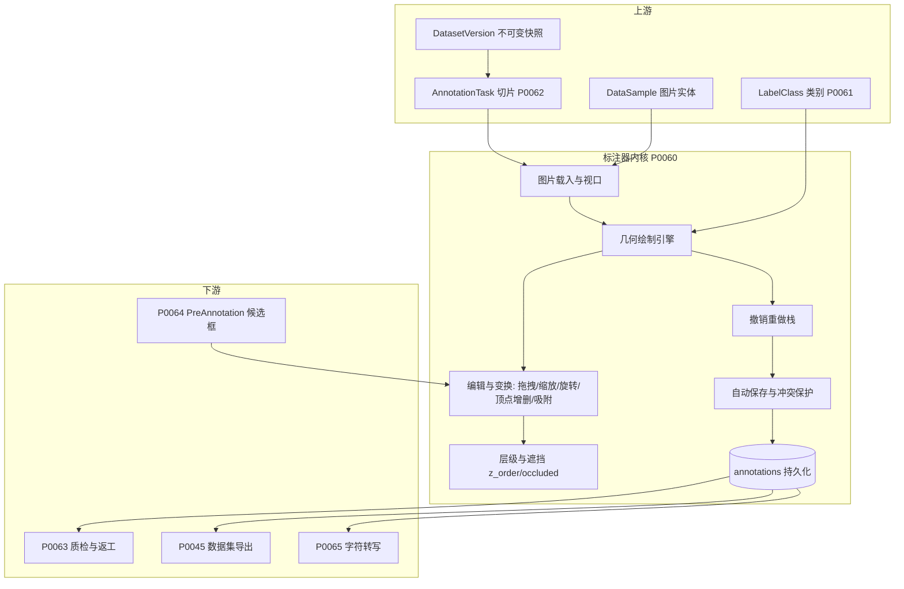
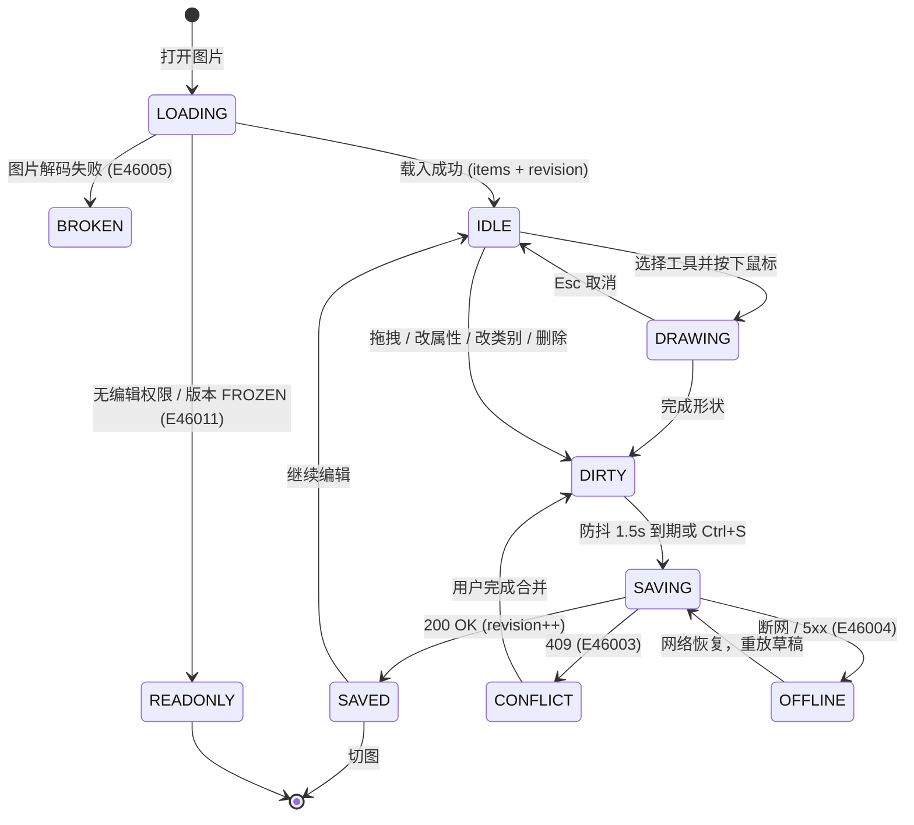
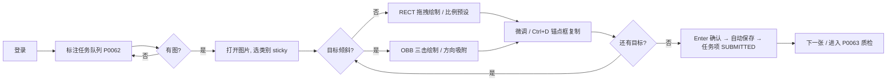
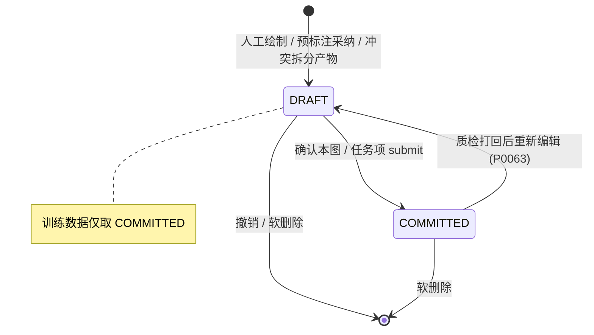

# PRD: P0060_标注器与标注几何 (Annotator & Annotation Geometry)

| 属性 | 内容 |
| :--- | :--- |
| **文档编号** | P0060 |
| **项目名称** | FoodYolo |
| **功能模块** | M04_标注中心 / 内置标注器 |
| **当前版本** | v1.0.0 |
| **文档状态** | Approved |
| **作者** | LabelA |
| **最后更新** | 2026-10-01 |

---

## 1. 全局说明

> **核心定位**: 平台唯一的人工数据生产入口，必须同时满足**通用**（四种几何可扩展、不绑定任务）与**极致高效**（食品包装日期喷码场景下瓶颈是"细长倾斜框画得慢"）。所有几何以**原图归一化坐标**落库，与视口缩放、屏幕分辨率彻底解耦。

### 名词解释

*   **Annotation（标注）**: `annotations` 表中的一行，由 `geometry_type` + 几何数据 + 一个 `LabelClass` 引用构成；一张 `DataSample` 可有 0..N 条。
*   **Geometry（几何）**: 形状类型。本版 `RECT` / `POLYGON` / `KEYPOINT` / `OBB`，枚举预留 `MASK` / `POLYLINE`。
*   **OBB**: 有向矩形框，用 4 个有序顶点表达，与 DOTA 等 OBB 检测任务的通用约定对齐，用于倾斜日期喷码。
*   **Image Space（原图坐标系）**: 以原图像素为单位，左上角为原点，x 向右、y 向下，范围 `[0,width] × [0,height]`。
*   **Normalized Coordinate（归一化坐标）**: 原图坐标除以宽高的 `[0,1]` 浮点数，**唯一持久化格式**。
*   **Viewport（视口）**: canvas 上可见的图像区域，受 `zoom` / `pan` 影响，**永不落库**。
*   **Snap（吸附）**: 拖拽时把候选边/顶点对齐到参考线或邻近标注的行为。
*   **Annotation Revision**: 单图标注的单调递增整数版本号，作为乐观锁比较依据。
*   **Anchor Box（锚点框）**: 日期喷码场景下可一键复制微移的上一个框，是效率核心。
*   **Negative Sample（负样本）**: 明确标记"无目标"的图，`DataSample.is_negative = true`。

### 统一异常处理

| Code | 场景 | 处理策略 |
| :--- | :--- | :--- |
| `E46001` | 几何非法（矩形 w/h ≤ 0；多边形 < 3 顶点或自相交；OBB 非凸/退化） | 阻止落库，画布红色虚线渲染并提示"形状无效：{原因}" |
| `E46002` | 坐标越界或非法数值（NaN / Inf / 超出 `[0,1]` 容差 `1e-4`） | 钳制到 `[0,1]`；钳制后退化则按 `E46001` 处理并写 `AuditLog` |
| `E46003` | 保存冲突（提交的 `annotation_revision` 与库中不一致） | HTTP 409，前端进入三方合并界面（§5.3） |
| `E46004` | 自动保存失败（断网 / 5xx / 磁盘满） | 草稿写 IndexedDB，顶栏转"离线草稿"，恢复后顺序重放 |
| `E46005` | 图片解码失败（损坏 / 不支持 / 像素超上限） | 只读占位图，禁止绘制，提供"标记损坏"操作 |
| `E46006` | 单图标注数超过上限（默认 2000 条） | 拒绝新增，仍允许编辑/删除已有标注 |
| `E46007` | 未选类别即绘制 | 使用 sticky 类别；无历史时阻止绘制并聚焦类别面板 |
| `E46008` | 撤销栈溢出（> 200 步） | 静默丢弃最旧记录，`AuditLog` 记 `UNDO_STACK_TRUNCATED` |
| `E46009` | 跨图粘贴的类别在当前数据集版本不可用 | 丢弃该条标注，提示条列出丢弃数量与类别名 |
| `E46010` | 多边形顶点 > 1000 或关键点 > 50 | 拒绝继续加点并提示上限 |
| `E46011` | 只读上下文（`VIEWER` / 版本 `FROZEN` / 任务非本人持有）尝试编辑 | 画布转只读，编辑入口禁用并提示原因 |
| `E46012` | 字符转写字段非法（> 64 字符或含控制字符） | 阻止提交该条标注，字段标红 |
| `E46013` | 图片二进制缺失或 `DataSample` 已软删除 | 列表项标记"失效"，跳过并继续下一张 |

---

## 2. 项目背景

### 背景 (Context)

FoodYolo 首个落地任务是**食品包装生产日期识别**：第一阶段做**日期区域检测**（YOLO 检测），第二阶段再接 OCR。真实图片对标注很不友好：喷码机与包装摆放角度叠加导致**经常倾斜**（轴对齐框必然带背景）；日期码是**细长区域**（长宽比 8:1 ~ 30:1，在 4000×3000 图里可能只占 3% 面积）；点阵喷码存在**字符粘连**（`1010` 与 `2026` 贴在一起），需要多个相邻框而非一个大框。同时平台定位是 **Local-First 的视觉检测模型训练基建**，面向 2~3 人小团队，标注的人往往就是团队里的工程师本人。

### 问题陈述 (Problem Statement)

1.  **通用工具与任务特性不匹配**: LabelImg 只有矩形框；CVAT 部署重（多服务 Docker Compose）且入口深，为"画日期框"付出的操作成本过高。
2.  **倾斜目标无好工具**: 轴对齐框让模型学到大量背景；OBB 又缺少"快速画、快速复现角度"的交互。
3.  **重复劳动**: 同批次包装的日期位置高度相似，通用工具没有"复制锚点框 + 微调"的一等操作。
4.  **坐标口径不统一**: 绝对像素 / 归一化 / 带缩放系数混用，导出导入反复出现 1~2 px 漂移。
5.  **丢失劳动成果**: 浏览器崩溃、误刷新、两人同标一图会直接丢掉一批标注。

### 目标与成功指标 (Goals & Success Metrics)

*   **北极星指标**: 单图标注平均耗时（打开图片 → 提交）在 4000px 级图片上 **≤ 25 秒**（含 3~6 个框）。
*   **次要指标**: 键盘操作覆盖率 **≥ 90%**；崩溃/断网后标注恢复率 **100%**；并发保存冲突率 **< 1%** 有效图次；平台内标注 → 导出 COCO → 重新导入的顶点偏差 **≤ 0.5 px**。

### 风险与规避 (Risks & Mitigation)

| 风险 | 影响 | 规避方案 |
| :--- | :--- | :--- |
| 4000px 图 + 1000 框时 Canvas 卡顿 | 标注效率指标失守 | 分层渲染（静态层缓存 + 交互层重绘）、视口裁剪、离屏缩略图 |
| 自研标注器功能膨胀 | 拖垮首期排期 | 明确 Out of Scope（AI 预标注 / 质检 / 视频 / 协作光标） |
| 归一化精度不足致小目标形变 | 细长框导出错位 | 全程 `float32`，序列化 6 位小数，禁止用降采样尺寸参与换算 |
| 大图多开导致标签页 OOM | 崩溃丢数据 | 仅缓存当前图 ±1 张解码结果，其余释放；草稿持久化 |
| 多人同图互相覆盖 | 标注被静默丢弃 | `annotation_revision` 乐观锁 + 任务项分片互斥（P0062） |

---

## 3. 价值模型

*   **方案**: 构建**任务无关的标注器内核**（四种几何 + 统一坐标规范 + 撤销栈 + 自动保存），叠加**日期喷码效率层**（锚点框复制、比例锁定、方向吸附、多框连画）。
*   **目标**: 同批 500 张产线图对比通用工具，单图耗时**下降 ≥ 40%**；让"倾斜用 OBB、正立用 RECT"成为自然选择，降低框回归难度（以验证集 mAP@0.5 相对提升衡量，阈值由 P0086 给出）；标注数据格式一次定义、全平台复用（P0061 管类别、P0062 管派单、P0063 管质检、P0065 管转写均读写同一结构）。

---

## 4. 项目范围

### 功能结构图



### In Scope (包含范围)

1.  **四种几何的绘制与编辑**：`RECT` / `POLYGON` / `KEYPOINT` / `OBB`，含拖拽、缩放、旋转、顶点增删、吸附。
2.  **工具栏与快捷键全集**：绘制模式、类别快切、视图操作、批量操作、翻页均可键盘完成。
3.  **坐标存储规范**：原图归一化坐标 + `float32` 精度 + 完整视口变换公式。
4.  **单图标注 JSON schema**：作为 P0061/P0062/P0063/P0065 的公共契约。
5.  **多框层级与遮挡**：`z_order` 排序、点击穿透、遮挡/截断标记、重叠告警。
6.  **撤销重做栈**、**自动保存与冲突保护**（IndexedDB 草稿 + 乐观锁 + 三方合并）。
7.  **日期喷码场景增强**：细长框比例预设、方向吸附、锚点框复制、多框连画、像素级微调。
8.  **图片级元标记**：负样本、难例、损坏（供 P0062 按难例切片、P0063 抽检）。

### Out of Scope (不包含范围)

*   **AI 预标注的产出与调度** → P0064；本模块只定义 `PreAnnotation` 转 `Annotation` 的几何契约。
*   **质检 / 双标一致性 / 返工** → P0063；本模块只保证 `annotation_id` + `revision` 可被比对。
*   **字符转写的业务规则**（文本规范化、OCR 对齐、统计）→ P0065；本模块只提供字段与输入交互。
*   **视频标注 / 时序跟踪 / 插值**：首期不做，视频先抽帧（02_数据导入）。
*   **语义分割 mask / 画笔 / 魔棒**：首期不做，枚举预留 `MASK`。
*   **多人实时协作（同图光标、操作广播）**：改为任务项级分片互斥。
*   **移动端标注**：小程序 / RN 只做采集与预览。

---

## 5. 业务流程

### 5.1 标注会话状态机



### 5.2 单图标注与自动保存

```mermaid
sequenceDiagram
    participant U as 标注员
    participant W as Web 标注器
    participant API as Backend API
    participant DB as PostgreSQL
    U->>W: 从任务队列打开图 i
    W->>API: GET /api/annotations?sample_id={id}
    API->>DB: SELECT annotations (deleted_at IS NULL)
    API-->>W: { items, annotation_revision, image_flags }
    W->>API: GET 缩略图（长边 2048，先渲染）
    W->>API: GET 原图（后台预取，高倍查看用）
    loop 每次编辑（防抖 1.5s / 满 10 次操作 / 切图）
        W->>API: PATCH /api/annotations/bulk  If-Match: N
        API->>DB: 事务内 CAS 校验 revision == N
        alt 一致
            API->>DB: UPSERT annotations; revision = N+1
            API-->>W: 200 { revision: N+1 }
        else 落后
            API-->>W: 409 E46003 { server_items, base_revision }
        end
    end
    U->>W: Enter（确认并跳下一张）
    W->>API: POST /api/annotation-task-items/{item_id}/submit
    API-->>W: 200，任务项状态推进（见 P0062）
```

### 5.3 并发冲突与三方合并

标注员 A、B 同时以 `revision = 7` 打开同一图：A 先保存成功（`revision = 8`），B 的 `If-Match: 7` 将被服务端 CAS 拒绝并返回 `409 E46003 { server_items, base_revision: 7 }`；前端以 `annotation_id` 为单位做 base(7) / mine / server(8) 三方比对，用户裁决后以 `If-Match: 8` 提交合并结果（`revision = 9`）。

> 合并规则：服务端有本地未动 → 保留服务端；本地新增 → 保留；本地删除且服务端未动 → 删除；**双方都改 → 保留服务端，本地版本以新 `annotation_id` 插入为 `DRAFT` 并在列表标"待裁决"**；本地删除但服务端已修改 → 保留服务端并提示删除取消。**任何路径都不静默丢弃人工劳动。**

---

## 6. 用户分析

### 6.1 用户画像 (User Personas)

*   **P1 算法工程师兼任标注员（主力，约 80% 工作量）**｜角色 `TRAINER`：目标是用几百张图快速压出可跑的日期检测模型。诉求：快、可键盘操作、批量复制相似框、结果直接进训练。痛点：画 30 个倾斜细长框要 10 分钟；改类要点三层菜单。
*   **P2 外包 / 兼职标注员**｜角色 `ANNOTATOR`：只被指派到特定数据集版本。诉求：明确的"当前任务/剩余量/已标注数"、误操作可撤销、按量结算。痛点：怕刷新丢数据、怕用错类别。
*   **P3 管理员 / 项目负责人**｜角色 `ADMIN`：定义类别（P0061）、派单（P0062）、看进度。诉求：口径统一、可审计、出问题可追溯。痛点：类别命名混乱、坐标口径不一导致返工。

### 6.2 用户链路图



---

## 7. 功能需求

### M04.F01 矩形框绘制与编辑 (RECT)

*   **用户故事**: 作为标注员，我希望拖拽出矩形并随手调整边和角，以便快速圈出正立的日期区域。
*   **逻辑与业务规则**:
    *   **前置条件**: 图片可编辑；`RECT` 工具激活；类别已选（否则 `E46007`）。
    *   **绘制**: 按下左键记起点 → 拖拽实时预览 `w×h` 与长宽比 → 松开落框 → 自动进入选中态。拖动距离 < 2 px（原图尺度）视为误触取消。
    *   **编辑**: 拖内部平移；拖 8 手柄缩放；`Shift` 保持长宽比；`Alt` 以中心缩放。
    *   **比例锁定**: 预设 `自由 / 1:1 / 4:1 / 8:1 / 12:1 / 20:1`，锁定后按比例约束（见 M04.F10）。
    *   **存储**: `geometry = { x, y, w, h }`，归一化，`x,y` 为左上角。落库 `status = DRAFT` 并触发自动保存。
*   **验收标准**:
    ```gherkin
    场景: 拖拽绘制矩形
      Given 图片 sample-001 已打开且当前类别为 date_region
      When 用户从 (100,200) 拖拽到 (500,260) 后松开
      Then 新增一条 geometry_type=RECT 的标注
      And geometry.w 等于 400 / 原图宽度
      And 1.5 秒后自动保存，annotation_revision 递增 1

    场景: 误触丢弃
      Given RECT 工具激活
      When 用户按下并松开左键且位移小于 2 像素
      Then 不新增任何标注
    ```
*   **边界情况与异常处理**:

    | 场景 | 处理 |
    | :--- | :--- |
    | 框拖出图片边界 | 钳制到 `[0,1]`，不报错（仅记 `E46002`） |
    | 图片缩放到 < 1 倍 | 手柄命中范围按屏幕像素（8 px）计算，不随缩放变小 |
    | `w` 或 `h` 为负（反向拖拽） | 交换角点归一化为正宽高，不报 `E46001` |
    | 单图已达 2000 条 | 阻止新增并提示 `E46006` |

### M04.F02 多边形绘制与编辑 (POLYGON)

*   **用户故事**: 作为标注员，我希望画出贴合不规则包装边缘的多边形，以便标注非矩形或被遮挡的目标。
*   **逻辑与业务规则**:
    *   **绘制**: 左键逐点加点；双击 / 点击首顶点 / `Enter` 闭合；`Esc` 取消；`Backspace` 删上一点。
    *   **编辑**: 拖顶点；双击边插入顶点；选中顶点 `Delete` 删除（须保持 ≥ 3 顶点）；拖内部平移；拖包围盒手柄整体缩放。
    *   **校验**: 顶点数 `3 ≤ n ≤ 1000`（超限 `E46010`）；射线法检测自相交，自相交按 `E46001` 并高亮交叉边。顶点按绘制顺序存储，**首尾不重复**，不强制顺时针。
    *   **存储**: `geometry = { points: [[x,y], ...] }`（归一化）；导出时转 COCO segmentation（扁平数组）或 YOLO-seg 行格式。
*   **验收标准**:
    ```gherkin
    场景: 绘制并闭合多边形
      Given POLYGON 工具已激活
      When 用户依次点击 4 个顶点并双击最后一点
      Then 新增 geometry_type=POLYGON 的标注且 points 长度为 4
      And 首尾顶点不相同

    场景: 删除顶点触发下限保护
      Given 存在 3 顶点多边形且已选中
      When 用户删除一个顶点
      Then 操作被拒绝并提示 "多边形至少需要 3 个顶点" (E46001)
      And 顶点数保持 3
    ```
*   **边界情况与异常处理**:

    | 场景 | 处理 |
    | :--- | :--- |
    | 相邻顶点距离 < 1 px | 闭合时合并重复顶点；合并后 < 3 顶点则删除该标注 |
    | 自相交 | 不允许闭合，末边渲染红色虚线并提示 `E46001` |
    | 缩放后顶点抖动 | 吸附到原图尺度 0.5 px 网格，避免 `1e-7` 噪声 |
    | 顶点数 > 500 拖拽卡顿 | 拖拽期间仅重绘被拖顶点邻接的两条边 |

### M04.F03 关键点标注 (KEYPOINT)

*   **用户故事**: 作为标注员，我希望在目标上打关键点并标注可见性，以便为骨架/定位类任务积累数据。
*   **逻辑与业务规则**:
    *   **模板**: `LabelClass` 携带 `keypoint_schema`（有序名称数组，如 `["tl","tr","br","bl"]`）。一条 `KEYPOINT` 标注代表**一个目标实例**，含模板全部关键点。
    *   **绘制**: 依次点击落点，顺序即模板顺序；全部落位自动完成，`Enter` 可提前完成（未打的点 `visible = 0`）。
    *   **可见性**: `visible ∈ {0 未标注/不可见, 1 可见, 2 遮挡但可推断}`（对齐 COCO）。`visible = 0` 的点记 `(0,0)` 且不参与损失。
    *   **存储**: `geometry = { keypoints: [{ name, x, y, visible }] }`；单条 ≤ 50 点（`E46010`）。
*   **验收标准**:
    ```gherkin
    场景: 完整标注 4 个关键点
      Given 类别 date_corner 的 keypoint_schema 为 ["tl","tr","br","bl"]
      When 用户依次点击 4 个位置
      Then 新增 geometry_type=KEYPOINT 的标注
      And keypoints 顺序为 tl,tr,br,bl 且 visible 均为 1

    场景: 提前结束
      Given 已落下 2 个关键点
      When 用户按下 Enter
      Then 剩余关键点 visible=0 且坐标为 (0,0)
    ```
*   **边界情况与异常处理**:

    | 场景 | 处理 |
    | :--- | :--- |
    | 类别未配置 `keypoint_schema` | 禁用 KEYPOINT 工具并提示"该类别未配置关键点模板" |
    | 两点落在 1 px 内 | 视为重复点击，忽略后者 |
    | 关键点落在图片外 | 钳制到边界，`visible` 不变（`E46002`） |

### M04.F04 旋转框绘制与编辑 (OBB)

*   **用户故事**: 作为标注员，我希望框能跟着日期喷码的倾角旋转，以便紧贴目标、少带背景。
*   **逻辑与业务规则**:
    *   **三击法**: 拖拽确定长边方向与长度 → 移动鼠标调宽度 → 单击落框。
    *   **方向吸附（默认开）**: 新框角度自动对齐到最近 `OBB`（角度差 ≤ 5° 时吸附）；`Alt` 临时禁用。
    *   **编辑**: 拖 4 角点自由形变（须保持凸）；长边中点沿法向调宽、短边中点沿切向调长；拖内部平移；旋转手柄绕中心旋转，`Shift` 吸附 15° 整数倍。
    *   **存储**: `geometry = { points: [[x,y]×4] }`，**4 点为准**，顺序固定 `tl → tr → br → bl`（相对框自身朝向）。派生 `{cx,cy,w,h,angle}` 仅作**只读缓存**随响应返回、不落库；`angle` = 长边与 x 轴夹角，取值 `[-90°, 90°)`，逆时针为正（对齐 DOTA 约定）。
    *   **凸性校验**: 4 点须构成凸四边形且面积 > 0，否则 `E46001`。导出 DOTA 时输出 `x1..y4, class_name, difficult`。
*   **验收标准**:
    ```gherkin
    场景: 三击法绘制
      Given OBB 工具已激活且吸附开启
      When 用户拖出长边、移动鼠标确定宽度后单击
      Then 新增 geometry_type=OBB 的标注且 points 恰为 4 个归一化顶点
      And 顶点按 tl,tr,br,bl 顺序环绕

    场景: 角度吸附
      Given 画布上存在 angle=12° 的 OBB
      When 用户绘制新 OBB 且最终角度为 15°
      Then 新框角度吸附为 12°
    ```
*   **边界情况与异常处理**:

    | 场景 | 处理 |
    | :--- | :--- |
    | 拖成凹四边形 | 阻止提交，回退到最后合法形变，提示 `E46001` |
    | 短边 < 2 px | 视作误触并删除该标注 |
    | 吸附到错误方向 | 仅在夹角 ≤ 5° 且短边差 ≤ 30% 时生效；`Alt` 禁用 |
    | `angle` 在 ±90° 边界抖动 | 派生值以 `1e-6` 容差规范化，UI 不抖动 |

### M04.F05 工具栏与快捷键体系 (Toolbar & Shortcuts)

*   **用户故事**: 作为标注员，我希望几乎所有操作都能键盘完成，以便高强度标注时减少手部移动。
*   **逻辑与业务规则**: 工具集合 = 选择/移动、`RECT`、`POLYGON`、`KEYPOINT`、`OBB`、平移、框选多选、删除。快捷键为**契约**，前端不得随意变更：

    | 快捷键 | 作用 | 快捷键 | 作用 |
    | :--- | :--- | :--- | :--- |
    | `V` / `R` / `P` / `K` / `O` | 选择 / RECT / POLYGON / KEYPOINT / OBB 工具 | `Delete` / `Backspace` | 删除选中标注（支持多选） |
    | `空格` + 拖拽 | 临时平移视图 | `Ctrl+Z` / `Ctrl+Shift+Z` | 撤销 / 重做（栈按图隔离） |
    | `1`~`9` | 切换第 1~9 个类别（对应 P0061 类别顺序） | `Ctrl+D` | 复制选中框并偏移（锚点框） |
    | `Shift`+`1`~`9` | 切换第 10~18 个类别 | `Ctrl+C` / `Ctrl+V` | 复制 / 粘贴（跨图受 `E46009` 约束） |
    | `Q` / `E` | 上一 / 下一类别 | `Ctrl+S` | 立即保存 |
    | `↑↓←→` / `Shift`+方向 | 微移 1 px / 10 px（原图尺度） | `Enter` / `Shift+Enter` | 确认并跳下一 / 上一张 |
    | `Alt`+方向 | 调整宽/高 1 px（RECT / OBB） | `[` / `]` | 选中框 z_order 下移 / 上移 |
    | `C` | 切换 `occluded` | `T` | 聚焦字符转写输入框（P0065） |
    | `+` / `-` / 滚轮 / `0` | 缩放（以光标为锚点） / 复位适配 | `Tab` / `Esc` / `?` | 列表切换选中 / 取消绘制或选中 / 快捷键帮助 |
    *   **冲突规则**: 输入框聚焦时全局快捷键失效（`Esc` 除外）；macOS 上 `Cmd` 等价 `Ctrl`；可自定义重映射，但 `V / R / P / K / O / Enter / Ctrl+Z` 为保留键。
    *   **粘性类别**: 当前类别翻页后保留，同一图内新框默认沿用。
*   **验收标准**:
    ```gherkin
    场景: 数字键切类后绘制
      Given 类别顺序为 [date_region, barcode, qr_code]
      When 用户按数字键 2 并绘制一个矩形
      Then 新标注类别为 barcode

    场景: 输入框内不触发画布快捷键
      Given 字符转写输入框聚焦
      When 用户输入字母 r
      Then 输入框内容为 "r" 且标注工具未切换
    ```
*   **边界情况与异常处理**:

    | 场景 | 处理 |
    | :--- | :--- |
    | 类别数 > 18 | 超出部分仅面板/搜索可选，快捷键不覆盖 |
    | 浏览器快捷键冲突（`Ctrl+S`） | `preventDefault` 劫持，不触发浏览器保存对话框 |
    | 绘制中触发撤销 | 先取消绘制，再执行撤销 |
    | 小键盘 / IME 组合键 | 仅响应 `event.key` 非 `Process` 的按键事件 |

### M04.F06 坐标存储与缩放解耦 (Normalized Coordinates)

*   **用户故事**: 作为开发者，我希望坐标永远以原图归一化值存储，以便任意视口与分辨率下数据口径唯一。
*   **逻辑与业务规则**:
    *   **唯一持久化格式**: 归一化 `float32`，范围 `[0,1]`，序列化保留 **6 位小数**（`round(v·1e6)/1e6`）。整数化不可取（4000 px 图上 1 px ≈ 0.00025）。
    *   **坐标系**: 原点左上，x 向右，y 向下（与 COCO / YOLO / VOC 一致），**不使用**数学坐标系。
    *   **正变换（存储 → 视口）**:
        ```text
        设原图 W0×H0，视口逻辑尺寸 Wc×Hc，设备像素比 dpr（canvas 实际尺寸 Wc·dpr × Hc·dpr）
          fitScale    = min(Wc / W0, Hc / H0)
          zoom        = 用户缩放 ∈ [0.05, 32]
          renderScale = fitScale · zoom
          viewport(vx, vy) = renderScale · (nx·W0, ny·H0) + (tx, ty)
          (tx, ty) = (Wc/2 − renderScale·W0/2 − panX, Hc/2 − renderScale·H0/2 − panY)
        绘制前统一 ctx.setTransform(dpr, 0, 0, dpr, 0, 0)，此后全部按逻辑像素计算
        ```
    *   **逆变换（视口 → 存储）**:
        ```text
        nx = (vx − tx) / (renderScale · W0)
        ny = (vy − ty) / (renderScale · H0)
        落库前：clamp(nx, 0, 1) → 吸附到原图 0.5 px 网格：nx = round(nx·W0·2) / (2·W0)
        ```
    *   **命中测试**: 容差以**屏幕像素**定义（默认 8 px），换算回原图 `tol_orig = 8 / renderScale`；若用固定原图容差，缩放到 0.1 倍时细长框无法点中。
    *   **禁止事项（Code Review 检查项）**: ① 禁止把 `zoom` / `pan` / `dpr` 写入任何持久化结构；② 禁止用缩略图尺寸做坐标换算（缩略图只用于渲染）；③ 禁止用 `Float16Array` 或降采样尺寸参与几何计算。
    *   **精度验收**: 归一化↔原图往返误差 ≤ 0.5 px；连续 100 次"读取→保存"零累积漂移（每次从归一化值重算，不做增量叠加）。
*   **验收标准**:
    ```gherkin
    场景: 缩放平移后绘制的框落在正确位置
      Given 原图 4000×3000，视口 zoom=4 且已平移
      When 用户在视口坐标 (800,600) 落下 RECT 左上角
      Then 落库 geometry.x 等于逆变换结果（误差 ≤ 1e-6）
      And 复位 zoom=1 后该框渲染在原图对应像素位置（误差 ≤ 0.5 px）

    场景: 往返一致性
      Given 一条已保存的 RECT
      When 连续执行 100 次"读取 → 保存"
      Then geometry 数值保持不变
    ```
*   **边界情况与异常处理**:

    | 场景 | 处理 |
    | :--- | :--- |
    | `dpr = 2` 或 1.25（Windows 缩放） | 由 `setTransform` 统一处理，换算只用逻辑像素 |
    | 图片 EXIF 未转正 | 导入阶段已按 EXIF 转正并写回像素；检测到未转正时按 `E46005` 禁止编辑 |
    | 窗口 resize | 重算 `fitScale` 与 `tx/ty`，不改动任何存储值 |
    | 前端宽高与服务端 `DataSample` 不一致 | 以服务端为准并上报 `AuditLog` |

### M04.F07 多框层级与遮挡处理 (Z-Order & Occlusion)

*   **用户故事**: 作为标注员，我希望重叠时能明确谁在上、谁能被点中，以便处理日期码压在条码上这类真实场景。
*   **逻辑与业务规则**:
    *   **`z_order`**: 同图内整数、自 0 递增，越大越靠上；绘制顺序按升序，符合"后画的盖住先画的"。
    *   **点击优先级**: 命中测试从 `z_order` 最大者开始；`Alt + 点击` 逐层向下穿透循环。
    *   **列表联动**: 标注列表按 `z_order` 降序展示，拖拽条目即调整层级，其余条目重排补齐（不留空洞）。
    *   **属性**: `attributes.occluded`（被遮挡）与 `attributes.truncated`（被图片边界截断），快捷键 `C` 切换遮挡；导出写入 COCO 扩展字段供训练侧过滤。
    *   **重叠告警（非阻塞）**: 同类 `RECT`/`OBB` 的 IoU > 0.85 时列表项打"疑似重复"角标并提示合并，**不自动删除**；跨类重叠不告警（日期码压条码是正常的）。
    *   **性能**: > 200 条时列表虚拟滚动；不可见区域的标注跳过绘制与命中测试。
*   **验收标准**:
    ```gherkin
    场景: 点击选中顶层
      Given 图片上有重叠的 A(z_order=0) 与 B(z_order=1)
      When 用户点击重叠区域
      Then 选中 B

    场景: Alt 穿透
      Given 同一重叠区域上的 A 与 B
      When 用户按住 Alt 点击
      Then 选中 A

    场景: 重复框只告警不删除
      Given 同类两条 RECT 的 IoU 为 0.92
      When 第二条绘制完成
      Then 列表出现"疑似重复"角标且两条标注都保留
    ```
*   **边界情况与异常处理**:

    | 场景 | 处理 |
    | :--- | :--- |
    | 两条标注完全重合无法选中下层 | `Alt` 循环穿透；列表点选优先于画布 |
    | 删除中间层 | 其余条目 `z_order` 重排为连续整数 |
    | 并发保存致 `z_order` 重复 | 服务端按 `(z_order, created_at, id)` 稳定排序，不报错 |
    | 单图 2000 框 | 禁用实心填充，只画边框；命中测试走网格空间索引 |

### M04.F08 撤销重做栈 (Undo/Redo Stack)

*   **用户故事**: 作为标注员，我希望误操作能一键回退，以便敢于快速操作而不怕出错。
*   **逻辑与业务规则**:
    *   **作用域**: 栈按 `sample_id` 隔离；切图时内存中最多保留 3 张图的栈，超出丢弃最旧（不落库）。
    *   **记录内容**: `CREATE / DELETE / MOVE / RESIZE / ROTATE / VERTEX_ADD / VERTEX_DELETE / CLASS_CHANGE / ATTR_CHANGE / Z_ORDER_CHANGE / BATCH_*`，记录受影响标注的 before/after；批量操作（如"删除 15 个框"）折叠为**一步**。
    *   **上限**: 200 步，溢出静默丢弃最旧（`E46008` 仅审计）；执行新操作后清空 redo 分支。
    *   **与保存的关系**: 撤销/重做**照常触发自动保存**（推高 `revision`），不做"跨保存点回滚服务端"。
    *   **与冲突的关系**: 进入 `E46003` 合并界面时栈冻结，合并完成后清空并重载基线。单图栈内存上限 8 MB。
*   **验收标准**:
    ```gherkin
    场景: 撤销与重做一次绘制
      Given 用户刚绘制一个矩形
      When 用户按 Ctrl+Z
      Then 该框从画布与列表消失
      And 按 Ctrl+Shift+Z 后恢复且 geometry 完全一致

    场景: 批量删除折叠为一步
      Given 用户框选 15 个标注并按下 Delete
      When 用户按 Ctrl+Z 一次
      Then 15 个标注全部恢复

    场景: 连续撤销
      Given 用户执行了 10 次独立的框位置微调
      When 连续按 Ctrl+Z 十次
      Then 每次只回退一步并回到最初位置
    ```
*   **边界情况与异常处理**:

    | 场景 | 处理 |
    | :--- | :--- |
    | 栈空时按 `Ctrl+Z` | 无操作，按钮置灰，不弹提示 |
    | 撤销涉及已被服务端删除的标注 | 以新 `annotation_id` 重建为 `DRAFT`，避免主键冲突 |
    | 撤销栈对象过大 | 单图超 8 MB 时按最旧记录丢弃 |

### M04.F09 自动保存与冲突保护 (Autosave & Conflict Guard)

*   **用户故事**: 作为标注员，我希望系统自动保存并在与他人冲突时明确告知，以便不丢数据、不覆盖他人成果。
*   **逻辑与业务规则**:
    *   **触发**: 防抖 **1.5 s**，或累积 **10 次**操作，或切图前，或 `Ctrl+S`，或 `beforeunload`（`navigator.sendBeacon` 尽力发送）。
    *   **写入单位**: 增量 `dirty` 集合（新增/修改/删除的 `annotation_id`），服务端一个事务内应用并返回新 `annotation_revision`。
    *   **乐观锁**: 请求头 `If-Match: <revision>`，服务端事务内 `SELECT ... FOR UPDATE` 比较，不一致返回 `409 E46003` + 服务端当前 `items` 与 `base_revision`。
    *   **离线草稿**: 失败或离线时把操作 + 基线 revision 写入 IndexedDB，顶栏显示"离线草稿 · N 项未同步"；恢复后**按顺序重放**，遇 409 转合并界面。
    *   **多标签页同图**: `BroadcastChannel` 声明独占，第二个标签页转只读，避免自冲突。
    *   **请求串行化**: 同一图同时最多一个在途保存请求。
*   **验收标准**:
    ```gherkin
    场景: 编辑后自动保存
      Given 图片 sample-001 当前 annotation_revision = 12
      When 用户移动一个标注并停止操作 1.5 秒
      Then 前端发出 PATCH 且 If-Match 为 12
      And 服务端返回 200 且 revision = 13
      And 顶栏显示"已保存"

    场景: 保存冲突不覆盖
      Given 本地基线 revision = 12 而服务端已推进到 13
      When 用户触发保存
      Then 服务端返回 409 E46003
      And 前端打开冲突合并界面并列出双方差异
      And 用户未做选择前不得覆盖服务端数据

    场景: 断网继续标注
      Given 网络已断开
      When 用户绘制 5 个框
      Then 标注正常显示且顶栏显示"离线草稿 · 5 项未同步"
      When 网络恢复
      Then 草稿自动重放并保存成功
    ```
*   **边界情况与异常处理**:

    | 场景 | 处理 |
    | :--- | :--- |
    | 数据集版本已 `FROZEN` | 返回 403 并提示 `E46011`，画布转只读 |
    | 任务项 lease 已被他人持有 | 返回 409 且错误码带 `LEASE_LOST`，提示"该图已被转交，请刷新"（P0062） |
    | 存储写失败 / 磁盘满 | 返回 507，前端保留草稿并提示 `E46004` |
    | IndexedDB 不可用（隐私模式） | 降级为内存草稿，关闭页面前弹窗拦截提醒 |
    | 工作区用户强制刷新 | 从 IndexedDB 恢复 dirty 集合并重放，UI 提示"已恢复未保存的 N 项修改" |

### M04.F10 日期喷码场景增强 (Date-Code Workflow)

*   **用户故事**: 作为标注员，我希望针对细长倾斜日期码有专门操作，以便数秒内完成一张图。
*   **逻辑与业务规则**:
    *   **比例预设**: `8:1 / 12:1 / 20:1 / 自定义`，默认 **12:1**；拖动方向决定框朝向（横/纵自动判定）。
    *   **锚点框复制（核心效率项）**: `Ctrl+D` 复制选中框到右侧偏移 `框宽 × 1.02` 处并保持类别与角度，连按即生成**相邻框**——直接对应"粘连字符需要多个相邻框"；`Alt+Ctrl+D` 复制到正下方。
    *   **多框连画模式**: 开启后以前一框的尺寸与角度为模板进入放置模式，单击即落框，`Esc` 退出。
    *   **方向吸附优先级**: ① 同图最近的 `OBB`；② 存在的 `PreAnnotation` 候选框角度。容差 5°，`Alt` 临时禁用。
    *   **像素级微调**: `zoom ≥ 4` 时方向键步长自动切为**原图 1 px**，`Shift` 为 10 px，`Alt` 调尺寸；右下角常驻显示当前步长。
    *   **细长框显示适配**: `max(w,h)/min(w,h) > 10` 时手柄仍按屏幕像素尺寸渲染（不被窄边压扁），并在框中心显示短边长度（px）。
    *   **粘连字符语义约定**: 语义可分割的相邻码段（如批次码 + 日期码）应画成**多个相邻框**而非一个大框，框间允许 0~2 px 重叠；该约定写入任务说明（P0062）并作为 P0063 的质检项。
    *   **倾斜文本**: 相对图片旋转超过 ±45° 时优先 `OBB`；平台不做自动转正（属 P0064 / 流水线增强）。
*   **验收标准**:
    ```gherkin
    场景: 比例预设快速绘制细长框
      Given 预设为 12:1 且类别为 date_region
      When 用户横向拖拽绘制
      Then 新框长宽比精确为 12:1（误差 ≤ 0.5%）
      And 框角度跟随拖拽方向

    场景: 连续复制生成相邻框
      Given 存在 angle=8° 的 OBB 且处于选中态
      When 用户连按三次 Ctrl+D
      Then 新增 3 个框，角度均为 8°
      And 相邻框水平间隔约为框宽的 1.02 倍

    场景: 高倍缩放下微调
      Given zoom=6
      When 用户按下右方向键
      Then 选中框在原图尺度右移 1 px
      And 界面显示"步长 1px"

    场景: 多框连画
      Given 连画模式开启且模板为 600×50 像素
      When 用户在 3 个位置依次单击后按 Esc
      Then 新增 3 个同尺寸同角度框并退出连画模式
    ```
*   **边界情况与异常处理**:

    | 场景 | 处理 |
    | :--- | :--- |
    | 比例锁定导致越界 | 允许越界绘制，松开后钳制到边界（可能破坏比例）并提示"比例已因边界调整" |
    | `Ctrl+D` 连按致框飞出图片 | 偏移方向自动翻转；两侧都无空间时提示"无可用相邻位置" |
    | 连画模式下模板框被删除 | 自动退出连画模式并提示 |
    | 分辨率 < 1000 px 致 12:1 短边不足 2 px | 落框时最小短边取 2 px 并提示 |
    | 用户把整行码画成一个超长框 | 不阻塞；由 P0063 按标注指引判定不合规并打回 |

---

## 8. 技术架构与数据模型

### 8.1 数据实体

#### Table: `annotations`

| 字段名 | 类型 | 必填 | 说明 | 约束 |
| :--- | :--- | :--- | :--- | :--- |
| `id` | UUID | Y | 主键，跨导出/导入保持稳定 | PK |
| `sample_id` | UUID | Y | → `DataSample.id` | FK, INDEX |
| `dataset_version_id` | UUID | Y | 所属 `DatasetVersion`（不可变快照） | FK, INDEX |
| `geometry_type` | Enum | Y | `RECT` / `POLYGON` / `KEYPOINT` / `OBB` | |
| `geometry` | JSONB | Y | 归一化几何数据，见 §8.2 | 结构校验 |
| `class_id` | UUID | Y | → `LabelClass.id`（**稳定 UUID，重命名不变**） | FK, INDEX |
| `class_name_snapshot` | String(64) | Y | 保存时类别名快照，便于导出与历史比对 | |
| `attributes` | JSONB | Y | `{ occluded, truncated, difficult, group_id }` | 默认 `{}` |
| `transcription` | String(64) | N | 字符转写文本；字段与规范化规则由 P0065 定义 | `[E46012]` |
| `z_order` | Int | Y | 同图绘制层级，越大越靠上 | DEFAULT 0 |
| `source` | Enum | Y | `HUMAN` / `MODEL`（预标注采纳）/ `IMPORTED` | DEFAULT `HUMAN` |
| `confidence` | Float | N | `source=MODEL` 时的置信度 | `[0,1]` |
| `status` | Enum | Y | `DRAFT` / `COMMITTED` | DEFAULT `DRAFT` |
| `revision` | Int | Y | 该条标注自身修订号 | DEFAULT 1 |
| `created_by` | UUID | Y | → `User.id` | FK |
| `created_at` / `updated_at` | timestamptz | Y | | |
| `deleted_at` | timestamptz | N | 软删除 | INDEX |

**索引**: `(sample_id, deleted_at)`、`(dataset_version_id, class_id)`、`(dataset_version_id, status)`。

#### Table: `annotation_revisions`

| 字段名 | 类型 | 必填 | 说明 | 约束 |
| :--- | :--- | :--- | :--- | :--- |
| `id` | UUID | Y | 主键 | PK |
| `sample_id` | UUID | Y | 图片 | UNIQUE(`sample_id`,`revision`) |
| `revision` | Int | Y | 单图标注整体版本号，乐观锁依据 | |
| `item_count` | Int | Y | 该版本下标注条数 | |
| `changed_by` | UUID | Y | 最后修改者 | FK `User` |
| `changed_at` | timestamptz | Y | 修改时间 | |
| `created_at` / `updated_at` | timestamptz | Y | | |

> 仅保留当前版本行 + 最近 20 个历史行用于冲突诊断；完整操作历史由 `AuditLog` 承担，避免正文表膨胀。

#### 图片级标记（`DataSample` 上的字段，由 03_数据管理维护、本模块消费）

| 字段名 | 类型 | 说明 |
| :--- | :--- | :--- |
| `annotation_status` | Enum | `UNLABELED / LABELED / VERIFIED / REJECTED`（DataSample 契约字段） |
| `is_hard_example` | Bool | 难例标记（DataSample 契约字段），供 P0062 按难例切片 |
| `is_negative` | Bool | 显式无目标（负样本），由本模块写入，默认 false |
| `is_broken` | Bool | 文件不可读/损坏；由导入预检或标注器"标记损坏"写入，默认 false |

### 8.2 标注 JSON Schema（公共契约）

```json
{
  "schema_version": "1.0",
  "sample": { "id": "1f2c9a4e-...-b7d1", "dataset_version_id": "8a3b...-c20f",
              "width": 4032, "height": 3024, "checksum": "sha256:9f2ab1..." },
  "annotation_revision": 42,
  "image_flags": { "negative": false, "broken": false },
  "items": [
    {
      "id": "d41d8cd9-...-9f00",
      "geometry_type": "RECT",
      "class_id": "77a1c0e2-...-3b55",
      "class_name_snapshot": "date_region",
      "geometry": { "x": 0.512345, "y": 0.264789, "w": 0.241000, "h": 0.018000 },
      "attributes": { "occluded": false, "truncated": false, "difficult": false, "group_id": null },
      "transcription": null,
      "z_order": 3, "source": "HUMAN", "confidence": null,
      "status": "COMMITTED", "revision": 2,
      "created_by": "5b0f...-aa12",
      "created_at": "2026-10-01T09:12:33Z", "updated_at": "2026-10-01T09:12:41Z"
    },
    {
      "id": "0a7e3b51-...-c9d2",
      "geometry_type": "OBB",
      "class_id": "77a1c0e2-...-3b55",
      "class_name_snapshot": "date_region",
      "geometry": { "points": [[0.5201, 0.2810], [0.7614, 0.2659], [0.7632, 0.2841], [0.5219, 0.2992]] },
      "attributes": { "occluded": true, "truncated": false, "difficult": false, "group_id": null },
      "transcription": "2026-10-01",
      "z_order": 4, "source": "MODEL", "confidence": 0.91,
      "status": "DRAFT", "revision": 1,
      "created_by": "5b0f...-aa12",
      "created_at": "2026-10-01T09:13:02Z", "updated_at": "2026-10-01T09:13:02Z"
    },
    {
      "id": "3c9f12ab-...-77e4",
      "geometry_type": "POLYGON",
      "class_id": "a1b2c3d4-...-ee01",
      "class_name_snapshot": "barcode",
      "geometry": { "points": [[0.1010, 0.4020], [0.4010, 0.4010], [0.4020, 0.4510], [0.1000, 0.4520]] },
      "attributes": { "occluded": false, "truncated": false, "difficult": false, "group_id": null },
      "transcription": null,
      "z_order": 5, "source": "HUMAN", "confidence": null,
      "status": "COMMITTED", "revision": 1,
      "created_by": "5b0f...-aa12",
      "created_at": "2026-10-01T09:14:10Z", "updated_at": "2026-10-01T09:14:10Z"
    },
    {
      "id": "9e77d0f1-...-2a63",
      "geometry_type": "KEYPOINT",
      "class_id": "c0ffee00-...-1234",
      "class_name_snapshot": "date_corner",
      "geometry": { "keypoints": [
        { "name": "tl", "x": 0.5201, "y": 0.2810, "visible": 1 },
        { "name": "tr", "x": 0.7614, "y": 0.2659, "visible": 1 },
        { "name": "br", "x": 0.7632, "y": 0.2841, "visible": 2 },
        { "name": "bl", "x": 0.0000, "y": 0.0000, "visible": 0 } ] },
      "attributes": { "occluded": false, "truncated": true, "difficult": false, "group_id": null },
      "transcription": null,
      "z_order": 6, "source": "HUMAN", "confidence": null,
      "status": "COMMITTED", "revision": 1,
      "created_by": "5b0f...-aa12",
      "created_at": "2026-10-01T09:16:00Z", "updated_at": "2026-10-01T09:16:00Z"
    }
  ],
  "meta": { "annotator": "5b0f...-aa12", "task_item_id": "4b8d...-9911",
            "duration_ms": 45123, "tool_version": "annotator/1.0.0" }
}
```

**各几何的 `geometry` 约束**:

| geometry_type | 字段 | 类型 | 约束 |
| :--- | :--- | :--- | :--- |
| `RECT` | `x`,`y`,`w`,`h` | float | `0 ≤ x, 0 ≤ y, w > 0, h > 0, x+w ≤ 1+1e-4, y+h ≤ 1+1e-4` |
| `POLYGON` | `points` | float[][2] | `3 ≤ len ≤ 1000`，首尾不重复，不自相交 |
| `OBB` | `points` | float[][2] | `len == 4`，凸，按 `tl,tr,br,bl` 环绕，面积 > 0 |
| `KEYPOINT` | `keypoints` | object[] | `1 ≤ len ≤ 50`，`visible ∈ {0,1,2}`，`visible = 0 → x = y = 0` |

### 8.3 标注条目生命周期

> 前端会话状态：`baseRevision`（乐观锁基线）、`items`（当前标注集）、`dirtySet`（待同步 id 集合）、`undoStack` / `redoStack`（上限 200）、`viewport`（`zoom`/`pan`，仅内存）、`offlineDraft`（IndexedDB）。



---

## 9. UI/UX 规格说明

### 主界面线框

```text
┌───────────────────────────────────────────────────────────────────────────────────────┐
│ FoodYolo 标注器  [任务: 日期检测-第1批]  图 23/150  已标 22  剩余 127      [已保存 ●]  │
├──────────┬────────────────────────────────────────────┬───────────────────────────────┤
│ 图片列表 │                                            │ 类别 (共 4)                   │
│ ┌──────┐ │        ┌──────────────────────────────┐    │ [1] date_region  ● 蓝         │
│ │ ✔ 21 │ │        │                              │    │ [2] barcode      ● 绿         │
│ │ ▶ 22 │ │        │        [ 画布 canvas ]        │    │ [3] qr_code      ● 橙         │
│ │ ○ 23 │ │        │    ╭─────────────╮ ← OBB      │    │ [4] date_corner  ● 紫         │
│ │ …    │ │        │    ╰─────────────╯            │    ├───────────────────────────────┤
│ └──────┘ │        └──────────────────────────────┘    │ 标注列表 (z 降序)             │
│          │   ┌────────────────────────────────────┐   │ ● date_region OBB   #4        │
│ [筛选:未标]│   │ 工具 V R P K O │ 比例 12:1 ▾ │ 吸附│   │ ● barcode     POLY  #3        │
│          │   └────────────────────────────────────┘   │ ⚠ 疑似重复 IoU 0.92          │
│          │   zoom 6.0x  步长 1px  坐标 (2014, 803)    │ ● date_region RECT  #1        │
├──────────┴────────────────────────────────────────────┴───────────────────────────────┤
│ [◀ 上一张 Shift+Enter] [保存 Ctrl+S] [多框连画] [确认本图 Enter] [快捷键 ?]           │
└───────────────────────────────────────────────────────────────────────────────────────┘
```

### 交互元素

| 元素 | 类型 | 状态 | 行为 |
| :--- | :--- | :--- | :--- |
| 工具按钮组 | ToggleGroup | Default / Active / Disabled | 切换几何工具；只读态全部 Disabled 并给出原因 tooltip |
| 比例预设 | Select | Default / Hover | `自由 / 8:1 / 12:1 / 20:1 / 自定义`，生效于下一次绘制 |
| 吸附开关 | Switch | On / Off | 控制角度吸附；按住 `Alt` 临时反转 |
| 类别列表项 | ListItem | Normal / Selected / Disabled | 单击切类；Disabled = 该类别在当前数据集版本不可用 |
| 标注列表项 | ListItem | Normal / Selected / Dragging | 拖拽调 `z_order`；右键菜单（复制/删除/置顶/置底） |
| 转写输入框 | Input | Default / Focus / Error | 聚焦时全局快捷键失效；非法内容提示 `E46012` |
| 保存状态指示 | StatusBadge | 已保存 / 保存中 / 未保存 / 离线草稿 / 冲突 | 冲突态点击打开合并抽屉 |
| 确认本图按钮 | Button | Default / Disabled / Loading | 等价 `Enter`；提交后按任务配置跳下一张或进入质检 |
| 冲突合并抽屉 | Drawer | Closed / Open | 三方差异列表，逐条选择"保留我的 / 保留服务端 / 两条都留" |

### 表单与校验

| 字段 | 类型 | 校验规则 | 默认值 |
| :--- | :--- | :--- | :--- |
| 字符转写 | Input | ≤ 64 字符；禁止控制字符；允许数字/字母/`-`/`/`/`.`/空格 | 空 |
| 遮挡 / 截断 / 难例 | Checkbox | - | false |
| 自定义属性 | KeyValue | Key ≤ 32 字符；Value ≤ 128 字符 | - |

---

## 10. 非功能性需求 (NFR)

*   **性能**: 4000×3000 图首屏（缩略图可绘制）**< 800 ms**，原图按需加载 **< 2 s**；拖拽/缩放帧率 **≥ 50 FPS**（1000 条标注时 ≥ 30 FPS）；自动保存 P95 **< 500 ms**；撤销单步 **< 50 ms**。
*   **可靠性**: 崩溃/刷新后草稿恢复率 **100%**（IndexedDB）；任何冲突路径下双方标注均可从 UI 取回，不静默丢失。
*   **安全**: 编辑权限受 RBAC 约束（`VIEWER` 只读；`ANNOTATOR` 仅限被指派任务范围；`TRAINER`/`ADMIN` 可编辑全量）；写操作全部落 `AuditLog`（`entity=annotations`, `action=CREATE/UPDATE/DELETE/MERGE`）；图片经短期签名 URL 读取，不暴露存储路径。
*   **兼容性**: 桌面 Chrome / Edge ≥ 120、Safari ≥ 17；最小可用视口 1280×720；< 1024 px 提示"请使用桌面端标注"；不提供移动端标注界面。
*   **可扩展性**: 单图标注上限 **2000** 条；2~3 人并发标注同一版本时单实例即可支撑（QPS < 50）；新增几何类型仅扩展 `geometry_type` 枚举与校验器插件，不改表结构。

---

## 附录

### 已确认的设计决策

| 决策项 | 结论 |
| :--- | :--- |
| 坐标持久化格式 | 原图归一化 `float32`，序列化保留 6 位小数；`zoom`/`pan`/`dpr` 永不落库 |
| 坐标系原点 | 左上角，x 向右，y 向下（与 COCO / YOLO / VOC 一致） |
| OBB 存储方式 | 4 个归一化顶点为准（`tl,tr,br,bl`），`cx/cy/w/h/angle` 为派生只读缓存；`angle ∈ [-90°,90°)` 逆时针为正 |
| 类别引用 | `class_id`（稳定 UUID）+ `class_name_snapshot`；重命名零迁移（P0061） |
| 单图并发控制 | `annotation_revision` 乐观锁（`If-Match`），冲突 409 `E46003`，按 `annotation_id` 三方合并 |
| 多标签页同图 | `BroadcastChannel` 独占，第二个标签页只读，避免自冲突 |
| 撤销栈 | 按图隔离，上限 200 步，批量折为一步，跨保存点不回滚服务端 |
| 自动保存 | 防抖 1.5 s / 10 次操作 / 切图 / `Ctrl+S`；离线写 IndexedDB 顺序重放 |
| 重叠处理 | `z_order` 决定绘制与点击优先级，`Alt+点击` 穿透；同类 IoU > 0.85 告警但不自动合并 |
| 日期码线框约定 | 语义可分割的相邻码段画成多个相邻框（允许 0~2 px 重叠），不做自动转正 |
| 关键点可见性 | 复用 COCO `0/1/2`，`visible = 0` 记 `(0,0)` 且不参与损失 |
| 转写字段归属 | `transcription` 为 `annotations` 上的可空列，语义与规范化由 P0065 定义 |
| 图片级标记 | 复用 `DataSample` 标量字段：`is_negative`（显式无目标）、`is_broken`（文件损坏）、`is_hard_example`（难例）；不引入 JSONB 聚合字段 |
| 首期不做的几何 | `MASK` / `POLYLINE` / 3D 点云，枚举预留 |
| 标注条目状态 | `DRAFT` / `COMMITTED` 两态；训练数据仅取 `COMMITTED` |

### 关联文档

| 文档 | 关系 |
| :--- | :--- |
| `P0061_类别体系管理` | 提供 `LabelClass` / `LabelGroup` 与快捷键映射 |
| `P0062_标注任务与派单` | 提供标注上下文（任务项、权限、翻页顺序）与分片互斥 |
| `P0063_质检与返工` | 消费 `annotations`，按 `annotation_id` + `revision` 双标比对 |
| `P0064_AI 预标注` | 产出 `PreAnnotation`，采纳后转为本模块 `Annotation`（`source=MODEL`） |
| `P0065_字符转写与 OCR 标注` | 使用 `transcription` 列，定义规范化与统计规则 |
| `P0045_数据集导出` | 按本模块坐标规范导出 COCO / YOLO / VOC / DOTA |
| `03_数据管理` | `DataSample` / `DatasetVersion` 提供图片与版本上下文 |

### Changelog

| 版本 | 日期 | 作者 | 说明 |
| :--- | :--- | :--- | :--- |
| v1.0.0 | 2026-10-01 | LabelA | 首版：四种几何、坐标规范、JSON schema、自动保存与冲突保护、日期喷码增强 |
