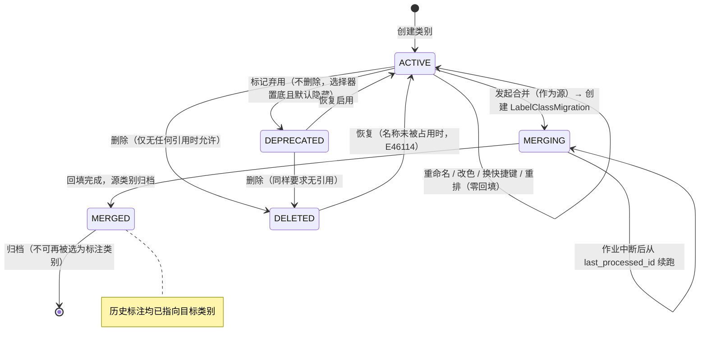
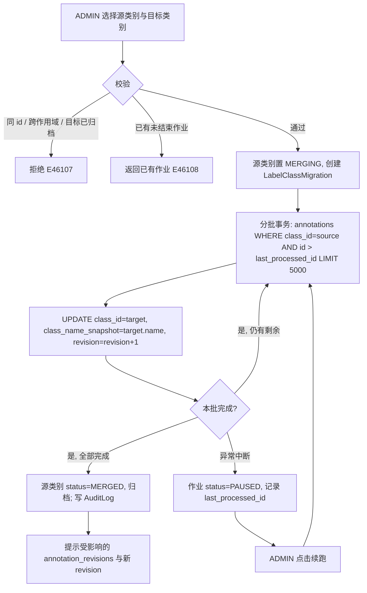
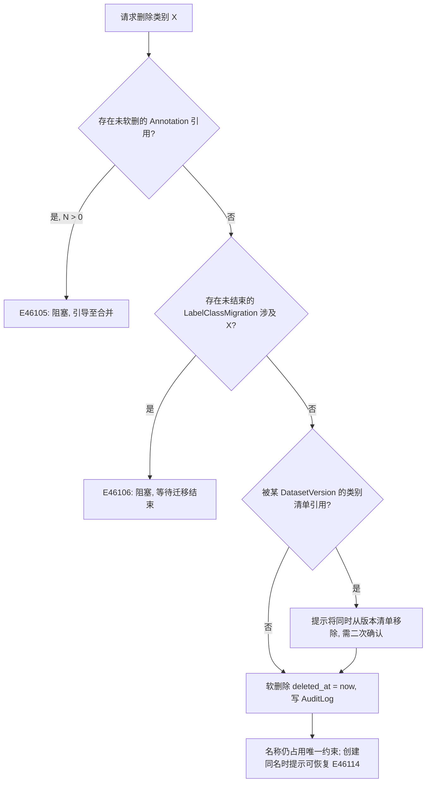
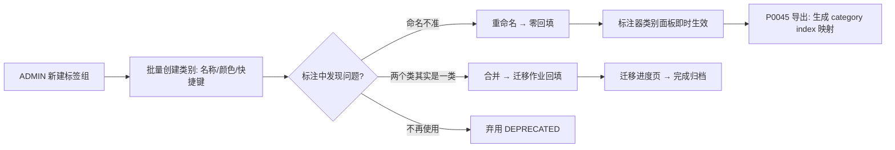
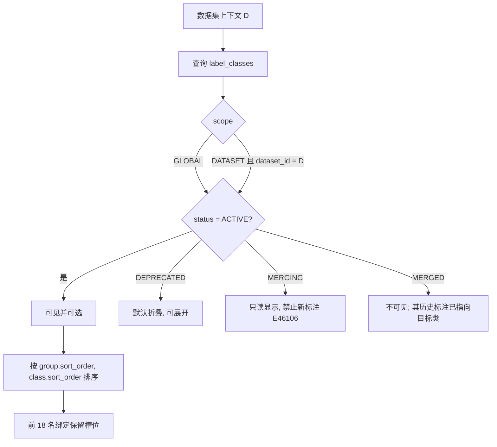

# PRD: P0061_类别体系管理 (Label Class Taxonomy)

| 属性 | 内容 |
| :--- | :--- |
| **文档编号** | P0061 |
| **项目名称** | 轻眸识刻 |
| **功能模块** | M04_标注中心 / 类别体系 |
| **当前版本** | v1.0.0 |
| **文档状态** | Approved |
| **作者** | LabelA |
| **最后更新** | 2026-10-01 |

---

## 1. 全局说明

> **核心定位**: `LabelClass` 是 轻眸识刻 **全平台唯一的标签语义源**。标注器（P0060）、导入映射（P0024）、训练导出（05_训练平台 / P0045）、质检（P0063）、字符转写（P0065）都只引用 `LabelClass.id`，不各自维护标签字符串。本模块的目标是：**让类别可以在项目早期被随意改名、随意合并，而不产生任何数据返工**。

### 名词解释

*   **LabelGroup（标签组）**: `label_groups` 表中的展示分组（如"日期相关"、"包装标识"），只影响 UI 分组与筛选，**不参与训练语义**。
*   **LabelClass（类别）**: `label_classes` 表中的一行 = 一个可被标注的语义类别。字段含 `name` / `color` / `shortcut` / `description` / `sort_order` / `scope`。
*   **Scope（作用域）**: 类别可见范围，`GLOBAL`（全平台所有数据集可用）或 `DATASET`（仅 `dataset_id` 指向的那个数据集可用）。
*   **Alias（别名）**: 类别曾用名列表。重命名后旧名进入 `aliases`，用于导入映射（P0024）自动匹配与历史数据可读性。
*   **Class ID（类别标识）**: 类别的稳定 UUID。**重命名不改变它**，因此已有标注无需回填。
*   **Merge（合并）**: 把源类别的全部标注改写为目标类别，随后源类别归档。**必须回填**。
*   **LabelClassMigration（迁移作业）**: `label_class_migrations` 表，承载合并/归并的后台批量回填任务，可暂停、续跑、查看进度。
*   **Reserved Slot（保留位）**: 快捷键 `1`~`9` / `Shift+1`~`9` 对应的前 18 个类别槽位，由 `sort_order` 决定。
*   **Class Index（类别序号）**: 导出 YOLO txt / COCO 时需要的 `0..N-1` 整数索引，**由导出时按 `sort_order` 动态生成**，不落库、不等于 `sort_order`。

### 统一异常处理

| Code | 场景 | 处理策略 |
| :--- | :--- | :--- |
| `E46101` | 同作用域内类别名重复 | 阻止提交并高亮冲突类别，提供"跳转到已有类别" |
| `E46102` | 类别名非法（空 / > 64 字符 / 含控制字符 / 首尾空白） | 阻止提交，字段标红并给出具体原因 |
| `E46103` | 快捷键已被占用 | 阻止提交并提示占用者，提供"交换快捷键"一键解决 |
| `E46104` | 颜色值非法（非 `#RRGGBB` / 与相邻类别色差过小） | 非法值阻止提交；色差过小仅告警不阻塞 |
| `E46105` | 类别被已有标注引用，删除被阻塞 | 阻止删除，返回引用数量并指向合并入口 |
| `E46106` | 类别处于 `MERGING` 状态 | 禁止编辑该类别、禁止新标注，提示"迁移中，剩余 N 张" |
| `E46107` | 合并目标非法（与源同 id / 跨作用域 / 目标已归档） | 阻止提交并给出原因 |
| `E46108` | 同类迁移作业已存在（未结束） | 返回已有作业 id 并跳转进度页，不重复创建（幂等） |
| `E46109` | 迁移作业中断或超时 | 作业转 `PAUSED`，页面提示"可续跑"，续跑从 `last_processed_id` 继续 |
| `E46110` | 非 `ADMIN` 执行类别管理写操作 | 403，界面入口对非管理员隐藏 |
| `E46111` | 作用域提升（`DATASET` → `GLOBAL`）名称冲突 | 阻止提交，提供"改用别名"或"合并到全局类别" |
| `E46112` | 数据集无任何可用类别 | 标注器禁用绘制并引导跳转本模块创建类别 |
| `E46113` | 导出时类别数与标注中出现的类别不一致 | 导出前校验，阻止导出并列出孤儿 `class_id` |
| `E46114` | 恢复已删除类别时名称被占用 | 阻止恢复，提示占用者 |

---

## 2. 项目背景

### 背景 (Context)

日期检测项目的类别看起来很少（初期只有 `date_region`），但真实演进极快：第一周只要日期区域，第三周会拆出 `batch_code` / `lot_code`，第五周引入 `qr_code` / `barcode`，还可能出现"先把两段日期码合成 `date_all`，后来才发现必须拆开"的返工。两名工程师在不同时间标注，命名习惯不一致（`date` / `date_region` / `DateRegion`）几乎是必然事件。平台同时要支持多数据集（未来的其他包装识别任务），类别不能全局硬编码。

### 问题陈述 (Problem Statement)

1.  **标签字符串内联存储的灾难**: 若标注里直接存 `"date_region"` 字符串，一次改名就要全表回填，回填中断还会留下半新半旧的脏数据。
2.  **合并无工具**: 把 `date` 合并进 `date_region` 意味着重写大量标注外键，手工不可行。
3.  **快捷键与颜色冲突**: 多人各自设置后出现"两个类共用数字键 3"，标注现场才发现。
4.  **导入侧标签对齐**: 外部数据集（COCO / YOLO）的标签名五花八门，需要与平台类别对齐（P0024），前提是平台类别有稳定标识与别名历史。
5.  **误删不可逆**: 删除被 3000 条标注引用的类别，若无阻塞机制会直接造成标注失效。

### 目标与成功指标 (Goals & Success Metrics)

*   **北极星指标**: 类别重命名 / 描述 / 颜色 / 顺序调整的**标注数据回填量 = 0**（`class_id` 稳定不变）。
*   **次要指标**:
    *   合并迁移 10 万条标注的作业**成功率 100%**，中断后可从断点续跑。
    *   导出格式（COCO `categories` / YOLO `names` / VOC）与本模块类别定义一致率 **100%**（`E46113` 校验拦截）。
    *   快捷键冲突在保存时即被发现，**不允许流入标注现场**。
    *   类别变更全部可在 `AuditLog` 追溯（谁、何时、改了什么、影响了多少标注）。

### 风险与规避 (Risks & Mitigation)

| 风险 | 影响 | 规避方案 |
| :--- | :--- | :--- |
| 合并迁移中断 | 部分标注已改、部分未改 | 分批事务 + `last_processed_id` 断点续跑 + 源类别 `MERGING` 状态封禁编辑 |
| 类别名滥用（一个数据集建 200 类） | 标注效率与训练指标双降 | 数据集详情显示类别数告警阈值（> 30 提示），不硬限制 |
| 全局类别被误删 | 影响所有数据集 | 删除仅 `ADMIN`；有引用即阻塞；软删除保留 |
| 快捷键被 18 个保留位限制不够用 | 高频类别难切换 | 超过 18 类时提供搜索选择 + 自定义 `Ctrl+K` 面板 |
| 颜色区分度不足 | 画布上难以区分 | 自动分配时做色差检查，提供 16 色高区分度调色板 |

---

## 3. 价值模型

*   **方案**: 引入"**组 → 类别**"两层结构，类别以稳定 UUID 承载语义、以可变 `name` + `aliases` 承载显示；所有变更（改名/改色/换快捷键/重排）**零回填**；只有**合并**需要回填，且由可续跑的迁移作业完成。
*   **目标**: 让"标签体系演进"从一件需要停机返工的事，变成标注过程中随时可做的一步操作；并让这一份定义同时驱动标注器、导入映射、导出与质检。

---

## 4. 项目范围

### 功能结构图

```mermaid
flowchart TD
    subgraph Taxonomy["类别体系 P0061"]
        A[LabelGroup 标签组] --> B[LabelClass 类别定义]
        B --> C[颜色 / 快捷键 / 描述]
        B --> D[作用域 GLOBAL | DATASET]
        B --> E[顺序 sort_order 与保留槽位]
        B --> F[重命名 + Alias 记录]
        B --> G[合并 + LabelClassMigration 回填]
        B --> H[删除阻塞校验]
    end
    subgraph Consumers["消费方"]
        I[P0060 标注器: 类别面板 / 快捷键]
        J[P0024 类别映射: 外部标签对齐]
        K[P0045 数据集导出: COCO/YOLO/VOC]
        L[P0063 质检: 按类统计与阈值]
    end
    B --> I
    F --> J
    B --> J
    B --> K
    B --> L
    M[(Dataset)] -.-> D
```

### In Scope (包含范围)

1.  **标签组与类别定义**：名称、描述、颜色、快捷键、`keypoint_schema`（供 P0060 的 KEYPOINT 使用）。
2.  **作用域管理**：`GLOBAL` / `DATASET` 两类作用域，以及 `DATASET → GLOBAL` 的提升操作。
3.  **重命名**：零回填改名 + 别名历史 + 审计。
4.  **合并与迁移**：可续跑的后台回填作业，含进度、暂停、失败恢复。
5.  **删除与阻塞**：引用检查、软删除、恢复。
6.  **顺序与快捷键**：`sort_order` 拖拽重排、保留槽位 `1`~`9` / `Shift+1`~`9`、冲突检测与一键交换。
7.  **颜色体系**：16 色调色板自动分配、自定义 hex、色差告警。
8.  **导入导出对齐**：类别定义批量导入（JSON / YOLO `names` 列表）、导出（COCO `categories` / YOLO `names` / VOC）。
9.  **变更审计**：所有写操作落 `AuditLog`。

### Out of Scope (不包含范围)

*   **外部标签自动发现与映射策略** → P0024（本模块只提供 `name` / `aliases` / `id` 供其匹配）。
*   **多级类别层级（taxonomy 树）**：首期只做"组 → 类别"两层，不做任意深度继承。
*   **类别的权限隔离（按类分配标注员）** → 由 P0062 的任务切片承担。
*   **训练侧类别权重 / 采样策略**：属训练超参，归 05_训练平台。
*   **标注质检阈值**：归 P0063。
*   **类别国际化（多语言名称）**：首期中英混写即可，不做 i18n 键。

---

## 5. 业务流程

### 5.1 类别生命周期状态机



### 5.2 重命名（零回填）流程

```mermaid
sequenceDiagram
    participant A as ADMIN
    participant UI as 类别管理页
    participant API as Backend API
    participant DB as label_classes
    A->>UI: 编辑 date_region → date_code
    UI->>API: PATCH /api/label-classes/{id} { name }
    API->>DB: 校验同作用域唯一性 (E46101)
    API->>DB: UPDATE name, aliases = aliases || [旧名]; updated_at
    API->>DB: 写 AuditLog (action=CLASS_RENAME, before/after)
    API-->>UI: 200 { id 不变, name, aliases }
    Note over API: class_id 不变 → annotations 零回填
    UI->>A: 提示"已重命名，旧名保留为别名用于导入匹配"
```

### 5.3 合并与回填流程



> **一致性保证**: 每批一个事务，批内与批间都以 `annotations.id` 升序推进；续跑幂等（`class_id = source` 的行只会被改写一次）。合并期间源类别 `MERGING`：**禁止新标注、禁止编辑属性**，避免"边迁边写"。

### 5.4 删除阻塞判定



---

## 6. 用户分析

### 6.1 用户画像 (User Personas)

*   **P1 管理员 / 技术负责人（`ADMIN`）**: 定义并维护类别体系。诉求：改名不返工、合并可回填、误删可恢复、变更有审计。痛点：早期命名随意导致后期无法收敛。
*   **P2 算法工程师（`TRAINER`）**: 关心"当前数据集到底有哪些类、各多少标注"。诉求：在标注与导出时看到一致的类别定义，导出索引稳定。痛点：导出后类别序号与预期不符。
*   **P3 标注员（`ANNOTATOR`）**: 只消费类别（面板显示 + 快捷键）。诉求：类别名直观、颜色可区分、数字键稳定。痛点：类别顺序被改动导致肌肉记忆失效、快捷键被占用。

### 6.2 用户链路图



---

## 7. 功能需求

### M04.F01 标签组与类别定义 (Label Group & Class Definition)

*   **用户故事**: 作为 `ADMIN`，我希望按组创建类别并填写名称、描述与关键点模板，以便全平台共享一套可读的标签语义。
*   **逻辑与业务规则**:
    *   **LabelGroup**: `name`（作用域内唯一）、`sort_order`、可选 `description`。系统预置默认组「未分组」，不可删除；删除组时组内类别转移至默认组。
    *   **LabelClass**: `id`（UUID，稳定）、`group_id`、`name`（≤ 64 字符，作用域内唯一，不允许首尾空白与控制字符）、`description`（≤ 256）、`color`、`shortcut`、`sort_order`、`scope`（`GLOBAL` / `DATASET`）、`dataset_id`（`scope=DATASET` 时必填）、`keypoint_schema`（仅 `KEYPOINT` 用途时填写）、`status`（`ACTIVE` / `DEPRECATED` / `MERGING` / `MERGED`）、`aliases`（text[]）。
    *   **命名规则**: 允许中英文、数字、`_`、`-`；自动去除首尾空格；**不做大小写静默合并**（`Date` 与 `date` 视为不同名，但保存时提示"疑似重复，建议合并"）。
    *   **创建数量**: 单数据集 `ACTIVE` 类别数 > 30 时，在数据集详情与标注器类别面板显示告警（不阻塞）。
*   **验收标准**:
    ```gherkin
    场景: 创建类别并归组
      Given ADMIN 在标签组"日期相关"下新建类别
      When 填写名称 date_region、颜色 #2E7DFF、快捷键 1 并保存
      Then label_classes 新增一行且 status=ACTIVE、scope=GLOBAL
      And 标注器类别面板出现该类别并绑定数字键 1

    场景: 同作用域重名被拒
      Given 已存在 GLOBAL 类别 date_region
      When 再次创建名为 date_region 的 GLOBAL 类别
      Then 保存失败并提示 E46101
      And 提供"跳转到已有类别"入口
    ```
*   **边界情况与异常处理**:

    | 场景 | 处理 |
    | :--- | :--- |
    | 名称含全角空格或换行 | 规整为半角空格并去除首尾空白；仍非法则 `E46102` |
    | 删除非空标签组 | 组内类别自动转移至「未分组」并在确认弹窗中列出数量 |
    | 名称超出 64 字符 | 阻止提交 `E46102`，不静默截断 |
    | 创建同名但大小写不同 | 允许创建，提示"疑似重复，建议合并到 {已有类别}" |

### M04.F02 颜色与快捷键分配 (Color & Shortcut Assignment)

*   **用户故事**: 作为 `ADMIN`，我希望颜色自动分配且快捷键不冲突，以便标注员在画布上快速区分与切换类别。
*   **逻辑与业务规则**:
    *   **调色板**: 内置 16 色高区分度调色板；新建类别按 `sort_order` 顺序取**未被占用**的颜色，占满后循环并提示手工调整。
    *   **颜色格式**: `#RRGGBB`；非法值 `E46104`。相邻 `sort_order` 的类别颜色在 CIELAB 空间的 ΔE < 20 时仅告警（不阻塞），提示换色。
    *   **快捷键**: 单字符（`1`~`9` / `a`~`z` / `A`~`Z`），**同作用域内唯一**（`GLOBAL` 与 `DATASET` 的快捷键在数据集上下文合并后统一校验）；冲突时 `E46103` 并提供"交换"一键操作。
    *   **保留槽位**: `sort_order` 前 9 名自动映射数字键 `1`~`9`，第 10~18 名映射 `Shift+1`~`Shift+9`（由 P0060 消费）；显式设置的 `shortcut` 优先于自动映射。
    *   **可见性**: 颜色与快捷键变更**不影响任何标注数据**，仅影响渲染与交互。
*   **验收标准**:
    ```gherkin
    场景: 自动分配颜色
      Given 调色板 16 色且已用 3 色
      When 新建第 4 个类别且未指定颜色
      Then 系统分配调色板中第 4 个未占用颜色

    场景: 快捷键冲突检测
      Given 类别 date_region 占用快捷键 1
      When 用户为 barcode 设置快捷键 1
      Then 保存失败并提示 E46103 且指出占用者
      And 提供"交换快捷键"操作，执行后两者互换且均无冲突

    场景: 保留槽位随排序变化
      Given GLOBAL 类别共 10 个
      When 用户把第 10 个类别拖到第 2 位
      Then 二者 sort_order 对调，数字键绑定随之调整
      And 不修改任何 annotation 数据
    ```
*   **边界情况与异常处理**:

    | 场景 | 处理 |
    | :--- | :--- |
    | 16 色用尽 | 循环取色并提示"颜色重复，建议手工区分" |
    | 保留位与显式快捷键冲突 | 显式设置优先，保留位顺延到下一个未占用数字键；无空缺则不绑定 |
    | 快捷键 `E`/`V` 等与标注器工具键冲突 | 禁止将 `V/R/P/K/O/H/C/T/F/Q/Enter/空格` 分配给类别，提示保留键列表 |
    | 用户配色对色盲不友好 | 画布同时显示类别短标签（前 3 字符），避免仅靠颜色区分 |

### M04.F03 类别作用域管理 (Global vs Dataset Scope)

*   **用户故事**: 作为 `ADMIN`，我希望有的类别全局复用、有的只属于某个数据集，以便"日期检测"与"其他包装任务"互不污染。
*   **逻辑与业务规则**:
    *   **可见性计算**: 在数据集 `D` 的标注上下文中，可用类别 = `scope=GLOBAL` 且 `status=ACTIVE` ∪ `scope=DATASET 且 dataset_id=D` 且 `status=ACTIVE`（隐藏 `DEPRECATED`，除非用户勾选"显示弃用类别"）。
    *   **提升为全局**: `DATASET → GLOBAL` 时若存在同名 GLOBAL 类别，`E46111`，提供两条出路：**改用别名**（把旧名写入目标类别 `aliases` 并合并）或**保留双类别**（新全局类别名后加数据集后缀）。
    *   **约束**: 一个类别的 `scope` 一经创建不可直接改为 `DATASET`（避免已有全局引用悬空）；只能"提升为全局"或"复制为数据集类别"。
    *   **跨作用域合并**: 禁止（`E46107`）；跨作用域如需归并，先提升作用域再合并。
    *   **空类别保护**: 数据集上下文可用类别为 0 时，标注器禁止绘制并提示 `E46112`。
*   **验收标准**:
    ```gherkin
    场景: 数据集级类别不污染其他数据集
      Given 类别 lot_code 的 scope=DATASET 且属于数据集 DS-1
      When 打开数据集 DS-2 的标注器
      Then 类别面板中不出现 lot_code

    场景: 提升为全局时同名冲突
      Given 存在 GLOBAL 类别 date_region
      And 存在 DATASET 类别 date_region（属于 DS-1）
      When ADMIN 将该 DATASET 类别提升为 GLOBAL
      Then 返回 E46111 并给出"合并到全局类别"与"改用别名"两个选项
    ```
*   **边界情况与异常处理**:

    | 场景 | 处理 |
    | :--- | :--- |
    | 提升时数据集已有标注引用该类别 | 允许提升（`class_id` 不变，零回填），仅扩展可见范围 |
    | 数据集被删除但存在 DATASET 级类别 | 类别软删除并写 `AuditLog`，标注级联进入"数据管理"的软删除流程（03_数据管理） |
    | 同 id 类别在 GLOBAL 与 DATASET 同时可见导致选重复 | 可见集合按 `id` 去重，标签显示作用域徽标 |

### M04.F04 类别重命名 (Rename)

*   **用户故事**: 作为 `ADMIN`，我希望改名后历史标注与导出仍正确，以便随时修正命名而不返工。
*   **逻辑与业务规则**:
    *   **零回填依据**: `annotations.class_id` 是稳定 UUID，重命名只更新 `label_classes.name`；`annotations.class_name_snapshot` **不改写**（它是历史快照，用于审计与导出对照）。
    *   **别名**: 旧名写入 `aliases`（去重、保留最近 10 个）；P0024 类别映射在自动匹配时同时匹配 `name` 与 `aliases`。
    *   **原子性**: 单个事务内完成名称更新 + 别名追加 + `AuditLog` 写入；成功后标注器面板在下次轮询（≤ 5 s）内刷新。
    *   **重命名与 `MERGING` 互斥**: `status=MERGING` 的类别不可重命名（`E46106`）。
    *   **后置条件**: `label_classes.name` 更新、`aliases` 追加旧名、审计记录 `before/after`；**`annotations` 表零写入**。
*   **验收标准**:
    ```gherkin
    场景: 重命名不影响已有标注
      Given 类别 date_region(class_id=C1) 已有 1200 条标注
      When ADMIN 将其重命名为 date_code
      Then label_classes.name 变为 date_code 且 aliases 含 date_region
      And annotations 中 class_id=C1 的行数仍为 1200 且未被修改
      And 标注器面板显示 date_code，历史快照仍是 date_region

    场景: 别名参与导入匹配
      Given 类别 date_code 的 aliases 含 date_region
      When 导入一个标签名为 date_region 的 COCO 数据集
      Then 自动映射建议指向 date_code
    ```
*   **边界情况与异常处理**:

    | 场景 | 处理 |
    | :--- | :--- |
    | 改名后与另一类别同名 | 阻止 `E46101`，提示"可直接合并到该类别" |
    | 连续多次改名 | `aliases` 去重且最多保留 10 个，超出丢弃最旧（仍可在 `AuditLog` 查到） |
    | 改名期间标注员正在标注 | 无影响（引用的是 id）；前端面板下次刷新后更新显示名 |
    | 导出中的作业遇到改名 | 导出按作业启动时的类别快照生成 `categories`，并在报告注明使用的名称版本 |

### M04.F05 类别合并与迁移回填 (Merge & Backfill Migration)

*   **用户故事**: 作为 `ADMIN`，我希望把两个类别合并为一个并自动回填历史标注，以便修正早期命名混乱。
*   **逻辑与业务规则**:
    *   **前置条件**: 源与目标均非 `MERGED`、作用域一致、`source.id ≠ target.id`（否则 `E46107`）；同 `(source_id)` 无未结束作业（否则 `E46108`）。
    *   **主流程**: 1. 创建 `LabelClassMigration{ source_class_id, target_class_id, status=RUNNING, last_processed_id=null, processed_count=0 }`；2. 源类别 `status=MERGING`；3. 分批（每批 ≤ 5000 行，单事务）执行 `UPDATE annotations SET class_id = target, class_name_snapshot = <target.name>, revision = revision + 1 WHERE class_id = source AND id > last_processed_id ORDER BY id LIMIT 5000`；4. 每批更新 `last_processed_id` 与 `processed_count`；5. 完成后源类别 `status=MERGED`，写 `AuditLog`。
    *   **受影响的 `annotation_revisions`**: 被修改标注所在图的 `annotation_revisions.revision` 递增（避免前端乐观锁校验失败），`item_count` 不变。
    *   **幂等与续跑**: 作业以 `source_class_id` 为幂等键；续跑只处理 `class_id = source` 的行，天然幂等。
    *   **互斥**: 同一源类别同时只允许一个进行中作业；跨源类别的作业可并行（但都受 DB 写压力约束，默认并发度 1）。
    *   **中断语义**: 进程重启 / 超时（默认 30 min 无进展）→ 作业转 `PAUSED`（`E46109`），不自动重试，避免与人工操作竞争；由 `ADMIN` 显式续跑。
    *   **后置条件**: 源类别不再有任何标注引用；源类别不可再用于新标注。
*   **验收标准**:
    ```gherkin
    场景: 合并并回填
      Given 类别 date(源) 有 3000 条标注，date_region(目标) 有 500 条
      When ADMIN 发起合并并确认
      Then 创建 LabelClassMigration 且源类别 status=MERGING
      And 迁移完成后 annotations 中 class_id=date_region 的行数为 3500 且 class_id=date 为 0
      And 源类别 status=MERGED 且不再出现在标注器类别面板
      And 受影响的图 annotation_revisions.revision 均已递增

    场景: 作业中断后续跑
      Given 迁移作业处理到 2000 条时进程重启
      When ADMIN 打开迁移进度页
      Then 作业显示 status=PAUSED、processed_count=2000 (E46109)
      When ADMIN 点击续跑
      Then 作业从 last_processed_id 继续，最终处理总数为 3000
      And 不产生重复计数或重复改写

    场景: 合并期间禁止写入源类别
      Given 源类别处于 MERGING
      When 标注员尝试用该类别新建标注
      Then 操作被拒绝并提示 E46106
    ```
*   **边界情况与异常处理**:

    | 场景 | 处理 |
    | :--- | :--- |
    | 源类别标注数为 0 | 直接归档源类别，不创建作业（提示"无标注需要回填"） |
    | 作业期间目标类别被弃用 | 允许，迁移继续；完成后提示目标处于 `DEPRECATED` |
    | 批次中途 DB 连接断开 | 该批事务回滚，`last_processed_id` 保持上一批末值，续跑安全 |
    | 迁移 10 万条耗时较长 | 进度页显示百分比与速率；期间标注器其余类别不受影响 |
    | 重复点击"开始合并" | `E46108` 返回已有作业 id 并跳转进度页 |
    | 合并后才发现选错目标 | 反向合并（把已归并的标注再合并回新类别）；**不支持自动"撤销合并"**，通过再合并修正并在审计中留痕 |

### M04.F06 类别删除与阻塞条件 (Deletion & Blocking)

*   **用户故事**: 作为 `ADMIN`，我希望删除误建类别时被明确告知会破坏什么，以便不出手造成标注失效。
*   **逻辑与业务规则**:
    *   **删除方式**: 一律**软删除**（`deleted_at`）；`annotations` 不受影响（若存在引用则本就不允许删除）。
    *   **阻塞条件（按顺序校验）**: ① 存在未软删除的 `annotations` 引用（数量 N）→ `E46105` 并给出合并入口；② 存在未结束的 `LabelClassMigration` 涉及该类别 → `E46106`；③ 被某 `DatasetVersion` 的类别清单引用 → 非阻塞，但需二次确认（确认后从清单移除）。
    *   **删除后**: 类别名仍占据同作用域唯一约束（避免与历史混淆）；再次创建同名类别时提示"存在已删除的同名类别，是否恢复"（`E46114`）。
    *   **恢复**: `ADMIN` 可将 `deleted_at` 置空恢复为 `ACTIVE`；名称被占用时 `E46114`。
    *   **权限**: 仅 `ADMIN`（`E46110`）；每次删除/恢复写 `AuditLog`。
*   **验收标准**:
    ```gherkin
    场景: 有引用时删除被阻塞
      Given 类别 barcode 被 42 条标注引用
      When ADMIN 请求删除 barcode
      Then 返回 E46105 并提示"被 42 条标注引用"
      And 提供"合并到其他类别"入口
      And 类别仍然存在

    场景: 无引用时可删除并恢复
      Given 类别 qr_code 无任何标注引用
      When ADMIN 删除该类别
      Then 类别 deleted_at 被设置且不再出现在类别面板
      When ADMIN 在同一作用域恢复该类别
      Then 类别重新为 ACTIVE 且名称不变

    场景: 非管理员无权删除
      Given 用户角色为 TRAINER
      When 该用户请求删除类别
      Then 返回 403 E46110
    ```
*   **边界情况与异常处理**:

    | 场景 | 处理 |
    | :--- | :--- |
    | 引用仅存在于软删除的标注 | 不计入阻塞（软删除标注不参与训练），但提示"存在 N 条已删除标注引用" |
    | 删除被数据集级映射引用 | 非阻塞，确认后从映射表标记为"映射失效"，由 P0024 重新映射 |
    | 恢复时同名类别已存在 | 阻止 `E46114`，提示占用者并提供合并入口 |
    | 并发删除同一类别 | 第二次请求返回"已删除"，幂等成功 |

### M04.F07 类别顺序与展示顺序 (Ordering)

*   **用户故事**: 作为 `ADMIN`，我希望拖拽调整类别顺序，以便高频类别落在数字键保留位上。
*   **逻辑与业务规则**:
    *   **`sort_order`**: 类别在其组内（跨组则为全局序列）的整数排序键，步长 10，便于插入；拖拽后整体重排为连续值（10, 20, 30…）。
    *   **派生序列（唯一权威）**: 标注器类别面板顺序 = 先按 `group.sort_order`，再按 `class.sort_order`；保留槽位 `1`~`9` / `Shift+1`~`9` 按该序列取前 18 个（显式 `shortcut` 优先）。
    *   **稳定性要求**: 排序变更**只影响展示与快捷键映射**，不影响 `class_id`、不影响导出索引（导出索引在导出时按同一序列动态生成，并写入导出清单）。
    *   **隐藏规则**: `DEPRECATED` 类别默认折叠在"已弃用"区域，不计入前 18 个保留位。
    *   **后置条件**: `sort_order` 更新 + `AuditLog(action=CLASS_REORDER)`；标注器在下一次拉取类别时刷新。
*   **验收标准**:
    ```gherkin
    场景: 拖拽重排生效
      Given 类别顺序为 [date_region, barcode, qr_code]
      When ADMIN 把 qr_code 拖到第一位
      Then sort_order 重排为连续值且顺序为 [qr_code, date_region, barcode]
      And 标注器面板顺序同步更新
      And 数字键 1 绑定到 qr_code（无显式 shortcut 时）

    场景: 弃用类别不占保留位
      Given 类别 A(DEPRECATED) 排在第一位
      Then 保留位不从 A 分配
      And A 折叠显示在"已弃用"区域
    ```
*   **边界情况与异常处理**:

    | 场景 | 处理 |
    | :--- | :--- |
    | 两人同时拖拽 | 后提交者以最新 `updated_at` 为准并重排；前端提示"顺序已被他人更新，已刷新" |
    | 排序变更期间标注员正在切换类别 | 保留位按新顺序生效；提示"快捷键已更新"（可选开关） |
    | 数据集级与全局类别混合排序 | 统一序列中全局类别优先、数据集类别紧随其后，UI 以徽标区分 |

### M04.F08 类别定义导入导出 (Import & Export Interop)

*   **用户故事**: 作为 `ADMIN`，我希望批量导入/导出类别定义，以便复用既有数据集的标签体系并与外部格式对齐。
*   **逻辑与业务规则**:
    *   **导入来源**: ① 平台 JSON（本模块导出格式，含 `name` / `aliases` / `color` / `shortcut` / `description` / `keypoint_schema`）；② YOLO `names` 列表（`names: [date, batch]` 或 `.names` 文件）；③ COCO `categories`（取 `name`，忽略 `id` 与 `supercategory`）。
    *   **导入策略**: 与现有类别按 `name` → `aliases` 顺序匹配；命中则复用（不覆盖颜色/快捷键，除非勾选"覆盖"）；未命中则新建；`description` 冲突时保留本地。
    *   **导出内容**: `[{ name, aliases, color, shortcut, description, sort_order, scope, keypoint_schema }]`；导出 YOLO 时额外输出**类别索引映射表**（`index → class_id → name`），供 P0045 导出打包。
    *   **索引一致性校验**: 导出数据集前校验"标注中出现的 `class_id` 集合" ⊆ "目标数据集版本的类别清单"；不满足则 `E46113` 并列出孤儿 `class_id`（常见于合并作业未跑完或类别被移出清单）。
*   **验收标准**:
    ```gherkin
    场景: 从 YOLO names 导入
      Given 上传 YOLO names 文件内容为 ["date_region", "barcode"]
      When ADMIN 执行导入
      Then 已存在的 date_region 被复用（颜色与快捷键不变）
      And barcode 作为新类别创建，颜色自动分配

    场景: 导出类别索引映射
      Given 类别顺序为 [date_region, barcode, qr_code]
      When 导出 YOLO 格式
      Then 生成 index 映射 0→date_region、1→barcode、2→qr_code
      And 映射随导出清单一起归档

    场景: 导出前孤儿类别校验
      Given 标注中存在 class_id=C9，但目标版本类别清单不含 C9
      When 用户发起导出
      Then 导出被阻止并提示 E46113 且列出 C9
    ```
*   **边界情况与异常处理**:

    | 场景 | 处理 |
    | :--- | :--- |
    | 导入文件含重名（同名多行） | 去重保留首条并提示忽略数量 |
    | 导入的 `shortcut` 与现有冲突 | 保留本地快捷键，导入值写入 `description` 备注并提示 `E46103` |
    | 导出时类别超过 YOLO 索引上限 | YOLO 索引为 `0..N-1` 整数，无实际上限；超过 1000 类时提示"类别过多，建议改用 COCO" |
    | 导入空文件 | 拒绝并提示"未解析到任何类别"（`E46101` 语义之外的空数据校验） |

---

## 8. 技术架构与数据模型

### 8.1 数据实体

#### Table: `label_groups`

| 字段名 | 类型 | 必填 | 说明 | 约束 |
| :--- | :--- | :--- | :--- | :--- |
| `id` | UUID | Y | 主键 | PK |
| `name` | String(64) | Y | 组名，作用域内唯一 | UNIQUE(`dataset_id`,`name`) |
| `description` | String(256) | N | 描述 | |
| `dataset_id` | UUID | N | 为空表示全局组 | FK `Dataset` |
| `sort_order` | Int | Y | 组排序，步长 10 | DEFAULT 0 |
| `is_default` | Bool | Y | 是否为「未分组」默认组 | 全局仅一条为 true |
| `created_by` | UUID | Y | 创建者 | FK `User` |
| `created_at` / `updated_at` | timestamptz | Y | | |
| `deleted_at` | timestamptz | N | 软删除 | |

#### Table: `label_classes`

| 字段名 | 类型 | 必填 | 说明 | 约束 |
| :--- | :--- | :--- | :--- | :--- |
| `id` | UUID | Y | 主键；**被 `annotations.class_id` 引用，稳定不变** | PK |
| `group_id` | UUID | Y | → `LabelGroup` | FK |
| `name` | String(64) | Y | 类别名 | UNIQUE(`scope`,`dataset_id`,`name`) WHERE `deleted_at IS NULL` |
| `aliases` | text[] | Y | 曾用名，最近 10 个 | DEFAULT `{}` |
| `description` | String(256) | N | 描述 | |
| `color` | String(7) | Y | `#RRGGBB` | 正则校验 |
| `shortcut` | String(1) | N | 单字符快捷键；为空则按保留槽位自动绑定 | 同作用域唯一 |
| `scope` | Enum | Y | `GLOBAL` / `DATASET` | |
| `dataset_id` | UUID | N | `scope=DATASET` 时必填 | FK `Dataset` |
| `keypoint_schema` | JSONB | N | 关键点名称有序数组，供 P0060 KEYPOINT 使用 | |
| `sort_order` | Int | Y | 排序键，步长 10 | DEFAULT 0 |
| `status` | Enum | Y | `ACTIVE` / `DEPRECATED` / `MERGING` / `MERGED` | DEFAULT `ACTIVE` |
| `merged_into_id` | UUID | N | `status=MERGED` 时指向目标类别 | FK `label_classes` |
| `created_by` | UUID | Y | 创建者 | FK `User` |
| `created_at` / `updated_at` | timestamptz | Y | | |
| `deleted_at` | timestamptz | N | 软删除 | INDEX |

**索引**: `(scope, dataset_id, status)`、`(sort_order)`、`GIN(aliases)`（加速导入匹配）。

#### Table: `label_class_migrations`

| 字段名 | 类型 | 必填 | 说明 | 约束 |
| :--- | :--- | :--- | :--- | :--- |
| `id` | UUID | Y | 主键 | PK |
| `source_class_id` | UUID | Y | 源类别 | FK, UNIQUE WHERE `status IN ('PENDING','RUNNING','PAUSED')` |
| `target_class_id` | UUID | Y | 目标类别 | FK |
| `status` | Enum | Y | `PENDING` / `RUNNING` / `PAUSED` / `SUCCEEDED` / `FAILED` | |
| `last_processed_id` | UUID | N | 断点：最后成功处理的 `annotations.id` | |
| `processed_count` | BigInt | Y | 已改写的标注条数 | DEFAULT 0 |
| `affected_sample_count` | Int | Y | 受影响的图片数（用于递增 `annotation_revisions`） | DEFAULT 0 |
| `error_message` | Text | N | 失败原因 | |
| `started_at` / `finished_at` | timestamptz | N | | |
| `created_by` | UUID | Y | 发起人 | FK `User` |
| `created_at` / `updated_at` | timestamptz | Y | | |

#### 派生数据（不落库）

| 名称 | 来源 | 用途 |
| :--- | :--- | :--- |
| 类别索引映射 `index → class_id → name` | 导出时按 `(group.sort_order, class.sort_order)` 生成 | YOLO / COCO / VOC 导出与清单归档 |
| 保留槽位绑定 `1`~`9` / `Shift+1`~`9` | 可见序列前 18 名（`ACTIVE`） | 标注器快捷键（P0060 §M04.F05） |

### 8.2 状态机与作用域可见性



---

## 9. UI/UX 规格说明

### 类别管理页线框

```text
┌───────────────────────────────────────────────────────────────────────────────────────┐
│ 轻眸识刻  设置 / 类别体系           作用域: [全局 ▾]   数据集: [未选择 ▾]   [+ 新建类别]│
├───────────────────────────┬───────────────────────────────────────────────────────────┤
│ 标签组                    │ 类别 (全局, 共 5)                                          │
│ ▸ 日期相关        (3)     │ ┌───┬──────────────┬───────┬─────┬──────┬──────────────┐  │
│ ▸ 包装标识        (2)     │ │ ⇅ │ 名称         │ 颜色  │ 键  │ 状态 │ 引用标注数   │  │
│ ▸ 未分组          (0)     │ ├───┼──────────────┼───────┼─────┼──────┼──────────────┤  │
│ [+ 新建组]                │ │ ⇅ │ date_region  │ ●#2E7 │  1  │ACTIVE│ 12043        │  │
│                           │ │ ⇅ │ barcode      │ ●#2BA │  2  │ACTIVE│  3120        │  │
│ ── 批量操作 ──            │ │ ⇅ │ qr_code      │ ●#E97 │  3  │ACTIVE│   880        │  │
│ [导入定义] [导出定义]     │ │ ⇅ │ date_code_old│ ●#9A2 │  -  │MERGE │      0  ⟳迁  │  │
│ [合并类别]                │ │ ⇅ │ code_v1      │ ●#C55 │  -  │DEPR  │      0        │  │
│                           │ └───┴──────────────┴───────┴─────┴──────┴──────────────┘  │
│                           │ 提示: 快捷键 3 与类别 qr_code 冲突? 无冲突。排序变更不影响标注│
├───────────────────────────┴───────────────────────────────────────────────────────────┤
│ 合并向导: 源 [date_code_old ▾] → 目标 [date_region ▾]   影响 0 条   [开始合并] [取消]  │
└───────────────────────────────────────────────────────────────────────────────────────┘
```

### 迁移进度页线框

```text
┌───────────────────────────────────────────────────────────────────────┐
│ 类别合并迁移  #mig_7f31                              [PAUSED]  [续跑]  │
├───────────────────────────────────────────────────────────────────────┤
│ 源: date_code_old  →  目标: date_region                               │
│ 进度 ████████████████░░░░░░░░░░░░  61%   已改写 2,140 / 3,500 条      │
│ 断点 last_processed_id: 4b8d…-9911    受影响图片 312 张               │
│ 最近事件: 12:04:11 进程重启，作业暂停 (E46109)                        │
│ [查看审计] [导出报告]                                                 │
└───────────────────────────────────────────────────────────────────────┘
```

### 交互元素

| 元素 | 类型 | 状态 | 行为 |
| :--- | :--- | :--- | :--- |
| 类别行 | DraggableRow | Default / Dragging / Selected | 拖拽改 `sort_order`；行内编辑名称/颜色/快捷键 |
| 作用域选择 | Select | Default / Disabled | `GLOBAL` / `DATASET`；改数据集时刷新可见集合 |
| 快捷键输入 | Input(1 char) | Default / Conflict / Disabled | 冲突即时提示 `E46103` 并提供"交换" |
| 颜色选择 | ColorPicker | Default / Warn | 16 色板 + 自定义 hex；色差过小给告警 |
| 合并向导 | Modal | Step1 / Step2 / Running | 选择源与目标 → 展示影响条数 → 执行 |
| 删除按钮 | Button | Default / Disabled / Blocked | 有引用时 Disabled 并显示阻塞原因与合并入口 |
| 迁移进度条 | Progress | Running / Paused / Done | 暂停时显示 `E46109` 与"续跑" |
| 导入/导出 | Button | Default / Uploading | 导入前预览匹配结果（复用/新建/冲突） |

### 表单与校验

| 字段 | 类型 | 校验规则 | 默认值 |
| :--- | :--- | :--- | :--- |
| 类别名称 | Input | 必填，1~64 字符，非首尾空白，作用域内唯一 | - |
| 描述 | Textarea | ≤ 256 字符 | 空 |
| 颜色 | ColorPicker | `#RRGGBB` | 调色板下一未占用色 |
| 快捷键 | Input | 单字符；非保留键（`V/R/P/K/O/H/C/T/F/Q`、`Enter`、空格）；同作用域唯一 | 按顺序自动绑定数字键 |
| 关键点模板 | TagInput | 每项 1~32 字符，去重，顺序即模板顺序，≤ 50 项 | 空 |

---

## 10. 非功能性需求 (NFR)

*   **性能**: 类别列表（≤ 500 类）加载 P95 **< 300 ms**；类别可见集合查询 P95 **< 50 ms**（命中 `(scope,dataset_id,status)` 索引）；合并迁移吞吐 **≥ 2000 条/秒**（本机 PostgreSQL）；改色/改名/重排在 **< 100 ms** 内返回。
*   **可靠性**: 合并迁移**原子分批 + 断点续跑**，任意时刻中断不产生脏状态；删除/恢复幂等；所有写操作落 `AuditLog`。
*   **安全**: 写操作仅 `ADMIN`（`E46110`）；`TRAINER` 可读全量类别，`ANNOTATOR` 仅可读其被指派数据集上下文中的可见类别；类别变更记录 `before/after` 与操作者。
*   **兼容性**: 类别管理页面在 1280×720 以上可用；`keypoint_schema` 与颜色在 P0060 标注器、P0045 导出、P0063 质检三处渲染一致。
*   **可扩展性**: 单数据集 `GLOBAL + DATASET` 可见类别上限 500（超过时 UI 强制搜索式选择）；`keypoint_schema` 走 JSONB 以便后续扩展每点属性（如必须可见/对称点关系）而不改表。

---

## 附录

### 已确认的设计决策

| 决策项 | 结论 |
| :--- | :--- |
| 类别标识 | `class_id` 为稳定 UUID，重命名/改色/改快捷键/重排**零回填** |
| 类别名唯一性 | `UNIQUE(scope, dataset_id, name) WHERE deleted_at IS NULL`；大小写不静默合并 |
| 作用域模型 | `GLOBAL` / `DATASET` 两种；`DATASET → GLOBAL` 支持提升，反向不允许 |
| 合并语义 | 必须回填 `annotations.class_id`；异步 `LabelClassMigration` 分批事务 + 断点续跑 |
| 迁移互斥 | 同源类别同时仅允许一个进行中作业；并发度默认 1 |
| 中间状态 | 迁移期间源类别 `MERGING`：禁新标注、禁编辑 |
| 中断处理 | 超时/重启 → `PAUSED`（`E46109`），不自动重试，由 `ADMIN` 续跑 |
| 删除方式 | 一律软删除；有未软删标注引用即阻塞（`E46105`）；名称仍占唯一约束 |
| 撤销合并 | 不支持自动撤销，通过"再合并"修正，审计留痕 |
| 颜色分配 | 16 色板按 `sort_order` 自动取未占用色；ΔE < 20 仅告警 |
| 快捷键 | 单字符，同作用域唯一；保留键（`V/R/P/K/O/H/C/T/F/Q/Enter/空格`）禁止分配；冲突可一键交换 |
| 保留槽位 | 可见序列前 18 名映射 `1`~`9` / `Shift+1`~`9`；显式 `shortcut` 优先 |
| 导出索引 | 导出时按排序动态生成 `index → class_id` 映射并归档，不落库 |
| 层级深度 | 仅"组 → 类别"两层，不做 taxonomy 树 |
| 类别数量 | 不设硬上限；单数据集可见类别 > 30 时告警 |

### 关联文档

| 文档 | 关系 |
| :--- | :--- |
| `P0060_标注器与标注几何` | 消费类别定义（面板、颜色、快捷键、`keypoint_schema`），引用 `class_id` |
| `P0062_标注任务与派单` | 任务可限定可用类别子集（按数据集上下文可见集合） |
| `P0024_类别映射与标签对齐` | 使用 `name` / `aliases` 将外部标签映射到 `LabelClass.id` |
| `P0045_数据集导出` | 依赖本模块的类别索引映射生成 COCO `categories` / YOLO `names` / VOC |
| `P0063_质检与返工` | 按类别统计与阈值配置 |
| `03_数据管理` | `Dataset` / `DatasetVersion` 决定 `DATASET` 作用域的可见范围 |

### Changelog

| 版本 | 日期 | 作者 | 说明 |
| :--- | :--- | :--- | :--- |
| v1.0.0 | 2026-10-01 | LabelA | 首版：标签组/类别定义、作用域、零回填重命名、可续跑合并迁移、删除阻塞、排序与导入导出对齐 |
