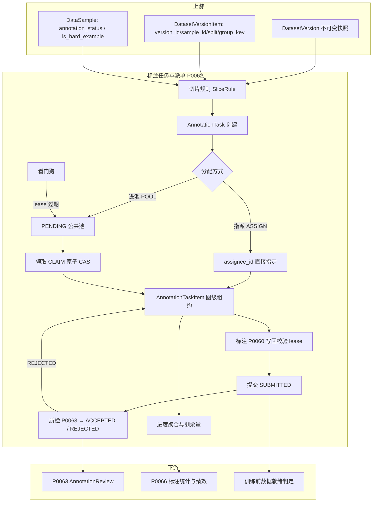
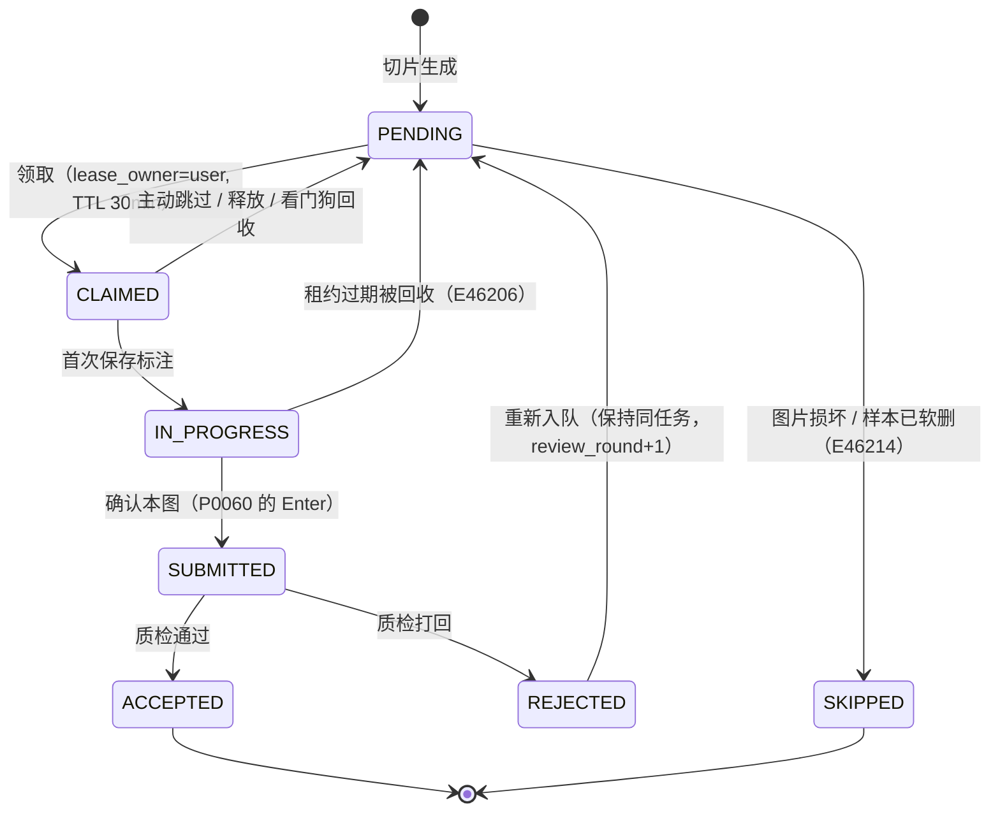
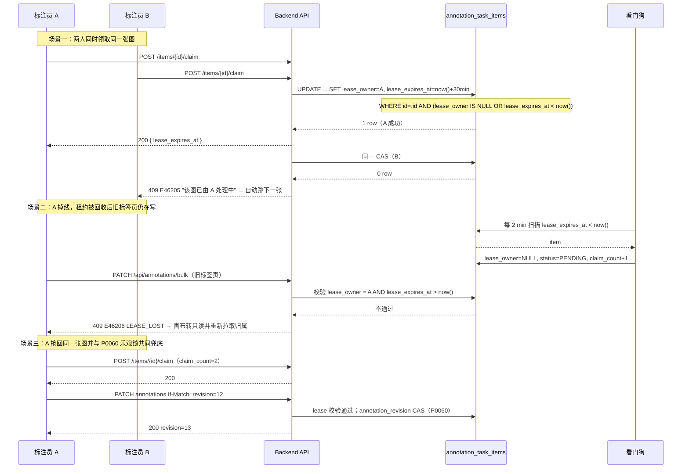
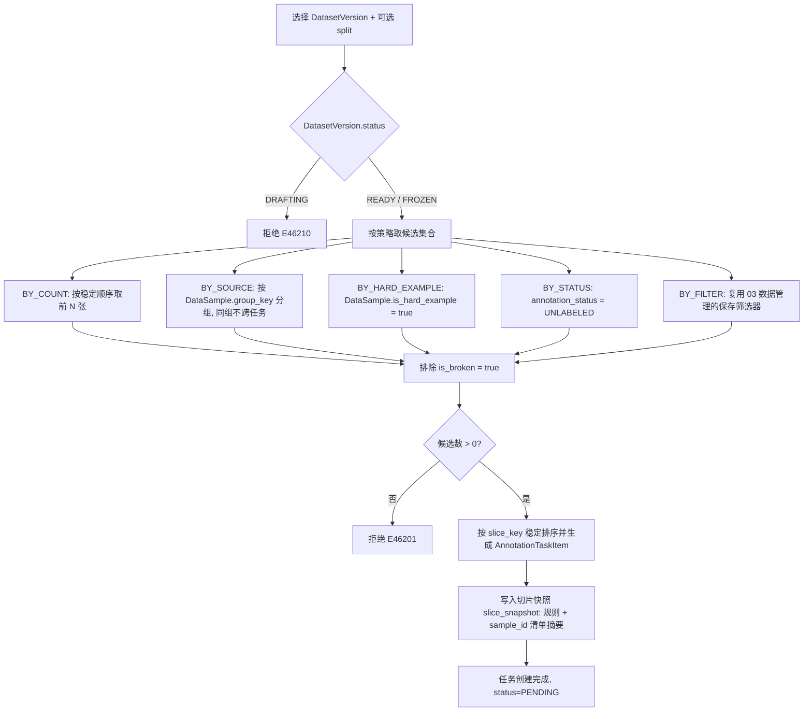
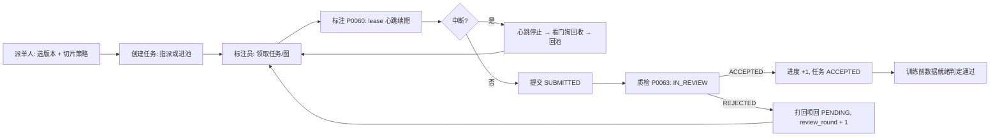

# PRD: P0062_标注任务与派单 (Annotation Task & Dispatch)

| 属性 | 内容 |
| :--- | :--- |
| **文档编号** | P0062 |
| **项目名称** | FoodYolo |
| **功能模块** | M04_标注中心 / 任务派单 |
| **当前版本** | v1.0.0 |
| **文档状态** | Approved |
| **作者** | LabelA |
| **最后更新** | 2026-10-01 |

---

## 1. 全局说明

> **核心定位**: 把不可变的 `DatasetVersion` **切片成可分配、可领取、可计量**的作业单元，并在**没有专职项目经理**的前提下让 2~3 人团队的标注工作不重不漏。本模块不生产标注（那是 P0060），也不判定质量（那是 P0063）——它只负责**谁在什么时候标哪几张图**，以及**多个人不会同时写同一张图**。

### 名词解释

*   **AnnotationTask（标注任务）**: `annotation_tasks` 表中的一行 = 一次可分配的作业批次，绑定一个 `DatasetVersion` 与一条切片规则，拥有唯一 `assignee_id`（可为空 = 进公共池）。
*   **AnnotationTaskItem（任务项）**: `annotation_task_items` 表中的一行 = 任务内的一张图。**并发控制与计量的最小单位**，承载 `lease_owner` / `lease_expires_at`。
*   **Slice Rule（切片规则）**: 由 `DatasetVersion`（可选 `split` 过滤）选出样本集合的规则，策略见 §M04.F01。
*   **Claim（领取）**: 标注员把公共池中的任务或任务项置于自己名下，获取写权限。
*   **Lease（租约）**: 任务项上的限时独占权，`lease_owner + lease_expires_at`；到期未续期即可被回收，防止"人走了图被永久锁住"。
*   **Release（释放）**: 主动放弃任务/任务项，回到可领取状态。
*   **Transfer（转交）**: 在不改变任务内容的前提下更换 `assignee_id`。
*   **Reviewer（质检人）**: 执行 P0063 质检的角色；本模块只消费其结论（`ACCEPTED` / `REJECTED`）。
*   **Dual Annotation（双标）**: 两人独立标同一张图以比对一致性。**首期不支持**（见 Out of Scope）。
*   **Progress（进度）**: 任务内按任务项状态聚合的实时分布，非冗余计数字段，见 §8.3。
*   **Pass / Review Round（轮次）**: 一次任务被质检打回后重新提交的序号，`review_round` 从 1 递增。

### 统一异常处理

| Code | 场景 | 处理策略 |
| :--- | :--- | :--- |
| `E46201` | 切片条件无结果（版本内 0 个匹配样本） | 阻止创建任务，提示"当前条件未匹配到图片，请放宽筛选" |
| `E46202` | 切片参数非法（每任务数量 ≤ 0 或 > 5000；策略缺必填参数） | 阻止创建，字段标红并给出合法区间 |
| `E46203` | 任务已被他人领取（并发领取 CAS 失败） | 返回"该任务刚被 {user} 领取"，前端刷新任务池 |
| `E46204` | 超出每人同时在办任务上限（默认 2） | 阻止领取，提示"请先释放或提交在办任务"，`ADMIN` 不受限 |
| `E46205` | 任务项已被他人锁定（lease 有效期内被抢占） | 409，标注器提示"该图已由 {user} 处理中"，自动跳到下一张 |
| `E46206` | lease 已过期被回收后再写入 | 409 `LEASE_LOST`，前端转只读并重新拉取该图任务项归属 |
| `E46207` | 无权操作该任务（非 `assignee` 且非 `ADMIN`） | 403，操作入口对他人隐藏 |
| `E46208` | 状态不允许该操作（如对 `ACCEPTED` 任务继续标注、对 `PENDING` 任务提交） | 阻止并提示当前状态与允许的动作 |
| `E46209` | 转交目标非法（用户不存在 / 无 `ANNOTATOR` 或 `TRAINER` 角色 / 转交给自己） | 阻止提交，提示具体原因 |
| `E46210` | `DatasetVersion.status = DRAFTING`（版本尚在写入） | 阻止创建任务，提示"版本就绪后可切片" |
| `E46211` | 取消任务时已被产出的标注将被保留但不被采纳 | 二次确认（列出已提交图片数），确认后任务 `CANCELLED` |
| `E46212` | 进度聚合与 `total_items` 不一致（数据一致性告警） | 页面显示"统计异常"并提供重算入口，写 `Alert` |
| `E46213` | 任务池为空（无 `PENDING` 任务可领取） | 非错误：空态提示"暂无可领取任务"，提供"申请派单"入口 |
| `E46214` | 任务项对应 `DataSample` 已被软删除或图片不可读 | 该项自动转 `SKIPPED`（不计入剩余量），并汇总提示数量 |

---

## 2. 项目背景

### 背景 (Context)

FoodYolo 面向 **2~3 人小团队、单机 Local-First**。这里的"派单"与工业标注平台的排产完全不同：没有专职 PM，没有几百人的标注团队，**多数时候是工程师自己标一部分、外包兼职标一部分**。任务往往在半天内创建、当天完成；有时为了赶一个模型，需要"谁有空谁领"。同时真实约束是：兼职人员经常中断（去开会、下班、网络掉线），如果图被永久锁在他们名下，整条流水线就卡住。

### 问题陈述 (Problem Statement)

1.  **切片手工化**: 从几千张图里手工挑 200 张给某人，靠 Excel 记进度，重复与遗漏必然发生。
2.  **并发覆盖**: 两人同时打开同一张图，各自画完保存，后保存者静默覆盖前者（P0060 的乐观锁能报冲突，但需要一个**让两人根本不会同时进场**的机制）。
3.  **断线锁死**: 领取后浏览器崩溃，图被锁在名下无人能碰。
4.  **进度不可见**: "还剩多少张"只能靠问人，无法回答"今天能不能标完"。
5.  **来源混杂导致验证集泄漏**: 同一段视频/同一批次包装的相邻帧被切进不同人的任务与不同 split，训练指标虚高。

### 目标与成功指标 (Goals & Success Metrics)

*   **北极星指标**: 任务级**不重不漏**——`sum(task.total_items) - 跨任务重复 sample 数 = 版本内被覆盖样本数`，覆盖率与去重率均 **100%**（可由切片快照复算验证）。
*   **次要指标**:
    *   同一 `sample_id` 同时处于 `CLAIMED` / `IN_PROGRESS` 的条目数**恒为 0**（数据库部分唯一索引强约束）。
    *   断线/崩溃后，任务项在 **≤ 32 分钟**内自动回到可领取状态（lease TTL 30 min + 看门狗 2 min）。
    *   任务进度页刷新延迟 **< 2 s**；剩余量估算偏差 **< 15%**。
    *   领取冲突（`E46203` / `E46205`）在 UI 中被明确解释，**不产生静默覆盖**。

### 风险与规避 (Risks & Mitigation)

| 风险 | 影响 | 规避方案 |
| :--- | :--- | :--- |
| 兼职人员长期占用不干活 | 任务停滞 | lease TTL + 心跳 + 看门狗回收；`claim_count` 异常升高时告警 |
| 切片把同源相邻帧拆到不同任务 | 验证集泄漏、指标失真 | `BY_SOURCE` 策略按 `ImportTask` / `CaptureTask` / 视频 ID 分组，不跨组切分 |
| 任务被取消但标注已产出 | 劳动浪费 | 取消时二次确认并保留标注数据（仅不被采纳） |
| 领取上限过严导致池中任务无人动 | 周期拉长 | 上限可配（默认 2），`ADMIN` 不受限并以看板提示阻塞任务 |
| 任务状态与任务项状态不一致 | 进度错乱 | 任务状态由任务项事件**单向推进**，并提供重算与一致性告警（`E46212`） |

---

## 3. 价值模型

*   **方案**: 以 `DatasetVersion` + 切片规则生成任务，任务项承载**图级租约**；用**数据库部分唯一索引**保证"同一张图同一时刻只有一个活跃作业者"，用**写回时校验 lease** 与 P0060 的 `annotation_revision` 乐观锁兜住残余竞态；进度由任务项状态实时聚合。
*   **目标**: 让"派单"从聊天记录里的口头约定，变成可查询、可计量、可自愈的作业流；让兼职人员随时中断都不阻塞流水线。

---

## 4. 项目范围

### 功能结构图



### In Scope (包含范围)

1.  **切片策略**：`BY_COUNT` / `BY_SOURCE` / `BY_HARD_EXAMPLE` / `BY_STATUS` / `BY_FILTER`，及 `split` 过滤与稳定排序。
2.  **任务创建与指派**：指派到人、投放公共池、限定可用类别子集、附任务说明（含 P0060 的日期码多框约定）。
3.  **领取 / 释放 / 转交**：含并发领取的原子性、释放后租约失效、转交后的通知。
4.  **任务状态机与任务项状态机**：`PENDING → CLAIMED → IN_PROGRESS → SUBMITTED → IN_REVIEW → ACCEPTED / REJECTED`。
5.  **图级分片互斥与并发冲突处理**：部分唯一索引 + lease CAS + 写回校验 + 乐观锁兜底。
6.  **领取上限与配额**：每人同时在办任务上限、单任务内同时打开图片数为 1。
7.  **进度、剩余量与 ETA**：任务级 / 个人级 / 全局池三个视角。
8.  **租约超时自愈**：心跳续期、看门狗回收、`claim_count` 异常告警。
9.  **取消与返工**：任务取消（保留标注）、质检打回后的重新入队与轮次递增。

### Out of Scope (不包含范围)

*   **质检判定与打回理由** → P0063（本模块只消费 `ACCEPTED` / `REJECTED` 结论并驱动状态）。
*   **双标（同一图两人独立标注 + 一致性比对）**：首期**不支持**。独立双标需要"同一 `sample_id` 的第二份标注工作副本"，涉及 `annotations` 工作域扩展，属 P0063 的后续演进；本模块的分片互斥明确保证**同一图同时只有一个活跃作业者**。
*   **实时协作（多人同图光标、操作广播）**：不做，见上。
*   **工时排班与计件工资结算** → 绩效聚合归 P0066，本模块只提供即时进度。
*   **跨数据集的任务合并/拆分**：一个任务只绑定一个 `DatasetVersion`。
*   **标注器内部交互** → P0060。
*   **训练触发的自动派单（主动学习闭环）**：属流水线 `HardExampleMining` 阶段，本模块只接收其产出的"难例筛选条件"。

---

## 5. 业务流程

### 5.1 AnnotationTask 状态机

```mermaid
stateDiagram-v2
    [*] --> PENDING : 创建任务（指派或进池）
    PENDING --> CLAIMED : 领取 / 被指派后由 assignee 确认
    PENDING --> CANCELLED : ADMIN 取消
    CLAIMED --> IN_PROGRESS : 首个任务项写入 IN_PROGRESS
    CLAIMED --> PENDING : 释放 RELEASE（未产出任何标注）
    IN_PROGRESS --> PENDING : 释放（已产出标注保留，租约失效）
    IN_PROGRESS --> SUBMITTED : 标注员提交（全部任务项已提交或有明确跳过）
    SUBMITTED --> IN_REVIEW : 质检人开始质检（P0063）
    SUBMITTED --> IN_PROGRESS : 撤回提交（尚未开始质检）
    IN_REVIEW --> ACCEPTED : 质检通过
    IN_REVIEW --> REJECTED : 质检打回（附 reason + 打回图清单）
    REJECTED --> IN_PROGRESS : 返工（review_round + 1，打回项重新入队）
    REJECTED --> CANCELLED : 放弃返工（ADMIN 决策）
    ACCEPTED --> [*]
    CANCELLED --> [*]
    note right of IN_PROGRESS : 任务内 item 状态驱动任务状态，不允许手工跳转
    note right of REJECTED : 打回项回到 IN_PROGRESS，未打回项保持已提交
```



### 5.2 AnnotationTaskItem 状态机



### 5.3 并发领取与写回冲突



### 5.4 切片流程



---

## 6. 用户分析

### 6.1 用户画像 (User Personas)

*   **P1 派单人（`ADMIN` / `TRAINER`）**: 通常是团队负责人或算法工程师。核心职责：按模型迭代节奏切出任务、指定或投放、盯进度、在卡住时救火（释放/转交/取消）。诉求：一眼看清"谁手上有什么、还剩多少、今天能不能完"。痛点：靠聊天工具分配导致重复与遗漏。
*   **P2 标注员（`ANNOTATOR`）**: 兼职或团队成员。核心职责：领取任务、按量交付。诉求：任务边界明确（标哪些图、用什么类别、有什么约定）、断线不丢进度、剩余量可见。痛点：被锁在无法完成的图上、任务说明不清导致返工。
*   **P3 质检人（`TRAINER`，兼）**: 核心职责：对 `SUBMITTED` 任务抽检并给结论（P0063）。诉求：按任务维度聚类问题、打回理由可复用。痛点：混在标注里质检，缺少清晰队列。

### 6.2 用户链路图



---

## 7. 功能需求

### M04.F01 数据集版本切片 (Slicing)

*   **用户故事**: 作为派单人，我希望用规则从数据集版本切出任务，以便不重不漏地覆盖需要标注的图。
*   **逻辑与业务规则**:
    *   **输入**: `dataset_version_id`（必填）、`split`（可选，`TRAIN` / `VAL` / `TEST` / `UNASSIGNED`，默认全部）、`strategy`、`params`。
    *   **策略**:
        | 策略 | 参数 | 语义 |
        | :--- | :--- | :--- |
        | `BY_COUNT` | `per_task_count`（1~5000，默认 200）、`order`（`CREATED_ASC` / `HARD_FIRST`） | 按稳定顺序取前 N 张；`HARD_FIRST` 把 `is_hard_example=true` 的图排在前面 |
        | `BY_SOURCE` | `group_by`（`GROUP_KEY` 默认 / `IMPORT_TASK` / `CAPTURE_TASK`） | 以 `DataSample.group_key`（来源身份真源：视频 / 采集任务 / 会话 / SKU）分组切分，**同组不跨任务**；后两者为按批次粗分，均用于防验证集泄漏 |
        | `BY_HARD_EXAMPLE` | `min_confidence`（可选） | 只取 `DataSample.is_hard_example = true` |
        | `BY_STATUS` | `annotation_status`（`UNLABELED` / `REJECTED`） | 按标注状态取图，用于"补标"/"返工" |
        | `BY_FILTER` | `saved_filter_id` | 复用 03_数据管理的保存筛选器（类别/尺寸/时间等组合条件） |
    *   **共性规则**: 一律排除 `DataSample.is_broken = true`；一律按 `(seq)` 稳定排序保证可复现；同一 `dataset_version_id` 下生成的 `(task_id, sample_id)` 唯一；切片以 `DataSample.group_key` 为来源身份**真源**，版本侧以 `DatasetVersionItem.group_key` 快照校验（同一 `version_id` 内同一 `group_key` 不得跨 `split`）；抽帧血缘字段（`frame_index` / `timestamp` / `source_video_id`）挂在 `DataSample` 上，本模块只读不写。
    *   **切片快照**: 任务创建时把 `sample_id` 清单摘要（数量 + 前 50 个 id + 全量清单的 hash）写入 `slice_snapshot`，用于事后"是否漏标"复算。
    *   **覆盖度提示**: 若版本内某 `sample_id` 已被其他**未取消**任务包含，创建页明确提示重叠数量（默认阻止；派单人可强制覆盖，用于返工场景）。
    *   **后置条件**: `AnnotationTask` + N 个 `AnnotationTaskItem`（`status=PENDING`）落库。
*   **验收标准**:
    ```gherkin
    场景: 按数量切片
      Given DatasetVersion V1 状态为 READY 且含 1200 个样本
      When 派单人使用 BY_COUNT、per_task_count=200 创建任务
      Then 生成 6 个任务，每个任务 200 个 PENDING 任务项
      And 任意两个任务的 sample_id 交集为空

    场景: 按来源切片不跨组
      Given 版本内样本按 DataSample.group_key 分布在 3 组（如 3 段视频）
      When 使用 BY_SOURCE、group_by=GROUP_KEY 切片
      Then 同一 group_key 的样本全部落在同一任务内
      And 不产生跨 group_key 的任务
      And 切片读取的 group_key 与 DatasetVersionItem.group_key 快照一致

    场景: 参数非法
      Given per_task_count = 0
      When 派单人提交创建
      Then 拒绝创建并返回 E46202

    场景: 空结果
      Given 版本内所有样本 is_broken = true
      When 派单人切片
      Then 拒绝创建并提示 E46201

    场景: 版本未就绪
      Given DatasetVersion V2 状态为 DRAFTING
      When 派单人切片
      Then 拒绝创建并返回 E46210
    ```
*   **边界情况与异常处理**:

    | 场景 | 处理 |
    | :--- | :--- |
    | 候选数不是 `per_task_count` 整数倍 | 最后一个任务为余数（可少于 N），不补空 |
    | 版本内样本 5000 张但每任务 200 张 | 生成 25 个任务；看板按池分组展示，避免列表爆炸 |
    | 任务创建过程中样本被软删除 | 该项转 `SKIPPED` 并在创建结果中报告数量（`E46214`） |
    | 与既有任务重叠 | 默认阻止并显示重叠数；强制覆盖时记录 `AuditLog` 与重叠原因 |
    | 同一版本被反复切片（迭代补标） | 允许；`BY_STATUS=UNLABELED` 天然只取未标图 |

### M04.F02 任务创建与指派 (Task Creation & Assignment)

*   **用户故事**: 作为派单人，我希望把任务直接指派给人或投放公共池，以便灵活匹配当天的可用人力。
*   **逻辑与业务规则**:
    *   **字段**: `name`（默认 `{数据集名}-{策略}-{日期}`）、`dataset_version_id`、`slice_rule`（JSONB）、`mode`（`ASSIGN` / `POOL`）、`assignee_id`（`ASSIGN` 时必填）、`allowed_class_ids`（可选，限定本次任务可用类别子集，供 P0060 类别面板过滤）、`instructions`（任务说明，≤ 2000 字符，默认携带平台的日期码标注约定）、`due_at`（可选）、`priority`（`NORMAL` / `HIGH`）。
    *   **默认说明模板**: 自动附上"日期喷码约定：语义可分割的相邻码段画成多个相邻框，允许 0~2 px 重叠；倾斜 > 45° 用 OBB"（与 P0060 M04.F10 一致）。
    *   **指派语义**: `ASSIGN` 创建后任务直接 `PENDING` 且 `assignee_id` 已写入，仅该 `assignee`（或 `ADMIN`）可领取；`POOL` 则任何具备标注权限者可领取。
    *   **权限**: 创建 / 指派需 `TRAINER` 或 `ADMIN`；`ANNOTATOR` 不可创建任务。
    *   **后置条件**: 任务进入 `PENDING`；若为 `ASSIGN`，向 `assignee` 发送通知（站内 + 可选 webhook）。
*   **验收标准**:
    ```gherkin
    场景: 指派任务
      Given 派单人选择模式 ASSIGN 并指定标注员 U1
      When 创建任务成功
      Then annotation_tasks.assignee_id = U1 且 status = PENDING
      And U1 收到任务通知
      And 其他标注员在池中看不到该任务

    场景: 投放公共池
      Given 派单人选择模式 POOL
      When 创建任务成功
      Then 任务出现在所有具备标注权限用户的"可领取任务"列表

    场景: 限定可用类别
      Given 任务 allowed_class_ids = [date_region]
      When 标注员打开该任务的任一张图
      Then 标注器类别面板仅显示 date_region
      And 无法选择其他类别
    ```
*   **边界情况与异常处理**:

    | 场景 | 处理 |
    | :--- | :--- |
    | 指派给无 `ANNOTATOR`/`TRAINER` 角色的用户 | 阻止并提示 `E46209` |
    | 说明超出 2000 字符 | 阻止提交并给出当前长度 |
    | 任务创建后立即被取消 | 允许；任务项删除（若尚无标注）或保留并标记 `CANCELLED` |
    | `allowed_class_ids` 含已 `MERGED` 类别 | 创建时校验，剔除失效类别并提示（P0061） |
    | 创建大量任务导致列表噪音 | 看板默认按"进行中 / 待领取 / 已完成"三栏折叠，超过 20 个任务折叠为池分组 |

### M04.F03 任务领取与释放 (Claim & Release)

*   **用户故事**: 作为标注员，我希望从池中领取任务并在无法继续时释放，以便任务不会卡在我这里。
*   **逻辑与业务规则**:
    *   **领取前置**: 任务 `status = PENDING`；用户具备标注权限；若是 `ASSIGN` 任务则必须是 `assignee`；用户未超在办上限（§M04.F07）。
    *   **领取原子性**: `UPDATE annotation_tasks SET assignee_id=:uid, status='CLAIMED', claimed_at=now() WHERE id=:id AND status='PENDING' AND (assignee_id IS NULL OR assignee_id=:uid)`；影响 0 行则 `E46203`。
    *   **图级领取**: 进入任务后，标注器逐张领取（`claim`），一次只锁一张（不批量预占），锁定时长即 lease TTL。
    *   **释放任务**: `CLAIMED` / `IN_PROGRESS` 可释放；释放时**该任务下所有有效 lease 立即失效**（`lease_owner=NULL`），已 `SUBMITTED` 的任务项保持已提交（不回收他人劳动成果）；任务回 `PENDING`，`assignee_id` 清空。
    *   **释放权限**: `assignee` 本人或 `ADMIN`；`TRAINER` 可释放自己创建的任务。
    *   **释放后不可写**: 释放瞬间起，旧标签页的任何保存请求都会被 lease 校验拒绝（`E46206`），前端提示并转只读。
    *   **后置条件**: 任务回到公共池（或保留 `assignee_id` 若为强制指派模式），可选通知原持有人。
*   **验收标准**:
    ```gherkin
    场景: 两人同时领取同一任务
      Given 任务 T1 处于 PENDING 且无 assignee
      When 标注员 A 与 B 同时点击领取
      Then 仅一人领取成功
      And 另一人收到 E46203 且任务池自动刷新

    场景: 释放任务使租约失效
      Given A 持有 T1 且 item#9 处于 IN_PROGRESS（lease 有效）
      When A 释放 T1
      Then T1 回到 PENDING 且 assignee_id 清空
      And item#9 的 lease_owner 置空且 status 回到 PENDING
      And A 的旧标签页保存请求返回 E46206

    场景: 释放后保留已提交成果
      Given A 已提交 item#1~#5
      When A 释放 T1
      Then item#1~#5 仍为 SUBMITTED（不被重置）
      And item#6 及之后回到 PENDING
    ```
*   **边界情况与异常处理**:

    | 场景 | 处理 |
    | :--- | :--- |
    | 释放后立即重新领取 | 允许（除非超上限或已被他人抢走） |
    | 任务已被质检打回后释放 | 允许；`review_round` 保留，打回项状态保留 |
    | 看门狗与人工释放竞争 | 均走同一 CAS（`lease_owner` 与过期判断），后执行者影响 0 行并静默成功 |
    | 用户被禁用（账号停用） | 其持有任务由 `ADMIN` 一键回收（批量释放），写 `AuditLog` |

### M04.F04 任务转交 (Transfer)

*   **用户故事**: 作为派单人，我希望把任务转交给另一个人，以便人员变动时任务不中断。
*   **逻辑与业务规则**:
    *   **可转交状态**: `CLAIMED` / `IN_PROGRESS` / `REJECTED`（返工中）；`SUBMITTED` 及以上不可转交（避免质检对象漂移）。
    *   **转交原子性**: `UPDATE ... SET assignee_id=:target, transferred_at=now() WHERE id=:id AND status IN ('CLAIMED','IN_PROGRESS','REJECTED') AND assignee_id=:current`；0 行则 `E46208`（状态已变）或 `E46203`（已被他人接管）。
    *   **租约处理**: 转交时原持有人的有效 lease 全部失效；**已 `SUBMITTED` 项不随之转移**（其质检归属仍指向原提交人，`submitted_by` 保留）。
    *   **目标校验**: 目标用户必须存在且具有 `ANNOTATOR` 或 `TRAINER` 角色，不能是自己（`E46209`）。
    *   **通知**: 通知原持有人与目标；转交记录写 `AuditLog(action=TASK_TRANSFER, from, to, reason?)`，`reason` 可选但建议填写。
    *   **后置条件**: `assignee_id` 更新，任务保持原状态（不回到 `PENDING`）。
*   **验收标准**:
    ```gherkin
    场景: 转交进行中的任务
      Given A 持有任务 T1（IN_PROGRESS，item#3 正在标注）
      When 派单人把 T1 转交给 B 并填写原因
      Then assignee_id 变为 B 且任务仍为 IN_PROGRESS
      And item#3 的 lease 被清空，B 可立即领取
      And A 与 B 均收到通知且审计日志记录原委

    场景: 已提交任务不可转交
      Given 任务 T2 处于 SUBMITTED
      When 派单人尝试转交
      Then 阻止并返回 E46208

    场景: 转交给自己
      Given 当前 assignee 为 A
      When 派单人把任务转交回 A
      Then 阻止并返回 E46209
    ```
*   **边界情况与异常处理**:

    | 场景 | 处理 |
    | :--- | :--- |
    | 转交目标已超出在办上限 | 允许（转交是派单人的显式决策），在 UI 中提示目标当前负载 |
    | 目标用户不存在或已停用 | `E46209` |
    | 转交瞬间目标任务项正被写入 | lease 失效后写入被拒（`E46206`），不产生跨人覆盖 |
    | 任务反复转交 | 每次均写审计；同一任务 24 h 内转交 ≥ 3 次在看板标"频繁转交"提示 |

### M04.F05 提交、质检流转与返工 (Submit, Review Handoff & Rework)

*   **用户故事**: 作为标注员，我希望提交后进入质检并在被打回时明确知道要重标哪些图，以便闭环交付。
*   **逻辑与业务规则**:
    *   **提交前置**: 任务内**所有**任务项处于 `SUBMITTED` / `ACCEPTED` / `SKIPPED`；仍有 `PENDING` / `CLAIMED` / `IN_PROGRESS` 时提交被拒并列出剩余项（`E46208`）。
    *   **撤回提交**: `SUBMITTED` 且尚未进入 `IN_REVIEW` 时可撤回，任务回 `IN_PROGRESS`。
    *   **质检流转**: 质检人开始质检 → 任务 `IN_REVIEW`（P0063 驱动）；质检结论：
        *   全部通过 → `ACCEPTED`，任务内所有 `SUBMITTED` 项转 `ACCEPTED`；
        *   存在打回 → `REJECTED`，`reject_reason`（枚举 + 备注）与打回图清单写 `annotation_reviews`（P0063），打回项转 `PENDING` 并**保留在同一任务内**重新入队，`review_round` 由 1 递增。
    *   **轮次上限**: `review_round > 3` 时任务标记"高返工"，在看板置顶告警，提示派单人与质检人复盘（不做硬阻塞）。
    *   **返工范围**: 默认只重开被打回的图；派单人可选择"整任务重标"（全部项回 `PENDING`，已 ACCEPTED 项除外，需二次确认）。
    *   **后置条件**: `ACCEPTED` 任务不可再编辑（P0060 对 `ACCEPTED` 任务项返回只读，`E46208`）；`Annotation.status` 保持 `COMMITTED`，训练数据就绪判定取 `ACCEPTED` 任务项对应的图片。
*   **验收标准**:
    ```gherkin
    场景: 提交前有未完成项
      Given 任务 T1 有 10 项，其中 3 项仍为 PENDING
      When 标注员点击提交
      Then 阻止提交并返回 E46208 且列出这 3 项

    场景: 质检打回后重新入队
      Given 任务 T1 处于 IN_REVIEW，其中 item#4、item#7 被打回
      When 质检人提交 REJECTED 结论
      Then T1 变为 REJECTED 且 review_round 从 1 变为 2
      And item#4、item#7 变为 PENDING，其余项保持 SUBMITTED

    场景: 全部通过
      Given 任务 T1 处于 IN_REVIEW 且无打回项
      When 质检人提交 ACCEPTED
      Then T1 变为 ACCEPTED 且其所有 SUBMITTED 项变为 ACCEPTED
      And T1 内任一图在标注器中为只读

    场景: 撤回提交
      Given 任务 T1 处于 SUBMITTED 且尚未开始质检
      When 标注员撤回提交
      Then T1 回到 IN_PROGRESS 且可直接继续标注
    ```
*   **边界情况与异常处理**:

    | 场景 | 处理 |
    | :--- | :--- |
    | 打回项图片已被软删除 | 该项转 `SKIPPED` 并从剩余量中扣除（`E46214`） |
    | 质检人在任务被撤回提交的同时给结论 | 结论写入失败并提示"任务状态已变更"，质检人需刷新队列（P0063） |
    | 反复打回（`review_round` 达 4） | 看板标"高返工"并通知派单人；不阻塞 |
    | 标注员对打回结论不认可 | 申诉流程归 P0063（本模块只承载状态） |
    | 任务 `ACCEPTED` 后需修正 | 由派单人创建**新任务**（`BY_STATUS=REJECTED` 或指定图），不改历史任务 |

### M04.F06 图级分片互斥与并发冲突处理 (Shard Mutual Exclusion)

*   **用户故事**: 作为系统，我希望同一张图在任何时刻只被一个活跃作业者持有，以便多标注员并行时不发生互相覆盖。
*   **逻辑与业务规则**:
    *   **第一层 · 分片互斥（数据库强约束）**: `annotation_task_items` 上建**部分唯一索引**
        ```sql
        CREATE UNIQUE INDEX uq_active_item_per_sample
          ON annotation_task_items (sample_id)
          WHERE status IN ('CLAIMED', 'IN_PROGRESS');
        ```
        该约束保证**跨任务**也不会出现同图双活跃——即使返工任务与主任务并存。
    *   **第二层 · 租约 CAS**: 领取走单条 `UPDATE ... WHERE (lease_owner IS NULL OR lease_expires_at < now()) AND status IN ('PENDING','REJECTED')`，以影响行数判定成败（0 行 → `E46205`）。
    *   **第三层 · 写回校验**: 标注保存接口（P0060 的 `PATCH /api/annotations/bulk`）在事务内校验 `lease_owner = current_user AND lease_expires_at > now()`，不通过返回 `409 E46206 (LEASE_LOST)`；同时执行 `annotation_revision` 乐观锁（`If-Match`）。
    *   **第四层 · 乐观锁兜底**: 处理"租约刚过期、旧标签页仍持有本地状态"的竞态：即使 lease 在写入瞬间被看门狗回收且被他人抢走，`annotation_revision` 也会拦截第二次写入并进入 P0060 的三方合并界面。
    *   **心跳与 TTL**: TTL 默认 **30 min**；标注器在**有编辑活动**时每 60 s 续期（`lease_heartbeat_at`）；页面隐藏且 10 min 无操作时不续期（把图让给他人）。
    *   **越权保护**: `ADMIN` 强制介入时走"强制释放 + 重新领取"，不绕过上述校验（保证审计完整）。
    *   **可观测**: `claim_count` 每次被回收即 +1；同一图 24 h 内 `claim_count ≥ 3` 触发 `Alert`（说明有人反复抢占或难度异常）。
*   **验收标准**:
    ```gherkin
    场景: 数据库层阻止同图双活跃
      Given item#9 属于任务 T1 且 status=IN_PROGRESS、lease_owner=A
      When 创建任务 T2 并把同一 sample 的 item 置为 CLAIMED
      Then 违反唯一约束 uq_active_item_per_sample，操作失败且不产生第二条活跃项

    场景: 租约过期后写入被拒
      Given item#9 的 lease 已于 5 分钟前到期并被看门狗回收
      And 标注员 A 的标签页仍停留在该图
      When A 的自动保存发出 PATCH
      Then 返回 409 E46206 (LEASE_LOST)
      And A 的画布转只读并提示"该图已回到待领取状态"

    场景: 乐观锁作为最后兜底
      Given A 的 lease 在 A 提交前一刻被回收，B 已领取并保存（revision=13）
      When A 的请求到达
      Then lease 校验失败返回 E46206
      And 若 lease 校验被并发重入绕过，则 annotation_revision 的 If-Match 仍拒绝 A 的请求（E46003）并进入合并界面
    ```
*   **边界情况与异常处理**:

    | 场景 | 处理 |
    | :--- | :--- |
    | 同一用户在多标签页打开同图 | P0060 的 `BroadcastChannel` 独占，第二个标签页只读 |
    | 看门狗与用户续期同时发生 | 均以 `lease_expires_at` 与 `lease_owner` 为条件的 CAS，后执行者影响 0 行 |
    | 客户端时钟不准 | TTL 与过期判定**全部以服务端时间**为准，客户端只发心跳不带时间戳 |
    | 网络抖动导致心跳丢失 1 次 | TTL 30 min 允许连续丢失多次心跳，不误回收 |
    | 图片特别难导致单图超 30 min | 有编辑活动即续期，不会被动回收；若真无操作则被回收（符合预期） |

### M04.F07 领取上限与配额 (Concurrency Quotas)

*   **用户故事**: 作为派单人，我希望限制每人同时在办的任务与图片数，以便人力分散、单点卡住不影响整体。
*   **逻辑与业务规则**:
    *   **在办任务上限**: 每人 `status IN ('CLAIMED','IN_PROGRESS','REJECTED')` 的任务数 ≤ `max_active_tasks`（默认 **2**，可配 1~5，由 `ADMIN` 在系统设置中调整）；超限领取/转交被拒（`E46204`，转交仅提示不阻塞）。
    *   **同任务内并发图片**: 恒为 **1**（标注器一次只打开一张图），避免一人占住多张图。
    *   **不做批量预占**: 不支持"一次领 50 张离线标"，离线场景由 P0060 的 IndexedDB 草稿承担，但**同一时刻服务端只承认 1 张的 lease**。
    *   **豁免**: `ADMIN` 不受上限限制（救火场景）；`TRAINER` 创建的任务不占用标注上限（其标注行为仍受限）。
    *   **可见性**: 任务池列表显示每个任务的 `in_progress_by`，避免多人重复挑同一任务。
*   **验收标准**:
    ```gherkin
    场景: 超出在办任务上限
      Given max_active_tasks = 2 且标注员 A 已有 2 个 IN_PROGRESS 任务
      When A 尝试领取第 3 个任务
      Then 阻止并返回 E46204
      And 提示"请先释放或提交在办任务"

    场景: 同任务内只能锁一张图
      Given A 已持有 item#9 的有效 lease
      When A 尝试领取同任务的 item#10
      Then 返回 E46208 并提示"请先确认或释放当前图片"

    场景: 管理员不受限
      Given max_active_tasks = 2 且 ADMIN 已有 3 个在办任务
      When ADMIN 领取新任务
      Then 领取成功
    ```
*   **边界情况与异常处理**:

    | 场景 | 处理 |
    | :--- | :--- |
    | 上限调低后已有用户超限 | 不强制释放，仅禁止新领取；看板提示"该用户超配 N 个任务" |
    | 用户被转交导致超限 | 允许（转交为显式决策），看板告警 |
    | `ANNOTATOR` 申请更多任务 | 提供"申请派单"入口（通知 `ADMIN`），不自行提额 |

### M04.F08 进度、剩余量与 ETA (Progress & Remaining)

*   **用户故事**: 作为派单人与标注员，我希望实时看到进度与剩余量，以便判断今天能否完成。
*   **逻辑与业务规则**:
    *   **任务进度**: 直接聚合 `annotation_task_items` 按 `status` 分组计数；**不设冗余计数字段**（避免漂移），查询走 `(task_id, status)` 索引，结果缓存 60 s。
    *   **口径定义**（写入 UI 与 API 契约）:
        *   `total` = 任务项总数；
        *   `done` = `SUBMITTED + ACCEPTED` 数；
        *   `accepted` = `ACCEPTED` 数；
        *   `remaining` = `PENDING + CLAIMED + IN_PROGRESS + REJECTED` 数（`SKIPPED` 不计入）；
        *   `progress_pct` = `done / (total - skipped)`。
    *   **ETA**: `remaining / rate`，`rate` = 最近 30 min 内转 `SUBMITTED` 的项数 ÷ 30；样本不足（30 min 内 < 5 项）时显示"—"而不是误导性数字。
    *   **个人视角**: 我在办任务的 `done / remaining`、今日已提交数、被打回数。
    *   **全局池视角**: 未领取任务数、待领取项总数、按来源分组的剩余量。
    *   **一致性告警**: 聚合结果与 `total_items` 不符时显示"统计异常"并提供重算入口（`E46212`，写 `Alert`）。
    *   **刷新**: 页面每 15 s 轮询（Local-First 单机，轮询足够且实现简单）；不使用 WebSocket（首期不需要）。
*   **验收标准**:
    ```gherkin
    场景: 任务进度口径
      Given 任务 T1 共 100 项：40 SUBMITTED、30 ACCEPTED、20 PENDING、5 IN_PROGRESS、3 SKIPPED、2 REJECTED
      When 打开任务详情
      Then done = 70，remaining = 27，progress_pct = 70 / (100-3) = 72.2%
      And SKIPPED 的 3 项不出现在 remaining 中

    场景: ETA 在样本不足时不显示数字
      Given 最近 30 分钟仅提交 2 项
      When 查看 ETA
      Then 显示 "—" 并提示"数据不足"

    场景: 个人剩余量
      Given 标注员 A 在 2 个任务中共有 150 项 remaining
      When A 打开工作台
      Then 显示 "在办 2 个任务，剩余 150 张"
    ```
*   **边界情况与异常处理**:

    | 场景 | 处理 |
    | :--- | :--- |
    | 任务所有项被 `SKIPPED` | 分母为 0 时 `progress_pct` 显示 100% 且任务可提交（无有效样本） |
    | 聚合查询变慢（任务 5000 项） | 只走索引计数 + 60 s 缓存；详情页分页拉取任务项 |
    | 某人在 30 min 内提交激增导致 ETA 过于乐观 | ETA 使用最近 30 min 与最近 4 h 两个窗口的较小速率 |
    | 进度与看板不一致（缓存过期） | 手动刷新按钮强制绕过缓存 |

### M04.F09 租约超时自愈与看门狗 (Lease Watchdog)

*   **用户故事**: 作为派单人，我希望被遗弃的图片能自动回到池中，以便兼职人员断线不阻塞流水线。
*   **逻辑与业务规则**:
    *   **看门狗周期**: 每 **2 min** 扫描一次 `annotation_task_items WHERE status IN ('CLAIMED','IN_PROGRESS') AND lease_expires_at < now()`。
    *   **回收动作**: 单事务内 `lease_owner = NULL, lease_heartbeat_at = NULL, lease_expires_at = NULL, status = 'PENDING', claim_count = claim_count + 1`；项若已 `SUBMITTED` 则不回收。
    *   **任务状态回退**: 若任务因此从 `IN_PROGRESS` 变回"无活跃项"，仅在**任务 `assignee_id` 为空**（已释放）时才回退到 `PENDING`；否则任务状态保持 `IN_PROGRESS` 并由看板提示"该用户持有 N 张超时未动的图"（便于派单人决策转交）。
    *   **异常告警**: 同图 24 h 内 `claim_count ≥ 3`、或某用户 24 h 内被回收 ≥ 20 张，写 `Alert`（`entity=annotation_task_items`）。
    *   **幂等**: 回收是幂等的（以 `lease_expires_at < now()` 为条件），重复扫描无副作用。
    *   **不自动提升**：看门狗**不**自动把人踢出任务、不自动转交——避免机器做出影响他人劳动成果的决策，交给人。
*   **验收标准**:
    ```gherkin
    场景: 断线后自动回池
      Given item#9 的 lease 在 31 分钟前过期且 status=IN_PROGRESS
      When 看门狗运行
      Then item#9 变为 PENDING、lease_owner 置空、claim_count 从 1 变为 2
      And 该图重新出现在任务的可领取列表中

    场景: 已提交项不被回收
      Given item#12 status=SUBMITTED 且 lease 已过期
      When 看门狗运行
      Then item#12 保持 SUBMITTED 不变

    场景: 频繁回收告警
      Given 同一 sample 在 24 小时内被回收 3 次
      When 看门狗完成本轮扫描
      Then 生成 Alert 提示"该图片被反复抢占，请检查图片质量或任务说明"
    ```
*   **边界情况与异常处理**:

    | 场景 | 处理 |
    | :--- | :--- |
    | 服务重启导致看门狗停摆 | 启动后立即执行一次补偿扫描 |
    | 大量项同时过期（整批人离线） | 单轮上限 1000 项，超出分批处理，避免长事务锁表 |
    | 用户正在保存的瞬间被回收 | 保存请求的 lease 校验会失败（`E46206`），前端转只读并保留本地草稿以便重新领取后重放 |
    | 图片本身标不完（超大图/异常） | `claim_count` 升高触发告警，由人决定是否 `SKIPPED` |

---

## 8. 技术架构与数据模型

### 8.1 数据实体

#### Table: `annotation_tasks`

| 字段名 | 类型 | 必填 | 说明 | 约束 |
| :--- | :--- | :--- | :--- | :--- |
| `id` | UUID | Y | 主键 | PK |
| `name` | String(128) | Y | 任务名 | |
| `dataset_version_id` | UUID | Y | 绑定的不可变版本 | FK, INDEX |
| `slice_rule` | JSONB | Y | `{ strategy, params, split, order }` | |
| `slice_snapshot` | JSONB | Y | `{ count, head_sample_ids, list_hash }` 用于覆盖度复算 | |
| `total_items` | Int | Y | 任务项总数（创建时确定，不随后续跳过而变） | CHECK > 0 |
| `status` | Enum | Y | `PENDING` / `CLAIMED` / `IN_PROGRESS` / `SUBMITTED` / `IN_REVIEW` / `ACCEPTED` / `REJECTED` / `CANCELLED` | INDEX |
| `mode` | Enum | Y | `ASSIGN` / `POOL` | DEFAULT `POOL` |
| `assignee_id` | UUID | N | 当前持有人；`POOL` 未领取时为空 | FK `User`, INDEX |
| `allowed_class_ids` | UUID[] | N | 限定可用类别子集（P0061） | |
| `instructions` | Text | N | 任务说明（含日期码标注约定模板） | ≤ 2000 字符 |
| `priority` | Enum | Y | `NORMAL` / `HIGH` | DEFAULT `NORMAL` |
| `review_round` | Int | Y | 质检轮次，从 1 递增 | DEFAULT 1 |
| `due_at` | timestamptz | N | 期望完成时间 | |
| `claimed_at` / `submitted_at` / `reviewed_at` / `transferred_at` | timestamptz | N | 关键事件时间 | |
| `created_by` | UUID | Y | 创建者 | FK `User` |
| `created_at` / `updated_at` | timestamptz | Y | | |
| `deleted_at` | timestamptz | N | 软删除 | |

**索引**: `(status, assignee_id)`、`(dataset_version_id, status)`、`(priority DESC, created_at)`。

#### Table: `annotation_task_items`

| 字段名 | 类型 | 必填 | 说明 | 约束 |
| :--- | :--- | :--- | :--- | :--- |
| `id` | UUID | Y | 主键 | PK |
| `task_id` | UUID | Y | 所属任务 | FK, **UNIQUE(`task_id`,`sample_id`)** |
| `sample_id` | UUID | Y | → `DataSample.id` | FK, INDEX |
| `seq` | Int | Y | 任务内稳定顺序（切片时确定） | UNIQUE(`task_id`,`seq`) |
| `status` | Enum | Y | `PENDING` / `CLAIMED` / `IN_PROGRESS` / `SUBMITTED` / `ACCEPTED` / `REJECTED` / `SKIPPED` | INDEX |
| `lease_owner` | UUID | N | 当前租约持有人 | FK `User` |
| `lease_expires_at` | timestamptz | N | 租约到期（服务端时间） | INDEX |
| `lease_heartbeat_at` | timestamptz | N | 最近心跳 | |
| `claim_count` | Int | Y | 被领取次数（含回收） | DEFAULT 0 |
| `submitted_by` | UUID | N | 提交人（转交后仍指向原提交人） | FK `User` |
| `submitted_at` | timestamptz | N | 提交时间 | |
| `latest_review_id` | UUID | N | 最近一次质检记录（P0063 的 `AnnotationReview.id`） | FK |
| `skip_reason` | Enum | N | `IMAGE_BROKEN` / `SAMPLE_DELETED` / `MANUAL` | |
| `created_at` / `updated_at` | timestamptz | Y | | |
| `deleted_at` | timestamptz | N | 软删除 | |

**关键约束**:
```sql
-- 同一张图在任何时刻只允许一个活跃作业者（跨任务生效，是并发互斥的第一道防线）
CREATE UNIQUE INDEX uq_active_item_per_sample
  ON annotation_task_items (sample_id)
  WHERE status IN ('CLAIMED', 'IN_PROGRESS');
```

#### 引用（不重复定义）

| 实体 | 归属 | 本模块的用法 |
| :--- | :--- | :--- |
| `AnnotationReview` | P0063 | `ACCEPTED` / `REJECTED` 结论与打回理由的来源；本模块只读 |
| `Annotation` / `annotation_revisions` | P0060 | 写回时的 `lease` 校验与 `annotation_revision` 乐观锁 |
| `DataSample` | 03_数据管理 | `annotation_status` / `is_hard_example` / `is_negative` / `is_broken` 作为切片条件 |
| `DatasetVersionItem` | 03_数据管理 | 提供 `(version_id, sample_id, split, group_key)` 作为切片来源；`group_key` 是版本创建时的快照副本，用于跨 split 校验 |
| `LabelClass` | P0061 | `allowed_class_ids` 引用其 id |

### 8.2 领取的原子操作（契约）

```sql
-- 任务级领取：影响 0 行 = 已被他人领取
UPDATE annotation_tasks
   SET assignee_id = :uid, status = 'CLAIMED', claimed_at = now(), updated_at = now()
 WHERE id = :task_id
   AND status = 'PENDING'
   AND (assignee_id IS NULL OR assignee_id = :uid);

-- 图级领取：以行数判定成败，过期租约可被抢占
UPDATE annotation_task_items
   SET lease_owner = :uid,
       lease_expires_at = now() + interval '30 minutes',
       lease_heartbeat_at = now(),
       status = 'CLAIMED',
       claim_count = claim_count + 1,
       updated_at = now()
 WHERE id = :item_id
   AND (lease_owner IS NULL OR lease_expires_at < now())
   AND status IN ('PENDING', 'REJECTED')
RETURNING id, lease_expires_at;
-- 返回 0 行 → HTTP 409 E46205
```

### 8.3 进度聚合查询（无冗余计数字段）

```sql
SELECT status, count(*) AS cnt
  FROM annotation_task_items
 WHERE task_id = :task_id AND deleted_at IS NULL
 GROUP BY status;
-- done     = cnt(SUBMITTED) + cnt(ACCEPTED)
-- accepted = cnt(ACCEPTED)
-- remaining= cnt(PENDING) + cnt(CLAIMED) + cnt(IN_PROGRESS) + cnt(REJECTED)
-- skipped  = cnt(SKIPPED)          （不计入 remaining）
```

---

## 9. UI/UX 规格说明

### 任务看板线框

```text
┌───────────────────────────────────────────────────────────────────────────────────────┐
│ 标注任务看板        [+ 新建任务]   视图 [我的 ▾]   在办上限 2/2 ⚠ 已达上限            │
├────────────────────┬────────────────────┬────────────────────┬───────────────────────┤
│ 待领取 (3)         │ 进行中 (2)         │ 待质检 (1)         │ 已完成 (7)            │
│ ┌────────────────┐ │ ┌────────────────┐ │ ┌────────────────┐ │ ┌───────────────────┐ │
│ │ 日期检测-第3批 │ │ │ 日期检测-第1批 │ │ │ 日期检测-第2批 │ │ │ 日期检测-初始批   │ │
│ │ 200 张 · POOL  │ │ │ 200 张 · A     │ │ │ 200 张 · B     │ │ │ 200 张 · ✓ACCEPT  │ │
│ │ 来源: Import#4 │ │ │ ████████░░ 78% │ │ │ 提交于 10:20   │ │ │ 打回 12 / 轮次 2  │ │
│ │ [领取]         │ │ │ 剩 44 张 · ~18m│ │ │ [开始质检]     │ │ │ 通过率 94%        │ │
│ └────────────────┘ │ └────────────────┘ │ └────────────────┘ │ └───────────────────┘ │
│                    │ ┌────────────────┐ │                    │                       │
│                    │ │ 难例回流-第1批 │ │                    │                       │
│                    │ │ 120 张 · B  ⟳  │ │                    │                       │
│                    │ │ item#9 超时⚠   │ │                    │                       │
│                    │ └────────────────┘ │                    │                       │
├────────────────────┴────────────────────┴────────────────────┴───────────────────────┤
│ 个人: 今日已提交 86 张 · 被打回 4 张 · 在办剩余 44 张    [释放全部] [申请派单]        │
└───────────────────────────────────────────────────────────────────────────────────────┘
```

### 标注工作台的队列栏（P0060 内嵌）

```text
┌─────────────────────────────────────────────────────────────┐
│ 任务: 日期检测-第1批 (A)     进度 156/200 · 剩余 44 · ETA 18m│
│ ┌─ 待标 12 ─┬─ 已跳过 1 ─┬─ 已提交 187 ─┐                    │
│ │ ○ 图23    │ ◌ 图41     │ ✔ …          │                    │
│ │ ▶ 图24(锁)│            │              │  [释放当前图]      │
│ └───────────┴────────────┴──────────────┘                    │
│ 提示: 当前图租约 30:00 到期 · 心跳正常                        │
└─────────────────────────────────────────────────────────────┘
```

### 交互元素

| 元素 | 类型 | 状态 | 行为 |
| :--- | :--- | :--- | :--- |
| 领取按钮 | Button | Default / Loading / Disabled | 领取任务；被抢时提示 `E46203` 并刷新列表 |
| 释放按钮 | Button | Default / ConfirmRequired | 二次确认（列出未提交项数量）后释放 |
| 转交按钮 | Button + Drawer | Default / Disabled | 选择目标用户 + 可选原因；`SUBMITTED` 以上置灰 |
| 提交按钮 | Button | Default / Disabled | 有未完成项时置灰并显示剩余数（`E46208`） |
| 任务说明 | Markdown | Readonly / Editable | 创建时可编辑，默认含日期码约定模板 |
| 进度条 | Progress | Running / Warn / Done | 显示 `progress_pct`、`remaining`、ETA |
| 看板卡片 | Card | Pool / Mine / Review / Done | 拖拽仅用于视图分组，不改变任务状态 |
| 超时提示 | Banner | Warn | 提示"该用户持有 N 张超时未动的图"并给"回收/转交"入口 |

### 表单与校验

| 字段 | 类型 | 校验规则 | 默认值 |
| :--- | :--- | :--- | :--- |
| 任务名称 | Input | 必填，1~128 字符 | `{数据集名}-{策略}-{日期}` |
| 数据集版本 | Select | 必填，`status ∈ READY / FROZEN` | - |
| 切片策略 | Radio | 必填，5 选 1 | `BY_COUNT` |
| 每任务数量 | Number | 1~5000，仅 `BY_COUNT` 时可见 | 200 |
| split 过滤 | MultiSelect | `TRAIN / VAL / TEST / UNASSIGNED` | 全选 |
| 分配方式 | Radio | `ASSIGN` / `POOL` | `POOL` |
| 指派对象 | Select | `ASSIGN` 时必填，需具备 `ANNOTATOR`/`TRAINER` 角色 | - |
| 可用类别 | MultiSelect | 选项为数据集上下文可见类别（P0061） | 全部可见类别 |
| 任务说明 | Textarea | ≤ 2000 字符 | 平台日期码标注约定模板 |
| 期望完成时间 | DateTime | 可选，不早于当前时间 | 空 |

---

## 10. 非功能性需求 (NFR)

*   **性能**: 任务创建（5000 项）**< 3 s**（批量插入 + 单事务）；图级领取 P95 **< 100 ms**；进度聚合（5000 项）P95 **< 200 ms**（索引计数 + 60 s 缓存）；看板首屏 **< 1 s**。
*   **一致性**: 同图活跃作业者唯一由**数据库部分唯一索引**保证，不依赖应用层判断；领取/释放/回收/转交全部走 CAS，语义为"影响 1 行成功，0 行失败"。
*   **可靠性**: 看门狗随服务启动执行一次补偿扫描，之后每 2 min 一轮；单轮处理上限 1000 项避免长事务；服务重启不丢租约状态（状态在库，不在内存）。
*   **安全**: 创建/指派/转交/取消需 `TRAINER` 或 `ADMIN`；领取/释放/提交限 `assignee` 本人或 `ADMIN`（`E46207`）；所有状态变更与转交写 `AuditLog`；`ANNOTATOR` 只能看到自己可见任务与公共池。
*   **兼容性**: 看板与工作台适配 1280×720 以上桌面端；移动端仅提供"查看我的任务与剩余量"，不支持派单操作。
*   **可扩展性**: 单机规模下支持 **200 个任务 / 200,000 个任务项 / 20 个并发标注会话**无压力；切片策略通过 `slice_rule.strategy` 枚举扩展，新增策略不改表结构；进度统计始终由查询派生，可随时增加维度而不迁移数据。

---

## 附录

### 已确认的设计决策

| 决策项 | 结论 |
| :--- | :--- |
| 任务与图的粒度 | `AnnotationTask`（批次）∩ `AnnotationTaskItem`（单图，并发最小单位） |
| 状态词表 | 任务与任务项共用 `PENDING / CLAIMED / IN_PROGRESS / SUBMITTED / ACCEPTED / REJECTED`；任务额外有 `IN_REVIEW` / `CANCELLED`；任务项额外有 `SKIPPED` |
| 状态推进方式 | 由任务项事件**单向驱动**任务状态，禁止人工跳转 |
| 切片防泄漏 | `BY_SOURCE` 以 `DataSample.group_key`（来源身份真源）分组，同组不跨任务；版本侧按 `DatasetVersionItem.group_key` 快照校验，同一 `version_id` 内同组不得跨 `split` |
| 切片可复现 | 稳定排序 + `slice_snapshot`（数量 + 头部 id + 清单 hash） |
| 重叠处理 | 默认阻止与既有未取消任务重叠；强制覆盖需记审计 |
| 并发互斥 | 三层防御：数据库部分唯一索引（同图唯一活跃项）→ 领取 CAS → 写回 lease 校验；`annotation_revision` 乐观锁兜底 |
| 租约参数 | TTL 30 min；有编辑活动时每 60 s 心跳续期；页面隐藏 10 min 无操作即停续期 |
| 回收策略 | 看门狗每 2 min 扫描；只回收 `CLAIMED` / `IN_PROGRESS`，不动 `SUBMITTED`；不自动踢人或转交 |
| 领取上限 | 每人同时在办任务默认 2（可配 1~5）；同任务内并发图片恒为 1；不做批量预占；`ADMIN` 豁免 |
| 转交 | 允许于 `CLAIMED` / `IN_PROGRESS` / `REJECTED`；`review_round` 与 `submitted_by` 保留；`SUBMITTED` 以上不可转交 |
| 提交条件 | 全部任务项为 `SUBMITTED` / `ACCEPTED` / `SKIPPED`；未开始质检前可撤回 |
| 返工 | 打回项在**原任务内**重新入队；`review_round` 递增；> 3 轮标记"高返工" |
| 双标（独立双标注） | **首期不支持**；需引入标注工作副本，属后续演进（P0063 范畴） |
| 进度口径 | 无冗余计数字段，实时聚合；`remaining` 不含 `SKIPPED`；ETA 双窗口取小值 |
| 刷新机制 | 15 s 轮询（Local-First 单机场景足够），不用 WebSocket |

### 关联文档

| 文档 | 关系 |
| :--- | :--- |
| `P0060_标注器与标注几何` | 标注作业执行方；写回时校验 lease，并以 `annotation_revision` 兜底冲突 |
| `P0061_类别体系管理` | 提供 `allowed_class_ids` 引用的 `LabelClass` |
| `P0063_质检与返工` | 提供 `AnnotationReview` 结论，驱动 `IN_REVIEW → ACCEPTED / REJECTED` |
| `P0066_标注统计与绩效` | 消费任务项状态与时间戳做绩效聚合（人均产量、耗时、返工率） |
| `03_数据管理` | `DatasetVersion` / `DatasetVersionItem` / `DataSample` 是切片的数据来源 |
| `06_流水线` | `Annotate` 阶段可依据切片策略生成任务；`HardExampleMining` 产出难例条件供 `BY_HARD_EXAMPLE` 使用 |

### Changelog

| 版本 | 日期 | 作者 | 说明 |
| :--- | :--- | :--- | :--- |
| v1.0.0 | 2026-10-01 | LabelA | 首版：切片策略、指派/领取/释放/转交、任务与任务项状态机、图级分片互斥与租约自愈、进度与 ETA |
