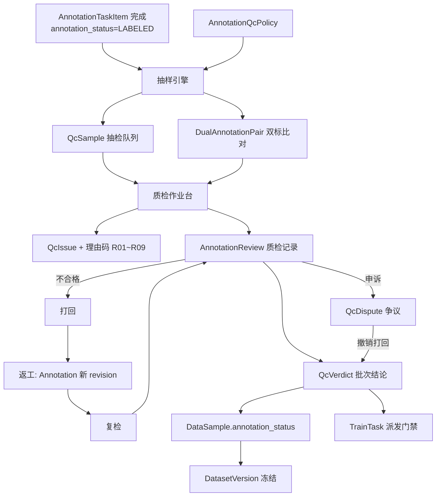
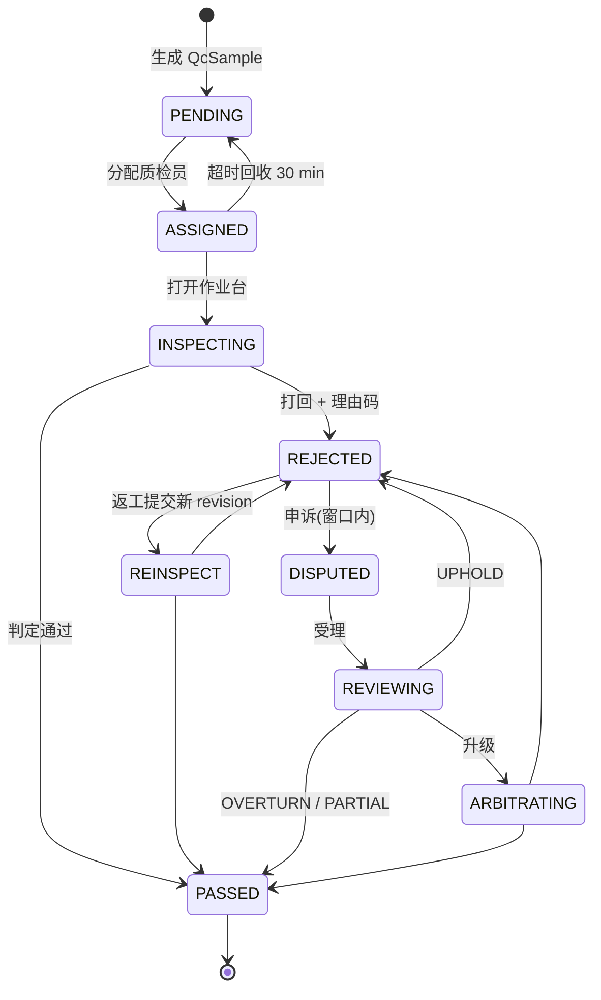
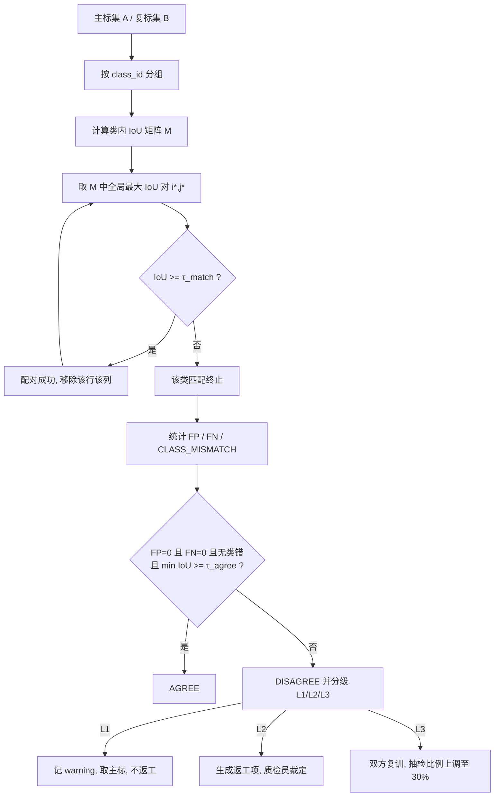
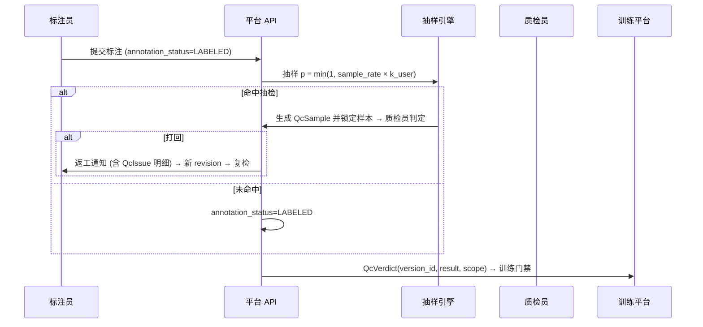
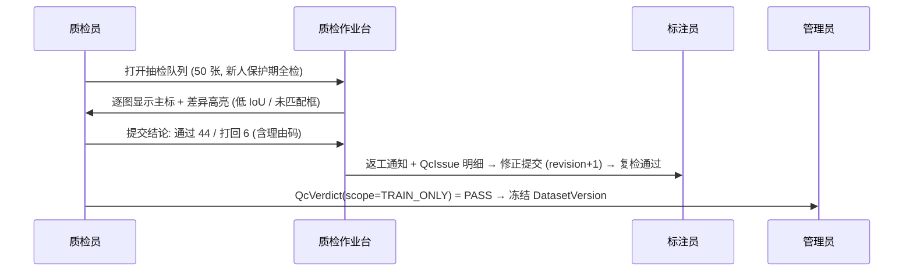

# PRD: P0063_质检与返工 (Quality Inspection & Rework)

| 属性 | 内容 |
| :--- | :--- |
| **文档编号** | P0063 |
| **功能模块** | M04_标注中心 |
| **当前版本** | v1.0.0 |
| **文档状态** | Approved |
| **作者** | Tyrion |
| **最后更新** | 2026-10-01 |

---

## 1. 全局说明

> [!IMPORTANT]
> **核心定位**: 训练框架（YOLOX）**自身不校验标签质量**，本模块是平台侧唯一的标签质量闸门：抽检 + 双标一致性 + 打回返工 + 争议仲裁，并把结论聚合为 `QcVerdict` 作为训练任务的准入凭据。质检产物仍写 `Annotation` 的新 `revision`，**不存在第二套标注存储**。

### 名词解释
*   **质检 (QC)**: 质检员对已提交标注做正确性判定；**抽检 (Sampling)** 为按比例抽样，**全检** 为比例 100% 的特例。
*   **双标 (Dual Annotation)**: 同一 `DataSample` 由两名标注员**互不可见**地各标一份（盲标），用于客观度量一致性。
*   **主标 / 复标 (Primary / Secondary Annotation)**: 作业标注员与双标复核标注员各自产出的 `Annotation` 集。
*   **IoU**: 几何交并比，本模块一致性的基础度量。
*   **匹配 (Matching)**: 两组标注间建立一一对应；未匹配的主标框为 **漏标 FN**，未匹配的复标框为 **多标 FP**。
*   **打回 (Reject) / 返工 (Rework)**: 判定不合格并退回重做；返工产出 `Annotation` 的新 revision，不就地覆盖。
*   **理由码 (Reason Code)**: 打回时必选的标准化原因 `R01`~`R09`。
*   **争议 / 仲裁 (Dispute / Arbitration)**: 标注员申诉与 `ADMIN` 终局裁定。
*   **质检关卡 (QC Gate)**: 训练任务引用 `DatasetVersion` 前的强制校验点。

### 统一异常处理
| Code | 场景 | 处理策略 |
| :--- | :--- | :--- |
| `E46301` | 质检策略参数非法 | 拒绝保存，提示越界字段（如抽检比例须在 0~100%） |
| `E46302` | 可抽检样本不足 | 提示"可抽检 {n} 张，低于最小抽检数 {m}"，降级为全检，不阻断 |
| `E46303` | 样本已被质检锁定 | 拒绝编辑，返回锁持有者与预计释放时间 |
| `E46304` | 复标人可见主标结果 | 拒绝派发，双标必须盲标（服务端不返回主标内容） |
| `E46305` | 双标人与主标人相同 | 拒绝创建双标对，提示须由不同标注员完成 |
| `E46306` | 几何类型不支持一致性度量 | 提示"类型 {t} 暂不支持自动判定"，转人工质检 |
| `E46307` | 质检结论缺少理由码 | 拒绝提交，打回必须至少 1 个理由码 |
| `E46308` | 版本未通过质检 | 拒绝训练任务引用，提示该版本质检未通过 |
| `E46309` | 申诉窗口已关闭 | 拒绝申诉，提示窗口为打回后 {h} 小时内 |
| `E46310` | 申诉次数超限 | 拒绝，同一图仅可申诉 1 次 |
| `E46311` | 质检员质检本人标注 | 拒绝，样本不出现在其队列 |
| `E46312` | 双标依赖缺失 | 复标未提交，比对任务保持 `PENDING` |
| `E46313` | 仲裁权限不足 | 拒绝，仲裁需 `ADMIN` 角色 |
| `E46314` | 冻结/归档版本禁止改结论 | 拒绝，提示版本状态为 {status} |
| `E46315` | 并发质检 revision 冲突 | 返回 409，提示标注已被他人修改，请刷新（沿用 P0060 定义的 `revision` 乐观锁语义） |

---

## 2. 项目背景

### 背景 (Context)
首个落地任务是**食品包装生产日期区域检测**：小目标 + 低对比度 + 反光褶皱，**漏标（FN）比误标（FP）更致命**——漏掉一个日期区域，产线直接失效。而标注员与质检员在 2~3 人团队中常是同两人，角色互斥只能靠系统强制。一次训练占满整机 GPU 数小时，**用脏标签训练是最贵的浪费**。

### 问题陈述 (Problem Statement)
1. **质量不可见**: 标注提交后无人复核，脏标签直通训练，指标异常无法归因。
2. **判定无标准**: 靠"看一眼"判合格，不同人结论不同且不可追溯。
3. **返工无闭环**: 打回缺少原因记录与复检，同一错误反复出现。
4. **基线漂移无监控**: 标注员水平随时间变化，缺少客观一致性指标。

### 目标与成功指标 (Goals & Success Metrics)
*   **北极星指标**: 进入训练的 `DatasetVersion` 中，质检覆盖样本的标注准确率 **≥ 99%**。
*   **次要指标**: 首轮抽检对明显错误的捕获率 **≥ 80%**；双标图级一致性 **≥ 95%** 方可转免检；复检通过率 **≥ 90%**；质检每图平均耗时 **≤ 40 s**。

### 风险与规避 (Risks & Mitigation)
| 风险 | 影响 | 规避方案 |
| :--- | :--- | :--- |
| 抽检比例过低，脏标签漏网 | 训练数据被污染 | 新人保护期强制全检；返工率高的标注员自动上调比例（F01 系数表） |
| 双标成本翻倍 | 小团队产能不足 | 双标默认 5%，只投向新类别、新标注员、历史分歧高的图 |
| 质检员主观放水 | 闸门失效 | 仲裁撤销率（`misjudge_rate`）计入质检员绩效；争议图强制第三人复核 |
| 质检锁定导致空转 | 产能损失 | 锁只作用于被抽中的图，同任务其余图可继续作业 |
| 争议拖延交付 | 阻塞训练 | 申诉 48h + 复核 24h + 仲裁 T+1，超时自动维持原判 |

---

## 3. 价值模型

*   **方案**: 在标注提交与版本冻结之间插入一个**可配置、可复现、有记录**的质检验收层——抽检比例由 `AnnotationQcPolicy` 驱动并按标注员历史自动加压；双标一致性用确定的 IoU 匹配算法产出客观数字；打回必须携带理由码形成错误分布；结论聚合为 `QcVerdict` 成为训练硬门禁。
*   **目标**: 团队随时能回答三个问题——"这批标签能不能上训练？"、"谁标的、谁检的、依据什么？"、"标注员在变好还是变坏？"

---

## 4. 项目范围

### 功能结构图


### In Scope (包含范围)
1. 质检策略: 按数据集/标注任务配置抽检比例、双标比例、IoU 阈值、一致性达标线、新人保护张数。
2. 抽样引擎: 分层抽样 + 优先级排序 + 可复现随机种子 + 样本锁定。
3. 双标一致性: IoU 匹配算法、图级判定、分歧分级、数据集级汇总。
4. 质检作业台: 逐框判定、理由码、批量通过、质检耗时记录。
5. 打回返工: 理由码体系、返工派单、复检、返工后新 revision。
6. 争议升级: 申诉 → 复核 → 仲裁三级路径。
7. 质检结论: `QcVerdict` 生成与训练门禁；回写 `DataSample.annotation_status`。

### Out of Scope (不包含范围)
*   **模型质量质检**: 只评标注不评模型，模型侧见 P0086_模型评估。
*   **图像质量自动判定**: 模糊/过曝/重复的自动预检属导入与验收环节；本模块仅允许质检员以 `R09` 打回且不计入标注员返工率。
*   **自定义审批流**: 固定三级（质检员 → 复核 → 仲裁），不提供自由编排。
*   **多人同图实时协作**: 互斥锁模型，不支持并发同图标注。
*   **图像级分类标签的一致性**: 首期只覆盖几何标注（rect/polygon/keypoint/OBB）。

## 5. 业务流程

### 5.1 质检状态机


### 5.2 双标一致性判定


### 5.3 端到端链路


### 5.4 质检会话与锁定
质检会话超时 30 min 自动释放；样本在 `INSPECTING` 期间由 `annotation_task_items.status=LOCKED_FOR_QC` 独占，标注员编辑返回 `E46303`；结论落库后解锁并把 `LOCKED_FOR_QC` 还原为作业状态。

## 6. 用户分析

### 6.1 用户画像 (User Personas)
*   **质检员 / 项目负责人（`TRAINER`）**: 设策略、执行抽检、裁定打回、处理争议。诉求："用最少抽检量确认这批标签能用，并把责任留痕。" 痛点：抽检靠感觉、打回对方不服、无法证明数据干净。
*   **标注员（`ANNOTATOR`）**: 完成作业、响应返工。诉求："打回要告诉我错在哪一框、为什么错。" 痛点：标准前后不一致、被误判无处申辩。
*   **管理员（`ADMIN`）**: 仲裁、调策略、看趋势。诉求："质检结论要能直接决定训练能不能开跑。" 痛点：版本冻结后才发现问题，训练白跑。

### 6.2 用户链路图 (User Journey Map)


---

## 7. 功能需求

### M04.F01 质检策略与抽样 (QC Policy & Sampling)
*   **用户故事**: 作为质检员，我希望按数据集配置抽检参数并让系统自动、可复现地抽样、优先抽高风险样本，以便有限质检人力花在刀刃上。
*   **逻辑与业务规则**
    *   **前置条件**: 角色 `TRAINER`/`ADMIN`；存在 `annotation_status=LABELED` 的 `DataSample`。
    *   **策略优先级**: `annotation_task_id` 非空 > 数据集默认 > 平台默认；只影响此后新生成的抽检计划，已有 `QcSample` 不回算。
    *   **有效比例**: `p = min(1.0, sample_rate × k_user)`，`n = min(N, max(ceil(N × p), 20))`；`N < 20` 时降级全检并由 `E46302` 提示（非阻断）。
    *   **分层**: 先按 `LabelClass` 分层，稀有类（占比 < 5%）每类至少抽 `rare_class_min_sample` 张，剩余配额按层样本量比例分配，取整余数按层样本量降序补齐。
    *   **优先级顺序**: ① 双标 `DISAGREE` 图 ② 单图耗时 z-score > 2 ③ AI 候选采纳率高但人工零改动 ④ 该标注员历史被打回过的图 ⑤ 其余随机。
    *   **可复现**: `DETERMINISTIC` 模式下 `seed = crc32(annotation_task_id + ":" + revision)`，同批次重跑得到同一清单。
    *   **锁定**: 清单生成即把对应 `AnnotationTaskItem.status` 置 `LOCKED_FOR_QC`，编辑返回 `E46303`；结论落库后解锁。
    *   **后置条件**: 写入 `QcSample` 并推送质检队列。
    *   **`k_user` 档位**: 新人保护期（生涯累计 < `newbie_protect_count`）= 10.0 等效全检；观察期（最近 500 图返工率 ≥ 10%）= 3.0；正常 = 1.0；免检档（最近 1000 图返工率 ≤ 2% 且质检通过率 ≥ 98%）= 0.2。

    | 参数 | 默认 | 范围 | 说明 |
    | :--- | :--- | :--- | :--- |
    | `sample_rate` / `dual_annotate_rate` | 0.10 / 0.05 | 0 ~ 1 | 基础抽检比例 / 双标比例 |
    | `iou_match_threshold` (τ_match) | 0.50 | 0.10 ~ 0.90 | 低于此值的框对视为不匹配 |
    | `iou_agree_threshold` (τ_agree) | 0.75 | 0.50 ~ 0.95 | 匹配框位置一致下限 |
    | `consistent_pass_threshold` (γ) | 0.95 | 0.80 ~ 1.00 | 数据集级一致性达标线 |
    | `newbie_protect_count` / `rare_class_min_sample` | 200 / 1 | 0 ~ 10000 / 0 ~ 20 | 新人保护张数 / 稀有类保底 |
    | `dispute_window_hours` / `inspect_timeout_min` / `rework_due_hours` | 48 / 30 / 24 | 1~168 / 5~240 / 1~240 | 申诉窗口 / 会话超时 / 返工时限 |

*   **验收标准**
    ```gherkin
    场景: 新人保护期强制全检
      Given 标注员 U-1001 生涯累计标注 120 张（< 200）
      When 其提交的标注任务 AT-0100 含 30 张图并执行抽样
      Then 生成 30 条 QcSample 且 sample_reason = NEWBIE
    场景: 抽样清单可复现且可锁定
      Given 标注任务 AT-0101 revision=3 含 500 张图，模式 DETERMINISTIC
      When 连续执行两次抽样并尝试修改被抽中样本的几何
      Then 两次返回的 sample_id 集合完全一致
      And 修改请求返回 E46303
    场景: 阈值倒挂被拒绝
      Given 策略表单设置 τ_match=0.80、τ_agree=0.70
      When 点击保存
      Then 返回 E46301 且提示一致性阈值必须大于匹配阈值
```
*   **边界情况与异常处理**
    | 场景 | 处理 |
    | :--- | :--- |
        | 抽样后标注被改动致 revision 变化 | `QcSample` 作废并按新 revision 重抽，避免质检陈旧内容 |
    | 同图被双标与抽检同时命中 | 只生成一条 `QcSample`，`sample_reason=DUAL_MATCH`，复用双标结论不重复耗工时 |
    | 并发抽样重复抽中 / 质检员离线积压 | 单事务 `SELECT ... FOR UPDATE SKIP LOCKED` 取批；超 `inspect_timeout_min` 的 `ASSIGNED` 自动回 `PENDING` |

---

### M04.F02 双标一致性比对 (Dual Annotation Agreement)
*   **用户故事**: 作为质检员，我希望系统用统一算法给出两人标注的一致性结论，以便客观判断标注标准是否收敛。
*   **逻辑与业务规则**
    *   **前置条件**: 同一样本存在主标集 A（`primary_annotator_id`）与复标集 B（`secondary_annotator_id`）且两人不同，否则 `E46305`；提交前服务端不向复标人返回主标内容（`E46304`）。
    *   **几何度量**: rect 用 IoU（归一化 `{x,y,w,h}` 还原像素后求交并）；OBB 用旋转 IoU（4 点转多边形裁剪求交）；polygon 用多边形 IoU（自交先简单化，Sutherland–Hodgman + 鞋带公式）；keypoint 用 OKS（`τ_oks = 0.65`）。
    *   **匹配算法（类别内一对一贪心）**:
        1. A、B 按 `class_id` 分组，**只在组内匹配**。
        2. 计算组内 IoU 矩阵 `M[i][j]`。
        3. 反复取 `M` 全局最大值 `(i*,j*)`；`M[i*][j*] ≥ τ_match` 则配对并从矩阵移除第 `i*` 行与第 `j*` 列，继续；否则终止该组匹配。
        4. 终止后 A 中未配对框计 **FN（漏标）**，B 中未配对框计 **FP（多标）**；配对成功但 `class_id` 不一致计 **CLASS_MISMATCH**（算法按类分组，此项由跨组近邻补充检查）。
        5. 落库 `matched_pairs / min_iou / mean_iou / fp_count / fn_count / mismatch_count`，并算框级 `precision = matched/|B|`、`recall = matched/|A|`、`F1`。
    *   **图级判定**: `AGREE ⟺ fp=0 ∧ fn=0 ∧ mismatch=0 ∧ (matched=0 ∨ min_iou ≥ τ_agree)`；双方均无框判 `AGREE` 但 `empty_both=true`，不计入一致性分母（防刷分）。
    *   **分歧分级**: `L1` 无 FP/FN/类错且 `τ_match ≤ min_iou < τ_agree` → 记 warning、取主标、不返工、进下轮抽检优先队列；`L2` 存在 `min_iou < τ_agree` 的匹配且 `fp+fn ≤ 1` 或恰 1 处类错 → 生成返工项交质检员裁定；`L3` `fp+fn ≥ 2` 或 `mismatch ≥ 2` → 双方标注均不可信，重派第三人，双方抽检比例上调至 30%。
    *   **数据集级汇总**: `agreement_rate = AGREE 图数 / 有效双标图数`（排除 `empty_both`）；低于 γ 时告警并把 `dual_annotate_rate` 临时翻倍（上限 1）持续 7 天；图级一致性另算 **Cohen's κ**，κ < 0.6 提示可能接近随机水平。
    *   **后置条件**: 写 `DualAnnotationPair`；`L2`/`L3` 联动生成 `QcSample` 与返工项。
*   **验收标准**
    ```gherkin
    场景: 两框位置接近判为一致
      Given 样本 S-001 主标与复标各 1 个 PRODUCTION_DATE 框, IoU = 0.88
      When 执行比对
      Then agree = true 且 level = NONE 且 min_iou = 0.88
    场景: 复标多一框判 L2 并返工
      Given 样本 S-002 主标 2 框、复标 3 框, 2 对匹配且最小 IoU = 0.80
      When 执行比对
      Then fp_count = 1、fn_count = 0、agree = false、level = L2
      And 生成 1 条 QcSample 且 sample_reason = DUAL_MATCH
    场景: 严重分歧判 L3 并双方加压
      Given 样本 S-003 主标 1 框、复标 2 框且无框对达到 τ_match
      When 执行比对
      Then fp_count = 2、fn_count = 1、level = L3
      And 主标人与复标人的抽检比例均上调至 0.30 且该样本重派第三人
```
*   **边界情况与异常处理**
    | 场景 | 处理 |
    | :--- | :--- |
    | 双方均为空标注 | 判 `AGREE` 且 `empty_both=true` 不计入分母；连续 3 次告警（疑似批量空图） |
    | 关键点缺 `visibility` / 自交多边形面积为 0 | 缺失点按 `v=0` 不计入 OKS 分母，全缺失转人工；多边形先简单化，仍失败转人工（`E46306`） |
    | 复标未提交即查询比对 | 返回 `E46312`，`DualAnnotationPair` 保持 `PENDING` |
    | 单类目标数 > 300 / 比对期间主标被改 | IoU 矩阵 O(n²)，按空间网格分块匹配；比对冻结在主标 revision，变更则该 Pair 失效重算 |

---

### M04.F03 质检作业与记录 (Inspection Workbench & Review Record)
*   **用户故事**: 作为质检员，我希望在一个界面完成看图、看差异、逐框判定，以便快速且留痕地得出结论。
*   **逻辑与业务规则**
    *   **前置条件**: `QcSample.status ∈ {PENDING, ASSIGNED}`；质检员 ≠ 主标人，否则样本不进入其队列（`E46311`）。
    *   **主流程**: 领取（`ASSIGNED`）→ 加载缩略图并懒加载原图 → 叠加主标框与差异高亮 → 逐框判定/勾选理由码 → 提交。
    *   **判定粒度**: 图级 `verdict ∈ {PASS, REJECT}` + 框级 `QcIssue[]`；`REJECT` 时至少 1 条 `QcIssue`，否则 `E46307`。
    *   **差异高亮**: 主标实线、复标虚线、`IoU < τ_agree` 红描边、未匹配框闪烁定位。
    *   **批量通过**: 仅限双标 `AGREE` 且无低 IoU 标记的图；逐图生成 `AnnotationReview`，不可绕过。
    *   **耗时记录**: 从 `INSPECTING` 到提交的**有效时长**（页面失焦 > 120 s 不计入）写入 `AnnotationReview.time_spent_sec`；快捷键 `J/K` 切换、`P` 通过、`R` 打回、`1~9` 理由码、`Ctrl+Enter` 提交。
    *   **后置条件**: 写 `AnnotationReview`；更新 `DataSample.annotation_status`；解锁样本。
*   **验收标准**
    ```gherkin
    场景: 质检通过
      Given 质检员 Q-01 打开样本 S-010, 主标 3 框位置正确
      When 点击通过并提交
      Then 生成 AnnotationReview(verdict=PASS)
      And DataSample S-010 的 annotation_status = VERIFIED 且样本解锁
    场景: 打回必须给理由码
      Given 质检员打开样本 S-011
      When 选择打回但未勾选任何理由码并提交
      Then 返回 E46307 且不生成 AnnotationReview
    场景: 不可质检本人标注 / 批量通过
      Given 样本 S-012 主标人为 U-01 且队列中另有 12 张双标 AGREE 图
      When U-01 尝试领取 S-012 并全选批量通过其余 12 张
      Then 领取返回 E46311 且样本不出现在其队列
      And 生成 12 条 AnnotationReview 且 reviewer 为当前质检员
```
*   **边界情况与异常处理**
    | 场景 | 处理 |
    | :--- | :--- |
    | 原图 > 50 MB | 先显示 2560px 长边缩略图判定；申请原图时流式加载并显示进度 |
    | 提交时标注已被第三方修改 | 校验 `revision` 不一致返回 `E46315`，要求刷新 |
    | 图像本身模糊/损坏 | 勾选 `R09`，`counted_in_rework=false`，不计入标注员返工率 |
    | 会话长时间无操作 / 反复领取刷工时 | 超时释放回 `PENDING` 且不存草稿；重复记录保留但绩效只取首条 |

---

### M04.F04 打回返工与理由码 (Reject & Rework)
*   **用户故事**: 作为标注员，我希望被打回时收到具体错误位置与理由，以便精准修正而非整图重标。
*   **逻辑与业务规则**
    *   **前置条件**: `AnnotationReview.verdict = REJECT`。
    *   **理由码与返工率计入规则**:

    | 理由码 | `issue_type` | 含义 | 计入标注员返工率 |
    | :--- | :--- | :--- | :--- |
    | `R01` / `R02` | `MISSING_BOX` / `EXTRA_BOX` | 漏标 / 多标误标 | 是 |
    | `R03` / `R04` | `WRONG_CLASS` / `IMPRECISE_BOX` | 类别错误 / 框位置不准 | 是 |
    | `R05` / `R06` | `ROUGH_POLYGON` / `KEYPOINT_OFFSET` | 多边形粗糙未贴边 / 关键点错位 | 是 |
    | `R07` / `R08` | `WRONG_TEXT` / `SOP_VIOLATION` | 转写文本错误或缺失（见 P0065）/ 未遵守标注规范 | 是 |
    | `R09` | `IMAGE_QUALITY` | 图像模糊/反光/损坏，无法标注 | **否** |

    *   **返工派单**: 每张打回图生成返工项并携带 `QcIssue[]` 指派给原标注员；`L3` 样本转派第三人。
    *   **返工语义**: 在同一 `Annotation` 记录上修改并递增 `revision`，历史 revision 保留可回溯（不物理覆盖）。
    *   **返工时限**: 默认 `rework_due_hours=24`；超时进入 `ADMIN` 逾期看板并告警，**不自动转派**（小团队需人工决策）。
    *   **复检**: 由**原质检员**复检（保证标准一致）；通过则 `PASSED`，否则再次 `REJECTED` 并开放申诉。
    *   **后置条件**: 返工期间 `DataSample.annotation_status` 保持 `REJECTED`，复检通过置 `VERIFIED`。
*   **验收标准**
    ```gherkin
    场景: 打回携带具体问题
      Given 质检员判定样本 S-020 不合格
      When 勾选 R01 并指定期望类别 PRODUCTION_DATE 后提交
      Then annotation_status = REJECTED
      And 返工项含 QcIssue(issue_type=MISSING_BOX) 且原标注员收到通知
    场景: 图像质量问题不计入返工率
      Given 质检员对样本 S-021 仅勾选 R09
      When 提交打回
      Then counted_in_rework = false 且该标注员返工率统计不含该样本
    场景: 返工后复检与超时
      Given 样本 S-020 处于 REJECTED 且标注员已提交 revision=5
      When 质检员复检判定通过
      Then verdict = PASS 且 annotation_status = VERIFIED 且 QcSample.status = PASSED
      And 若另一返工项超 24 小时未提交则告警中心出现"返工逾期"且看板标记 OVERDUE
```
*   **边界情况与异常处理**
    | 场景 | 处理 |
    | :--- | :--- |
    | 原标注员已离职/禁用 | 转派给 `ADMIN` 指定人员，原归属保留在记录中 |
    | 返工后修改了未被打回的框 | 允许，但复检全图重判（不做增量复检，避免新引入错误漏检） |
    | 同图连续 3 次复检不通过 | 标记 `HARD_SAMPLE` 转派第三人并进入难例池（供流水线难例回流） |
    | 返工期间准备冻结版本 / 理由码与实际不符 | 冻结被拒绝并提示存在 `REJECTED` 样本，除非显式忽略并生成 `WAIVED`；理由码有误走申诉，撤销后记录标 `overturned=true` |

---

### M04.F05 争议申诉与仲裁 (Dispute & Arbitration)
*   **用户故事**: 作为标注员，我希望对不认可的质检结论发起申诉并获得独立复核，以便误判不影响我的质量记录。
*   **逻辑与业务规则**
    *   **前置条件**: `verdict=REJECT` 且未超 `dispute_window_hours`（否则 `E46309`）；同图申诉次数 < 1（否则 `E46310`）；申诉理由必填且 ≥ 10 字。
    *   **三级路径**: `RAISED`（标注员提交）→ `REVIEWING`（**另一名 `TRAINER`**，不可为原质检员，24 h 内重新判定，系统强制展示双方标注与差异面板）→ `ARBITRATING`（`ADMIN` 终局，不可再申诉）。
    *   **裁定语义**: `UPHOLD` 维持打回（返工继续）；`OVERTURN` 撤销打回（`annotation_status=VERIFIED`、`AnnotationReview.overturned=true`、返工项关闭、原质检员 `misjudge_count` +1）；`PARTIAL` 仅撤销部分 `QcIssue`，剩余继续返工。
    *   **超时规则**: 复核 24 h 未处理自动升级仲裁；仲裁 48 h 未处理自动维持复核结论。
    *   **后置条件**: 写 `QcDispute` 与 `AuditLog`（含双方 id 与裁定理由）。
*   **验收标准**
    ```gherkin
    场景: 申诉撤销误判
      Given 样本 S-030 于 2026-10-01 10:00 被判打回
      And 标注员于 2026-10-01 15:00 发起申诉
      When 复核人判定 OVERTURN
      Then annotation_status = VERIFIED 且 overturned = true
      And 原质检员 misjudge_count 加 1 且返工项关闭
    场景: 超出申诉窗口
      Given 打回时间为 2026-09-28 10:00, 窗口 48 小时
      When 标注员于 2026-10-01 09:00 申诉
      Then 返回 E46309
    场景: 仲裁终局且原质检员不得复核
      Given 争议针对质检员 Q-01 的结论
      Then 该复核任务不出现在 Q-01 队列
      When 争议经 ADMIN 裁定 UPHOLD 后标注员再次申诉
      Then 返回 E46310
```
*   **边界情况与异常处理**
    | 场景 | 处理 |
    | :--- | :--- |
    | 团队仅 1 名 `TRAINER` | 复核强制由 `ADMIN` 承担；若 `ADMIN` 即原质检员则直接进入仲裁并提示"无独立复核人" |
    | 申诉期间版本已冻结 | 允许申诉；裁定 `OVERTURN` 时置版本 `stale_qc` 标记并告警，不自动解冻 |
    | 争议无法达成一致 | 强制双标流程，以双标结论作为仲裁依据 |
    | 高频申诉（> 30% 打回量）/ 理由不足 10 字 | 记录但不阻断，在 P0066 看板标记"争议倾向"；理由不足则表单拒绝且不消耗申诉次数 |

---

### M04.F06 质检结论与训练关卡 (QC Verdict & Training Gate)
*   **用户故事**: 作为管理员，我希望系统按版本汇总质检结论并在训练引用未通过版本时直接拒绝，以便脏标签不可能进入训练。
*   **逻辑与业务规则**
    *   **生成时机**: 手动生成 / `DatasetVersion` 冻结时自动 / 每日 02:00 扫描 24 h 内无变更的标注任务。
    *   **唯一键**: `(dataset_version_id, annotation_task_id)`；`scope ∈ {ALL, TRAIN_ONLY}` 表达覆盖范围，`TRAIN_ONLY` 表示只对 `DatasetVersionItem.split = TRAIN` 的样本做了质检，避免 val 集未质检的漏检盲区。
    *   **判定规则**: 抽检数为 0 → `WAIVED`；`抽检通过率 ≥ γ` 且未通过样本均已返工通过 → `PASS`；否则 `FAIL`。`抽检通过率 = PASSED / (PASSED + REJECTED)`，`REJECTED` 以最终状态计，被 `OVERTURN` 的不计为失败。
    *   **硬约束**: 存在 `agree=false 且 level=L3` 的样本时，无论通过率如何均判 `FAIL`。
    *   **训练门禁**: `TrainTask` 在 `DISPATCHED` 前置检查读取该版本 `QcVerdict`——`PASS` 放行；`WAIVED` 放行但标黄警告；`FAIL` 或无记录则拒绝派发并返回 `E46308`。
    *   **例外通道**: `ADMIN` 可给 `DatasetVersion` 打 `qc_waived` 标签（`DatasetVersionTag`）强制放行并写 `AuditLog`；标签移除后门禁立即恢复。
    *   **回写、幂等与版本状态**: `PASS` 时把覆盖样本的 `annotation_status` 置 `VERIFIED`；重复生成覆盖旧记录不产生多条；仅 `DRAFTING` 版本可注入标注，`READY`/`FROZEN`/`ARCHIVED` 禁止写入。
*   **验收标准**
    ```gherkin
    场景: 未通过质检的版本禁止训练
      Given DatasetVersion DV-FoodPkg-v3 的 QcVerdict.result = FAIL
      When 用户提交引用该版本的训练任务
      Then 返回 E46308 且任务不进入队列
    场景: 仅 TRAIN 子集被质检
      Given 版本 DV-FoodPkg-v4 只对 split=TRAIN 的样本抽检且全部通过
      When 生成质检结论
      Then scope = TRAIN_ONLY 且 result = PASS 且训练门禁放行
    场景: 一致性 L3 直接否决
      Given 抽检通过率为 0.98 且存在 1 个 level = L3 的双标对
      When 生成质检结论
      Then result = FAIL
```
*   **边界情况与异常处理**
    | 场景 | 处理 |
    | :--- | :--- |
    | 版本尚未冻结即请求结论 | 允许生成并标 `provisional=true`，冻结时重新生成正式结论 |
    | 同版本关联多个标注任务 | 每任务一条 `QcVerdict`；门禁要求参与训练样本所属的全部任务均为 `PASS`/`WAIVED` |
    | 生成时仍有样本在 INSPECTING | 跳过未完成样本并标 `provisional=true`，不阻塞 |
    | 质检后新增数据 / 存在 `R09` 打回 / 冻结版本被 `OVERTURN` | 新增产出新版本（`DRAFTING`）且无质检记录，门禁默认拒绝；`R09` 不计入通过率失败项但需人工决定剔除或重拍；置 `stale_qc` 标记告警，不自动解冻 |

---

## 8. 技术架构与数据模型

> 所有实体均含 `id UUID PK`、`created_at` / `updated_at timestamptz`，按需含 `deleted_at`，下表不再重复。

### 8.1 数据实体

| 字段名 | 类型 | 必填 | 说明 | 约束 |
| :--- | :--- | :--- | :--- | :--- |
| **annotation_qc_policies (AnnotationQcPolicy)** — 质检策略 | | | | |
| dataset_id / annotation_task_id | UUID | Y/N | 数据集与标注任务（NULL = 数据集默认策略） | FK；联合唯一 |
| sample_rate / dual_annotate_rate | Numeric(4,3) | Y | 抽检比例 / 双标比例 | 0 ~ 1 |
| iou_match_threshold / iou_agree_threshold / consistent_pass_threshold | Numeric(4,3) | Y | τ_match / τ_agree / γ | 见 F01 |
| newbie_protect_count / rare_class_min_sample / dispute_window_hours / inspect_timeout_min / rework_due_hours | Int | Y | 新人保护张数 / 稀有类保底 / 申诉窗口 / 会话超时 / 返工时限 | - |
| sample_seed_mode / created_by | Enum / UUID | Y | DETERMINISTIC 或 RANDOM / 创建者 | FK → users.id |
| **qc_samples (QcSample)** — 抽检样本 | | | | |
| policy_id / annotation_task_id / annotation_task_item_id / sample_id | UUID | Y | 策略 / 标注任务 / 单图作业单元 / 数据样本 | FK |
| annotation_revision | Int | Y | 抽样时刻的 revision | 乐观锁基准 |
| primary_annotator_id / inspector_id / locked_at | UUID / timestamptz | Y/N | 主标人 / 质检员 / 锁定时间 | FK → users.id |
| sample_reason | Enum | Y | RANDOM / RARE_CLASS / OUTLIER_TIME / DUAL_MATCH / NEWBIE / PRIOR_REJECT | - |
| status | Enum | Y | PENDING / ASSIGNED / INSPECTING / REINSPECT / PASSED / REJECTED | - |
| **annotation_reviews (AnnotationReview)** — 质检记录 | | | | |
| qc_sample_id / annotation_id / sample_id / reviewer_id | UUID | Y | 抽检样本 / 标注 / 数据样本 / 质检员 | FK |
| annotation_revision / time_spent_sec | Int | Y | 被质检 revision / 有效耗时（秒） | - |
| verdict / severity | Enum | Y/N | PASS 或 REJECT / L1、L2、L3（打回必填） | - |
| counted_in_rework / overturned / concluded_at | Boolean / timestamptz | Y | 是否计入返工率（R09 为 false）/ 是否被撤销 / 结论时间 | - |
| **qc_issues (QcIssue)** — 逐框问题 | | | | |
| annotation_review_id / target_annotation_id / expected_class_id | UUID | Y/N | 质检记录 / 涉及标注框（漏标为 NULL）/ 期望类别 | FK |
| issue_type / reason_code | Enum | Y | MISSING_BOX…IMAGE_QUALITY / R01~R09（一一对应） | - |
| bbox_hint | JSONB | N | 漏标/多标参考位置（归一化） | - |
| resolved | Boolean | Y | 返工后是否已修正 | 默认 false |
| **dual_annotation_pairs (DualAnnotationPair)** — 双标比对 | | | | |
| sample_id / primary_annotation_id / secondary_annotation_id | UUID | Y | 样本 / 主标集 / 复标集 | FK |
| primary_annotator_id / secondary_annotator_id | UUID | Y | 主标人与复标人（须不同） | FK → users.id |
| matched_pairs / fp_count / fn_count / mismatch_count | Int | N | 匹配 / 多标 / 漏标 / 类错计数 | - |
| min_iou / mean_iou / precision / recall / f1 | Numeric(5,4) | N | 一致性指标 | - |
| empty_both / agree / level / status | Boolean / Enum | Y/N | 双方空标注 / 图级一致性 / NONE~L3 / PENDING、COMPUTED、FAILED | - |
| **qc_disputes (QcDispute)** — 争议 | | | | |
| annotation_review_id / raised_by / reviewer_id | UUID | Y/N | 质检记录 / 申诉人 / 复核人（≠ 原质检员） | FK → users.id |
| raise_reason | Text | Y | 申诉理由 | ≥ 10 字 |
| status / resolution / resolution_note / resolved_at | Enum / Text / timestamptz | Y/N | RAISED~CLOSED / UPHOLD、OVERTURN、PARTIAL / 裁定说明 / 时间 | - |
| **qc_verdicts (QcVerdict)** — 批次结论（训练门禁凭据） | | | | |
| dataset_version_id / annotation_task_id | UUID | Y | 版本与标注任务 | FK；联合唯一 |
| scope / result | Enum | Y | ALL 或 TRAIN_ONLY / PASS、FAIL、WAIVED | - |
| inspected_count / passed_count / rejected_count / l3_conflict_count | Int | Y | 抽检统计与 L3 分歧数 | - |
| pass_rate / provisional / generated_at | Numeric(5,4) / Boolean / timestamptz | Y | 通过率 / 是否临时结论 / 生成时间 | - |

**关键索引**: `qc_samples(status, annotation_task_id)`、`annotation_reviews(sample_id, concluded_at)`、`dual_annotation_pairs(sample_id)`、`qc_verdicts(dataset_version_id, annotation_task_id)` 唯一。

### 8.2 模块依赖
`P0060`（`Annotation` + `revision`）、`P0061`（`LabelClass`）、`P0062`（`AnnotationTaskItem`）为上游；`P0064` 的候选框采纳率作为抽检优先级信号；下游为 `03 数据管理`（`DataSample.annotation_status` → `DatasetVersion` 冻结）与 `05 训练平台`（`TrainTask` 派发门禁消费 `QcVerdict`）。

---

## 9. UI/UX 规格说明

### 9.1 质检作业台
```text
┌───────────────────────────────────────────────────────────────────────────────┐
│ 质检作业台   DS-FoodPkg / AT-0100 / 批次 QC-20261001-004      47/120  [退出]  │
├────────────────┬──────────────────────────────────────────┬───────────────────┤
│ 抽检队列 (120) │        ┌──────────────────────────────┐    │ 质检结论          │
│ ● 054 待检 NEW │        │      图像画布 (1280×720)      │    │ ( ) 通过  [P]     │
│ ○ 055 待检     │        │   ▢ 生产日期   IoU .61 ⚠      │    │ (•) 打回  [R]     │
│ ○ 056 待检 DUAL│        │   ▢ 保质期     IoU .91        │    │ 理由码:           │
│ ○ 057 待检 RARE│        └──────────────────────────────┘    │ [x] R01 漏标      │
│ 筛选: [全部]   ├──────────────────────────────────────────┤ [ ] R02 误标      │
│ [新人][双标]   │ 差异面板: 主标 3 框 / 复标 4 框           │ [ ] R03 类别错误  │
│ [分歧][逾期]   │ FP:1(未匹配) FN:0  最小IoU:0.61  L2 显著 │ [ ] R04 框不准    │
│ 图例: ▬主标    │ [定位到差异]                              │ [ ] R07 转写错误  │
│       ▬复标 ⚠低│                                          │ [ ] R09 图像质量  │
│                │                                          │ [提交结论 Ctrl+↵] │
├────────────────┴──────────────────────────────────────────┴───────────────────┤
│ 快捷键: J/K 上/下一张 · P 通过 · R 打回 · 1-9 理由码 · Ctrl+Enter 提交        │
└───────────────────────────────────────────────────────────────────────────────┘
```

### 9.2 交互元素
| 元素 | 类型 | 状态 | 行为 |
| :--- | :--- | :--- | :--- |
| 抽检队列项 | ListItem | Default/Hover/Active/Badge | onClick: 加载样本并置 `INSPECTING` |
| 图像画布 | Canvas | Loading/Zoom/Pan | 滚轮缩放、拖拽平移、双击适配窗口 |
| 差异高亮层 | Overlay | On/Off | 主标实线、复标虚线、`IoU < τ_agree` 红描边 |
| 通过 `[P]` | Button | Default/Disabled | 双标 `L3` 样本禁用（须先返工） |
| 打回 `[R]` | Button | Default/Disabled | 未勾选理由码时禁用提交 |
| 理由码复选框 | Checkbox | Checked/Unchecked | 勾选 `R01/R02` 时展开"期望类别"选择器 |
| 批量通过 | Button | Default/Loading | 仅对 `agree=true` 且无低 IoU 标记的样本可用 |

### 9.3 表单设计
| 字段 | 类型 | 校验规则 | 默认值 |
| :--- | :--- | :--- | :--- |
| 抽检比例 | Number(%) | 0 ~ 100 | 10 |
| 双标比例 | Number(%) | 0 ~ 100 | 5 |
| τ_match / τ_agree | Number | τ_match ∈ [0.10,0.90]、τ_agree ∈ [0.50,0.95] 且 τ_agree > τ_match | 0.50 / 0.75 |
| γ（一致性达标线） | Number | 0.80 ~ 1.00 | 0.95 |
| 新人保护张数 | Number | 0 ~ 10000 | 200 |
| 返工时限 | Number(小时) | 1 ~ 240 | 24 |
| 申诉理由 | Textarea | required，≥ 10 字 | - |

---

## 10. 非功能性需求 (NFR)

*   **性能 (Performance)**: 单图双标比对（≤ 50 框）< **200 ms**，≤ 300 框 < **2 s**（空间分块）；抽样引擎处理 10,000 样本 < **3 s**；作业台缩略图首屏 < **800 ms**；`QcVerdict` 生成（10,000 样本）< **5 s**。
*   **可用性 (Availability)**: 质检接口 P95 < **300 ms**，批量通过 100 张 < **5 s**；质检服务异常时标注提交不阻塞，仅抽样暂缓并在恢复后补抽（记 `qc_delayed`）。
*   **安全 (Security)**: `ANNOTATOR` 只见自己的结论与返工项，`TRAINER` 可质检与复核，`ADMIN` 可仲裁与强制放行；角色互斥（质检员 ≠ 主标人，复核人 ≠ 原质检员，仲裁人 ≠ 复核人）；双标期服务端过滤主标内容；打回/撤销/强制放行全部写 `AuditLog`。
*   **兼容性 (Compatibility)**: Chrome / Edge ≥ 120、Safari ≥ 17；画布支持触摸板手势；≥ 8K 大图降采样显示（判定基于归一化坐标，不受影响）。
*   **可扩展性 (Scalability)**: 单数据集 **100,000** 样本可抽检与生成结论；质检并发放开至 **2** 人（单机团队现实上限），冲突由样本级锁避免；理由码与策略表驱动，新增理由码只扩枚举值不改结构。
*   **数据保留 (Retention)**: `AnnotationReview` / `QcIssue` 保留 **3 年**；`DualAnnotationPair` 保留 **1 年**；返工与申诉记录随 `Annotation` 生命周期保存，`Annotation` 软删后质检记录转只读。

---

## 附录: 已确认的设计决策

| 决策项 | 结论 |
| :--- | :--- |
| 质检粒度 | 图级 `PASS/REJECT` + 框级 `QcIssue`，不支持"仅部分框放行" |
| 双标匹配 | 类别内一对一贪心（全局最大 IoU 优先），O(n²)，n > 300 按空间网格分块 |
| τ_match / τ_agree / γ 默认 | 0.50 / 0.75 / 0.95 |
| 图级一致性定义 | `fp=0 ∧ fn=0 ∧ mismatch=0 ∧ min_iou ≥ τ_agree`；双方空标注判一致但 `empty_both` 不计入分母 |
| 抽检有效比例 | `p = min(1, sample_rate × k_user)`，`k_user` 分新人/观察/正常/免检四档 |
| 随机可复现 | `seed = crc32(annotation_task_id + ":" + revision)`，默认 DETERMINISTIC |
| 理由码 | `R01`~`R09`，其中 `R09`（图像质量）不计入标注员返工率 |
| 返工语义 | 同一 `Annotation` 递增 `revision`，历史 revision 可回溯，不物理覆盖 |
| 复检人 | 原质检员（保证标准一致），不随机轮换 |
| 申诉路径 | 标注员 → 独立复核人（另一 `TRAINER`）→ `ADMIN` 仲裁（终局）；每图限 1 次，窗口 48 h |
| 质检会话超时 | 30 min 无操作自动释放，不存草稿 |
| 训练门禁凭据 | `QcVerdict(dataset_version_id, annotation_task_id)`，`result ∈ PASS/FAIL/WAIVED`，`scope ∈ ALL/TRAIN_ONLY` |
| L3 分歧处置 | 无视通过率直接 `FAIL`；相关标注员抽检比例上调至 30% |
| 版本写入约束 | 仅 `DRAFTING` 版本可注入标注，`READY`/`FROZEN`/`ARCHIVED` 禁止 |

## 关联文档

| 文档 | 关系 |
| :--- | :--- |
| P0060_标注器与标注几何 | 上游：`Annotation`、`revision` 乐观锁、归一化几何 |
| P0061_类别体系管理 | 上游：`LabelClass`，类错判定依赖稳定 `class_id` |
| P0062_标注任务与派单 | 上游：`AnnotationTask` / `AnnotationTaskItem` 与作业状态 |
| P0064_AI预标注 | 并行：候选框采纳率作为抽检优先级信号 |
| P0066_标注统计与绩效 | 下游：消费质检耗时、返工率、通过率 |
| P0041_数据集与版本 | 下游：`annotation_status` 回写与版本冻结 |
| P0082_训练任务提交与调度 | 下游：`TrainTask` 派发门禁消费 `QcVerdict` |

## Changelog

| 版本 | 日期 | 作者 | 说明 |
| :--- | :--- | :--- | :--- |
| v1.0.0 | 2026-10-01 | Tyrion | 首版：抽检策略、双标一致性算法、理由码、争议升级与训练门禁 |
