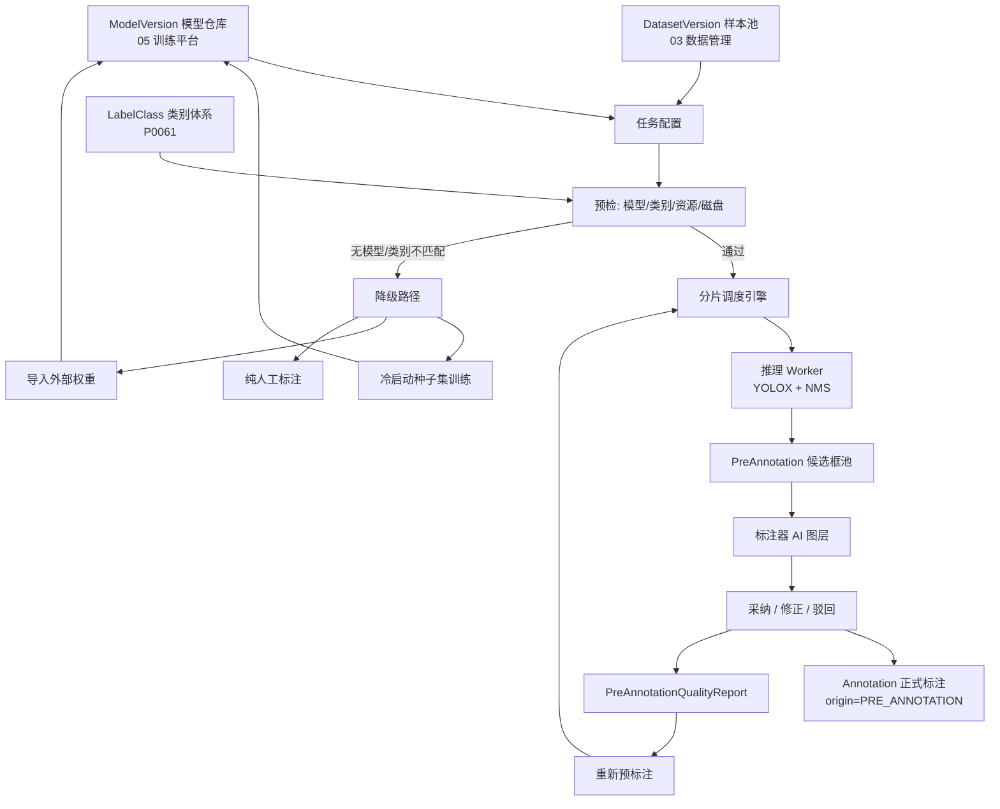
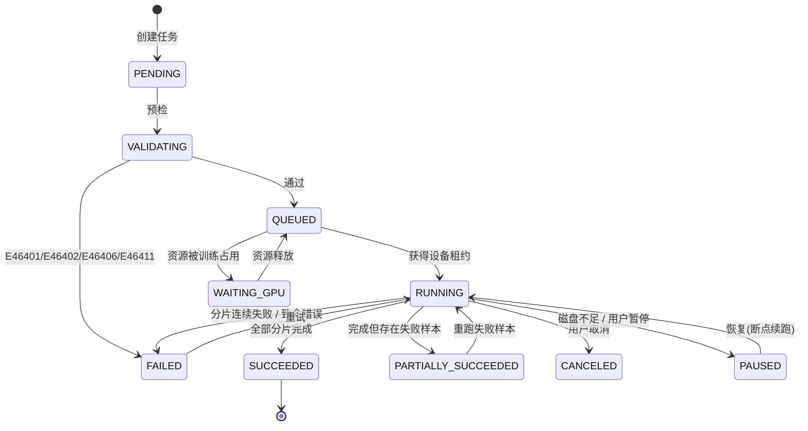
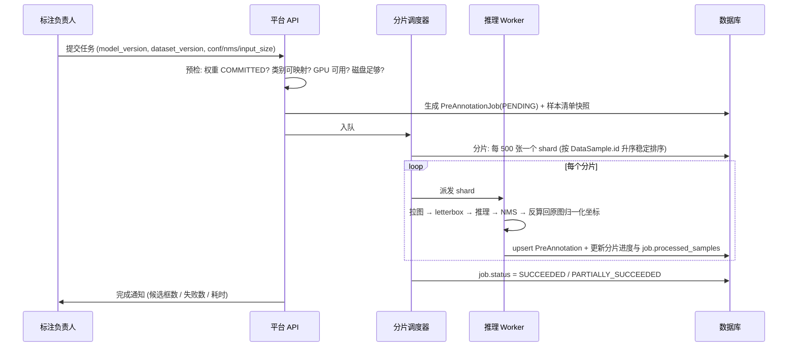

# PRD: P0064_AI预标注 (AI Pre-annotation)

| 属性 | 内容 |
| :--- | :--- |
| **文档编号** | P0064 |
| **功能模块** | M04_标注中心 |
| **当前版本** | v1.0.0 |
| **文档状态** | Approved |
| **作者** | Tyrion |
| **最后更新** | 2026-10-01 |

---

## 1. 全局说明

> [!IMPORTANT]
> **核心定位**: 用**已训练的模型**给未标注图片批量产出候选框，把标注员的工作从"从零画框"降级为"检查并修正"。候选框与正式标注**物理分离**（`PreAnnotation` vs `Annotation`），人工确认前不进入训练数据，因此模型自身的系统性错误不会被"自我强化"。**不提供自动采纳通道**。

### 名词解释
*   **预标注 (Pre-annotation)**: 模型对未标注样本推理得到、尚未经人工确认的候选几何与类别集合。
*   **候选框 (Candidate)**: `PreAnnotation` 中的单条记录，含归一化几何、`class_id`、`score`。
*   **原样采纳 (Accept As-Is)**: 候选框未做任何几何/类别修改即被确认，用于度量模型准确度。
*   **修正 (Edit) / 驳回 (Reject)**: 调整后确认 / 删除误检框。
*   **人工新增 (Human Added)**: 人工补画的框，即模型漏掉的，用于度量 recall。
*   **NMS (Non-Maximum Suppression)**: 推理后处理，抑制重叠冗余框。
*   **`conf` / `nms` 阈值**: 置信度过滤阈值与 NMS IoU 阈值，任务级可配；平台侧参数映射到 YOLOX 的 `test_conf` / `nmsthre`。
*   **预标注质量反馈**: 由人工采纳行为反推的模型指标（`keep_rate` / `edit_rate` / `reject_rate` / `missing_rate`）。
*   **降级路径 (Degradation Path)**: 无可用模型 / 无 GPU / 类别不匹配时仍能让标注继续的兜底方案。

### 统一异常处理
| Code | 场景 | 处理策略 |
| :--- | :--- | :--- |
| `E46401` | 无可用模型版本 | 拒绝创建任务，引导至降级路径（冷启动训练 / 导入外部权重 / 纯人工标注） |
| `E46402` | 权重文件缺失或未 `COMMITTED` | 拒绝派发，提示权重 `ManagedFile` 状态并给出重新登记入口 |
| `E46403` | 无可用 GPU / `TrainNode` 不可调度 | 任务保持 `QUEUED` 并显示原因；允许显式切换 CPU 推理（附耗时警告） |
| `E46404` | 单图推理超时 | 该样本记 `FAILED` 并跳过，不阻塞整批；连续超时 ≥ 20 张自动暂停任务 |
| `E46405` | 图像解码失败 | 记 `FAILED` 并写 `error_message`，失败清单可从任务详情导出 |
| `E46406` | 推理参数非法 | 拒绝提交，提示越界字段（如 `conf` 须在 0.01~0.99） |
| `E46407` | 目标数据集版本不可写 | 拒绝写入，提示版本状态非 `DRAFTING` |
| `E46408` | 样本已被人工标注提交 | 跳过并记 `SKIPPED_LABELED`，不覆盖人工结果 |
| `E46409` | 幂等键重复提交 | 返回既有任务 ID，提示相同参数的预标注任务已在运行 |
| `E46410` | 存储空间不足 | 暂停任务并告警，提示所需最小剩余空间 |
| `E46411` | 模型类别与数据集类别不匹配 | 拒绝启动，打开类别映射界面，映射结果写入 `job.class_map` |
| `E46412` | 推理输出形状非法 | 记 `FAILED` 并写审计日志，标注该 `ModelVersion.suspect=true` |
| `E46413` | 任务被取消 | 已产出候选框保留（`PENDING`），未开始分片立即终止 |
| `E46414` | 断点状态文件损坏 | 从头重跑（幂等：按 `(job_id, sample_id, class_id, geometry_hash)` upsert 不产生重复） |
| `E46415` | 权限不足 | 拒绝，仅 `TRAINER` / `ADMIN` 可创建与取消预标注任务 |

---

## 2. 项目背景

### 背景 (Context)
食品包装日期检测场景中单图通常只有 1~3 个目标区域，但**拍摄量大**：一个采集批次 3,000~10,000 张。纯人工从空白画框，单图 15~25 秒，10,000 张即 40~70 人时，对 2~3 人团队不可承受。一旦有了第一版模型（哪怕 mAP50 只有 0.6），标注员的工作就能从"画框"变成"删掉错的、补上漏的"，单图可压到 3~6 秒。

### 问题陈述 (Problem Statement)
1. **标注成本线性增长**: 团队规模不变时数据增长即停滞。
3. **AI 结果污染数据集**: 把模型输出直接当标注写库会固化模型系统性错误，形成自我强化循环。
4. **无法判断模型该不该用**: 缺少"模型给标注员带来的净收益"度量，只能凭感觉。

### 目标与成功指标 (Goals & Success Metrics)
*   **北极星指标**: 标注员单图平均耗时相对纯人工基线**下降 ≥ 50%**，且质检通过率**不下降**。
*   **次要指标**: 端到端吞吐 ≥ **5,000 张/小时**（单张消费级 GPU，`input_size=640`）；`keep_rate ≥ 0.70` 且 `reject_rate ≤ 0.20` 判定模型可继续用于预标注；重跑后**无重复候选框**（幂等 100%）；已有人工标注样本被 AI 覆盖的概率 **= 0**。

### 风险与规避 (Risks & Mitigation)
| 风险 | 影响 | 规避方案 |
| :--- | :--- | :--- |
| 模型误差被固化 | 标注质量随迭代下降 | `PreAnnotation` 与 `Annotation` 物理分离，必须人工确认才写库，保留 `origin` 与 `pre_annotation_id` 溯源 |
| 标注员盲目全选 | 引入模型系统性漏检 | 质量报告统计 `missing_rate`；低分框禁止批量接受；界面强制"漏检自检"提示 |
| 预标注覆盖人工成果 | 数据丢失 | 仅在 `annotation_status=UNLABELED` 的样本上推理，已提交样本一律跳过（`E46408`） |
| GPU 被训练任务占用 | 预标注排队 | 与训练共用 `TrainNode`，预标注优先级低于训练，让出 GPU 前保存分片检查点 |

---

## 3. 价值模型

*   **方案**: 构建「模型仓库 → 批量推理 → 候选框入库 → 人工修正 → 正式标注」闭环，并把人工的采纳/修正/删除行为**反向聚合为模型质量报告**，驱动下一轮选型或调参。
*   **目标**: 让标注产能从"人力线性"变为"人力 + GPU 并行"；让"这个模型值不值得用来预标注"从主观判断变成可读的数字。

---

## 4. 项目范围

### 功能结构图


### In Scope (包含范围)
1. 任务配置: 模型版本、目标样本范围、`conf`/`nms`/`input_size`/类别过滤/批大小/设备。
4. 候选框入库: 以 `PreAnnotation` 落库，保留 `score` 与 `model_version_id`。
5. 人工修正: 标注器 AI 图层、逐框采纳/修正/驳回、受限的"接受全部"。
6. 转正式标注: 确认后 upsert 到 `Annotation` 并保留溯源字段。
7. 质量反馈: `keep_rate` / `edit_rate` / `reject_rate` / `missing_rate` / 平均修正 IoU，按类别拆分。
8. 重新预标注: 换模型或调参重跑，含候选框冲突保护策略。
9. 降级路径: 无模型、无 GPU、类别不匹配三种情形的可用出口。

### Out of Scope (不包含范围)
*   **模型推理服务化**: 不提供常驻推理 API、不做多模型在线分流（属 07_部署推理）。
*   **模型训练与调参**: 只消费 `ModelVersion`，不产出模型（属 05_训练平台）。
*   **交互式分割**: 首期不做点选/涂鸦引导的 SAM 类交互式标注。
*   **自动采纳**: 不提供"置信度 > X 自动转正式标注"的免人工通道（避免错误固化）。
*   **OCR 文本预填**: 文本建议由 P0065 定义，本模块只负责检测框。

---

## 5. 业务流程

### 5.1 预标注任务状态机


### 5.2 批量推理执行


### 5.3 无模型时的降级决策
```mermaid
flowchart TD
    A[请求 AI 预标注] --> B{存在 READY 的 ModelVersion?}
    B -->|否| C{已有 ≥ 50 张人工标注?}
    C -->|是| D[路径 A: 冷启动训练<br/>跳转 05 训练平台, 预填 HyperparamTemplate]
    C -->|否| E{能拿到外部权重?}
    E -->|是| F[路径 B: 导入外部 .pth/.onnx<br/>登记 ModelVersion(source=EXTERNAL)]
    E -->|否| G[路径 C: 纯人工标注, 先标 50~100 张种子集]
    D --> H[训练完成 → 生成 ModelVersion → 回到预标注]
    F --> H
    G --> H
    B -->|是| I{类别能映射?}
    I -->|否| J[E46411: 打开类别映射界面并写入 job.class_map]
    I -->|是| L{GPU 可用?}
    J --> L
    L -->|否| M[排队等待 / CPU 降级 (提示约 20 倍耗时, 建议先跑 200 张)]
    L -->|是| O[正常创建任务]
```

---

## 6. 用户分析

### 6.1 用户画像 (User Personas)
*   **标注负责人（`TRAINER`）**: 选模型与参数、发起预标注、解读报告、决定是否重训。诉求："把 8,000 张图的标注压到两天内，并且我知道模型帮了多少忙、帮错了多少。" 痛点：不知道哪个模型版本更适合当前数据；跑完才发现参数不对要重来。
*   **标注员（`ANNOTATOR`）**: 在候选框基础上修正并提交。诉求："一眼看出哪些框是 AI 的；一键接受明显正确的。" 痛点：AI 框与人工框视觉上分不清导致误确认；模型漏检处需额外自检。
*   **管理员（`ADMIN`）**: 分配 GPU 时间、处理任务失败。诉求："预标注别把训练任务挤掉，失败要能续跑。" 痛点：GPU 被长时间占用；中断后无法断点恢复。

### 6.2 用户链路图 (User Journey Map)
```mermaid
sequenceDiagram
    participant TR as 标注负责人
    participant API as 平台
    participant GPU as 推理 Worker
    participant AN as 标注员
    participant RP as 质量报告
    TR->>API: 选择 ModelVersion yolo-date-v2, conf=0.25, nms=0.45, input_size=640
    API->>TR: 预检通过, 预计 12 分钟, 预计产出 6 MB
    API->>GPU: 分片推理 (12 个 shard)
    GPU->>API: 候选框 6,214 个
    API->>AN: 样本进入标注队列 (含 AI 图层)
    AN->>API: 修正并提交 6,000 张
    API->>RP: 聚合 keep_rate=0.78 / edit_rate=0.15 / reject_rate=0.08 / missing=812
    RP->>TR: 建议: 模型可用; BATCH_NO 类 recall 偏低, 可补 300 张难例重训
```

---

## 7. 功能需求

### M04.F01 预标注任务配置与预检 (Prelabel Job Setup & Preflight)
*   **用户故事**: 作为标注负责人，我希望选择模型版本、样本范围与推理参数并让系统预检，以便在浪费 GPU 时间之前就知道这次任务能不能跑。
*   **逻辑与业务规则**
    *   **前置条件**: 角色 `TRAINER`/`ADMIN`；目标 `DatasetVersion.status = DRAFTING`，否则 `E46407`。
    *   **样本范围**: `ALL_UNLABELED`（版本内 `annotation_status=UNLABELED` 的全部样本）/ `FILTERED`（复用检索筛选器）/ `HAND_PICKED`（手动勾选）。样本清单在创建时**快照固定**，执行中新增样本不自动纳入。
    *   **类别映射**: `ModelVersion.class_names` 与数据集 `LabelClass` 不一致时进入映射界面（名称精确匹配 → 忽略大小写与空格 → 手工指定 → 忽略该类），结果写入 `job.class_map`，未映射的模型类别整体过滤；**禁止按索引位置盲目对应**。
    *   **预检项**: 权重 `ManagedFile.status=COMMITTED`（否则 `E46402`）、`ModelVersion.status=READY`（否则 `E46401`）、类别可映射、GPU 可用或显式选 CPU、磁盘剩余 ≥ 估算产出空间 × 1.5。
    *   **估算模型**: `预计耗时 = 样本数 / 设备档位吞吐`；`预计产出空间 = 样本数 × 平均框数(默认 2.5) × 400 B`；`input_size` 每翻倍一次，耗时约 ×3。
    *   **幂等键**: `params_hash = sha256(model_version_id + dataset_version_id + sample_set_hash + conf + nms + input_size + class_filter)`；同键任务处于 `QUEUED`/`RUNNING` 时返回既有 ID（`E46409`）。
    *   **降级**: 无任何 `READY` 模型时走 §5.4 三条路径；所有降级入口在界面直接给出，不留死路。
    *   **后置条件**: 生成 `PreAnnotationJob(status=PENDING)` 与不可变样本清单快照。

    | 参数 | 类型 | 必填 | 默认 | 范围 | 说明 |
    | :--- | :--- | :--- | :--- | :--- | :--- |
    | `model_version_id` | UUID | Y | - | - | 从模型仓库选择 |
    | `sample_scope` | Enum | Y | `ALL_UNLABELED` | - | 样本范围模式 |
    | `conf_threshold` | Numeric(3,2) | Y | 0.25 | 0.01 ~ 0.99 | 置信度过滤（→ YOLOX `test_conf`） |
    | `nms_threshold` | Numeric(3,2) | Y | 0.45 | 0.10 ~ 0.95 | NMS IoU 阈值（→ YOLOX `nmsthre`） |
    | `input_size` | Int | Y | 640 | 320 ~ 1920（32 的倍数） | 推理输入尺寸 |
    | `class_filter` | UUID[] | N | 空=全部 | - | 只推理指定 `LabelClass` |
    | `batch_size` | Int | Y | 16 | 1 ~ 64 | 显存不足自动减半并告警 |
    | `device` | Enum | Y | `GPU:0` | `GPU:0` / `CPU` | 设备选择 |
    | `shard_size` | Int | Y | 500 | 100 ~ 5000 | 分片粒度（决定检查点频率） |
    | `overwrite_policy` | Enum | Y | `APPEND` | `APPEND`/`OVERWRITE_PENDING`/`RESET` | 已有候选框时的处理策略 |

*   **验收标准**
    ```gherkin
    场景: 正常创建预标注任务
      Given 模型版本 MV-date-v2 状态 READY 且权重文件已 COMMITTED
      And 数据集版本 DV-FoodPkg-v5 处于 DRAFTING 且有 6000 张 UNLABELED 样本
      When 选择 conf=0.25、nms=0.45、input_size=640 并提交
      Then 预检通过并生成 PreAnnotationJob(status=PENDING)
      And 返回预计耗时与预计产出空间
    场景: 类别不匹配时打开映射界面
      Given 模型类别为 ["date","expiry"] 而数据集 LabelClass 为 ["生产日期","保质期"]
      When 提交任务
      Then 返回 E46411 并展示类别映射界面
      When 映射 date→生产日期、expiry→保质期 后提交
      Then 任务创建成功且 class_map 记录两条映射
    场景: 无可用模型时进入降级路径
      Given 模型仓库中无任何 READY 状态的 ModelVersion
      When 用户点击 [AI 预标注]
      Then 返回 E46401 并展示三条路径: 冷启动训练 / 导入外部权重 / 纯人工标注
```
*   **边界情况与异常处理**
    | 场景 | 处理 |
    | :--- | :--- |
        | 导入外部权重 | 支持 `.pth` / `.onnx`，登记 `ModelVersion(source=EXTERNAL)`；**不可发布为服务**，仅供预标注 |
    | 只有 CPU | 允许，弹出耗时估算（约 GPU 的 1/20），建议先用 200 张验证效果 |
    | 目标版本执行期间被冻结 / 磁盘剩余不足 | 未开始样本跳过，已写入候选框保留（候选不是标注）；磁盘不足时 `shard_size` 自动下调至 100 缩短检查点周期 |
    | 模型 `class_names` 为泛化名（`class_0`） | 必须手工映射到 `LabelClass`，否则 `E46411` |

---

### M04.F02 批量推理执行 (Batch Inference Execution)
*   **用户故事**: 作为标注负责人，我希望大批量推理稳定跑完并能在中断后断点续跑，以便不用守着机器、也不用因为一次崩溃重跑一万张。
*   **逻辑与业务规则**
    *   **前置条件**: `PreAnnotationJob.status = QUEUED` 且获取到设备租约。
    *   **分片策略**: 按样本清单顺序**稳定切分**（`DataSample.id` 升序），每片 `shard_size` 张，片内按 `batch_size` 分批；分片是进度、检查点与并发的统一粒度。
    *   **坐标反算**: letterbox 的缩放与 padding 必须在写库前逆向还原，输出**归一化** `{x,y,w,h}`（top-left origin），与 `Annotation` 坐标系完全一致，避免二次转换误差。
    *   **后处理**: 按 `conf_threshold` 过滤 → 类内 NMS（`nms_threshold`）→ 平台侧截断上限 `max_detections` 默认 300（YOLOX 无对应参数，为平台侧保护）。
    *   **检查点**: 每完成一个分片写 `progress_json`（`{last_shard, processed, succeeded, failed}`）并更新 DB 计数；重启从 `last_shard + 1` 继续。
    *   **失败样本**: 解码失败、单图超时（默认 30 s，`E46404`）、输出形状非法（`E46412`）记入 `failed_samples` 不中断整批；同片连续失败 ≥ 20 张时暂停任务并告警（判定为模型或数据系统性问题）。
    *   **幂等**: 候选框按 `(job_id, sample_id, class_id, geometry_hash)` upsert，重跑不产生重复记录。
    *   **吞吐参考**: `input_size=640`、`batch_size=16`，消费级 GPU 约 80~300 FPS；10,000 张纯推理 35~125 秒，计入拉图与写库后端到端约 **3~8 分钟**；CPU 约 4~15 FPS。
    *   **后置条件**: 全部成功 → `SUCCEEDED`；存在失败 → `PARTIALLY_SUCCEEDED`（候选框立即可用，失败样本可单独重跑）。
*   **验收标准**
    ```gherkin
    场景: 全量推理成功
      Given 预标注任务 PJ-001 含 6000 张样本, shard_size=500, GPU 可用
      When 任务执行完成
      Then 生成 12 个分片且 status = SUCCEEDED 且 processed_samples = 6000
      And 每个样本的 PreAnnotation 携带 score 与 model_version_id
    场景: 断点续跑不重复
      Given 任务 PJ-001 在第 7 个分片处被取消
      When 用户点击 [继续]
      Then 从第 8 个分片开始执行
      And 已完成的 3500 张样本候选框数量保持不变
    场景: 部分失败仍可用
      Given 任务 PJ-002 中 23 张图损坏无法解码
      When 任务执行完成
      Then status = PARTIALLY_SUCCEEDED 且 failed_samples = 23
      And 其余样本候选框可正常用于标注
    场景: 训练任务优先于预标注
      Given 预标注正在使用 GPU
      When 高优先级训练任务进入队列
      Then 预标注在完成当前分片后暂停并保存检查点, GPU 交给训练
      When 训练任务结束
      Then 预标注自动恢复
```
*   **边界情况与异常处理**
    | 场景 | 处理 |
    | :--- | :--- |
    | GPU 显存不足 | `batch_size` 自动减半重试，连续 3 次失败降到 1 并告警 |
    | 图像尺寸极大（≥ 8K） | 按长边 2560 缩放解码后推理，坐标仍按原图尺寸归一化 |
    | 对象存储拉取超时 | 单样本重试 2 次（指数退避 1s/3s），仍失败记 `FAILED` 并继续 |
        | 模型文件在运行中被替换 | 任务启动时把权重 `etag` 固化到 `job.model_etag`，中途校验不一致即终止 |

---

### M04.F03 候选框采纳与人工修正 (Candidate Adoption & Correction)
*   **用户故事**: 作为标注员，我希望 AI 框和人工框在视觉与数据上都明确区分，并能逐框采纳、修正或驳回，以便快速确认而不至于误把错误固化。
*   **逻辑与业务规则**
    *   **前置条件**: 样本存在 `status=PENDING` 的 `PreAnnotation`；样本未被质检锁定（否则 `E46303`）。
    *   **视觉区分**: AI 候选框用**虚线 + 半透明填充 + 类别名前缀 `AI`**；人工框实线不透明；`score < 0.5` 的候选框显示为**警告色虚线**。
    *   **操作语义**:

    | 操作 | `PreAnnotation.status` | 对 `Annotation` 的影响 |
    | :--- | :--- | :--- |
    | 原样采纳 | `ACCEPTED` | upsert 一条 `Annotation`，`origin=PRE_ANNOTATION`，`accept_as_is=true` |
    | 修正后采纳 | `EDITED` | upsert 一条 `Annotation`，`accept_as_is=false`，记录 `edit_iou = IoU(候选框, 最终框)` |
    | 驳回 | `REJECTED` | 不写入 `Annotation`；若此前已写入则软删除该条 |
    | 忽略（未处理） | `PENDING` | 提交时若仍存在 `PENDING` 候选框，弹窗提示"还有 N 个 AI 候选未处理" |

    *   **"接受全部"**: 一键将当前图 `score ≥ 0.5` 的候选框置 `ACCEPTED`；`score < 0.5` 必须逐个确认（避免低质量框被批量固化）。
    *   **漏检自检**: 提交前若该图 `PreAnnotation` 数量 > 0 且人工未新增任何框，提示"请确认是否确有漏检目标"（不阻断）。
    *   **溯源**: `Annotation` 保存 `pre_annotation_id` 与 `pre_annotation_score`，供 P0063 与质量报告追溯。
    *   **后置条件**: 样本 `annotation_status` 由 `UNLABELED` 变为 `LABELED`，触发 P0063 的抽样判定。
*   **验收标准**
    ```gherkin
    场景: 原样采纳候选框
      Given 样本 S-100 含 2 个 PreAnnotation(status=PENDING, score=0.91/0.83)
      When 标注员分别点击两个候选框并选择"采纳"
      Then 生成 2 条 Annotation 且 origin = PRE_ANNOTATION 且 accept_as_is = true
      And 两条 PreAnnotation.status = ACCEPTED
    场景: 修正后采纳记录 Edit 事件
      Given 候选框 CA-1 位置偏左, 人工拖动后 IoU(原框, 新框) = 0.62
      When 标注员确认
      Then status = EDITED 且生成 accept_as_is=false 的 Annotation
      And 质量报告计入 edit 并记录修正 IoU = 0.62
    场景: 接受全部仅覆盖高置信框
      Given 样本含 5 个候选框, score 为 0.92/0.88/0.71/0.44/0.31
      When 点击 [接受全部]
      Then 前 3 个置为 ACCEPTED 且后 2 个保持 PENDING 并要求逐个处理
    场景: 已有标注样本不会被 AI 覆盖
      Given 样本 S-200 的 annotation_status = LABELED
      When 重新预标注扫描到该样本
      Then 记 SKIPPED_LABELED (E46408) 且其 Annotation 不被修改
```
*   **边界情况与异常处理**
    | 场景 | 处理 |
    | :--- | :--- |
    | 候选框与已有人工框高度重叠（IoU ≥ 0.9） | 不自动合并；界面提示"疑似重复"，标注员选择保留其一 |
    | 候选框超出图像边界 | 按边界裁剪后写库；裁剪后面积 < 原面积 20% 时自动驳回并告警 |
    | 两个候选框几乎重合（NMS 未去净） | 入库前二次类内 NMS（IoU ≥ 0.85），重复者置 `REJECTED` 并标 `reason=DUPLICATE` |
    | 标注员长时间离开，候选框被他人在另一会话处理 | 乐观锁冲突返回 409，要求刷新并提示已处理数量 |
    | 采纳后又被驳回 / 预标注任务被取消时已部分写入 | `Annotation` 软删除且候选框回退 `REJECTED`，计数以最终状态为准；已写入的 `PENDING` 候选框保留可用，无差异 |

---

### M04.F04 预标注质量反馈 (Quality Feedback Report)
*   **用户故事**: 作为标注负责人，我希望系统用人工的采纳行为反推模型质量，以便决定继续用该模型、换版本还是重训。
*   **逻辑与业务规则**
    *   **前置条件**: `PreAnnotationJob` 完成且至少一张图被人工处理并提交。
    *   **统计口径**: 分母均为该任务产出的候选框总数 `total_candidates`，只统计**已被人工处理**的样本，未处理样本不计入。
    *   **指标定义与健康区间**:

    | 指标 | 公式 | 含义 | 健康区间 |
    | :--- | :--- | :--- | :--- |
    | `keep_rate` | `ACCEPTED / total_candidates` | 原样采纳比例（定位+分类都准） | ≥ 0.70 |
    | `edit_rate` | `EDITED / total_candidates` | 需人工调整比例 | ≤ 0.25 |
    | `reject_rate` | `REJECTED / total_candidates` | 误检比例 | ≤ 0.20 |
    | `missing_rate` | `human_added / (ACCEPTED + EDITED)` | 人工补框与模型有效框之比（漏检） | ≤ 0.20 |
    | `mean_edit_iou` | `avg(edit_iou)`，仅 `EDITED` | 定位偏差程度 | ≥ 0.85 |
    | `label_accuracy` | `ACCEPTED / (ACCEPTED + EDITED)` | 位置正确前提下类别判断正确率 | ≥ 0.95 |
    | `score_separation` | `avg(score_ACCEPTED) − avg(score_REJECTED)` | 置信度区分度 | ≥ 0.25 |

    *   **按类拆分**: 每指标按 `class_id` 分组输出，识别"哪一类拖后腿"（如 `BATCH_NO` 的 `reject_rate=0.52`）。
    *   **自动建议**（只给建议不自动执行）: `keep_rate < 0.50` → 泛化不足，建议补难例重训；`edit_rate > 0.40` 且 `mean_edit_iou < 0.80` → 定位系统性偏移，检查坐标系与 letterbox 还原；`reject_rate > 0.30` → 误检偏多，建议提高 `conf_threshold` 后重跑；`missing_rate > 0.30` → 召回不足，建议重训或降低 `conf_threshold`；`score_separation < 0.10` → score 不具区分度，检查模型输出层或阈值设置。
    *   **与质检联动**: 关联 P0063 的 `AnnotationReview`，计算"AI 来源标注的质检通过率"与"纯人工标注的质检通过率"之差；差值 > 10% 时报告标注"预标注引入质量风险"。
    *   **生成时机**: 按需手动生成 + 每 6 小时增量刷新（只聚合已处理样本）。
    *   **后置条件**: 写 `PreAnnotationQualityReport`，可导出 CSV/JSON。
*   **验收标准**
    ```gherkin
    场景: 生成质量报告
      Given 预标注任务 PJ-001 产出 6214 个候选框
      And 其中 4800 ACCEPTED、900 EDITED、514 REJECTED, 人工额外补画 812 个框
      When 生成质量报告
      Then keep_rate = 0.7725 且 edit_rate = 0.1448 且 reject_rate = 0.0827
      And missing_rate = 812/5700 = 0.1425
    场景: 按类别定位短板
      Given BATCH_NO 类候选框 120 个, 其中 62 个被驳回
      When 生成报告
      Then 报告中 BATCH_NO 的 reject_rate = 0.5167
      And 建议栏提示 "BATCH_NO 类误检偏多, 建议提高 conf 或针对该类补数据"
    场景: 预标注来源质量风险提示
      Given AI 来源标注的质检通过率为 0.82 且纯人工标注为 0.96
      When 生成报告
      Then 报告标注 "预标注引入质量风险" 并给出差值 0.14
```
*   **边界情况与异常处理**
    | 场景 | 处理 |
    | :--- | :--- |
    | 样本尚未被人工处理 | 不计入统计分母；报告注明"已处理 X / 总 Y"并提示统计置信度受限 |
    | 标注员未处理完候选框就提交 | 不允许：提交时强制所有候选框为 `ACCEPTED` 或 `REJECTED`，不存在"未处理即提交" |
    | 同一图被多次处理（返工） | 以最终一次提交的 `PreAnnotation.status` 为准，中途状态不重复计数 |
    | 人工补画的框被后续质检打回 | `human_added` 计数保留，但报告标注"含被打回的补框 N 个" |
    | 报告生成时任务仍在运行 | 允许，报告为增量快照并标记 `partial=true` |
    | `total_candidates = 0`（全部低于 conf） | 各比率置 `null`，提示"模型未产出任何候选框，请降低 conf_threshold" |

---

### M04.F05 重新预标注 (Re-prelabel)
*   **用户故事**: 作为标注负责人，当模型更新或参数调整后，我希望对同一批样本重新预标注，同时不破坏已经人工确认过的成果。
*   **逻辑与业务规则**
    *   **前置条件**: 目标样本已有候选框（来自旧任务）或已有部分人工确认结果。
    *   **触发方式**: 从质量报告的建议入口，或主动选择新 `ModelVersion` / 新参数。
    *   **保护规则（硬约束）**: `PreAnnotation.status ∈ {ACCEPTED, EDITED}` 的候选框**永不删除**，其对应 `Annotation` 记录**永不修改**；重跑只作用于 `PENDING` 与 `REJECTED` 候选框，以及尚未处理的新样本。
    *   **覆盖策略**:

    | 策略 | 行为 | 适用场景 |
    | :--- | :--- | :--- |
    | `OVERWRITE_PENDING` | 删除 `status=PENDING` 的旧候选框后重跑 | 换模型版本，旧候选框已过时 |
    | `APPEND`（默认） | 保留旧候选框，新候选框按 IoU ≥ 0.85 去重后追加 | 调低 `conf` 补召回 |
    | `RESET` | 删除该样本全部 `PENDING`/`REJECTED` 候选框后重跑 | 参数完全重来 |

    *   **去重规则**: 新候选框与已存在的同 `class_id` 候选框 IoU ≥ 0.85 时保留 `score` 更高者；若被保留者是 `ACCEPTED`/`EDITED`，则新候选直接丢弃（不产生 AI 之间的重复）。
    *   **幂等**: 同参数重跑命中 `params_hash` 则直接复用（见 F01）。
    *   **后置条件**: 生成新的 `PreAnnotationJob`，`parent_job_id` 指向被替换任务；质量报告可对比两版模型的指标；旧任务候选框记录保留，可回滚。
*   **验收标准**
    ```gherkin
    场景: 换模型版本重新预标注保护人工成果
      Given 样本 S-300 已有 2 个候选框, 其中 1 个 status=ACCEPTED 且已生成 Annotation
      When 用新模型版本以 RESET 策略重跑
      Then ACCEPTED 的候选框保留且对应 Annotation 不变
      And PENDING 的候选框被删除并替换为新模型输出
    场景: APPEND 策略调低 conf 补召回
      Given 旧任务使用 conf=0.5, 样本平均 1.8 框
      When 用 conf=0.25 以 APPEND 策略重跑
      Then 新候选框被追加且与旧框 IoU ≥ 0.85 的重复框被去重, 保留 score 更高者
    场景: 不产生 AI 之间的重复
      Given 样本 S-301 已有候选框 CA-1(status=EDITED)
      When 新候选框 CA-9 与 CA-1 的 IoU = 0.92
      Then CA-9 被丢弃且 CA-1 保持 EDITED 不变
    场景: 质量报告支持版本对比
      Given 任务 PJ-001 使用模型 v2 且 keep_rate=0.78
      When 任务 PJ-005 (parent_job_id=PJ-001) 使用模型 v3 且 keep_rate=0.86
      Then 报告可对比两版 keep_rate / reject_rate / missing_rate
```
*   **边界情况与异常处理**
    | 场景 | 处理 |
    | :--- | :--- |
    | 全部候选框都已被人工确认 | 重跑空跑结束并提示"无待更新候选框"，状态仍为 `SUCCEEDED` |
    | 新模型类别体系与旧任务不同 | 要求重新做类别映射（`E46411`），无法对应的类别候选框直接丢弃 |
    | 重跑期间标注员正在处理同一图 | 样本级锁跳过该样本并记 `SKIPPED_EDITING` |
    | 旧任务仍在 `RUNNING` | 拒绝创建重跑任务（`E46409`），提示先取消或等待 |
    | 重跑后质量反而下降 | 报告支持回滚：把旧任务候选框重新置为可用，两版记录均保留，不做物理删除 |

---

## 8. 技术架构与数据模型

> 所有实体均含 `id UUID PK`、`created_at` / `updated_at timestamptz`，按需含 `deleted_at`，下表不再重复。

### 8.1 数据实体

| 字段名 | 类型 | 必填 | 说明 | 约束 |
| :--- | :--- | :--- | :--- | :--- |
| **pre_annotation_jobs (PreAnnotationJob)** — 预标注任务 | | | | |
| dataset_version_id / annotation_task_id / model_version_id | UUID | Y/N | 目标版本 / 标注任务 / 模型版本 | FK |
| model_etag / parent_job_id | String / UUID | Y/N | 权重 etag（运行期校验）/ 被替换的上一版任务 | FK → jobs.id |
| sample_scope / sample_filter / sample_set_hash | Enum / JSONB / String | Y/N | 样本范围模式 / 筛选器快照 / 清单哈希（幂等） | sha256 |
| class_map | JSONB | N | 模型类别 → `LabelClass` 映射 | - |
| conf_threshold / nms_threshold / input_size / batch_size / shard_size | Numeric(3,2) / Int | Y | 推理参数 | 见 F01 参数表 |
| overwrite_policy / params_hash | Enum / String | Y | `APPEND`、`OVERWRITE_PENDING`、`RESET` / 幂等键 | sha256 |
| status | Enum | Y | PENDING / VALIDATING / QUEUED / WAITING_GPU / RUNNING / PAUSED / SUCCEEDED / PARTIALLY_SUCCEEDED / FAILED / CANCELED | - |
| total_samples / processed_samples / succeeded_samples / failed_samples / candidate_count | Int | Y | 样本与候选框计数 | - |
| progress_json / error_code / error_message | JSONB / String / Text | N | `{last_shard, shards_total}` 检查点 / `E464xx` / 失败详情 | - |
| **pre_annotations (PreAnnotation)** — 候选框（与 `Annotation` 物理分离） | | | | |
| job_id / sample_id / model_version_id / class_id | UUID | Y | 任务 / 样本 / 模型版本 / 预测类别 | FK |
| class_name_snapshot | String | Y | 类别名快照 | 防重命名后失真 |
| geometry_type / geometry | Enum / JSONB | Y | RECT / POLYGON / KEYPOINT / OBB 与归一化几何（rect 为 `{x,y,w,h}` top-left origin；obb 为 4 点） | 坐标 ∈ [0,1] |
| score | Numeric(5,4) | Y | 模型置信度 | 0 ~ 1 |
| status | Enum | Y | PENDING / ACCEPTED / EDITED / REJECTED / DUPLICATE | 默认 PENDING |
| annotation_id / edit_iou | UUID / Numeric(5,4) | N | 采纳后生成的正式标注 / 修正前后 IoU | FK → annotations.id |
| **pre_annotation_quality_reports (PreAnnotationQualityReport)** — 质量反馈 | | | | |
| job_id / total_candidates / handled_samples | UUID / Int | Y | 任务 / 候选框总数 / 已人工处理样本数 | FK |
| accepted_as_is / edited / rejected / human_added | Int | Y | 原样采纳 / 修正 / 驳回 / 人工补框计数 | - |
| keep_rate / edit_rate / reject_rate / missing_rate | Numeric(5,4) | N | 核心比率 | - |
| mean_edit_iou / label_accuracy / score_separation | Numeric(5,4) | N | 定位与分类质量指标 | - |
| per_class_json / suggestions | JSONB | N | 按类拆分指标 / 自动建议列表 | - |
| qc_pass_rate_ai / qc_pass_rate_manual | Numeric(5,4) | N | AI 来源与纯人工来源的质检通过率 | - |

**关键索引**: `pre_annotation_jobs(dataset_version_id, status)`、`pre_annotations(sample_id, status)`、`pre_annotations(job_id, status)`；**唯一** `pre_annotations(job_id, sample_id, class_id, geometry_hash)` 与 `pre_annotation_jobs(params_hash)`（仅对 `QUEUED`/`RUNNING` 的部分唯一索引）。

### 8.2 模块契约

`ModelVersion` 与权重 `ManagedFile`（`owner_type=MODEL_VERSION`）由 05 训练平台提供；样本来自 03 数据管理的 `DatasetVersion`/`DataSample`；采纳后的 `Annotation` 交给 P0063 质检；`PreAnnotationQualityReport` 反馈给 P0066 统计。

---

## 9. UI/UX 规格说明

### 9.1 预标注任务创建页
```text
┌──────────────────────────────────────────────────────────────────────────────┐
│ AI 预标注 / 新建任务                                                          │
├──────────────────────────────────────────────────────────────────────────────┤
│ 模型版本 *  [ yolo-date-v2  (mAP50 0.87, 2026-09-28, READY)          ▾ ]     │
│             类别映射: date → 生产日期 ✓ | expiry → 保质期 ✓     [编辑映射]    │
│ 数据集版本 *[ DV-FoodPkg-v5  (DRAFTING)                              ▾ ]     │
│ 样本范围 *  (•) 未标注全部 (6,000 张)  ( ) 按筛选器  ( ) 手动勾选            │
│ 推理参数    conf [0.25]  nms [0.45]  input_size [640 ▾]  batch [16]          │
│             设备 (•) GPU:0  ( ) CPU          类别白名单 [全部类别 ▾]          │
│ 已有候选框  (•) 追加  ( ) 覆盖未处理  ( ) 重置                                │
│ │ 样本 6,000 · 预计耗时 ≈ 12 分钟 (GPU 约 500 FPS 有效吞吐)               │  │
│ │ 预计产出空间 ≈ 6 MB · 磁盘剩余 412 GB ✓                                 │  │
│                                                      [取消]  [预检并提交]     │
└──────────────────────────────────────────────────────────────────────────────┘
```

### 9.2 质量报告面板
```text
┌──────────────────────────────────────────────────────────────────────────────┐
│ 预标注质量报告  PJ-001  yolo-date-v2  已处理 5,714 / 6,000   [导出] [重跑]    │
├──────────────────────────────────────────────────────────────────────────────┤
│ 候选框 6,214  原样采纳 4,800  修正 900  驳回 514  人工补框 812                │
│ keep_rate   ████████████████░░░░  0.773  ✓ ≥0.70     mean_edit_iou   0.874   │
│ edit_rate   ███░░░░░░░░░░░░░░░░░  0.145  ✓ ≤0.25     label_acc       0.842   │
│ reject_rate ██░░░░░░░░░░░░░░░░░░  0.083  ✓ ≤0.20     score_sep       0.412   │
│ missing_rate███░░░░░░░░░░░░░░░░░  0.143  ✓ ≤0.20                              │
│ 按类别 ┌──────────┬───────┬───────┬───────┬───────┬────────┐                 │
│        │ 类别     │ 候选  │ keep  │ edit  │ reject│ 备注   │                 │
│        ├──────────┼───────┼───────┼───────┼───────┼────────┤                 │
│        │ 生产日期 │ 5,204 │ 0.812 │ 0.131 │ 0.057 │ ✓      │                 │
│        │ 保质期   │   890 │ 0.701 │ 0.183 │ 0.116 │ ✓      │                 │
│        │ 批号     │   120 │ 0.400 │ 0.083 │ 0.517 │ ⚠ 误检 │                 │
│ ⚠ 建议: 批号类 reject_rate=0.517, 建议提高 conf 至 0.35 或针对该类补数据      │
│         AI 来源质检通过率 0.82 vs 纯人工 0.96 (差 0.14) — 存在质量风险        │
│                                                      [按建议参数重新预标注]  │
└──────────────────────────────────────────────────────────────────────────────┘
```

### 9.4 交互元素与表单
| 元素 | 类型 | 状态 | 行为 |
| :--- | :--- | :--- | :--- |
| 模型版本选择器 | Select | Default/Empty(降级提示) | onChange: 校验类别可映射性并实时提示 |
| 类别映射编辑器 | Dialog | Default/Conflict | 按名称自动匹配，未匹配项红色高亮 |
| 预估面板 | InfoCard | Default/Warning | 磁盘不足或 CPU 模式显示警告色 |
| 预检并提交 | Button | Default/Loading/Disabled | 预检失败时禁用并展示 `E464xx` 详情 |
| 进度条 | ProgressBar | Running/Paused/Completed/Failed | 显示 `processed/total` 与当前分片序号 |
| AI 候选框列表 | List | Pending/Accepted/Edited/Rejected | 点击定位到画布中的框 |
| 接受全部 / 全部驳回 | Button | Default/Disabled | 接受全部仅处理 `score ≥ 0.5` 的候选框 |
| 重新预标注 | Button | Default | 从报告跳转创建页并预填建议参数 |

| 字段 | 类型 | 校验规则 | 默认值 |
| :--- | :--- | :--- | :--- |
| 模型版本 | Select | required | 最近一次 READY 版本 |
| 数据集版本 | Select | required，须为 `DRAFTING` | - |
| conf / nms 阈值 | Number | 0.01 ~ 0.99 / 0.10 ~ 0.95 | 0.25 / 0.45 |
| input_size | Select | 320/416/512/640/960/1280 | 640 |
| batch_size / shard_size | Number | 1 ~ 64 / 100 ~ 5000 | 16 / 500 |

---

## 10. 非功能性需求 (NFR)

*   **性能 (Performance)**: 端到端吞吐（`input_size=640`、`batch=16`、消费级 GPU）≥ **5,000 张/小时**；单图推理延迟 GPU < **20 ms**、CPU < **400 ms**；候选框批量写库 ≥ **2,000 条/秒**；质量报告生成（10,000 样本）< **5 s**；标注器加载 300 个候选框 < **300 ms**。
*   **可用性 (Availability)**: 任务级断点续跑，中断后重复计算 ≤ `shard_size` 张；单样本失败不影响整批且可单独重跑；平台重启后自动恢复 `RUNNING` 任务（依赖 `progress_json`）。
*   **安全 (Security)**: 仅 `TRAINER`/`ADMIN` 可创建、取消、重跑预标注任务，`ANNOTATOR` 只能处理候选框；权重访问走 `ManagedFile` 预签名 URL，不暴露存储凭据；候选框写入强校验目标版本为 `DRAFTING`，防止污染已冻结版本；任务、取消、重跑、外部权重导入均写 `AuditLog`。
*   **兼容性 (Compatibility)**: 模型格式首期支持训练后端产物（`.pth`）与 ONNX，不支持 TensorRT 引擎直接推理（由 07 模块导出后处理）；图像格式 JPEG/PNG/BMP/WEBP，解码阶段统一校正 EXIF 方向；浏览器 Chrome / Edge ≥ 120。
*   **可扩展性 (Scalability)**: 单任务样本上限首期 **50,000** 张，超限提示分批；单 GPU 串行执行，多 GPU 时按分片并行（每卡一个 Worker）；支持多版本模型对同一批样本预标注并对比（`parent_job_id` 关联）。
*   **数据保留 (Retention)**: `PreAnnotation` 随 `DatasetVersion` 生命周期保存，样本软删后保留只读 30 天再物理清理；`PreAnnotationJob` 保留 **1 年**；质量报告保留 **3 年**；失败样本清单保留至任务删除。

---

## 附录: 已确认的设计决策

| 决策项 | 结论 |
| :--- | :--- |
| 候选框存储 | 独立实体 `PreAnnotation`，与 `Annotation` **物理分离**，人工确认才 upsert 到 `Annotation` |
| 自动采纳 | 不提供；所有候选框必须经人工确认，避免模型错误自我强化 |
| 推理参数默认 | `conf=0.25`、`nms=0.45`、`input_size=640`、`batch_size=16`；映射到 YOLOX `test_conf`/`nmsthre`/`test_size` |
| 坐标约定 | 全部归一化，rect 为 `{x,y,w,h}` top-left origin，与 P0060 `Annotation` 完全一致 |
| 资源仲裁 | 与训练共用 `TrainNode`，预标注优先级低于训练，让出 GPU 前保存检查点 |
| 无模型降级 | 冷启动种子集训练 / 导入外部权重（`source=EXTERNAL`，不可发布）/ 纯人工标注 |
| 采纳率门槛 | `keep_rate ≥ 0.70` 且 `reject_rate ≤ 0.20` 判定模型可继续用于预标注 |
| 重新预标注保护 | `ACCEPTED`/`EDITED` 候选框与其 `Annotation` 永不被覆盖；`RESET` 也只清 `PENDING`/`REJECTED` |

## 关联文档

| 文档 | 关系 |
| :--- | :--- |
| P0085_模型仓库与 Lineage | 上游：提供 `ModelVersion` 与权重 `ManagedFile` |
| P0041_数据集与版本 | 上游：提供样本池与 `annotation_status` 判定 |
| P0060_标注器与标注几何 | 下游：AI 图层渲染、采纳写库与 `revision` 乐观锁 |
| P0061_类别体系管理 | 上游：`LabelClass` 与 `class_map` 映射目标 |
| P0062_标注任务与派单 | 并行：预标注结果进入标注任务队列 |
| P0063_质检与返工 | 下游：按 `origin` 拆分质检通过率，评估预标注质量风险 |
| P0065_字符转写与OCR标注 | 并行：检测框上的文本转写字段与 AI 检测框共用坐标系 |
| P0066_标注统计与绩效 | 下游：预标注对单图耗时的改善纳入产能统计 |

## Changelog

| 版本 | 日期 | 作者 | 说明 |
| :--- | :--- | :--- | :--- |
| v1.0.0 | 2026-10-01 | Tyrion | 首版：任务配置与预检、分片批量推理、候选框采纳、质量反馈、重新预标注、降级路径 |
