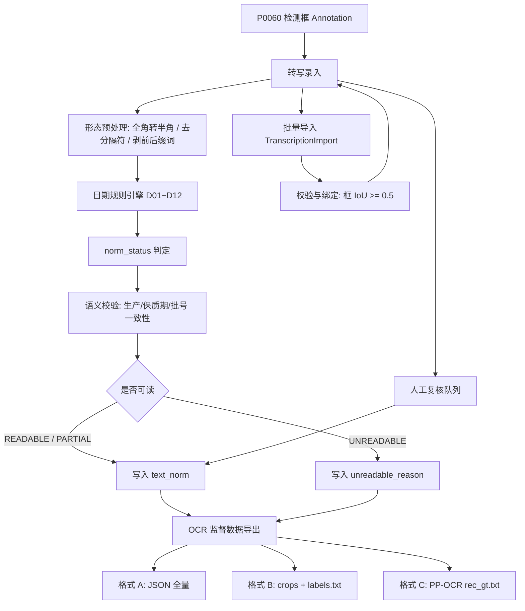
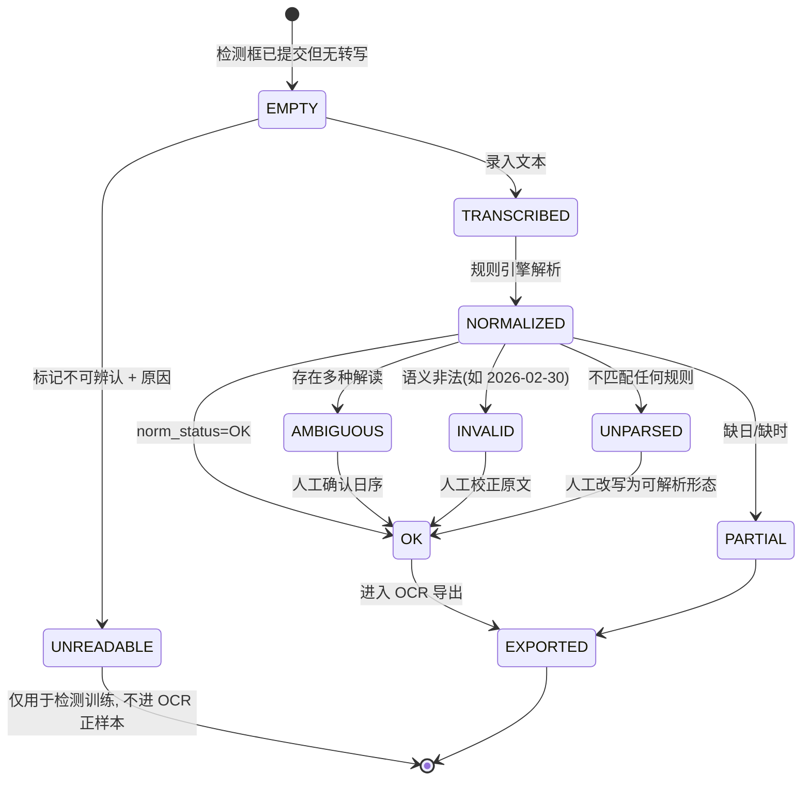
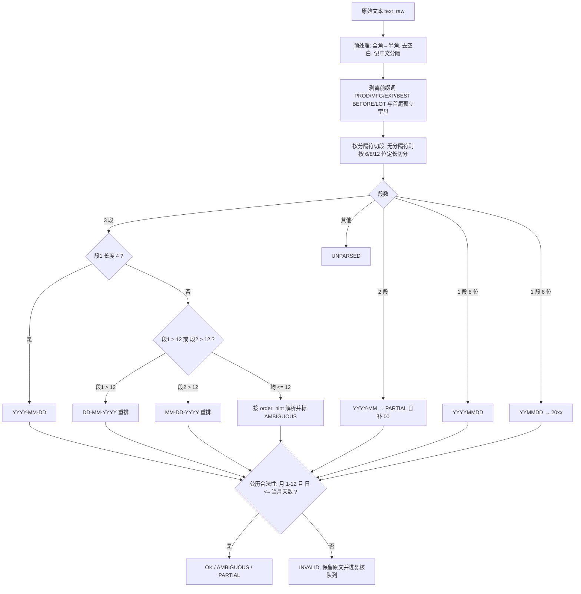
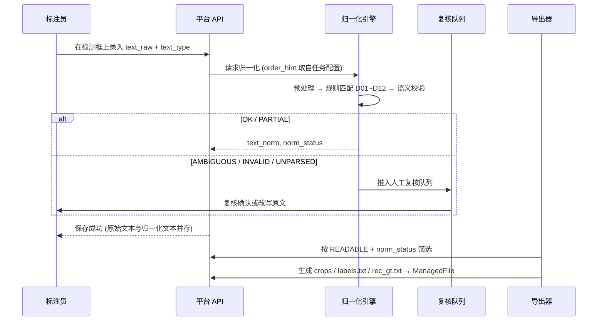
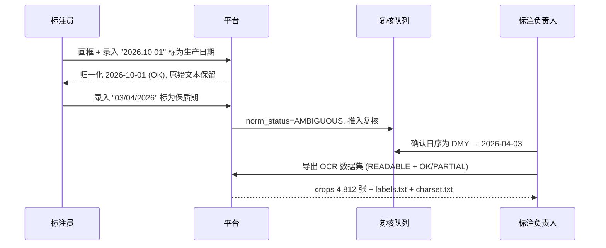

# PRD: P0065_字符转写与OCR标注 (Character Transcription & OCR Annotation)

| 属性 | 内容 |
| :--- | :--- |
| **文档编号** | P0065 |
| **功能模块** | M04_标注中心 |
| **当前版本** | v1.0.0 |
| **文档状态** | Approved |
| **作者** | Tyrion |
| **最后更新** | 2026-10-01 |

---

## 1. 全局说明

> [!IMPORTANT]
> **核心定位**: 第一阶段只做**日期区域检测（YOLO 检测框）**，但检测框本身不含信息。本模块在检测框上附加**字符转写**字段，把"这里有个日期区域"升级为"这里是 `2026-10-01` 的生产日期"，从而让第一阶段的标注数据**直接成为第二阶段 OCR 训练的监督信号**，无需二次标注。转写字段挂在 `annotations` 表上（P0060 定义列，本模块定义语义），不新建标注实体。

### 名词解释
*   **转写 (Transcription)**: 人工阅读检测框内文字并录入的原始字符串。
*   **原始文本 (Raw Text)**: 转写原样，保留分隔符与大小写（如 `2026.10.01`）。
*   **归一化文本 (Normalized Text)**: 按规则转换后的规范形式，日期一律 `YYYY-MM-DD`（含时刻时 `YYYY-MM-DDTHH:mm`）。
*   **文本类型 (`text_type`)**: 框内文字的语义角色——`PRODUCTION_DATE`（生产日期）/ `EXPIRY_DATE`（保质期至某日）/ `SHELF_LIFE_TERM`（保质期时长，如「180 天」「6 个月」）/ `BATCH_NO`（批号）/ `OTHER` / `UNKNOWN`。
*   **可读性 (`readability`)**: `READABLE`（完全可辨）/ `PARTIAL`（部分可辨，缺失字符用 `?` 占位）/ `UNREADABLE`（无法辨认）。
*   **归一化状态 (`norm_status`)**: `OK` / `PARTIAL` / `AMBIGUOUS` / `INVALID` / `UNPARSED`。
*   **歧义 (Ambiguous)**: 形态合法但存在多种解读，如 `03/04/2026` 可为 3 月 4 日或 4 月 3 日。
*   **`order_hint`**: 任务级日序约定（`DMY` / `MDY` / `AUTO`），用于消解纯数字日期的歧义。
*   **监督信号**: OCR 训练所需的「裁剪图 + 文本」配对，由检测框与转写字段联合产生。
*   **裁剪图 (Crop)**: 按检测框外扩边距后裁出的子图，OCR 识别的输入单元。

### 统一异常处理
| Code | 场景 | 处理策略 |
| :--- | :--- | :--- |
| `E46501` | 转写文本超长 | 拒绝保存，提示长度上限 128 字符 |
| `E46502` | 文本含非法字符 | 拒绝保存，提示不可打印字符/emoji 位置；全角字符自动转换后重试 |
| `E46503` | 框未绑定标注 | 拒绝写入，提示需先在 P0060 中创建该检测框 |
| `E46504` | 日期语义非法 | 保留原文，`norm_status=INVALID`，强制进入人工复核队列 |
| `E46505` | 日期无法解析 | 保留原文，`norm_status=UNPARSED`，进入人工复核队列；不阻断保存 |
| `E46506` | 日期歧义待确认 | `norm_status=AMBIGUOUS`，按 `order_hint` 取默认解并标记待确认 |
| `E46507` | `text_type` 与形态冲突 | 提示"类型为 BATCH_NO 但内容呈日期形态"，要求人工确认类型 |
| `E46508` | 同图同类型文本冲突 | 提示"已存在 1 个生产日期"，要求人工确认保留哪一个 |
| `E46509` | 保质期早于生产日期 | 语义告警，不阻断保存，但该图标记 `needs_review` |
| `E46510` | `UNREADABLE` 未给原因 | 拒绝保存，`unreadable_reason` 必填 |
| `E46511` | 导入文件格式错误 | 拒绝导入，提示缺失的表头列名与期望格式 |
| `E46512` | 导入行无法绑定标注框 | 该行记 `unmatched` 并跳过，汇总到导入报告 |
| `E46513` | 导出筛选后样本为 0 | 拒绝生成空数据集，提示放宽筛选条件 |
| `E46514` | 目标版本不可写 | 拒绝写入/导出，提示版本状态非 `DRAFTING` |
| `E46515` | 权限不足 | 拒绝，批量导入与导出需 `TRAINER` / `ADMIN` |

---

## 2. 项目背景

### 背景 (Context)
食品包装上的生产日期由**打码机喷印**，形态高度不统一：`2026-10-01`、`20261001`、`2026.10.01`、`2026年10月1日`、`A20261001B`、`261001` 都在真实包装上出现过，且常伴随反光、褶皱、喷印断线。第一阶段的检测框只回答"日期在哪里"，产线真正需要的是"日期是多少"。若不在标注阶段顺手录入文本，第二阶段 OCR 就**没有监督数据**，必须重新组织一轮标注——成本翻倍。

### 问题陈述 (Problem Statement)
1. **检测与识别数据割裂**: 检测标注完成后再补 OCR 标注，等于同一批图标注两遍。
4. **不可辨认样本无处置**: 模糊到无法阅读的框，如果简单丢弃会丢失"该区域确实存在日期"的检测监督信号。

### 目标与成功指标 (Goals & Success Metrics)
*   **北极星指标**: 已标注检测框的转写覆盖率 **≥ 95%**（`READABLE` 框全部有文本，`UNREADABLE` 框全部有原因标记）。
*   **次要指标**: 日期归一化自动解析成功率 **≥ 90%**（`OK` + `PARTIAL` 占比），人工复核队列占比 ≤ 10%；生产日期 / 保质期 / 批号三类字段的**语义标注准确率 ≥ 98%**；导出 OCR 数据集可用率 100%（无空图、无空标签）。
*   **质量护栏**: `UNREADABLE` 比例 > 20% 的批次触发告警（提示拍摄或打码质量异常）。

### 风险与规避 (Risks & Mitigation)
| 风险 | 影响 | 规避方案 |
| :--- | :--- | :--- |
| 转写成为标注瓶颈 | 单图耗时上升 | 支持键盘流式录入 + 复用上一图文本；允许 `PARTIAL` 占位后补；批量导入通道兜底 |
| 归一化规则误吞原始信息 | 无法回溯真实喷印内容 | 原始文本与归一化文本**双字段并存**，`text_raw` 永不覆盖 |
| 歧义被静默按默认解处理 | 生产日期与保质期张冠李戴 | 歧义一律标 `AMBIGUOUS` 并进人工确认队列，未确认不进入 OCR 导出 |
| 转写错误污染 OCR 训练集 | 模型学到错误标签 | 转写复用 P0063 的 `R07` 理由码纳入质检；导出前强制通过 `norm_status` 筛选 |
| 批量导入覆盖人工成果 | 数据丢失 | 默认 `skip` 策略，仅在显式选择 `overwrite` 时覆盖，且写审计日志 |

---

## 3. 价值模型

*   **方案**: 在检测框上增设转写字段族（`text_raw` / `text_norm` / `text_type` / `readability` / `norm_status`），配合**确定的归一化规则表**与**语义校验**，把一次标注同时产出「检测监督信号 + OCR 监督信号」。
*   **目标**: 第二阶段的 OCR 训练**零额外标注成本**启动；同时上游可用归一化日期做业务校验（如"保质期早于生产日期"这类包装错误检测）。

---

## 4. 项目范围

### 功能结构图


### In Scope (包含范围)
1. 检测框文本转写录入（键盘流式、复用上一图、快捷键）。
2. 日期格式归一化规则表（`D01`~`D12`）与 `norm_status` 判定。
3. 文本类型区分（生产日期 / 保质期 / 批号 / 其他）与语义一致性校验。
4. 不可辨认标记（`readability` + `unreadable_reason`）与批次级告警。
5. 转写数据批量导入（CSV / JSON）与导入检查报告。
6. OCR 监督数据导出（三种格式）与导出报告。
7. 人工复核队列（`AMBIGUOUS` / `INVALID` / `UNPARSED` / 语义告警）。

### Out of Scope (不包含范围)
*   **OCR 模型训练与推理**: 本模块只产出数据，训练属 05_训练平台，识别服务属 07_部署推理。
*   **自动文本识别（AI 预填文本）**: 首期不做检测框内文本的模型预填，转写全部人工；预留字段 `text_source` 以便后续接入。
*   **检测框的几何编辑**: 属 P0060，本模块不改几何。

---

## 5. 业务流程

### 5.1 转写状态机


### 5.2 日期归一化流程


### 5.3 端到端链路


---

## 6. 用户分析

### 6.1 用户画像 (User Personas)
*   **标注员（`ANNOTATOR`）**: 画框后顺手录入框内文字。诉求："录文本要快，能复用上一张的写法，看不清就标一下原因就行。" 痛点：不同包装格式各异，反复切换输入法；日期写法记不住规范。
*   **标注负责人（`TRAINER`）**: 定义 `order_hint`、复核歧义样本、导出 OCR 数据集。诉求："归一化规则要确定、可复现，歧义别静默吞掉。" 痛点：人工复核量不可控；导出数据里混入错误文本会毁掉 OCR 训练。
*   **OCR 算法负责人**: 消费导出的裁剪图与标签。诉求："导出即用，字符集固定，无需清洗。" 痛点：标签里混入 `UNREADABLE` 或带 `?` 的残缺文本。

### 6.2 用户链路图 (User Journey Map)


---

## 7. 功能需求

### M04.F01 检测框文本转写 (Box Transcription)
*   **用户故事**: 作为标注员，我希望在检测框上直接录入框内文字并标注其语义角色，以便一次作业同时产出检测与 OCR 两套监督信号。
*   **逻辑与业务规则**
    *   **前置条件**: 该 `Annotation`（检测框）已存在且已提交；样本未被质检锁定（否则 `E46303`）；目标版本为 `DRAFTING`（否则 `E46514`）。
    *   **字段语义**: `text_raw`（原始录入，永不覆盖）、`text_norm`（归一化结果，由规则引擎写入）、`text_type`、`readability`、`norm_status`、`unreadable_reason`、`text_source`（`MANUAL` / `IMPORT` / `OCR_PREFILL`，首期恒为前两者）。
    *   **录入约束**: 长度 ≤ **128** 字符（`E46501`）；字符集 `0-9 A-Z a-z` 与 `- . / : 空格`（`E46502`）；全角字符自动转半角后再校验。
    *   **类型必填**: `readability ∈ {READABLE, PARTIAL}` 时 `text_raw` 必填且 `text_type` 必填；`UNREADABLE` 时 `text_raw` 必须为空（`NULL`）。
    *   **写入幂等**: 以 `(annotation_id)` 唯一，重复提交覆盖当前值并递增 `Annotation.revision`。
    *   **后置条件**: 触发归一化引擎（F02），并按需进入复核队列（F04）。

    | 字段 | 类型 | 必填 | 说明 | 约束 |
    | :--- | :--- | :--- | :--- | :--- |
    | `text_raw` | String | 条件 | 原始转写文本 | ≤ 128 字符；`UNREADABLE` 时必须为 NULL |
    | `text_norm` | String | N | 归一化文本 | 由引擎写入，人工不可直接编辑 |
    | `text_type` | Enum | 条件 | `PRODUCTION_DATE` / `EXPIRY_DATE` / `SHELF_LIFE_TERM` / `BATCH_NO` / `OTHER` / `UNKNOWN` | `READABLE`/`PARTIAL` 时必填 |
        | `norm_status` | Enum | N | `OK` / `PARTIAL` / `AMBIGUOUS` / `INVALID` / `UNPARSED` | 由引擎写入 |
    | `unreadable_reason` | Enum | 条件 | `BLUR` / `OCCLUDED` / `GLARE` / `DAMAGED` / `TOO_SMALL` / `PRINT_MISSING` | `UNREADABLE` 时必填 |
    
*   **验收标准**
    ```gherkin
    场景: 在检测框上录入转写文本
      Given 样本 S-400 存在检测框 ANN-1, 框内文字为 "2026.10.01"
      When 标注员录入 text_raw="2026.10.01" 且 text_type=PRODUCTION_DATE
      Then 保存成功且 text_raw 保留 "2026.10.01"
      And text_norm = "2026-10-01" 且 norm_status = OK
    场景: 原始文本永不被覆盖
      Given 检测框 ANN-2 的 text_raw = "2026年10月1日"
      When 归一化引擎写入 text_norm = "2026-10-01"
      Then text_raw 仍为 "2026年10月1日"
    场景: 超长文本与非法字符被拒绝
      Given 标注员粘贴一段 200 字符的说明文字
      When 提交转写
      Then 返回 E46501
      When 改为录入 "2026-10-01😀"
      Then 返回 E46502 并提示非法字符位置
    场景: 复用上一图文本需人工确认
      Given 上一图 PRODUCTION_DATE 转写为 "2026-10-01"
      When 标注员点击 [复用上一图]
      Then 输入框预填该文本但不自动提交
      And 标注员确认后才写入并递增 revision
```
*   **边界情况与异常处理**
    | 场景 | 处理 |
    | :--- | :--- |
    | 同一框内多行文字（如日期与批号同框） | 提示拆分检测框，或将 `text_type` 置 `OTHER` 并完整录入，不参与日期归一化 |
    | 录入含 `PARTIAL` 占位符 `?` | 允许，`norm_status=PARTIAL` 且进入复核队列，导出时默认剔除 |
    | 框在质检锁定期间被转写 | 返回 `E46303` |
    | 转写后检测框几何被修改 | 转写随 `Annotation.revision` 变化，几何变更时保留文本但标记 `geometry_changed=true` 供复核 |
    | 误删文本（置空） | 允许，`text_raw=NULL` 且 `norm_status=NULL`；审计日志记录删除前值 |

---

### M04.F02 日期格式归一化 (Date Normalization)
*   **用户故事**: 作为标注负责人，我希望系统按一套确定的规则把各种日期写法归一为统一形式，以便下游可直接比较与校验，且结果可复现。
*   **逻辑与业务规则**
    *   **前置条件**: `text_raw` 非空且 `text_type ∈ {PRODUCTION_DATE, EXPIRY_DATE, SHELF_LIFE_TERM}`（`BATCH_NO` 与 `OTHER` 不参与归一化，走 F03 的字符集校验）。
    *   **时长归一化（`SHELF_LIFE_TERM` 专用）**: 解析 `<数值><单位>`，单位 ∈ {天, 日, 个月, 月, 年}；`text_norm` 存**折算天数**（1 个月 = 30 天、1 年 = 365 天），`text_raw` 保留原始写法。**折算仅用于计算与校验，不得覆盖原文**——包装上写的是「6 个月」，展示出来就该是「6 个月」，而不是「180 天」。
    *   **为什么需要时长**: C 端要回答「还剩多久过期」，需要 `生产日期 + 保质期时长`；但很多包装**只印时长不印到期日**。若只有 `EXPIRY_DATE` 而没 `SHELF_LIFE_TERM`，这类包装就算不出剩余天数。
    *   **预处理（顺序执行）**: ① 全角转半角 ② 去除首尾与中间空白 ③ 统一分隔符集合（`.` `·` `-` `/` `\` 空格）④ 识别并记录中文分隔（`年` `月` `日`）⑤ 剥离前缀词（`生产日期` `生产日` `PROD` `MFG` `DATE OF MANUFACTURE` `保质期` `此日期前食用最佳` `BEST BEFORE` `EXP` `EXPIRY`）⑥ 剥离首尾孤立字母（打码机喷印常见 `A20261001B`）。

    | 规则 ID | 输入形态（等价正则） | 示例 | 归一结果 | `norm_status` |
    | :--- | :--- | :--- | :--- | :--- |
    | `D01` | `^\d{4}[-./ ]?\d{2}[-./ ]?\d{2}$` | `2026-10-01` / `20261001` / `2026.10.01` / `2026/10/01` | `2026-10-01` | `OK` |
    | `D02` | `^\d{4}年\d{1,2}月\d{1,2}日$` | `2026年10月1日` | `2026-10-01` | `OK` |
    | `D03` | `^\d{2}[-./ ]?\d{2}[-./ ]?\d{2}$` | `261001` / `26.10.01` | `2026-10-01` | `OK`，附警告 `YEAR_INFERRED` |
    | `D04` | `^\d{4}[-./ ]?\d{2}$` | `2026-10` | `2026-10`（日补 `00`） | `PARTIAL`（缺日） |
    | `D05` | `^\d{4}[-./ ]?\d{2}[-./ ]?\d{2}[T ]?\d{2}:?\d{2}$` | `2026-10-01 13:45` | `2026-10-01T13:45` | `OK` |
    | `D06` | `^[A-Z]?\d{4}[-./ ]?\d{2}[-./ ]?\d{2}[A-Z]?$` | `A20261001B` | `2026-10-01` | `OK`，附警告 `AFFIX_STRIPPED` |
    | `D07` | `^\d{1,2}[-./ ]\d{1,2}[-./ ]\d{4}$` 且段1 > 12 | `13/10/2026` | `2026-10-13` | `OK` |
    | `D08` | 同 `D07` 但段1 ≤ 12 且段2 ≤ 12 | `03/04/2026` | 按 `order_hint` 解析，默认 `DMY` → `2026-04-03` | `AMBIGUOUS` |
    | `D09` | 同 `D07` 但段1 ≤ 12 且段2 > 12 | `03/13/2026` | `2026-03-13`（段2 必为日） | `OK` |
    | `D10` | `^\d{4}[-./ ]?\d{2}[-./ ]?\d{2}\d{4}$` | `202610011345` | `2026-10-01T13:45` | `OK` |
    | `D11` | `^\d{4}年\d{1,2}月$` | `2026年10月` | `2026-10`（日补 `00`） | `PARTIAL` |
    | `D12` | `^\d{4}[-./ ]?\d{2}[-./ ]?\d{2}[ ][A-Z0-9]{1,4}$` | `2026-10-01 A1` | `2026-10-01`（尾缀丢弃） | `OK`，附警告 `SUFFIX_DROPPED` |

    *   **两位年份推断**: `00`~`99` 一律映射到 `20xx`（`00`~`69` → `20xx`，`70`~`99` → `20xx` 并附警告 `YEAR_ASSUMED_20XX`）；食品包装保质期跨度不超过 5 年，因此不做 `19xx` 推断。
    *   **`order_hint` 取值**: `DMY`（默认，符合国内包装习惯）/ `MDY` / `AUTO`（等价 `DMY` 但强制标 `AMBIGUOUS`）。`order_hint` 在标注任务上配置，不随图片变化。
    *   **语义合法性校验**: 月份 ∈ `1~12`；日 ∈ `1~当月天数`（含闰年 2 月 29）；时 ∈ `0~23`；分 ∈ `0~59`。违反任一 → `norm_status=INVALID`（`E46504`）。
    *   **`norm_status` 判定优先级**: `UNPARSED`（无规则命中）> `INVALID`（形态命中但语义非法）> `AMBIGUOUS` > `PARTIAL` > `OK`。
    *   **无法解析时的处理**（强制路径）:
        1. `text_raw` 原样保留，**不丢弃**；
        2. `text_norm` 置 `NULL`（`INVALID` 保留"非法归一化结果"前缀 `!` 以便排查，如 `!2026-13-01`）；
        3. 推入人工复核队列，标注负责人可在复核界面直接改写原文或手工指定归一结果；
        4. 复核前该框**不进入 OCR 导出**（F06 默认只导出 `OK` / `PARTIAL`）；
        5. 若 `UNPARSED` 比例超过批次样本的 30%，生成"格式未覆盖"告警并列出 Top 10 原文形态，供扩充规则表。
    *   **后置条件**: 写 `text_norm` / `norm_status` / `norm_warnings[]`，并可被 P0063 以 `R07` 打回。

*   **验收标准**
    ```gherkin
    场景: 三种主流写法归一为同一结果
      Given 三个检测框分别录入 "2026-10-01"、"20261001"、"2026.10.01"
      When 逐个执行归一化
      Then 三者的 text_norm 均为 "2026-10-01" 且 norm_status = OK
    场景: 中文日期与喷印前后缀
      Given 录入 "2026年10月1日"
      When 执行归一化
      Then text_norm = "2026-10-01" 且 norm_status = OK
      When 另录入 "A20261001B"
      Then text_norm = "2026-10-01" 且 norm_warnings 包含 AFFIX_STRIPPED
    场景: 歧义日期按 order_hint 解析并标记待确认
      Given 标注任务的 order_hint = DMY, 录入 "03/04/2026"
      When 执行归一化
      Then text_norm = "2026-04-03" 且 norm_status = AMBIGUOUS
      And 该框进入人工复核队列
    场景: 段位可判定时不产生歧义
      Given 录入 "13/10/2026"
      When 执行归一化
      Then text_norm = "2026-10-13" 且 norm_status = OK
      And 不进入复核队列
    场景: 语义非法日期保留原文并强制复核
      Given 录入 "2026-02-30"
      When 执行归一化
      Then text_raw 仍为 "2026-02-30"
      And norm_status = INVALID 且该框进入人工复核队列
      And 该框默认不进入 OCR 导出
    场景: 无法解析的形态不阻断保存
      Given 录入 "见瓶底喷码"
      When 保存转写
      Then 保存成功且 norm_status = UNPARSED
      And 该框进入人工复核队列并在导出时被排除
    场景: 缺日正式期标为 PARTIAL
      Given 录入 "2026-10"
      When 执行归一化
      Then text_norm = "2026-10" 且 norm_status = PARTIAL
```
*   **边界情况与异常处理**
    | 场景 | 处理 |
    | :--- | :--- |
    | 八位数字实为 `YYYYMMDD` 但月位非法（如 `20261301`） | `INVALID`，不尝试其他切分（避免把批号误读为日期） |
    | 表面像日期实为批号（`20261001` 标为 `BATCH_NO`） | 不执行日期归一化，`text_norm=NULL`，仅做字符集校验；若用户标为日期类型则提示 `E46507` |
    | 一段文本含两个日期（生产日期 + 保质期同框） | 提示拆框；若强行保存则 `norm_status=UNPARSED` 并强制复核 |
    | 分隔符缺失导致段位混淆（`2026101`，7 位） | 无规则命中 → `UNPARSED`，不猜测补零 |
    | 时刻存在但不在 `0~23` 范围（`2026-10-01 25:00`） | `INVALID`，保留原文并复核 |
    | 规则表更新后历史数据 | 不自动重算；提供按版本重跑归一化的管理动作，重跑结果写入新 `revision` 并保留旧值 |

---

### M04.F03 文本类型区分与语义校验 (Text Type & Semantic Validation)
*   **用户故事**: 作为标注负责人，我希望生产日期、保质期、批号被明确区分并做一致性校验，以便 OCR 训练不被语义混淆的数据污染。
*   **逻辑与业务规则**
    *   **同图唯一性**: 同一 `DataSample` 下同一 `text_type` 最多 1 个框；出现第 2 个时提示 `E46508`，要求人工确认保留哪个（另一个改为 `OTHER` 或删除）。
    *   **跨类型一致性校验（同图内，仅告警不阻断）**:

    | 校验项 | 规则 | 违反时 |
    | :--- | :--- | :--- |
    | 生产日期合理性 | `PRODUCTION_DATE ≤ 拍摄日期 + 7 天` 且 `≥ 拍摄日期 − 5 年` | 告警 `PROD_OUT_OF_RANGE` |
    | 保质期不早于生产日期 | `EXPIRY_DATE ≥ PRODUCTION_DATE` | 告警 `EXPIRY_BEFORE_PROD`（`E46509`） |
    | 保质期跨度合理 | `1 天 ≤ EXPIRY_DATE − PRODUCTION_DATE ≤ 5 年` | 告警 `SHELF_LIFE_ABNORMAL` |
    | 保质期时长合理 | `SHELF_LIFE_TERM` 折算天数 ∈ `[1, 1825]` | 告警 `SHELF_LIFE_TERM_ABNORMAL` |
    | 到期日与时长并存且矛盾 | 同图同时存在 `EXPIRY_DATE` 与 `SHELF_LIFE_TERM`，且 `EXPIRY_DATE − PRODUCTION_DATE` 与折算天数相差 > 30 天 | 告警 `SHELF_LIFE_CONFLICT`（不阻断，真实包装可能两种都印） |
    | 类型完整性 | 同图存在 `EXPIRY_DATE` 但缺 `PRODUCTION_DATE` | 提示，不告警（合法包装形态） |

    *   **告警处置**: 所有告警写入 `norm_warnings[]` 并把该图标记 `needs_review=true`；**不阻断提交**（真实包装确实存在印刷错误，标注员不应被迫改数据），但告警图在导出时默认标记 `flagged=true`，由导出方决定是否纳入。
    *   **后置条件**: 类型与告警落库，进入 P0063 质检的可打回项（`R03` 类别错误 / `R07` 转写错误）。
*   **验收标准**
    ```gherkin
    场景: 区分生产日期与保质期
      Given 样本 S-410 有两个框, 分别录入 "2026-10-01" 与 "2027-04-01"
      When 分别标为 PRODUCTION_DATE 与 EXPIRY_DATE
      Then 两个框均保存成功且 text_type 各不相同
      And 不产生任何一致性告警
    场景: 保质期早于生产日期产生告警
      Given 样本 S-411 生产日期 2026-10-01, 保质期 2026-08-01
      When 提交转写
      Then 保存成功但 norm_warnings 包含 EXPIRY_BEFORE_PROD
      And 该图 needs_review = true
    场景: 批号不参与日期归一化
      Given 录入 "20261001" 且 text_type = BATCH_NO
      When 保存
      Then text_norm 为 NULL 且不执行日期规则
      And 若临时改为 PRODUCTION_DATE 则返回 E46507 要求确认
    场景: 同图同类型冲突
      Given 样本 S-412 已有 1 个 PRODUCTION_DATE 框
      When 再标一个 PRODUCTION_DATE 框
      Then 返回 E46508 并要求人工确认保留哪一个
```
*   **边界情况与异常处理**
    | 场景 | 处理 |
    | :--- | :--- |
    | 包装上只有"保质期至"没有生产日期 | 合法，不告警 |
    | 批次号与日期形态完全相同（`20261001`） | 以人工选择的 `text_type` 为准，不做自动推断 |
    | 拍摄日期缺失（`DataSample` 无 EXIF 时间） | 跳过生产日期范围校验并记录 `SKIP_NO_CAPTURE_DATE` |
    | 保质期跨度 > 5 年（如罐头） | 告警但不阻断；阈值可在任务级配置 |
    | 同图两个框内容完全相同且类型不同 | 提示可能重复标注，要求人工确认 |

---

### M04.F04 不可辨认标记与复核队列 (Unreadable Marking & Review Queue)
*   **用户故事**: 作为标注员，我希望对看不清的框做结构化标记而不是丢弃，以便检测监督信号不丢失、且质量问题的归因可追溯。
*   **逻辑与业务规则**
    *   **前置条件**: 检测框已存在。
    *   **标记语义**: `readability=UNREADABLE` 时 `text_raw` 必须为 `NULL`，`unreadable_reason` 必填（`E46510`），取值 `BLUR` / `OCCLUDED` / `GLARE` / `DAMAGED` / `TOO_SMALL` / `PRINT_MISSING`。
    *   **`PARTIAL` 约定**: 可辨认但部分字符缺失时，缺失字符用 `?` 占位（如 `2026-1?-01`），`norm_status=PARTIAL`，可进入复核补齐。
    *   **批次级告警**: 单个标注任务内 `UNREADABLE` 占比 > **20%** 时生成告警（提示拍摄或打码质量问题，建议重拍/重采）；`PRINT_MISSING` 单独统计，占比 > 10% 时提示采集流程问题。
    *   **可用性规则**: `UNREADABLE` 框**保留检测监督信号**（几何仍用于检测训练），但**不进入 OCR 训练正样本**；`PARTIAL` 框默认不进入 OCR 导出（可在导出时显式勾选包含并附加掩码信息）。
    *   **复核队列**: 队列项来源为 `AMBIGUOUS` / `INVALID` / `UNPARSED` / `needs_review=true`；支持按类型筛选、批量确认、批量改写原文；复核动作写 `AuditLog`。
    *   **后置条件**: 标注状态与告警落库；复核后 `norm_status` 更新为 `OK`/`PARTIAL` 并移除待确认标记。
*   **验收标准**
    ```gherkin
    场景: 标记不可辨认必须给原因
      Given 检测框 ANN-9 内文字被反光完全遮挡
      When 标注员选择 UNREADABLE 但未选原因并保存
      Then 返回 E46510
      When 选择原因 GLARE 后保存
      Then readability = UNREADABLE 且 unreadable_reason = GLARE
      And text_raw 为 NULL
    场景: 不可辨认框仍保留检测信号但不进 OCR 导出
      Given 某批次含 200 个框, 其中 12 个为 UNREADABLE
      When 导出 OCR 数据集
      Then 导出结果不含这 12 个框
      And 该样本的检测框标注在检测数据集中完整保留
    场景: 批次不可辨认比例过高触发告警
      Given 标注任务 AT-0200 共 500 个框, 其中 118 个为 UNREADABLE (23.6%)
      When 提交批次
      Then 告警中心出现"不可辨认比例过高"告警并给出原因分布
    场景: 人工复核补齐残缺文本
      Given 检测框 ANN-10 的 text_raw = "2026-1?-01" 且 norm_status = PARTIAL
      When 复核员在复核队列中改写为 "2026-10-01"
      Then norm_status = OK 且该框可进入 OCR 导出
```
*   **边界情况与异常处理**
    | 场景 | 处理 |
    | :--- | :--- |
    | 框内无任何文字（空喷码） | `readability=UNREADABLE` 且原因 `PRINT_MISSING`；若确认该区域本就不应有日期，建议在 P0063 以 `R02` 打回删除该框 |
    | 从 `READABLE` 改为 `UNREADABLE` | 允许，`text_raw` 与 `text_norm` 被清空并记录审计日志中的旧值 |
    | 复核队列长期积压 | 队列项超过 500 或最旧项超过 7 天时告警；支持批量确认同形态原文 |
    | 同一原文形态反复出现 `UNPARSED` | 告警中给出 Top 10 形态，供扩充规则表 |
    | 复核后又被打回 | 进入 P0063 的返工流程，转写字段随 `Annotation.revision` 一起回退到合规状态 |

---

### M04.F05 转写数据批量导入与检查 (Bulk Import & Validation)
*   **用户故事**: 作为标注负责人，我希望把外部已有的转写结果批量导入并与检测框绑定，以便复用历史标注、避免重复录入。
*   **逻辑与业务规则**
    *   **前置条件**: 角色 `TRAINER`/`ADMIN`；目标版本 `DRAFTING`；检测框已存在。
    *   **支持格式**:
        *   **CSV**: 表头必须包含 `sample_path, class_name, x, y, w, h, text, text_type`（表头缺失返回 `E46511`）。
        *   **JSON**: 数组元素为 `{sample_path, class_name, bbox: [x,y,w,h], text, text_type, readability?}`。
        *   坐标默认按**归一化**解析；若 `coordinate_mode=PIXEL` 则按样本 `width`/`height` 换算。
    *   **绑定规则**: 按 `sample_path` 找到 `DataSample`，与该样本下 `class_name` 对应的 `Annotation` 做 IoU 匹配；**IoU ≥ 0.5** 视为同一框（`E46512` 阈值），取最大者绑定；`class_name` 不匹配时忽略类别只按 IoU 匹配。
    *   **校验项**: 样本存在、框可绑定、`text` 长度 ≤ 128、`text_type` 合法、`readability` 合法；校验结果进入导入报告。
    *   **冲突策略**: 目标框已有 `text_source=MANUAL` 的非空转写时——默认 `skip`；可选 `overwrite`（覆盖并写审计日志 `overwritten_value`）。
    *   **执行方式**: 异步分片（默认 2,000 行/片），可预览前 50 行（dry-run），失败行不阻断其余行。
    *   **导入报告**: `total` / `matched` / `unmatched` / `invalid` / `skipped` / `overwritten`，附失败行号与原因，可导出 CSV。
    *   **后置条件**: 写入 `transcription_imports` 记录与被绑定的 `Annotation` 字段；触发归一化引擎。
*   **验收标准**
    ```gherkin
    场景: 正常批量导入
      Given 一份 5,000 行的 CSV, 每行都有可绑定的检测框
      When 提交导入
      Then 导入完成且 matched = 5000 且 unmatch = 0
      And 所有绑定的 text_source = IMPORT 且已触发归一化
    场景: 表头缺失被拒绝
      Given CSV 缺少 text_type 列
      When 提交导入
      Then 返回 E46511 并提示缺失列名与期望表头
    场景: 框无法绑定的行被跳过
      Given 10 行中的框与已有标注 IoU 均 < 0.5
      When 提交导入
      Then unmatch = 10 且这些行记录原因 "NO_BOX_IOU_GE_0.5"
      And 其余行正常导入
    场景: 默认不覆盖人工转写
      Given 目标框已有 text_source=MANUAL 的转写 "2026-10-01"
      When 以默认策略导入该框的 "2026-10-02"
      Then 该框被 skip 且原值保持不变
      When 改为 overwrite 策略重新导入
      Then 值更新为 "2026-10-02" 且审计日志记录覆盖前值
```
*   **边界情况与异常处理**
    | 场景 | 处理 |
    | :--- | :--- |
    | 同一行匹配到多个候选框且最高 IoU 并列 | 记 `invalid`（`AMBIGUOUS_MATCH`），要求人工指定，不随机择一 |
    | CSV 编码非 UTF-8（GBK） | 自动探测失败时提示选择编码；导入报告标注使用的编码 |
    | 导入过程中样本被质检锁定 | 该行记 `skipped`（`LOCKED`），不写入 |
    | 文件极大（> 50 MB） | 流式解析，行级处理；分片粒度按 2,000 行切分并支持断点续跑 |
    | 导入结果与现有转写产生语义冲突（如同一图出现两个生产日期） | 记录 `E46508` 到报告，导入照常完成，冲突项进入复核队列 |
    | 导入中途用户取消 | 已完成分片保留（幂等），未开始分片终止；可在报告中看到 `canceled_at_row` |

---

### M04.F06 OCR 监督数据导出 (OCR Supervision Export)
*   **用户故事**: 作为 OCR 算法负责人，我希望直接导出「裁剪图 + 文本」的配对数据集，以便零清洗启动第二阶段识别模型训练。
*   **逻辑与业务规则**
    *   **前置条件**: 存在满足筛选条件的转写数据；导出目标版本为 `DRAFTING`。
    *   **筛选条件（默认）**: `readability = READABLE` 且 `norm_status ∈ {OK}` 且 `text_type ∈ {PRODUCTION_DATE, EXPIRY_DATE}`；`BATCH_NO` 与 `OTHER` 需显式勾选才导出（字符集与长度差异大，混训会干扰）。
    *   **裁剪规则**: 按检测框外扩 **5%**（可配 0%~20%）后裁剪；等比缩放到固定高度（可配 **32 / 48 / 64**，默认 48），宽度按比例，超长截断至宽高比 20:1；空白填充值 `114`（灰度）；输出 PNG。
    *   **三种导出格式**:

    | 格式 | 产物 | 用途 |
    | :--- | :--- | :--- |
    | **A. 全量 JSON** | `annotations.json`：`[{image, width, height, boxes:[{id, category, bbox, text_raw, text_norm, text_type, readability, norm_status, split}]}]` | 结构化流转、自研训练框架 |
    | **B. 裁剪识别集** | `crops/{sample_id}_{annotation_id}.png` + `labels.txt`（`相对路径\ttext_norm`）+ `charset.txt` | CRNN / PARSeq 等 CTC 系识别模型 |
    | **C. PP-OCR 风格** | `crop_img/` + `rec_gt.txt`（`相对路径\ttext`）+ `dict.txt` | PaddleOCR 识别训练 |

    *   **字符集**: 由实际导出数据统计生成，默认候补集 `0-9 - . / :`，附 `charset.txt` 与字符直方图；导出前校验所有标签字符均在字符集内，否则报错并列出越界样本。
    *   **切分继承**: 导出沿用 `DatasetVersionItem.split`（`TRAIN`/`VAL`/`TEST`/`UNASSIGNED`），避免同一来源相邻帧同时进入训练与验证（防泄漏）。
    *   **产物归属**: 全部导出文件经 `ManagedFile` 登记：`owner_type=DATASET_VERSION`、`owner_id=dataset_version_id`、`purpose=ocr_export`；对象键遵循契约规则 `{path_prefix}/{owner_type}/{owner_id}/{purpose}/...`，即 `{path_prefix}/DATASET_VERSION/{version_id}/ocr_export/...`。一个物理文件只登记一条 `ManagedFile`，别处引用一律用 `managed_file_id`。
    *   **导出报告**: 样本数、字符总数、标签长度直方图、`text_type` 分布、被排除样本数与原因分类、`flagged=true`（语义告警）样本数。
    *   **空结果保护**: 筛选后样本数为 0 时拒绝生成（`E46513`），提示放宽条件。
    *   **后置条件**: 生成导出记录与产物清单，可被 05 训练平台作为数据集版本引用。
*   **验收标准**
    ```gherkin
    场景: 导出裁剪识别集
      Given 数据集版本 DV-FoodPkg-v5 中有 4,812 个 READABLE 且 norm_status=OK 的日期框
      When 以格式 B 导出 (高度 48, 外扩 5%)
      Then 生成 crops/*.png 4,812 张与 labels.txt 4,812 行
      And labels.txt 每行的文本均为 YYYY-MM-DD 形态
      And 生成 charset.txt 且所有标签字符均在字符集内
    场景: 排除不可读与未解析样本
      Given 版本中另有 12 个 UNREADABLE、37 个 UNPARSED、8 个 INVALID 框
      When 使用默认筛选导出
      Then 这 57 个框均不出现在产物中
      And 导出报告列出被排除数量与原因分类
    场景: 空结果被拒绝
      Given 筛选条件为 text_type=BATCH_NO 且 norm_status=OK
      And 版本中无任何满足条件的框
      When 点击导出
      Then 返回 E46513 并提示放宽筛选条件
    场景: 切分继承防止泄漏
      Given 版本中 split=VAL 的样本含 300 个合格框
      When 导出格式 A
      Then 这 300 个框的 split 字段仍为 VAL
      And 不与 TRAIN 切分混合
```
*   **边界情况与异常处理**
    | 场景 | 处理 |
    | :--- | :--- |
    | 框外扩后超出图像边界 / 框极小（< 8×8 px） | 按边界裁剪；裁剪后小于 8×8 px 的框记入报告并跳过 |
    | 标签长度异常（如抓取了整段说明文字） | 长度 > 32 的标签标记 `LONG_LABEL` 并在报告中单列，默认仍导出但需人工确认 |
    | 导出期间数据被修改 | 导出基于快照（起止 `Annotation.revision`），不一致时中止并提示重跑 |
    | 数据集版本被冻结 | 冻结前后均可导出；导出到已冻结版本 → `E46514` |
    | 磁盘空间不足 | 导出前估算空间（样本数 × 平均 3 KB）并校验，不足则拒绝 |
    | 字符集含不可见字符 | 导出前过滤并告警；过滤后若为空则判为 `E46513` |

---

## 8. 技术架构与数据模型

> 所有新增实体均含 `id UUID PK`、`created_at` / `updated_at timestamptz`，按需含 `deleted_at`。

### 8.1 数据实体

| 字段名 | 类型 | 必填 | 说明 | 约束 |
| :--- | :--- | :--- | :--- | :--- |
| **annotations（转写字段族，实体由 P0060 拥有，本模块定义语义）** | | | | |
| `text_raw` | String(128) | N | 原始转写文本（永不覆盖） | `UNREADABLE` 时必须为 NULL |
| `text_type` | Enum | N | `PRODUCTION_DATE` / `EXPIRY_DATE` / `BATCH_NO` / `OTHER` / `UNKNOWN` | 可读时必填 |
| `readability` | Enum | Y | `READABLE` / `PARTIAL` / `UNREADABLE` | 默认 READABLE |
| `norm_status` | Enum | N | `OK` / `PARTIAL` / `AMBIGUOUS` / `INVALID` / `UNPARSED` | 引擎写入 |
| `unreadable_reason` | Enum | N | `BLUR` / `OCCLUDED` / `GLARE` / `DAMAGED` / `TOO_SMALL` / `PRINT_MISSING` | `UNREADABLE` 时必填 |
| **transcription_imports (TranscriptionImport)** — 转写批量导入批次 | | | | |
| dataset_version_id | UUID | Y | 目标数据集版本 | FK；须为 DRAFTING |
| file_id | UUID | Y | 导入文件 | FK → managed_files.id（`owner_type=CLIENT_UPLOAD`；上传先落 `_uploads/{upload_session_id}/`，回调校验后 `COMMITTED` 并登记 `storage_path`） |
| format / encoding / coordinate_mode | Enum | Y | `CSV` 或 `JSON` / 字符编码 / `NORMALIZED` 或 `PIXEL` | - |
| conflict_policy | Enum | Y | `SKIP`（默认）/ `OVERWRITE` | - |
| status | Enum | Y | `PENDING`/`RUNNING`/`SUCCEEDED`/`PARTIALLY_FAILED`/`FAILED`/`CANCELED` | - |
| total_rows / matched / unmatched / invalid / skipped / overwritten | Int | Y | 导入统计 | - |
| error_report | JSONB | N | 失败行号、原因与 `E465xx` 码 | - |
| started_at / finished_at / created_by | timestamptz / UUID | Y | 时间与创建者 | FK → users.id |
| **ManagedFile（导出产物，复用契约实体）** | | | | |
| owner_type | Enum | Y | 固定 `DATASET_VERSION`，`owner_id = dataset_version_id` | 契约枚举（8 值全集之一） |
| purpose | Enum | Y | 产物用途，本模块取 `ocr_export`；同一 `owner_type`/`owner_id` 下按 `purpose` 分目录 | 取值由本模块自定义，不跨模块占用 |
| storage_path | String | Y | `{path_prefix}/{owner_type}/{owner_id}/{purpose}/...`，即 `{path_prefix}/DATASET_VERSION/{version_id}/ocr_export/...` | 契约对象键规则 |
| mime_type / size_bytes / etag / status | String / BigInt / String / Enum | Y | 产物元数据 | `PENDING→COMMITTED→DELETED` |

**索引**: `annotations(norm_status, needs_review)`、`annotations(text_type, readability)`、`transcription_imports(dataset_version_id, status)`。


---

## 9. UI/UX 规格说明

### 9.1 转写与复核界面
```text
┌────────────────────────────────────────────────────────────────────────────────┐
│转写  DS-FoodPkg-v5 / AT-0200 / S-003412       412/1200  [上一张][下一张]       │
├──────────────────────────────────────────────┬─────────────────────────────────┤
│  ┌ ─ ─ ─ ─ ─ ─ ─┐  ← 生产日期                │ 框 #1  生产日期                 │
│  ┆  2026.10.01    ┆                          │ 原文 [2026.10.01           ]    │
│  └ ─ ─ ─ ─ ─ ─ ─┘                            │ 归一 2026-10-01     ✓ OK        │
│  ┌ ─ ─ ─ ─ ─ ─ ─┐  ← 保质期                  │ 类型 [生产日期 ▾]               │
│  ┆  2027/04/01    ┆                          │ 可读性 (•)可读 ( )部分 ( )不可读│
│  └ ─ ─ ─ ─ ─ ─ ─┘                            │ [复用上一图]  [清空]            │
│       ┌─────────┐  ← 批号                    │                                 │
│       │ A261001B│                            │ 框 #2  保质期                   │
│       └─────────┘                            │ 原文 [2027/04/01           ]    │
│ 提示: 格式与上一图不同, 请确认               │ 归一 2027-04-01     ✓ OK        │
│                                              │ [提交本图 Ctrl+Enter]           │
├──────────────────────────────────────────────┴─────────────────────────────────┤
│ 复核队列 (23) │ ⚠ 2026-1?-01 PARTIAL │ ⚠ 03/04/2026 AMBIGUOUS │ ⚠ 见瓶底喷码   │
│ 批量操作: [确认全部 OK] [按 Top 形态批量改写]      [导出复核清单 CSV]          │
└────────────────────────────────────────────────────────────────────────────────┘
```

### 9.2 交互元素
| 元素 | 类型 | 状态 | 行为 |
| :--- | :--- | :--- | :--- |
| 原文输入框 | Input | Default/Invalid/Warning | 实时归一化预览；非法字符高亮并提示 `E46502` |
| 归一结果展示 | ReadOnlyField | OK/PARTIAL/AMBIGUOUS/INVALID/UNPARSED | 按状态着色，点击可展开规则命中详情 |
| 类型选择器 | Select | Default/Suggested/Conflict | 依据框内关键词给出建议类型（不自动定值） |
| 可读性单选 | Radio | Default/Required | 选"不可读"时展开原因选择且禁用原文输入 |
| 复用上一图 | Button | Default/Disabled | 预填同类型文本，需二次确认才提交 |
| 复核队列项 | ListItem | Partial/Ambiguous/Unparsed/Flagged | onClick: 定位到对应框 |
| 批量改写 | Button | Default/Loading | 对同形态原文统一改写，写审计日志 |
| 导出复核清单 | Button | Default | 导出待复核项 CSV 供线下处理 |

### 9.3 表单设计
| 字段 | 类型 | 校验规则 | 默认值 |
| :--- | :--- | :--- | :--- |
| 原文文本 | Input | ≤ 128 字符；字符集 `0-9 A-Z a-z - . / : 空格` | - |
| 文本类型 | Select | required（可读时） | UNKNOWN |
| 可读性 | Radio | required | READABLE |
| 不可读原因 | Select | `UNREADABLE` 时 required | - |
| `order_hint`（任务级） | Select | `DMY` / `MDY` / `AUTO` | DMY |
| 裁剪外扩比例 | Number(%) | 0 ~ 20 | 5 |
| 裁剪高度 | Select | 32 / 48 / 64 | 48 |
| 导出格式 | Checkbox | A / B / C 至少选一 | A + B |

---

## 10. 非功能性需求 (NFR)

*   **性能 (Performance)**: 单框归一化（含语义校验）< **5 ms**；单图转写保存接口 P95 < **200 ms**；批量导入吞吐 ≥ **5,000 行/秒**（不含图像处理）；OCR 导出（10,000 框）< **90 s**（裁剪与编码为主要开销）；裁剪单图 < **8 ms**。
*   **可用性 (Availability)**: 规格化引擎异常时**降级保存**——写入 `text_raw`、`norm_status=NULL` 并标记 `needs_review`，绝不因引擎故障丢失人工录入；导入与导出支持断点续跑（分片幂等）。
*   **安全 (Security)**: 转写录入对 `ANNOTATOR` 开放；批量导入与导出仅 `TRAINER`/`ADMIN`；覆盖人工转写、批量改写原文、重跑归一化全部写 `AuditLog`（含旧值）；导入文件仅接受 CSV/JSON，解析时不执行任何脚本。
*   **兼容性 (Compatibility)**: 导入支持 UTF-8 / GBK / UTF-8-BOM；导出裁剪图固定 PNG（无损），另可切换 JPEG(q95) 以省空间；界面支持数字小键盘流式录入，Chrome / Edge ≥ 120。
*   **可扩展性 (Scalability)**: 单版本支撑 **500,000** 个转写框；规则表可扩至 100+ 条而不影响性能（按优先级短路匹配）；`text_type` 与 `unreadable_reason` 为枚举，新增取值只扩枚举；预留 `text_source=OCR_PREFILL` 以便后续接入模型预填。
*   **数据保留 (Retention)**: 转写字段随 `Annotation` 生命周期保存；`transcription_imports` 保留 **1 年**；导入原始文件与导出产物按 `ManagedFile` 的 `DELETED` 语义软删后 30 天物理清理；归一化规则的每次变更保留版本记录以便回溯。

---

## 附录: 已确认的设计决策

| 决策项 | 结论 |
| :--- | :--- |
| 转写字段位置 | 挂 `annotations` 表顶层列（P0060 定义列、P0065 定义语义），不新建实体，不放 `attributes` |
| 原始与归一化文本 | 双字段并存，`text_raw` 永不覆盖 |
| 歧义日期 | 按任务级 `order_hint`（默认 `DMY`）解析并强制标 `AMBIGUOUS` 进复核队列 |
| 无法解析 | 保留原文、`text_norm=NULL`、`norm_status ∈ {INVALID, UNPARSED}`、进复核、默认不导出 |
| `norm_status` 优先级 | `UNPARSED` > `INVALID` > `AMBIGUOUS` > `PARTIAL` > `OK` |
| 不可辨认 | `readability=UNREADABLE` 必须给原因；保留检测信号，不进 OCR 正样本 |
| 批次告警阈值 | `UNREADABLE` 占比 > 20% 告警；`PRINT_MISSING` > 10% 单独告警 |
| 批量导入绑定阈值 | 与检测框 IoU ≥ 0.5 才绑定，默认 `skip` 冲突策略 |
| 导出筛选默认 | `READABLE` + `norm_status=OK` + 日期类型；`PARTIAL`/`BATCH_NO` 需显式勾选 |
| 字符集 | 由导出数据统计生成，默认候补 `0-9 - . / :`，标签越界即报错 |
| 导出产物归属 | `ManagedFile(owner_type=DATASET_VERSION, owner_id=dataset_version_id, purpose=ocr_export)`；一个物理文件只登记一条记录 |

## 关联文档

| 文档 | 关系 |
| :--- | :--- |
| P0060_标注器与标注几何 | 上游：`Annotation` 实体与 `revision` 乐观锁；本模块扩展其转写列 |
| P0062_标注任务与派单 | 上游：`order_hint` 等任务级配置与作业队列 |
| P0063_质检与返工 | 下游：`R07`（转写错误）为打回理由码，质检记录消费 `norm_warnings` |
| P0064_AI预标注 | 并行：AI 检测框与人工框共用坐标系；预留 `OCR_PREFILL` 文本预填 |
| P0066_标注统计与绩效 | 下游：转写框数与 `UNREADABLE` 占比纳入统计与绩效 |
| P0045_数据集导出 | 并行：OCR 导出为专用格式，标准格式导出仍走 P0045 |
| P0041_数据集与版本 | 上游：`DatasetVersionItem.split` 与版本可写性判定 |
| P0085_模型仓库与 Lineage | 下游：OCR 识别模型的训练数据来源 |

## Changelog

| 版本 | 日期 | 作者 | 说明 |
| :--- | :--- | :--- | :--- |
| v1.0.0 | 2026-10-01 | Tyrion | 首版：框上转写、日期归一化规则表 D01~D12、类型区分与语义校验、不可辨认标记、批量导入、OCR 监督数据导出 |
| v1.0.1 | 2026-10-02 | Tyrion | 新增 `SHELF_LIFE_TERM`（保质期时长）类型与时长归一化规则：包装常只印「保质期 180 天」而不印到期日，缺此类型则 C 端无法推算剩余天数；补两条校验（时长合理性、到期日与时长矛盾告警） |
