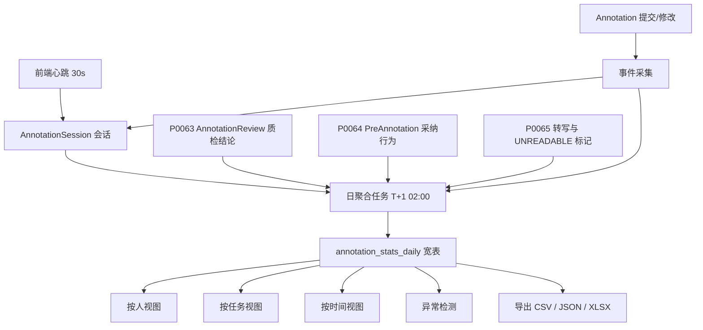
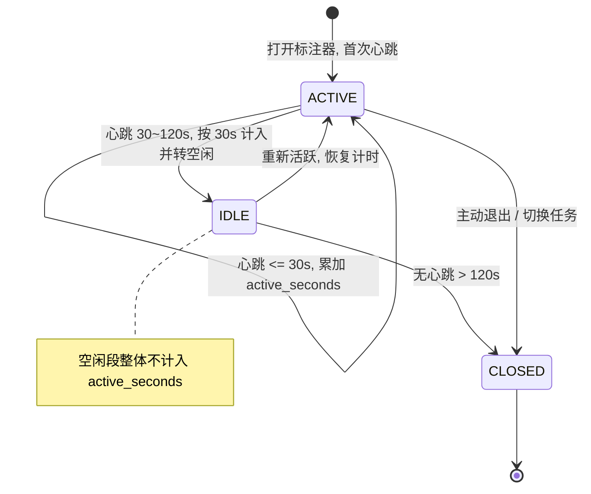
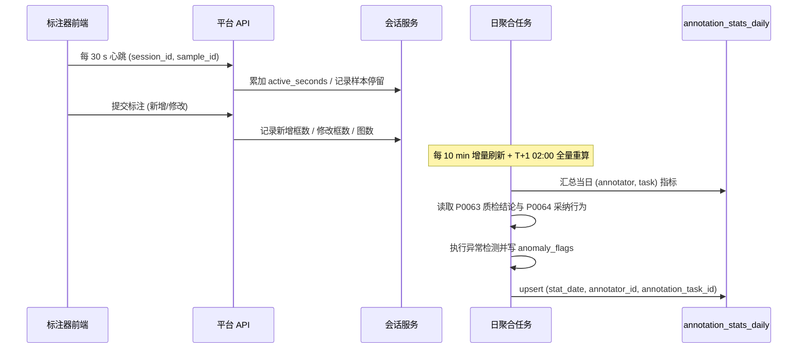
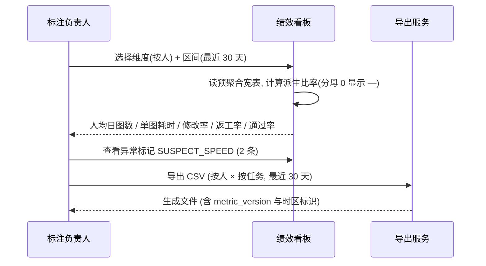
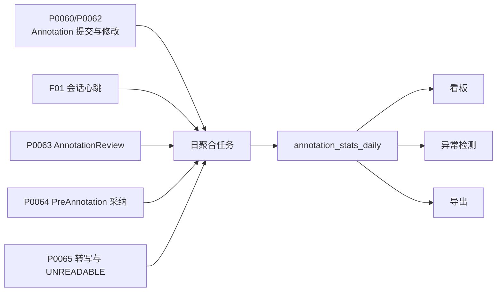

# PRD: P0066_标注统计与绩效 (Annotation Statistics & Productivity)

| 属性 | 内容 |
| :--- | :--- |
| **文档编号** | P0066 |
| **功能模块** | M04_标注中心 |
| **当前版本** | v1.0.0 |
| **文档状态** | Approved |
| **作者** | Tyrion |
| **最后更新** | 2026-10-01 |

---

## 1. 全局说明

> [!IMPORTANT]
> **核心定位**: 把标注作业的原始行为（会话心跳、提交、修改、质检结论）折算成**口径固定、公式可核对**的一组指标，用于回答"谁标了多少、花了多久、质量如何、值不值得信任"。所有指标以**每日聚合宽表**落库，看板与导出读同一份数据，杜绝"看板一个数、导出另一个数"。

### 名词解释
*   **会话 (Session)**: 标注员在一台设备上连续作业的时间片，由心跳维持，间隔 > 120 s 判定结束。
*   **有效工时 (`active_seconds`)**: 会话内相邻心跳间隔 ≤ 30 s 的时长累加；> 120 s 的空闲不计入；30~120 s 按 30 s 计（避免挂机刷时长同时不过度惩罚思考停顿）。
*   **标注量**: 分「图数」与「框数」两口径，二者不可混用。
*   **新增框 (New Box)**: 某 `Annotation` 首次提交（`revision` 从 null → 1）计入新增。
*   **修改框 (Edited Box)**: 已提交过的 `Annotation` 被再次修改并提交（`revision` 递增）计入修改；同一框一天内多次修改只计 1 次。
*   **单图耗时 (`time_per_image`)**: 有效工时 ÷ 当日有提交的图数，是效率的核心口径。
*   **修改率 (`edit_rate`)**: 修改框占该标注员总作业框数的比例，反映返工与自我纠错强度。
*   **返工率 (`rework_rate`)**: 被质检打回且计入返工率（即非 `R09`）的抽检图数 ÷ 被抽检图数。
*   **质检通过率 (`qc_pass_rate`)**: 抽检判定为通过的图数 ÷ 抽检图数；被申诉撤销（`OVERTURN`）的打回按通过计。
*   **一次通过率 (`first_pass_yield`)**: 首次质检即通过的图数 ÷ 抽检图数。
*   **聚合宽表 (`annotation_stats_daily`)**: 以 `(stat_date, annotator_id, annotation_task_id)` 为粒度的日聚合结果。
*   **异常标记 (Anomaly Flag)**: 由行为特征触发的可疑信号，只提示不自动惩罚。

### 统一异常处理
| Code | 场景 | 处理策略 |
| :--- | :--- | :--- |
| `E46601` | 统计时间范围非法 | 拒绝，提示起止顺序或跨度上限（默认 ≤ 366 天） |
| `E46602` | 指标口径版本不匹配 | 提示"该区间存在两个口径版本"，默认按最新口径展示并允许切换 |
| `E46603` | 会话心跳缺失导致工时不可用 | 该段不计入 `active_seconds`，在报告中标注 `TIME_INCOMPLETE` |
| `E46604` | 分母为 0 | 该比率返回 `null` 而非 `0`，界面显示 `—`（避免"0 返工率"的误导） |
| `E46605` | 查询跨度过大导致超时 | 自动降级为按日预聚合读数，提示"已使用预聚合数据" |
| `E46606` | 权限不足（查看他人） | 拒绝，`ANNOTATOR` 仅可查看本人数据 |
| `E46607` | 导出数据量超限 | 拒绝单次导出 > 500,000 行，提示缩小范围或分次导出 |
| `E46608` | 导出格式不支持 | 拒绝，仅支持 `CSV` / `JSON` / `XLSX` |
| `E46609` | 统计任务失败 | 保留上一版聚合数据（不写空值），告警并支持手动重跑 |
| `E46610` | 历史数据被回溯修改 | 受影响日期的聚合标记 `stale=true` 并按 T+1 重算，看板显示刷新时间 |
| `E46611` | 时区不一致 | 统一按服务器本地时区（单机部署）切分自然日，导出附带时区标识 |
| `E46612` | 用户已禁用/离职 | 历史聚合保留只读，不参与排行与平均值计算 |
| `E46613` | 无任何作业数据 | 返回空结果集与提示，不报错 |
| `E46614` | 导出文件生成失败 | 保留任务记录并标记 `FAILED`，可重试 |
| `E46615` | 并发重算冲突 | 同一 `(stat_date, annotator_id, annotation_task_id)` 以数据库唯一键保证幂等，后到者覆盖 |

---

## 2. 项目背景

### 背景 (Context)
2~3 人团队中，标注产能与质量是交付节奏的唯一变量。当前标注数据只能看到"任务完成百分比"，但真正决定排期的是：**每人每天能标多少张、单图多久、打回率多高**。没有这些数字，就无法判断"再补 5,000 张要不要加班"、"某个标注员是不是需要复训"、"预标注到底省了多少工时"。

### 问题陈述 (Problem Statement)
1. **产能不可测算**: 只能凭感觉估工时，排期靠猜。
2. **质量与绩效割裂**: 质检结论（P0063）与作业量分散在两处，无法算出"高产但低质"的人。
3. **口径不统一**: 图数/框数混用、"工时"含挂机时间，导致不同人报出的数字互相矛盾。
5. **预标注收益不可验证**: 无法量化 P0064 到底省了多少时间。

### 目标与成功指标 (Goals & Success Metrics)
*   **北极星指标**: 交付排期所需的核心三指标（人均日图数、单图耗时、质检通过率）**可在看板一次看到且与导出数据完全一致**。
*   **次要指标**: 日聚合任务在 **T+1 02:00 前**完成；单日看板首屏加载 < **1.5 s**；指标口径变更须留版本号且历史数据可回溯；预标注收益（对比基线单图耗时）可量化到 ±5% 精度。
*   **治理指标**: 异常标记的**误报率 ≤ 20%**（由人工复核结果统计）。

### 风险与规避 (Risks & Mitigation)
| 风险 | 影响 | 规避方案 |
| :--- | :--- | :--- |
| 指标被"刷"（挂机、批量复制框） | 绩效失真 | 有效工时剔除空闲；异常标记覆盖超速/复制/机器人式提交 |
| 口径频繁变动导致历史不可比 | 趋势失真 | 指标定义带 `metric_version`，变更须新增版本号，历史按原版本展示 |
| 绩效压力导致标注员赶工 | 质量下降 | 看板把质量指标（通过率、返工率）与产能**并列展示**，不做单一排名 |
| 统计拖慢主库 | 影响标注作业 | 聚合走读副本/独立时序表，看板只读预聚合表，明细查询限流 |
| 隐私与抵触情绪 | 团队摩擦 | `ANNOTATOR` 只能看本人数据；不提供跨人公开排行（仅 `TRAINER`/`ADMIN` 可见对比） |

---

## 3. 价值模型

*   **方案**: 采集作业会话与提交行为 → 按固定口径折算为日聚合宽表 → 以「人 / 任务 / 时间」三视角呈现，并叠加质检结论（P0063）与预标注采纳（P0064）形成效率与质量的联合视图。
*   **目标**: 排期从"猜"变成"算"；把标注员的进步与退步变成可观测的曲线；为预标注与质检策略的调整提供数据依据。

---

## 4. 项目范围

### 功能结构图


### In Scope (包含范围)
1. 会话与有效工时采集（心跳、空闲剔除、超时会话关闭）。
2. 核心指标计算：图数、框数、单图耗时、修改率、返工率、质检通过率、一次通过率、预标注采纳率、转写覆盖率。
3. 三视角看板：按人 / 按任务 / 按时间（日、周、月）。
4. 异常行为标记（超速、复制、机器人式提交、质量回归）。
5. 统计导出（CSV / JSON / XLSX），支持维度组合与时间范围。
6. 指标口径版本管理与历史重算。

### Out of Scope (不包含范围)
*   **薪酬与考核制度**: 系统只提供数据，不做工资结算或评级结论。
*   **跨团队/多人排行榜**: 单机 2~3 人团队不设公开排名，仅提供横向对比视图（`TRAINER`/`ADMIN` 可见）。
*   **预测性排期**: 不提供自动排期建议，只提供历史速率供人工估算。
*   **采集端与训练端的绩效**: 只统计标注中心范围内的作业；采集（01）与训练（05）的统计各自归属。

---

## 5. 业务流程

### 5.1 工时采集与会话状态机


### 5.2 指标计算流程


### 5.3 端到端链路


---

## 6. 用户分析

### 6.1 用户画像 (User Personas)
*   **标注负责人（`TRAINER`）**: 排期、复训决策、评估预标注收益。诉求："给我一张表，能看出谁快、谁质量稳、这批数据还要几天。" 痛点：数据分散、口径不一、预标注省了多少说不清。
*   **标注员（`ANNOTATOR`）**: 查看自己的工作量与质量。诉求："我能看到自己的返工率和打回原因，知道该改什么。" 痛点：被打回只知结果不知分布；认为工时统计不公。
*   **管理员（`ADMIN`）**: 抽查异常、导出报表。诉求："异常信号要有，但别拿它当结论。" 痛点：刷量行为无从发现。

### 6.2 用户链路图 (User Journey Map)
```mermaid
sequenceDiagram
    participant AN as 标注员
    participant WB as 绩效看板
    participant TR as 标注负责人
    AN->>WB: 查看本人本周指标
    WB-->>AN: 图数 1,240 / 单图 18.6s / 返工率 4.2% / 通过率 95.8%
    AN->>WB: 展开理由码分布
    WB-->>AN: R04 框不准 6 次, R01 漏标 2 次 → 建议复查小目标规范
    TR->>WB: 查看按任务视图
    WB-->>TR: AT-0200 完成 62%, 预计 3.4 天完成; 预标注使单图耗时由 24.1s 降至 18.6s (-22.8%)
    TR->>TR: 依据数据决定是否补派一人
```

---

## 7. 功能需求

### M04.F01 会话与有效工时采集 (Session & Effective Time Tracking)
*   **用户故事**: 作为标注负责人，我希望工时统计剔除挂机时间，以便得到的效率数据可信且标注员认可。
*   **逻辑与业务规则**
    *   **前置条件**: 标注器页面已打开且用户已认证；`ANNOTATOR` / `TRAINER` / `ADMIN` 均可产生会话。
    *   **心跳**: 前端每 **30 s** 上报一次 `(session_id, sample_id)`；标签页失焦超过 120 s 时停止上报。
    *   **时长折算规则**:

    | 相邻心跳间隔 Δ | 计入 `active_seconds` | 说明 |
    | :--- | :--- | :--- |
    | Δ ≤ 30 s | Δ | 正常作业 |
    | 30 s < Δ ≤ 120 s | 30 s | 思考/查阅停顿，按最小粒度计 |
    | Δ > 120 s | 0 | 判为挂机，转入 `IDLE` |

    *   **会话结束**: 主动退出、切换标注任务、或超过 `session_timeout`（默认 15 min）无心跳。
    *   **会话归属**: 一个会话只属于一个 `annotation_task_id`；同用户并发多会话（多标签页）时，同一时刻只计最长活跃的一个，其余按 `CONCURRENT_DISCARDED` 标记并不计时（防重复计工时）。
    *   **样本停留**: 记录每张图的有效停留秒数（同一图多次进入则累加），用于异常检测（F04）与"单图耗时分布"，不直接写宽表。
    *   **后置条件**: 写 `annotation_sessions`；会话关闭时把 `active_seconds` 与提交计数汇入当日聚合。
*   **验收标准**
    ```gherkin
    场景: 正常作业累加工时
      Given 标注员 U-01 的心跳间隔均为 30 秒, 持续 10 分钟
      When 会话关闭
      Then 该会话 active_seconds = 600

    场景: 挂机时间不计入
      Given 心跳间隔依次为 30s、30s、300s、30s
      When 会话关闭
      Then active_seconds = 90
      And 300 秒的间隔记入 idle 且不计入

    场景: 多标签页并发只计一次
      Given U-01 同时打开两个标签页产生两个会话且均活跃
      When 统计当日工时
      Then 只按最活跃的会话计时
      And 另一会话标记 CONCURRENT_DISCARDED 且 active_seconds 不计入

    场景: 切换任务结束会话
      Given U-01 在任务 AT-0200 作业中
      When 切换到任务 AT-0201
      Then AT-0200 的会话 CLOSED 并落账
      And 新建 AT-0201 的会话
    ```
*   **边界情况与异常处理**
    | 场景 | 处理 |
    | :--- | :--- |
    | 前端崩溃/断网导致心跳中断 | 断网前的心跳正常累加；缺口段按 Δ > 120 s 处理不计时，报告标注 `TIME_INCOMPLETE`（`E46603`） |
    | 系统时间被篡改 | 心跳时间以**服务端接收时间**为准，客户端时间仅用于展示 |
        | 会话跨越自然日（23:50→00:20） | 按自然日切分，各自计入当日 |
    
---

### M04.F02 核心指标口径与计算 (Metric Definitions & Formulas)
*   **用户故事**: 作为标注负责人，我希望每个指标都有唯一、可核对的计算公式，以便团队对数字达成一致、不再各说各话。
*   **逻辑与业务规则**
    *   **前置条件**: 存在当日会话或提交记录；聚合任务可访问 P0063 / P0064 / P0065 的结果。
    *   **指标定义（`metric_version = v1`）**:

    | 指标 | 公式 | 口径说明 |
    | :--- | :--- | :--- |
    | `annotated_images` | `distinct count(sample_id ∈ 当日产生新增框或修改框的样本)` | 图数口径 |
    | `annotated_boxes` | `new_boxes + edited_boxes` | 框数口径 |
    | `new_boxes` | `count(annotation WHERE revision 首次提交)` | 仅计 `revision` 由 null→1 |
    | `edited_boxes` | `count(distinct annotation WHERE 当日 revision 递增 ≥ 1 次)` | 同框当日多次修改只计 1 |
    | `active_seconds` | `Σ 会话有效时长`（见 F01 折算表） | 见 F01 |
    | `time_per_image` | `active_seconds / annotated_images` | 分母 0 → `null` |
    | `boxes_per_image` | `annotated_boxes / annotated_images` | 分母 0 → `null` |
    | `edit_rate` | `edited_boxes / (new_boxes + edited_boxes)` | 分母 0 → `null` |
    | `qc_sampled` | `count(AnnotationReview 当日结论)` | 抽检图数 |
    | `qc_passed` | `count(verdict = PASS) + count(overturned = true)` | 被撤销的打回按通过计 |
    | `qc_pass_rate` | `qc_passed / qc_sampled` | 分母 0 → `null`（显示 `—`） |
    | `first_pass_yield` | `count(首轮即 PASS) / qc_sampled` | 排除返工后通过的图 |
    | `rework_count` | `count(AnnotationReview WHERE verdict=REJECT 且 counted_in_rework=true)` | 排除 `R09` |
    | `rework_rate` | `rework_count / qc_sampled` | 分母 0 → `null` |
    | `reject_reason_distribution` | `count by reason_code ∈ R01~R09` | 用于定位薄弱环节 |
    | `ai_candidates_handled` | `count(PreAnnotation 当日处理)` | 预标注采纳分母 |
    | `ai_accept_as_is_rate` | `count(ACCEPTED) / ai_candidates_handled` | 标注员对 AI 的信任度 |
    | `ai_correction_rate` | `count(EDITED) / ai_candidates_handled` | AI 需人工修正的比例 |
    | `transcribed_boxes` | `count(annotation WHERE text_raw 非空 或 readability=UNREADABLE)` | 转写覆盖分子 |
    | `transcription_coverage` | `transcribed_boxes / annotated_boxes` | 分母 0 → `null` |
    | `unreadable_ratio` | `count(UNREADABLE) / transcribed_boxes` | 分母 0 → `null` |
    | `prelabel_throughput_gain` | `(baseline_time_per_image − time_per_image) / baseline_time_per_image` | `baseline` 取该标注员无 AI 候选框历史区间的中位数；无基线则 `null` |

    *   **口径规则**: ① 一律以**服务端时间**切分自然日；② 分母为 0 一律返回 `null`，界面显示 `—`，**不使用 0**；③ 比率保留 4 位小数、展示为百分比保留 1 位；④ 已禁用用户的历史聚合保留只读，不参与平均值与对比。
    *   **口径版本**: 每个指标带 `metric_version`；公式变更必须新增版本号，历史区间按写入时的版本展示并允许切换。
    *   **重算**: 支持按 `(stat_date, annotator_id, annotation_task_id)` 重算；回溯修改（如质检撤销）触发 `stale=true` 并在 T+1 自动重算。
    *   **后置条件**: 写 `annotation_stats_daily`，唯一键保证幂等。
*   **验收标准**
    ```gherkin
    场景: 单图耗时按有效工时计算
      Given U-01 当日 active_seconds = 9300, annotated_images = 500
      When 计算指标
      Then time_per_image = 18.6

    场景: 修改框同日多次修改只计一次
      Given 框 ANN-1 在 10:00 与 15:00 各被修改一次
      When 计算 edited_boxes
      Then ANN-1 只计 1

    场景: 分母为 0 显示为 — 而不是 0
      Given U-02 当日未被抽检 (qc_sampled = 0)
      When 查看返工率与通过率
      Then 两者均为 null 且界面显示 "—"

    场景: 被撤销的打回按通过计
      Given U-03 被抽检 40 张, 其中 3 张打回后 1 张被 OVERTURN
      When 计算 qc_pass_rate
      Then qc_passed = 38 且 qc_pass_rate = 0.95

    场景: 口径版本可切换
      Given 某区间写入时使用 metric_version=v1, 当前为 v2
      When 用户查看该区间
      Then 默认按 v1 展示并标注版本
      And 可切换至 v2 且切换后数值变化被明确提示
    ```
*   **边界情况与异常处理**
    | 场景 | 处理 |
    | :--- | :--- |
    | 标注员当日无会话但有提交（API 直连） | `active_seconds=0`，`time_per_image` 返回 `null` |
    | 质检结论在次日才产出 | 质量指标按**结论产生日**归属，不回填到标注日；看板同时提供"按标注日"的对齐视图 |
    | 一张图被两人前后作业（返工转派） | 图数按各自实际动作分别计入，不重复归属同一人 |
    | 预标注基线不可用（新人无历史） | `prelabel_throughput_gain` 返回 `null` 并提示"无基线区间" |
    | 历史数据被删除 | 聚合保留快照值并标记 `source_deleted=true`，不重算为 0 |

---

### M04.F03 多维统计看板 (Multi-dimensional Dashboard)
*   **用户故事**: 作为标注负责人，我希望从人、任务、时间三个视角查看同一套指标，以便既能看个体表现也能看整体进度。
*   **逻辑与业务规则**
    *   **前置条件**: 已存在 `annotation_stats_daily` 数据。
    *   **三个视角**:

    | 视角 | 维度组合 | 典型用途 | 关键派生值 |
    | :--- | :--- | :--- | :--- |
    | 按人 | `(annotator_id)`，可下钻到 `(annotator_id, annotation_task_id)` | 产能与质量对比、复训决策 | 日/周/月均值、理由码分布、趋势 |
    | 按任务 | `(annotation_task_id)`，可下钻到 `(annotation_task_id, stat_date)` | 交付进度与排期 | 完成率、剩余量、预计完成天数 |
    | 按时间 | `(stat_date)`，支持日/周/月粒度 | 整体产出趋势、预标注收益曲线 | 合计、环比、趋势线 |

    *   **完成率与预计完成**: `完成率 = 已完成图数 / 任务总图数`；`预计完成天数 = 剩余图数 / 最近 7 天日均图数`（日均不足 1 张或样本不足 3 天时返回 `null` 并提示"数据不足"）。
    *   **趋势对比**: 环比（上一等长区间）与同比仅在上期有数据时展示；无上期数据时显示 `—`。
    *   **权限**: `ANNOTATOR` 只可见本人视角；`TRAINER` 可见全部人与任务；`ADMIN` 全部并含导出。
    *   **性能策略**: 看板只读预聚合宽表；当日数据由 10 min 增量任务刷新，看板显示"数据截至 HH:mm"。
    *   **后置条件**: 无写入；查询动作写访问日志（不含明细分页）。
*   **验收标准**
    ```gherkin
    场景: 按人查看并下钻
      Given TRAINER 选择"按人"视角与最近 30 天
      When 点击标注员 U-01
      Then 展示其按任务下钻的指标列表
      And 展示 R01~R09 的理由码分布

    场景: 按任务估算完成时间
      Given 任务 AT-0200 总图数 5000, 已完成 3100, 最近 7 天日均 560
      When 查看任务视角
      Then 完成率 = 0.62
      And 预计完成天数 ≈ 3.4

    场景: 数据不足时不给出估算
      Given 任务 AT-0201 仅有 2 天作业记录
      When 查看预计完成天数
      Then 返回 null 且显示"数据不足"

    场景: 标注员只能看本人
      Given 标注员 U-01 登录
      When 访问按人视角
      Then 只能选择本人且无法查看他人指标
      And 直接请求他人数据的接口返回 E46606
    ```
*   **边界情况与异常处理**
    | 场景 | 处理 |
    | :--- | :--- |
    | 查询跨度过大（> 366 天） | 返回 `E46601`，提示缩小范围 |
    | 宽表尚未生成（当日首次访问） | 显示"今日数据计算中"并提供昨日数据，不报错 |
    | 用户被禁用 | 历史数据只读展示并标注"已停用"，不参与均值与排行 |
    | 一个标注员跨多个任务 | 按人视角展示合计与分任务明细两层，避免合计与明细互相矛盾 |
    | 时区/夏令时 | 统一按服务器本地时区切自然日，导出文件头标注时区（`E46611`） |

---

### M04.F04 异常行为检测与质量防护 (Anomaly Detection & Quality Guard)
*   **用户故事**: 作为管理员，我希望系统标记可疑的作业模式，以便及时发现刷量或质量滑坡，同时不把标记当成处罚结论。
*   **逻辑与业务规则**
    *   **前置条件**: 当日存在作业数据。
    *   **检测规则（全部只标记不阻断）**:

    | 标记 | 触发条件 | 含义 |
    | :--- | :--- | :--- |
    | `SUSPECT_SPEED` | 单图停留 < **3 s** 且该图框数 > **20**，连续 ≥ 5 张 | 可能敷衍或批量套用 |
    | `SUSPECT_COPY` | 连续 ≥ 10 张图的框数与归一化坐标分布完全一致（哈希相同） | 可能复制粘贴 |
    | `SUSPECT_ROBOT` | 提交时间间隔标准差 < **1 s** 且当日提交 > **200** 张 | 可能脚本化提交 |
    | `QUALITY_REGRESSION` | 最近 7 天 `rework_rate` 较前 7 天上升 > **10 个百分点** | 质量滑坡 |
    | `QUALITY_IMPROVEMENT` | 最近 7 天 `rework_rate` 下降 > **10 个百分点** 且 `qc_sampled ≥ 20` | 可考虑放宽抽检系数 |
    | `AI_OVER_RELIANCE` | `ai_accept_as_is_rate > 0.95` 且 `reject_rate` 同步上升 | 可能不再人工核对 AI 候选框 |
    | `UNREADABLE_SPIKE` | 当日 `unreadable_ratio` > **0.20** | 拍摄或打码质量问题（联动 P0065 告警） |

    *   **处置流程**: 标记写入 `anomaly_flags[]` → 看板高亮 → `TRAINER` 在 48 h 内复核 → 复核结论三选一：`CONFIRMED`（确有问题，联动 P0063 上调该人抽检系数）/ `FALSE_POSITIVE`（误报，记录以统计误报率）/ `IGNORED`（无结论，超时自动转 `IGNORED`）。
    *   **不做的事**: 不自动扣减绩效、不自动封锁账号、不自动打回标注；所有处置必须由人执行。
    *   **后置条件**: 标记与复核结论落库，参与误报率统计。
*   **验收标准**
    ```gherkin
    场景: 标记超速作业
      Given U-04 连续 5 张图的停留时间均 < 3 秒且每张框数 25
      When 日聚合任务运行
      Then 该日记录 anomaly_flags 包含 SUSPECT_SPEED
      And 看板高亮该条记录

    场景: 复制粘贴被标记
      Given U-05 连续 12 张图的框数与归一化坐标哈希完全相同
      When 日聚合任务运行
      Then anomaly_flags 包含 SUSPECT_COPY

    场景: 误报复核计入误报率
      Given 标记 SUSPECT_SPEED 经 TRAINER 复核为 FALSE_POSITIVE
      When 计算治理指标
      Then 该标记计入误报率分子且不触发抽检系数上调

    场景: 确认异常联动抽检加压
      Given 标记经复核为 CONFIRMED
      When 复核人勾选"上调抽检系数"
      Then 该标注员的 k_user 调整为 3.0 (观察期档)
      And 变更写入审计日志
    ```
*   **边界情况与异常处理**
    | 场景 | 处理 |
    | :--- | :--- |
    | 合法的高速作业（图简单、目标少） | 规则含"框数 > 20"前置条件以降低误报；仍误报则复核记 `FALSE_POSITIVE` |
    | 新人尚无 7 天历史 | 跳过质量回归类标记，只做行为类标记 |
    | 团队仅 1 名标注员 | 质量回归仍可计算（对自身历史比较），不依赖横向对比 |
    | 标记积压未复核 | 超 48 h 自动转 `IGNORED` 并在看板提示"待复核 N 条" |
    | 数据回溯使标记失效 | `stale=true` 并在 T+1 重算，历史标记保留供追溯 |

---

### M04.F05 统计导出 (Statistics Export)
*   **用户故事**: 作为管理员，我希望把统计结果按需要的维度导出，以便离线分析或向需求方汇报。
*   **逻辑与业务规则**
    *   **前置条件**: 角色 `TRAINER` / `ADMIN`；时间范围合法且单次导出行数 ≤ **500,000**。
    *   **导出维度**: `按人` / `按任务` / `按时间` / `按人×任务` / `按人×时间`（日、周、月粒度可选）。
    *   **格式**: `CSV`（UTF-8 with BOM，Excel 友好）/ `JSON` / `XLSX`；其他格式返回 `E46608`。
    *   **文件头元数据**: 导出文件必须包含 `metric_version`、时区、区间起止、导出时间与操作人，避免离线数据无口径来源。
    *   **字段**: 维度列 + F02 定义的全部指标列；比率列输出小数（4 位）与百分数两列并列，避免下游换算分歧。
    *   **空值约定**: 分母为 0 的比率在 CSV 中输出空字符串（非 `0`），在 JSON 中输出 `null`。
    *   **执行方式**: 行数 ≤ 50,000 同步返回；超过则转异步任务，完成后在"导出中心"提供下载。产物经 `ManagedFile` 登记：`owner_type=DATASET_VERSION`、`owner_id=dataset_version_id`、`purpose=stat_export`，对象键遵循契约规则 `{path_prefix}/{owner_type}/{owner_id}/{purpose}/...`，即 `{path_prefix}/DATASET_VERSION/{version_id}/stat_export/...`；**单次导出必须绑定一个 `dataset_version_id`，跨版本汇总导出按版本拆分为多个文件**，以满足「一个物理文件只登记一条 `ManagedFile`、跨处引用一律用 `managed_file_id`」的铁律。
    *   **权限与审计**: `ANNOTATOR` 仅可导出本人数据（且仅 CSV）；所有导出写 `AuditLog`（操作人、维度、区间、行数）。
    *   **后置条件**: 生成导出记录与文件，保留 **90 天**。
*   **验收标准**
    ```gherkin
    场景: 导出按人×任务维度
      Given TRAINER 选择"按人×任务"、最近 30 天、CSV 格式
      When 点击导出且预估 12,400 行
      Then 同步返回 CSV 文件
      And 文件头包含 metric_version、时区与区间起止

    场景: 超限被拒绝
      Given 预估行数 680,000
      When 点击导出
      Then 返回 E46607 并提示缩小范围或分次导出

    场景: 空值约定一致
      Given 某标注员当日 qc_sampled = 0
      When 导出 CSV 与 JSON
      Then CSV 中该比率列为空字符串
      And JSON 中该值为 null

    场景: 标注员导出受限
      Given 标注员 U-01 尝试导出他人数据
      Then 返回 E46606
      And 尝试请求 XLSX 格式时返回 E46608
    ```
*   **边界情况与异常处理**
    | 场景 | 处理 |
    | :--- | :--- |
    | 异步导出期间数据被重算 | 导出基于生成时刻的宽表快照，文件头记录快照时间 |
    | 导出文件生成失败 | 任务标 `FAILED` 并保留记录，可重试（`E46614`） |
    | 区间内无数据 | 生成仅含表头的文件并提示"该区间无数据"（`E46613`） |
    | 磁盘不足 | 导出前估算空间（行数 × 平均 200 B）并校验，不足则拒绝 |
    | 用户重复点击导出 | 相同维度+区间的生成中任务复用，不重复生成（幂等） |
    | 导出内容含已禁用用户 | 保留其历史行并标注 `user_status=DISABLED`，不参与汇总行 |

---

## 8. 技术架构与数据模型

> 所有实体均含 `id UUID PK`、`created_at` / `updated_at timestamptz`，按需含 `deleted_at`。

### 8.1 数据实体

| 字段名 | 类型 | 必填 | 说明 | 约束 |
| :--- | :--- | :--- | :--- | :--- |
| **annotation_sessions (AnnotationSession)** — 作业会话 | | | | |
| annotator_id | UUID | Y | 标注员 | FK → users.id |
| annotation_task_id | UUID | Y | 所属标注任务 | FK → annotation_tasks.id |
| started_at / ended_at / last_heartbeat_at | timestamptz | Y | 起止与最后心跳 | 服务端时间 |
| active_seconds / idle_seconds | Int | Y | 有效工时 / 空闲秒数 | 按 F01 折算表 |
| images_submitted / boxes_submitted | Int | Y | 会话内提交量 | - |
| status | Enum | Y | `ACTIVE` / `IDLE` / `CLOSED` / `CONCURRENT_DISCARDED` | - |
| device_type | Enum | N | `DESKTOP` / `TABLET` | 不记录 IP 与 UA 全文（隐私） |
| **annotation_stats_daily (AnnotationStatDaily)** — 日聚合宽表 | | | | |
| stat_date | Date | Y | 统计日（服务器本地时区） | 联合唯一键之一 |
| annotator_id / annotation_task_id | UUID | Y | 标注员与任务 | FK；联合唯一 |
| metric_version | String | Y | 口径版本，如 `v1` | 公式变更必须新增 |
| annotated_images / annotated_boxes / new_boxes / edited_boxes | Int | Y | 图数、框数、新增、修改 | 见 F02 |
| active_seconds | Int | Y | 有效工时 | 见 F01 |
| qc_sampled / qc_passed / qc_rejected / rework_count | Int | Y | 质检与返工计数 | 排除 `R09` |
| ai_candidates_handled / ai_accepted / ai_edited / ai_rejected | Int | Y | 预标注处理计数 | 见 P0064 |
| transcribed_boxes / unreadable_boxes | Int | Y | 转写与不可辨认计数 | 见 P0065 |
| reject_reason_distribution | JSONB | N | `{"R01":2,"R04":6,...}` | - |
| anomaly_flags | JSONB | N | 标记数组，如 `["SUSPECT_SPEED"]` | 见 F04 |
| anomaly_review | JSONB | N | 复核结论 `{flag, result, reviewer_id, reviewed_at}` | - |
| stale / computed_at | Boolean / timestamptz | Y | 是否需重算 / 计算时间 | - |
| **ManagedFile（导出产物，复用契约实体）** | | | | |
| owner_type | Enum | Y | 固定 `DATASET_VERSION`，`owner_id = dataset_version_id` | 契约枚举（8 值全集之一） |
| purpose | Enum | Y | 产物用途，本模块取 `stat_export`；同一 `owner_type`/`owner_id` 下按 `purpose` 分目录 | 取值由本模块自定义，不跨模块占用 |
| storage_path | String | Y | `{path_prefix}/{owner_type}/{owner_id}/{purpose}/...`，即 `{path_prefix}/DATASET_VERSION/{version_id}/stat_export/...` | 契约对象键规则 |
| mime_type / size_bytes / etag / status | String / BigInt / String / Enum | Y | 产物元数据 | `PENDING→COMMITTED→DELETED` |

**索引**: `annotation_sessions(annotator_id, started_at)`、`annotation_stats_daily(stat_date, annotator_id)`、`annotation_stats_daily(annotation_task_id, stat_date)`；**唯一** `(stat_date, annotator_id, annotation_task_id)`。

### 8.2 数据来源与依赖


派生比率（`time_per_image` / `edit_rate` / `qc_pass_rate` / `rework_rate` 等）**不落库**，由看板与导出按 F02 公式实时计算，确保口径只有一处定义。

---

## 9. UI/UX 规格说明

### 9.1 绩效看板
```text
┌──────────────────────────────────────────────────────────────────────────────┐
│ 标注绩效   视角 [按人 ▾]  区间 [2026-09-02 ~ 2026-10-01]  口径 v1  [导出 ▾]  │
│ 数据截至 2026-10-01 14:20 (10 分钟增量)                          [刷新]      │
├──────────────────────────────────────────────────────────────────────────────┤
│ 汇总: 图数 12,480 · 框数 15,206 · 有效工时 64.2h · 单图 18.5s               │
│       质检通过率 95.6% · 返工率 4.1% · 一次通过率 91.3%                       │
├──────────┬────────┬────────┬────────┬────────┬────────┬────────┬───────────┤
│ 标注员   │ 图数   │ 框数   │ 单图   │ 修改率 │ 返工率 │ 通过率 │ 异常标记  │
├──────────┼────────┼────────┼────────┼────────┼────────┼────────┼───────────┤
│ U-01 张三│ 6,240  │ 7,610  │ 17.2s  │ 6.1%   │ 3.2%   │ 96.8%  │ —         │
│ U-02 李四│ 5,180  │ 6,402  │ 20.1s  │ 8.4%   │ 5.6%   │ 94.1%  │ —         │
│ U-03 王五│ 1,060  │ 1,194  │ 21.6s  │ 11.2%  │ 4.2%   │ 95.8%  │ ⚠ 超速(2) │
├──────────┴────────┴────────┴────────┴────────┴────────┴────────┴───────────┤
│ 理由码分布 (U-03): R01 漏标 2 · R04 框不准 6 · R07 转写 1                    │
│ 趋势: ╭─╮ 单图耗时 22.4s → 18.6s (预标注上线后 -17.0%)                       │
│        ╰─╯ 返工率 6.8% → 4.1%                                                │
│                                        [下钻到按任务]  [查看异常明细 (2)]    │
└──────────────────────────────────────────────────────────────────────────────┘
```

### 9.2 交互元素
| 元素 | 类型 | 状态 | 行为 |
| :--- | :--- | :--- | :--- |
| 视角切换 | Tabs | 按人/按任务/按时间 | 切换维度组合，保持时间区间 |
| 时间区间选择 | DateRange | Preset/Custom | 预设最近 7/30/90 天；自定义上限 366 天 |
| 口径版本选择 | Select | 默认最新/历史 | 切换后数值变化弹提示 `E46602` |
| 指标数值 | Text | 有值/空值(`—`)/更新中 | 空值悬停提示"分母为 0" |
| 异常标记徽标 | Badge | Warning/Info | onClick: 打开异常明细与复核入口 |
| 下钻 | TableRow | Default/Expanded | 展开该人或该任务的分组明细 |
| 导出 | Dropdown | Default/Loading/Disabled | 选维度与格式；超限时禁用并提示 `E46607` |
| 数据截至提示 | Text | Default/Stale | `stale=true` 时显示"数据将重算" |

### 9.3 表单设计
| 字段 | 类型 | 校验规则 | 默认值 |
| :--- | :--- | :--- | :--- |
| 视角 | Tabs | required | 按人 |
| 时间区间 | DateRange | 起 ≤ 止，跨度 ≤ 366 天 | 最近 30 天 |
| 时间粒度（按时间视角） | Select | 日 / 周 / 月 | 日 |
| 口径版本 | Select | required | 最新 |
| 导出格式 | Select | CSV / JSON / XLSX | CSV |
| 导出维度 | MultiSelect | 至少选一 | 按人 |

---

## 10. 非功能性需求 (NFR)

*   **性能 (Performance)**: 日聚合任务（100 万条 Annotation、30 天）< **10 min**；看板首屏（单视角、30 天）< **1.5 s**，切视角 < **500 ms**；同步导出（≤ 50,000 行）< **5 s**；心跳接口 P95 < **80 ms**（心跳高频，必须轻量）。
*   **可用性 (Availability)**: 统计服务不可用时**不影响标注作业**（心跳失败静默重试，最多丢失 30 s 计时并标注 `TIME_INCOMPLETE`）；聚合任务失败保留上一版数据不写空值；看板始终显示"数据截至"时间。
*   **安全 (Security)**: `ANNOTATOR` 仅可查看与导出本人数据；`TRAINER` 可查看全部人但**不提供公开排行**（避免团队摩擦）；`ADMIN` 全量并可复核异常；不采集 IP 与 User-Agent 全文；导出与异常复核全部写 `AuditLog`。
*   **兼容性 (Compatibility)**: 看板支持 Chrome / Edge ≥ 120；导出 CSV 采用 UTF-8 with BOM 以兼容 Excel；XLSX 单表上限 1,048,576 行，超限自动分表并在文件名标注分片序号。
*   **可扩展性 (Scalability)**: 首期支撑 2~5 名标注员、单日 **50,000** 框、3 年历史数据；`metric_version` 机制允许新增指标而不破坏历史可比性；宽表按 `stat_date` 分区，历史数据可归档到冷存储（归档后看板只读预聚合值）。
*   **数据保留 (Retention)**: `annotation_sessions` 明细保留 **180 天**（后续仅保留日聚合）；`annotation_stats_daily` 保留 **3 年**；导出文件保留 **90 天**，到期由 `ManagedFile` 软删后 30 天物理清理。

---

## 附录: 已确认的设计决策

| 决策项 | 结论 |
| :--- | :--- |
| 聚合粒度 | 日聚合宽表 `annotation_stats_daily`，唯一键 `(stat_date, annotator_id, annotation_task_id)` |
| 派生比率存储 | **不落库**，由看板与导出按统一公式实时计算，保证口径单点定义 |
| 有效工时口径 | 心跳 Δ≤30 s 全计；30~120 s 按 30 s 计；>120 s 不计；并发会话只计最活跃一个 |
| 时间基准 | 一律服务端时间；自然日按服务器本地时区切分 |
| 空值约定 | 分母为 0 返回 `null`，界面 `—`，CSV 空字符串，绝不输出 0 |
| 图数 vs 框数 | 两口径并列提供，`annotated_boxes = new_boxes + edited_boxes` |
| 修改框去重 | 同一框同一自然日多次修改只计 1 次 |
| 被撤销打回 | `OVERTURN` 的打回按通过计，同时单独保留原始打回数用于追溯 |
| 质量指标归属日 | 按**质检结论产生日**归属，另提供"按标注日"对齐视图 |
| 口径版本 | 每指标带 `metric_version`，变更须新增版本并保留历史版本展示 |
| 异常检测定位 | 只标记不处罚；复核结论三选一（确有问题 / 误报 / 忽略），误报率纳入治理指标 |
| 异常复核联动 | 仅 `CONFIRMED` 且人工勾选时，才联动 P0063 上调该标注员抽检系数至观察期档 |
| 预标注收益口径 | 与该标注员**无 AI 候选历史区间**的中位数对比；无基线返回 `null` |
| 导出上限 | 单次 ≤ 500,000 行；≤ 50,000 同步、超过转异步 |
| 导出产物归属 | `ManagedFile(owner_type=DATASET_VERSION, owner_id=dataset_version_id, purpose=stat_export)`；单次导出必须绑定一个版本，跨版本按版本拆文件 |

## 关联文档

| 文档 | 关系 |
| :--- | :--- |
| P0060_标注器与标注几何 | 上游：`Annotation` 提交/修改事件与 `revision` 递增 |
| P0062_标注任务与派单 | 上游：`AnnotationTask` / `AnnotationTaskItem` 与任务总图数 |
| P0063_质检与返工 | 上游：`AnnotationReview` 的 `verdict` / `counted_in_rework` / 理由码 |
| P0064_AI预标注 | 上游：`PreAnnotation` 采纳行为，用于计算预标注收益与过度依赖标记 |
| P0065_字符转写与OCR标注 | 上游：转写覆盖率与 `UNREADABLE` 比例 |
| P0131_审计日志 | 下游：导出与异常复核动作写入审计 |
| P0130_用户与权限 | 上游：`User` 与角色，决定可见范围 |

## Changelog

| 版本 | 日期 | 作者 | 说明 |
| :--- | :--- | :--- | :--- |
| v1.0.0 | 2026-10-01 | Tyrion | 首版：会话与有效工时口径、指标公式表（metric_version v1）、三维看板、异常检测与统计导出 |
