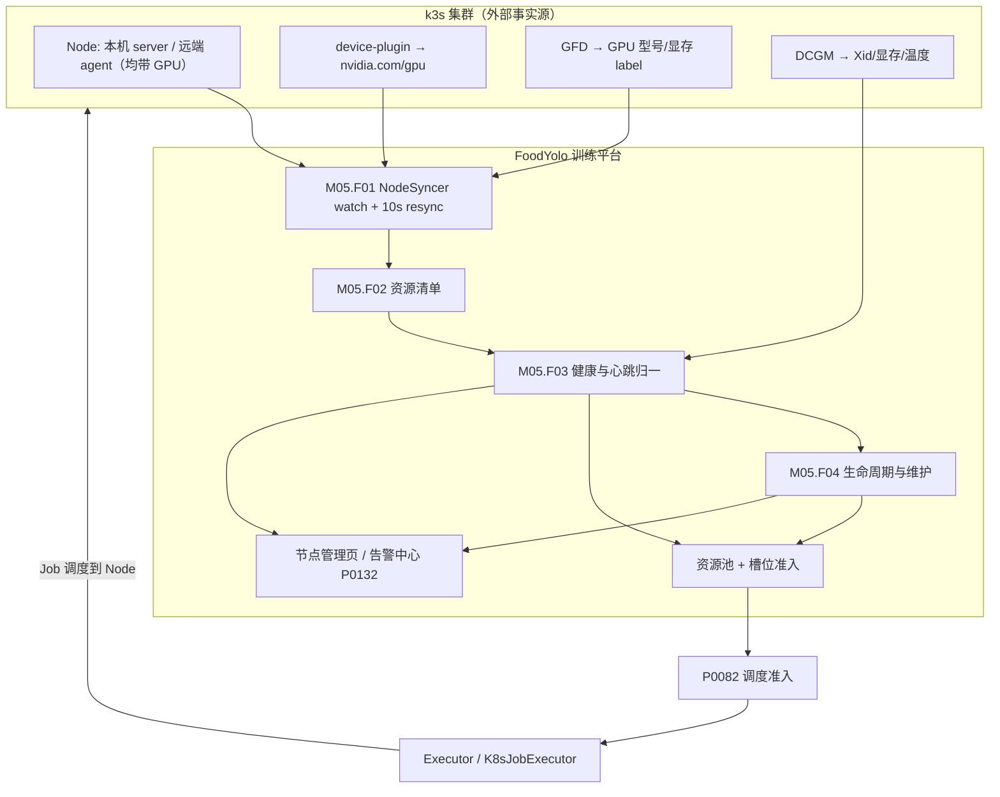
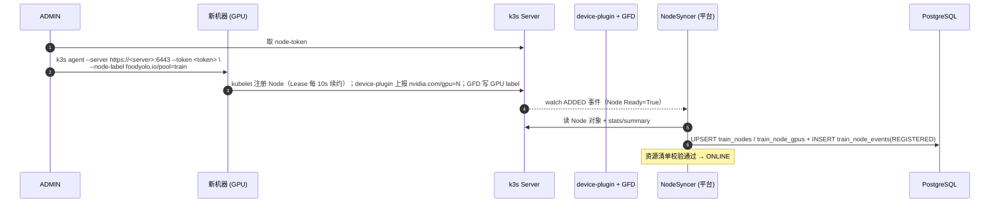
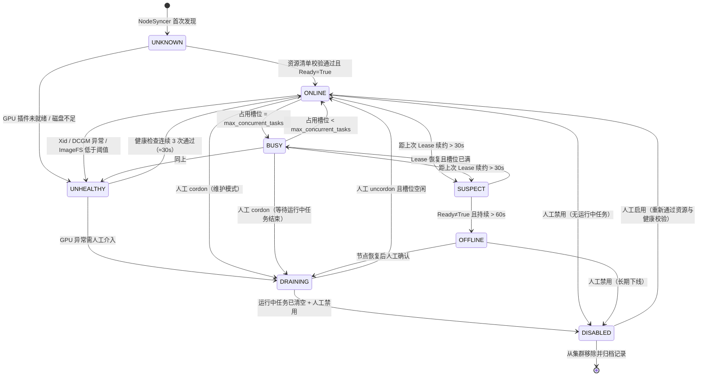
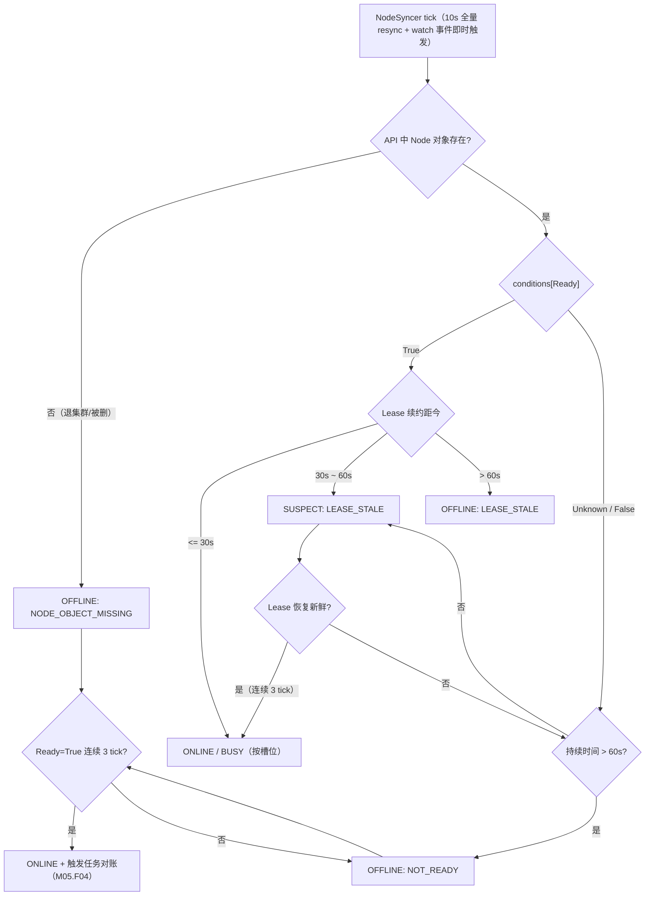
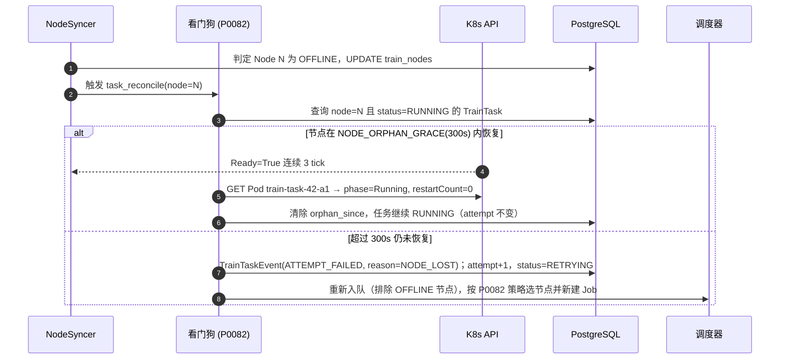
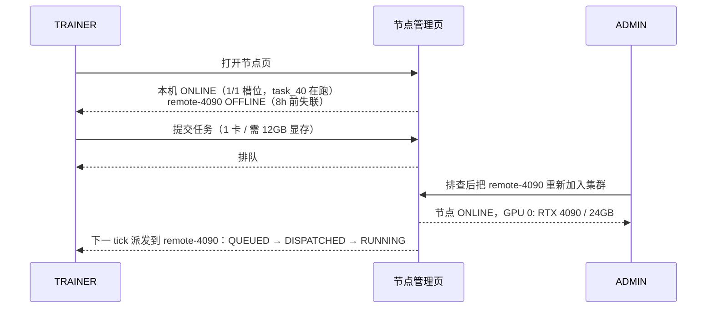
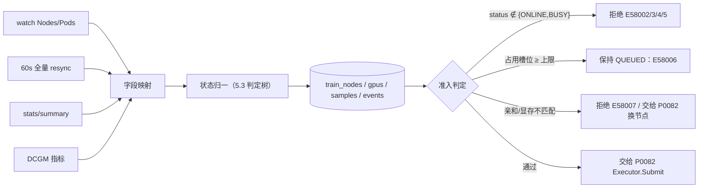

# PRD: P0080_计算节点与资源池 (Compute Nodes & Resource Pool)

| 属性 | 内容 |
| :--- | :--- |
| **文档编号** | P0080 |
| **项目名称** | FoodYolo |
| **功能模块** | M05_训练平台 · 计算节点与资源池 |
| **当前版本** | v1.0.0 |
| **文档状态** | Approved |
| **作者** | TrainA |
| **最后更新** | 2026-10-01 |

---

## 1. 全局说明

> [!IMPORTANT]
> **核心定位**: 训练算力由 **k3s 集群** 承载。平台**不实现自己的节点协议、不定义 Agent 心跳报文**。`TrainNode` 是 **K8s Node 的镜像视图（Mirror View）**：平台只做「同步 → 状态归一 → 准入判定 → 告警」。新增一台机器 = 在目标机器执行 `k3s agent` 加入集群并打 label，平台 10s 内自动发现。

### 名词解释

| 术语 | 说明 |
| :--- | :--- |
| k3s Server / Agent | 单机形态下 server 与 GPU 同机（server 即本机 Node）；扩展形态下其他机器以 `k3s agent` 加入成为新 Node |
| TrainNode | 平台侧对 K8s Node 的镜像记录（`train_nodes`），承载展示、告警、准入所需字段；平台**不创建** Node，只观察 |
| Node Lease | kubelet 每 10s 续约的 `coordination.k8s.io/Lease`，判活的一手依据 |
| Ready Condition | Node `status.conditions[type=Ready]`；`False`/`Unknown` 即不可调度 |
| cordon / taint | 置 `spec.unschedulable=true` / 打 `foodyolo.io/maintenance=true:NoSchedule`，用于维护态 |
| `nvidia.com/gpu` | NVIDIA Device Plugin 暴露的可调度 GPU 资源名，单位「张」 |
| GPU Feature Discovery (GFD) | 把 GPU 型号/显存/驱动/CUDA 写成 Node label 的组件，平台据此做显存与型号匹配 |
| DCGM / Xid | GPU 健康指标来源；Xid 是驱动层报出的 GPU 硬件异常事件号 |
| RuntimeClass `nvidia` | 使容器内可见 GPU；由 nvidia-container-toolkit + containerd 配置支撑 |
| ImageFS / NodeFS | kubelet 上报的两类文件系统用量；镜像层与 emptyDir 计入 ImageFS，磁盘告警看它 |
| 资源池 (Resource Pool) | 满足同一 label 选择器的 TrainNode 集合，如 `foodyolo.io/pool=train` |
| 孤儿任务 (Orphan) | 节点失联但任务仍标记 `RUNNING`，处于观察窗口内 |

### 统一异常处理

| Code | 场景 | 处理策略 |
| :--- | :--- | :--- |
| `E58001` | 平台无法访问 K8s API（kubeconfig 失效 / k3s server 不可达） | 节点列表降级为上次快照并标注「数据更新于 {ts}」；**停止派发新任务**，队列保留；告警中心发 P0 告警 |
| `E58002` | 节点离线（`Ready≠True`，或 Lease 陈旧 > 60s） | 节点标记 `OFFLINE`，停止派发；其上运行中任务进入孤儿观察（见 M05.F04） |
| `E58003` | 节点 GPU 不可调度（`nvidia.com/gpu` allocatable=0，或 Device Plugin 未就绪） | 节点标记 `UNHEALTHY`，原因「GPU 插件未就绪」，拒绝派发 |
| `E58004` | 节点磁盘余量不足（ImageFS 可用 < 20GiB 或 < 10%） | 节点标记 `UNHEALTHY`，拒绝派发；告警提示清理镜像缓存 |
| `E58005` | 节点处于 `DRAINING` / `DISABLED` / `OFFLINE`，或已被禁用 | 调度器跳过；若任务 `nodeName` 硬绑定该节点（PINNED），提交即失败并给出可用节点列表 |
| `E58006` | 节点无空闲槽位（运行中任务数 ≥ `max_concurrent_tasks`） | 任务保持 `QUEUED`，队列面板显示「等待 {node} 释放槽位」 |
| `E58007` | 任务亲和 / 容忍与任何节点不匹配 | 提交阶段静态校验失败，返回不匹配的具体 key/value 与候选池 |
| `E58008` | 节点 GPU 健康异常（Xid 非 0 / ECC 不可纠错 / 温度 > 90℃） | 节点标记 `UNHEALTHY`；**不打断**运行中任务，槽位清空后自动转 `DRAINING` |
| `E58009` | 节点信息同步字段缺失或解析异常 | 保留上一次有效快照，异常字段标 `stale` 并在详情页提示；不阻塞其他节点同步 |

---

## 2. 项目背景

### 背景 (Context)
FoodYolo 的训练执行层是 **k3s**：单机形态下 k3s server 与本机 GPU 同机，一台工作站即一个单节点集群；需要更多算力时用 `k3s agent` 把第二台机器加入集群。**训练任务必须走 k3s**（一次训练 = 一个 K8s Job）。因此「有哪几台机器、每台几块卡、还剩多少显存、现在能不能接任务」直接决定训练能否被调度。

### 问题陈述 (Problem Statement)
1. **算力不可见**：GPU 机器常被某人手工 `python train.py` 占满，其他人提交后永远排队却不知道原因。
2. **需求与资源错配**：`input_size=1280, batch_size=16` 的任务被派到 8GB 显存的卡上，跑到第 2 个 epoch 才 OOM；应在调度前判定「显存不够」。
3. **节点掉线任务悬空**：机器断电后平台仍显示任务 `RUNNING`，没人知道它已经死了。
4. **维护期误派**：换驱动、清磁盘时，「临时不接任务」的手段只能靠口头通知。
5. **重复造轮子风险**：自研节点 Agent 就要自己处理证书、版本兼容、断线重连、时钟漂移 —— 而 kubelet 已经全部提供。

### 目标与成功指标 (Goals & Success Metrics)
*   **北极星指标**: 提交任务时，平台能在 **1 次页面刷新内** 给出确定答案 —— 「在哪台机器跑」或「为什么现在跑不了（具体到节点与原因）」。
*   **次要指标**: 同步延迟 P95 ≤ 10s；节点离线 60s 内标记、其上任务 5min 内有确定结论；「算力被占满但平台显示空闲」导致的无效提交 = 0。

### 风险与规避 (Risks & Mitigation)

| 风险 | 影响 | 规避方案 |
| :--- | :--- | :--- |
| k3s server 挂掉 | 平台看不到任何节点，任务全部卡住 | 只读快照降级 + P0 告警；队列不清空，恢复后自动续跑 |
| 有人绕过平台直接跑脚本占卡 | 平台认为空闲，派任务过去直接 OOM | 准入前读 **DCGM 实测空闲显存**，与「平台已分配」取较小值 |
| GPU 型号/驱动碎片化 | 镜像在 A 机跑得通、B 机跑不通 | GFD label 落库作为亲和条件；镜像侧做驱动兼容矩阵校验（P0081） |
| 节点磁盘被镜像塞满 | kubelet 驱逐 Pod，训练中途被杀 | ImageFS 阈值监控，早于驱逐线告警（< 20GiB 即拒派） |

---

## 3. 价值模型

*   **方案**: 建立「K8s Node → TrainNode 镜像视图」同步层，把 K8s 原生能力（Lease 存活、Ready 条件、cordon/taint、GPU 资源声明）归一为可用于展示与准入的字段；其上再加**平台级槽位与准入门**（含指定节点）。
*   **目标**: 提交前即可看到「可用节点 / 空闲显存 / 队列长度」，无效提交归零；节点离线后任务不再永久悬空；维护动作在 UI 上一等公民化，不依赖命令行。

---

## 4. 项目范围

### 功能结构图



### In Scope (包含范围)
1. **节点纳管**：自动发现集群中的 Node 并建立 `TrainNode` 记录（含本机节点）。
2. **资源清单**：CPU / 内存 / 磁盘（ImageFS、NodeFS）/ GPU 张数 / 每卡显存 / 型号 / 驱动 / CUDA / RuntimeClass 可用性。
3. **健康与心跳归一**：Ready 条件 + Lease 新鲜度 + GPU 健康 + 磁盘阈值 → 单一节点状态。
4. **生命周期与维护模式**：7 态状态机与对应 K8s 操作（cordon / taint / disable）。
5. **资源池与槽位准入**：label 选择器定义池；平台级并发上限；`AUTO` / `PINNED` 两种调度模式的节点侧约束。
6. **离线处置**：节点失联时运行中任务的孤儿观察、恢复判定与失败回收。

### Out of Scope (不包含范围)
*   **自研节点 Agent 与心跳协议**（复用 kubelet Lease，不新增节点侧常驻进程）；**自动扩缩容 / 节点自动加入**（仍需人工 `k3s agent` 加入）。
*   **多集群联邦、跨机房调度**；**GPU 共享与切分（MIG / MPS）** —— 第一版一卡同一时刻只服务一个训练任务。
*   **平台自己决定 Pod 落在哪个 Node**：这是 K8s 调度器的职责（`PINNED` 只是显式绑定，不算选机算法）。
*   **节点成本核算与计费**。

---

## 5. 业务流程

### 5.1 节点纳管流程（新增一台机器）



### 5.2 节点状态机



> `BUSY` 与 `ONLINE` 的唯一区别是**槽位是否占满**（占满即不再准入任何新任务）；`SUSPECT` 是**尚未判定离线**的中间态，避免因一次网络抖动把任务判死。

### 5.3 心跳与离线判定

平台不使用节点侧心跳报文，判活依据两条独立证据：**Ready 条件** 与 **Lease 续约时间戳**。



**判定参数（固定默认值）**

| 参数 | 值 | 说明与理由 |
| :--- | :--- | :--- |
| `NODE_SYNC_INTERVAL` | 10s | 与 kubelet Lease 续约周期对齐；再短只放大 API 压力 |
| `NODE_RESYNC_FULL` | 60s | 除 watch 事件外每 60s 全量 resync，兜住 watch 断连丢事件 |
| `NODE_LEASE_STALE_AFTER` | 30s | kubelet 每 10s 续约，连丢 3 次仍未见新 timestamp → 可疑 |
| `NODE_OFFLINE_AFTER` | 60s | K8s `node-monitor-grace-period` 默认 40s 后置 NotReady，再给 20s 容差，避免与 K8s 判定打架 |
| `NODE_RECOVER_CONFIRM_TICKS` | 3（≈30s） | 恢复需连续确认，防止网络抖动导致状态反复横跳 |
| `NODE_ORPHAN_GRACE` | 300s | 节点 OFFLINE 后任务的观察窗口；与 P0082 看门狗超时一致 |
| `NODE_SAMPLE_RETENTION` | 明细 7 天 / 小时聚合 30 天 | 资源趋势够用，且不会把单机盘写满 |
| `NODE_STALE_HIDE_AFTER` | 30 天 | 长期离线节点在列表折叠，**不自动删除**（lineage 需要） |

### 5.4 节点离线时，运行中任务如何处置



---

## 6. 用户分析

### 6.1 用户画像 (User Personas)

*   **运维管理员 (ADMIN)**（通常是团队里管机器的人）：职责是维护 GPU 工作站、装驱动、清磁盘；诉求「我要换驱动，先挡住新任务，但别把在跑的训练弄崩」；痛点是**没有任何「临时不接任务」的状态**，只能靠喊。
*   **训练工程师 (TRAINER)**：职责是调参跑训练；诉求「我现在提交，今晚能不能跑起来、跑在哪台机器」；痛点是**排队没有原因**、显存不够要到 OOM 才知道。
*   **只读观察者 (VIEWER)**：一眼看出集群是否健康、谁在占卡。

### 6.2 用户链路图 (User Journey Map)



---

## 7. 功能需求

### M05.F01 节点纳管与镜像视图同步 (Node Discovery & Sync)
*   **用户故事**: 作为 ADMIN，我希望新加的机器自动出现在平台里，不需要在平台上再手工登记一遍。

*   **逻辑与业务规则**
    *   **前置条件**: 目标机器已执行 `k3s agent` 加入集群并带 `foodyolo.io/pool=<name>` label；平台 ServiceAccount 具备 `nodes: get/list/watch`、`pods: get/list/watch`、`nodes/stats: get`。
    *   **主流程**: ① `NodeSyncer` 建立 Node/Pod watch，同时每 60s 全量 resync；② 收到 `ADDED/MODIFIED` → 拉 Node 对象 + `stats/summary` → 映射字段 → UPSERT；③ 首次同步校验通过置 `ONLINE`，失败置 `UNHEALTHY` 并写原因；④ 收到 `DELETED` → 转 `OFFLINE`、移出资源池、记 `NODE_REMOVED`。
    *   **后置条件**: `train_nodes` 与集群状态误差 ≤ 10s；每次状态变化写一条 `TrainNodeEvent`。
*   **同步字段映射**:

    | 平台字段 | K8s 来源 | 说明 |
    | :--- | :--- | :--- |
    | `k8s_node_uid` | `Node.metadata.uid` | 集群内唯一，幂等键 |
    | `name` / `is_local` | `metadata.name` / 是否 k3s server 主机名 | 本机节点打「本机」标签 |
    | `pool` | label `foodyolo.io/pool` | 资源池名；缺省不纳入训练池 |
    | `labels_json` / `taints_json` | `metadata.labels` / `spec.taints` | 供亲和选择器与容忍判定 |
    | `unschedulable` | `spec.unschedulable` | cordon 标记 |
    | `kubelet_version` / `container_runtime` / `os_image` / `arch` | `status.nodeInfo.*` | 兼容性排查；运行时应为 `containerd://…` |
    | `cpu_cores` / `mem_total_bytes` | `status.capacity.cpu/memory` | 准入参考 |
    | `gpu_capacity` | `status.capacity["nvidia.com/gpu"]` | 0 表示不可训练 |
    | `ready` / `ready_transition_at` / `lease_renew_at` | `conditions[type=Ready]` / Lease `renewTime` | 存活判定与心跳新鲜度 |
    | `imagefs_available_bytes` | `stats/summary.node.fs` | 镜像与 emptyDir 余量 |
    | `status` | 平台归一计算 | 见 5.2 / 5.3 |

*   **验收标准**:
    ```gherkin
    场景: 新增一台 GPU 机器被自动纳管
      Given 平台已运行且 k3s 集群可访问
      When ADMIN 在新机器执行 k3s agent 加入集群并打 label foodyolo.io/pool=train
      Then 10 秒内节点管理页出现该节点，状态为 ONLINE
      And GPU 清单显示型号、显存总量与驱动版本
      And 列表展示 0 个正在运行的任务

    场景: 节点被移出集群
      Given 节点 remote-4090 处于 ONLINE
      When 该节点被 k3s 移除（node delete / agent 退出）
      Then 平台标记其为 OFFLINE，原因 NODE_OBJECT_MISSING，并立即移出可调度资源池
      And 记录一条 train_node_events(NODE_REMOVED)
    ```

*   **边界情况与异常处理**:

    | 场景 | 处理 |
    | :--- | :--- |
    | watch 长连接断开 | 指数退避重连（1s→30s），重连后强制全量 resync；期间 UI 显示「同步延迟」角标 |
    | 平台重启期间节点状态变化 | 启动时先全量 resync 再建 watch，避免丢事件导致中间态 |
    | Node 无 `foodyolo.io/pool` label | 纳管但标 `pool=null`，不进入训练池，UI 提示「未加入训练资源池」 |
    | 同名节点重建（UID 变化） | 以 `k8s_node_uid` 判为新实体，旧记录转 OFFLINE 并保留历史，不覆盖 |
    | K8s API 短时 5xx | 单次同步退避重试 3 次（1s/3s/9s），仍失败保留旧快照并记 `E58009` |

### M05.F02 节点资源与 GPU 清单 (Resource & GPU Inventory)
*   **用户故事**: 作为 TRAINER，我希望在提交任务前看到每块卡的型号和剩余显存，避免把 12GB 需求提到 8GB 卡上。

*   **逻辑与业务规则**
    *   **前置条件**: 节点已纳管；GPU 属性依赖 `nvidia-device-plugin`（资源名）与 GFD（属性 label）。
    *   **主流程**: ① 解析 label 得到单卡属性（型号 / `nvidia.com/gpu.memory` / 驱动 / CUDA）；② 按 `capacity["nvidia.com/gpu"]` 生成 N 条 `TrainNodeGpu`，`gpu_uuid` 由 DCGM 或节点采集脚本补齐，缺失则留空标 `stale`；③ 每 10s 采样实测空闲显存与利用率写 `TrainNodeSample`；④ 每小时聚合一次写趋势数据。
    *   **实测 vs 平台分配**: 平台对空闲显存的判定取 **`min(实测空闲显存, 显存总量 − 平台已分配给运行中任务的显存)`**。前者防止绕过平台的手工进程导致误判，后者防止并发派发超卖。
    *   **后置条件**: `TrainNodeGpu` 与物理卡一一对应；采样明细保留 7 天。
*   **验收标准**:
    ```gherkin
    场景: 有人绕过平台直接占用 GPU
      Given 平台认为节点 foodyolo-01 空闲（1 张 RTX 4090）
      When 运维在机器上手工启动一个占用 20GB 显存的进程
      Then 下一次采样（≤10s）后实测空闲显存降为 4GB
      And 提交需要 12GB 的任务时该节点判定不可准入（reason=GPU_MEMORY_INSUFFICIENT）
      And GPU 列表仍显示 index=0 / 24 GB 总量 / 驱动 535.161 / CUDA 12.1 / 健康 OK
    ```

*   **边界情况与异常处理**:

    | 场景 | 处理 |
    | :--- | :--- |
    | 有 GPU 但未装 Device Plugin | `gpu_capacity=0` → 节点 `UNHEALTHY`，提示安装 device-plugin 与 GFD |
    | GFD 未安装（无型号/显存 label） | 相关字段标 `stale`；仍可调度，但显存匹配退化为「按卡数」，UI 黄色提示 |
    | GPU 数量运行中变化（热插拔） | 下次同步更新，仅追加或标记失效，不删除仍被历史任务引用的 `gpu_uuid` |
    | 采样源（DCGM）未就绪 | 保留上次采样值并标 `stale`，不阻断调度；连续 6 次（60s）失败则节点 `UNHEALTHY` |
    | 显存单位不一致 | 统一以**字节**落库；GFD 的 MiB 值写入时 ×1024×1024，前端格式化为 GB |

### M05.F03 节点健康、心跳与离线判定 (Health & Heartbeat)
*   **用户故事**: 作为 VIEWER，我希望机器掉线后平台立刻告诉我，而不是等我发现训练日志不动了。

*   **逻辑与业务规则**
    *   **主流程**: 按 5.3 判定树计算状态；判定 `OFFLINE` 时触发 M05.F04 的任务对账，并向告警中心（P0132）发告警。
    *   **健康扣分项**（任一命中 → `UNHEALTHY`）: ① `nvidia.com/gpu` allocatable=0 或 device-plugin Pod 非 Running；② DCGM 报 Xid 非 0；③ ImageFS 可用 < 20GiB 或 < 10%；④ RuntimeClass `nvidia` 不可用。
    *   **恢复规则**: `UNHEALTHY → ONLINE` 需连续 3 次（≈30s）健康检查通过，避免 DCGM 单次抖动。
    *   **后置条件**: 状态变化写 `train_node_events`；`UNHEALTHY` 节点不参与准入。
*   **验收标准**:
    ```gherkin
    场景: 节点断电
      Given 节点 foodyolo-02 处于 ONLINE 且有 1 个任务在跑
      When 该机器断电
      Then 30 秒内状态变为 SUSPECT（LEASE_STALE）
      And 60 秒内状态变为 OFFLINE，且告警中心生成「节点离线」告警
      And 该节点上的任务进入孤儿观察（见 M05.F04）

    场景: GPU 硬件异常
      Given 节点 GPU 报出 Xid 79
      When 平台采集到 DCGM 指标
      Then 节点标记 UNHEALTHY（GPU_XID_ERROR），不再派发新任务
      And 正在运行的任务不被中断
    ```

*   **边界情况与异常处理**:

    | 场景 | 处理 |
    | :--- | :--- |
    | 平台与 K8s 同机，机器整体宕机 | 平台与节点一起消失；重启后按 K8s 中 Node 状态恢复，运行中任务由启动对账判定 |
    | 控制面卡顿导致同步延迟 | 用 K8s 侧 Lease 时间戳判定，不用平台本地 tick 次数 |
    | 网络抖动 3~5s | 不足以触发 SUSPECT（阈值 30s），不会引起状态翻转 |
    | 状态反复抖动（≥5 次/小时） | 生成「节点网络不稳定」告警，并临时把该节点阈值放宽为 2 倍 |
    | 节点与 server 时钟不一致 | 一律以 K8s API 返回的时间戳为准，不采用节点本地时钟 |

### M05.F04 节点生命周期、维护模式与资源池准入 (Lifecycle, Maintenance & Admission)
*   **用户故事**: 作为 ADMIN，我希望在换驱动前把机器标成维护态 —— 不再接新任务，但让正在跑的任务自然结束。

*   **逻辑与业务规则**
    *   **维护模式（DRAINING）**: ① `PATCH Node.spec.unschedulable=true`（cordon）；② 打 `foodyolo.io/maintenance=true:NoSchedule` taint；③ 平台调度器跳过该节点。**运行中任务不被中断**，全部结束后再手动转 `DISABLED` 或回 `ONLINE`。
    *   **强制排水**: ADMIN 可选择「立即终止运行中任务」，对每个任务调用 `Executor.Cancel`（P0082 的 SIGTERM → 60s → SIGKILL）；任务转 `FAILED`，`reason=MANUAL_TERMINATION`，**不自动重试**。
    *   **禁用（DISABLED）**: 平台不再派发并从资源池移除；对应 taint `foodyolo.io/disabled=true:NoSchedule`；不删除历史记录。
    *   **资源池**: label 选择器定义，默认 `foodyolo.io/pool=train`；池内每个节点有 `max_concurrent_tasks`（默认 = `gpu_capacity`，允许下调用以留卡做推理，**不允许**超过 `gpu_capacity`）。准入时统计「已派发未结束的 TrainTask 数」，≥ 上限即 `E58006`。
    *   **两层调度的边界**: 平台层负责「任务是否允许进入集群 + 需要什么资源声明（含可选目标节点）」；**默认 Pod 落到哪个 Node 由 K8s 调度器决定**，平台不实现选机算法。
    *   **指定节点（Pin）**: 任务可选 `scheduling_mode=PINNED` + `target_node_id`，平台在 Pod 模板写入 `nodeName`（硬绑定，仍受 K8s 资源校验）。钉住时准入照常执行：目标节点 `status ∉ {ONLINE, BUSY}` → 提交即失败 `E58005`，**不静默改派**；槽位占满 → 保持 `QUEUED` 且不溢出到其他节点；排队期间节点转 `DRAINING/DISABLED/OFFLINE` → 任务转 `FAILED`（`TARGET_NODE_UNAVAILABLE`）。GPU 仍由 K8s 分配（Pod 只声明张数，不指定卡序号）。
    *   **后置条件**: 所有变更写 `train_node_events`（含 `actor_id`）与审计日志（P0131）。
*   **验收标准**:
    ```gherkin
    场景: 进入维护模式
      Given 节点 foodyolo-01 上有 1 个运行中任务 task_40
      When ADMIN 点击 [进入维护]
      Then 节点状态变为 DRAINING 且 K8s 中 spec.unschedulable=true
      And 新任务不再派发到该节点，队列面板显示「无可用节点」
      And task_40 继续运行至结束
      When task_40 结束后 ADMIN 点击 [退出维护]
      Then 节点回到 ONLINE 并重新参与调度

    场景: 强制立即终止
      Given 节点处于 DRAINING 且有运行中任务
      When ADMIN 选择「立即终止运行中任务」并确认
      Then 平台对每个任务发起取消（SIGTERM，60s 宽限，超时 SIGKILL）
      And 任务状态变为 FAILED（MANUAL_TERMINATION），且不会被自动重试
    ```

*   **边界情况与异常处理**:

    | 场景 | 处理 |
    | :--- | :--- |
    | 禁用节点时仍有运行中任务 | 拒绝直接 DISABLED，提示先「进入维护」或「强制终止」；API 返回 `E58005` 附任务列表 |
    | 维护中节点是池内唯一节点 | 允许操作，但提交任务时明确提示「无可用节点」，不静默排队 |
    | 节点在 DISABLED 期间被移出集群 | 保留记录，状态转 OFFLINE 且 `disabled=true`；启用时提示节点不存在 |
    | 有人绕过平台改了 Node label/taint | 下次同步（≤10s）覆盖为平台期望值并记 `DRIFT_CORRECTED`，同时告警 |
    | 并发上限被下调到低于当前运行数 | 允许（不杀任务），新任务排队直到运行数降到上限以下 |
    | PINNED 目标节点在排队期间离线 / 被非平台进程占满显存 | 前者转 `FAILED(TARGET_NODE_UNAVAILABLE)` 并提供「改为自动调度后重提」；后者保持 QUEUED 并提示显存被外部进程占用 |

---

## 8. 技术架构与数据模型

### 8.1 数据实体

#### Table: `train_nodes`（TrainNode，K8s Node 镜像视图）

| 字段名 | 类型 | 必填 | 说明 | 约束 |
| :--- | :--- | :--- | :--- | :--- |
| `id` | UUID | Y | 主键 | PK, auto-gen |
| `k8s_node_uid` | String(64) | Y | K8s Node UID | UNIQUE |
| `name` | String(63) | Y | 节点名 | UNIQUE |
| `is_local` | Boolean | Y | 是否 k3s server 所在本机 | default false |
| `pool` | String(32) | N | 资源池名 | NULL = 未入池 |
| `status` | Enum | Y | `UNKNOWN/ONLINE/BUSY/SUSPECT/OFFLINE/UNHEALTHY/DRAINING/DISABLED` | default UNKNOWN |
| `status_reason` | String(32) | N | `LEASE_STALE` / `GPU_XID_ERROR` 等 | |
| `unschedulable` | Boolean | Y | 对应 `spec.unschedulable` | default false |
| `labels_json` / `taints_json` | JSONB | Y | Node label / taint 快照 | |
| `kubelet_version` / `container_runtime` / `os_image` / `arch` | String | N | 兼容性排查 | |
| `cpu_cores` / `mem_total_bytes` | Int / BigInt | Y | 可分配 CPU 与内存 | > 0 |
| `imagefs_total_bytes` / `imagefs_available_bytes` | BigInt | N | ImageFS 用量 | 采样值 |
| `gpu_capacity` | Int | Y | `nvidia.com/gpu` allocatable | default 0 |
| `max_concurrent_tasks` | Int | Y | 平台并发上限 | 1 ≤ v ≤ gpu_capacity |
| `runtimeclass_ready` | Boolean | Y | RuntimeClass `nvidia` 可用性 | default false |
| `ready` / `ready_transition_at` / `lease_renew_at` | Bool / Timestamptz | N | K8s 侧存活证据 | |
| `last_sync_at` / `sync_stale_fields` | Timestamptz / JSONB | Y/N | 最近成功同步；缺失字段列表（`E58009`） | |
| `disabled_at` / `disabled_by` | Timestamptz / UUID | N | 禁止人 | FK → users.id |
| `registered_at` / `created_at` / `updated_at` / `deleted_at` | Timestamptz | Y | 纳管时间与通用字段；`deleted_at` 用于归档节点 | |

#### Table: `train_node_gpus`（TrainNodeGpu）

| 字段名 | 类型 | 必填 | 说明 | 约束 |
| :--- | :--- | :--- | :--- | :--- |
| `id` | UUID | Y | 主键 | PK |
| `node_id` | UUID | Y | 所属节点 | FK → train_nodes.id, CASCADE |
| `gpu_index` | Int | Y | 卡序号（0 起，驱动重载后可能变化） | UNIQUE(node_id, gpu_index) |
| `gpu_uuid` | String(64) | N | 物理卡唯一标识；**任务绑定用它而非 index** | UNIQUE(node_id, gpu_uuid) |
| `model` / `compute_capability` | String | N | 型号与算力代次，如 `NVIDIA GeForce RTX 4090` / `8.9` | |
| `vram_total_bytes` | BigInt | Y | 显存总量 | > 0 |
| `driver_version` / `cuda_version` | String | N | 驱动 / CUDA 版本 | |
| `health` / `xid_code` | Enum / Int | Y/N | `OK / WARN / ERROR / UNKNOWN`；最近一次 Xid | default UNKNOWN |
| `mig_enabled` / `last_sample_at` | Boolean / Timestamptz | Y/N | 第一版恒为 false；最近采样时间 | default false |

#### Table: `train_node_samples`（TrainNodeSample，时序采样）

| 字段名 | 类型 | 必填 | 说明 |
| :--- | :--- | :--- | :--- |
| `id` | BigSerial | Y | 主键 |
| `node_id` | UUID | Y | FK → train_nodes.id |
| `sampled_at` | Timestamptz | Y | 采样时间（K8s API 时间） |
| `cpu_used_millicores` / `mem_used_bytes` / `imagefs_available_bytes` | Int / BigInt | N | CPU、内存与 ImageFS 用量 |
| `gpu_util_json` | JSONB | N | `[{"index":0,"util":0.82,"vram_used_bytes":…}]` |
| `running_task_count` | Int | Y | 平台认定的在跑任务数 |

> 保留策略：明细 7 天，按小时聚合 30 天，由 TTL 清理任务执行（不归档原始明细）。

#### Table: `train_node_events`（TrainNodeEvent，状态变更审计）

| 字段名 | 类型 | 必填 | 说明 |
| :--- | :--- | :--- | :--- |
| `id` | BigSerial | Y | 主键 |
| `node_id` | UUID | Y | FK → train_nodes.id |
| `event_type` | Enum | Y | `REGISTERED / SYNC_FAILED / STATUS_CHANGED / MAINTENANCE_ENTER / MAINTENANCE_EXIT / DISABLED / ENABLED / NODE_REMOVED / DRIFT_CORRECTED / FORCED_DRAIN` |
| `from_status` / `to_status` | Enum | N | 状态迁移前后 |
| `reason` / `detail_json` | String(64) / JSONB | N | 原因码；上下文（任务列表、旧 label 值等） |
| `actor_id` | UUID | N | 操作人（自动事件为空），FK → users.id |
| `created_at` | Timestamptz | Y | 发生时间 |

### 8.2 同步与准入逻辑



**平台侧 RBAC（最小权限；平台以 ServiceAccount 运行在 k3s 或持 kubeconfig 裸机运行）**

| 资源 | 动词 | 用途 |
| :--- | :--- | :--- |
| `nodes` | get, list, watch | 同步节点状态 |
| `nodes` | patch（仅 `spec.unschedulable`） | cordon / uncordon |
| `nodes/stats` | get | 读取资源用量 |
| `pods`, `pods/log` | get, list, watch | 任务状态与日志（P0082 / P0084） |
| `jobs` | create, get, list, watch, delete | 训练任务（P0082） |

---

## 9. UI/UX 规格说明

### 9.1 节点列表

```text
+--------------------------------------------------------------------------------------+
|  训练平台 > 计算节点    资源池: [全部 ▾]  状态: [全部 ▾]  [刷新] 自动刷新: 10s       |
+-------------------+------------+--------------+-------+----------------+--------------+
| 节点              | 状态       | GPU          | 槽位  | 运行任务       | 操作         |
+-------------------+------------+--------------+-------+----------------+--------------+
| foodyolo-01 (本机)| 🟢 ONLINE  | RTX 4090 ×1  | 1 / 1 | task_40        | [维护][详情] |
|                   |            | 21.4/24 GB   |       |                |              |
| foodyolo-02       | 🔴 OFFLINE | RTX 4090 ×1  | -     | (task_42 孤儿) | [禁用][详情] |
|                   | 失联 8h    | 驱动 535.161 |       |                |              |
| foodyolo-03       | 🟡 DRAINING| A4000 ×2     | 0 / 1 | task_44        | [终止][详情] |
+-------------------+------------+--------------+-------+----------------+--------------+
| 共 3 个节点 · 可用槽位 0 · 队列等待 2 个任务                                          |
+--------------------------------------------------------------------------------------+
```

### 9.2 节点详情与维护确认

```text
+--------------------------------------------------------------------------------------+
|  ← 返回  foodyolo-01 [本机]  🟢 ONLINE  最近同步 3s 前  kubelet v1.29.3+k3s1        |
| GPU  # | 型号     | 显存总量 | 实测空闲 | 利用率 | 驱动    | CUDA | 健康 | 任务      |
|      0 | RTX 4090 | 24 GB    | 21.4 GB  | 87%    | 535.161 | 12.1 | OK   | task_40   |
| 资源   CPU 4/16 核   内存 22.1/64 GB   ImageFS 可用 118 GB (34%)   [进入维护][禁用]   |
| 运行中 task_40  食品日期检测-baseline  RUNNING  attempt 1/3  已运行 41m  [查看][终止]  |
| 事件   10:02 BUSY → ONLINE（task_39 结束）  09:41 ONLINE → BUSY（派发 task_40）        |
+--------------------------------------------------------------------------------------+
|  [进入维护] → 确认弹窗: ⚠ 该节点有 1 个运行中任务 task_40（已运行 41m）              |
|  处理方式: (•) 等待自然结束  ( ) 立即终止（不可恢复，不自动重试）                      |
|  维护原因（必填，记入审计）: [更换驱动 535.161 → 550.54            ]  [取消][确认]    |
+--------------------------------------------------------------------------------------+
```

### 9.3 交互元素

| 元素 | 类型 | 状态 | 行为 |
| :--- | :--- | :--- | :--- |
| 自动刷新开关 | Toggle | On(默认)/Off | On 时每 10s 拉取列表；Off 显示「数据更新于 …」 |
| [维护] | Button | Default/Hover/Disabled | Disabled 当节点 OFFLINE/DISABLED；打开维护确认弹窗 |
| [强制终止] | Button (Danger) | Default/Confirm/Loading | 二次确认后对全部运行中任务调用 Cancel |
| [禁用] / [启用] | Button | Disabled（有运行中任务）/ 仅 DISABLED 显示 | 禁用前置条件见 M05.F04；启用触发重新校验（GPU/磁盘/RuntimeClass） |
| 资源池筛选 / 状态角标 | Select / Badge | 多选 / 7 态 | 按 `foodyolo.io/pool` 过滤；角标悬停显示 `status_reason` 原文 |

---

## 10. 非功能性需求 (NFR)

*   **性能**: 节点列表接口 P95 < 200ms（≤16 节点）；状态同步延迟 P95 ≤ 10s；采样写入 ≤ 1 条/节点/10s（16 节点 ≈ 0.14 万条/天）。
*   **可靠性**: NodeSyncer 单实例运行（单机部署，无需 leader 选举），崩溃重启后全量 resync 保证一致；与 k3s API 交互统一 5s 超时 + 3 次退避重试；单节点同步失败不影响其他节点（`E58009` 局部降级）。
*   **安全**: 节点管理操作仅 `ADMIN`（RBAC 见 P0130）；平台 ServiceAccount 最小权限（8.2），不授予 `nodes/delete`、`pods/exec`；不使用集群 admin kubeconfig，凭证加密存储且禁止注入训练容器。
*   **兼容性**: k3s ≥ v1.28（需 RuntimeClass 与 Node Lease）；NVIDIA 驱动 ≥ 535、CUDA ≥ 12.1；运行时为 containerd（k3s 默认），不假定 Docker daemon 存在。
*   **可扩展性**: 设计目标 ≤ 16 节点 / ≤ 64 张 GPU；新增节点零配置（`k3s agent` + pool label）；超出规模需改用真正的多机方案。

---

## 附录: 已确认的设计决策

| 决策项 | 结论 |
| :--- | :--- |
| 算力承载 | **k3s**（单机 = 单节点集群，扩展 = `k3s agent` 加入）；训练任务必须走 K8s |
| 节点抽象 | `TrainNode` 是 **K8s Node 的镜像视图**，平台**不自研节点 Agent 协议**；心跳来源为 kubelet **Lease** + Ready Condition |
| 离线判定 | SUSPECT > 30s（Lease 陈旧）、OFFLINE > 60s；恢复需连续 3 tick 确认 |
| 孤儿任务宽限 | `NODE_ORPHAN_GRACE = 300s`，与 P0082 看门狗超时对齐；超时后 attempt+1 重排队 |
| 调度边界 | 平台只做**准入声明**；默认 Pod 落点由 K8s 调度器决定，平台不实现选机算法 |
| 指定节点 | `scheduling_mode = AUTO(默认) / PINNED` + `target_node_id`；PINNED 时写 Pod `nodeName`，节点不可用即失败、不改派 |
| 维护模式 | cordon + taint `foodyolo.io/maintenance=true:NoSchedule`，不中断运行中任务 |
| 并发与池 | 并发上限默认 = `gpu_capacity`，可下调不可上调；资源池 = label `foodyolo.io/pool=train`；第一版不做 GPU 共享 / MIG |
| 长期离线节点 | 30 天后 UI 折叠，**不自动删除**（训练 lineage 需要） |
| E-code / 功能编号 | 本篇 `E58001–E58009`（`E`+模块 5+P 号后两位 `80`+两位流水），P0081 = `E581xx`、P0082 = `E582xx`；功能号 `M05.F01–F04`，**每篇从 `F01` 重新开始** |
| 数据口径 | GPU 型号/显存取 GFD label，实时用量取 DCGM；单位统一为字节落库 |

---

## 关联文档

*   **P0081_训练环境与镜像**: 镜像与 RuntimeClass/驱动兼容矩阵、`nvidia-container-toolkit` 前置校验
*   **P0082_训练任务提交与调度**: 消费本节的状态、槽位、GPU 容量做准入与亲和；`Executor.Submit/Status/Cancel/StreamLogs`
*   **P0084_训练日志与指标看板**: 节点资源趋势展示的采样数据来源
*   **P0130_用户与角色** / **P0131_审计日志** / **P0132_告警中心**: 权限、审计与告警规则
*   **P0100_流水线阶段与算子**: 流水线阶段复用的同款节点准入与资源声明

---

## Changelog

| 版本 | 日期 | 作者 | 变更说明 |
| :--- | :--- | :--- | :--- |
| v0.1.0-draft | 2026-10-01 | TrainA | 初稿：自研节点 Agent + 心跳协议方案 |
| v0.9.0-draft | 2026-10-01 | TrainA | 架构更正：改为 k3s 承载，`TrainNode` 改为 K8s Node 镜像视图，删除自研 Agent 协议 |
| v0.9.5-draft | 2026-10-01 | TrainA | 采纳集成裁定：E 码改 `E58001+`、功能号每篇从 `M05.F01` 起、新增 PINNED 指定节点准入 |
| v1.0.0 | 2026-10-01 | TrainA | 正式发布：状态机、判定参数、离线任务处置、准入规则与数据模型定稿 |
