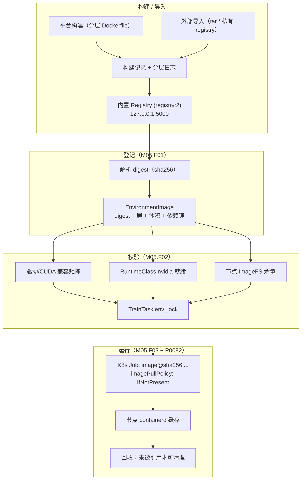
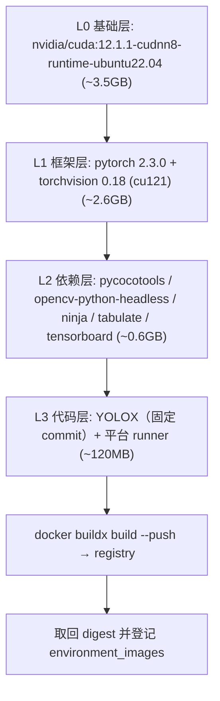
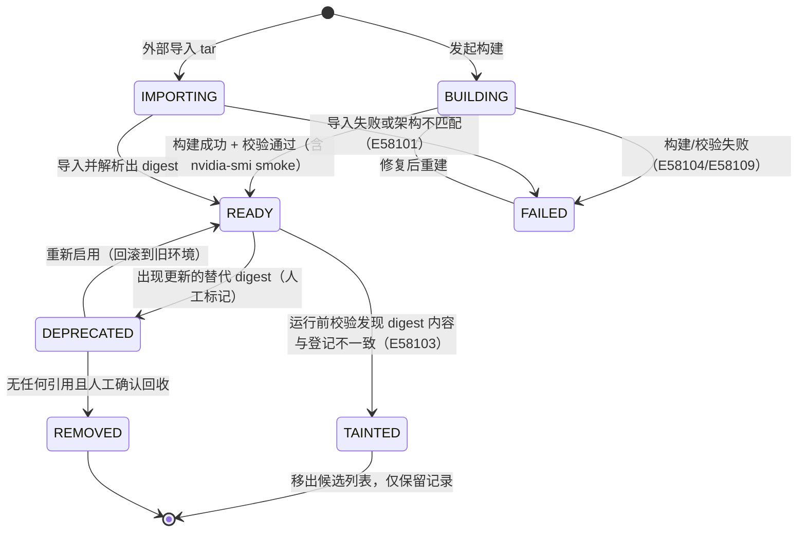
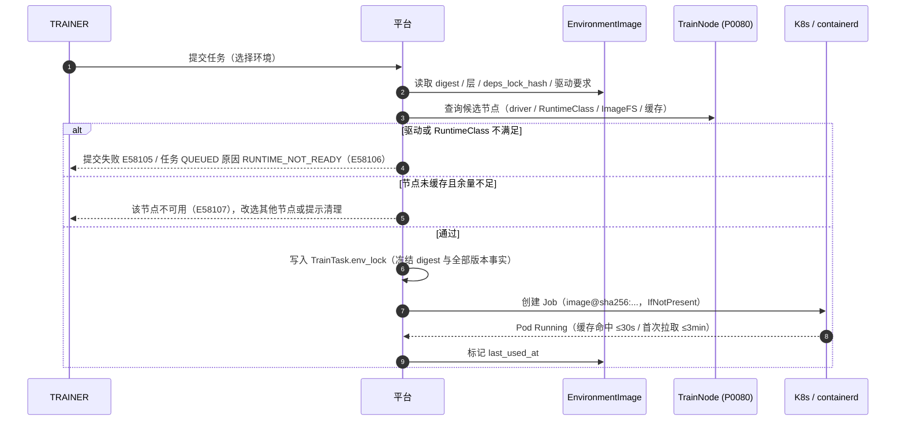
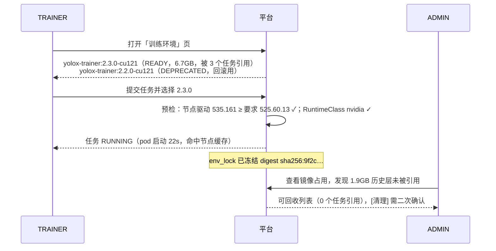
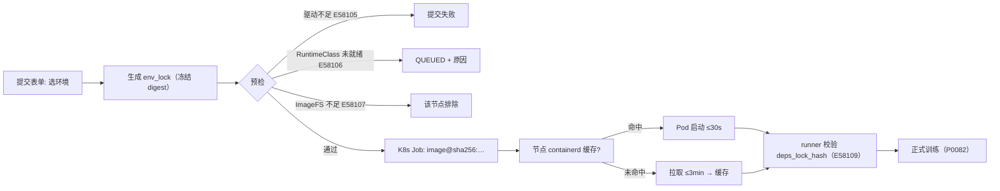

# PRD: P0081_训练环境与镜像 (Training Environment & Images)

| 属性 | 内容 |
| :--- | :--- |
| **文档编号** | P0081 |
| **项目名称** | FoodYolo |
| **功能模块** | M05_训练平台 · 训练环境与镜像 |
| **当前版本** | v1.0.0 |
| **文档状态** | Approved |
| **作者** | TrainA |
| **最后更新** | 2026-10-01 |

---

## 1. 全局说明

> [!IMPORTANT]
> **核心定位**: 一次训练的可复现性 = **镜像 digest（不可变）+ 代码 commit + 依赖锁 + 超参 + 随机种子**。本模块负责前两项与「环境能否在本集群跑起来」的判定。镜像推送到内置 registry，Job 以 `<repo>@sha256:<digest>` 拉取（**绝不用 tag 运行**，tag 只是人类可读别名）。k3s 使用 **containerd**，不存在 Docker daemon，导入/清理都走 `crictl` / `ctr`。

### 名词解释

| 术语 | 说明 |
| :--- | :--- |
| EnvironmentImage | 平台登记的**不可变**训练环境镜像（表 `environment_images`），以 digest 为主键语义 |
| Image Digest | `sha256:...` 内容寻址标识；tag 可变、digest 不可变，任务一律固定 digest |
| 分层 (Layer) | 镜像的四层约定：CUDA 基础层 → 深度学习框架层 → 训练依赖层 → 平台/用户代码层 |
| Registry | 镜像仓库；本平台内置 `registry:2` 容器（默认 `127.0.0.1:5000`，需在 k3s `registries.yaml` 登记为 insecure） |
| RuntimeClass `nvidia` | Pod 声明 `runtimeClassName: nvidia` 才能在容器内看到 GPU |
| nvidia-container-toolkit | k3s/containerd 侧把 GPU 设备与驱动库注入容器的组件，是 GPU 训练的前置条件 |
| GPU Feature Discovery | 把 GPU 驱动/CUDA 版本写为 Node label，用于镜像与节点的兼容预检 |
| 环境锁 (env_lock) | 落库在 `TrainTask.env_lock` 的 JSONB 快照，记录本次训练的全部环境事实 |
| 预拉取 (Prefetch) | 在节点上用一次短生命周期 Pod 把镜像拉进 containerd 缓存，减少正式任务的启动等待 |
| Trainer Backend | 训练后端抽象；**首个实现为 YOLOX（Apache-2.0）**，接口预留 MMDetection / RT-DETR 适配器 |
| Exp File | YOLOX 的模型结构/训练配置入口文件（`exp_file`），平台模板化生成 |

### 统一异常处理

| Code | 场景 | 处理策略 |
| :--- | :--- | :--- |
| `E58101` | registry 中不存在该 digest/tag | 提交与预拉取均失败，提示「镜像不存在或已被清理」，列出同仓库可用 digest |
| `E58102` | 镜像拉取失败（registry 不可达 / 网络中断 / 磁盘写满） | Job 停留在 `ImagePullBackOff`；平台在 **5min** 内识别并标记任务失败（`IMAGE_PULL_FAILED`），不消耗重试次数 |
| `E58103` | 运行前校验发现镜像内容与登记的 digest 不一致 | 立即中止（任务不启动），标记镜像为 `TAINTED` 并告警；疑似镜像被覆盖推送 |
| `E58104` | 镜像构建失败（依赖安装失败 / 基础镜像拉取失败 / 构建超时） | 构建记录置 `FAILED` 并保留**分层日志**；已成功的层进缓存，重试不重跑 |
| `E58105` | 基础镜像 CUDA 版本与节点驱动不兼容 | 提交阶段静态拦截：提示「该镜像要求驱动 ≥ {X}，节点 {N} 当前 {Y}」，并给出兼容的镜像 digest |
| `E58106` | 节点 `nvidia-container-toolkit` / RuntimeClass `nvidia` 未就绪 | 节点判为 `UNHEALTHY`（见 P0080）；提交时若池内无就绪节点，任务保持 `QUEUED` 并显示该原因 |
| `E58107` | 节点磁盘不足以拉取镜像（ImageFS 可用 < 镜像未压缩体积 × 1.2） | 预检拦截，标记该节点不可用于此任务；提示清理镜像缓存 |
| `E58108` | 镜像被运行中/排队中的任务引用，不可删除 | 拒绝删除，返回引用它的任务列表；仅允许对未被引用的镜像执行回收 |
| `E58109` | 依赖锁生成或校验失败（pip 解析冲突 / 锁文件与镜像不一致） | 构建失败 `E58104` 并输出冲突的依赖对；运行前校验失败则任务失败（`ENV_LOCK_MISMATCH`），**不计入重试** |
| `E58110` | 私有 registry 认证失败（imagePullSecret 缺失或过期） | Job 报 `401/403`；平台标记任务失败（`REGISTRY_AUTH_FAILED`）并提示 ADMIN 续期凭证 |

---

## 2. 项目背景

### 背景 (Context)
训练任务在 k3s 上以 Job 形式执行，Pod 用哪个镜像决定了「能跑什么、跑得对不对」。团队只有 2~3 人，没有专职 MLOps：既希望「换台机器、换个时间跑，结果能对上」，又不想维护一套复杂的镜像构建流水线。首个训练后端已确定为 **YOLOX（Apache-2.0）**，其依赖面（PyTorch / torchvision / pycocotools / opencv-headless）固定且体积大，适合做成一个预置镜像。

### 问题陈述 (Problem Statement)
1. **不可复现**：`yolox-trainer:latest` 这种 tag 会在某次重建后被覆盖，一个月后重跑同一个任务，环境已经变了，指标对不上。
2. **体积与等待**：PyTorch + CUDA 镜像动辄 6~8GB，节点首次拉取要等几分钟；用户不知道卡在哪一步。
3. **库不可见**：镜像只能在命令行 `docker images` 里看，谁在用、占多少盘、能不能删，全靠记。
4. **导入方式错位**：同事从外网机器 `docker save` 出来的 tar，在 k3s（containerd）上 `docker load` 是无效的 —— 必须导入 `k8s.io` 命名空间。
5. **驱动不匹配**：镜像要 CUDA 12.1，节点的驱动只支持到 11.8，直到 Pod 起来报错才发现。
6. **构建黑盒**：构建失败只给一个 exit code，不知道是 pip 冲突还是网络超时。

### 目标与成功指标 (Goals & Success Metrics)
*   **北极星指标**: 任意一个历史训练任务，凭 `TrainTask.env_lock` + 数据集版本即可在**另一台节点上复现出同一环境**，镜像解析结果一致率 **100%**。
*   **次要指标**:
    *   预置 YOLOX 训练镜像未压缩体积 **≤ 8GB**；节点首次拉取 P95 **≤ 3min**（千兆内网），缓存命中时 Pod 启动 **≤ 30s**。
    *   因环境问题（驱动不兼容、依赖缺失、镜像缺失）导致的训练失败占比 **< 5%**，且全部在**提交阶段**被拦截或给出明确原因。
    *   镜像相关磁盘占用可解释：平台登记的镜像总体积与节点实际占用差异 **< 10%**。

### 风险与规避 (Risks & Mitigation)

| 风险 | 影响 | 规避方案 |
| :--- | :--- | :--- |
| 基础镜像（上游）被删/改 | 无法重建环境 | 基础镜像也固定在本地 registry，保留 digest；不直接依赖 Docker Hub 拉取 |
| 训练后端授权不确定 | 不能商用分发权重 | **首个实现选 Apache-2.0 的 YOLOX**；MMDetection / RT-DETR 作为后续适配器，授权路线在引入前单独确认 |
| 镜像越滚越大 | 节点盘被塞满、拉取变慢 | 分层约定 + 体积预算（8GB）+ 镜像回收流程，超预算构建直接告警 |
| 依赖漂移（pip 解析到新版本） | 复现失败 | 构建阶段生成并固化 `requirements.lock`（含 hash），运行前校验 `pip_freeze_hash` |
| 节点 containerd 缓存与 registry 不一致 | 拉到旧内容 | 一律以 digest 拉取；`imagePullPolicy: IfNotPresent` 在 digest 语义下是安全的 |

---

## 3. 价值模型

*   **方案**: 用「四层镜像 + digest 固定 + env_lock 快照」三件套把训练环境变成**可寻址、可校验、可复用**的资产；构建与分发只做单机内网范围的最简实现（内置 registry + 节点预拉取），不引入 CI/CD 流水线与多环境发布体系。
*   **目标**: 用户从「在机器上装环境」变成「在表单里选一个环境」；环境相关的隐性失败从「训练到一半才发现」提前到「提交时就知道」。

---

## 4. 项目范围

### 功能结构图



### In Scope (包含范围)
1. **镜像登记**：把 registry 中的镜像登记为 `EnvironmentImage`（digest、层、体积、基础 CUDA/驱动要求、依赖锁）。
2. **构建**：平台内置分层 Dockerfile 模板构建 YOLOX 训练镜像；构建记录与分层日志。
3. **导入**：支持外部 tar 导入（`ctr -n k8s.io images import`）与私有 registry 直连。
4. **环境锁定**：`TrainTask.env_lock` 的生成、校验与复现查询。
5. **GPU 运行时前置校验**：节点 RuntimeClass / device-plugin / 驱动版本矩阵与提交期拦截。
6. **分发与回收**：节点预拉取、节点镜像缓存视图、未被引用镜像的回收。

### Out of Scope (不包含范围)
*   **镜像构建 CI/CD**：不接 GitHub Actions / Jenkins，构建由平台内的一次性构建任务发起。
*   **多 registry 联邦与镜像同步**：只支持一个内置 registry（可选接一个私有 registry）。
*   **镜像签名与供应链安全扫描**（cosign / trivy）：第一版不做，仅做 digest 一致性校验。
*   **训练代码分发**：代码层只放平台 runner；用户训练代码通过 `code_commit_sha` + 打包挂载（见 8.2），不在本模块管代码仓库。
*   **K8s 多版本容器运行时适配**：只支持 k3s 默认的 containerd。

---

## 5. 业务流程

### 5.1 镜像分层与构建



*   **Python / torch 版本必须固定**：YOLOX 源码仍走 `torch.cuda.amp.GradScaler` 路径（新版 PyTorch 已弃用），镜像**禁止使用 `latest` tag 的框架层**，L1 必须锁定到具体版本（如 `torch 2.3.0+cu121`），并把版本写入 `env_lock`。
*   每层独立构建并缓存：**只改 L3 时，L0~L2 全部命中缓存**，重建耗时从 ~12min 降到 ~1min。
*   依赖锁在 L2 生成：`pip install -r requirements.txt && pip freeze > requirements.lock`，锁文件哈希写入 `environment_images.deps_lock_hash`。

### 5.2 镜像状态机



> 关键约束：`READY / DEPRECATED` 都**可以**被任务引用（回滚就是引用旧 digest），`TAINTED / REMOVED` 不可被新任务引用。**已产生过 ModelVersion 的镜像永不允许物理删除**（lineage 需要）。

### 5.3 任务运行时镜像解析与预检



---

## 6. 用户分析

### 6.1 用户画像 (User Personas)

*   **训练工程师 (TRAINER)**：诉求「我不关心 CUDA 版本，只想选一个能跑的环境」；痛点是把时间花在装环境和排查驱动上；对「上个月那次实验今天还能重跑」有硬需求（要交差、要对比）。
*   **运维管理员 (ADMIN)**：诉求「盘别被镜像塞满，删哪个镜像别把别人的任务搞崩」；痛点是没有引用关系视图，删镜像靠猜。
*   **质检/交付人员 (VIEWER)**：需要确认「这个模型是哪个环境下训出来的」，用于解释指标差异。

### 6.2 用户链路图 (User Journey Map)



---

## 7. 功能需求

### M05.F01 镜像登记与版本管理 (Image Registry & Versioning)
*   **用户故事**: 作为 TRAINER，我希望平台里有一份「可用的训练环境」清单，每个环境有唯一且不变的标识，而不是一串我看不懂的 tag。

*   **逻辑与业务规则**
    *   **前置条件**: registry 可达（默认 `127.0.0.1:5000`，已写入 k3s `registries.yaml` 的 insecure 列表）；平台具备 `docker buildx`/`buildkit` 或 `crictl` 能力。
    *   **主流程（登记）**: ① 输入镜像引用（tag 或 digest）→ ② 平台 `docker manifest inspect` / registry API 拉取 manifest → ③ 记录 digest、层列表与压缩后体积、`architecture` → ④ 解析镜像内 `requirements.lock` 哈希与 Python/CUDA/torch 版本（读镜像 label 或执行一次短命容器采集）→ ⑤ 写入 `environment_images`，状态 `READY`。
    *   **主流程（导入）**: 上传 `.tar` → 服务端 `ctr -n k8s.io images import`（**不是 `docker load`**）→ 重新 tag 并 `push` 到内置 registry → 按登记流程解析 digest。
    *   **版本不可变**: 同一个 digest 只允许一条 `EnvironmentImage` 记录；`name:tag` 可对应多条历史记录（tag 漂移时新增记录而非覆盖）。
    *   **后置条件**: 环境出现在提交表单的「训练环境」下拉中；`last_used_at` 随任务派发更新。
*   **验收标准**:
    ```gherkin
    场景: 登记一个预置 YOLOX 训练环境
      Given registry 中存在 foodyolo/yolox-trainer:2.3.0-cu121
      When ADMIN 点击 [登记镜像] 并选择该 tag
      Then 平台记录 digest sha256:...，状态 READY
      And 详情显示基础 CUDA 12.1 / torch 2.3.0 / 未压缩体积 6.7 GB / 层数 4
      And 提交表单的「训练环境」下拉出现该镜像

    场景: tag 被覆盖后仍能追溯
      Given 镜像 2.3.0-cu121 已被登记（digest A）
      When 有人重新推送了同名 tag（digest B）
      Then 平台新增一条记录（digest B）
      And 历史任务仍指向 digest A，其 env_lock 不变
    ```

*   **边界情况与异常处理**:

    | 场景 | 处理 |
    | :--- | :--- |
    | registry 已存在同 digest 记录 | 幂等返回已有记录，不新增 |
    | 上传的 tar 是 `amd64` 而节点为 `arm64` | 导入阶段拒绝（`E58101`），提示架构不匹配 |
    | 镜像内缺 `requirements.lock` | 允许登记但标 `deps_lock_hash=null`；引用该镜像的任务在 `env_lock` 中标注「依赖锁缺失」，复现等级降为「弱」 |
    | 登记过程被中断 | 记录停在 `IMPORTING`，5min 后置 `FAILED` 并允许重试 |
    | 用户上传超大 tar（> 20GB） | 前端限制上传大小并提示改用私有 registry 直连；服务端二次校验 |

### M05.F02 环境锁定、GPU 运行时与前置校验 (Environment Lock & Runtime Preflight)
*   **用户故事**: 作为 TRAINER，我希望提交时就知道「这个环境在这台机器上跑不跑得起来」，而不是等 Pod 报错。

*   **逻辑与业务规则**
    *   **env_lock 内容**（写入 `TrainTask.env_lock`，任务创建后**不可修改**）:

        | 字段 | 说明 |
        | :--- | :--- |
        | `image_id` / `image_ref` / `image_digest` | 环境标识（digest 为执行依据） |
        | `python_version` / `torch_version` / `cudnn_version` | 框架事实 |
        | `cuda_runtime_version` / `min_driver_version` | 与节点驱动做兼容判定 |
        | `deps_lock_hash` | `requirements.lock` 的 sha256 |
        | `trainer_backend` / `trainer_backend_commit` | 如 `YOLOX` / `0.3.0` 对应 commit |
        | `code_commit_sha` | 用户训练代码版本 |
        | `seed` | 随机种子（与超参一起冻结） |
        | `locked_at` | 冻结时间 |

    *   **兼容判定规则**: 节点 `driver_version ≥ image.min_driver_version` 且 `Node label nvidia.com/cuda.runtime.major.minor ≥ image.cuda_runtime`。不满足 → 提交阶段 `E58105`（若池内存在兼容节点则自动改选并提示）。
    *   **GPU 运行时前置**: 节点须满足 ① `RuntimeClass nvidia` 存在；② `nvidia-device-plugin` Pod Running；③ `nvidia-container-toolkit` 版本 ≥ 1.13。三者任一不满足，节点在 P0080 侧为 `UNHEALTHY`，本模块只消费该结论，**不重复探测**（避免两套真相）。
    *   **运行前校验**: Pod 启动后 runner 做一次轻量校验（`env_lock` 中的 `deps_lock_hash` 与镜像内实测值比对），不一致 → 任务失败 `E58109`，**不消耗重试次数**（重试也不可能变好）。
    *   **后置条件**: 任务详情的「环境」区块展示 env_lock 全量字段，可一键复制为复现说明。
*   **验收标准**:
    ```gherkin
    场景: 驱动版本不足被提前拦截
      Given 镜像要求驱动 ≥ 525.60.13
      And 池内唯一节点驱动为 470.199.02
      When TRAINER 提交任务并选择该环境
      Then 提交失败并返回 E58105
      And 提示「该镜像要求驱动 ≥ 525.60.13，节点 foodyolo-01 当前 470.199.02」
      And 不创建 K8s Job

    场景: 节点 GPU 运行时未就绪
      Given 池内节点未安装 nvidia-container-toolkit
      When 提交任意训练任务
      Then 任务保持 QUEUED，阻塞原因 RUNTIME_NOT_READY（E58106）
      And 节点页显示该节点 UNHEALTHY 及原因
    ```

*   **边界情况与异常处理**:

    | 场景 | 处理 |
    | :--- | :--- |
    | 节点在任务执行前升级了驱动 | 不影响已冻结的 env_lock；若升级后不兼容，任务在下次派发（重试）时重新预检 |
    | 依赖锁缺失的历史镜像 | 允许运行，但 `env_lock.deps_lock_hash=null`，任务详情打「复现等级：弱」标记 |
    | runner 校验失败但训练其实能跑 | 一律失败（宁可拒绝也不产出不可信结果），并在日志中打印两边的哈希值 |
    | 用户手动改 env_lock | 不可修改（API 拒绝 `PATCH`）；如需换环境必须新建任务 |
    | 集群中存在多个 CUDA 运行时版本的节点 | 按「满足即候选」选节点；若显式指定节点不满足则提交失败并给出兼容节点列表 |

### M05.F03 镜像分发、预拉取与回收 (Distribution, Prefetch & GC)
*   **用户故事**: 作为 ADMIN，我希望镜像已经在节点上，任务不用等拉取；也希望知道哪些镜像可以安全删掉。

*   **逻辑与业务规则**
    *   **拉取策略**: Job 一律 `imagePullPolicy: IfNotPresent` + digest 引用。digest 不可变，所以 `IfNotPresent` 不会拿到旧内容，且能吃到节点缓存。
    *   **预拉取**: 平台提供一个「预拉取到节点」动作：在目标节点创建短命 Pod（`sleep 1` 后退出，`runtimeClassName: nvidia` 可选）把镜像拉入 containerd 缓存，完成后自动删除；也可由 ADMIN 对整池批量执行。预拉取是**优化项**，失败不阻塞正式任务。
    *   **体积与耗时预算**: 未压缩体积 ≤ 8GB（超出告警但不阻止）；节点首次拉取 P95 ≤ 3min（千兆内网），缓存命中 Pod 启动 ≤ 30s。平台在「镜像详情」给出 `预取耗时（各节点实测）`。
    *   **节点缓存视图**: `environment_image_caches` 记录每个 (节点, digest) 的 `cached / size_bytes / last_checked_at`，来自节点 ImageFS 扫描（`crictl images`）或 kubelet 上报；列表页显示「3/4 节点已缓存」。
    *   **回收规则**（三段式，缺一不可）:
        1. **候选**: 状态为 `DEPRECATED` 且 `last_used_at` 距今 > 30 天，或状态为 `FAILED` 的构建产物；
        2. **引用检查**: 无 `TrainTask`（含排队中）、无 `ModelVersion` 引用该 digest；
        3. **人工确认**: 展示释放空间与影响面，ADMIN 二次确认后才执行 `registry` 删除 + 各节点 `crictl rmi`。
    *   **绝不自动回收**：任何后台任务都只产出「可回收建议」，不自动删除（避免误删导致历史实验无法重跑）。
*   **验收标准**:
    ```gherkin
    场景: 预拉取加速首次运行
      Given 节点 foodyolo-02 未缓存 yolox-trainer:2.3.0-cu121
      When ADMIN 对全池执行 [预拉取]
      Then 各节点出现一次短命 Pod 并在镜像拉取完成后自行消失
      And 镜像列表显示「2/2 节点已缓存」
      When 随后提交任务
      Then Pod 启动时间 ≤ 30s（缓存命中）

    场景: 拒绝回收仍被引用的镜像
      Given 镜像 digest 被 2 个历史 ModelVersion 引用
      When ADMIN 尝试回收该 digest
      Then 操作被拒绝并返回 E58108
      And 页面列出引用它的 ModelVersion 与 TrainTask 列表
    ```

*   **边界情况与异常处理**:

    | 场景 | 处理 |
    | :--- | :--- |
    | 预拉取时节点磁盘不足 | 该节点标记 `E58107` 并跳过，其余节点继续；不阻塞其他动作 |
    | 拉取过程中网络中断 | Pod 进入 `ImagePullBackOff`；平台在 5min 后终止该 Pod 并记录失败，不影响正式任务 |
    | 节点缓存被外部清理（`crictl rmi`） | 下次 `last_checked_at` 扫描时更新为 `cached=false`；任务重新拉取，属正常路径 |
    | registry 容器被误删/未启动 | 所有拉取失败 `E58102`；告警中心提示「内置 registry 不可用」，任务保持 QUEUED 而非失败（等待 registry 恢复） |
    | 同一镜像在多个节点缓存体积统计不一致 | 以节点实测为准，列表显示区间值并在详情页展示逐节点明细 |
    | 构建产物（`FAILED`）占用磁盘 | 进入回收候选；不自动删除，避免用户想查看失败镜像内容 |

---

## 8. 技术架构与数据模型

### 8.1 数据实体

#### Table: `environment_images`（EnvironmentImage）

| 字段名 | 类型 | 必填 | 说明 | 约束 |
| :--- | :--- | :--- | :--- | :--- |
| `id` | UUID | Y | 主键 | PK |
| `name` | String(128) | Y | 镜像名（如 `foodyolo/yolox-trainer`） | |
| `tag` | String(64) | N | 人类可读别名（可变，仅展示） | |
| `digest` | String(80) | Y | `sha256:...`，**执行依据** | UNIQUE |
| `registry` | String(128) | Y | 所属 registry 地址 | |
| `status` | Enum | Y | `BUILDING / IMPORTING / READY / FAILED / DEPRECATED / TAINTED / REMOVED` | default BUILDING |
| `size_bytes` | BigInt | Y | 未压缩体积 | > 0 |
| `layer_count` | Int | N | 层数（四层约定应为 4） | |
| `base_image_digest` | String(80) | N | L0 基础镜像 digest | |
| `python_version` | String(16) | N | 如 `3.10.13` | |
| `torch_version` | String(16) | N | 如 `2.3.0+cu121` | |
| `cuda_runtime_version` | String(16) | N | 如 `12.1` | |
| `min_driver_version` | String(32) | N | 兼容判定用，如 `525.60.13` | |
| `deps_lock_hash` | String(64) | N | `requirements.lock` sha256；NULL = 弱复现 | |
| `trainer_backend` | String(32) | Y | 首个实现恒为 `YOLOX` | |
| `trainer_backend_commit` | String(40) | N | YOLOX 代码 commit | |
| `labels_json` | JSONB | N | 镜像 OCI label 快照 | |
| `last_used_at` | Timestamptz | N | 最近被任务引用时间 | |
| `deprecated_by_image_id` | UUID | N | 被哪个新 digest 取代 | FK → environment_images.id |
| `created_by` | UUID | N | 登记人 | FK → users.id |
| `created_at` / `updated_at` / `deleted_at` | Timestamptz | Y/N | 通用字段 | |

#### Table: `environment_image_builds`（EnvironmentImageBuild）

| 字段名 | 类型 | 必填 | 说明 | 约束 |
| :--- | :--- | :--- | :--- | :--- |
| `id` | UUID | Y | 主键 | PK |
| `image_id` | UUID | N | 构建成功后的产物镜像 | FK → environment_images.id |
| `build_type` | Enum | Y | `PLATFORM_BUILD / IMPORT_TAR / IMPORT_REGISTRY` | |
| `dockerfile_snapshot` | Text | N | 构建时的 Dockerfile 文本（可复现） | |
| `build_args_json` | JSONB | N | 构建参数（含各层基础镜像 digest） | |
| `layer_status_json` | JSONB | Y | 逐层状态 `[{"layer":"L2","status":"FAILED","duration_s":…}]` | |
| `status` | Enum | Y | `RUNNING / SUCCEEDED / FAILED` | |
| `error_code` | String(16) | N | 如 `E58104`、`E58109` | |
| `log_path` | String(512) | N | 构建日志文件路径（本地存储，保留 30 天） | |
| `started_at` / `finished_at` | Timestamptz | Y/N | 耗时统计 | |
| `created_by` | UUID | N | 发起人 | FK → users.id |

#### Table: `environment_image_caches`（节点镜像缓存）

| 字段名 | 类型 | 必填 | 说明 | 约束 |
| :--- | :--- | :--- | :--- | :--- |
| `id` | BigSerial | Y | 主键 | PK |
| `node_id` | UUID | Y | 节点 | FK → train_nodes.id, UNIQUE(node_id, image_id) |
| `image_id` | UUID | Y | 镜像 | FK → environment_images.id |
| `cached` | Boolean | Y | 节点 containerd 是否已缓存该 digest | default false |
| `size_bytes` | BigInt | N | 节点上实测占用 | |
| `prefetch_status` | Enum | N | `NONE / RUNNING / DONE / FAILED` | |
| `last_checked_at` | Timestamptz | N | 最近一次核对时间 | |

### 8.2 训练代码与数据如何进容器

| 内容 | 方案 | 说明 |
| :--- | :--- | :--- |
| 训练代码 | 代码层内置平台 runner；用户代码由 `code_commit_sha` 对应的 tar 包在 Job 启动时由 initContainer 从对象存储拉取到 `/workspace/code` | 避免为每次代码改动重建镜像（重建 L3 仅 ~1min，但会新增 digest，污染环境列表） |
| 数据集（默认，跨节点安全） | initContainer 用平台签发的**短期 presign URL** 从对象存储把数据集清单与压缩包拉到 `emptyDir:/workspace/dataset` | 无节点本地假设，任意节点可跑；代价是每次任务重复下载（< 5GB 数据集可接受） |
| 数据集（大文件优化） | 节点上预置缓存目录 `/var/lib/foodyolo/cache/datasets/<dataset_version_id>`（hostPath，只读挂载），节点打 label `foodyolo.io/dataset-cache=true`；AUTO 模式下通过 nodeAffinity 优先命中缓存节点，未命中则回退默认方案 | 仅当数据集 > 5GB 或反复训练同一版本时启用 |
| 数据集格式 | 平台生成 **COCO** 结构，并按 YOLOX Exp 字段落位：`data_dir` 指向数据根目录，`train_ann` / `val_ann` / `test_ann` 指向 `annotations/instances_{train,val,test}.json`；不使用 `data.yaml` | 与 02 模块的 COCO 双向转换对齐 |

### 8.3 环境解析与运行链路



---

## 9. UI/UX 规格说明

### 9.1 训练环境列表与详情

```text
+------------------------------------------------------------------------------------------+
|  训练平台 > 训练环境                                        [导入 tar]  [新建构建]        |
+------------------------------------------------------------------------------------------+
| 环境名                        | digest   | 体积  | 基础 | 状态       | 引用 | 节点缓存  |
+-------------------------------+----------+-------+------+------------+------+-----------+
| yolox-trainer:2.3.0-cu121     | 9f2c…a41 | 6.7GB | cu121| 🟢 READY   | 3    | 2/2       |
| yolox-trainer:2.2.0-cu121     | 77ab…9e0 | 6.5GB | cu121| 🟡 DEPREC. | 1    | 1/2       |
| foodyolo/debug-cu118          | 1de4…77c | 5.9GB | cu118| 🔴 FAILED  | 0    | 0/2       |
+-------------------------------+----------+-------+------+------------+------+-----------+
| 详情: 层 │ 环境事实 │ 节点缓存 │ 引用任务 │ 构建日志                                        |
| ┌──────────────────────────────────────────────────────────────────────────────────────┐ |
| │ L0 nvidia/cuda:12.1.1-cudnn8-runtime-ubuntu22.04  (3.5GB)                            │ |
| │ L1 pytorch/pytorch:2.3.0-cuda12.1-cudnn8-runtime  (2.6GB)   ← 缓存                              │ |
| │ L2 deps: pycocotools/opencv-headless/ninja/tabulate  (0.6GB)  deps_lock sha256:4b71…  │ |
| │ L3 YOLOX@9d1f2c4 + foodyolo-runner@v1.4  (120MB)                                     │ |
| └──────────────────────────────────────────────────────────────────────────────────────┘ |
| 环境事实  python 3.10.13 · torch 2.3.0+cu121 · cudnn 8.9.2 · 要求驱动 ≥ 525.60.13        |
| 节点缓存  foodyolo-01 ✓ (6.7GB)   foodyolo-02 ✓ (6.7GB)   最近核对 12:03                  |
+------------------------------------------------------------------------------------------+
```

### 9.2 交互元素

| 元素 | 类型 | 状态 | 行为 |
| :--- | :--- | :--- | :--- |
| [新建构建] | Button | Default/Loading | 打开分层构建表单（基础镜像 / torch 版本 / 依赖清单 / YOLOX commit） |
| [导入 tar] | Button | Default/Uploading | 上传 tar → `ctr -n k8s.io images import` → 自动 push 到内置 registry |
| [预拉取] | Button | Default/Running | 提供「全部节点 / 指定节点」；执行中显示进度，失败节点单独标红 |
| [回收] | Button (Danger) | Disabled（有引用时） | 三段式确认；Disabled 时悬停显示引用列表（`E58108`） |
| 层折叠面板 | Accordion | Collapsed/Expanded | 展开显示每层大小、构建缓存命中与失败定位 |
| 复现说明 | Button | Default | 复制 `env_lock` 为 Markdown/YAML，供实验记录引用 |
| 状态角标 | Badge | 7 态 | `FAILED` 悬停显示 `error_code` 与失败层 |

---

## 10. 非功能性需求 (NFR)

*   **性能**: 镜像列表接口 P95 < 200ms（≤50 个镜像）；构建（仅 L3 变更）≤ 2min，全量构建 ≤ 15min；节点首次拉取 P95 ≤ 3min，缓存命中 Pod 启动 ≤ 30s。
*   **存储**: 内置 registry 与节点 ImageFS 需预留 ≥ 3 倍「单镜像体积 × 并发环境数」；镜像总量超阈值告警；构建日志保留 30 天。
*   **可靠性**: 构建任务可重试且复用层缓存；registry 不可用时任务保持 QUEUED（而非失败）；预拉取失败不影响正式任务。
*   **安全**: registry 凭证加密存储并仅以 `imagePullSecret` 注入 Pod；镜像 tar 上传需 ADMIN 权限；不允许在镜像中内置任何平台凭证；`env_lock` 只读。
*   **兼容性**: 仅支持 containerd（k3s 默认）；镜像架构须与节点 `arch` 一致；CUDA 运行时 ≥ 12.1 与驱动 ≥ 535 为推荐组合（更低版本需在兼容矩阵中显式登记）。
*   **可扩展性**: 训练后端以 `trainer_backend` 字段区分，新增 MMDetection / RT-DETR 只需新增镜像与 runner 适配器，**不改表结构**；镜像层约定最多 5 层（L0~L4 预留给用户自定义层）。

---

## 附录: 已确认的设计决策

| 决策项 | 结论 |
| :--- | :--- |
| 训练后端 | **首个实现 = YOLOX（Apache-2.0）**；避开 AGPL-3.0 训练后端的授权风险；预留 MMDetection / RT-DETR 适配位 |
| 镜像可复现 | 任务一律 `image@sha256:<digest>` + `imagePullPolicy: IfNotPresent`；tag 仅作展示 |
| 分层约定 | L0 CUDA → L1 框架 → L2 依赖 → L3 代码；只改 L3 时重建 ≤ 2min |
| 体积预算 | 未压缩 ≤ 8GB（超出告警不阻断）；依赖锁固化 `requirements.lock` 并记录哈希 |
| 容器运行时 | k3s 默认 **containerd**；导入用 `ctr -n k8s.io images import`，不假定 Docker daemon |
| registry | 内置 `registry:2`（默认 `127.0.0.1:5000`，insecure 登记到 k3s `registries.yaml`） |
| GPU 运行时 | 依赖 nvidia-container-toolkit + RuntimeClass `nvidia`；就绪性由 P0080 判定，本模块消费结论 |
| 数据进容器 | 默认 presign URL + initContainer 拉取到 emptyDir；大数据集可选 hostPath 缓存 + nodeAffinity |
| 数据格式 | 平台生成 COCO 结构（`annotations/*.json`），YOLOX 原生读取 |
| 回收策略 | 仅产出建议，**绝不自动删除**；有 ModelVersion / TrainTask 引用的 digest 永不删除 |
| E-code 区间 | `E58101–E58110`（`E` + 模块 5 + P 号后两位 `81` + 两位流水） |
| 功能编号 | `M05.F01 – M05.F03`（每篇文档内从 `F01` 重新开始） |

---

## 关联文档

*   **P0080_计算节点与资源池**: 节点驱动/RuntimeClass/ImageFS 与 GPU 清单的来源，本模块的预检输入
*   **P0082_训练任务提交与调度**: 消费 `env_lock` 与镜像 digest 创建 Job；`imagePullPolicy` 与资源声明
*   **P0083_超参数与训练模板**: YOLOX 参数面（`-f/--exp_file`、`max_epoch`、`batch_size`、`fp16`、`eval_interval`、`save_history_ckpt`，以及 `opts` 覆盖项）
*   **P0085_模型仓库与 Lineage**: 由镜像 digest + 数据集版本 + 超参构成 lineage
*   **P0021_标准数据集格式导入**: COCO 结构与平台内部格式的互转
*   **P0046_数据回收与 GC**: 数据集侧回收，与本模块的镜像回收相互独立

---

## Changelog

| 版本 | 日期 | 作者 | 变更说明 |
| :--- | :--- | :--- | :--- |
| v0.1.0-draft | 2026-10-01 | TrainA | 初稿：Docker daemon + `docker run` 方案 |
| v0.9.0-draft | 2026-10-01 | TrainA | 架构更正：改为 k3s/containerd，镜像走内置 registry + digest 固定 |
| v0.9.5-draft | 2026-10-01 | TrainA | 训练后端改为 **YOLOX（Apache-2.0）**，弃用 AGPL-3.0 训练后端；E 码改 `E581xx`；功能号每篇从 `F01` 起 |
| v1.0.0 | 2026-10-01 | TrainA | 正式发布：分层构建、env_lock 字段、兼容矩阵、预拉取与回收规则定稿 |
