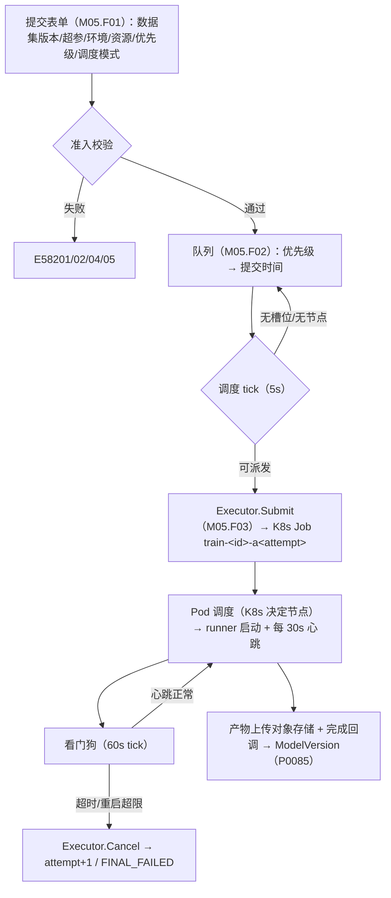
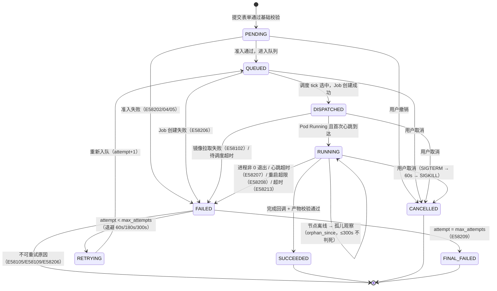
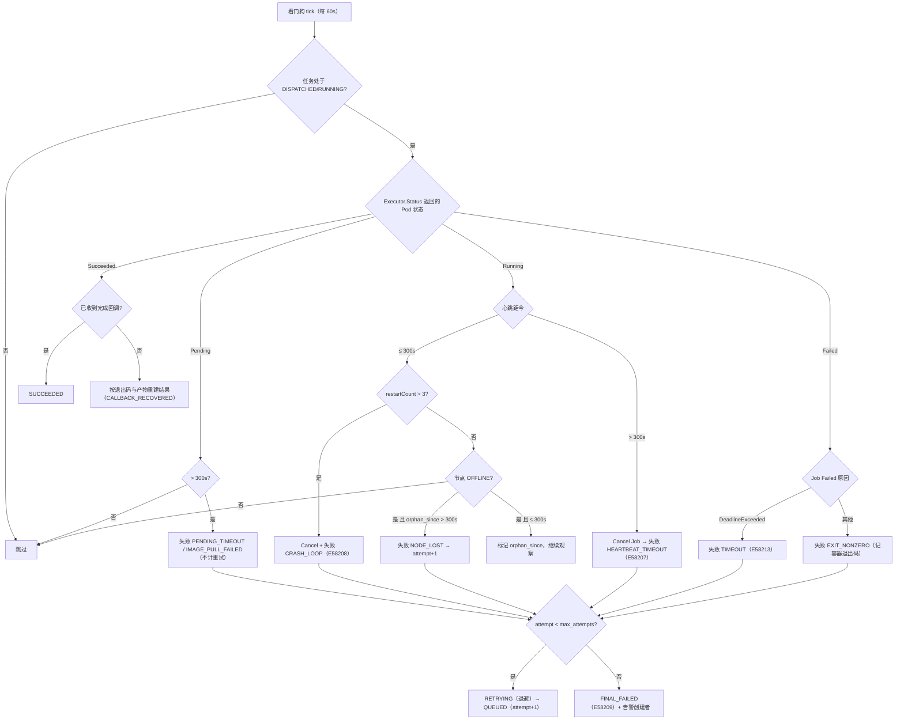
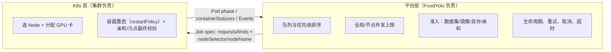
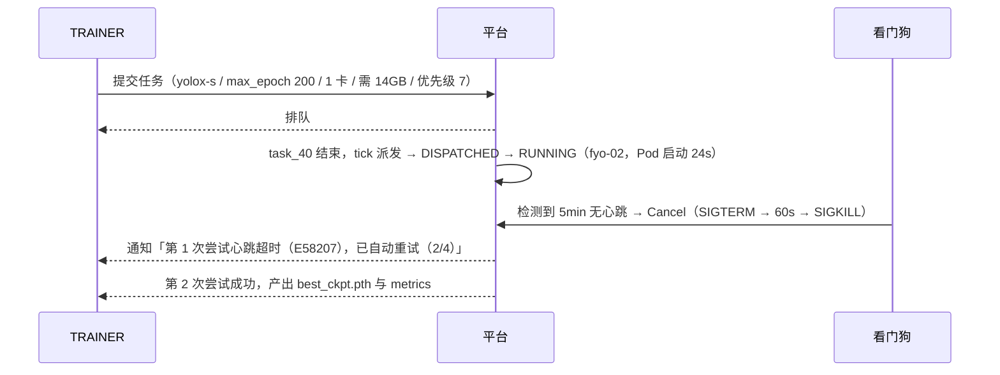

# PRD: P0082_训练任务提交与调度 (Training Task Submission & Scheduling)

| 属性 | 内容 |
| :--- | :--- |
| **文档编号** | P0082 |
| **项目名称** | FoodYolo |
| **功能模块** | M05_训练平台 · 训练任务提交与调度 |
| **当前版本** | v1.0.0 |
| **文档状态** | Approved |
| **作者** | TrainA |
| **最后更新** | 2026-10-01 |

---

## 1. 全局说明

> [!IMPORTANT]
> **核心定位**: 一次训练 = 一个 **K8s Job**。调度分两层：**平台层**负责队列、优先级、并发上限、资源准入、任务生命周期与重试；**K8s 层**负责「Pod 落到哪个 Node、GPU 卡怎么分、容器崩了怎么重启」。平台**不实现选机算法**（`PINNED` 只是把 `nodeName` 写死）。执行统一走 **`Executor` 抽象**（`Submit / Status / Cancel / StreamLogs`），首个实现为 `K8sJobExecutor`。

### 名词解释

| 术语 | 说明 |
| :--- | :--- |
| TrainTask | 训练任务实体（`train_tasks`），平台层唯一的任务记录；**重试不新建实体**，只递增 `attempt` |
| attempt / max_attempts | 当前第几次尝试（从 1 起）/ 允许的最大次数（默认 4 = 首跑 1 次 + 重试 3 次） |
| 准入 (Admission) / 队列 / 阻塞原因 | 任务进入集群前的静态检查（数据集版本、环境与驱动、显存与亲和、并发余量）；通过但未获得资源的任务集合；结构化的「为什么还没跑」 |
| 心跳 (Heartbeat) / 看门狗 (Watchdog) | 容器内 runner 每 30s 回调平台一次（epoch/step/指标摘要）；看门狗是平台侧的对账循环，检查心跳、Pod 状态、重启次数与超时 |
| 孤儿任务 (Orphan) / 宽限期 (Grace) | 节点离线但 Pod 可能仍活着的任务，300s 宽限内不判死；取消时先 SIGTERM、等 60s 让 runner 存 checkpoint，再 SIGKILL |
| 幂等回调 | 完成回调以 `(task_id, attempt)` 为幂等键，重复回调不产生副作用 |
| Executor | 执行器抽象；未来替换执行后端（远端集群 / Slurm / Ray）不改上层 |
| `activeDeadlineSeconds` / `backoffLimit` | K8s Job 级硬超时；Job 的 Pod 级重试次数，平台设为 **0**，Pod 级重试统一由平台 `attempt` 负责 |

### 统一异常处理

| Code | 场景 | 处理策略 |
| :--- | :--- | :--- |
| `E58201` | 提交参数校验失败（必填缺失 / 超参越界 / GPU 数 ≤ 0） | 表单即时标红，不创建任务；返回字段级错误明细 |
| `E58202` | 数据集版本不可用（非 `READY`/`FROZEN`，或文件已被 GC） | 提交失败；提示可选同类版本，不自动替换 |
| `E58203` | 池内无可用节点（全部 `OFFLINE`/`DISABLED`/`DRAINING`） | 任务保持 `QUEUED`（`NO_NODE`），告警中心提示节点全不可用 |
| `E58204` | 显存需求超过所有节点可用显存 | 提交阶段静态拦截，或排队中阻塞 `VRAM_INSUFFICIENT`；提示可用最大显存与建议 `batch_size` |
| `E58205` | 节点亲和 / 容忍匹配不到任何节点 | 提交失败，返回不匹配的 key/value 与池内 label 快照 |
| `E58206` | K8s Job 创建失败（API 拒绝 / RBAC 不足 / ResourceQuota） | 任务 `FAILED(DISPATCH_FAILED)`，**不消耗重试次数**；告警管理员 |
| `E58207` | 心跳超时（≥ 300s 无心跳且 Pod 为 Running） | 看门狗取消 Job → `attempt+1`；超过 `max_attempts` → `FINAL_FAILED` |
| `E58208` | 容器反复重启超过上限（`restartCount > 3`） | 取消 Job 并判本次尝试失败（`CRASH_LOOP`），进入重试流程 |
| `E58209` | 重试次数耗尽 | 转 `FINAL_FAILED`，保留全部 attempt 事件与日志归档，通知创建者 |
| `E58210` | 取消 / 终止失败（删除 Job 超时 > 90s） | 强制 `delete pod --grace-period=0 --force`；仍失败则 `FAILED(CANCEL_FAILED)` 并告警 |
| `E58211` | 完成回调非法或重复（attempt 过期 / token 错误 / 重复提交） | 幂等忽略并记 `TrainTaskEvent(CALLBACK_REJECTED)`；过期 attempt 不写任何结果 |
| `E58212` | 产物上传失败（对象存储不可写 / 空间不足 / 网络中断） | runner 重试 3 次（10s/30s/90s）；仍失败则 `ARTIFACT_UPLOAD_FAILED`，**保留 Pod 内本地路径**供人工取回 |
| `E58213` | 超过 `activeDeadlineSeconds` | K8s 置 Job `DeadlineExceeded`；判本次尝试失败（`TIMEOUT`）并按重试策略处理 |

---

## 2. 项目背景

### 背景 (Context)
平台已有数据集版本（P0041）、字符转写标注（P0065）与训练环境镜像（P0081），需要一条把它们变成模型的通路。团队 2~3 人、单机 k3s，GPU 通常 1~4 张，**算力是稀缺资源**（同一时刻可能只有一个人能真正跑训练）。因此本模块的核心不是「最大化吞吐」，而是「**让每个人清楚知道自己的任务处于什么状态、还要等多久、为什么**」。

### 问题陈述 (Problem Statement)
1. **隐性排队**：GPU 被占用时提交后没有任何反馈，只能反复刷日志。
2. **抢跑无规则**：谁先跑、能否插队没有规则，只能私下协调。
3. **任务卡死无人知**：进程 hang、节点掉线、镜像拉不动，任务永远停在「运行中」。
4. **重试语义混乱 / 取消不干净 / 产物去向不明**：三层重试叠加会把一次失败跑成好几次；直接 kill 丢 checkpoint；训练完的权重落在哪、平台怎么知道也没有契约。

### 目标与成功指标 (Goals & Success Metrics)
*   **北极星指标**: 任务从「提交」到「进入确定状态」（`RUNNING` 或明确的排队阻塞原因）**≤ 10s**，无黑盒等待。
*   **次要指标**: 卡死任务 **5min 内**被识别并进入自愈；因重试叠加导致的重复训练 = **0**；失败任务 **100%** 可在 UI 看到 `E582xx` 原因码与对应日志片段；调度器单 tick < 200ms。

### 风险与规避 (Risks & Mitigation)

| 风险 | 影响 | 规避方案 |
| :--- | :--- | :--- |
| 平台重试与 K8s 重试叠加 | GPU 被无效重复消耗 | `backoffLimit=0`；容器级仅 `restartPolicy: OnFailure` 原地重启且平台监视 `restartCount` 收口 |
| 心跳依赖平台可达 | 平台重启/网络抖动导致误杀 | 抖动窗口 5min ≫ 心跳间隔 30s；平台重启后先全量对账再启动看门狗 |
| 高优先级任务饿死低优先级 | 团队内部矛盾 | 优先级只影响排队顺序，**不做抢占**；同优先级严格 FIFO |
| 大任务长期占用唯一 GPU / 显存估算不准 | 别人无法迭代；训练中途 OOM | `activeDeadlineSeconds` + 预估耗时展示，ADMIN 可手动终止；`min_vram_gb` 外留 10% 余量，OOM 退出码独立归类用于建议 `batch_size` |

---

## 3. 价值模型

*   **方案**: 用「平台队列 + K8s Job」两层调度替代人工协调；用一条状态机与一张常量表（心跳 30s / 超时 5min / 重试 3 次）把重试、取消、自愈语义钉死；用 `Executor` 接口隔离执行细节。
*   **目标**: 用户提交后立刻知道「跑了 / 排第几 / 为什么排」；失败后能自助判断是环境、代码还是资源问题；GPU 不再被重复无效消耗。

---

## 4. 项目范围

### 功能结构图



### In Scope (包含范围)
1. **提交**：数据集版本、超参模板与覆盖、环境镜像、GPU/显存、节点亲和、优先级、调度模式、超时。
2. **状态机**：`PENDING → QUEUED → DISPATCHED → RUNNING → SUCCEEDED`；失败侧 `FAILED → RETRYING → FINAL_FAILED`；另有 `CANCELLED`。
3. **调度**：平台队列、优先级、全局与节点并发上限、显存与亲和准入。
4. **执行**：`Executor` 抽象 + `K8sJobExecutor`（Job 创建、状态映射、日志流、取消）。
5. **自愈与可见性**：心跳看门狗、容器重启上限、节点丢失与孤儿观察、超时、重试与最终失败；排队位置、阻塞原因、预计等待、任务详情。

### Out of Scope (不包含范围)
*   **运行中任务抢占**（腾资源由 ADMIN 手动终止）；**自动扩缩容 / 多集群调度**。
*   **分布式多机训练（DDP / torchrun 多 Pod）**：第一版一个任务一个 Pod（可申请多张 GPU）；**超参搜索**由人工创建多个任务实现。
*   **训练代码托管**：只记录 `code_commit_sha` 与代码包地址（见 P0081 8.2）；**指标曲线渲染与日志检索**归 P0084。

---

## 5. 业务流程

### 5.1 任务状态机



> `orphan_since` 是 `RUNNING` 的子状态标记，**不是独立状态**：节点 300s 内恢复且 Pod 仍存活时任务继续 `RUNNING` 且 `attempt` 不变（见 P0080 5.4）。

### 5.2 提交 → 调度 → 执行 → 回调

```mermaid
sequenceDiagram
    autonumber
    participant U as TRAINER
    participant API as 平台 API
    participant SCH as 调度器
    participant EX as K8sJobExecutor
    participant K8S as k3s
    participant POD as 训练 Pod (runner)
    participant OBJ as 对象存储

    U->>API: POST /train-tasks（数据集版本/超参/环境/资源/优先级）
    API->>API: 准入校验 → 冻结 env_lock 与 hyperparams
    API->>API: 创建 TrainTask(PENDING→QUEUED) + TrainTaskEvent(CREATED)
    API-->>U: 202 Accepted + 队列位置与阻塞原因

    loop 每 5s
        SCH->>API: 取队列（priority DESC, created_at ASC）
        SCH->>SCH: 槽位 / 显存 / 亲和 / 镜像缓存判定
    end
    SCH->>EX: Submit(taskId, attempt=1, spec)
    EX->>K8S: create Job train-&lt;id&gt;-a1（image@digest, nvidia.com/gpu）
    K8S-->>EX: Job created（Pod Pending → Running）
    SCH->>API: TrainTask → DISPATCHED（记 k8s_job_name）

    POD->>API: 首次心跳（epoch 0）→ TrainTask → RUNNING
    loop 每 30s
        POD->>API: POST /heartbeat（epoch/step/metrics 摘要）→ 更新 metrics_json + heartbeat_at
    end
    POD->>OBJ: 上传 YOLOX_outputs/&lt;exp&gt;/（checkpoint / train_log.txt / tensorboard/）
    POD->>API: POST /complete?attempt=1（幂等键 task_id+attempt）
    API->>API: 校验产物 → SUCCEEDED → 生成 ModelVersion（P0085）；P0086 生成评估产物
    API-->>U: 通知：训练完成（mAP50=0.912）
```

### 5.3 心跳与看门狗



### 5.4 两层调度边界



| 维度 | 平台层 | K8s 层 |
| :--- | :--- | :--- |
| 选哪台机器 | 只表达约束（`nodeSelector`；`PINNED` 时写 `nodeName`） | 真正决策（`AUTO` 模式由调度器决定） |
| 谁能跑 / 重试 / 时间上限 | 队列顺序、并发上限、显存准入；`attempt+1`（跨节点跨 Pod）；业务超时 `timeout_hours` → `activeDeadlineSeconds` | 资源 `requests` 是否可满足；容器原地重启（同 Pod）；到点杀 Pod 并置 Job `DeadlineExceeded` |

---

## 6. 用户分析

### 6.1 用户画像 (User Personas)

*   **训练工程师 (TRAINER)**：一天提交 3~10 个对比实验；诉求「提交后别让我猜，告诉我排第几、大概何时跑」，痛点是显存/环境问题要到运行中才暴露。
*   **团队负责人 (ADMIN)**：诉求「关键实验能优先跑，但不把别人饿死」「GPU 别被卡死的任务白占」；痛点是缺少可见性与干预手段。
*   **只读观察者 (VIEWER)**：看别人的训练进度与结果，不需要操作。

### 6.2 用户链路图 (User Journey Map)



---

## 7. 功能需求

### M05.F01 任务提交与校验 (Task Submission & Validation)
*   **用户故事**: 作为 TRAINER，我希望填一张表单就能提交训练，并在提交的瞬间就知道参数或资源有没有问题。

*   **表单要素**:

    | 字段 | 类型 | 必填 | 校验规则 / 默认值 |
    | :--- | :--- | :--- | :--- |
    | 任务名称 | Text | Y | 1–64 字符；同项目内重名时提示 |
    | 数据集版本 | Select | Y | 仅可选 `READY`/`FROZEN` 版本；展示样本数/类别数 |
    | 超参模板 / 覆盖 | Select + Form | N | 见 P0083：Exp 文件（`-f/--exp_file`）继承 + CLI（`max_epoch` / `batch_size` / `fp16` / `eval_interval` / `save_history_ckpt`）+ `opts` 覆盖；提交时**冻结**为 `hyperparams` |
    | 训练环境 | Select | Y | 来自 P0081 的 `READY`/`DEPRECATED` 镜像；展示 digest 与体积 |
    | GPU 数量 / 最小显存 | Number / Number(GB) | Y / N | 1 ≤ n ≤ 节点最大卡数（默认 1）；显存默认 8，按 **空闲显存 × 0.9** 判定 |
    | 节点亲和 | Key-Value 列表 | N | 如 `foodyolo.io/gpu-model=NVIDIA-GeForce-RTX-4090` |
    | 调度模式 / 目标节点 | Radio / Select | Y / 条件必填 | `AUTO`（默认，交给 K8s）/ `PINNED`（指定节点，仅 `ONLINE`/`BUSY` 可选） |
    | 优先级 / 超时 | Select / Number | Y / N | `LOW(3)/NORMAL(5，默认)/HIGH(7)/URGENT(9)`；超时默认 12 小时 → `activeDeadlineSeconds` |

*   **逻辑与业务规则**
    *   **主流程**: ① 表单校验（`E58201`）→ ② 准入校验（数据集版本、镜像可用与驱动兼容、显存与亲和可满足、并发未超限）→ ③ 冻结 `env_lock`（P0081）与 `hyperparams` → ④ 生成 `TaskExecutionSpec` → ⑤ 创建 `TrainTask(PENDING)` 并即时置 `QUEUED`，返回队列位置。
    *   **准入是静态判定**：只看当前快照，不做预占；「准入通过」不等于「马上能跑」，后者由调度器负责。
    *   **后置条件**: 任务出现在列表；若同一 `(数据集版本, 超参, 镜像 digest)` 组合已有运行中任务，提示「疑似重复提交」并要求二次确认（不阻止）。
*   **验收标准**:
    ```gherkin
    场景: 提交合法任务并立即得到排队反馈
      Given 数据集版本 ds_v12 为 FROZEN，环境 yolox-trainer:2.3.0-cu121 为 READY
      And 池内唯一 ONLINE 节点的 1 张 GPU（16GB）正被 task_40 占用
      When TRAINER 提交任务（1 卡 / 需 14GB / AUTO / NORMAL）
      Then 任务状态为 QUEUED，队列位置 1，响应时间 ≤ 10s
      And 阻塞原因显示「等待节点 foodyolo-01 释放槽位」，预计等待 41 分钟

    场景: 显存需求超出池内最大可用显存
      Given 池内节点单卡最大显存 16GB
      When 提交任务声明最小显存 24GB
      Then 提交失败并返回 E58204
      And 提示「池内最大可用显存 16GB，建议 batch_size ≤ 8」
      And 不创建 K8s Job
    ```

*   **边界情况与异常处理**:

    | 场景 | 处理 |
    | :--- | :--- |
    | 数据集版本在排队期间被删除/GC | 派发前复检，失败 `E58202`，任务 `FAILED`（不消耗重试） |
    | 重复点击提交 | 前端加载态禁用；后端按 `(dataset_version_id, hyperparams_hash, image_digest)` 在 10s 内去重 |
    | `PINNED` 目标节点在提交瞬间转为维护态 | 提交失败 `E58005`（P0080），提示可用节点，不自动改派 |
    | 超参越界（`batch_size=0` / `max_epoch=0`）或亲和条件无法匹配 | 前者字段级错误 `E58201`；后者 `E58205` 并返回不匹配的 key/value 与池内 label 快照 |

### M05.F02 调度、排队与并发准入 (Scheduling, Queueing & Admission)
*   **用户故事**: 作为 TRAINER，我希望排队有明确规则，重要实验能插队，但普通任务不会被无限期推迟。

*   **逻辑与业务规则**
    *   **排序**: `priority DESC, created_at ASC`；同优先级先到先得；**不做抢占**。
    *   **派发条件**（全部满足）: ① 存在 `status ∈ {ONLINE, BUSY}` 的节点（`PINNED` 时仅考察目标节点）；② 节点已用槽位 + 1 ≤ `max_concurrent_tasks`；③ 全局运行中任务数 < `max_concurrent_tasks_global`（默认 = 池内槽位总数，可下调）；④ `min_vram_gb ≤ 节点单卡空闲显存 × 0.9`；⑤ 满足亲和（`AUTO`）或目标节点可用（`PINNED`）；⑥ 镜像已缓存，或节点 ImageFS 余量 ≥ 镜像体积 × 1.2。
    *   **阻塞原因码**: `NO_NODE` / `NO_SLOT` / `VRAM_INSUFFICIENT` / `AFFINITY_NO_MATCH` / `IMAGE_NOT_CACHED` / `RUNTIME_NOT_READY` / `GLOBAL_CONCURRENCY_LIMIT`。
    *   **预计等待时间**: 基于当前占用任务的历史平均耗时估算，区间呈现（如「约 35~50min」）并标注「仅供参考」。
    *   **调度 tick**: 每 5s 一次；有任务结束/取消时事件驱动立即触发一次。
    *   **全局并发上限**: 默认等于池内可用槽位总数；ADMIN 可下调以留算力给推理服务（P0110），下调不打断运行中任务。
*   **验收标准**:
    ```gherkin
    场景: 高优先级任务插队但不抢占
      Given 队列中有 task_A（NORMAL，09:00）与 task_B（NORMAL，09:05），当前无空闲槽位
      When 09:10 提交 task_C（URGENT），槽位在 09:20 释放
      Then 下一个被派发的是 task_C
      And task_A 全程保持 QUEUED（未被中断，也未被判失败）

    场景: 阻塞原因可解释且不静默失败
      Given 池内唯一节点因磁盘不足被标记 UNHEALTHY
      When 提交任务
      Then 任务保持 QUEUED 且阻塞原因为 NO_NODE
      And 任务详情可跳转到节点页查看具体原因（ImageFS 可用 12GB）
      And 该任务不会被自动判为失败
    ```

*   **边界情况与异常处理**:

    | 场景 | 处理 |
    | :--- | :--- |
    | 排队中节点全部转为 OFFLINE | 保持 QUEUED（`NO_NODE`）并触发告警（P0132）；**不自动失败** |
    | 排队中镜像被标记 `TAINTED` | 复检失败，任务 `FAILED(IMAGE_TAINTED)`，提示另选环境（不消耗重试） |
    | 排队中目标节点被强制排水 | `PINNED` 任务 `FAILED(TARGET_NODE_UNAVAILABLE)`；`AUTO` 任务重新选节点 |
    | 同优先级任务积压 / 调度 tick 与派发并发 | 严格 FIFO 并展示「前面还有 N 个任务」；派发时对 `TrainTask.id` 加行锁（`SELECT … FOR UPDATE SKIP LOCKED`）保证幂等 |

### M05.F03 任务生命周期、看门狗与执行器 (Lifecycle, Watchdog & Executor)
*   **用户故事**: 作为 TRAINER，我希望任务卡死能自动被发现、失败能自动重试、取消时能尽量保存进度，并且我随时能看到日志。

*   **关键常量（默认值）**

    | 常量 | 值 | 理由 |
    | :--- | :--- | :--- |
    | `SCHEDULER_TICK` / `WATCHDOG_TICK` | 5s / 60s | 灵敏但不对单机 DB 造成压力；看门狗取 2 倍心跳周期避免抖动 |
    | `HEARTBEAT_INTERVAL` / `HEARTBEAT_TIMEOUT` | 30s / 300s | 与指标刷新同频；超时容忍一个 epoch 的 IO 抖动，又能 5min 内释放 GPU |
    | `MAX_RETRIES` / `RETRY_BACKOFF` | 3（`max_attempts=4`）/ 60s·180s·300s | 覆盖偶发 OOM 与节点抖动；指数退避给节点冷却与镜像重试留时间 |
    | `CANCEL_GRACE_PERIOD` / `CANCEL_CONFIRM_TIMEOUT` | 60s / 90s | 前者足够 runner 保存 `latest_ckpt.pth`；后者超时则强制删除 Pod |
    | `PENDING_TIMEOUT` / `CONTAINER_RESTART_LIMIT` | 300s / 3 | 拉取或待调度超 5min 判失败（不计重试）；容器原地重启超 3 次交回平台层 |
    | `ORPHAN_GRACE` / `TTL_AFTER_FINISHED` | 300s / 2 天 | 孤儿宽限与 P0080 节点离线判定对齐；Pod 保留 2 天便于拉日志 |

*   **Pod 重启 vs 平台重试的边界（必须分清，否则重复消耗 GPU）**

    | 层级 | 触发条件 | 处理者 | 计数载体 | 结果 |
    | :--- | :--- | :--- | :--- | :--- |
    | 容器级 | 进程非 0 退出 / OOM Kill | kubelet（`restartPolicy: OnFailure`） | `restartCount` | **原地重启**，Pod 与节点不变，`attempt` 不变 |
    | 容器级收口 | `restartCount > 3` | 平台看门狗 | — | `Cancel` → 本次尝试失败（`CRASH_LOOP`）→ `attempt+1` |
    | Pod 级 | Pod 被驱逐 / 节点不可用 | K8s（`backoffLimit: 0`） | — | Job `Failed` → 平台按失败处理（`attempt+1`） |
    | 平台级 | 心跳超时 / 节点丢失 / 节点维护 | 平台看门狗 | `TrainTask.attempt` | 取消旧 Job → `attempt+1` 重排队（可换节点） |
    | 时间级 | 超过 `activeDeadlineSeconds` | K8s | — | Job `DeadlineExceeded` → 失败（有 checkpoint 则走续训 P0087） |

*   **Executor 抽象（首个实现：`K8sJobExecutor`）**

    ```
    interface Executor {
      submit(spec: TaskExecutionSpec): Promise<ExecutorHandle>
      status(handle: ExecutorHandle): Promise<TaskRuntimeStatus>
      streamLogs(handle: ExecutorHandle, opts: {sinceSeconds?: number, follow: boolean}): AsyncIterable<LogLine>
      cancel(handle: ExecutorHandle, opts: {gracePeriodSeconds: number}): Promise<CancelResult>
    }
    ```

    | 能力 | `K8sJobExecutor` 实现 | 未来替换映射（不改上层） |
    | :--- | :--- | :--- |
    | `submit` | `BatchV1Api.createNamespacedJob`（`foodyolo` 命名空间） | 远端集群：换 kubeconfig；Slurm / Ray：新增实现 |
    | `status` | Job `status` + Pod `phase` + `containerStatuses[].restartCount` | 同上 |
    | `streamLogs` | `CoreV1Api.readNamespacedPodLog`（follow） | 远端日志网关 |
    | `cancel` | `deleteNamespacedJob(propagationPolicy=Background, gracePeriodSeconds=60)` | 对应的作业取消 API |

    `TaskRuntimeStatus` 统一返回 `{ phase: PENDING|RUNNING|SUCCEEDED|FAILED, reason?, exitCode?, restartCount }`，**上层只看这个结构**，不感知 K8s 字段。

*   **执行契约（数据进 / 产物出）**
    *   **数据进**: initContainer 用平台签发的短期 presign URL 拉取数据集（COCO 结构）到 `/workspace/dataset`；大数据集走 hostPath 缓存 + nodeAffinity（详见 P0081 8.2）。
    *   **产物出**: YOLOX 训练进程在容器内写 **`YOLOX_outputs/<experiment_name>/`**（平台通过 `-expn` 固定为 `<train_task_id>-a<attempt>`，与 `TrainTask.output_dir` 一致），runner 上传该目录并登记 `ManagedFile(owner_type=TRAIN_TASK)`，随后回调完成接口：`latest_ckpt.pth`（每 epoch 覆盖，续训唯一依据）、`best_ckpt.pth`（AP50-95 提升时）、`epoch_<n>_ckpt.pth`（仅 `save_history_ckpt=true` 时）、`last_mosaic_epoch_ckpt.pth`（进入 no-aug 阶段）、`train_log.txt`（P0084 曲线主数据源）、`tensorboard/`（可选事件目录，供交叉校验）。
    *   **平台生成物（不由训练容器产出）**: `eval_<epoch>.json` / `PR_curve.png` / `confusion_matrix.png` 由平台在训练结束后自绘（YOLOX evaluator 仅返回 `(ap50_95, ap50, summary)`），落 `ManagedFile(owner_type=EVALUATION_TASK)`，归 **P0086** 负责；`vis_res/` 属 `tools/demo.py` 预测可视化，与本模块无关。
    *   **回调幂等**: 幂等键 `(task_id, attempt)`；重复回调返回 200 且不重复写结果；过期 `attempt` 的回调直接丢弃并记 `CALLBACK_REJECTED`。
    *   **回调丢失兜底**: 看门狗发现 Job `Succeeded` 但无回调时，按 Pod 退出码 + 对象存储产物重建结果，标记 `CALLBACK_RECOVERED`。

*   **验收标准**:
    ```gherkin
    场景: 心跳超时触发自愈重试
      Given 任务 task_51 处于 RUNNING（attempt 1/4）且心跳正常
      When 容器内进程 hang 住，超过 300 秒无心跳（Pod 仍 Running）
      Then 看门狗在 60s tick 内取消该 Job（SIGTERM → 60s → SIGKILL）
      And 记录 TrainTaskEvent(ATTEMPT_FAILED, reason=HEARTBEAT_TIMEOUT, error_code=E58207)
      And 任务转为 RETRYING，退避 60s 后以 attempt=2 重新入队并可能落到另一节点

    场景: 重试耗尽转为最终失败
      Given 任务 attempt = 4 且本次尝试再次失败
      When 看门狗判定本次尝试失败
      Then 任务转为 FINAL_FAILED（E58209）
      And 保留 4 次 attempt 的事件链与日志归档
      And 通知创建者，且不再自动重试

    场景: 取消时保存进度
      Given 任务处于 RUNNING 且 runner 处理 SIGTERM
      When TRAINER 点击 [取消]
      Then 容器收到 SIGTERM，runner 保存 latest_ckpt.pth 后退出
      And 60 秒内未退出则收到 SIGKILL
      And 任务状态变为 CANCELLED，已上传产物仍保留
    ```

*   **边界情况与异常处理**:

    | 场景 | 处理 |
    | :--- | :--- |
    | 平台自身重启（k3s 上 Deployment 重启） | 启动后先全量对账（读所有非终态任务的 Job/Pod），再启动看门狗；**不对账不判失败** |
    | runner 无法回调平台 | 本地缓冲心跳与完成事件（上限 200 条）并继续训练；恢复后补发，最终结果以对象存储产物为准 |
    | 完成回调先于产物上传完成到达 | 回调携带产物 `ManagedFile` 状态；未 `COMMITTED` 视为未完成，平台回 `409` 让 runner 重试 |
    | 看门狗与用户手动重试并发触发 | `attempt` 递增用乐观锁（`WHERE attempt = :expected`），冲突方放弃 |
    | 用户对 `FINAL_FAILED` 点击「再试一次」 | **新建 `TrainTask`**，携带原 `env_lock`/`hyperparams`/数据集版本，不复活旧实体 |
    | 节点在运行中进入维护（draining） | 不打断运行中任务（P0080）；任务自然结束或超时后照常走失败/重试 |
    | 取消正在排队的任务 / 重复点取消 | 排队任务直接置 `CANCELLED`（不调用 Executor）；重复取消幂等返回 200 |
    | Pod 被 TTL 清理后请求实时日志 | 返回归档日志（`log_archive_file_id`，P0084）并提示「实时流已不可用」 |

---

## 8. 技术架构与数据模型

### 8.1 数据实体

#### Table: `train_tasks`（TrainTask）

| 字段名 | 类型 | 必填 | 说明 | 约束 |
| :--- | :--- | :--- | :--- | :--- |
| `id` | UUID | Y | 主键 | PK |
| `name` | String(64) | Y | 任务名称 | |
| `dataset_version_id` | UUID | Y | 数据集版本 | FK → dataset_versions.id |
| `hyperparam_template_id` | UUID | N | 超参模板 | FK → hyperparam_templates.id |
| `hyperparams` | JSONB | Y | 提交时**冻结**的超参快照（YOLOX 参数面，见 P0083） | 不可修改 |
| `environment_image_id` / `image_digest` | UUID / String(80) | Y | 训练环境与其固化 digest（执行依据） | FK → environment_images.id |
| `env_lock` | JSONB | Y | 环境锁快照（P0081 M05.F02） | 不可修改 |
| `status` | Enum | Y | `PENDING/QUEUED/DISPATCHED/RUNNING/SUCCEEDED/FAILED/RETRYING/FINAL_FAILED/CANCELLED` | default PENDING |
| `scheduling_mode` / `target_node_id` | Enum / UUID | Y / N | `AUTO`（默认）/ `PINNED`；PINNED 时必填目标节点 | FK → train_nodes.id |
| `node_selector_json` / `priority` | JSONB / Int | N / Y | 亲和条件；优先级 0–9（默认 5） | |
| `requested_gpu_count` / `min_vram_gb` / `timeout_hours` | Int | Y | GPU 数（≥1）/ 最小显存（默认 8）/ 超时小时（默认 12） | |
| `attempt` / `max_attempts` | Int | Y | 从 1 起；默认 `max_attempts = 4` | 1 ≤ attempt ≤ max_attempts |
| `queue_position` / `block_reason` | Int / String(32) | N | 队列位置快照；阻塞原因码（见 M05.F02） | 仅 QUEUED 有效 |
| `executor` / `k8s_namespace` / `k8s_job_name` / `pod_name` | String | Y / N | 执行器标识（默认 `K8S_JOB`）与执行句柄 | |
| `node_id` / `assigned_gpu_count` | UUID / Int | N | 实际落地节点（AUTO 下由 K8s 决定后回填）与分配卡数 | FK → train_nodes.id |
| `heartbeat_at` / `orphan_since` | Timestamptz | N | 最近心跳；孤儿观察起点 | |
| `dispatched_at` / `started_at` / `finished_at` | Timestamptz | N | 生命周期时间点 | |
| `metrics_json` | JSONB | Y | 汇总指标 + epoch 序列：`map50 / map50_95 / map75 / precision / recall / f1 / per_class_maps / confusion_matrix / epochs[]` | 由心跳与回调更新 |
| `output_dir` / `log_archive_file_id` | String(512) / UUID | N | 产物键前缀（`YOLOX_outputs/<train_task_id>-a<attempt>/`）；`train_log.txt` 归档 | FK → managed_files.id |
| `log_bytes` / `log_line_count` / `log_level_counts` | BigInt / Int / JSONB | N | 日志规模统计（P0084 使用） | |
| `last_error_code` / `last_error_message` | String(16) / Text | N | 最近失败原因（`E582xx`） | |
| `created_by` | UUID | Y | 创建者 | FK → users.id |
| `created_at` / `updated_at` / `deleted_at` | Timestamptz | Y/N | 通用字段 | |

#### Table: `train_task_events`（TrainTaskEvent，attempt 级事件链）

| 字段名 | 类型 | 必填 | 说明 |
| :--- | :--- | :--- | :--- |
| `id` | BigSerial | Y | 主键 |
| `task_id` / `attempt` | UUID / Int | Y | 所属任务与尝试次数（FK → train_tasks.id） |
| `event_type` | Enum | Y | `CREATED / QUEUED / DISPATCHED / STARTED / HEARTBEAT_LOST / ORPHAN_MARKED / ORPHAN_CLEARED / CONTAINER_RESTART / ATTEMPT_FAILED / RETRY_SCHEDULED / SUCCEEDED / CANCELLED / CALLBACK_REJECTED / CALLBACK_RECOVERED` |
| `reason` / `error_code` / `detail_json` | String(32)/String(16)/JSONB | N | 如 `HEARTBEAT_TIMEOUT`、`NODE_LOST`、`CRASH_LOOP`；`E582xx`；上下文（退出码、Pod 事件、队列位置等） |
| `created_at` | Timestamptz | Y | 发生时间 |

> 心跳与指标**不另建时序表**：心跳只更新 `train_tasks.heartbeat_at` 与 `metrics_json.epochs[]`；完整曲线由 P0084 解析随 `YOLOX_outputs/` 归档的 `train_log.txt`（可选交叉校验 `tensorboard/`）后绘制。

### 8.2 K8s Job 规格（`K8sJobExecutor.submit` 产出）

```yaml
apiVersion: batch/v1
kind: Job
metadata:
  name: train-<taskId>-a<attempt>            # namespace: foodyolo
  labels: { foodyolo.io/task-id: "<taskId>", foodyolo.io/attempt: "<attempt>" }
spec:
  backoffLimit: 0                            # Pod 级重试交给平台 attempt
  activeDeadlineSeconds: <timeout_hours * 3600>
  ttlSecondsAfterFinished: 172800            # 保留 2 天便于拉日志
  template:
    spec:
      restartPolicy: OnFailure               # 容器级原地重启；看门狗监视 restartCount
      runtimeClassName: nvidia
      nodeName: <PINNED 目标节点；AUTO 不设置>
      nodeSelector: <AUTO 亲和条件>
      tolerations: [{ key: "foodyolo.io/maintenance", operator: "Exists", effect: "NoSchedule" }]
      initContainers:
        - name: fetch-dataset                # 用 presign URL（24h）拉数据集到 /workspace
          image: foodyolo/fetcher:1.2@sha256:<digest>
          command: ["/bin/sh","-c","curl -fsSL -o /w/ds.tar.zst \"$DATASET_URL\" && tar --zstd -xf /w/ds.tar.zst -C /workspace"]
      containers:
        - name: trainer
          image: <registry>/<repo>@sha256:<digest>     # 固定 digest，不用 tag
          imagePullPolicy: IfNotPresent
          command: ["/opt/foodyolo/runner.sh"]
          env: FOODYOLO_TASK_ID / FOODYOLO_ATTEMPT / FOODYOLO_CALLBACK_URL / FOODYOLO_CALLBACK_TOKEN(Secret)
          resources:
            requests: { nvidia.com/gpu: "<n>", cpu: "4", memory: "16Gi" }
            limits:   { nvidia.com/gpu: "<n>", memory: "32Gi" }
          volumeMounts: workspace(emptyDir, 120Gi) → /workspace；dataset-cache(hostPath, 可选) → /dataset
```

### 8.3 K8s 状态 → TrainTask 状态映射

| K8s 观测 | 平台状态 | 说明 |
| :--- | :--- | :--- |
| Job 已创建，Pod `Pending` | `DISPATCHED` | `Pending` > 300s → 失败（`PENDING_TIMEOUT` / `IMAGE_PULL_FAILED`，不计重试） |
| Pod `Running` 且收到首次心跳 | `RUNNING` | 无心跳但 Pod Running → 看门狗按 `HEARTBEAT_TIMEOUT` 处理 |
| Job `Complete` | `SUCCEEDED` | 需完成回调；缺失时由看门狗按产物重建（`CALLBACK_RECOVERED`） |
| Job `Failed`（`BackoffLimitExceeded` / 其他） | `FAILED` | `backoffLimit=0`，通常代表 Pod 级失败；记容器退出码 |
| Job `Failed`（`DeadlineExceeded`） | `FAILED` | `TIMEOUT`（`E58213`） |
| Pod 所在 Node `NotReady` | 观察 → `FAILED` | 300s 宽限后 `NODE_LOST`（`attempt+1`） |

---

## 9. UI/UX 规格说明

### 9.1 提交表单与任务列表

```text
+------------------------------------------------------------------------------------------+
|  训练平台 > 新建训练任务     数据集版本* [ds_v12 食品日期检测 (FROZEN, 8,420 张) ▾]      |
|  超参模板 [yolox-s-baseline ▾]  超参覆盖 [展开 12 项]  训练环境* [yolox-trainer:2.3.0 ▾] |
|  GPU 数量* [1]  最小显存 [14] GB  超时 [12] 小时                                         |
|  调度模式* (•) 自动调度（交给 K8s）  ( ) 指定节点 [foodyolo-02 ▾]                         |
|  优先级* [HIGH ▾]   节点亲和 [+ 添加]  foodyolo.io/gpu-model = RTX-4090                  |
|  预估: 阻塞「等待 foodyolo-01 释放槽位」，约 35~50min            [取消]  [提交]          |
+----------------+--------------+-----------------+-------+--------+--------------+--------+
| 任务            | 数据集版本   | 状态            | 尝试  | 节点   | 进度/指标     | 操作   |
+----------------+--------------+-----------------+-------+--------+--------------+--------+
| 日期检测-s-v3   | ds_v12       | 🟢 RUNNING      | 2 / 4 | fyo-02 | E78/200      | [日志] |
| 日期检测-s-v2   | ds_v11       | 🟡 QUEUED       | 1 / 4 | -      | #1 等待      | [取消] |
|                |              | 阻塞 NO_SLOT（等 fyo-01 释放）  约 35~50m                         |
| 日期检测-n-v1   | ds_v12       | 🔴 FINAL_FAILED | 4 / 4 | fyo-01 | E58207 心跳超时 | [再试一次] |
+----------------+--------------+-----------------+-------+--------+--------------+--------+
| 队列 2 个任务 · 池内槽位 2/2 占用中 · 全局并发上限 2                                     |
+------------------------------------------------------------------------------------------+
```

### 9.2 交互元素

| 元素 | 类型 | 状态 | 行为 |
| :--- | :--- | :--- | :--- |
| [提交] | Button | Default/Loading/Disabled | 校验未过时 Disabled；提交中防重复；成功跳转任务详情 |
| 调度模式切换 | Radio | AUTO(默认)/PINNED | 切到 PINNED 展开节点选择，并提示「节点不可用时任务直接失败，不会改派」 |
| 队列位置 / 状态角标 / 进度 | Badge / Text | QUEUED / 9 态 / RUNNING | 悬停显示 `block_reason` 与预计等待区间；终态悬停显示 `last_error_code`；运行时显示 `epoch n/N` 与最近心跳的 mAP50 |
| [取消] / [再试一次] | Button (Danger) / Button | QUEUED·RUNNING / 仅终态 | 取消：二次确认并说明「先尝试保存 checkpoint，最多 60 秒」；再试一次：复用原环境/超参/数据集**新建任务** |
| [日志] | Button | DISPATCHED 及之后 | 打开实时日志抽屉（`Executor.streamLogs`，follow） |

---

## 10. 非功能性需求 (NFR)

*   **性能**: 提交接口 P95 < 300ms（含准入校验）；调度 tick ≤ 200ms（≤50 个排队任务）；状态查询 P95 < 200ms；心跳写入 ≤ 1 次/任务/30s。
*   **可靠性**: 平台重启后必须先对账再判失败；看门狗与调度器均为幂等循环；`attempt` 递增使用乐观锁防并发重复重试。
*   **安全**: 提交/取消/重试仅 `TRAINER` 与 `ADMIN`，`VIEWER` 只读；回调接口使用按任务签发的一次性 token 并校验 `(task_id, attempt)`；presign URL 有效期 24h 且只读。
*   **可观测性与兼容性**: 每次尝试的事件链可查、失败必有 `error_code`，`FINAL_FAILED`、节点全不可用、队列积压 > 5 个任务时告警（P0132）；依赖 k3s ≥ v1.28，`Executor` 抽象保证更换执行后端不改上层，单机目标 ≤ 4 张 GPU / ≤ 50 个排队任务（并发与重试常量可配置，默认值见 M05.F03）。

---

## 附录: 已确认的设计决策

| 决策项 | 结论 |
| :--- | :--- |
| 执行模型 / 调度分层 | 一次训练 = **一个 K8s Job**；平台层（队列/优先级/并发/准入/生命周期）+ K8s 层（选 Node/分卡/重启容器），平台不自研选机 |
| 指定节点 | `scheduling_mode = AUTO(默认) / PINNED` + `target_node_id`；PINNED 失败不改派 |
| 执行抽象 | `Executor = Submit / Status / Cancel / StreamLogs`；首个实现 `K8sJobExecutor` |
| 重试语义与常量 | 唯一计数载体是 `TrainTask.attempt`；`backoffLimit=0`；容器级仅原地重启且受 `restartCount ≤ 3` 收口。常量：心跳 30s / 看门狗 60s / 心跳超时 5min / 重试 3 次（`max_attempts=4`）/ 取消宽限 60s / 退避 60-180-300s |
| 优先级与并发 | 0–9（默认 5）只影响排队、**不抢占**；全局上限默认 = 池内槽位总数（节点级由 P0080 控制）；显存准入 = `min_vram_gb ≤ 单卡空闲显存 × 0.9` |
| 数据进出容器 | 进：initContainer + presign URL 到 emptyDir（大数据集 hostPath 缓存 + nodeAffinity，见 P0081 8.2）；出：`YOLOX_outputs/<experiment_name>/` 下的 `latest_ckpt.pth` / `best_ckpt.pth` / `epoch_<n>_ckpt.pth`（`save_history_ckpt`）/ `last_mosaic_epoch_ckpt.pth` / `train_log.txt` / `tensorboard/`，上传为 `ManagedFile(owner_type=TRAIN_TASK)` 后回调 |
| 评估产物 / 数据集格式 | `eval_<epoch>.json` / `PR_curve.png` / `confusion_matrix.png` 为**平台自绘**（`owner_type=EVALUATION_TASK`，由 P0086 生成）；平台生成 **COCO** 结构并通过 Exp 的 `data_dir` / `train_ann` / `val_ann` / `test_ann` 对接（不用 `data.yaml`） |
| 取消语义 / "再试一次" | `SIGTERM` → 60s 宽限（存 `latest_ckpt.pth`）→ `SIGKILL`，产物保留；「再试一次」**新建 `TrainTask`**，不复活旧实体 |
| 指标承载 | 不建时序指标表：心跳更新 `heartbeat_at` 与 `metrics_json`，曲线由 P0084 解析归档的 `train_log.txt`（可选 `tensorboard/`） |
| E-code / 功能编号 | E 码 `E58201–E58213`（`E`+模块 5+P 号后两位 `82`+两位流水）；功能号 `M05.F01–F03`（每篇从 `F01` 起） |

---

## 关联文档

*   **P0080_计算节点与资源池**: 节点状态、槽位、GPU 容量与亲和来源；节点离线时任务的孤儿处置
*   **P0081_训练环境与镜像**: `env_lock`、镜像 digest 与 GPU 运行时前置校验
*   **P0083_超参数与训练模板**: YOLOX 参数面与模板，本模块冻结其快照
*   **P0084_训练日志与指标看板**: 实时日志流（`Executor.streamLogs`）与 `tensorboard/` 曲线解析
*   **P0085_模型仓库与 Lineage** / **P0086_模型评估**: 由完成回调生成 `ModelVersion` 与评估产物
*   **P0087_断点续训与失败重试**: 消费 `latest_ckpt.pth` 续训，本模块提供 attempt 与事件链
*   **P0132_告警中心**: `FINAL_FAILED`、队列积压、节点全不可用的告警规则

---

## Changelog

| 版本 | 日期 | 作者 | 变更说明 |
| :--- | :--- | :--- | :--- |
| v0.1.0-draft | 2026-10-01 | TrainA | 初稿：`docker run --gpus all` 执行器方案 |
| v0.9.0-draft | 2026-10-01 | TrainA | 架构更正：执行层改为 k3s + K8s Job，明确两层调度边界，首实现改为 `K8sJobExecutor` |
| v0.9.5-draft | 2026-10-01 | TrainA | 训练后端改为 YOLOX；新增 `scheduling_mode=PINNED`；E 码改 `E582xx` |
| v0.9.7-draft | 2026-10-01 | TrainA | 按源码核验修正 YOLOX 产物（`YOLOX_outputs/<exp>/`）与参数名；移出平台自绘评估产物；删除心跳时序表 |
| v1.0.0 | 2026-10-01 | TrainA | 正式发布：状态机、常量表、重试边界、Job 规格与回调幂等定稿 |
