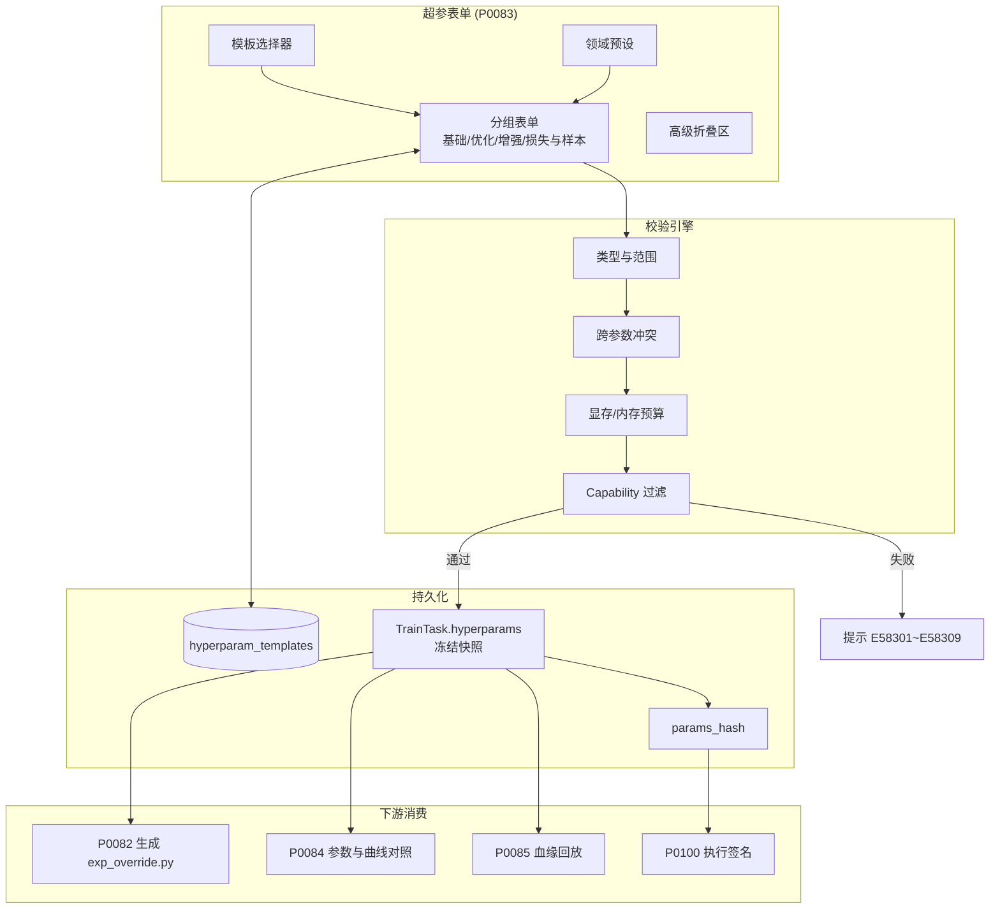
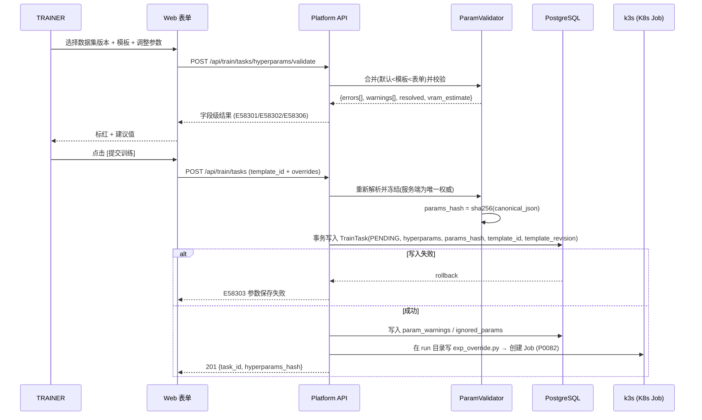
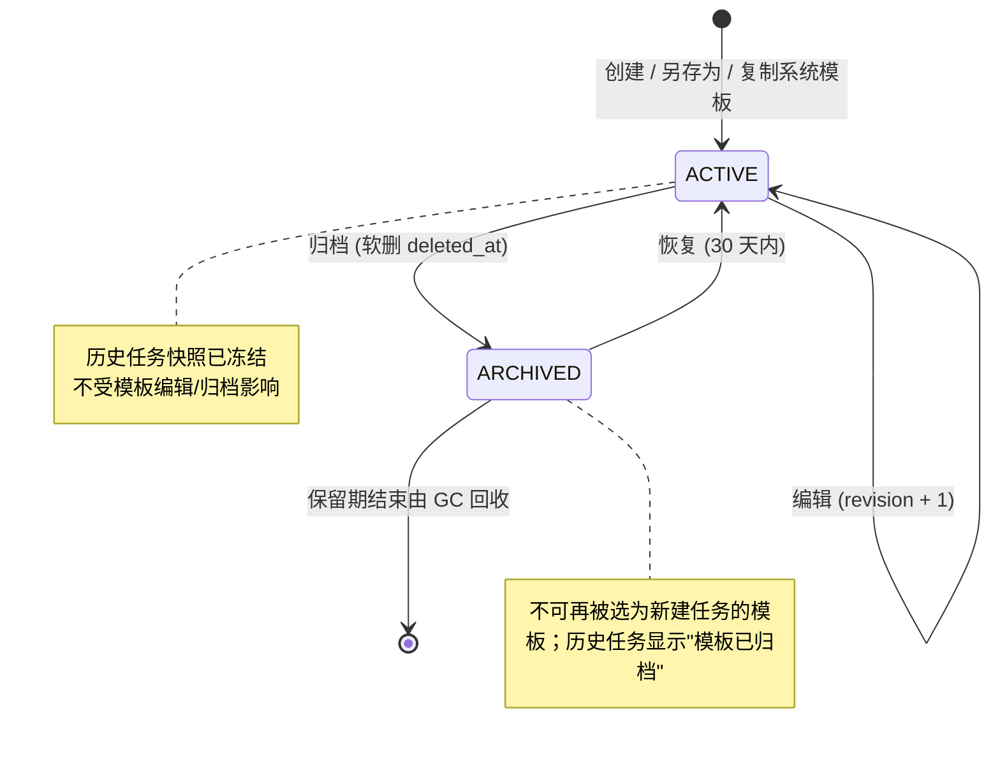
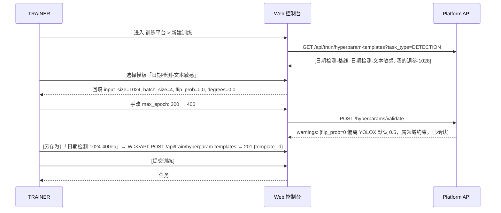

# PRD: P0083_超参数与训练模板 (Hyperparameters & Training Templates)

| 属性 | 内容 |
| :--- | :--- |
| **文档编号** | P0083 |
| **项目名称** | 轻眸识刻 |
| **功能模块** | M05_训练平台 |
| **当前版本** | v1.0.0 |
| **文档状态** | Draft |
| **作者** | 轻眸识刻 Team |
| **最后更新** | 2026-10-01 |

---

## 1. 全局说明

> [!IMPORTANT]
> **核心定位**: 把训练后端（**首个实现 = YOLOX，Apache-2.0**；预留 MMDetection / RT-DETR(lyuwenyu) 适配器）的参数面收敛为**分组表单 + 校验引擎 + 可复用模板 + 提交时冻结快照**。
> 平台不追求"暴露全部参数"，而追求"每次训练都可复现、每次调节都可沉淀"：任何一个 `ModelVersion` 都能反查出它当时用的是哪套参数。

### 名词解释

*   **HyperparamTemplate（超参模板）**: 具名可复用的超参集合，含名称、描述、适用任务类型、来源模板与 scope。
*   **Exp File（实验配置）**: YOLOX 以 Python `Exp` 类描述训练配置。平台不拼 CLI 字符串，而是按快照生成 `exp_override.py`（继承基类覆盖字段），保证可复现、可读、可审计。
*   **参数快照 (Hyperparams Snapshot)**: 提交瞬间解析合并后的**完整生效参数**，序列化 JSONB 冻结写入 `TrainTask.hyperparams`，此后与模板解耦、永不改变。
*   **参数解析优先级 / 平台强制注入**: `平台默认值 < 模板 params < 表单覆盖 < 平台强制注入`；后者指 `data_dir / train_ann / val_ann / output_dir / exp_name / device`，用户不可编辑。
*   **参数指纹 (params_hash)**: 对规范 JSON（key 升序、数值规范化）取 `sha256`，用于复现校验、流水线执行签名与去重。
*   **自动批大小 (AutoBatch)**: `batch_size = -1` 时平台按显存推导并回写实际值，**仅支持单卡**。
*   **Trainer Backend（训练后端）**: 可替换的训练框架适配层，须声明 **Capability 表**（支持哪些参数、取值范围、适用任务类型）；其参数定义集版本为 `HYPERPARAM_SCHEMA_VERSION`（首版 `det-yolox-v1`），后端参数面变化时递增，历史快照按写入时版本解读。
*   **领域预设 (Task Preset)**: 针对"生产日期检测"这类**文本敏感**任务的推荐参数组合。日期区域含字符，水平镜像与旋转破坏语义，故对 `flip_prob / degrees` 有强约束。
*   **run 目录 (`output_dir`)**: 单机 k3s 下与训练 Pod 共享的 hostPath/PVC 目录（平台侧只读挂载）；`exp_override.py`、checkpoint 与日志都落在这里。字段名与 P0082 的 `train_tasks.output_dir` 一致。

### 统一异常处理

| Code | 场景 | 处理策略 |
| :--- | :--- | :--- |
| `E58301` | 参数类型或取值越界（`input_size=600`、`max_epoch=0`） | 表单即时标红，展示 `{字段, 实际值, 期望范围}`，阻断提交 |
| `E58302` | 参数互相冲突（`warmup_epochs + no_aug_epochs >= max_epoch`、`batch_size=-1` 且多卡） | 阻断并给修正建议；可降级为非阻断的场景记入快照 `param_warnings` |
| `E58303` | 参数快照写入失败（事务失败 / JSONB 超长） | 回滚任务创建，提示"参数保存失败，请重试"，写审计日志 |
| `E58304` | 模板名重复，或试图修改/删除系统模板 | 阻断；提示改用"另存为"或"复制系统模板" |
| `E58305` | 模板与当前任务/数据集不兼容（`cache=ram` 超出内存预算） | 阻断，提示预估需求与可用量，建议改 `cache=disk` 或关闭 |
| `E58306` | 显存预算不足（`batch_size × input_size²` 超出所选 GPU 显存） | 阻断，给出"建议 `batch_size ≤ N` / `input_size ≤ M`" |
| `E58307` | 出现 schema 未定义的参数键（注入 / 陈旧模板残留） | 拒绝该键并记入 `ignored_params`，不阻断其余合法参数 |
| `E58308` | 引用的模板已被删除或不可见（跨用户 PERSONAL 模板） | 提示模板不可用，回退"仅用平台默认值"，要求显式确认 |
| `E58309` | 训练后端不支持该参数（Capability 不匹配，如 OBB 专属的 `angle` 出现在 DETECTION 任务中） | 前端置灰；模板携带时提交阶段移入 `ignored_params` 并提示 |
| `E58310` | 快照 `params_hash` 与任务详情页回放不一致 | 阻断"复现训练"，触发 `Alert`（`HYPERPARAM_TAMPERED`），提示联系管理员 |

---

## 2. 项目背景

### 背景 (Context)
轻眸识刻 训练闭环为 `数据集版本 → 超参 → 训练任务 → 模型版本`。P0082 定义提交与调度（一次训练 = 一个 k3s K8s Job），P0085 定义模型仓库。训练后端已定稿为 **YOLOX (Apache-2.0)**，其有效旋钮横跨模型结构（`exp_file`）、优化（`basic_lr_per_img/weight_decay/momentum/warmup_epochs`）、增强（`mosaic_prob/mixup_prob/degrees/shear/translate`）、评估与显存策略（`test_conf/nmsthre/cache/occupy`）四类，共 30+ 个；而团队只有 2~3 人，没有专职 MLOps 维护参数文档。

### 问题陈述 (Problem Statement)
1.  **参数靠脑记**: 参数散落在 `exp` 文件与 CLI 中，手敲易漏 `no_aug_epochs`、写错 `weight_decay`，实验之间不可比。
2.  **不可复现**: `ModelVersion` 只有权重文件，半年后没人记得"这版是哪套参数、哪个 exp、哪份数据训出来的"。
3.  **非法组合发现太晚**: `batch_size` 与 `input_size` 组合超显存，要等容器启动 3~10 分钟后 OOM；`warmup_epochs + no_aug_epochs ≥ max_epoch` 会让训练提前进入无增强阶段甚至异常退出。
4.  **模板散落 + 领域知识易丢**: 调好的参数记在聊天记录 / 手改的 `exp` 文件里，无法沉淀为团队资产；日期检测对水平镜像与旋转极敏感，但面板不做提示，新人易打开 `flip_prob` 把日期训成镜像字符。

### 目标与成功指标 (Goals & Success Metrics)
*   **北极星指标**: 训练任务的**参数快照完整落库率 100%**（任何 `SUCCEEDED` 任务的 `TrainTask.hyperparams` 非空且通过哈希校验）。次要指标：提交前非法参数拦截率 ≥ 95%（分母为"容器启动后 60s 内因参数报错退出"的任务数，目标 ≤ 5%）；模板复用率 ≥ 60%；校验接口 P95 < 150ms。

### 风险与规避 (Risks & Mitigation)

| 风险 | 影响 | 规避方案 |
| :--- | :--- | :--- |
| 后端参数面变化（YOLOX 升级 / 换 MMDetection） | 旧模板失效、快照解读错乱 | schema 版本化 + Capability 表；未知键走 `E58307` 而不整体报错 |
| 显存估算过于乐观 | 提交放行、运行时 OOM | 估算取安全系数 0.9；首 epoch OOM 时自动减半 `batch_size` 重试 ≤3 次，快照标注 `auto_batch_applied` |
| 模板被当"配置中心"滥用（几十个近似模板） | 认知负担，反而更难选 | 列表按 `task_type + last_used_at` 排序；同 scope 内同名唯一；提供归档而非堆积 |
| 生成的 `exp_override.py` 引入代码执行路径 / 领域预设被误当银弹 | 代码注入；无脑套用预设 | 仅允许 schema 白名单字段并类型化序列化，禁止透传任意字符串；预设显式标注"起点建议"且不隐藏参数 |

---

## 3. 价值模型

*   **方案与目标**: 以**参数 schema（单一事实来源）**驱动 ①表单渲染与校验、②模板存取与另存、③提交时解析/校验/冻结/哈希。UI 只呈现分组后的约 30 个常用参数，冷门参数折叠在"高级"，**任何被设置的参数都进入快照**并写入生成的 `exp_override.py`；从而把调参从个人经验变成团队资产 —— 新人 5 分钟内用团队模板发起一次可复现训练，任一 `ModelVersion` 都能一键看到当时生效的全部参数与来源（默认值 / 模板 / 手改）。

---

## 4. 项目范围

### 功能结构图



### In Scope (包含范围)
1.  **分组超参表单**: 基础 / 优化 / 增强 / 损失与样本 四组 + 高级折叠区，覆盖 §8.1.1 全量表。
2.  **参数校验**: 类型、范围、枚举、跨参数冲突、显存与内存预算、后端 Capability 过滤（`E58301~E58309`）。
3.  **模板能力**: 系统预置、另存为个人/团队模板、从模板发起、编辑（revision 递增）、归档（软删）。
4.  **领域预设**: 生产日期检测的参数起点（含镜像/旋转类增强的领域约束与提示）。
5.  **快照冻结与回放**: 提交时解析合并并写入 `TrainTask.hyperparams` + `params_hash` + 模板来源 + 被忽略参数与警告，生成 `exp_override.py`；详情页展示生效参数、来源标记、与源模板 diff 及"以此参数新建任务"。

### Out of Scope (不包含范围)
*   **超参自动搜索 (HPO)**: 不做网格搜索、贝叶斯优化、NAS；只做"人工调参 + 模板复用"。
*   **自由 exp 文件直接编辑**: 不允许上传/粘贴 Python `exp` 绕过校验；仅提供**只读**的生效 `exp_override.py` 预览与复制。
*   **多后端参数自动翻译**: Capability 表只做"支持/不支持"，不做跨框架语义映射。
*   **跨任务智能调参/自动推荐**: 不做。
*   **数据集格式转换、切分与类别不平衡处理**: 属 02/03/06 模块；本模块只引用 `dataset_version_id`，训练数据由平台导出为 **COCO 格式**（`annotations/instances_*.json` + `train2017.txt`/`val2017.txt`）；YOLOX 无类别权重旋钮，不平衡由类别映射与采样解决，不在本模块伪造参数。

---

## 5. 业务流程

### 5.1 参数解析与合并优先级

| 层级 | 来源 | 说明 |
| :--- | :--- | :--- |
| 1 | 平台默认值 `schema.default` | 参数全量表的默认列，保证任何参数都有值 |
| 2 | 模板 `template.params` | 选中模板后整体叠加，记录 `template_id + revision` |
| 3 | 表单覆盖 `form_overrides` | 逐字段覆盖，来源标记为 `MANUAL` |
| 4 | 平台强制注入 | `data_dir/train_ann/val_ann/output_dir/exp_name/device`，用户不可见不可改 |

合并后依次执行：Capability 过滤（不支持项 → `ignored_params`）→ 类型与范围校验（`E58301`）→ 冲突与预算校验（`E58302`/`E58305`/`E58306`）→ 规范化 JSON 计算 `params_hash` → 写入 `TrainTask.hyperparams` 冻结 → 生成 `exp_override.py` 与只读 `train_args.json`。任一步失败即阻断提交并返回字段级错误。

### 5.2 提交校验与快照冻结



> [!NOTE]
> **服务端为唯一权威**: 前端校验只优化体验；提交时服务端必须用同一 validator 重新解析，避免"前端被绕过 / 模板在提交瞬间被改动"导致快照与运行参数不一致。

### 5.3 模板状态机



---

## 6. 用户分析

### 6.1 用户画像 (User Personas)
*   **训练工程师 (TRAINER，主要用户)**: 选数据集版本、调参、发起训练、对比实验。诉求"调好的参数下次一键复用，改了哪个参数一眼可见"；痛点：参数散在 exp 文件里记不住、OOM 才发现组合不对、说不清上一版用了什么参数。
*   **管理员 (ADMIN)**: 维护系统预置模板、参数 schema 与后端 Capability 表、处理告警。诉求"参数定义集中可管，后端升级不至全线失效"；痛点：文档与代码不同步、用户到处复制 exp 片段。
*   **只读用户 (VIEWER)**: 查看训练结果与参数，诉求"看懂这一版模型是怎么训出来的"；痛点：只有一条 loss 曲线，缺少参数上下文。
*   **标注员 (ANNOTATOR)**: 不直接使用本模块；影响是"数据集版本是否冻结"决定表单中该版本能否被选中。

### 6.2 用户链路图 (User Journey Map)



---

## 7. 功能需求

### M05.F01 分组超参表单 (Grouped Hyperparameter Form)
*   **用户故事**: 作为 TRAINER，我希望在分组、带默认值与范围的表单里调整参数，以便不用查 YOLOX 源码也能改对参数。
*   **逻辑与业务规则**
    *   **前置条件**: 用户具备 `TRAINER` 或 `ADMIN`；存在 `status ∈ {READY, FROZEN}` 的 `DatasetVersion`。
    *   **主流程**: ①按 §8.1.1 四组渲染（其余入"高级"折叠区）；②每字段展示参数名、单位、默认值、范围与来源徽标（默认/模板/手改）；③修改后本地即时校验，失焦调用 `validate` 做跨参数与预算校验；④提供"重置为模板值"/"重置为平台默认值"，并给出**只读**生效 `exp_override.py` 预览（含被忽略参数注释）。
    *   **后置条件**: 表单状态与 `resolved params` 一致；未提交前不写任何持久化状态（草稿存浏览器本地）。
*   **验收标准**
    ```gherkin
    场景: 修改 batch_size 触发显存预算估算
      Given 用户选择模板「日期检测-小目标高分辨率」(input_size=1280, batch_size=4)
      And 目标节点为单卡 24GB
      When 用户将 batch_size 改为 32
      Then 表单在 batch_size 字段下方显示 "预估显存 26.4GB > 可用 21.6GB"
      And 提交按钮置灰并显示 E58306 提示与建议值 "batch_size ≤ 20"
    ```
    ```gherkin
    场景: 只读 exp_override.py 预览不含被忽略参数
      Given 当前任务类型为 DETECTION 且模板携带 angle=1.0
      When 用户展开右侧 exp_override.py 预览
      Then 预览中不出现 angle
      And 预览底部注释显示 "# ignored: angle (DETECTION 不支持)"
    ```
*   **边界情况与异常处理**

    | 场景 | 处理 |
    | :--- | :--- |
    | 浏览器本地草稿与模板被他人修改 | 对比 `template.revision`，不一致提示"模板已更新"并提供"重新加载模板值" |
    | 用户切换任务类型（DETECTION → OBB） | 重新执行 Capability 过滤，不支持参数置灰并保留原值于 `ignored_params` |
    | 字段被输入超长字符串或代码片段 | 前端限制类型，服务端按 schema 强校验并返回 `E58301` |

### M05.F02 参数校验与非法组合拦截 (Validation & Conflict Guard)
*   **用户故事**: 作为 TRAINER，我希望在提交前就被拦住明显错误的参数组合，以便不浪费一整轮 GPU 时间。
*   **逻辑与业务规则**
    *   **前置条件**: 已解析出 `resolved params`。
    *   **主流程**: ①类型与范围校验（`E58301`）；②冲突校验（`E58302`，见规则集）；③预算校验（`E58305`/`E58306`），显存按 `batch_size × input_size² × 模型规模 × 0.9` 估算，`cache=ram` 时按数据集字节数估算内存；④Capability 过滤（`E58309`）；⑤返回 `{errors[], warnings[], resolved, vram_estimate, suggestions[]}`，`errors` 非空即阻断。
    *   **后置条件**: 校验结果随任务写库（`param_warnings`/`ignored_params`），任务详情页可回看。
*   **核心校验规则集**

    | 规则 | 判定 | 结果 |
    | :--- | :--- | :--- |
    | `input_size % 32 != 0`；或 `max_epoch < 1` / `> 5000` | 非 32 倍数；轮数越界 | `E58301` 阻断，建议 608/640/1280；`max_epoch` 越界直接拒绝 |
    | `warmup_epochs + no_aug_epochs >= max_epoch` | 无增强阶段挤占全部轮次 | `E58302` 阻断，建议 `no_aug_epochs ≤ max_epoch - warmup_epochs - 10` |
    | `batch_size = -1` 且 `device` 多卡 | AutoBatch 仅支持单卡 | `E58302` 阻断 |
    | `mosaic_prob = 0` 且 `mixup_prob > 0`；或 `mixup_prob > 0` 且 `enable_mixup = False` | mixup 依赖 mosaic 管线 / 开关矛盾 | 非阻断警告：前者提示收益不稳定，后者以 `enable_mixup=False` 生效 |
    | `degrees > 0` 或 `flip_prob > 0`（预设 `text_sensitive`） | 旋转/水平镜像破坏日期字符语义 | **强警告**：需勾选确认方可提交 |
    | `shear > 5` 且 `text_sensitive` | 错切破坏文本可读性 | 非阻断警告，建议 ≤ 2.0 |
    | `input_size > 1280` 且 `batch_size > 16` | 组合过于激进 | 非阻断警告 + 显存预估提示 |
    | `cache = ram` 且预估内存 > 可用内存 × 0.8 | 内存预算不足 | `E58305` 阻断，建议 `cache=disk` |
    | 预估显存 > 所选 GPU 显存 × 0.9 | 显存预算不足 | `E58306` 阻断，给出可行 `batch_size` 上限 |
    | 参数键不在 schema 中；或 Capability 未声明支持（如 DETECTION 下的 OBB 参数 `angle`） | 未知/残留键；后端不支持 | `E58307` 拒绝该键，`E58309` 置灰并在提交时移入 `ignored_params`（均不阻断其余合法参数） |
*   **验收标准**
    ```gherkin
    场景: input_size 非 32 倍数被拦截
      Given 用户在表单中将 input_size 输入为 600
      When 用户点击 [提交训练]
      Then 返回错误码 E58301
      And 表单在 input_size 字段下方显示 "input_size 必须为 32 的倍数，建议 608"
      And 任务未被创建
    ```
    ```gherkin
    场景: 日期检测任务下开启水平镜像需显式确认
      Given 当前任务的领域预设标记为 text_sensitive
      When 用户将 flip_prob 从 0 改为 0.5
      Then 表单弹出强警告 "水平镜像会破坏日期文本方向语义"
      And 未勾选确认前提交按钮置灰
      And 勾选确认后提交成功，且快照 param_warnings 中记录该决策
    ```
*   **边界情况与异常处理**

    | 场景 | 处理 |
    | :--- | :--- |
    | GPU 显存信息缺失（节点未上报） | 跳过 `E58306`，降级为非阻断警告"无法预估显存" |
    | 数据集样本数极少（如 12 张）而 `batch_size` 更大 | 非阻断警告，建议 `batch_size ≤ 8`；不阻断 |
    | 校验期间所选节点已被占满 | 校验不锁资源；`E58306` 只基于节点标称显存，实际准入在 P0082 判定 |

### M05.F03 训练模板的保存、复用与另存 (Hyperparam Templates)
*   **用户故事**: 作为 TRAINER，我希望把自己调好的参数保存为模板并让团队复用，以便每次训练不必从零开始。
*   **逻辑与业务规则**
    *   **前置条件**: 用户具备 `TRAINER` 或 `ADMIN`；模板名在同一 `scope` 内唯一。
    *   **主流程**: ①**保存为新模板**：以当前 `resolved params`（不含平台注入项）落库，`revision=1`；②**另存为**：记录 `base_template_id` 形成演进链；③**复用**：新建任务选模板 → 回填表单 → 来源徽标显示模板名；④**编辑**：`ACTIVE` 模板可编辑，`revision+1`，提示"已影响 N 个未来任务，历史任务不受影响"；⑤**归档**：软删，历史任务显示"模板已归档（快照不受影响）"。
    *   **后置条件**: 模板列表按 `task_type + last_used_at` 排序；`task_usage_count` 递增。
*   **模板字段与约束**

    | 字段 | 类型 | 约束 | 说明 |
    | :--- | :--- | :--- | :--- |
    | `name` | VARCHAR(64) | 必填，同 scope 唯一 | 模板名 |
    | `description` | VARCHAR(512) | 可空 | 用途说明与调参心得 |
    | `task_type` | ENUM | 必填 | `DETECTION`/`OBB`/`POSE`/`SEGMENT` |
    | `scope` | ENUM | 必填 | `SYSTEM`/`TEAM`/`PERSONAL` |
    | `params` | JSONB | 必填 | 仅存用户可见参数，不含平台注入项 |
    | `base_template_id` | UUID | 可空，FK 自引用 | 另存来源 |
    | `revision` | INT | 默认 1 | 每次编辑 +1 |
    | `is_system` | BOOL | 默认 false | 系统预置；仅 ADMIN 可复制，不可修改 |
*   **验收标准**
    ```gherkin
    场景: 从表单另存为个人模板
      Given 用户已把 input_size 调为 1024、batch_size 调为 6、flip_prob 调为 0
      When 用户点击 [另存为] 并输入名称 "日期检测-1024-无镜像"
      Then 模板创建成功，scope=PERSONAL，revision=1
      And 模板选择器顶部出现该模板
    ```
    ```gherkin
    场景: 编辑模板不影响历史任务快照
      Given 模板 T1 已被任务 #1001 引用（快照已冻结）
      When 用户把 T1 的 max_epoch 从 300 改为 500
      Then T1.revision 变为 2
      And 任务 #1001 详情页仍显示 max_epoch=300，来源徽标为 "模板 T1 (r1, 已变更)"
    ```
*   **边界情况与异常处理**

    | 场景 | 处理 |
    | :--- | :--- |
    | 模板名与已归档模板重名 | 允许（唯一约束只作用于未删除行），但提示"存在同名归档模板" |
    | 模板引用已下线的后端参数 | 加载时执行 Capability 过滤，不符项置灰并提示 `E58309` |
    | 模板被他人删除后浏览器仍缓存 | 提交时服务端校验返回 `E58308`，提示回退平台默认值并需显式确认 |
    | 跨用户引用他人 PERSONAL 模板（URL 直连） | 返回 404 + `E58308`，不泄露模板存在性 |

### M05.F04 参数快照与任务绑定 (Frozen Hyperparam Snapshot)
*   **用户故事**: 作为 TRAINER/VIEWER，我希望每个训练任务都带一份完整、不可篡改的参数快照，以便半年后还能复现这次训练。
*   **逻辑与业务规则**
    *   **前置条件**: 校验通过；任务创建事务开始。
    *   **主流程**: ①服务端重新解析参数生成 `resolved params`；②计算 `params_hash = sha256(canonical_json)`（key 升序、数值规范化、去除平台注入键与 `null`）；③同一事务写入 `TrainTask` 的 `hyperparams`/`params_hash`/`hyperparam_template_id`/`hyperparam_template_revision`/`params_schema_version`/`param_warnings`/`ignored_params`/`status=PENDING`；④在 run 目录生成 `exp_override.py`（后端实际加载）与只读 `train_args.json`（回放审计）；⑤详情页"超参"Tab 展示快照、来源徽标、与模板 diff 与"以此参数新建任务"。
    *   **后置条件**: 快照冻结；模板编辑与 schema 升级均不改变既有快照；`ModelVersion.hyperparams` 直接引用同一份快照对象。
*   **验收标准**
    ```gherkin
    场景: 快照哈希可复现校验
      Given 任务 #1042 已提交且 params_hash = h1
      When 用户点击 [以此参数新建任务] 并直接提交，不做任何修改
      Then 新任务的 params_hash 等于 h1
      And 两个任务详情页显示 "参数一致"
    ```
    ```gherkin
    场景: 篡改成不一致的快照触发告警
      Given 任务 #1042 的 hyperparams 被直接改库
      When 用户打开任务详情页
      Then 页面提示 E58310 "参数快照校验失败"
      And 系统产生一条 Alert（类型 HYPERPARAM_TAMPERED）
      And [以此参数新建任务] 按钮置灰
    ```
*   **边界情况与异常处理**

    | 场景 | 处理 |
    | :--- | :--- |
    | `hyperparams` JSONB 体积超单行限制 | `E58303` 回滚任务创建，提示参数体量异常 |
    | 事务过程中模板被并发编辑 | 快照按提交瞬间的 `revision` 解析，写入 `hyperparam_template_revision` 供追溯 |
    | 后端升级导致 schema 版本变化 | 快照按写入时的 `params_schema_version` 解读，旧快照标注"按 det-yolox-v1 解读" |
    | 任务重试（`attempt` 递增）与"改参数后重跑" | 重试沿用同一份快照（续训只覆盖 checkpoint 与 epoch 字段）；改参数走"以此参数新建任务"生成新快照，不修改原任务 |

---

## 8. 技术架构与数据模型

### 8.1 数据实体

#### Table: `hyperparam_templates`

| 字段名 | 类型 | 必填 | 说明 | 约束 |
| :--- | :--- | :--- | :--- | :--- |
| `id` | UUID | Y | 主键 | PK |
| `name` | VARCHAR(64) | Y | 模板名 | UNIQUE(`name`,`scope`,`created_by`) WHERE `deleted_at IS NULL` |
| `description` | VARCHAR(512) | N | 用途与调参说明 | - |
| `task_type` | VARCHAR(16) | Y | 适用任务类型 | CHECK IN (`DETECTION`,`OBB`,`POSE`,`SEGMENT`) |
| `scope` | VARCHAR(16) | Y | 可见范围 | CHECK IN (`SYSTEM`,`TEAM`,`PERSONAL`) |
| `params` | JSONB | Y | 用户可见参数集合 | CHECK `jsonb_typeof(params)='object'` |
| `param_count` | INT | Y | 参数个数（冗余） | CHECK `> 0` |
| `base_template_id` | UUID | N | 另存来源模板 | FK → `hyperparam_templates.id` |
| `revision` | INT | Y | 修订号，创建为 1 | CHECK `>= 1` |
| `is_system` | BOOL | Y | 是否系统预置 | DEFAULT false |
| `task_usage_count` | INT | Y | 被引用次数 | DEFAULT 0 |
| `last_used_at` | timestamptz | N | 最近一次被用于提交任务 | - |
| `created_by` | UUID | Y | 创建者 | FK → `users.id` |
| `created_at` / `updated_at` | timestamptz | Y | 通用时间戳 | - |
| `deleted_at` | timestamptz | N | 软删（归档） | - |

#### Table: `train_tasks`（本篇新增/依赖字段，其余见 P0082）

| 字段名 | 类型 | 必填 | 说明 | 约束 |
| :--- | :--- | :--- | :--- | :--- |
| `hyperparams` | JSONB | Y | 冻结的完整生效参数快照 | CHECK `jsonb_typeof='object'` |
| `params_hash` | CHAR(64) | Y | 快照 sha256 指纹 | CHECK `length=64` |
| `hyperparam_template_id` | UUID | N | 来源模板 | FK → `hyperparam_templates.id` |
| `hyperparam_template_revision` | INT | N | 来源模板提交时的 revision | - |
| `params_schema_version` | VARCHAR(16) | Y | 参数 schema 版本，首版 `det-yolox-v1` | - |
| `param_warnings` | JSONB | N | 非阻断警告列表 | - |
| `ignored_params` | JSONB | N | 被忽略参数及原因 | - |
| `auto_batch_applied` | BOOL | N | 运行时是否触发 OOM 自动降 batch | DEFAULT false |
| `output_dir` | VARCHAR(512) | Y | run 目录（`YOLOX_outputs/<experiment_name>/`，hostPath/PVC），含 `exp_override.py` 与 checkpoint | UNIQUE |

> `exp_override.py` 与 `train_args.json` 作为 `ManagedFile`（`owner_type=TRAIN_TASK`）登记，对象键 `{path_prefix}/TRAIN_TASK/{task_id}/{filename}`。

### 8.1.1 参数全量表（单一事实来源）

> 默认值对齐 **YOLOX** 基线 `Exp`（`yolox_base.py`）与平台约定；`平台注入` 项用户不可编辑。参数一律使用后端原生名称，不引入其他框架专有参数名。

#### A. 基础 (Basic)

| 参数 | 类型 | 默认值 | 取值范围/枚举 | 适用任务 | 说明与校验 |
| :--- | :--- | :--- | :--- | :--- | :--- |
| `exp_file` | str | `yolox_s.py` | 平台登记的模型结构（`yolox_nano/s/m/l/x`） | 全部 | 必填；决定 depth/width 与规模档 |
| `input_size` | int | `640` | `32–2048`，必须为 32 的倍数 | 全部 | YOLOX 以 `(H,W)` 元组存储，表单以单值输入；非 32 倍数或越界 → `E58301` |
| `max_epoch` | int | `300` | `1–5000` | 全部 | 对应 YOLOX `max_epoch` |
| `batch_size` | int | `8` | `-1` \| `1–256` | 全部 | `-1` = 平台按显存自动推导（仅单卡）；YOLOX 基线 Exp 为 64（多卡口径），平台单卡默认下调为 8 |
| `device` | 平台注入 | 自动空闲卡 | 节点 GPU 索引集合 | 全部 | 由 P0082 资源准入决定，序列化为 `device=0,1` |
| `scheduling_mode` | enum | `AUTO` | `AUTO`/`PINNED` | 全部 | 表单"调度方式"选择；`PINNED` 时须选节点并联动 `target_node_id`（P0082） |
| `data_num_workers` | int | `4` | `0–16` | 全部 | DataLoader 进程数，按 CPU 核数收敛 |
| `seed` | int | unset | `0–4294967295` | 全部 | 复现用；unset 表示不固定 |
| `fp16` | bool | `False` | true/false | 全部 | 混合精度；GPU 不支持时降级并警告 |
| `ema` | bool | `True` | true/false | 全部 | 权重 EMA；关闭后 `best_ckpt.pth` 直接取 raw 权重 |
| `save_history_ckpt` | bool | `True` | true/false | 全部 | 开启则每 epoch 保存 `epoch_<n>_ckpt.pth`；关闭时只保留 `best_ckpt.pth` / `latest_ckpt.pth` |
| `eval_interval` | int | `10` | `1–max_epoch` | 全部 | 每 N epoch 触发评估与存盘节奏；评估产物由 P0086 生成并登记为 `ManagedFile(owner_type=EVALUATION_TASK)` |
| `multiscale_range` | int | `5` | `0–20` | 全部 | 训练中按 ±N×32 随机缩放 `input_size` |
| `resume` | bool | `False` | 只读 | 全部 | 由 P0087 断点续训控制，表单只读 |

#### B. 优化 (Optimizer)

> YOLOX 固定使用 SGD（warmup + cosine 调度），故本组不暴露 `optimizer` 枚举，而暴露学习率与调度旋钮。

| 参数 | 类型 | 默认值 | 取值范围/枚举 | 适用任务 | 说明与校验 |
| :--- | :--- | :--- | :--- | :--- | :--- |
| `basic_lr_per_img` | float | `0.00015625` | `1e-6–0.01` | 全部 | 单图基础学习率（YOLOX 基线 `0.01/64`）；有效学习率 = `basic_lr_per_img × batch_size` |
| `warmup_lr` | float | unset | `0.0–0.1` | 全部 | 预热起始学习率；unset 时由 `scheduler` 按 warmup 曲线自行推导 |
| `weight_decay` | float | `0.0005` | `0.0–0.01` | 全部 | 权重衰减（YOLOX 基线 `5e-4`） |
| `momentum` | float | `0.9` | `0.0–0.999` | 全部 | SGD 动量 |
| `warmup_epochs` | float | `5.0` | `0.0–50.0` | 全部 | 预热轮数；与 `no_aug_epochs` 之和须 `< max_epoch`（`E58302`） |
| `no_aug_epochs` | int | `15` | `0–max_epoch` | 全部 | 末段关闭增强的轮数，用于稳定收敛 |
| `min_lr_ratio` | float | `0.05` | `0.0–1.0` | 全部 | 末段学习率下限比例（余弦调度） |
| `scheduler` | enum | `yoloxwarmcos` | `yoloxwarmcos`/`yoloxcos`/`const` | 全部 | 学习率调度策略 |

#### C. 增强 (Augmentation)

| 参数 | 类型 | 默认值 | 取值范围/枚举 | 适用任务 | 说明与校验 |
| :--- | :--- | :--- | :--- | :--- | :--- |
| `mosaic_prob` | float | `1.0` | `0.0–1.0` | 检测/OBB/分割/姿态 | 四图拼接概率；日期小区域慎用高值 |
| `mixup_prob` | float | `1.0` | `0.0–1.0` | 同上 | mixup 触发概率；`mosaic_prob=0` 时给非阻断警告 |
| `enable_mixup` | bool | `True` | true/false | 同上 | mixup 总开关，与 `mixup_prob` 冲突时以本开关为准 |
| `mosaic_scale` | tuple | `(0.1, 2.0)` | 二元组 `0.1–3.0` | 同上 | 子图缩放范围，需 `min < max` |
| `mixup_scale` | tuple | `(0.5, 1.5)` | 二元组 `0.1–3.0` | 同上 | mixup 缩放范围，需 `min < max` |
| `degrees` | float | `10.0` | `0.0–180.0` | 同上 | 旋转角度；文本敏感任务强警告 |
| `translate` | float | `0.1` | `0.0–1.0` | 同上 | 平移比例 |
| `shear` | float | `2.0` | `-180–180` | 同上 | 错切角度；文本敏感任务建议 ≤ 2.0 |
| `hsv_prob` | float | `1.0` | `0.0–1.0` | 全部 | HSV 扰动触发概率，包装反光场景可保留 |
| `flip_prob` | float | `0.5` | `0.0–1.0` | 全部 | **水平镜像概率；文本敏感任务预设置 0 并强警告** |

#### D. 损失与样本 (Loss & Sampling)

> YOLOX 的损失权重（SimOTA 匹配、IoU 损失）内置于 head，不在 Exp 暴露，故本组收敛为**评估阈值、样本加载与显存策略**。

| 参数 | 类型 | 默认值 | 取值范围/枚举 | 适用任务 | 说明与校验 |
| :--- | :--- | :--- | :--- | :--- | :--- |
| `cache` | bool/str | `False` | `False`/`ram`/`disk` | 全部 | `ram` 需过内存预算校验（`E58305`）；首次 epoch 前完成缓存，之后训练显著加速 |
| `occupy` | bool | `False` | true/false | 全部 | 对应 CLI `-o/--occupy`：进程启动即预占显存，避免与他人共用 GPU 时碎片化；独占节点建议开启 |
| `test_conf` | float | `0.01` | `0.0–1.0` | 全部 | 评估阶段置信度阈值 |
| `nmsthre` | float | `0.65` | `0.0–1.0` | 全部 | 评估阶段 NMS IoU 阈值 |
| `test_size` | int | 同 `input_size` | `32–2048`，32 的倍数 | 全部 | 评估输入尺寸，默认跟随 `input_size`；与 `input_size` 不同会同时影响显存与耗时 |

### 8.1.2 系统预置模板

| 模板名 | task_type | 关键参数 | 适用场景 |
| :--- | :--- | :--- | :--- |
| `日期检测-基线` | DETECTION | `exp_file=yolox_s, input_size=640, batch_size=8, max_epoch=300, mosaic_prob=1.0` | 首次跑通、快速基线 |
| `日期检测-小目标高分辨率` | DETECTION | `input_size=1280, batch_size=4, no_aug_epochs=20, mosaic_prob=0.5, basic_lr_per_img=0.00125` | 日期区域占比小（< 3% 画面） |
| `日期检测-文本敏感` | DETECTION | `flip_prob=0.0, degrees=0.0, shear=2.0, hsv_prob=1.0, translate=0.1` | 禁止方向性增强，保留光照扰动 |
| `日期检测-少样本` | DETECTION | `max_epoch=500, no_aug_epochs=30, ema=True, mosaic_prob=0.5, basic_lr_per_img=0.00015625` | 每类 < 200 张时抑制过拟合、提升小目标召回 |

### 8.2 关键逻辑

*   **规范化与哈希**: `canonical_json` = 递归 key 升序 + 数值最简化（`1.0 → 1`）+ 去除 `null` 与平台注入键；`params_hash = sha256(canonical_json)`，用于任务去重、流水线执行签名（P0100）与复现校验（`E58310`）。
*   **`exp_override.py` 生成**: 形如 `class Exp(MyExp): def __init__(self): super().__init__(); self.input_size=(1024,1024); self.batch_size=6; self.flip_prob=0.0`；仅允许 schema 白名单字段，值经类型化序列化，**不接受任意字符串**（防代码注入，对应 `E58307`）。
*   **Capability 表与快照不可变**: 后端注册 `{param → {supported_task_types, min, max, enum_values}}`，表单据此渲染、提交时据此过滤，未知键走 `E58307`；`train_tasks.hyperparams` 由库级 trigger 保护，仅允许在 `status='PENDING'` 且同一事务内首次写入，之后任何 `UPDATE` 抛错。

---

## 9. UI/UX 规格说明

### 训练任务 - 超参配置页

```text
┌──────────────────────────────────────────────────────────────────────────────┐
│ ← 返回   新建训练任务                                         [取消] [提交训练] │
├──────────────────────────────────────────────────────────────────────────────┤
│ 数据集版本: dataset-prod/date-det v12 (FROZEN) ▾   任务名: date-det-1028      │
│ 超参模板: [日期检测-文本敏感 ▾] (r2)  [另存为] [重置为模板值] [高级模式 ▾]    │
├───────────────────────────────────────────┬──────────────────────────────────┤
│ ▼ 基础 (Basic)                            │  exp_override.py (只读)          │
│   exp_file   [yolox_s        ▾]  默认     │  ─────────────────────────────   │
│   max_epoch     [ 400 ]   1-5000    手改 ●   │  class Exp(MyExp):               │
│   input_size [1024 ]   32的倍数  模板 ●   │      def __init__(self):         │
│   batch_size [   4 ]   -1|1-256  模板 ●   │          super().__init__()      │
│   调度方式 (•)自动 ( )指定节点  平台注入  │          self.input_size=(1024,1024)│
│   eval_interval [10]  save_history_ckpt[✓]│          self.batch_size=4       │
│ ▼ 优化 (Optimizer)                        │  # ignored: angle                │
│   basic_lr_per_img [0.00015625]           │  #   (DETECTION 不支持)          │
│   weight_decay [0.0005]  momentum [0.9]   │                                  │
│   warmup_epochs [5.0]  no_aug_epochs [20] │  ─────────────────────────────   │
│   scheduler [yoloxwarmcos ▾]  min_lr_ratio│  预估显存: 9.8GB / 可用 21.6GB   │
│ ▼ 增强 (Augmentation)                     │  参数指纹: 3f9c…                 │
│   mosaic_prob [0.5]   mixup_prob [1.0]    │                                  │
│   degrees [0.0] ⚠文本敏感  flip_prob[0.0] │                                  │
│   shear [2.0]  translate [0.1] hsv_prob[1]│                                  │
│ ▼ 损失与样本 (Loss & Sampling)            │                                  │
│   cache [False ▾]  occupy [ ]  test_conf [0.01]  nmsthre [0.65]              │
├───────────────────────────────────────────┴──────────────────────────────────┤
│ ⚠ 警告 (2)                                                                   │
│   • flip_prob 偏离 YOLOX 默认 0.5，属文本敏感领域约束，已确认                │
│   • 该任务领域预设为 text_sensitive，degrees/flip_prob 已锁定为 0            │
└──────────────────────────────────────────────────────────────────────────────┘
```

### 交互元素

| 元素 | 类型 | 状态 | 行为 |
| :--- | :--- | :--- | :--- |
| 模板选择器 | Select | Default/Disabled/Loading | onChange: 回填表单并刷新来源徽标；有手改时二次确认 |
| 参数输入项 | Input/Select/Switch | Default/Focus/Error/Warning/Disabled | onBlur 调 `validate`；Error 态显示 `E58301~E58306` 文案 |
| 来源徽标 / 调度方式 | Badge / Radio | 默认/模板/手改/预设; AUTO/PINNED | 徽标点击展开"该值来自哪里"；选 `PINNED` 时展开节点选择器并写入 `target_node_id` |
| [另存为] / [高级模式] | Button / Toggle | Default/Disabled(无权限) / Collapsed/Expanded | 另存：弹窗输入名称与描述创建模板；高级：展开 `basic_lr_per_img`/`multiscale_range`/`test_size` |
| `exp_override.py` 预览 | CodePanel | Loading/Ready | 只读，支持复制；始终反映服务端校验结果 |
| [提交训练] | Button | Default/Disabled(校验错误)/Loading | onClick: 提交任务，成功后跳转任务详情页 |

---

## 10. 非功能性需求 (NFR)

*   **性能 (Performance)**: `POST /hyperparams/validate` P95 < **150ms**（不含 GPU 查询；节点信息缓存 TTL 10s）；表单首屏 < **300ms**（schema 一次性下发并缓存，`schema_version` 变化才失效）；模板列表查询 P95 < **100ms**。
*   **安全 (Security)**: 仅 `TRAINER`/`ADMIN` 可创建、编辑、归档模板，`PERSONAL` 模板仅创建者可见（服务端强校验）；参数一律走类型化 schema 校验，**禁止**透传任意键值到 `exp_override.py`（`E58307`）；平台强制注入项不可被覆盖，避免写到 run 目录之外；快照写入与模板变更全部写 `AuditLog`（`actor/action/target/before/after`）。
*   **兼容性与可扩展性 (Compatibility / Scalability)**: 目标浏览器 Chrome / Edge 最新两个大版本（React 19 + Vite）；参数 schema 向后兼容，删改参数必须递增 `HYPERPARAM_SCHEMA_VERSION`；更换/新增后端只需提供新的 Capability 表与参数 schema（如 MMDetection 的 config 体系），表单与校验引擎不改代码；新增任务类型经 `supported_task_types` 登记即可复用，单机 2~3 人场景模板量级 ≤ 500、并发校验 ≤ 5 QPS。
*   **数据保留 (Retention)**: 模板永久保留，归档后 30 天内可恢复，超期由 GC 物理清理（历史快照不受影响）；`hyperparams`/`params_hash`/`exp_override.py` 随任务永久保留；参数 schema 历史版本保留以解读旧快照。

---

## 附录: 已确认的设计决策

| 决策项 | 结论 |
| :--- | :--- |
| 首个训练后端 | **YOLOX (Apache-2.0)**；预留 MMDetection / RT-DETR(lyuwenyu) 适配器，不使用 AGPL-3.0 框架 |
| 参数命名基线 | 一律使用 YOLOX 源码核验过的原生参数名（`exp_file`/`input_size`/`batch_size`/`max_epoch`/`basic_lr_per_img`/`weight_decay`/`momentum`/`warmup_lr`/`scheduler`/`mosaic_prob`/`mixup_prob`/`flip_prob`/`save_history_ckpt`/`data_num_workers` 等），不引入其他框架专有参数名，也不自造参数 |
| 参数暴露与合并 | 四组常用参数（约 30 个）+ 高级折叠区，不做全量平铺与自由 exp 编辑；合并优先级为 平台默认值 < 模板 params < 表单覆盖 < 平台强制注入 |
| 校验权威 | 服务端为唯一权威，前端校验仅作体验优化 |
| 未知参数键 / 后端不支持参数 | 前者拒绝并记入 `ignored_params`（`E58307`），不阻断其余合法参数；后者前端置灰，模板携带时提交阶段移入 `ignored_params`（`E58309`） |
| AutoBatch | 支持 `batch_size=-1`，**仅单卡**；多卡时阻断（`E58302`） |
| 显存预算 | 提交前估算，安全系数 0.9；运行时 OOM 由后端自动减半 batch 并回写 `auto_batch_applied` |
| 文本敏感领域约束 | `flip_prob`/`degrees` 强警告需显式确认；预设中置 0 但可改 |
| 类别不平衡 | 不在训练侧伪造权重参数（YOLOX 无类别权重旋钮），由 02/03 模块的类别映射与采样解决 |
| 模板可见性与编辑语义 | `SYSTEM`（ADMIN 维护，只能复制）/ `TEAM`（团队共享）/ `PERSONAL`（仅创建者）；模板可变（revision 递增），历史任务快照已冻结不受影响 |
| 快照与重试 / 改参数重跑 | 重试（`attempt` 递增）沿用同一份快照，不重新解析参数；改参数走"以此参数新建任务"，不修改原任务 |
| params_hash 用途 | 复现校验、`E58310` 篡改检测、P0100 流水线执行签名 |
| 参数 schema 版本 | `HYPERPARAM_SCHEMA_VERSION`，首版 `det-yolox-v1` |
| 参数载体 | 快照生成 `exp_override.py`（后端加载）+ `train_args.json`（只读回放），二者登记为 `ManagedFile` |
| HPO / 自动调参 | 不做，明确 Out of Scope |

## 关联文档

| 文档 | 关系 |
| :--- | :--- |
| P0082_训练任务提交与调度 | 消费 `hyperparams` 快照生成 k3s Job 与 `exp_override.py`；提供 `scheduling_mode`/`target_node_id` |
| P0084_训练日志与指标看板 | 在曲线上叠加参数上下文；解析 `train_log.txt` 与 `eval_<epoch>.json` |
| P0085_模型仓库与 Lineage | `ModelVersion.hyperparams` 直接引用本模块冻结快照 |
| P0086_模型评估 | 复用同一套 Capability 校验（`test_size`/`test_conf`/`nmsthre` 可覆盖）；评估报告、`PR_curve.png`、`confusion_matrix.png` 等平台生成产物由 P0086 写入并登记为 `ManagedFile(owner_type=EVALUATION_TASK)` |
| P0087_断点续训与失败重试 | 续训仅覆盖 `resume` 与 checkpoint 相关字段，其余参数沿用快照 |
| P0081_训练环境与镜像 | 提供 `EnvironmentImage`、Capability 与 YOLOX 预置权重 |
| P0100_流水线阶段与算子 / P0045_数据集导出 | 流水线以 `params_hash` 作为执行签名的一部分；数据集导出提供训练所需 COCO 格式（`annotations/*.json` + 图像列表） |

## Changelog

| 版本 | 日期 | 作者 | 说明 |
| :--- | :--- | :--- | :--- |
| v1.0.0 | 2026-10-01 | 轻眸识刻 Team | 首版：YOLOX 参数分组表单、校验规则集、模板与冻结快照 |
