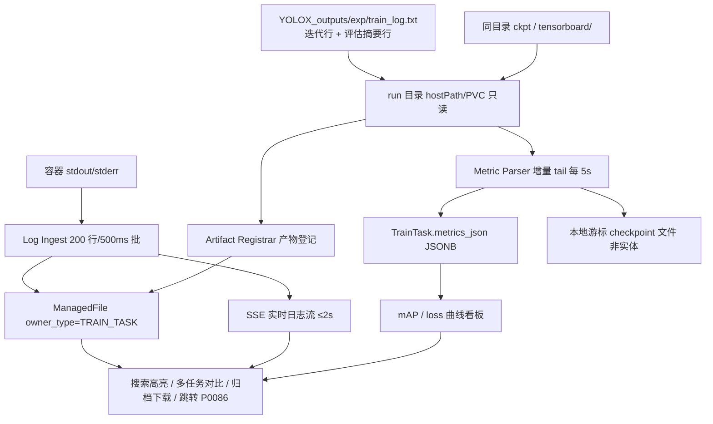
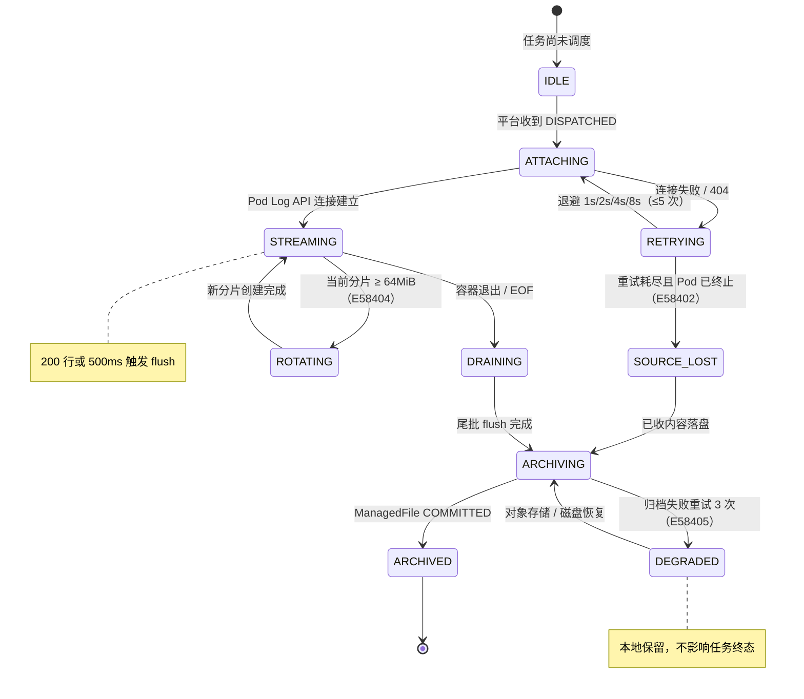
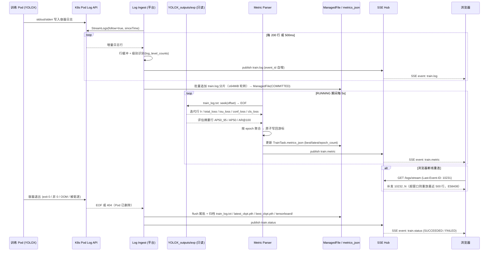
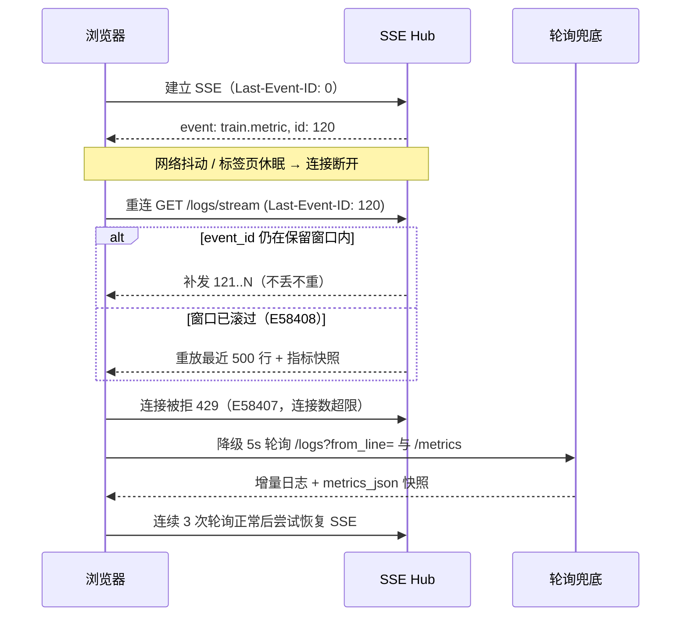
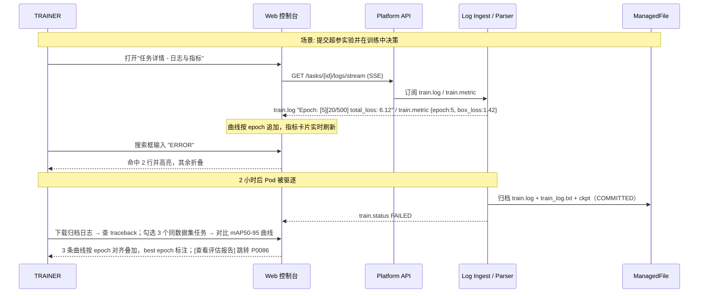
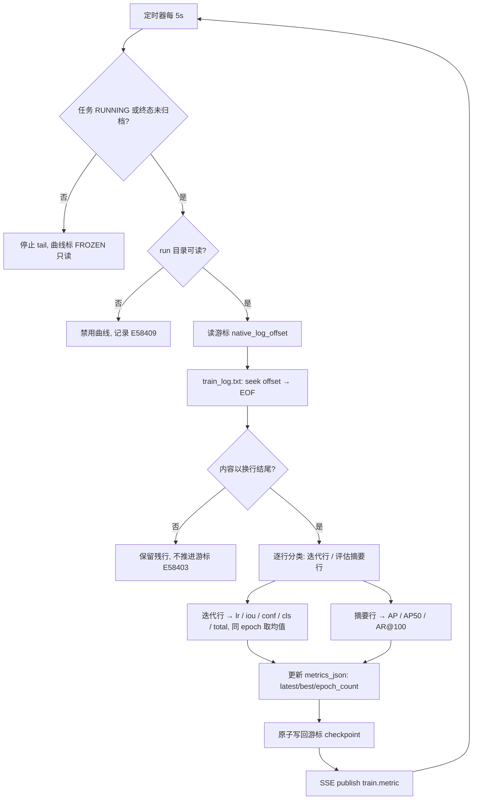
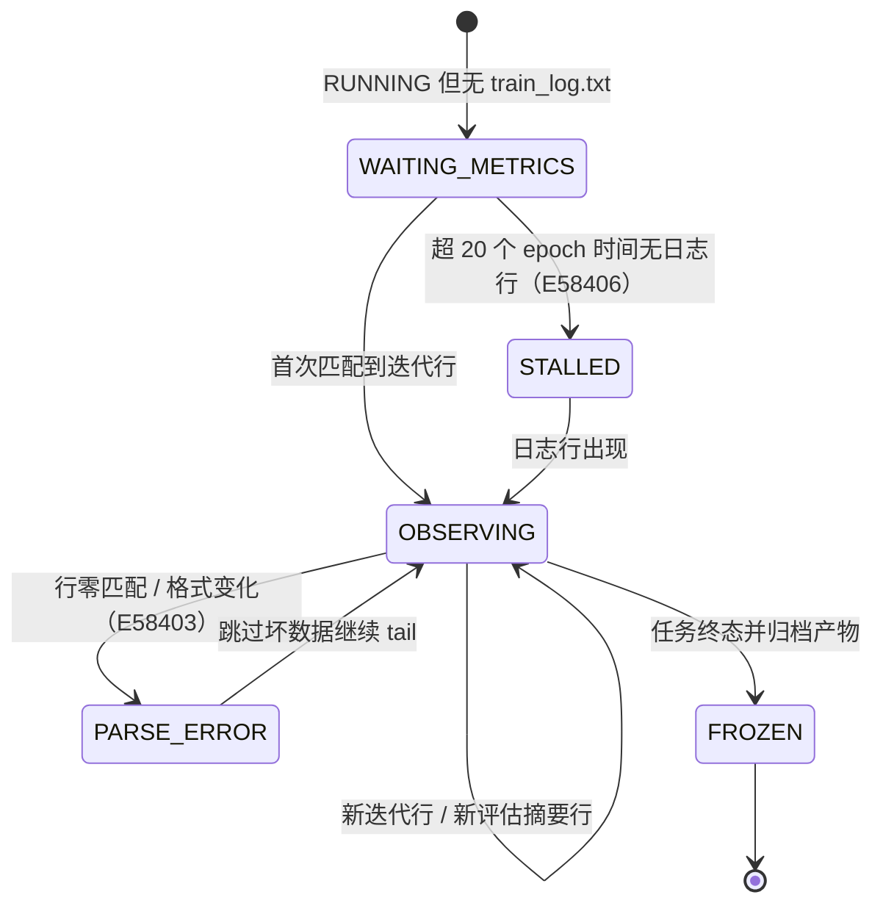

# PRD: P0084_训练日志与指标看板 (Training Logs & Metrics Dashboard)

| 属性 | 内容 |
| :--- | :--- |
| **文档编号** | P0084 |
| **项目名称** | 轻眸识刻 |
| **功能模块** | M05_训练平台 |
| **当前版本** | v1.0.0 |
| **文档状态** | Draft |
| **作者** | 轻眸识刻 Team |
| **最后更新** | 2026-10-01 |

---

## 1. 全局说明

> [!IMPORTANT]
> **核心定位**: 本模块是训练过程的**唯一观测面**。平台与训练 Pod 同机（单机 k3s），通过 K8s Pod Log API 流式采集容器 stdout/stderr，并通过 **hostPath/PVC 只读挂载**增量解析 YOLOX 输出目录 `YOLOX_outputs/<experiment_name>/` 下的原生日志 `train_log.txt`（迭代行的 loss / lr + YOLOX evaluator 打印的 COCO 评估摘要行），把**实时日志**与 **mAP / loss 曲线**推送到 Web 控制台；日志与产物在任务终态**归档为 `ManagedFile`**，与 Pod 生命周期解耦，因此中断、失败、被驱逐的任务**曲线仍可回看**。
>
> **架构约束（不可推翻）**: 一次训练 = 一个 K8s Job；首个 Trainer Backend = **YOLOX（Apache-2.0）**（预留 MMDetection / RT-DETRv2 适配器）；Executor 能力边界为 `Submit / Status / Cancel / StreamLogs`；**不新建 Metric / Artifact / TrainLogChunk / TrainCheckpoint 实体表**——训练产物一律登记 `ManagedFile`（`owner_type=TRAIN_TASK`），逐 epoch 曲线由前端解析归档的 `train_log.txt` 绘制，汇总指标写入 `TrainTask.metrics_json`(JSONB)；PR 曲线 / 混淆矩阵 / 独立评估报告属 **P0086**，登记为 `ManagedFile(owner_type=EVALUATION_TASK)`。

### 名词解释
*   **TrainLog（训练日志流）**: 一次训练 Job 容器 stdout/stderr 的时序行流，按 `TrainTask.attempt` 分段。
*   **LogChunk（日志分片）**: 落盘归档的日志文件单元，单分片 ≤ **64 MiB** 超出轮转；分片本身是 `ManagedFile`，不是实体表。
*   **Log Ingest（日志采集器）**: 平台侧常驻组件，`StreamLogs` 连接 Pod Log API，做**行缓冲（200 行 / 500ms 批）**、级别统计与 SSE 分发。
*   **MetricPoint（指标点）**: 一个 epoch 的一行指标读数，**不落库**；运行时在内存环形缓冲，归档后由前端从 `train_log.txt` 重建。
*   **train_log.txt**: **YOLOX 原生训练日志**，含逐迭代 `Epoch: [n][i/m] lr: … total_loss: … iou_loss: … conf_loss: … cls_loss: …` 行、启动期 `args: Namespace(...)` 参数快照、以及每次 `eval_interval` 评估后 evaluator 打印的 COCO 摘要行；是**全部 7 项曲线的唯一事实源**。
*   **评估摘要行**: YOLOX evaluator 打印的 `Average Precision (AP) @[ IoU=0.50:0.95 | area= all | maxDets=100 ] = 0.412` 等 COCO 统计行（evaluator 只返回 `(ap50_95, ap50, summary)`，不落独立文件）。
*   **解析游标 (Parse Cursor)**: 平台本地 checkpoint 文件（`{data_dir}/cursors/{task_id}.json`），记录 `native_log_offset` / `last_event_id` / `attempt`，用于增量 tail 与断线补发；**非业务实体、不入库**。
*   **SSE / Last-Event-ID**: 平台到浏览器的单向推送（事件 `train.log` / `train.metric` / `train.status`，带单调递增 `event_id`）；断线重连回传 `Last-Event-ID`，平台据此从保留窗口补发。
*   **心跳 (Heartbeat)**: `TrainTask.last_heartbeat_at` 每 **30s** 更新；采集器以看门狗超时 **5min** 判定失真并重连（见 P0082）。
*   **run 目录**: YOLOX 输出根 `YOLOX_outputs/<experiment_name>/`（`-expn` 可覆盖 experiment_name），以 `hostPath`（默认 `/var/lib/foodyolo/runs`）或 PVC（`foodyolo-runs`）挂载；平台侧**只读**挂载同一目录。

### 统一异常处理
| Code | 场景 | 处理策略 |
| :--- | :--- | :--- |
| `E58401` | 日志流中断（Pod Log API 连接断开） | 指数退避重连（1s/2s/4s/8s，≤5 次），带 `sinceTime` 续传，UI 显示"日志重连中" |
| `E58402` | Pod 被驱逐 / 节点失联，日志源消失 | 停止重连，flush 已收内容并归档，提示"日志源已终止"，任务状态由 P0082 判定 |
| `E58403` | 框架日志解析失败（迭代行不匹配 / 评估摘要行缺失或格式变化） | 保留残行不推进游标；坏行跳过并计数，提示"部分 epoch 指标不可读" |
| `E58404` | 日志文件超限（单分片 > 64 MiB 或任务日志总量超上限） | 轮转新分片；总量超限时淘汰最旧分片，写入 `TrainTaskEvent` |
| `E58405` | 归档失败（对象存储不可达 / 磁盘写满） | 重试 3 次（退避 5s/30s/120s）；仍失败标记归档 `DEGRADED`，本地保留，不让任务失败 |
| `E58406` | 指标缺失（`train_log.txt` 未生成 / 尚未到 `eval_interval` 首个评估点） | 显示"指标待生成"，每 30s 重试；连续 20 个 epoch 时间无迭代行则提示检查 `-expn` 输出目录与 `--logger` 配置 |
| `E58407` | SSE 连接数超限（同用户 > 6 条 / 全局 > 200 条） | 拒绝新连接返回 `429`，前端降级为 **5s 轮询** `/metrics` 与 `/logs` |
| `E58408` | 断线重连的 `Last-Event-ID` 早于保留窗口 | 全量重放最近 **500 行**日志 + 指标快照，再转增量推送 |
| `E58409` | run 目录不可读 / 挂载失败 | 禁用曲线与产物区，提示"检查 hostPath/PVC 挂载权限"，日志流不受影响 |
| `E58410` | 无权限查看日志或指标 | 返回 `403`，提示"无权限查看该任务日志"；前端隐藏该 Tab |

---

## 2. 项目背景

### 背景 (Context)
轻眸识刻 已完成计算节点（P0080）、训练环境（P0081）、任务提交与调度（P0082）、超参数模板（P0083），但**训练跑起来之后是一个黑盒**：用户只知道 `RUNNING` 还是 `SUCCEEDED`。首个落地任务是食品包装生产日期识别的日期区域检测（YOLO 检测框，训练后端 YOLOX），单任务 20 分钟到数小时，用户需要在训练过程中决定"要不要提前停掉"。

### 问题陈述 (Problem Statement)
1.  **训练黑盒**: 平台只暴露任务状态，无进度、无 loss、无 mAP，无法判断模型是否收敛。
2.  **日志只活在容器里**: YOLOX 把迭代日志写到 stdout 与容器内文件，用户需要 `kubectl logs` 才能看到，且没有级别高亮与搜索。
3.  **Pod 一结束日志就没了**: Job 完成或被驱逐后 Pod 被清理，`kubectl logs` 返回 404，失败原因（OOM、traceback、数据路径错）彻底丢失。
4.  **多任务无法对比**: 同一数据集上跑了 3 组超参（不同 `basic_lr_per_img` / `mosaic_prob`），无法把 3 条 mAP 曲线画在一张图上。
5.  **中断即失忆**: 任务跑 8 小时后失败，此前 15 个评估点的指标若只存在于容器内，重试后一切归零。

### 目标与成功指标 (Goals & Success Metrics)
*   **北极星指标**: **任意任务在 RUNNING 期间，日志端到端延迟 ≤ 2s、指标可见延迟 ≤ 10s；任务进入终态后，完整日志与全部 epoch 曲线 100% 可回看。**
*   **次要指标**: 日志流在 Pod 生命周期内可用率 > **99%**；终态后 **5s 内**完成归档登记（`train.log` 与 `train_log.txt` 均为 `COMMITTED`）；对比支持 **≤5 条**曲线按 epoch 对齐；单任务日志占用默认 ≤ **20 GiB**。

### 风险与规避 (Risks & Mitigation)
| 风险 | 影响 | 规避方案 |
| :--- | :--- | :--- |
| 迭代日志刷屏打满磁盘 | 平台与训练同机，磁盘写满拖垮一切 | 200 行/500ms 批处理 + 单分片 64 MiB 轮转 + 总量上限淘汰最旧 |
| Pod 被驱逐/删除，日志源在归档前消失 | 日志丢失 | Ingest 每 5s 增量落盘，不依赖 Pod 存活；`E58402` 下仍归档已收内容 |
| YOLOX 升级导致日志行/摘要行格式变化 | 曲线空白 | 行模式正则集中配置 + 摘要行容错匹配，失败降级（`E58403`） |
| 浏览器掉线/标签页休眠，SSE 断开 | 用户以为任务卡住 | `Last-Event-ID` 补发 + 5s 轮询兜底（`E58407`/`E58408`） |
| 多人同时打开同一任务日志 | SSE 连接堆积 | 同用户 6 条、全局 200 条连接上限，超限降级轮询 |
| `eval_interval`（默认 10）过大导致 mAP 点稀疏 | 曲线看不出趋势 | 提交任务时按 `max_epoch` 比例对 `eval_interval` 给出建议值提示 |

---

## 3. 价值模型

*   **方案**: 在任务执行层（k3s）之上构建 **Log Ingest + Metric Parser**：日志走 Pod Log API 流式采集并批处理落盘，指标走 YOLOX 输出目录只读增量解析；两条流统一经 SSE 推送前端，产物在终态归档为 `ManagedFile`，实现与 Pod 生命周期无关的可回看能力。
*   **目标**: 用户提交任务后不再需要 `kubectl`。打开"任务详情 - 日志与指标"页即可看到正在发生什么（日志）、学得怎么样（曲线）、要不要干预（提前取消），失败后拿着归档日志定位原因，并把多组实验曲线叠在一张图上决策。

---

## 4. 项目范围

### 功能结构图


### In Scope (包含范围)
1.  **日志流式采集**: 经 `StreamLogs` 连接 K8s Pod Log API，实时采集 stdout/stderr。
2.  **批处理与落盘**: 200 行 / 500ms 批处理，增量落盘归档为 `train.log` 分片（≤64 MiB 轮转）。
3.  **实时推送**: SSE 推送 `train.log` / `train.metric` / `train.status`，延迟 ≤ 2s。
4.  **日志级别解析**: 识别 ERROR / WARN / INFO / DEBUG / TRACEBACK 并计数到 `log_level_counts`。
5.  **指标解析**: 只读增量解析 `train_log.txt`，取迭代行（loss / lr）与评估摘要行（mAP / recall），更新 `metrics_json`。
6.  **曲线看板**: mAP50-95 / mAP50 / box_loss / cls_loss / precision / recall / lr 折线图。
7.  **日志搜索与高亮**: 关键字 / 正则搜索，ERROR/WARN 高亮，级别过滤。
8.  **多任务对比**: ≤5 个任务的同类指标按 epoch 对齐叠加，支持 EMA 平滑 α。
9.  **归档与保留**: 终态归档为 `ManagedFile`，热 30 天 / 冷归档 180 天，总量上限淘汰最旧。
10. **断线兜底**: `Last-Event-ID` 补发 + 无 SSE 时 5s 轮询；评估报告跳转 P0086。

### Out of Scope (不包含范围)
*   **日志聚合系统**: 不引入 Loki / Elasticsearch / Kafka，单机场景用文件 + 内存环形缓冲足够。
*   **指标实体表**: 不建 `Metric` / `MetricPoint` / `TrainArtifact` / `TrainCheckpoint` 表；曲线源 = `train_log.txt`，汇总 = `metrics_json`，checkpoint 列表 = `ManagedFile` 前缀列举。
*   **评估产物生成**: PR 曲线 / 混淆矩阵 / 独立评估报告由 **P0086** 生成（`ManagedFile(owner_type=EVALUATION_TASK)`），P0084 只做跳转引用，不自绘、不解析。
*   **远程终端 / exec**: 不进容器交互（属 P0082 范畴），本模块只读观测；**告警规则引擎**也不做。
*   **跨集群日志归集**: 仅覆盖当前单机 k3s（含 k3s agent 加入的同集群节点）。

---

## 5. 业务流程

### 5.1 日志采集会话与观测状态机


### 5.2 日志与指标采集推送全流程


SSE 断开后浏览器按 `Last-Event-ID` 重连（窗口外走 `E58408` 全量重放）；连接被拒 `429`（`E58407`）时前端自动切到 **5s 轮询** `/logs?from_line=` 与 `/metrics`，恢复后自动切回 SSE。

### 5.3 断线重连与降级流程


---

## 6. 用户分析

### 6.1 用户画像 (User Personas)
*   **TRAINER（训练工程师，主要用户）**: 提交训练、盯过程、判断收敛、对比超参、定位失败。诉求："训练跑着的时候就要知道 loss 降没降、mAP 涨没涨，失败了要能看到 traceback。" 痛点：只有 `RUNNING` 一个状态字、日志要 `kubectl logs`、Pod 一结束日志全丢、多组超参无法同图对比。
*   **ADMIN（平台管理员）**: 维护 k3s、节点与存储，排查磁盘满、挂载失败、归档堆积。诉求："能看出哪个任务日志暴涨、哪个归档失败、SSE 连接有没有打满。" 痛点：缺少采集健康视图（连接数、归档状态、磁盘占用）。
*   **VIEWER（观察者）**: 了解训练进展与模型质量趋势，不做技术操作。诉求："一张 mAP 曲线 + 当前 epoch 就够。" 痛点：不需要也不应看到容器内部细节与下载权限。
*   **ANNOTATOR（标注员）**: 数据标注。对本模块**无诉求**，访问返回 `E58410`（前端不展示该 Tab）。

### 6.2 用户链路图 (User Journey Map)


---

## 7. 功能需求

### M05.F01 日志流式采集与实时推送 (Log Streaming Ingest & Push)
*   **用户故事**: 作为 TRAINER，我希望任务运行时的日志实时出现在页面上，且任务结束或被驱逐后仍能回看，这样不用 `kubectl` 也知道训练在干什么、为什么失败。
*   **逻辑与业务规则**:
    *   **前置条件**: `TrainTask.status ∈ {DISPATCHED, RUNNING}`，用户为 ADMIN 或任务可见范围内的 TRAINER/VIEWER。
    *   **主流程**: ① 状态变 `DISPATCHED` 时经 `K8sJobExecutor.StreamLogs` 连接 Pod Log API（`follow=true`，按 `attempt` 取对应 Pod）；② 日志行进入行缓冲，累积 **200 行**或 **500ms** 到期即 flush；③ flush 时识别级别写入 `log_level_counts`、累加 `log_bytes`/`log_line_count`、追加写本地分片；④ 每批生成单调递增 `event_id` 经 SSE Hub 广播 `train.log`，前端追加到虚拟滚动列表（用户上滚则暂停跟随）；⑤ 容器退出或 Pod 404 → `DRAINING → ARCHIVING`，flush 尾批并登记分片为 `ManagedFile`。
    *   **后置条件**: `log_archive_file_id` 指向首分片（多分片按 `owner_id` + `storage_path` 前缀枚举）；`log_bytes`/`log_line_count`/`log_level_counts` 已更新。
    *   **分片 / 重试**: 单分片达 **64 MiB** 关闭当前并新建（`train.log`、`train.0001.log`…），轮转写 `TrainTaskEvent`；总量超上限（默认 **20 GiB**，ADMIN 可配）删除最旧分片（`E58404`）。断开按 1s/2s/4s/8s 退避重连 ≤5 次、用最后 `sinceTime` 续传（`E58401`）；Pod 已终止则不再重连（`E58402`）。
*   **验收标准**:
    ```gherkin
    场景: 训练中的日志实时到达浏览器
      Given 任务 task-A 状态为 RUNNING，YOLOX 每 0.5s 打印一行迭代日志
      And 用户已打开任务详情页的"日志与指标"Tab
      When 训练进程打印 "Epoch: [3][10/500] total_loss: 6.204"
      Then 浏览器在 2 秒内追加该行
      And 该行识别为 INFO 并计入 log_level_counts.INFO
    场景: Pod 被驱逐后日志仍可回看
      Given 任务 task-B 已运行并产生 12,000 行日志
      When Pod 被驱逐，K8s 返回 404
      Then 平台不再重连并记录 E58402
      And train.log 分片登记为 ManagedFile(status=COMMITTED)
      And 刷新任务详情页仍能看到全部 12,000 行日志
    场景: 单分片超过 64MiB 触发轮转
      Given 任务 task-C 当前分片已写入 63.9 MiB
      When 新一批日志到达使分片超过 64 MiB
      Then 关闭当前分片并新建 train.0001.log
      And 任务事件流中出现"日志分片轮转"事件
    ```
*   **边界情况与异常处理**:
    | 场景 | 处理 |
    | :--- | :--- |
    | Pod Log API 拒绝连接（Pod 未 Ready） | 归入 `ATTACHING → RETRYING` 退避重试，UI 显示"等待日志源" |
    | 无换行超长行（进度条 \r） | 按 `\n` 与 `\r` 双分隔切行，单行超 8 KiB 截断并附 `…[truncated]` |
    | 日志总量超 20 GiB | 删除最旧分片并记录事件（`E58404`），当前分片不受影响 |
    | 平台本地磁盘写满 | 停止落盘、仅保留内存环形缓冲降级为纯 SSE（`E58405`→`DEGRADED`），页面显著提示 |
    | 同任务多标签页打开 | 每连接独立计数；同用户 > 6 条返回 `429`，前端降级轮询（`E58407`） |

### M05.F02 指标曲线解析与展示 (Metrics Parsing & Curves)
*   **用户故事**: 作为 TRAINER，我希望 mAP 和 loss 随 epoch 实时成曲线，不用自己去 YOLOX 输出目录翻日志文件对数字。
*   **逻辑与业务规则**:
    *   **前置条件**: 平台对 run 目录有只读访问（否则 `E58409`）；任务处于 `RUNNING` 或终态。
    *   **主流程**: ① 每 **5s** 读游标的 `native_log_offset`；② `seek(offset)` 读 `train_log.txt` 到 EOF，仅当内容以 `\n` 结尾才推进游标，否则保留残行（`E58403`）；③ 匹配迭代行 `Epoch: [n][i/m]` 提取 `lr`/`total_loss`/`iou_loss`/`conf_loss`/`cls_loss`，未知行忽略；④ 匹配评估摘要行（`Eval result: AP50_95=…, AP50=…` 与 COCO `Average Precision/Recall` 统计行）提取 mAP 与 recall；⑤ 按 epoch 聚合（同 epoch 多行 loss 取均值），覆盖写 `TrainTask.metrics_json` 并原子写回游标；⑥ SSE 推送 `train.metric`，前端按 epoch 追加；⑦ 终态时把 `train_log.txt` 与 ckpt 登记为 `ManagedFile`，前端此后直接解析归档产物重绘。
    *   **后置条件**: `metrics_json.best` 记录 `metrics/mAP50-95` 最优 epoch；`native_log_file_id` 指向 `COMMITTED` 的 `train_log.txt`，曲线与 Pod 生命周期解耦。
    *   **刷新频率**: SSE 有增量即推、周期 ≤ **2s**；曲线按 **epoch 追加**（不整图重绘）；无 SSE 时前端 **5s 轮询** `/metrics`。
    *   **指标源 → 平台字段映射**（全部来自 `train_log.txt`）:

        | 源行模式 | 源字段 | 平台指标字段 | 说明 |
        | :--- | :--- | :--- | :--- |
        | `Epoch: [n][i/m]` | `lr: {v}` | `lr` | 学习率 |
        | `Epoch: [n][i/m]` | `total_loss: {v}` | `train/total_loss` | 总损失 |
        | `Epoch: [n][i/m]` | `iou_loss: {v}` | `train/box_loss` | 框回归损失 |
        | `Epoch: [n][i/m]` | `conf_loss: {v}` | `train/conf_loss` | 目标置信度损失（辅助） |
        | `Epoch: [n][i/m]` | `cls_loss: {v}` | `train/cls_loss` | 分类损失 |
        | `Eval result:` / `Average Precision (AP) @[IoU=0.50:0.95…]` | `AP` | `metrics/mAP50-95` | **主指标**，COCO AP@[.5:.95] |
        | `Eval result:` / `Average Precision (AP) @[IoU=0.50…]` | `AP50` | `metrics/mAP50` | COCO AP@0.5 |
        | `Average Recall (AR) @[… maxDets=100]` | AR@100 | `recall` | 召回率 |
        | 由 P0086 评估回填（`EVALUATION_TASK`） | `precision` | `precision` | 精确率；未回填时该曲线隐藏并标"待评估" |

        X 轴统一为 **epoch**：loss/lr 行按 `Epoch: [n]` 聚合为该 epoch 均值；mAP/recall 仅在 `eval_interval`（默认 **10**）个 epoch 出现一次，中间**不插值**、曲线断开。
    *   **`metrics_json` 结构**（只存汇总，不存逐 epoch 序列）: `{"schema":"yolox/coco-v1","source":"train_log.txt","epoch_count":15,"updated_at":"2026-10-01T09:31:12Z","latest":{"epoch":15,"train/box_loss":1.812,"train/cls_loss":0.931,"lr":0.00082},"best":{"epoch":14,"metrics/mAP50-95":0.412,"metrics/mAP50":0.672,"recall":0.745},"evaluation":{"precision":0.812,"evaluated_at":"2026-10-01T10:02:00Z"},"incomplete":false}`
*   **验收标准**:
    ```gherkin
    场景: 曲线随 epoch 实时追加
      Given 任务 task-A 运行中，train_log.txt 已有 epoch 1~4 的迭代行
      When YOLOX 追加 epoch 5 的迭代行并落盘
      Then 5 秒内浏览器 loss 曲线新增 epoch 5 数据点
      And 指标卡片 lr / train/box_loss 更新为 epoch 5 的聚合值
    场景: 中断任务的曲线仍可回看
      Given 任务 task-B 在 epoch 9 失败，train_log.txt 已归档为 ManagedFile
      When 用户在任务详情页查看曲线
      Then 页面从归档 train_log.txt 绘制 loss 与 mAP 曲线
      And 在 best epoch 处标注最优值，即使该任务 Pod 已不存在
    场景: mAP 点按 eval_interval 出现且不插值
      Given 超参 eval_interval = 10，任务已跑到 epoch 20
      When 解析器匹配到两次 Eval result 摘要行
      Then 曲线在 epoch 10 与 20 各出现一个 mAP50-95 点
      And 其余 epoch 无 mAP 点且不做插值
    ```
*   **边界情况与异常处理**:
    | 场景 | 处理 |
    | :--- | :--- |
    | `train_log.txt` 尚未生成 | 置 `WAITING_METRICS`，"指标待生成"，30s 重试（`E58406`） |
    | 行格式与正则不符（YOLOX 升级） | 未知行忽略；连续 200 行零匹配记 `E58403` 并提示"日志格式未识别" |
    | 解析器读到半行（写入中） | 保留残行待下轮，游标不推进，不产出脏数据点（`E58403`） |
    | 重试后新 attempt 覆盖同路径 | `size < offset` 时游标归零并加 attempt 分段标记，不串联两次训练曲线 |
    | run 目录未挂载或权限不足 | 禁用曲线区并提示检查 hostPath/PVC（`E58409`）；日志流仍可用 |
    | `precision` 尚未由 P0086 回填 | 该曲线隐藏并显示"待评估 → 查看评估报告"，不影响其它指标 |

### M05.F03 日志搜索与错误高亮 (Log Search & Error Highlighting)
*   **用户故事**: 作为 TRAINER，我希望在几万行日志里直接搜关键字并让 ERROR / traceback 一眼可见，而不是用眼睛滚。
*   **逻辑与业务规则**:
    *   **前置条件**: 用户有该任务查看权限（否则 `E58410`）；日志已归档或仍可读内存缓冲。
    *   **主流程**: ① 用户输入关键字或正则，选择范围（实时缓冲 / 归档全文）与级别过滤；② 实时缓冲走内存环形缓冲（最近 2,000 行），归档全文走服务端流式扫描（不整文件载入内存）；③ 返回命中行号、上下文（前后 2 行）与总数，前端滚动定位第 1 个命中；④ 着色：`ERROR`/`Traceback`/`Exception` → 红，`WARN`/`WARNING` → 黄，`INFO` → 默认，`DEBUG` → 灰；⑤ 结果可导出为 `.txt`（仅命中行）。
    *   **后置条件 / 约束**: 搜索条件写入 URL query（可分享/刷新保持），不落库；100 MiB 归档日志关键字搜索 P95 < **3s**，正则模式超 200ms 中止并提示改用关键字。
*   **验收标准**:
    ```gherkin
    场景: 关键字搜索定位报错行
      Given 任务 task-A 归档日志共 45,000 行，其中 2 行包含 "CUDA out of memory"
      When 用户在搜索框输入 "CUDA out of memory" 并回车
      Then 页面显示 "2 处匹配"
      And 列表自动滚动到第 1 处命中并高亮，前后各显示 2 行上下文
    场景: 无权限用户访问日志
      Given 用户角色为 ANNOTATOR
      When 该用户直接访问 GET /api/train/tasks/{id}/logs?q=test
      Then 接口返回 403 且错误码为 E58410
    场景: 级别过滤与高亮
      Given 归档日志中包含 3 行 ERROR、5 行 WARNING 与若干 INFO
      When 用户勾选级别过滤 "ERROR" 与 "WARN"
      Then 列表只显示这 8 行
      And ERROR 行以红色标记、WARN 行以黄色标记
    ```
*   **边界情况与异常处理**:
    | 场景 | 处理 |
    | :--- | :--- |
    | 搜索关键字为空 | 不发起请求，恢复全量视图 |
    | 非法正则 | 提示"正则语法错误"并自动回退为字面量搜索 |
    | 归档未 COMMITTED（任务刚结束） | 搜索范围落到内存缓冲 + 本地分片，提示"归档中" |
    | 命中数 > 10,000 | 只返回前 10,000 条并提示"结果过多，请细化条件" |
    | 超大归档搜索超时 | 中止扫描返回已完成部分，提示"已完成 60%，请缩小范围" |

### M05.F04 多任务曲线对比 (Multi-Task Curve Comparison)
*   **用户故事**: 作为 TRAINER，我希望把 3~5 个任务的 mAP 曲线叠在一张图上，快速判断哪组超参更好。
*   **逻辑与业务规则**:
    *   **前置条件**: 被选任务同属 `task_type=detection`，且各自产物已归档或曲线可解析。
    *   **主流程**: ① 用户勾选 2~5 个任务点击"对比曲线"；② 平台并发拉取各任务归档的 `train_log.txt`，服务端解析为 `[{epoch, value}]`；③ **按 epoch 对齐**：X 轴取各任务 epoch 并集，缺失点不插值（曲线断开），不做时间轴对齐；④ 每条曲线自动配色与图例（任务名 + attempt），标注各自 `best epoch` 与 `best value`；⑤ 支持选主指标（默认 `metrics/mAP50-95`）、切换线性/对数 Y 轴、**EMA 平滑 α（默认 0.0，范围 0~0.95，仅渲染层，原始数据不变）**；⑥ 导出 PNG 使用同一数据快照。
    *   **后置条件 / 限制**: 对比组合存为 URL query，不落库、不生成实体；最多 **5** 条，超出提示"最多同时对比 5 个任务"；跨数据集版本对比时显示"数据集版本不同，结果不完全可比"警告条。
*   **验收标准**:
    ```gherkin
    场景: 三个任务曲线叠加对比
      Given 任务 A/B/C 均已成功且归档了 train_log.txt
      When 用户勾选这 3 个任务并点击 [对比曲线]，主指标选择 metrics/mAP50-95
      Then 页面渲染 3 条按 epoch 对齐的曲线，图例显示任务名与 best epoch
      And 任务 B 只有到 epoch 6 的评估点，其曲线在 6 处结束且不插值
    场景: 超过对比上限
      Given 用户已选择 5 个任务
      When 用户再勾选第 6 个任务
      Then 提示 "最多同时对比 5 个任务"
      And 第 6 个任务不被加入对比图
    场景: EMA 平滑不改变原始数据
      Given 对比图当前 α = 0.0
      When 用户将平滑参数调整为 α = 0.8
      Then 图线变得更平滑
      And 导出 CSV 的原始数据与 α = 0.0 时完全一致
    ```
*   **边界情况与异常处理**:
    | 场景 | 处理 |
    | :--- | :--- |
    | 某任务无评估摘要行（`eval_interval` 内失败） | 该任务只显示 loss 曲线并标注"无 mAP 数据" |
    | 被对比任务已被删除 | 从对比集移除并提示"任务已删除" |
    | 选择的任务属于不同数据集版本 | 允许对比但顶部显示版本差异警告条 |
    | epoch 数差异极大（10 vs 300） | X 轴取并集，提供"仅重叠区间"开关 |
    | 归档产物解析失败 | 该曲线标记不可用并记录 `E58403`，不阻塞其他曲线 |

### M05.F05 日志归档与保留策略 (Log Archiving & Retention)
*   **用户故事**: 作为 ADMIN，我希望日志和指标按明确策略归档与淘汰，既能在需要时回看，又不会把单机磁盘撑爆。
*   **逻辑与业务规则**:
    *   **前置条件**: 任务进入终态（`SUCCEEDED`/`FAILED`/`FINAL_FAILED`/`CANCELLED`）或采集会话进入 `DRAINING`。
    *   **主流程**: ① flush 尾批日志，分片按对象键 `{path_prefix}/TRAIN_TASK/{task_id}/{filename}` 提交 `ManagedFile`（本地磁盘或 MinIO），`PENDING → COMMITTED`；② 同批登记 YOLOX 原生产物 `train_log.txt` / `latest_ckpt.pth` / `best_ckpt.pth` / `epoch_<n>_ckpt.pth` / `last_mosaic_epoch_ckpt.pth` / `tensorboard/`；③ **热保留 30 天**（在线全文检索）；④ 超 30 天转**冷归档 180 天**（压缩 `.log.gz`，仅下载、不支持在线全文搜索），超 180 天由 GC 清理（`ManagedFile.status → DELETED`）；⑤ 单任务日志总量默认 20 GiB 超限淘汰最旧分片，全平台配额达 90% 时提示 ADMIN；⑥ 提供 `[下载归档日志]`（流式 ZIP，不占服务端内存）与 `[删除日志]`（ADMIN，二次确认，记 `AuditLog`）。
    *   **后置条件 / 权限**: `log_archive_file_id` / `native_log_file_id` 指向 `COMMITTED` 产物，`TrainTaskEvent` 留下归档、轮转、淘汰事件；ADMIN 可删除任意任务日志，TRAINER 可下载自己提交任务的归档，VIEWER 只读在线内容、不可下载，ANNOTATOR 一律 `403`（`E58410`）。
*   **验收标准**:
    ```gherkin
    场景: 任务结束后自动归档
      Given 任务 task-A 状态从 RUNNING 变为 SUCCEEDED
      When 归档流程完成
      Then train.log 与 train_log.txt 均登记为 ManagedFile，owner_type=TRAIN_TASK，status=COMMITTED
      And 5 秒内任务详情页显示"日志已归档"
    场景: 归档失败不阻塞任务终态
      Given MinIO 不可达，任务 task-B 已 SUCCEEDED
      When 归档重试 3 次仍失败
      Then 任务保持 SUCCEEDED 不变
      And 采集会话标记为 DEGRADED 且记录 E58405
      And 日志分片保留在平台本地，界面提示"归档待重试"
    场景: 单任务日志超过总量上限
      Given 单任务日志总量上限为 20 GiB，task-C 已写入 20 GiB
      When 新日志继续到达
      Then 平台删除最旧分片后继续写入
      And 任务事件流中记录"淘汰最旧分片"
    ```
*   **边界情况与异常处理**:
    | 场景 | 处理 |
    | :--- | :--- |
    | 任务被取消，日志只有 300 行 | 正常归档，不做最小长度限制 |
    | 归档过程中平台重启 | 启动扫描 `PENDING` 的 `ManagedFile` 继续归档（幂等，按 `etag` 去重） |
    | `best_ckpt.pth` 不存在（未触发过评估提升） | 仅登记实际存在的文件，缺失文件在产物表标"未产生" |
    | 磁盘仅剩 1 GiB | 停止归档 ckpt 等大文件，仅保留 `train.log` / `train_log.txt`，告警提示扩容 |
    | 冷归档恢复请求 | 异步解冻，页面提示"预计 1~3 分钟"，完成后站内通知 |

---

## 8. 技术架构与数据模型

### 8.1 数据实体

#### 8.1.1 `TrainTask` 本篇字段（`train_tasks`）
| 字段名 | 类型 | 必填 | 说明 | 约束 |
| :--- | :--- | :--- | :--- | :--- |
| `id` | UUID | Yes | 主键 | PK |
| `status` | Enum | Yes | 任务状态（复用 P0082） | `PENDING/QUEUED/DISPATCHED/RUNNING/SUCCEEDED/FAILED/RETRYING/FINAL_FAILED/CANCELLED` |
| `attempt` | INT | Yes | 重试次数，日志与曲线按 attempt 分段 | `CHECK (attempt >= 1)` |
| `current_epoch` / `total_epochs` | INT | No | 训练进度（解析自 `train_log.txt` / 超参 `max_epoch`） | `current_epoch >= 0` |
| `output_dir` | TEXT | Yes | run 目录绝对路径（`YOLOX_outputs/<experiment_name>/`，hostPath/PVC 挂载点） | 训练 Pod 与平台均可读 |
| `log_archive_file_id` | UUID | No | 容器日志首分片 FK → `ManagedFile`(`owner_type=TRAIN_TASK`) | FK，归档后写入 |
| `native_log_file_id` | UUID | No | 归档的 `train_log.txt` FK → `ManagedFile`；**全部曲线的唯一源** | FK |
| `metrics_json` | JSONB | No | 汇总指标快照（`latest`/`best`/`evaluation`/`epoch_count`/`schema`） | 每 5s 覆盖写；不含逐 epoch 序列 |
| `log_bytes` | BIGINT | No | 已采集日志字节数 | 默认 0，`CHECK (log_bytes >= 0)` |
| `log_line_count` | INT | No | 已采集日志行数 | 默认 0 |
| `log_level_counts` | JSONB | No | 级别计数，如 `{"ERROR":3,"WARN":12,"INFO":8451,"DEBUG":0}` | 键固定为 4 级 |

> **不存在** `TrainMetricPoint` / `TrainArtifact` / `TrainLogChunk` / `TrainCheckpoint` 表。逐 epoch 序列的载体是归档的 `train_log.txt`；日志分片与 checkpoint 都是多个 `ManagedFile` 行（`owner_id = task_id`，按 `storage_path` 前缀区分/列举）。

#### 8.1.2 `ManagedFile`(owner_type=`TRAIN_TASK`) 训练产物登记规则
| 文件名 | 用途 | 产生时机 | 是否必须 |
| :--- | :--- | :--- | :--- |
| `train_log.txt` | YOLOX 原生日志：迭代行（loss/lr）+ 启动期 `args: Namespace(...)` 参数快照 + `eval_interval` 评估摘要行（→ `native_log_file_id`，**全部曲线源**，参数与 `TrainTask.hyperparams` 互验） | 任务启动即创建，全程追加 | **必须**（否则 `E58406`） |
| `latest_ckpt.pth` | 最新权重，断点续训（P0087）的**唯一真源** | 每个 epoch 覆盖写 | **必须** |
| `best_ckpt.pth` | 最优权重（AP50-95 提升时刷新），发布到模型仓库（P0085） | 评估后指标提升时覆盖写 | 建议必须 |
| `epoch_<n>_ckpt.pth` | 周期权重，由 Exp 的 `save_history_ckpt`(bool) 控制；列表按对象键前缀列举 | 开启后每个 epoch | 可选 |
| `last_mosaic_epoch_ckpt.pth` | 进入 `no_aug_epochs` 阶段前的权重存档 | 最后一次数据增强 epoch 结束时 | 可选 |
| `tensorboard/` | YOLOX 事件目录（`--logger tensorboard`），可作曲线核对源（P0084 不解析，仅归档） | 训练启动后持续写 | 可选 |
| `train.log` | 平台采集的容器 stdout/stderr 归档首分片（→ `log_archive_file_id`）；轮转后 `train.0001.log`… | 采集过程持续追加，终态 flush | **必须** |

> `PR_curve.png` / `confusion_matrix.png` / 独立评估报告**不是** YOLOX 原生产物（evaluator 只返回 `(ap50_95, ap50, summary)`），由 **P0086** 生成并登记为 `ManagedFile(owner_type=EVALUATION_TASK)`；P0084 仅在详情页提供"查看评估报告"跳转。

#### 8.1.3 解析游标（非业务实体）
*   存储于**平台本地** `{data_dir}/cursors/{task_id}.json`（绝不写入只读的训练 run 目录），结构 `{"native_log_offset":8192,"active_archive_id":"uuid","last_event_id":10231,"attempt":2}`；解析批次结束时**原子替换**（写临时文件 + rename），平台重启后据此续读，不丢不重。游标是**平台运行时状态**，生命周期与任务一致、无查询需求，故不入库。

### 8.2 指标解析逻辑与观测状态机




### 8.3 关键接口
| 接口 | 方法 | 说明 |
| :--- | :--- | :--- |
| `/api/train/tasks/{id}/logs/stream` | GET (SSE) | 实时日志流；请求头 `Last-Event-ID` 补发；超限返回 `429` |
| `/api/train/tasks/{id}/logs` | GET | 分页读取归档/缓冲日志，参数 `from_line` / `q` / `level` / `limit` |
| `/api/train/tasks/{id}/logs/download` | GET | 流式 ZIP 下载归档日志（ADMIN / 任务提交者） |
| `/api/train/tasks/{id}/metrics` | GET | 返回 `metrics_json` 快照与曲线序列，参数 `epoch_from` / `epoch_to` |
| `/api/train/tasks/metrics/compare` | GET | 多任务对比，参数 `task_ids`（≤5）/ `metric` / `ema_alpha` |
| `/api/train/tasks/{id}/artifacts` | GET | 列出 `owner_type=TRAIN_TASK` 的产物 `ManagedFile` |

SSE 事件契约：`event: train.log | train.metric | train.status`，均带 `id:`（单调递增 `event_id`）与 JSON `data`；心跳注释行每 **15s** 一次以防代理断连。

---

## 9. UI/UX 规格说明

### 9.1 任务详情 - 日志与指标页（线框图）
```text
+---------------------------------------------------------------------------------------------------+
| [← 返回任务列表]  foodyolo-date-detect-exp3   [🟢 RUNNING]  attempt 2   epoch 42/100  [取消任务] |
+---------------------------------------------------------------------------------------------------+
|  概览  |  超参数  |  日志与指标  |  产物  |  事件                                                    |
+---------------------------------------------------------------------------------------------------+
| ┌── 指标曲线 ────────────────────────────────────────┐ ┌── 指标卡片 ─────────────────────────────┐ |
| │ 指标 [mAP50-95 ▾]  [☑ mAP50] [☐ box_loss]  α[0.0▾] │ │ mAP50-95   0.412   ▲ +0.018 / 10ep      │ |
| │ 0.70┤                                              │ │ mAP50 0.672 ▲   box_loss 1.812 ▼        │ |
| │     │              ╭──────                        │ │ cls_loss 0.931 ▼   lr 8.2e-4            │ |
| │ 0.50┤          ╭───╯                              │ │ recall 0.745   precision 待评估 (P0086)  │ |
| │     │      ╭───╯                                  │ │ ── 数据源: train_log.txt ───────────────│ |
| │ 0.30┤  ╭───╯   ▲ best epoch 14 / 0.412             │ └─────────────────────────────────────────┘ |
| │     │ ╭╯   (评估点间隔 eval_interval=10，不插值)    │ ┌── 归档状态 ─────────────────────────────┐ |
| │ 0.10┤╯                                            │ │ 热保留至 2026-10-31 (剩余 30 天)         │ |
| │     └────┬────┬────┬────┬────┬────┬────┬──▶ epoch │ │ [下载归档日志] [下载指标 CSV] [查看评估] │ |
| └───────────────────────────────────────────────────┘ │ 日志分片: train.log (18.2 MiB)           │ |
| ┌── 实时日志 ─────────────────────── [🏷跟随滚动 ☑] ┐ └─────────────────────────────────────────┘ |
| │ 搜索 [ CUDA out of memory        ]  □正则  [范围▾] │ 级别 [☑ERROR][☑WARN][☐INFO][☐DEBUG]  [▶] │ |
| │ ── 45,000 行 · 2 处匹配 (第 1 处) ──────────────────│                                          │ |
| │ 41,208  41208/45000  Epoch: [14][480/500] total_loss: 3.12 │                                   │ |
| │ 41,209  41209/45000  Saving latest_ckpt.pth                │                                   │ |
| │ 41,210  41210/45000  ■ ERROR: CUDA out of memory.          │  ← 红色高亮                        │ |
| │ 41,211  41211/45000    Tried to allocate 2.00 GiB          │  ← 上下文；WARNING 行以黄色标记     │ |
| │ ...                                                │                                          │ |
| └────────────────────────────────────────────────────┘                                          │ |
+---------------------------------------------------------------------------------------------------+
| [☑ 自动刷新 (SSE, 2s)]  连接: ● 已连接   event_id 10231      [☐ 仅看错误]  [导出搜索结果]         |
+---------------------------------------------------------------------------------------------------+
```

### 9.2 交互元素表
| 元素 | 类型 | 行为 |
| :--- | :--- | :--- |
| 指标选择器 | 下拉多选 | 从标准指标中选，默认 `metrics/mAP50-95` |
| 平滑 α | 滑块 0~0.95 | 仅影响渲染，原始数据与导出不变 |
| 曲线 Tooltip | 悬浮 | 显示 epoch 与全部已选指标值，best 点加标记 |
| 跟随滚动 | 开关 | 开启时新日志自动置底，用户上滚自动关闭 |
| 搜索框 / 级别过滤 | 文本 + 正则开关 + 复选组 | 回车触发；显示"当前序号 / 命中总数"；级别默认全选 |
| 日志行 | 虚拟列表 | 单击复制整行；ERROR/WARN 行着色 + 左侧色条 |
| 对比曲线 | 按钮 | 跳转对比视图，携带已选任务（≤5） |
| 下载归档日志 | 按钮 | 触发流式 ZIP 下载（VIEWER 隐藏） |
| 查看评估报告 | 按钮 | 跳转 P0086 评估详情，不回传产物到本模块 |
| 连接状态指示 | 状态点 | ● 已连接 / ◐ 重连中(E58401) / ○ 轮询降级(E58407) |
| 归档状态条 | 提示条 | 归档中 / 已归档 / 归档待重试(E58405) / 已转冷归档 |

### 9.3 筛选与参数表单字段
| 字段 | 类型 | 必填 | 默认值 | 说明 |
| :--- | :--- | :--- | :--- | :--- |
| `task_ids` | Multi-select | Yes（对比视图） | 当前任务 | 最多 5 个，仅同 `task_type` |
| `metric` | Select | Yes | `metrics/mAP50-95` | 7 个标准指标 + `train/total_loss` / `train/conf_loss` 辅助 |
| `epoch_from` / `epoch_to` | Number | No | 空（全量） | 图表 X 轴区间裁剪 |
| `ema_alpha` | Number | No | `0.0` | 0~0.95，仅渲染层平滑 |
| `q` / `regex` / `level` | Text + Boolean + Multi-checkbox | No | 空 / `false` / 全选 | 日志搜索条件；非法正则回退字面量 |
| `attempt` | Select | No | 最新 | 重试任务按 attempt 分段查看日志与曲线 |

---

## 10. 非功能性需求 (NFR)

*   **性能 (Performance)**: 日志端到端延迟（容器 stdout → 浏览器渲染）P95 ≤ **2s**（批处理窗口 500ms），采集吞吐 ≥ **5 MB/s**（单任务，只读旁路不阻塞训练 Pod）；指标可见延迟 P95 ≤ **10s**（解析周期 5s + 推送 ≤2s），单轮解析 ≤ **300ms**（增量读，不整文件重扫）；单任务并发 SSE ≤ 6 连接/用户、≤ 200 连接全局（`E58407`）；100 MiB 归档日志关键字搜索 P95 < **3s**，正则模式 200ms 超时保护。
*   **安全 (Security)**: 权限对齐 4 角色——ADMIN 全量 + 删除，TRAINER 查看/下载自己任务，VIEWER 只读在线内容、禁止下载，ANNOTATOR 无入口（`E58410`）；下载操作写 `AuditLog`（谁、何时、哪个任务、字节数）；搜索与对比接口对 `q`、`task_ids` 做长度/数量校验并设正则超时；归档对象键固定 `{path_prefix}/TRAIN_TASK/{task_id}/{filename}`，不做用户可控路径拼接。
*   **兼容性 (Compatibility)**: 首个 Trainer Backend = **YOLOX（Apache-2.0）**，解析规则（迭代行正则、评估摘要行容错匹配）以适配器配置集中管理，新增 MMDetection / RT-DETRv2 时只增配置不改模型；推送以 **SSE** 为主（HTTP/1.1 兼容、易穿透反代），保留 WebSocket 作为后续可选通道，无 SSE 支持时 5s 轮询兜底；浏览器基线为 Chromium 内核最新两个大版本。
*   **可扩展性 (Scalability)**: 节点扩展（`k3s agent` 加入）后采集走 Pod Log API，与 `nodeName` 无关；跨节点 run 目录需共享 PVC 或各节点本地目录 + 归档兜底；其他任务类型的指标通过扩展行模式映射与摘要行解析支持，不改数据模型；冷热分层可替换归档后端（本地磁盘 ↔ MinIO 低频存储），不改上层接口。
*   **数据保留 (Data Retention)**: 热保留 **30 天**（在线可搜可下载）；冷归档 **180 天**（压缩 `.log.gz`，仅下载）；超 180 天由 GC 删除（`ManagedFile.status → DELETED`）；单日志分片轮转阈值 **64 MiB**，单任务日志总量上限默认 **20 GiB** 超限淘汰最旧分片；平台配额达 90% 告警 ADMIN，归档删除记 `AuditLog` 且不可恢复。

---

## 附录: 已确认的设计决策

| 决策项 | 结论 |
| :--- | :--- |
| 文档编号 / E 码段 | P0084；异常码 `E58401`–`E58410`（`E` + 模块 5 + P 后两位 84 + 流水 01~10） |
| Trainer Backend | **YOLOX（Apache-2.0）**；参数面以 Exp 文件（`-f/--exp_file`）为准，产物与日志一律使用 YOLOX 原生约定（`train_log.txt` / `*_ckpt.pth` / `tensorboard/`），不使用任何其他框架的产物命名与参数名 |
| 曲线数据存储 | **不建 Metric / MetricPoint / TrainLogChunk / TrainArtifact / TrainCheckpoint 表**；全部 7 项曲线源 = 归档 `train_log.txt`（迭代行 + 评估摘要行），前端解析绘制 |
| `TrainTask` 曲线源字段 | 早期草稿的"指标文件 FK"字段随框架切换废止，统一为 **`native_log_file_id`**（FK → `ManagedFile(owner_type=TRAIN_TASK)` 的 `train_log.txt`） |
| 汇总指标位置 | `TrainTask.metrics_json`(JSONB)，仅存 `latest`/`best`/`evaluation`/`epoch_count`/`schema`（每 5s 覆盖写） |
| 产物登记方式 | 一律 `ManagedFile`，`owner_type=TRAIN_TASK`，对象键 `{path_prefix}/TRAIN_TASK/{task_id}/{filename}`，`PENDING → COMMITTED`；多文件按对象键前缀列举 |
| 评估产物归属 | PR 曲线 / 混淆矩阵 / 独立评估报告**不是** YOLOX 原生输出（evaluator 只返回 `(ap50_95, ap50, summary)`），由 **P0086** 生成，登记为 `ManagedFile(owner_type=EVALUATION_TASK)`；`precision` 由 P0086 回填 `metrics_json.evaluation`，未回填时曲线隐藏并标"待评估" |
| 输出目录 | `YOLOX_outputs/<experiment_name>/`（`experiment_name` 默认取 exp 文件名，Job 用 `-expn` 固定）；平台只读挂载该目录 |
| checkpoint 控制 | 由 Exp 的 `save_history_ckpt`(bool) 控制是否产出 `epoch_<n>_ckpt.pth`；`latest_ckpt.pth` 每 epoch 更新、`best_ckpt.pth` 在 AP50-95 提升时更新、`last_mosaic_epoch_ckpt.pth` 在进入 `no_aug_epochs` 前产出 |
| 训练参数快照 | 不额外造产物文件；取 `train_log.txt` 开头 `args: Namespace(...)` 行与 `TrainTask.hyperparams` 互验 |
| 曲线 X 轴 | 统一为 **epoch**；loss/lr 由迭代行按 epoch 聚合均值，mAP/recall 点仅在 `eval_interval`（默认 10）出现、不插值 |
| 解析游标存储 | 平台本地 checkpoint 文件 `{data_dir}/cursors/{task_id}.json`（原子写），**非业务实体、不入库** |
| 日志采集与推送 | K8s Pod Log API（`StreamLogs`），行缓冲 **200 行 / 500ms** 触发 flush；**SSE 为主**（`train.log`/`train.metric`/`train.status`），断线用 `Last-Event-ID` 补发（窗口外重放最近 500 行），无 SSE 时 5s 轮询兜底 |
| 日志分片与保留 | 单分片 **64 MiB** 轮转、单任务总量默认 **20 GiB** 超限淘汰最旧；热 **30 天** / 冷归档 **180 天** / 超期 GC 删除 |
| 多任务对比 | 最多 **5** 条曲线，按 epoch 对齐（不插值），EMA 平滑 α ∈ [0, 0.95] 仅影响渲染 |
| 指标级别识别 | 正则识别 `ERROR|Traceback|Exception` / `WARN|WARNING` / `INFO` / `DEBUG`，只统计 4 级 |
| VIEWER 权限 | 可查看在线日志与曲线，**不可下载归档、不可删除** |
| 归档失败语义 | 归档失败**不改变任务终态**，采集会话置 `DEGRADED`（`E58405`），本地保留并重试 3 次 |

---

## 关联文档

*   **P0080_计算节点与资源池**: 节点失联驱动日志源消失判定（`E58402`）；节点 label 与 GPU 容量影响训练可执行性。
*   **P0082_训练任务提交与调度**: 任务状态机、心跳（30s）、看门狗（5min）、`attempt` 语义与 Executor `StreamLogs` 边界。
*   **P0083_超参数与训练模板**: `hyperparams` 快照；`max_epoch` / `eval_interval` / `save_history_ckpt` / `no_aug_epochs` 直接影响曲线点密度与 checkpoint 归档量。
*   **P0085_模型仓库与 Lineage**: 训练产物（`best_ckpt.pth` 等）由本模块登记为 `ManagedFile`，供模型版本发布引用。
*   **P0086_模型评估**: 生成 PR 曲线 / 混淆矩阵 / 评估报告（`EVALUATION_TASK`）并回填 `precision`，本模块提供"查看评估报告"跳转。
*   **P0087_断点续训与失败重试**: 重试新增 `attempt`，日志与曲线按 attempt 分段；续训依赖 `latest_ckpt.pth`（`ManagedFile`）+ `metrics_json` 中的 epoch 汇总。
*   **P0040_存储配置与桶绑定 / P0041_数据集与版本**: `ManagedFile` 的本地磁盘 / S3 兼容对象存储后端选择；多任务对比时提示 `dataset_version_id` 差异。

---

## Changelog

| 版本 | 日期 | 作者 | 变更说明 |
| :--- | :--- | :--- | :--- |
| v0.1.0-draft | 2026-10-01 | 轻眸识刻 Team | 初稿：日志流式采集、指标看板、归档保留与多任务对比 |
| v1.0.0 | 2026-10-01 | 轻眸识刻 Team | 定稿：Trainer Backend 定为 YOLOX（Apache-2.0），输出目录 `YOLOX_outputs/<experiment_name>/`，7 项曲线统一源自 `train_log.txt`（迭代行 + 评估摘要行），E 码 `E58401`–`E58410`；评估产物归 P0086（`EVALUATION_TASK`）；热 30 天 / 冷 180 天保留策略 |
