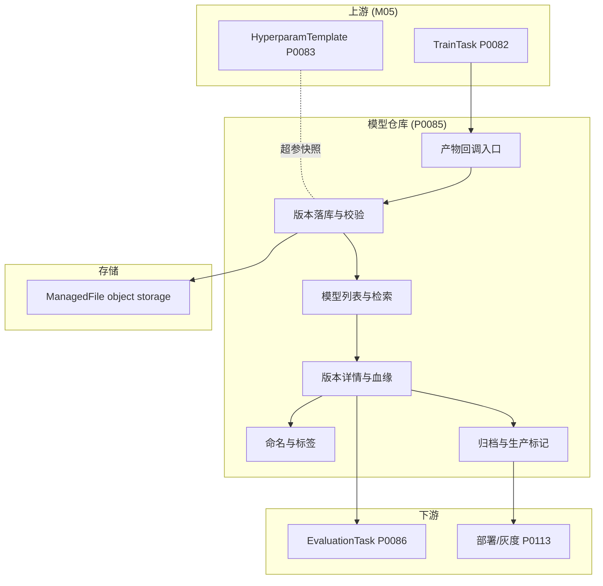
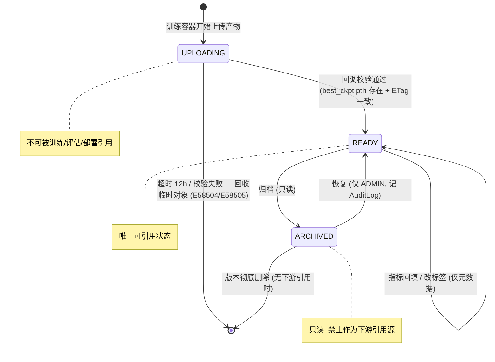
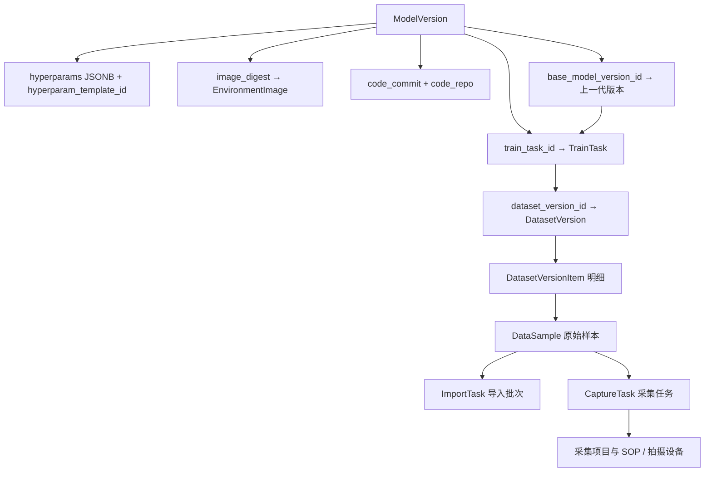
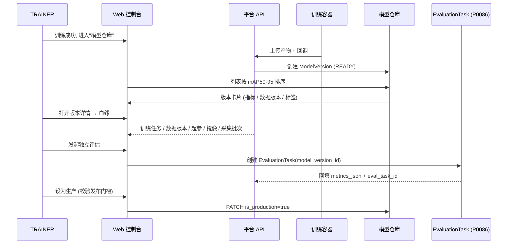
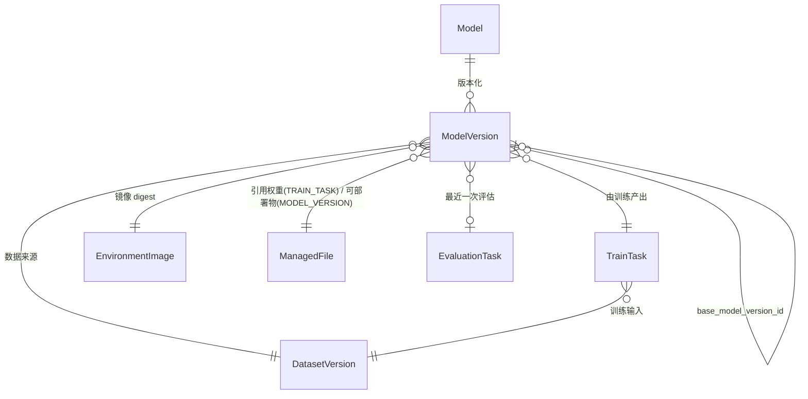

# PRD: P0085_模型仓库与Lineage (Model Registry & Lineage)
| 属性 | 内容 |
| :--- | :--- |
| **文档编号** | P0085 |
| **项目名称** | FoodYolo |
| **功能模块** | M05_训练平台 |
| **当前版本** | v1.0.0 |
| **文档状态** | Draft |
| **作者** | FoodYolo Team |
| **最后更新** | 2026-10-01 |
---
## 1. 全局说明

> [!IMPORTANT]
> **核心定位**: 把每次训练产出的权重固化为**不可变的 `ModelVersion`**，并把它与**数据版本、超参快照、镜像 digest、代码提交、基础模型**绑定成一条可追溯的血缘链。FoodYolo 中不存在"散落在磁盘上的 `best_ckpt.pth`"——任何一份权重都能回答"它是用哪份数据、哪套超参、哪个镜像训出来的，能否复现"。
### 名词解释
*   **Model**: 逻辑模型容器，按"业务任务 + 网络结构"聚合（如 `date-det-yolox`）。不存权重，只持有版本计数与最新版本指针。
*   **ModelVersion**: 一次训练（`TrainTask`）产出的**不可变**权重快照，是模型仓库的最小可引用单元；训练、评估、导出、部署都只引用 `ModelVersion.id`。
*   **Lineage (血缘)**: `ModelVersion` 向上游回溯到训练任务、超参、数据版本、镜像、代码，再继续回溯到采集批次与原始样本的有向关系集合。
*   **权重 (weights)**: 训练框架原生权重（YOLOX 约定 `best_ckpt.pth` / `latest_ckpt.pth` / `epoch_N_ckpt.pth` / `last_mosaic_epoch_ckpt.pth`）；平台不重命名、不转码，原样登记为 `ManagedFile`。
*   **ManagedFile**: 统一文件登记实体。**训练产物一律 `owner_type=TRAIN_TASK`、`owner_id=train_task_id`**（无论是否由流水线触发），对象键 `{path_prefix}/TRAIN_TASK/{train_task_id}/{filename}`，状态 `PENDING → COMMITTED → DELETED`；`content_hash` 标识同一物理对象，只登记一次。`ModelVersion` 侧只**引用**这些文件（`weights_file_id` + `artifacts_json[].file_id`），不重复登记。
*   **回调 (Callback)**: 训练容器的后置步骤在上传完成后调用平台 `POST /api/train/model-versions/callback`，由平台创建 `ModelVersion`。**创建权在平台，不在容器**。
*   **SemVer 风格版本号**: 单调递增的 `version_no`（整数，排序与引用用）+ 人类可读的 `version_label`（如 `v1` / `v1.1-date-det-20261001`）。不用自由文本做版本比较。
*   **digest**: 镜像内容哈希（`sha256:...`）。同一 tag 可被覆盖，digest 不会，因此 `image_digest` 是复现依据，`image_id` 仅作关联。
*   **artifacts_json**: `ModelVersion` 上的 JSONB 数组，`[{role, file_id, byte_size, etag}]`，承载权重之外的附带产物，避免新建产物表。
*   **is_production**: 生产标记。一个 `Model` 下**最多一个**版本为真，用于部署流水线（P0113）取权重。
### 统一异常处理
| Code | 场景 | 处理策略 |
| :--- | :--- | :--- |
| `E58501` | 产物上传中断（弱网 / 容器被驱逐） | 保留 `PENDING` 的 `ManagedFile` 分片记录，回调未到则版本不落库；支持按 `upload_id` 续传，超过 2h 未续传由清理任务回收临时对象 |
| `E58502` | 回调重复（网络重试 / 容器重复执行） | 以 `train_task_id + attempt` 为幂等键；命中已存在版本直接返回 `200` 与原 `model_version_id`，不重复创建、不重复计数 |
| `E58503` | 回调乱序（后一版本先到，再收到前一版本） | 按 `version_no` 单调校验，落后于 `Model.latest_version_id` 的回调仍可落库，但**不回退** `latest_version_id` |
| `E58504` | 权重文件缺失（`best_ckpt.pth` 未上传或校验失败） | 版本置 `UPLOADING` 并保持不可引用；提示 "缺少权重文件，请检查 YOLOX 实验输出目录"，重试 3 次后置失败并写 `AuditLog` |
| `E58505` | 校验和 / ETag 不匹配 | 判定上传损坏，删除临时对象，返回 "文件校验失败 (ETag 不匹配)"，`ManagedFile` 置 `DELETED` |
| `E58506` | 唯一约束冲突（`version_no` / `version_label` / 模型名重复） | 唯一约束冲突后自动 `+1` 重试（最多 5 次），最终仍冲突返回 `409` 与冲突字段 |
| `E58507` | 归档的模型或版本被写入 / 被引用 | 拒绝创建或修改下游任务，提示 "目标已归档，请选择 READY 版本或先恢复" |
| `E58508` | 血缘溯源断链（上游 `TrainTask` / `DatasetVersion` 记录缺失） | 血缘接口返回可达节点并显式标注 `broken_at`，页面以灰色断点展示，**不静默隐藏**，同时写 `Alert` |
| `E58509` | 存储不可达（本地磁盘 / MinIO 宕机、磁盘写满） | 权重下载与预签名签发失败，返回 `503` 与重试指引；上传期不可达则不落库，任务标记产物归档失败 |
| `E58510` | 生产标记冲突（并发把两个版本设为生产） | 事务内 `UNIQUE(model_id) WHERE is_production` 兜底，后到者返回 `409 "该模型已存在生产版本"` |
---
## 2. 项目背景
### 背景 (Context)
FoodYolo 面向 2~3 人的食品包装日期识别团队，训练执行层是**单机 k3s**：一次训练 = 一个 K8s Job，训练容器把产物上传对象存储（本地磁盘或 MinIO）后回调平台。第一阶段只做日期区域检测（YOLOX 检测框），第二阶段接 OCR，因此模型会以"检测器"为单位持续迭代数十个版本。训练任务、超参模板、日志指标分别由 P0082 / P0083 / P0084 承载，**必须有一个仓库把这些过程产物收口成可引用、可追溯的模型资产**。
### 问题陈述 (Problem Statement)
1.  **模型散落磁盘**: 权重保存在开发机与训练目录里，命名靠 `best_ckpt_v2.pth` / `best_ckpt_final.pth` 手工维护，谁是最新、哪个能上生产无据可依。
2.  **只剩 `best_ckpt.pth` 无法复现**: 拿到一个权重，说不出它对应哪次任务、哪套超参、哪个镜像 digest，换台机器训不出同样结果。
3.  **数据来源断裂**: 不知道模型是用哪份 `DatasetVersion` 训的，更无法回溯到采集批次；出现线上误检时无法定位是数据问题还是训练问题。
4.  **评估与生产脱节**: 训练末轮指标与独立评估（P0086）混为一谈，没有发布门槛，误把过拟合权重投到生产。
### 目标与成功指标 (Goals & Success Metrics)
*   **北极星指标**: 模型仓库中 `READY` 以上版本的**血缘完整率 = 100%**——每个版本都能唯一解析出 `dataset_version_id`、`hyperparams`、`image_digest`、`train_task_id` 四项。
*   **次要指标**:
    *   训练成功到出现 `READY` 版本 < **60 秒**（含上传与回调）。
    *   同一 `TrainTask.attempt` 的重复回调 **100% 幂等**，不产生第二个 `ModelVersion`。
    *   从 `ModelVersion` 回溯到原始采集批次的链路查询 P95 < **800ms**（单机 PG，5 万版本以内）；生产版本误标为 0（`is_production` 唯一性约束无违例逃逸）。
### 风险与规避 (Risks & Mitigation)
| 风险 | 影响 | 规避方案 |
| :--- | :--- | :--- |
| 训练容器回调丢失 | 权重已上传但仓库无版本 | 上传完成先写 `ManagedFile`（`COMMITTED`），平台按任务扫描实验输出目录兜底生成版本 |
| 弱网导致大权重上传中断 | 版本长期 `UPLOADING` | 支持分片续传；`UPLOADING` 超 12h 由清理任务置失败并回收 |
| 磁盘写满 | 上传与评估一并失败 | 上传前预检剩余配额，低于阈值直接返回 `E58509`，不写半截对象 |
| 归档版本被流水线引用 | 训练/部署静默失败 | 引用处统一校验 `status`，归档即拦截并提示 |
| 血缘上游被清理 | 追溯断链 | 元数据永久保留；断链时显式返回 `broken_at`，不静默丢字段 |
---
## 3. 价值模型
*   **方案**: 以 `Model`（逻辑容器）+ `ModelVersion`（不可变快照）两层结构管理模型资产；版本由训练容器的**回调**创建，训练产物以 `owner_type=TRAIN_TASK` 登记一次、模型侧只持有外键引用，可部署物归 `MODEL_VERSION`；血缘字段在落库时一次写死、之后只读。仓库对外只暴露"列表 / 详情 / 血缘 / 归档 / 生产标记"五类能力，评估与部署通过 `model_version_id` 引用。
*   **目标**: 任何一份权重都能被引用、被解释、被复现——`model_version_id` 进，数据版本、超参、镜像、代码、训练任务、基础模型全套出来。
---
## 4. 项目范围
### 功能结构图

### In Scope (包含范围)
1.  **产物上传与版本落库**: 回调入口、幂等、训练产物 `ManagedFile`（`owner_type=TRAIN_TASK`）登记/复用与 `artifacts_json` 组装。
2.  **模型列表与检索**: 按名称 / 任务类型 / 标签组 / 状态 / 生产标记 / 数据版本检索，支持按 `mAP50-95` 排序。
3.  **模型版本详情与血缘查看**: 版本元数据、指标、血缘链路与"回溯到原始采集批次"。
4.  **命名与标签**: `Model.name` 唯一性、`version_no` 递增、`version_label` 规则、tag 与 `label_group_id` 绑定。
5.  **归档与生产标记**: `READY → ARCHIVED` 只读归档、`is_production` 唯一、发布门槛校验（依赖 P0086 指标）。
6.  **与 `EvaluationTask` 对接**: `eval_task_id` 指向最近一次评估，`metrics_json` 由评估回填。
### Out of Scope (不包含范围)
*   **模型训练与调度**: 由 P0082 负责，本模块只消费其产物。
*   **独立评估执行**: 混淆矩阵 / PR 曲线由 P0086 产出，本模块只引用与展示摘要。
*   **模型在线推理服务**: 部署与灰度回滚归 P0113，本模块只提供可引用版本与生产标记。
*   **权重格式转换**: 本模块不执行转换；`onnx` / `engine` / OpenVINO 等可部署物由导出阶段产生并登记为 `owner_type=MODEL_VERSION`，本模块只持有引用、可供部署端按 `managed_file_id` 取用。
*   **多租户与权限模型扩展**: 仅 ADMIN / TRAINER / ANNOTATOR / VIEWER 四角色。
*   **版本内容寻址去重**: 不做跨版本 blob 级去重，同权重多版本按独立文件登记。
---
## 5. 业务流程
### 5.1 ModelVersion 状态机

### 5.2 产物上传 → 回调 → 版本落库
```mermaid
sequenceDiagram
    participant Pod as 训练容器 (K8s Job)
    participant OS as 对象存储 (MinIO/本地)
    participant API as 平台 API
    participant DB as PostgreSQL
    Pod->>OS: 上传 YOLOX_outputs/{experiment_name}/ 下 best_ckpt.pth / latest_ckpt.pth / train_log.txt 至 {path_prefix}/TRAIN_TASK/{train_task_id}/
    Pod->>API: POST /api/train/model-versions/callback
    Note over Pod,API: {train_task_id, attempt, artifacts:[{role,path,size,etag}], metrics_json}
    API->>API: 幂等校验 (train_task_id + attempt)
    alt 已存在版本
        API-->>Pod: 200 已落库的 model_version_id (E58502)
    else 首次回调
        API->>OS: HEAD 校验对象存在与 ETag (E58504/E58505)
        API->>API: 登记/复用 ManagedFile(owner_type=TRAIN_TASK, owner_id=train_task_id) → COMMITTED
        API->>DB: BEGIN; 取 version_no; INSERT model_versions(UPLOADING→READY)
        API->>DB: UPDATE models.latest_version_id / version_count; COMMIT
        API-->>Pod: 201 {model_version_id, version_label}
    end
```
### 5.3 从 ModelVersion 回溯到原始采集批次

---
## 6. 用户分析
### 6.1 用户画像
| 角色 | 职责 | 核心诉求 | 痛点 |
| :--- | :--- | :--- | :--- |
| **ADMIN** | 平台运维、存储与配额治理 | 存储可控、版本可归档可清理、生产标记唯一 | 磁盘被无用中间权重撑爆；误把两个版本设为生产 |
| **TRAINER** | 提交训练、调参、发布模型 | 一眼看到哪个版本最好、能追溯到数据与超参、发布有门槛 | 权重文件名混乱；说不清哪次任务的产物能上生产 |
| **VIEWER** | 查看模型指标与血缘 | 只读查看指标与血缘，不误操作 | 找不到"这个模型是用哪批数据训的" |
| **ANNOTATOR** | 提供标注数据 | 知道自己的标注批次被哪个模型用上 | 模型迭代与数据批次的关系不透明 |
### 6.2 用户链路图

---
## 7. 功能需求
### M05.F01 产物上传与版本落库 (Artifact Upload & Version Commit)
*   **用户故事**: 作为 TRAINER，我希望训练容器上传产物后自动生成一个模型版本，且重复回调不会产生重复版本，这样我不用手工整理权重文件。
*   **逻辑与业务规则**
    *   **前置条件**: `TrainTask.status = SUCCEEDED`（或最后一次 attempt 成功）；容器已完成对象存储上传；调用者为训练容器身份令牌或 ADMIN。
    *   **主流程**: ①容器从 `YOLOX_outputs/<experiment_name>/` 上传训练原生产物（`best_ckpt.pth`、`latest_ckpt.pth`、`epoch_N_ckpt.pth`、`last_mosaic_epoch_ckpt.pth`、`train_log.txt`、`tensorboard/`）至 `{path_prefix}/TRAIN_TASK/{train_task_id}/`；②容器回调平台，携带 `train_task_id`、`attempt`、`artifacts[]`（`role/path/size/etag`）与末轮 `metrics_json`；③平台按 `train_task_id + attempt` 幂等校验，未命中则 `HEAD` 校验对象存在与 ETag；④登记或复用 `ManagedFile`（`owner_type=TRAIN_TASK`、`owner_id=train_task_id`；按 `content_hash` 去重，同一物理对象只保留一条记录）并置 `COMMITTED`，把返回的 `file_id` 写入 `weights_file_id` 与 `artifacts_json`；⑤事务内分配 `version_no`（`MAX+1`，冲突重试 ≤5 次），插入 `ModelVersion`，写 `artifacts_json` 与 `artifact_count`；⑥更新 `Model.latest_version_id`、`version_count`，`status` 由 `UPLOADING` 置 `READY`。评估类产物（PR 曲线 / 混淆矩阵 / `eval_N.json` / `vis_res/`）由 P0086 自绘并登记为 `ManagedFile(owner_type=EVALUATION_TASK)`，不进本版本的 `artifacts_json`。
    *   **后置条件**: 存在唯一 `READY` 版本，`weights_file_id` 指向 `role=BEST_CKPT` 的 `ManagedFile`（`owner_type=TRAIN_TASK`，仅引用）；返回 `201` 与 `model_version_id`。
    *   **产物角色映射**（`role` 取 UPPER_SNAKE；训练类 role 均为 YOLOX 原生文件、登记 `owner_type=TRAIN_TASK`，本版本只引用）: `BEST_CKPT → best_ckpt.pth`（必须，`weights_file_id` 指向它，AP50-95 提升时产生）、`LATEST_CKPT → latest_ckpt.pth`（每 epoch 覆盖）、`EPOCH_CKPT → epoch_N_ckpt.pth`（Exp 开启 `save_history_ckpt` 时产生，可多条）、`LAST_MOSAIC_CKPT → last_mosaic_epoch_ckpt.pth`（进入 no-aug 阶段时产生）、`TRAIN_LOG → train_log.txt`、`TENSORBOARD_EVENTS → tensorboard/`（逐文件登记）、`ONNX → model.onnx`（用户自备或平台导出；**唯一以 `owner_type=MODEL_VERSION`、`owner_id=model_version_id` 新登记的 role**，与训练产物分开登记、彼此仅用 `managed_file_id` 互相引用，见 P0112 端侧导出）；未知文件按 `role=OTHER` 登记，不阻断落库。
*   **验收标准**
    ```gherkin
    场景: 训练成功后回调创建模型版本
      Given 一个 TrainTask 状态为 SUCCEEDED 且 attempt=1
      And 训练容器已上传 best_ckpt.pth 与 train_log.txt 至 {path_prefix}/TRAIN_TASK/{train_task_id}/
      When 容器以相同 train_task_id 与 attempt 回调平台
      Then 返回 201 并携带 model_version_id 与 version_label
      And model_versions 中出现 status=READY 且 weights_file_id 非空的新记录
      And Model.version_count 自增 1 且 latest_version_id 指向该版本
    场景: 重复回调保持幂等
      Given 同一 train_task_id + attempt 已成功创建过 ModelVersion
      When 容器因网络重试再次回调同一载荷
      Then 返回 200 与首次的 model_version_id
      And model_versions 中该 train_task_id 的记录数仍为 1 且 Model.version_count 不变
      And 同一物理文件（content_hash 相同）的 ManagedFile 记录数仍为 1
    场景: 权重文件缺失时拒绝落库
      Given 回调载荷中不包含 role=BEST_CKPT 的产物
      When 平台执行落库校验
      Then 返回 422 且 error_code=E58504
      And 不创建任何 model_versions 记录
    ```
*   **边界情况与异常处理**
    | 场景 | 处理 |
    | :--- | :--- |
    | 上传中断（弱网 / Pod 被驱逐） | 保留分片记录，回调未到则不落库；2h 内可续传，超时清理临时对象（`E58501`） |
    | 回调乱序（后一版本先到） | 允许落库但不回退 `latest_version_id`；前端按 `version_no` 排序（`E58503`） |
    | ETag 不匹配 | 删除临时对象，`ManagedFile` 置 `DELETED`，返回 `E58505` |
    | 并发回调抢占同一 `version_no` | 唯一约束冲突后 `+1` 重试，最多 5 次，仍冲突返回 `409`（`E58506`） |
    | `UPLOADING` 超 12h | 清理任务置失败、回收临时对象、写 `AuditLog`（`E58504`） |
    | 训练归档与模型落库对同一物理文件重复登记 | 以 `content_hash` 命中既有记录，复用其 `managed_file_id` 写入 `artifacts_json`，**不建第二条记录**并记审计事件 |
### M05.F02 模型列表与检索 (Model List & Search)
*   **用户故事**: 作为 TRAINER，我希望快速筛出"日期检测、最近一周、mAP50 最高"的模型版本，这样我能决定把哪个版本送去评估或发布。
*   **逻辑与业务规则**
    *   **前置条件**: 调用者角色 ∈ {ADMIN, TRAINER, VIEWER}；ANNOTATOR 仅可见只读摘要。
    *   **主流程**: ①`GET /api/models` 返回 `Model` 聚合行（`latest_version_id`、`version_count`、`is_archived`、`label_group_id`）；②支持过滤 `task_type`、`label_group_id`、`keyword`（`Model.name` 模糊）、`has_production`、`updated_after`；③`GET /api/models/versions` 支持过滤 `dataset_version_id`、`status`、`is_production`、`tag`，排序 `mAP50-95 desc` / `version_no desc` / `created_at desc`；④列表行展示 `metrics_json` 的 `metrics_map50`、`metrics_map50_95`、`precision`、`recall` 与数据版本名称。
    *   **后置条件**: 返回分页结果（默认 20 条/页），每条含 `model_version_id`、`version_label`、`status`、`is_production`、`eval_task_id`。
    *   **业务规则**: 归档版本默认不出现在默认视图，需显式 `include_archived=true`；不返回软删除记录。
*   **验收标准**
    ```gherkin
    场景: 按指标排序检索版本
      Given 模型 date-det-yolox 存在 3 个 READY 版本, mAP50-95 分别为 0.61 / 0.68 / 0.55
      When TRAINER 请求 GET /api/models/versions?model_id={id}&metric_sort=map50_95:desc
      Then 返回顺序为 0.68 / 0.61 / 0.55 且每行包含 dataset_version_id 与其可读名称
    场景: 归档版本默认隐藏
      Given 某模型下存在 1 个 ARCHIVED 版本和 2 个 READY 版本
      When TRAINER 打开模型仓库列表页且未勾选"包含已归档"
      Then 列表仅展示 2 个 READY 版本
    场景: 关键字与标签组组合过滤
      Given 存在 task_type=DETECTION 且 label_group_id=G1 的模型
      When 以 keyword=date 且 label_group_id=G1 过滤
      Then 返回结果全部满足名称包含 date 且标签组为 G1
    ```
*   **边界情况与异常处理**
    | 场景 | 处理 |
    | :--- | :--- |
    | 检索无结果 | 返回空数组与 `200`，前端展示空态与"清空筛选"入口 |
    | `metrics_json` 为空（未评估） | 指标列显示 `—`，排序时该版本排在有效指标之后 |
    | `dataset_version_id` 已被归档 | 行内标注"数据版本已归档"，不阻断列表加载 |
    | 血缘上游缺失 | 行内指标仍展示，血缘入口点击后才提示断链（`E58508`） |
### M05.F03 模型版本详情与血缘查看 (Version Detail & Lineage)
*   **用户故事**: 作为 TRAINER，我希望在版本详情里看到它是哪份数据、哪套超参、哪个镜像训出来的，并能一路点回采集批次，这样线上误检时我能定位问题源头。
*   **逻辑与业务规则**
    *   **前置条件**: `model_version_id` 存在且调用者有权访问。
    *   **主流程**: ①`GET /api/models/versions/{id}` 返回版本元数据、指标、产物清单（`artifacts_json` 展开为文件列表与下载预签名 URL）；②`GET /api/models/versions/{id}/lineage` 返回血缘树：`TrainTask` → `DatasetVersion` → `DatasetVersionItem`（聚合计数）→ `ImportTask` / `CaptureTask`；③同时返回 `hyperparams` 快照与其 `hyperparam_template_id`、`image_digest`、`code_commit` / `code_repo`、`base_model_version_id`；④前端以"数据 / 超参 / 环境 / 代码 / 基础模型"五段折叠展示，每段可跳转到对应模块详情页。
    *   **后置条件**: 血缘响应携带 `complete: true|false` 与 `broken_at`（断链时给出节点名与原因）。
    *   **业务规则**: 血缘数据**只读**，不随上游实体后续修改而变化（`hyperparams` 为提交时冻结快照）；上游实体被删除时返回其 `id` 与"记录已不存在"，不隐藏该层。
*   **验收标准**
    ```gherkin
    场景: 查看完整血缘链
      Given 一个 READY 的 ModelVersion 且上游 TrainTask / DatasetVersion 均存在
      When TRAINER 请求 GET /api/models/versions/{id}/lineage
      Then 响应包含 train_task_id, dataset_version_id, hyperparams, image_digest, code_commit
      And 响应中 complete=true 且 broken_at 为空
      And 数据段包含 DatasetVersionItem 计数与来源 ImportTask 或 CaptureTask 标识
    场景: 血缘断链时显式标注
      Given 该版本的 TrainTask 记录已被物理删除
      When 请求同一血缘接口
      Then 响应 complete=false 且 broken_at 指明 TrainTask 节点
      And 其余可达节点仍正常返回, 平台写入一条 Alert 记录
    场景: 归档版本血缘仍可查看
      Given 一个 status=ARCHIVED 的 ModelVersion
      When VIEWER 打开其详情页血缘面板
      Then 血缘完整返回且页面标注"已归档，只读"
    ```
*   **边界情况与异常处理**
    | 场景 | 处理 |
    | :--- | :--- |
    | 上游 `TrainTask` 缺失 | 标注 `broken_at`，其余节点照常展示（`E58508`） |
    | `hyperparams` 为空 | 显示"该任务未使用超参模板"，不视为断链 |
    | 大版本血缘查询慢 | 血缘接口只返回聚合计数，明细按需分页加载 |
    | 版本已归档且被引用 | 详情页提示"已归档"，下游引用处拦截（`E58507`） |
### M05.F04 命名与标签 (Naming & Labels)
*   **用户故事**: 作为 TRAINER，我希望模型名与版本号的命名规则被平台强制执行，这样团队里不会出现 `best_ckpt_v2.pth` 这类无法解释的资产。
*   **逻辑与业务规则**
    *   **前置条件**: 创建/重命名模型时调用者为 ADMIN 或 TRAINER。
    *   **主流程**: ①`Model.name` 必须匹配 `^[a-z0-9][a-z0-9-]{2,62}$`，且全局唯一（`UNIQUE(name) WHERE deleted_at IS NULL`）；②首次创建 `Model` 时绑定 `task_type`（当前仅 `DETECTION`，为 OCR 阶段预留 `OCR_DETECTION`）与 `label_group_id`；③`version_no` 由平台自增分配，用户不可编辑；`version_label` 支持模板 `v{major}[.{minor}]-{task_type}-{YYYYMMDD}`，默认 `v{version_no}`；④`version_label` 在 `Model` 内唯一（`UNIQUE(model_id, version_label)`），重命名仅允许改日期/描述段，不允许改变 `version_no`；⑤tag 为版本级自由标记（如 `baseline`、`prod-candidate`），与 `label_group_id` 正交：`label_group_id` 定义类别体系，tag 描述用途。
    *   **后置条件**: 命名非法返回 `422`；`version_label` / 模型名重复等唯一约束冲突返回 `409` 与 `E58506`。
    *   **业务规则**: `Model.is_archived=true` 时禁止新增版本；被 `is_production` 引用的模型禁止归档。
*   **验收标准**
    ```gherkin
    场景: 非法模型名被拒绝
      Given TRAINER 提交模型名 "Date_Det Best!" (含大写与空格)
      When 平台执行命名校验
      Then 返回 422 并提示"模型名只能包含小写字母、数字与连字符", 不创建 Model 记录
    场景: 版本号自动递增且标签默认
      Given 模型 date-det-yolox 当前 version_count=2
      When 新的一次训练回调落库
      Then 新版本 version_no=3 且默认 version_label="v3"
      And UNIQUE(model_id, version_no) 校验通过
    场景: 版本标签重名被拒绝
      Given 模型下已存在 version_label="v1.1-date-det-20261001"
      When 用户尝试为另一版本设置同一 version_label
      Then 返回 409 且错误码 E58506
    ```
*   **边界情况与异常处理**
    | 场景 | 处理 |
    | :--- | :--- |
    | 模型名与已软删除模型同名 | 允许创建（唯一索引带 `deleted_at IS NULL`） |
    | `version_label` 长度超 64 | 返回 `422`，不截断 |
    | 归档模型下回调新版本 | 拒绝并提示"模型已归档，无法新增版本"（`E58507`） |
    | tag 数量超限 | 单版本 tag ≤ 10，超限返回 `422` |
### M05.F05 归档与生产标记 (Archive & Production Flag)
*   **用户故事**: 作为 ADMIN，我希望旧版本能归档成只读、每个模型最多一个生产版本，这样生产环境永远引用到唯一且经过评估的权重。
*   **逻辑与业务规则**
    *   **前置条件**: 归档需 ADMIN 或 TRAINER；设置生产需 ADMIN 或 TRAINER，且版本 `status=READY`。
    *   **主流程**: ①`POST /api/models/versions/{id}/archive` 校验无活跃下游引用后置 `ARCHIVED` 并写 `archived_at`；②归档后版本只读，拒绝再次作为训练 `base_model_version_id`、评估源或部署源；③`PATCH /api/models/versions/{id}` 设置 `is_production=true` 时先做发布门槛校验，再在事务内把同 `model_id` 其他版本置 `false`、当前版本置 `true`；④**发布门槛**: `metrics_json` 中 `eval` 来源（`eval_task_id` 非空）的 `mAP50` ≥ 阈值（默认 0.70，ADMIN 可配），仅训练末轮指标不足以发布；⑤`POST /api/models/versions/{id}/restore`（ADMIN）执行 `ARCHIVED → READY` 并记 `AuditLog`。
    *   **后置条件**: 归档版本 `status=ARCHIVED` 且 `archived_at` 非空；生产版本唯一且 `published_by` / `published_at` 已写。
    *   **业务规则**: 归档不删除文件，`ManagedFile` 保持 `COMMITTED`；被生产标记的版本不可归档（须先取消生产标记）。
*   **验收标准**
    ```gherkin
    场景: 设为生产版本时自动取消旧生产标记
      Given 模型 date-det-yolox 的 v2 版本 is_production=true
      And v3 版本 status=READY 且 eval 指标 mAP50=0.78 高于阈值
      When TRAINER 将 v3 设为生产版本
      Then v3.is_production=true 且 v2.is_production 变为 false
      And 该模型下 is_production=true 的版本恰好 1 个
      And v3.published_by 与 published_at 被写入
    场景: 未达发布门槛时拒绝设为生产
      Given v4 版本仅有训练末轮指标 metrics_source=train, mAP50=0.66
      When TRAINER 尝试将 v4 设为生产版本
      Then 返回 422 且提示"需先通过独立评估且 mAP50 ≥ 阈值"
      And v4.is_production 仍为 false
    场景: 归档版本被下游引用时拦截
      Given 一个 status=ARCHIVED 的 ModelVersion
      When TRAINER 以该版本作为 base_model_version_id 提交新训练任务
      Then 返回 409 且错误码 E58507, 不创建 TrainTask
    场景: 归档版本保持只读
      Given 一个 ARCHIVED 版本
      When 用户尝试修改其 hyperparams 或替换权重文件
      Then 返回 409 且提示"已归档版本不可变更"
    ```
*   **边界情况与异常处理**
    | 场景 | 处理 |
    | :--- | :--- |
    | 并发设置两个生产版本 | 事务 + 唯一索引兜底，后到者 `409`（`E58510`） |
    | 归档正在被评估的版本 | 拒绝归档，提示先结束 `EvaluationTask` |
    | 归档被生产标记的版本 | 拒绝，提示先取消生产标记 |
    | 归档失败（存储不可达） | 元数据状态不变，返回 `503`（`E58509`） |
---
## 8. 技术架构与数据模型
### 8.1 数据实体表
#### `Model` (models)
| 字段名 | 类型 | 必填 | 说明 | 约束 |
| :--- | :--- | :--- | :--- | :--- |
| `id` | UUID | 是 | 主键 | PK |
| `name` | VARCHAR(64) | 是 | 模型名（小写字母/数字/连字符） | UNIQUE(name) WHERE deleted_at IS NULL；CHECK 正则 |
| `task_type` | VARCHAR(32) | 是 | 业务任务类型 | CHECK IN ('DETECTION','OCR_DETECTION') |
| `description` | TEXT | 否 | 模型用途说明 | — |
| `label_group_id` | UUID | 否 | 类别体系 | FK → label_groups.id |
| `latest_version_id` | UUID | 否 | 最新版本指针 | FK → model_versions.id |
| `version_count` | INT | 是 | 版本计数（含归档） | NOT NULL DEFAULT 0；CHECK >= 0 |
| `is_archived` | BOOLEAN | 是 | 模型级归档 | NOT NULL DEFAULT false |
| `created_by` | UUID | 是 | 创建人 | FK → users.id |
| `created_at` / `updated_at` | timestamptz | 是 | 时间戳 | NOT NULL DEFAULT now() |
| `deleted_at` | timestamptz | 否 | 软删除 | NULL 表示有效 |
#### `ModelVersion` (model_versions)
| 字段名 | 类型 | 必填 | 说明 | 约束 |
| :--- | :--- | :--- | :--- | :--- |
| `id` | UUID | 是 | 主键 | PK |
| `model_id` | UUID | 是 | 所属模型 | FK → models.id；与 `version_no` 组 UNIQUE |
| `version_no` | INT | 是 | 单调递增版本序号 | UNIQUE(model_id, version_no)；CHECK version_no >= 1 |
| `version_label` | VARCHAR(64) | 是 | 人类可读版本号 | UNIQUE(model_id, version_label) |
| `status` | VARCHAR(16) | 是 | 版本状态 | CHECK IN ('UPLOADING','READY','ARCHIVED')；DEFAULT 'UPLOADING' |
| `weights_file_id` | UUID | 否 | 主权重 `best_ckpt.pth` 文件（引用，非本表所有） | FK → managed_files.id（`owner_type=TRAIN_TASK`）；READY 时非空 |
| `artifacts_json` | JSONB | 是 | 附带产物 `[{role,file_id,byte_size,etag}]` | NOT NULL DEFAULT '[]' |
| `artifact_count` | INT | 是 | 产物数量（冗余计数） | NOT NULL DEFAULT 0；CHECK >= 0 |
| `metrics_json` | JSONB | 否 | 指标汇总，含 `metrics_source` | 训练末轮回填；独立评估后覆盖为 `eval` 来源 |
| `dataset_version_id` | UUID | 是 | 训练数据版本（血缘根，COCO 格式） | FK → dataset_versions.id |
| `train_task_id` | UUID | 是 | 产出该版本的训练任务 | FK → train_tasks.id；`(train_task_id, attempt)` 唯一（幂等键） |
| `hyperparams` | JSONB | 是 | 提交时冻结的超参快照 | NOT NULL |
| `hyperparam_template_id` | UUID | 否 | 使用的超参模板 | FK → hyperparam_templates.id |
| `base_model_version_id` | UUID | 否 | 基础模型（续训/微调） | FK → model_versions.id；CHECK <> id |
| `image_id` | UUID | 是 | 训练环境镜像 | FK → environment_images.id |
| `image_digest` | VARCHAR(128) | 是 | 镜像内容哈希 | NOT NULL；CHECK LIKE 'sha256:%' |
| `code_commit` | VARCHAR(64) | 否 | 训练代码提交号 | — |
| `code_repo` | VARCHAR(255) | 否 | 代码仓库地址 | — |
| `trainer_backend` | VARCHAR(64) | 是 | 训练后端标识 | NOT NULL DEFAULT 'YOLOX'；预留 'MMDETECTION' / 'RTDETR' |
| `training_duration_sec` | INT | 否 | 训练耗时（秒） | CHECK >= 0 |
| `gpu_spec` | VARCHAR(128) | 否 | 训练 GPU 规格 | 如 `RTX4090x1` |
| `eval_task_id` | UUID | 否 | 最近一次独立评估 | FK → evaluation_tasks.id |
| `is_production` | BOOLEAN | 是 | 生产标记 | NOT NULL DEFAULT false；UNIQUE(model_id) WHERE is_production AND deleted_at IS NULL |
| `published_by` | UUID | 否 | 发布人 | FK → users.id |
| `published_at` | timestamptz | 否 | 发布时间 | — |
| `archived_at` | timestamptz | 否 | 归档时间 | ARCHIVED 时非空 |
| `created_at` / `updated_at` | timestamptz | 是 | 时间戳 | NOT NULL DEFAULT now() |
| `deleted_at` | timestamptz | 否 | 软删除 | NULL 表示有效 |
#### 引用字段（不新建表）
| 实体 | 被引用字段 | 用途 |
| :--- | :--- | :--- |
| `TrainTask` (train_tasks) | `id, attempt, status, dataset_version_id, hyperparam_template_id, hyperparams, environment_image_id, image_digest, code_commit, code_repo, trainer_backend, training_duration_sec, device_spec, node_id, scheduling_mode, target_node_id, metrics_json, finished_at` | 血缘上游与失败重试语义 |
| `ManagedFile` (managed_files) | `id, owner_type, owner_id, storage_config_id, storage_path, size_bytes, mime_type, etag, content_hash, status` | 训练产物登记（`owner_type=TRAIN_TASK`）、可部署物（`owner_type=MODEL_VERSION`）与下载 |
| `DatasetVersion` / `DatasetVersionItem` / `DataSample` | `id, dataset_id, status, item_count` / `id, dataset_version_id, data_sample_id` / `id, capture_task_id, import_sample_id` | 血缘回溯至原始批次 |
| `EvaluationTask` (evaluation_tasks) | `id, model_version_id, status, metrics_json, finished_at` | 发布门槛与指标回填 |
| `EnvironmentImage` (environment_images) | `id, name, tag, digest` | 镜像 digest 核对 |
#### 血缘关系

### 8.2 状态机与逻辑流
- **状态机**: `UPLOADING → READY → ARCHIVED`（含 `UPLOADING → [*]` 超时/校验失败回收、`ARCHIVED → READY` 仅 ADMIN 恢复），见 §5.1。
- **唯一可引用状态**: `READY`；`UPLOADING` 不可被训练/评估/部署引用，`ARCHIVED` 只读且禁止作为下游引用源。
- **血缘落库时机**: `ModelVersion` 插入事务内一次性写死 `dataset_version_id`、`hyperparams`、`image_digest`、`code_commit`、`base_model_version_id`；此后任何上游变化都不回写。

```mermaid
flowchart TD
    S([回调进入]) --> IDEM{幂等键命中?}
    IDEM -->|是| RET[返回既有版本 200 / E58502]
    IDEM -->|否| VER{对象存在 & ETag 一致?}
    VER -->|否| FAIL1[标记失败并回收临时对象 / E58504·E58505]
    VER -->|是| MF[登记/复用 ManagedFile(owner_type=TRAIN_TASK) COMMITTED]
    MF --> NO[分配 version_no]
    NO --> RC{唯一约束冲突?}
    RC -->|是| RETRY[+1 重试 ≤5 次 / E58506]
    RETRY --> RC
    RC -->|否| INS[INSERT model_versions status=READY]
    INS --> LIN[写入血缘字段快照]
    LIN --> UPD[更新 models.latest_version_id / version_count]
    UPD --> OK([201 返回 model_version_id])
    INS -->|lineage 上游缺失| BROKEN[complete=false + broken_at / E58508]
```
---
## 9. UI/UX 规格说明
### 9.1 模型仓库列表页
```text
┌──────────────────────────────────────────────────────────────────────────────┐
│ FoodYolo / 训练平台 / 模型仓库                                                │
├──────────────────────────────────────────────────────────────────────────────┤
│ [关键字: date____] [任务类型 ▾检测] [标签组 ▾日期类] [☐ 包含已归档] [搜索]     │
│ 排序: [mAP50-95 ▾]                          共 6 个模型 / 24 个版本   [刷新]  │
├──────────────────────────────────────────────────────────────────────────────┤
│ 模型                │ 类型  │ 最新版本      │ 版本数 │ 生产版本 │ 更新时间    │
│ ────────────────────┼───────┼───────────────┼────────┼──────────┼──────────── │
│ date-det-yolox      │ 检测  │ v3  mAP.68 ⭐ │  3     │ v2       │ 10-01 14:20 │
│ date-det-yolox-obb  │ 检测  │ v1  mAP.55    │  1     │ —        │ 09-28 09:11 │
│ date-det-baseline   │ 检测  │ v12 mAP.61    │ 12     │ v12      │ 09-20 21:03 │
│ (已归档) date-det-v5│ 检测  │ v8  mAP.49    │  8     │ —        │ 08-15 10:44 │
├──────────────────────────────────────────────────────────────────────────────┤
│ 版本矩阵 (展开 date-det-yolox)                                               │
│   v3 READY    dv-2026-1001  0.81 / 0.68           [详情 | 评估]              │
│   v2 READY    dv-2026-0928  0.79 / 0.66  ★生产    [详情 | 血缘]              │
│   v1 ARCHIVED dv-2026-0915  0.72 / 0.58           [详情 | 恢复]              │
└──────────────────────────────────────────────────────────────────────────────┘
```

| 元素 | 类型 | 交互行为 |
| :--- | :--- | :--- |
| 关键字输入 | Input | 防抖 300ms，按 `Model.name` 模糊匹配 |
| 任务类型 / 标签组 | Select | 单选，立即刷新 |
| 包含已归档 | Checkbox | 勾选后 `include_archived=true`，归档行加灰底 |
| 排序 | Select | `mAP50-95 desc` / `version_no desc` / `updated_at desc` |
| 模型行 | Row | 点击展开版本矩阵 |
| 详情 / 血缘 | Button | 跳转版本详情页对应 Tab |
| 评估 | Button | 创建 `EvaluationTask`（P0086），源版本须为 `READY` |
| 恢复 | Button | 仅 ADMIN 可见，`ARCHIVED → READY` |
### 9.2 模型版本详情页
```text
┌──────────────────────────────────────────────────────────────────────────────┐
│ ← 返回模型仓库    date-det-yolox / v3  [READY] [★ 设为生产] [归档]           │
├──────────────────────────────────────────────────────────────────────────────┤
│ [概览] [血缘] [产物] [指标]                                                   │
├──────────────────────────────────────────────────────────────────────────────┤
│ 概览                                                                          │
│  版本号 v3 (version_no=3)        版本标签 v3-date-det-20261001                │
│  数据版本 dv-2026-1001 (FROZEN)  训练任务 tt-9f3c (attempt=1, SUCCEEDED)      │
│  超参模板 yolo-date-v2           镜像 digest sha256:8a1f…  (env-yolox:0.2)    │
│  代码提交 a1b2c3d @ git.local/foodyolo-train  训练后端 YOLOX                  │
│  基础模型 date-det-yolox/v2   训练耗时 42m18s   GPU RTX4090x1                  │
│  指标 mAP50 0.81 / mAP50-95 0.68 / P 0.84 / R 0.79  (来源: eval 10-01 15:02)  │
├──────────────────────────────────────────────────────────────────────────────┤
│ 血缘 (complete=true)                                                          │
│  ModelVersion v3 ─▶ TrainTask tt-9f3c ─▶ DatasetVersion dv-2026-1001          │
│       └─▶ DatasetVersionItem 4,812 ─▶ CaptureTask cap-0042 (采集批次)         │
│       └─▶ hyperparams {max_epoch:100, input_size:[640,640], batch_size:16, …}  │
│       └─▶ image_digest sha256:8a1f… ─▶ EnvironmentImage env-yolox:0.2         │
│       └─▶ base_model_version_id ─▶ date-det-yolox/v2                          │
├──────────────────────────────────────────────────────────────────────────────┤
│ 产物                                                                          │
│  role          文件              大小      ETag        下载                   │
│  BEST_CKPT     best_ckpt.pth     68.5MB   9c2f…       [下载]                  │
│  LATEST_CKPT   latest_ckpt.pth   68.5MB   41ab…       [下载]                  │
│  TRAIN_LOG     train_log.txt     212KB    bd90…       [下载]                  │
│  (共 12 项，含 EPOCH_CKPT × 5 / TENSORBOARD；评估类产物归 P0086)              │
└──────────────────────────────────────────────────────────────────────────────┘
```

| 元素 | 类型 | 交互行为 |
| :--- | :--- | :--- |
| Tab 切换 | Tabs | 概览 / 血缘 / 产物 / 指标，URL 携带 `?tab=` |
| 设为生产 | Button | 校验发布门槛，成功后静态提示"该模型唯一生产版本已切换" |
| 归档 | Button | 二次确认，校验下游引用后置 `ARCHIVED` |
| 血缘节点 | Link | 跳转 `TrainTask` / `DatasetVersion` / 采集批次详情 |
| 产物下载 | Button | 后端签发预签名 URL（有效期 15min） |
| 断链标记 | Badge | `complete=false` 时对应节点显示灰色断点与原因 |
### 9.3 表单字段规格表
| 字段 | 控件 | 必填 | 校验 / 默认值 |
| :--- | :--- | :--- | :--- |
| `Model.name` | Input | 是 | 正则 `^[a-z0-9][a-z0-9-]{2,62}$`；全局唯一 |
| `Model.task_type` | Select | 是 | 默认 `DETECTION` |
| `Model.label_group_id` | Select | 是 | 来源于 `LabelGroup`，创建后不可随意变更 |
| `version_label` | Input | 否 | 默认 `v{version_no}`；≤ 64 字符；模型内唯一 |
| `tags[]` | Tag Input | 否 | 单版本 ≤ 10 个，每个 ≤ 32 字符 |
| `is_production` | Switch | 否 | 默认关；开启前校验 `status=READY` 且 eval `mAP50` ≥ 阈值 |
| `archive_reason` | Input | 归档时是 | ≤ 200 字符，写入 `AuditLog` |
---
## 10. 非功能性需求 (NFR)
### 10.1 性能
| 指标 | 目标 |
| :--- | :--- |
| 模型列表接口（1 万版本） | P95 < 400ms |
| 版本详情接口（含产物展开） | P95 < 300ms |
| 血缘接口（5 层链路） | P95 < 800ms，明细返回聚合计数 |
| 回调落库（含对象 HEAD 校验） | P95 < 2s / 版本 |
| 并发回调 | 同一任务幂等键加行锁，500 并发无重复版本 |
### 10.2 安全
*   权限矩阵：ADMIN（归档/恢复/删除/配置阈值）、TRAINER（创建/发布/评估）、VIEWER（只读）、ANNOTATOR（只读摘要，不可见下载按钮）。
*   回调接口使用训练容器一次性令牌（含 `train_task_id` 与过期时间），令牌不可跨任务复用。
*   下载一律签发**短期预签名 URL**（15min），不向未授权角色暴露 `storage_path`。
*   所有状态变更（归档、恢复、设生产、取消生产）写 `AuditLog`（操作者、目标版本、前后状态）；`ManagedFile.status=COMMITTED` 前不计入可用配额。
### 10.3 兼容性
*   训练后端可插拔：`trainer_backend` 自由标识，**首个实现 = YOLOX (Apache-2.0)**，预留 MMDetection / RT-DETR 适配器；产物 role 映射表按后端可扩展，未知文件按 `role=OTHER` 登记。
*   训练镜像固定 torch 版本（YOLOX 使用 `torch.cuda.amp.GradScaler`，新版本 PyTorch 已弃用该路径），不使用 latest；复现以 `image_digest` 为准。
*   存储后端兼容本地磁盘与 S3 兼容对象存储（MinIO / AWS S3），差异由 `StorageConfig` 吸收；前端 React 19 + TypeScript + Vite，接口遵循平台统一错误体 `{code, message, detail}`。
### 10.4 可扩展性
*   新增产物类型只需扩展 role 映射表，不动表结构（`artifacts_json` 无固定 schema）；评估指标扩展写入 `metrics_json`，无需迁移 `model_versions`。
*   新增任务类型（OCR 阶段）只需扩展 `task_type` 枚举与 `label_group_id` 绑定，版本结构不变。
### 10.5 数据保留
*   **版本元数据永久保留**: `model_versions` 记录不因权重清理而删除，血缘链长期可查。
*   **权重文件**按存储配额与归档策略：`READY` 版本权重默认保留；`ARCHIVED` 版本超 180 天且无引用时可由 ADMIN 触发物理删除（`ManagedFile` 置 `DELETED`，元数据保留）。
*   **归档版本只读**: 不可变更超参、不可替换权重、不可作为下游引用源，仅 ADMIN 可恢复或删除。
*   训练侧产物（`tensorboard/` 事件、`train_log.txt`）随训练任务保留策略（`owner_type=TRAIN_TASK`）；平台导出的可部署物（`*.onnx` 等，`owner_type=MODEL_VERSION`）随版本权重同生命周期。评估类产物（PR 曲线 / 混淆矩阵 / `vis_res/`）由 P0086 以 `owner_type=EVALUATION_TASK` 登记，其保留策略随评估记录。
---
## 附录
### A. 已确认的设计决策
| 决策项 | 结论 |
| :--- | :--- |
| 是否新建产物表 | 不新建 `ModelVersionArtifact` / `Artifact` / `Metric`；文件一律登记 `ManagedFile`，`ModelVersion` 只保存引用（`weights_file_id` + `artifacts_json[].file_id`） |
| 训练后端与产物约定 | 首个 Trainer Backend = **YOLOX (Apache-2.0)**（预留 MMDetection / RT-DETR）；输出目录 `YOLOX_outputs/{experiment_name}/`（`-expn` 可覆盖）下 `best_ckpt.pth`（`weights_file_id` 指向，AP50-95 提升时产生）/ `latest_ckpt.pth`（每 epoch）/ `epoch_N_ckpt.pth`（`save_history_ckpt`）/ `last_mosaic_epoch_ckpt.pth` / `train_log.txt` / `tensorboard/`；`artifacts_json[].role ∈ BEST_CKPT/LATEST_CKPT/EPOCH_CKPT/LAST_MOSAIC_CKPT/TRAIN_LOG/TENSORBOARD_EVENTS/ONNX/OTHER` |
| 评估类产物的归属 | `eval_N.json` / `PR_curve.png` / `confusion_matrix.png` / `vis_res/` **不是** YOLOX 原生产物（框架 evaluator 只返回 `ap50_95, ap50, summary`），由 P0086 自绘并登记 `ManagedFile(owner_type=EVALUATION_TASK)`，不进 `ModelVersion.artifacts_json` |
| 超参面（P0083 定义） | Exp 文件 + CLI + `opts` 覆盖：`max_epoch` / `batch_size` / `basic_lr_per_img` / `min_lr_ratio` / `weight_decay` / `warmup_epochs` / `no_aug_epochs` / `input_size` / `multiscale_range` / `mosaic_prob` / `mixup_prob` / `enable_mixup` / `degrees` / `translate` / `shear` / `ema` / `eval_interval` / `save_history_ckpt` / `data_num_workers` / `scheduler` / `flip_prob` / `hsv_prob` / `test_conf` / `nmsthre`；`hyperparams` JSONB 存提交时完整快照 |
| 数据集字段对接 | 平台生成 COCO 时直接映射 Exp 的 `data_dir` / `train_ann` / `val_ann`（如 `instances_train2017.json`） |
| 不引入 `TrainCheckpoint` | 断点文件是 `ManagedFile`（`owner_type=TRAIN_TASK`）；断点续训只依赖 `latest_ckpt.pth` + `TrainTask.metrics_json` 的 epoch 序列 |
| 训练产物归属（单一规则） | `best_ckpt.pth` / `latest_ckpt.pth` / `epoch_N_ckpt.pth` / `last_mosaic_epoch_ckpt.pth` / `train_log.txt` / `tensorboard/` 一律 `owner_type=TRAIN_TASK`、`owner_id=train_task_id`（**无论是否由流水线触发**）；`PIPELINE_STAGE_RUN` 只承载非训练阶段（Import / Dedup / Clean / Split / Augment / Export）的清单与报告，通过 `train_task_id` 引用训练产物而不重复登记 |
| ckpt → 模型资产 | 某 ckpt 被登记为可部署模型版本时，`ModelVersion.weights_file_id` 仍**引用同一条** `ManagedFile`（不复制记录）；只有新导出的可部署格式（`onnx` / `engine` / …）才是新的物理对象，归 `MODEL_VERSION` |
| 可部署物归属 | `*.onnx` / `*.engine` / OpenVINO 目录 / `*.tflite` / `*.ncnn` 等推理端可加载产物一律 `owner_type=MODEL_VERSION`、`owner_id=model_version_id`；导出过程的 `export_manifest.json`、格式校验结果与精度回跑报告归 `PIPELINE_STAGE_RUN`；数据集导出包归 `DATASET_VERSION`（`manifest.json` 随包走） |
| 物理文件唯一登记 | 一个物理文件只登记一条 `ManagedFile`，别处引用一律用外键 `managed_file_id`；`content_hash` 用于识别同一物理对象，严禁对同一对象建两条记录 |
| 导出面约束 | `tools/export_onnx.py` 默认 `opset=11`，`--dynamic` 仅放开 batch 轴，`--decode_in_inference` 默认 False（导出 ONNX **不含** NMS 与 head decode，推理端自行后处理）；TensorRT 建议走 ONNX → `trtexec`（`tools/trt.py` 依赖已废弃的 `torch2trt`）；**导出后必须回跑评估校验精度损失**，报告归 `PIPELINE_STAGE_RUN` |
| `ManagedFile.owner_type` 全集 | `DATASET_VERSION / MODEL_VERSION / TRAIN_TASK / CAPTURE_TASK / CLIENT_UPLOAD / PIPELINE_STAGE_RUN / EVALUATION_TASK / AUDIT_LOG` |
| 节点调度 | 训练任务支持 `scheduling_mode ∈ AUTO / PINNED` 与 `target_node_id`（P0082 定义），本模块在血缘中展示训练所用节点 |
| 版本创建主体与幂等 | 平台创建（回调触发），训练容器只上传与上报；`(train_task_id, attempt)` 为幂等键，重复回调返回既有版本 `200` |
| 数据集格式 | 训练数据统一为 **COCO**（平台生成 `annotations/*.json`）；血缘仍以 `dataset_version_id` 为根，不引入格式分支 |
| 版本号与镜像记录 | `version_no` 平台自增且唯一，`version_label` 人类可读、模型内唯一；复现依据记录 `image_digest`（`sha256:…`），`image_id` 仅作关联 |
| 超参血缘 | `hyperparams` 为提交时冻结的完整快照，`hyperparam_template_id` 仅记录来源 |
| 发布门槛与生产唯一性 | 必须存在 `eval_task_id` 且其评估 `mAP50` ≥ 阈值（默认 0.70）；`UNIQUE(model_id) WHERE is_production` 兜底 + 事务内切换 |
| 归档与断链语义 | 归档只读、保留文件与元数据、禁止被下游引用，恢复需 ADMIN；血缘断链显式返回 `broken_at` 与 `complete=false` |
### B. 关联文档
| 文档 | 关系 |
| :--- | :--- |
| P0082 训练任务提交与调度 | 提供 `TrainTask`（血缘上游与产物来源） |
| P0083 超参数与训练模板 | 提供 `hyperparam_template_id` 与超参快照来源 |
| P0084 训练日志与指标看板 | 提供训练末轮指标与 `train_log.txt` |
| P0086 模型评估 | 提供 `EvaluationTask`、`metrics_json` 回填与发布门槛指标；PR 曲线 / 混淆矩阵 / `eval_N.json` / `vis_res/` 由 P0086 自绘并登记 `ManagedFile(owner_type=EVALUATION_TASK)` |
| P0087 断点续训与失败重试 | `base_model_version_id` 指向续训基础版本；断点文件为 `ManagedFile`（`owner_type=TRAIN_TASK`），不引入 `TrainCheckpoint` 实体 |
| P0113 灰度与回滚 | 以 `is_production` 版本为部署源 |
### C. Changelog
| 版本 | 日期 | 作者 | 说明 |
| :--- | :--- | :--- | :--- |
| v1.0.0 | 2026-10-01 | FoodYolo Team | 初版：模型仓库、版本落库、血缘与归档发布 |
