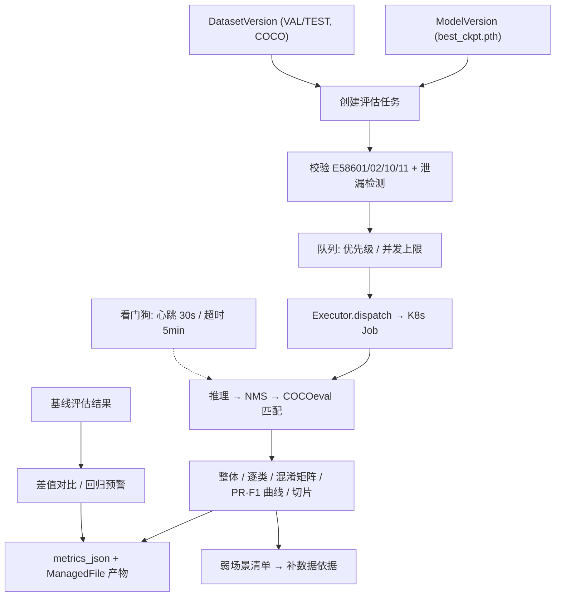
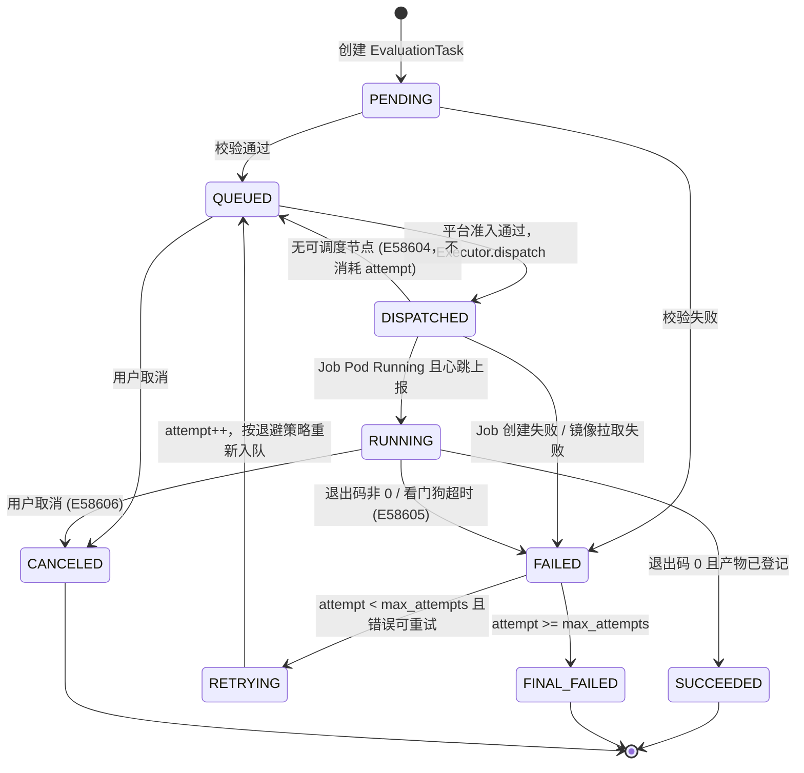
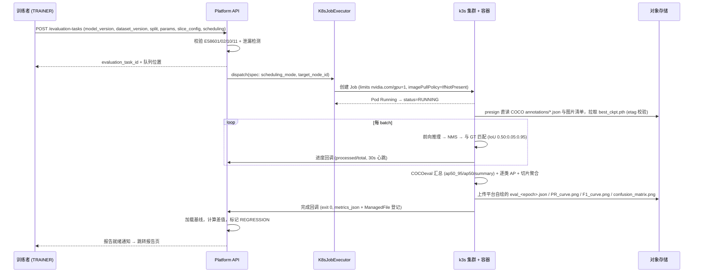
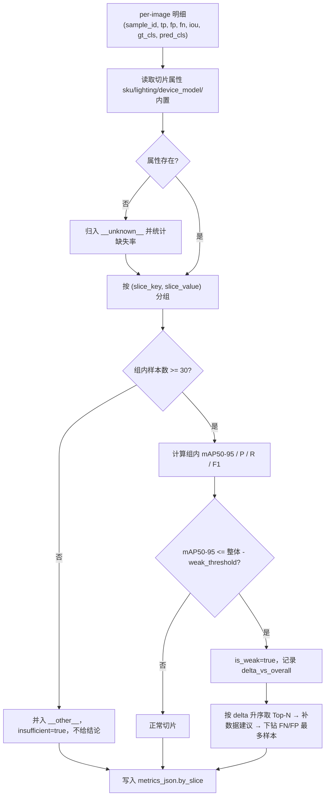
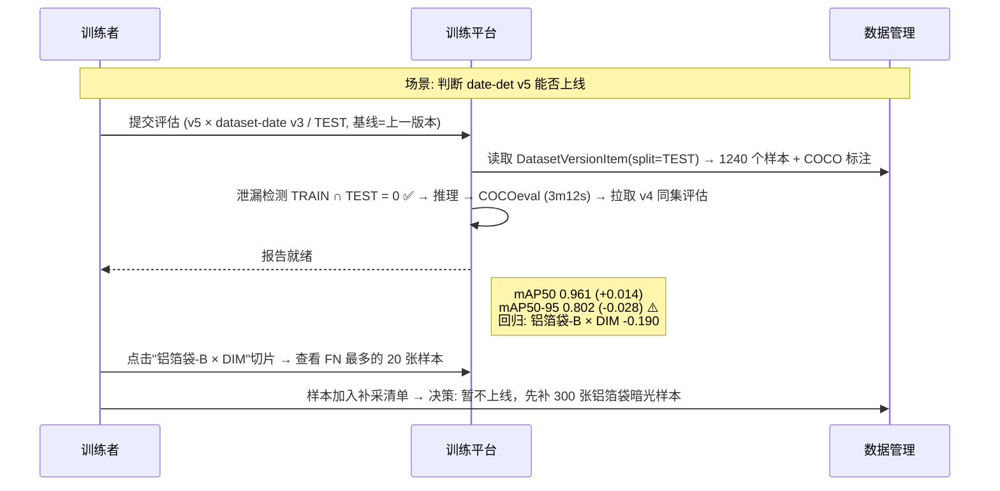
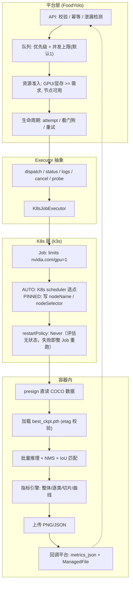

# PRD: P0086_模型评估 (Model Evaluation)
| 属性 | 内容 |
| :--- | :--- |
| **文档编号** | P0086 |
| **项目名称** | FoodYolo 视觉模型训练基建 |
| **功能模块** | M05_训练平台 |
| **当前版本** | v1.0.0 |
| **文档状态** | Draft |
| **作者** | TrainC |
| **最后更新** | 2026-10-01 |

---

## 1. 全局说明

> [!IMPORTANT]
> **核心定位**: 评估是**独立于训练的只读验证动作**。任意 `ModelVersion` 可在任意 `DatasetVersion` 的 `VAL`/`TEST` 切分上反复评估；评估**不修改模型权重**，只产出结构化报告。评估任务复用训练任务的状态机与 `Executor`，是"一种特殊的训练任务"，但拥有独立入口。
> **训练后端**: 首个实现为 **YOLOX（Apache-2.0）**，指标口径以 `pycocotools` COCOeval 为准；已明确不使用 AGPL-3.0 的 Ultralytics YOLO 系。

### 名词解释
*   **EvaluationTask**: 一次"模型 × 数据集版本 × 参数"的评估执行单元，落库 `evaluation_tasks`，经 `Executor` 提交为一个 K8s Job。
*   **ModelVersion**: 不可变权重快照（P0085），含 `best_ckpt.pth`、`latest_ckpt.pth`。
*   **DatasetVersion**: 不可变数据快照（P0041），`status ∈ DRAFTING|READY|FROZEN|ARCHIVED`；成员关系在 `DatasetVersionItem(version_id, sample_id, split)`，`split ∈ TRAIN|VAL|TEST|UNASSIGNED`。
*   **attempt**: 同一 `EvaluationTask` 的执行次数，从 1 开始。重试**不新建实体**，只 `attempt++`。
*   **Executor**: 执行层抽象（定义见 P0082），能力边界 `dispatch / status / logs / cancel / probe`；当前唯一实现 `K8sJobExecutor`（创建 K8s Job）。
*   **exp_file**: YOLOX 的模型结构定义（如 `exps/default/yolox_s.py`），决定网络结构与类别数；评估必须与权重训练时一致。
*   **场景切片 (Slice) / 弱场景 (Weak Slice)**: 按某维度取值把评估样本分组、逐组独立计算指标（如 SKU、光照、拍摄设备）；样本量达标但指标显著低于整体者即弱场景，是补数据的直接依据。
*   **IoU / θ / `test_conf` / `nmsthre`**: 交并比 / 评估匹配阈值 / YOLOX Exp 的评估置信度阈值 / NMS 的 IoU 阈值。四者独立，不得混淆。
*   **AP / mAP50 / mAP50-95 / mAP75**: 单类 PR 曲线下面积（COCO 101 点插值）/ `θ=0.50` 的均值 / `θ∈{0.50…0.95}` 10 个阈值的均值（即 COCO `AP`）/ `θ=0.75` 的均值。
*   **conf_star / 混淆矩阵**: 使 F1 最大的置信度阈值（报告中 P/R/F1 取该阈值处的值并随报告输出）/ 预测类 × 真值类计数矩阵，含 `background` 行列，用于定位漏检与误检。
*   **基线 (Baseline) / 字符转写**: 用于差值对比的参照评估结果，通常为同 `Model` 上一版本 / 检测框上的文本字段（P0065），**本模块不评估它**，OCR 指标第二阶段单独定义。

### 统一异常处理

> E 码格式：`E` + 模块号(1位) + P 编号后两位(2位) + 流水(2位)。P0086 占用 `E58601` - `E58699`。
| Code | 场景 | 处理策略 |
| :--- | :--- | :--- |
| `E58601` | 数据集版本不存在 / 非 `READY`、`FROZEN` / 选了 `TRAIN` 切分 | 拒绝提交，提示"请选择已就绪的 VAL 或 TEST 切分" |
| `E58602` | 权重文件缺失或 `ManagedFile.status != COMMITTED` | 拒绝提交，提示"模型权重不可用：{file_id}" |
| `E58603` | 指标计算失败（COCO 标注非法、框越界、类别越界） | 置 `FAILED`，跳过该样本并计数；跳过率 > 5% 报告标红 |
| `E58604` | 集群无可调度节点 / GPU 不足 / 指定节点已下线 | 停留 `QUEUED`，**不消耗 `attempt`**，不判失败 |
| `E58605` | 看门狗超时（5min 无心跳） | 平台判 `FAILED`，按 P0087 策略重试 |
| `E58606` | 用户主动取消 | 置 `CANCELED`，不重试，不计入失败率 |
| `E58607` | 切片维度不存在 / 取值基数 > 200 | 非阻断：归入 `__unknown__` 或 `__other__`，报告顶部告警 |
| `E58608` | 基线与本次不可比（版本/切分/参数/口径不一致） | 禁止差值计算，展示一致性差异明细 |
| `E58609` | 报告导出失败 | 提示"导出失败：存储空间不足"，报告页数据仍可读 |
| `E58610` | 模型类别数与数据集类别数不一致 | 拒绝提交，列出差异类别清单 |
| `E58611` | 目标 split 内无样本或无标注实例 | 拒绝提交 |
| `E58612` | 同模型版本 + 同数据集版本 + 同参数重复提交 | 返回已有 `evaluation_task_id`，不重复执行 |
| `E58613` | 检测到评估集与 TRAIN 的样本重叠，或同一 `group_key`（同源视频/采集批次/会话）跨 split（数据泄漏） | 继续执行，报告强制标红并列出重叠 `sample_id` / `group_key` 前 20 条 |

---

## 2. 项目背景

### 背景 (Context)
P0084 展示的验证指标只是**训练脚本内部对 `VAL` 的一次快照**，绑死在"这一次训练"上：换超参、换 `input_size`、换随机种子，数字就不可比。首个任务（食品包装生产日期区域检测）产线上真正的疑问是：这个模型在我这条产线的光照下准不准？换到铝箔袋 SKU 会不会崩？v5 比 v4 到底好还是差？

### 问题陈述 (Problem Statement)
1. **评估与训练耦合**: 想评估历史模型必须重跑训练脚本，没有"拿旧模型在固定测试集跑一遍"的独立入口。
2. **指标单一**: 只有整体 mAP，无法回答"哪个场景不行"——整体 0.92 背后可能是暗光切片只有 0.41。
3. **不可复现**: 指标散落在容器 stdout 与训练目录里，没有参数快照与引擎版本，两个月后无人能复现。
4. **版本回归无感知 / 评估抢占训练**: 缺少与上一版本的自动差值对比，退化常在上线后才发现；评估这类临时短任务与训练挤在同一执行路径上会互相阻塞。

### 目标与成功指标 (Goals & Success Metrics)
*   **北极星指标**: 每个进入部署推理环节的 `ModelVersion` 都有一次 `SUCCEEDED` 的 `EvaluationTask`（覆盖率 **100%**）。
*   **次要指标**: 5000 样本 `VAL`、单卡评估，提交到报告可读 **< 5 分钟**；报告可导出 JSON 供外部 CI 直接断言；弱场景识别覆盖 ≥ 3 个维度且可下钻到样本。
*   **风险与规避**:
| 风险 | 影响 | 规避方案 |
| :--- | :--- | :--- |
| 评估集混入训练样本 | 指标虚高，上线翻车 | 提交时校验 `split` + 重叠检测（`E58613`），报告强制标注 |
| 切片元数据缺失 | 切片全落 `__unknown__`，失去归因能力 | 内置维度兜底（分辨率/批次/难例标记）；缺失率 > 30% 告警 |
| 评估挤占训练 GPU | 训练排队变慢 | 评估默认并发上限 1，`priority` 不高于 `NORMAL` |
| 小样本切片产生噪声结论 | 误导补数据决策 | `min_samples=30` 阈值，不达标并入 `__other__` 并标注 |
| 指标口径漂移 / `exp_file` 与权重不匹配 | 报告不可比 / 加载失败或类别错位 | `metric_engine_version` 参与可比性校验；提交时比对 `exp_file` 与类别数（`E58610`） |

---

## 3. 价值模型
*   **方案**: 把评估从"训练脚本里的一个标志位"提升为一等公民任务。复用 `TrainTask` 状态机与 `K8sJobExecutor`，独立提交、排队、重跑；产出结构化报告：整体指标 + 每类 AP + 混淆矩阵 + PR/F1 曲线 + 场景切片 + 基线差值；所有数字附带**可复现参数快照**（`params_json` + `metric_engine_version` + 权重 `etag` + 镜像 `digest`）。
*   **目标**: "这个模型能不能上产线"的决策时间从"半天翻日志"降到"5 分钟看报告 + 1 分钟看弱场景"。

---

## 4. 项目范围



### In Scope
1. **独立评估提交**: 任意 `ModelVersion` × 任意 `DatasetVersion` × `VAL`/`TEST`，与训练解耦。
2. **指标全集**: `mAP50`、`mAP50-95`、`mAP75`、per-class `AP50/AP50-95/AP75`、`precision`、`recall`、`F1`、混淆矩阵、PR 曲线、F1-Confidence 曲线。
3. **场景切片评估**: 按 SKU / 光照 / 拍摄设备 / 内置维度分组统计，产出弱场景清单与样本下钻。
4. **基线对比**: 与指定或自动推断的基线做差值对比，红绿高亮，回归预警。
5. **报告与导出**: 只读报告页 + 导出 JSON / CSV / PNG / ZIP。
6. **任务治理**: 复用 `TrainTask` 状态机（含 `RETRYING`/`FINAL_FAILED`）、`Executor`、进度与日志流、可指定执行节点。

### Out of Scope
*   **OCR / 字符转写指标**（字符准确率、字段级召回）——第二阶段独立模块；本模块只评估检测框几何。
*   **逐图人工复核工作台**（属标注中心与 P0111 在线试跑）。
*   **鲁棒性/对抗性测评**（模糊、噪声、旋转等合成扰动下的退化测试）。
*   **自动超参搜索 / 模型集成 / 多模型投票**。
*   **训练过程内的实时验证指标**（P0084 职责）与**自动触发部署**（P0110 职责）。

---

## 5. 业务流程

### 5.1 评估任务状态机（复用 TrainTask 状态机）



### 5.2 评估执行时序



### 5.3 弱场景归因流程



---

## 6. 用户分析

### 6.1 用户画像 (User Personas)
| 角色 | 职责 | 核心诉求 | 痛点 |
| :--- | :--- | :--- | :--- |
| **训练者 (TRAINER)** | 训练并迭代日期检测模型，决定哪版可上线 | "不重跑训练，把上个月那版在固定测试集再跑一遍，并告诉我比上一版好还是差" | 评估入口只有训练脚本；指标不可复现；版本差异靠手抄 |
| **质检/标注负责人 (ANNOTATOR)** | 补充与修正数据 | "告诉我模型在哪种场景不行，我去补那种数据" | 只拿到"整体 mAP 偏低"这种无法行动的结论 |
| **管理员 (ADMIN)** | 保障 GPU 资源与平台稳定 | "评估任务别把训练的卡占满" | 长短任务混在一队列，缺并发上限控制 |

### 6.2 用户链路图 (User Journey Map)



---

## 7. 功能需求

### M05.F01 评估任务创建 (Evaluation Task Submission)
*   **用户故事**: 作为训练者，我希望对任意历史 `ModelVersion` 在指定 `DatasetVersion` 上发起评估，以便不依赖训练流程就得到可复现的指标。
*   **逻辑与业务规则**
    *   **前置条件**: 角色 ∈ `ADMIN`/`TRAINER`；`DatasetVersion.status ∈ {READY, FROZEN}` 且目标 `split` 内样本数 ≥ 1 且有标注实例；权重 `ManagedFile.status = COMMITTED`；`ModelVersion.lineage.exp_file` 存在且类别数与数据集 `LabelClass` 集合一致（按名称对齐，顺序可不同）。
    *   **主流程**: ① 选模型版本 → ② 选数据集版本并读 `split_stats` 展示 `VAL`/`TEST` 样本数 → ③ 确认参数（见 8.2）→ ④ 选切片维度 → ⑤ 选基线策略 → ⑥ 选调度方式（`AUTO` 交给 K8s scheduler / `PINNED` 指定节点，用于必须与训练同卡型复现的场景）→ ⑦ 泄漏检测（比对评估集 `sample_id` 与同数据集 `TRAIN` 集合，并校验同版本内 `DatasetVersionItem.group_key` 未跨 split——`group_key` 真源在 `DataSample`，版本侧为快照副本）→ ⑧ 落库 `PENDING`，校验通过转 `QUEUED`。
    *   **幂等**: 以 `(model_version_id, dataset_version_id, split, params_hash)` 为幂等键；命中已有 `QUEUED`/`RUNNING`/`SUCCEEDED` 时返回 `E58612` 与已有 `id`。
    *   **后置条件**: 任务入队，列表可见状态与队列位置。
*   **验收标准**
    ```gherkin
    场景: 对历史模型版本发起评估
      Given ModelVersion "date-det v5" 的 best_ckpt.pth 状态为 COMMITTED
      And DatasetVersion "date-2026Q3 v3" 状态为 FROZEN，TEST 切分有 1240 个样本
      When 训练者以 split=TEST、baseline_mode=PREVIOUS_VERSION、scheduling_mode=AUTO 提交评估
      Then 系统创建 evaluation_task，status=QUEUED，列表显示队列位置与预估等待

    场景: 类别体系不一致时拒绝提交，泄漏时强提示
      Given ModelVersion 的 exp_file 定义类别为 ["production_date","qrcode"]，数据集类别为 ["production_date"]
      And TEST 切分中有 12 个 sample_id 同时出现在 TRAIN 切分
      When 用户提交评估
      Then 返回 E58610 且不创建 evaluation_task 记录
      And 若类别一致则正常入队并置 leakage_warning=true，报告页顶部显示泄漏红色横幅（重叠判定同时覆盖 `sample_id` 与同源 `group_key`）
    ```
*   **边界情况与异常处理**
    | 场景 | 处理 |
    | :--- | :--- |
    | `DatasetVersion.status = DRAFTING` / 权重已被 GC | 拒绝 `E58601` / `E58602`，给出"先冻结版本"跳转或标注该版本不可评估 |
    | 用户选择 `TRAIN` 切分 / 连点提交 | 前端禁选且 API 层拒绝；幂等键去重返回首个 `evaluation_task_id` |
    | 评估并发已满 / 集群无可用 GPU / 指定节点下线 | 保持 `QUEUED`（`E58604`），不消耗 `attempt`、不判失败 |

### M05.F02 指标计算与报告生成 (Metric Engine & Report)
*   **用户故事**: 作为训练者，我希望评估结束后直接看到一套口径统一、参数可追溯的指标，以便把它当作上线判据。
*   **逻辑与业务规则**
    *   **前置条件**: K8s Job 退出码为 0 且回传 per-image 匹配明细。
    *   **主流程**: ① 容器按 Exp 的 `data_dir` + `val_ann`/`test_ann` 读取 COCO 标注与图片，逐 batch 前向推理并 NMS → ② 与 GT 贪心匹配，累计 per-image `TP/FP/FN` → ③ `pycocotools` COCOeval 计算 `AP / AP50 / AP75` 与逐类 AP → ④ 平台指标引擎扩展计算 `conf_star` 处的 `P/R/F1`、混淆矩阵、PR 曲线、F1-Confidence 曲线 → ⑤ 生成可视化与结构化产物 `eval_<epoch>.json`、`PR_curve.png`、`F1_curve.png`、`confusion_matrix.png` 与报告 `report.json`——**这四类文件均为平台自绘生成，YOLOX evaluator 只返回 `(ap50_95, ap50, summary)`** → ⑥ 汇总指标写入 `EvaluationTask.metrics_json`，产物登记为 `ManagedFile` → ⑦ 记录 `metric_engine_version`。
    *   **关键口径（不得各版本自行解释）**: 按 `test_conf`（平台为保 PR 曲线完整下调至 `0.001`）过滤后按置信度降序贪心匹配，一个 GT 只被匹配一次；`IoU >= θ` 且类别一致才算 TP；类别不一致的高 IoU 预测同时计入该 GT 的 FN 与该预测的 FP，并落在混淆矩阵非对角格；`mAP50`/`mAP50-95` 只对**有实例的类别**求平均；报告 P/R/F1 取 `conf_star` 处。
    *   **`eval_<epoch>.json` 命名**: `epoch` 取被评估 checkpoint 的训练 epoch（来自 `ModelVersion.lineage.epoch`），独立评估不凭空造 epoch。
    *   **后置条件**: `status=SUCCEEDED`，`metrics_json` 与产物可读。
*   **验收标准**
    ```gherkin
    场景: 计算并展示完整指标
      Given 一个 SUCCEEDED 的评估任务，TEST 集 1240 张、单类别 production_date
      When 打开评估报告页
      Then 展示 mAP50 / mAP50-95 / mAP75 / precision / recall / F1 与 conf_star、类别明细行
      And 展示混淆矩阵（含 background 行列）、PR 曲线与 F1-Confidence 曲线，且与 metrics_json.overall 一致

    场景: 报告可复现
      Given 报告记录了 params_json 与 metric_engine_version
      When 用相同参数、相同权重 etag、相同数据集版本重跑评估
      Then 所有标量指标差异 < 1e-6
    ```
*   **边界情况与异常处理**
    | 场景 | 处理 |
    | :--- | :--- |
    | 某类别在评估集中无实例 | 不参与 mAP 平均，行标 `no_instance=true`，避免被 0 分拉低 |
    | COCO 标注框越界或 `category_id` 越界 | 计入 `skipped_samples` 并继续；跳过率 > 5% 报告标红 |
    | 模型未检出任何框 | 正常出报告：`recall=0`，混淆矩阵全落在 `background FN` 列，不报错 |
    | `exp_file` 与权重不匹配（shape mismatch）/ 类别数 > 50 | 判 `FAILED` 并提示检查 `exp_file`；矩阵 PNG 分页导出，Web 端改可搜索热力表 |

### M05.F03 场景切片评估 (Slice-based Evaluation)
*   **用户故事**: 作为训练者，我希望看到模型在不同 SKU、光照条件、拍摄设备下的分别表现，以便定位薄弱场景并指导补数据。
*   **逻辑与业务规则**
    *   **切片维度来源**: `METADATA` 类维度 `sku`（纸盒-A/铝箔袋-B/PET瓶-C，来自采集或导入时写入的样本属性）、`lighting`（BRIGHT/NORMAL/DIM/BACKLIT/GLARE，来自采集 SOP 打标或导入映射）、`device_model`（拍摄 EXIF，P0003）；`BUILTIN` 类维度 `source_id`（`DataSample.import_task_id`/`capture_task_id`）、`resolution`（`DataSample.width/height` 分桶）、`is_hard_example`（难例回流标记）。
    *   **主流程**: ① 按 `slice_key` 分桶，每桶独立算 `mAP50-95/mAP50/P/R/F1` → ② 样本数 `< min_samples` 的桶并入 `__other__` 并标 `insufficient=true` → ③ 属性缺失样本入 `__unknown__` 桶**单独统计、不隐藏**，并展示各维度缺失率 → ④ 弱场景判定 `mAP50-95 <= 整体 - weak_threshold` 且样本量达标 → ⑤ 弱场景按 `delta_vs_overall` 升序取 Top-N（默认 5）生成补数据建议 → ⑥ 下钻到该切片 FN/FP 最多的 `sample_id`。
    *   **基数限制**: 单维度取值数上限 200；超限只展示样本数 Top-20，其余入 `__other__`（`E58607`）。
    *   **后置条件**: 切片指标写入 `metrics_json.by_slice`（结构见 8.1）。
*   **验收标准**
    ```gherkin
    场景: 按光照切片识别弱场景
      Given 一次评估整体 mAP50-95 = 0.802，lighting=DIM 桶有 210 个样本且 mAP50-95 = 0.705
      When 打开报告的"场景切片"页
      Then lighting 维度展示 BRIGHT / NORMAL / DIM / GLARE / __unknown__ 五个桶
      And DIM 桶标记 is_weak=true 并高亮 delta=-0.107，弱场景清单第 1 条为 DIM

    场景: 样本不足或属性缺失时不产生错误结论
      Given GLARE 桶只有 11 个样本而 min_samples=30，且数据集未写入 sku 属性
      When 查看切片表
      Then GLARE 行 insufficient=true 且不参与弱场景判定，不产生补数据建议
      And sku 维度显示单一 __unknown__ 桶且 missing_rate=1.0，顶部告警"sku 维度无有效取值"
    ```
*   **边界情况与异常处理**
    | 场景 | 处理 |
    | :--- | :--- |
    | 某维度 300 个取值 | 只展示样本数 Top-20，其余 `__other__`；基数 > 200 报 `E58607` |
    | 某桶有图无框（实例数 0） | `mAP` 记 `null`，只统计 `recall=0` 与无目标误检数 |
    | 一图多 SKU | 以样本属性为准；属性为多值列表时样本计入每个取值，报告显式说明桶计数之和 > 总样本数 |
    | 切片聚合拖慢评估 / 需自定义维度 | 不重复推理，仅在 per-image 结果上内存 group by；允许从样本属性任选 key（基数 ≤ 200）存为 `slice_config` 预设 |

### M05.F04 基线对比与差值高亮 (Baseline Diff)
*   **用户故事**: 作为训练者，我希望报告自动把本次结果与上一版模型对比并高亮差异，以便一眼看出是进步还是退化。
*   **逻辑与业务规则**
    *   **基线解析**: `PINNED` → 用指定 `baseline_evaluation_task_id`；`PREVIOUS_VERSION` → 取同 `Model` 下版本号小于本次的最大 `ModelVersion`，再取其在**相同 `dataset_version_id` + 相同 `split`** 上最近一次 `SUCCEEDED` 评估；找不到则展示"无可用基线"。
    *   **可比性校验（不通过报 `E58608`，禁止任何差值数字）**: `dataset_version_id` 相同；`split` 相同；`params_json` 中 `eval_iou_list`/`test_size`/`test_conf`/`nmsthre` 相同；类别集合相同；`metric_engine_version` 相同（不同则降级为"仅供参考"水印）。
    *   **差值展示规则**: `Δ >= +0.010` 绿色 `▲`；`-0.010 < Δ < +0.010` 灰色视为持平；`Δ <= -0.010` 红色 `▼`；整体 `mAP50-95` 差值 `<= -0.020` 触发报告顶部 `REGRESSION` 横幅并写告警中心；某类别 `AP50-95` 差值 `<= -0.050` 时该行标红并在弱场景清单附"类别退化"条目。
    *   **后置条件**: 报告含 `baseline` 与 `delta` 区块；回归写 `Alert(alert_alerts)`。
*   **验收标准**
    ```gherkin
    场景: 自动对比上一版本
      Given Model "date-det" 有 v4 与 v5，且 v4 在 dataset-date v3/TEST 上已有 SUCCEEDED 评估
      When 对 v5 提交评估且 baseline_mode=PREVIOUS_VERSION
      Then 报告并排显示 v5 与 v4 指标
      And mAP50 差值 +0.014 显示为绿色 ▲，mAP50-95 差值 -0.008 显示为灰色（持平）

    场景: 触发回归预警与不可比保护
      Given 基线整体 mAP50-95 = 0.830，本次 = 0.802，且基线数据集版本为 v2 而本次为 v3
      When 报告生成
      Then 顶部显示 REGRESSION 横幅并写告警中心
      And 基线区返回 E58608 并展示"不可比: 数据集版本不一致 (v2 vs v3)"，不展示任何差值数字
    ```
*   **边界情况与异常处理**
    | 场景 | 处理 |
    | :--- | :--- |
    | 基线来自旧 `metric_engine_version` | 允许对比但全局加"口径不同"水印 |
    | 上次版本评估 `VAL`，本次 `TEST` | `E58608`，提示 split 不一致 |
    | 基线产物已被 GC | 仅用已落库的 `metrics_json` 标量值对比，曲线对比 Tab 隐藏 |
    | 版本号不连续（v3 后直接 v5）/ 本次经重试后成功 | 取版本号小于本次的最大者；差值基于最终 `attempt` 结果并在报告中注明 |

### M05.F05 评估报告导出 (Report Export)
*   **用户故事**: 作为训练者，我希望把评估结果导出为 JSON / CSV / 图片，以便进入外部流水线做自动断言或写进上线评审材料。
*   **逻辑与业务规则**
    | 格式 | 文件名 | 内容 |
    | :--- | :--- | :--- |
    | JSON | `evaluation_report.json` | 任务元信息、参数快照、整体/逐类/切片指标、基线差值、泄漏标记 |
    | JSON | `eval_<epoch>.json` | 评估明细：evaluator 返回的 `ap50_95`/`ap50`/`summary` + per-image `TP/FP/FN` |
    | CSV | `metrics.csv` / `slices.csv` | `class, ap50, ap50_95, ap75, precision, recall, f1, instance_count, no_instance` / `slice_key, slice_value, sample_count, map50, map50_95, precision, recall, f1, delta_map50_95, is_weak` |
    | PNG | `PR_curve.png` / `F1_curve.png` / `confusion_matrix.png` | 平台自绘可视化产物（非 YOLOX 原生） |
    | ZIP | `evaluation_{task_id}.zip` | 以上全部 + `params.json` + 弱场景失败样本清单 |
    *   仅 `SUCCEEDED` 可导出指标；`FAILED`/`FINAL_FAILED` 只允许导出**诊断包**（日志 + 参数 + 错误码），不含指标。
    *   JSON `schema_version` 固定 `1.0`，字段只增不改、新增字段必须可选；指标保留 **6 位小数**避免进位歧义。
    *   导出同步生成（产物已存在则直接打包），耗时上限 10s，超时转异步并通知。
*   **验收标准**
    ```gherkin
    场景: 导出 JSON 供 CI 断言
      Given 评估任务已 SUCCEEDED
      When 用户点击"导出 JSON"
      Then 下载 evaluation_report.json，schema_version = "1.0" 且含整体指标、逐类 AP、切片数组与 baseline 区块
      And 可用 jq 断言 ".overall.map50_95 >= 0.80"

    场景: 失败任务只允许导出诊断包
      Given 任务状态为 FINAL_FAILED，error_code=E58603
      When 打开导出菜单
      Then 仅提供"导出诊断包(ZIP)"，不提供指标 CSV / JSON 导出
    ```
*   **边界情况与异常处理**
    | 场景 | 处理 |
    | :--- | :--- |
    | 磁盘空间不足 | `E58609`，提示所需空间并给出清理入口 |
    | JSON 过大（切片维度过多） | 切片数组超 5000 行截断至 Top-2000 并写 `slices_truncated=true` |
    | 下载中断 / 并发导出同一任务 | 支持 Range 断点续传；ZIP 落 `_exports/` 保留 7 天；`(task_id, format)` 加锁复用产物 |
    
---

## 8. 技术架构与数据模型

### 8.1 数据实体

> 遵循全局裁定：**产物文件一律走 `ManagedFile`，不新建 Artifact 表；汇总指标用 JSONB 挂在执行实体上，不新建 Metric 表。**
> `ManagedFile.owner_type` 全集（8 值，不再新增）：`DATASET_VERSION | MODEL_VERSION | TRAIN_TASK | CAPTURE_TASK | CLIENT_UPLOAD | PIPELINE_STAGE_RUN | EVALUATION_TASK | AUDIT_LOG`。评估产物登记为 `owner_type=EVALUATION_TASK`、`owner_id=evaluation_tasks.id`；**被评估模型的训练产物（`latest_ckpt.pth` / `best_ckpt.pth` / `train_log.txt` 等）仍归 `TRAIN_TASK`，不因被评估而改归属**。

#### Table: `evaluation_tasks`
| 字段名 | 类型 | 必填 | 说明 | 约束 |
| :--- | :--- | :--- | :--- | :--- |
| `id` | UUID | Y | 主键 | PK |
| `name` | String | Y | 默认 `eval-{model}-{version}-{dataset}-{split}` | 1-128 chars |
| `model_version_id` / `dataset_version_id` | UUID | Y | 被评估模型版本 / 评估数据集版本 | FK → `model_versions.id` / `dataset_versions.id` |
| `split` | Enum | Y | 目标切分 | `VAL` / `TEST` |
| `status` | Enum | Y | 任务状态 | `PENDING/QUEUED/DISPATCHED/RUNNING/SUCCEEDED/FAILED/RETRYING/FINAL_FAILED/CANCELED` |
| `attempt` / `max_attempts` | Int | Y | 当前尝试 / 最大尝试 | 默认 1 / 4（1 次初始 + 3 次重试） |
| `priority` | Enum | Y | 优先级 | `LOW`/`NORMAL`/`HIGH`，默认 `NORMAL` |
| `scheduling_mode` / `target_node_id` | Enum / UUID | Y/N | 调度方式与指定节点 | `AUTO`（K8s scheduler）/ `PINNED`；后者必填并写入 Pod `nodeName` |
| `node_id` / `environment_image_id` | UUID | N/Y | 实际执行节点 / 执行镜像 | FK → `train_nodes.id` / `environment_images.id`（记 `digest`） |
| `params_json` / `params_hash` | JSONB / String(64) | Y | 参数快照与指纹 | `sha256(canonical(params_json))`，幂等与可比性键 |
| `slice_config` | JSONB | N | 切片维度配置 | `[{"key":"lighting","type":"METADATA"}]` |
| `baseline_mode` / `baseline_evaluation_task_id` | Enum / UUID | Y/N | 基线策略与指定基线 | `PREVIOUS_VERSION`/`PINNED`/`NONE`；`PINNED` 时必填 |
| `leakage_warning` / `leakage_sample_count` | Boolean / Int | Y | 泄漏标记与重叠数 | 默认 false / 0 |
| `progress` / `processed_images` / `total_images` | Float / Int | Y | 进度与计数 | 进度回调更新；提交时写 `total_images` |
| `metrics_json` | JSONB | N | **汇总指标（真源）** | 成功时写入，结构见下 |
| `error_code` / `error_message` | String / Text | N | 错误码与摘要 | `E58xxx`；摘要截断 2000 字符 |
| `metric_engine_version` | String | N | 指标引擎版本 | 成功时写入，参与基线可比性校验 |
| `report_uri` / `log_uri` / `heartbeat_at` / `executor_ref` | String / timestamptz | N | 报告与日志对象键 / 最近心跳（超 5min 未更新判离线）/ 执行层引用 K8s Job 名 | 如 `job/eval-8f3a1c` |
| `created_by` | UUID | Y | 创建者 | FK → `users.id` |
| `created_at` / `updated_at` / `started_at` / `finished_at` / `deleted_at` | timestamptz | Y/N | 时间戳与软删除 | 删除与 `ModelVersion` 解耦，不影响权重 |

**Unique（部分唯一索引）**: `(model_version_id, dataset_version_id, split, params_hash) WHERE status IN ('QUEUED','RUNNING','SUCCEEDED')`。
**Index**: `(dataset_version_id, split, status)`；`(model_version_id, created_at DESC)`。

#### `EvaluationTask.metrics_json` 结构（指标与切片数据的唯一真源）

```json
{
  "schema_version": "1.0", "metric_engine_version": "1.0.3", "params_hash": "3f9c…",
  "overall": { "map50": 0.961, "map50_95": 0.802, "map75": 0.881, "precision": 0.938,
               "recall": 0.912, "f1": 0.925, "conf_star": 0.341, "tp": 1174, "fp": 59, "fn": 113,
               "instance_count": 1287, "pred_count": 1233, "sample_count": 1240, "skipped_samples": 0 },
  "per_class": [ { "class_name": "production_date", "ap50": 0.961, "ap50_95": 0.802, "ap75": 0.881,
                   "precision": 0.938, "recall": 0.912, "f1": 0.925, "instance_count": 1287, "no_instance": false } ],
  "confusion_matrix": { "labels": ["production_date", "background"], "matrix": [[1174, 113], [59, 0]] },
  "artifacts": { "eval_json": "…/eval_30.json", "pr_curve": "…/PR_curve.png", "f1_curve": "…/F1_curve.png",
                 "confusion": "…/confusion_matrix.png" },
  "by_slice": {
    "lighting": {
      "dimension_type": "METADATA", "missing_rate": 0.032, "min_samples": 30, "weak_threshold": 0.05,
      "slices": [
        { "slice_value": "NORMAL", "sample_count": 610, "instance_count": 633, "map50": 0.972, "map50_95": 0.845,
          "precision": 0.950, "recall": 0.930, "f1": 0.940, "per_class_ap": { "production_date": 0.845 },
          "delta_vs_overall": { "map50_95": 0.033, "recall": 0.018 }, "is_weak": false, "insufficient": false },
        { "slice_value": "DIM", "sample_count": 210, "instance_count": 221, "map50": 0.901, "map50_95": 0.705,
          "precision": 0.88, "recall": 0.79, "f1": 0.83, "per_class_ap": { "production_date": 0.705 },
          "delta_vs_overall": { "map50_95": -0.107 }, "is_weak": true, "insufficient": false },
        { "slice_value": "__unknown__", "sample_count": 40, "instance_count": 41, "map50": 0.930,
          "map50_95": 0.790, "is_weak": false, "insufficient": false }
      ] },
    "sku": { "dimension_type": "METADATA", "missing_rate": 0.04, "slices": [ "…" ] }
  },
  "weak_slices": [ { "slice_key": "lighting", "slice_value": "DIM", "sample_count": 210, "map50_95": 0.705,
                     "delta_map50_95": -0.107, "is_weak": true,
                     "top_fn_samples": ["s_8123", "s_9077"], "top_fp_samples": ["s_4410"] } ],
  "baseline": { "evaluation_task_id": "…", "model_version_id": "…", "comparable": true,
                "delta": { "map50": 0.014, "map50_95": -0.028, "map75": -0.014, "precision": 0.017,
                           "recall": -0.018, "f1": 0.000 }, "regression": true, "incomparable_reasons": [] },
  "leakage": { "warning": false, "sample_count": 0, "sample_ids": [], "group_keys": [] }
}
```
*   `by_slice.<slice_key>.slices[]` 每项即一个切片的完整记录：取值、样本/实例数、四项指标、逐类 AP、相对整体差值、弱场景与样本不足标记。特殊取值 `__unknown__`（属性缺失）、`__other__`（并入的小样本桶）。
*   产物文件**不落此 JSON 内容**，仅登记 `ManagedFile` 行；`artifacts` 存对象键作展示索引。

### 8.2 指标计算契约与参数默认值
| 指标 | 定义 | 口径 |
| :--- | :--- | :--- |
| `AP`（`mAP50-95`） | 10 个 IoU 阈值下各类 AP 的均值 | `pycocotools` COCOeval，101 点插值 |
| `AP50`（`mAP50`）/ `AP75`（`mAP75`） | `θ=0.50` / `θ=0.75` 下各类 AP 的均值 | 仅含 `instance_count > 0` 的类别 |
| per-class AP | 单类 `(AP, AP50, AP75)` | COCOeval `per_category` 输出 |
| `precision` / `recall` / `F1` | `TP/(TP+FP)` / `TP/(TP+FN)` / `2PR/(P+R)` | 取 `conf_star = argmax_conf F1` |
| 混淆矩阵 | 预测类 × 真值类计数 | `conf=conf_matrix_thr`，`θ=0.50`，含 `background` |
| PR 曲线 / F1-Confidence 曲线 | 逐类 `(recall, precision)` 随 `conf` 变化点集 / 逐类 `(conf, F1)` 点集 | 101 点采样 / `conf ∈ [0,1]` 采样 100 点 |
| 参数 | 默认值 | 说明 |
| :--- | :--- | :--- |
| `exp_file` | 取自 `ModelVersion.lineage.exp_file` | YOLOX 模型结构定义；不匹配则加载失败 |
| `input_size` / `test_size` / `batch_size` / `fp16` | `(640,640)` / `(640,640)` / `16` / `false` | 训练与测试分辨率（H×W）/ 评估 batch（OOM 时由 P0087 降档）/ FP16 |
| `test_conf` / `nmsthre` / `eval_interval` | `0.01` / `0.65` / `10` | YOLOX Exp 的评估置信度阈值与 NMS IoU（平台为保 PR 曲线召回完整会把推理下限降至 `0.001`，并在报告中输出 `conf_star`）/ 框架评估与存盘节奏 |
| `eval_iou_list` / `conf_matrix_thr` | `[0.50,0.55,…,0.95]`（10 档）/ `0.25` | 改动后与基线不可比 / 混淆矩阵阈值 |
| `conf_star` | 自动求解 | 报告 P/R/F1 所用阈值，随报告输出 |
| `min_samples` / `weak_threshold` | `30` / `0.05` | 切片最小样本量 / 弱场景差值阈值 |
| `leakage_check` / `seed` | `true` / `0` | 泄漏检测开关 / 可复现性记录 |

### 8.3 执行架构



---

## 9. UI/UX 规格说明

### 9.1 评估任务创建

```text
+---------------------------------------------------------------+
|  新建评估任务                                          [✕]     |
+---------------------------------------------------------------+
|  模型版本 *                                                     |
|   date-det v5 [▾]   ├ v5 2026-09-28  mAP50-95 0.830  ← 选中     |
|                     ├ v4 2026-09-20  mAP50-95 0.845             |
|                     └ v3 2026-09-11  (未评估)                   |
|  数据集版本 *  [ date-2026Q3 v3 (FROZEN) ▾ ]                    |
|  评估切分 *    ( ) VAL    (•) TEST        TEST: 1240 样本        |
|  ── 高级参数 ────────────────────────────────────────────────  |
|  input_size [640▾]  batch_size [16]  test_size [640▾]  [ ]fp16  |
|  test_conf [0.01]   nmsthre [0.65]   eval_interval [10]  矩阵阈值 [0.25] |
|  ── 场景切片 ────────────────────────────────────────────────  |
|  [✓] sku (覆盖 96%)  [✓] lighting (88%)  [✓] device_model (71%) |
|  [ ] resolution (内置)    最小样本量 [30]  弱场景阈值 [0.05]    |
|  ── 基线 / 调度 ─────────────────────────────────────────────  |
|  基线: (•) 同模型上一版本   ( ) 指定评估   ( ) 不对比            |
|  调度: (•) 自动（K8s scheduler）  ( ) 指定节点 [gpu-node-01 ▾]  |
|  ⚠ 检测到 12 个样本同时存在于 TRAIN 与 TEST，报告将标注泄漏风险  |
+---------------------------------------------------------------+
|                                    [取消]   [提交评估]         |
+---------------------------------------------------------------+
```

### 9.2 评估报告页

```text
+-------------------------------------------------------------------------------+
| ← 返回  eval-date-det-v5-TEST                              [导出 ▾] [重跑]   |
| 🔴 REGRESSION: mAP50-95 较基线下降 0.028（阈值 0.020）                         |
| date-det v5 | dataset-date v3 (TEST) | 1240 样本 | 3m12s | Engine v1.0.3        |
| params input_size=640 batch_size=16 conf_star=0.341 | 权重 etag a91f…           |
+-------------------------------------------------------------------------------+
| 整体指标              本次     基线(v4)    差值                                |
|   mAP50              0.961     0.947     ▲ +0.014     mAP75   0.881  ▼ -0.014  |
|   mAP50-95           0.802     0.830     ▼ -0.028  ←  precision 0.938 ▲ +0.017 |
|   recall             0.912     0.930     ▼ -0.018     F1      0.925   0.000   |
+-------------------------------------------------------------------------------+
| [整体指标][分类明细][混淆矩阵][PR 曲线][F1 曲线][场景切片][基线对比]           |
| 分类明细: production_date  AP50 .961  AP50-95 .802  AP75 .881  P .938 R .912  |
| 混淆矩阵 (conf=0.25, IoU=0.50):  true prod_date → 1174 TP / 113 FN            |
|                                  true background → 59 FP                       |
+-------------------------------------------------------------------------------+
| 场景切片    维度 [lighting ▾] [sku] [device_model]                              |
|   slice      样本   mAP50  mAP50-95  Δmap50-95  状态                            |
|   NORMAL      610   0.972   0.845     +0.033    正常                            |
|   BRIGHT      320   0.968   0.821     +0.019    正常                            |
|   DIM         210   0.901   0.705     -0.107    ⚠ 弱场景                        |
|   GLARE        60   0.880   0.760     -0.042    正常                            |
|   __unknown__  40   0.930   0.790     -0.012    正常   ⚠ device_model 缺失 29%  |
| 弱场景 Top-2: #1 铝箔袋-B × DIM 样本 88  mAP50-95 0.612  Δ-0.190 [查看样本 20] |
|               #2 SKU 铝箔袋-B   样本 240 mAP50-95 0.688  Δ-0.114 [查看样本 20] |
+-------------------------------------------------------------------------------+
```

### 9.3 交互元素
| 元素 | 类型 | 状态 | 行为 |
| :--- | :--- | :--- | :--- |
| 提交评估 | Button | Default / Disabled / Loading | onClick: 校验 → 创建任务 → 跳任务详情 |
| 切分选择 / 切片维度 | Radio / Checkbox | `VAL`·`TEST` / 勾选·未勾选·Disabled | 切换切分刷新样本数（不提供 `TRAIN`）；维度覆盖率 < 5% 置灰并提示"属性缺失" |
| 调度方式 | Radio | `AUTO` / `PINNED` | 切到 `PINNED` 展示可用节点下拉，节点不可用则禁用提交 |
| 指标卡片 / 差值高亮 | Card / Badge | Delta-Green / Delta-Red / Uncomparable | hover 显示口径 tooltip；差值阈值 ±0.010 |
| 弱场景行 | TableRow | Normal / Weak / Insufficient | 点击展开样本下钻抽屉 |
| 导出 / 重跑 | Dropdown / Button | Default / Disabled（非 SUCCEEDED） | 导出 JSON·CSV·ZIP·诊断包；重跑复用 `params_json` 新建任务 |

---

## 10. 非功能性需求 (NFR)
*   **性能与并发**: 5000 张 640×640 单卡（T4 级）端到端评估 < **5 分钟**；COCOeval 与切片聚合（10 个 IoU 阈值）< **60 秒**；报告页首屏标量指标 P95 < **300ms**；同一时刻最多 **1 个**评估任务 `RUNNING`（可配置 1-3），训练运行中时新评估默认排在训练之后。
*   **可靠性 (Reliability)**: 心跳 30s，watchdog 5min 无心跳判离线并进入重试判定；最多 3 次重试（`max_attempts=4`）；OOM 触发的重试自动降低 `batch_size`（策略见 P0087）。
*   **可复现性 (Reproducibility)**: 报告必须携带 `params_json`、`params_hash`、`metric_engine_version`、权重 `etag`、镜像 `digest` 五项；相同五项输入重跑，标量差异 < **1e-6**。
*   **数据保留 (Retention)**: 报告产物在对象存储保留 **180 天**；`metrics_json` 随任务记录永久保留；评估任务记录保留 1 年。
*   **安全 (Security)**: 创建/重跑/取消限 `ADMIN`/`TRAINER`，`VIEWER` 只读报告；容器以非 root 运行、数据只读挂载、禁止挂载 Docker socket；数据访问走 presign URL，签名有效期 ≤ 2 小时；`PINNED` 调度仅 `ADMIN`/`TRAINER` 可用。
*   **兼容性与可观测性**: Web 端 Chrome / Edge 最新两个大版本；`report.json` `schema_version=1.0` 向后兼容；指标 `evaluation_task_duration_seconds`、`evaluation_failures_total{error_code}`；日志落 `_logs/EVALUATION_TASK/{task_id}.log`；评估镜像沿用 P0081 固定 torch 版本（YOLOX 依赖 `torch.cuda.amp.GradScaler`，不得使用 latest）。

---

## 附录: 已确认的设计决策
| 决策项 | 结论 |
| :--- | :--- |
| 评估与训练关系 | **完全解耦**：任意 `ModelVersion` × 任意 `DatasetVersion`，不依赖训练流程 |
| 训练后端与数据格式 | **YOLOX（Apache-2.0）**，不使用 AGPL-3.0 的 Ultralytics；参数与产物命名一律 YOLOX 原生；评估集以 **COCO 格式**提供（`annotations/*.json` + 图片），不使用 `data.yaml` |
| 指标口径 | `pycocotools` COCOeval（101 点插值、10 个 IoU 阈值）；平台在其 per-image 明细上扩展 P/R/F1、混淆矩阵与切片 |
| 执行与调度 | 复用 `Executor`（`K8sJobExecutor`）提交 K8s Job，`restartPolicy: Never`；支持 `AUTO`（K8s scheduler）与 `PINNED`（`target_node_id` → Pod `nodeName`），默认 `AUTO` |
| 任务实体与状态机 | `EvaluationTask(evaluation_tasks)`，**不引入 EvaluationRun**，重试仅 `attempt++`（`max_attempts` 默认 4）；状态机与 `TrainTask` 完全一致（含 `RETRYING`/`FINAL_FAILED`） |
| 指标与产物承载 | **`EvaluationTask.metrics_json`（JSONB）为指标唯一真源**，不新建 Metric 表；产物一律 `ManagedFile`（`owner_type=EVALUATION_TASK`），不新建 Artifact 表 |
| 产物文件名与目录 | 评估输出目录沿用框架 `YOLOX_outputs/<experiment_name>/`；`PR_curve.png`、`F1_curve.png`、`confusion_matrix.png`、`eval_<epoch>.json` 均为**平台自绘生成**（YOLOX evaluator 只返回 `(ap50_95, ap50, summary)`），统一落 `ManagedFile(owner_type=EVALUATION_TASK)` |
| 切片维度与噪声防护 | 元数据（`sku`/`lighting`/`device_model`）+ 内置（`source_id`/`resolution`/`is_hard_example`），基数上限 200；`min_samples=30`、`weak_threshold=0.05`，缺失值独立成 `__unknown__` 桶不隐藏 |
| 基线与差值 | 默认 `PREVIOUS_VERSION`；不可比即禁止差值（`E58608`）；±0.010 为持平带，整体退化 ≥ 0.020 触发回归预警并写 `Alert` |
| 数据泄漏、OCR 与 P/R/F1 口径 | 泄漏提交时检测、允许执行但报告强制标红（`E58613`）；OCR 指标明确排除在本模块之外，第二阶段独立定义；P/R/F1 取 F1 最大的 `conf_star` 处并随报告输出 |
| 错误码区间 | `E58601` - `E58613`（P0086 专属段） |

## 关联文档
*   **P0085_模型仓库与 Lineage** / **P0084_训练日志与指标看板**: `ModelVersion`、`exp_file`、权重来源 / 训练过程内的实时验证指标（与本次独立评估区分）
*   **P0087_断点续训与失败重试** / **P0083_超参数与训练模板**: 评估任务继承的重试与 OOM 降参策略 / `exp_file` 与推理参数来源
*   **P0082_训练任务提交与调度** / **P0080_计算节点与资源池** / **P0081_训练环境与镜像**: 共享的队列、优先级、调度方式与 `Executor` 抽象 / `TrainNode`（K8s Node 镜像视图）/ 固定 torch 版本的评估镜像
*   **P0041_数据集与版本** / **P0065_字符转写与 OCR 标注**: `DatasetVersion` / `DatasetVersionItem` 切分来源 / 第二阶段 OCR 指标的标注来源
*   **P0110_模型服务发布** / **P0132_告警中心**: 消费评估结论决定是否发布 / 接收模型退化告警（`Alert`）

## Changelog
| 版本 | 日期 | 作者 | 变更说明 |
| :--- | :--- | :--- | :--- |
| v0.1.0-draft | 2026-10-01 | TrainC | 初稿创建 |
| v1.0.0 | 2026-10-01 | TrainC | 定稿：训练后端改为 YOLOX、E 码改 5 位格式、功能 ID 从 F01 重排、指标走 `metrics_json`、产物走 `ManagedFile(owner_type=EVALUATION_TASK)`、支持指定节点调度 |
