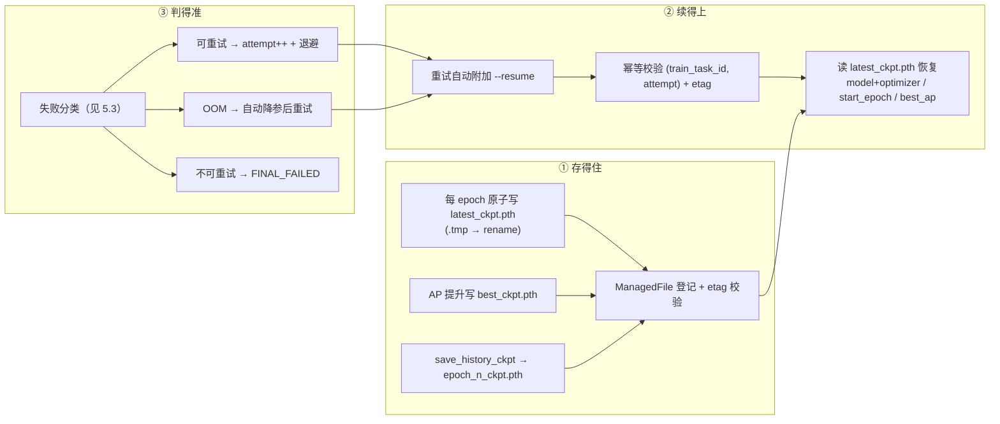
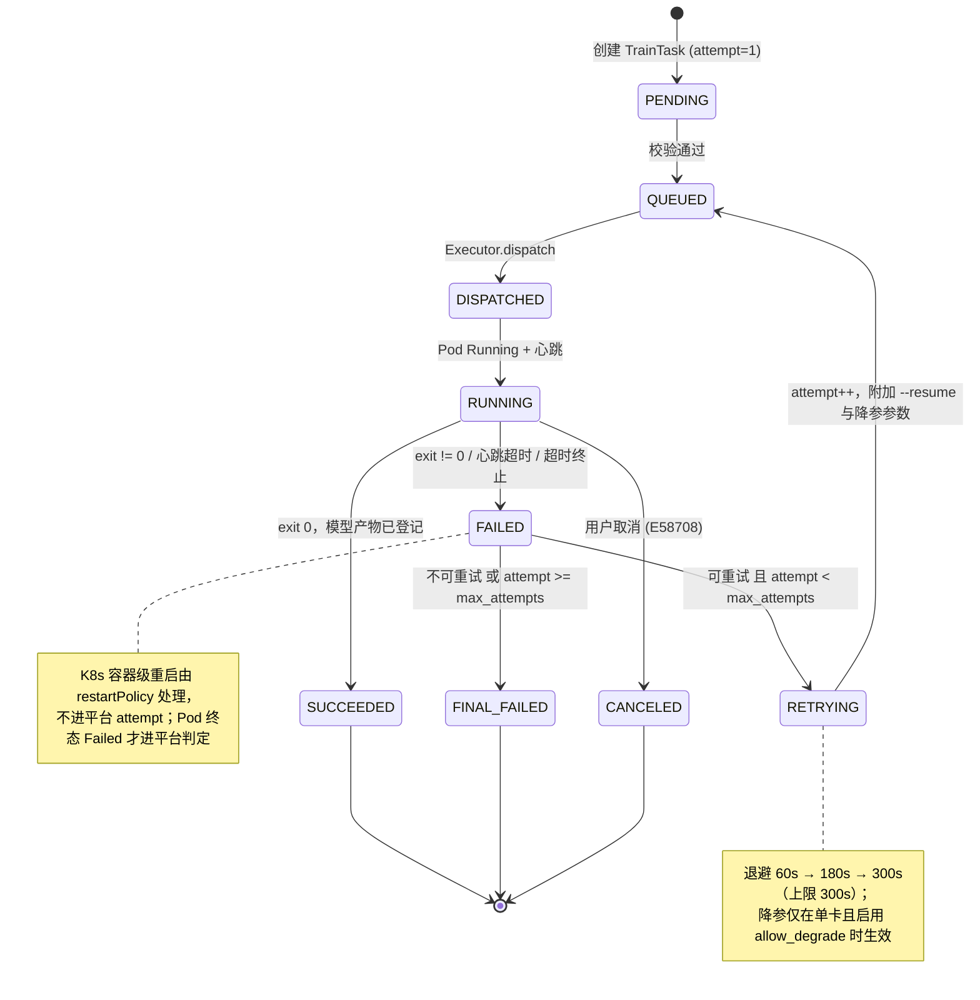
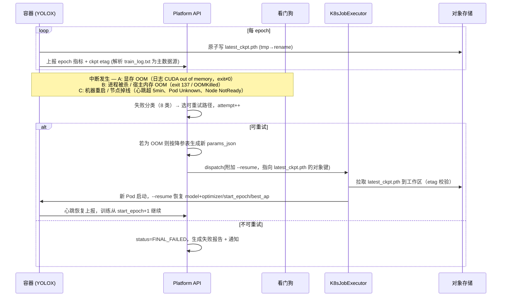
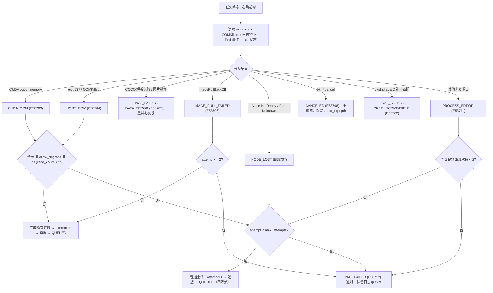
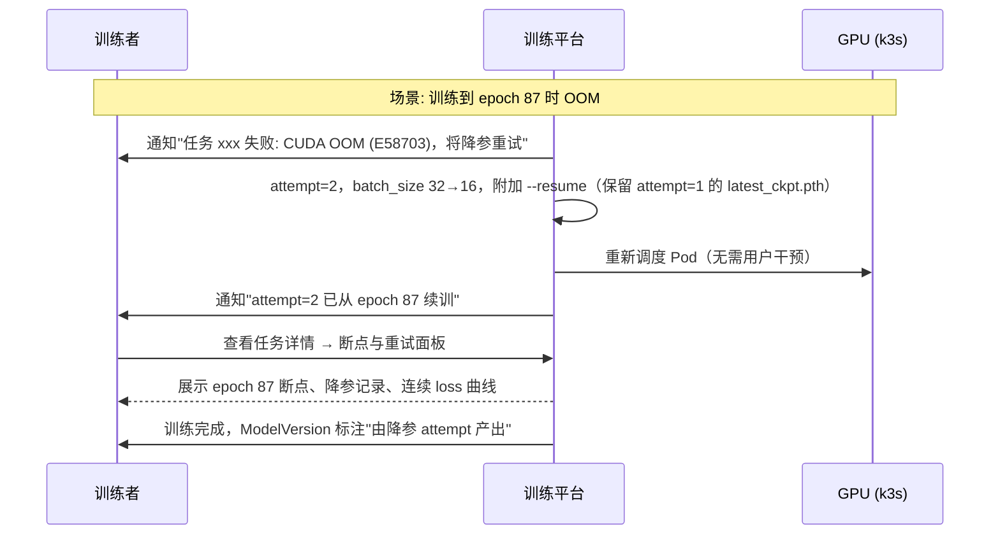
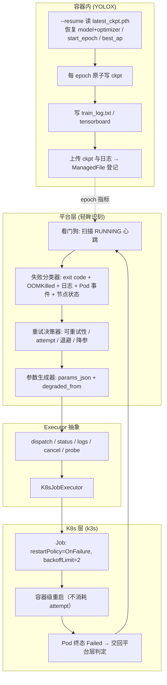

# PRD: P0087_断点续训与失败重试 (Checkpoint Resume & Failure Retry)
| 属性 | 内容 |
| :--- | :--- |
| **文档编号** | P0087 |
| **项目名称** | 轻眸识刻 视觉模型训练基建 |
| **功能模块** | M05_训练平台 |
| **当前版本** | v1.0.0 |
| **文档状态** | Draft |
| **作者** | TrainC |
| **最后更新** | 2026-10-01 |

---

## 1. 全局说明

> [!IMPORTANT]
> **核心定位**: 训练在单机 k3s 上以 **K8s Job** 运行，中断是常态而非事故——显存溢出、宿主机重启、为腾 GPU 手动 kill。本模块定义四件事：**checkpoint 怎么存**、**从 checkpoint 怎么续**、**中断后平台怎么自动恢复**、**什么情况才判定彻底失败**。
> **训练后端**: **YOLOX（Apache-2.0）**。断点续训直接使用框架原生 `--resume`（读取 `<输出目录>/latest_ckpt.pth`），不自行实现优化器状态恢复。
> **单一真源**: checkpoint 文件一律登记为 `ManagedFile(owner_type=TRAIN_TASK)`，**不引入 `TrainCheckpoint` 表**；逐 epoch 指标挂在 `TrainTask.metrics_json`。

### 名词解释
*   **TrainTask**: 训练任务的唯一实体（`train_tasks`）。一次训练 = 一个 K8s Job；**重试不新建实体，只递增 `attempt`**（不引入 `TrainRun`）。
*   **attempt**: 任务执行次数，从 1 开始；`attempt=1` 为首次执行，每次重试 +1，上限由 `max_attempts` 控制（默认 4，即最多 3 次重试）。
*   **Executor / K8sJobExecutor**: 执行层抽象（定义见 P0082，能力 `dispatch / status / logs / cancel / probe`）与其唯一实现。
*   **checkpoint (ckpt)**: YOLOX 保存的 `.pth` 权重文件，含 `model`、`optimizer` 的 `state_dict` 以及 `start_epoch`、`best_ap`。**优化器状态是能真正续训的前提**。
*   **`YOLOX_outputs/<experiment_name>/`**: YOLOX 默认输出目录；平台显式指定 `experiment_name = {train_task_id}-a{attempt}`，避免多次 attempt 互相覆盖。
*   **`:latest_ckpt.pth` / `best_ckpt.pth` / `epoch_<n>_ckpt.pth` / `last_mosaic_epoch_ckpt.pth`**: 分别对应"每 epoch 覆盖保存（**resume 默认起点**）"/"`AP50-95` 提升时另存（不作 resume 起点）"/"`save_history_ckpt=true` 时按 epoch 保留"/"进入 no-aug 阶段时保存"。
*   **`start_epoch` / `best_ap`**: ckpt 内记录的训练进度与历史最优 AP；`--resume` 会恢复二者，因此学习率调度（`yoloxwarmcos`，按 epoch 计算 LR）也能自然接续。
*   **resume**: 语义为"从 `latest_ckpt.pth` 恢复模型与优化器状态、epoch 计数与最优 AP，继续训练到 `max_epoch`"。
*   **watchdog / heartbeat**: 看门狗每 5 分钟校验一次心跳；容器心跳周期 30s，超 5min 无心跳判定 Pod 失联。
*   **CUDA OOM / cgroup OOM**: 显存不足（日志出现 `CUDA out of memory`）/ 宿主内存不足被内核 OOM Killer 杀死（退出码 `137`）。
*   **降参 (Degradation) / `backoffLimit`·`restartPolicy`**: 重试时自动下调 `batch_size` / `input_size` / `data_num_workers` 以规避 OOM（记录到 `params_json.degraded_from`）/ K8s Job 的**容器级**重启策略，与平台层 `attempt` 重试是两层，不可混淆。

### 统一异常处理

> E 码格式：`E` + 模块号(1位) + P 编号后两位(2位) + 流水(2位)。P0087 占用 `E58701` - `E58799`。
| Code | 场景 | 处理策略 |
| :--- | :--- | :--- |
| `E58701` / `E58702` | ckpt 缺失、非 `COMMITTED`、`torch.load` 失败 / ckpt 与 `exp_file` 不兼容（类别数、shape 不匹配） | 前者降级为"从头训练"并提示，用户显式 resume 则拒绝；后者判 `FAILED` 且**不可重试**，提示检查 `exp_file` 与类别数 |
| `E58703` / `E58704` | CUDA OOM（显存不足）/ cgroup OOM（宿主内存不足，退出码 137） | 按 8.2 降参表处理：`attempt++` 并下调 `batch_size` / `input_size`（显存）或 `data_num_workers` 与 `batch_size`（宿主内存）后重试 |
| `E58705` | 数据错误（COCO json 非法、图片损坏、类别越界、DataLoader worker 崩溃） | **不自动重试**（数据没变，重试必然复现），判 `FAILED` 并给出问题样本清单 |
| `E58706` / `E58707` | 镜像拉取失败（`ImagePullBackOff`）/ 节点掉线（`NotReady`、Pod `Unknown`、心跳超时） | 前者退避重试（≤2 次），仍失败判 `FINAL_FAILED` 并提示镜像仓库连通性；后者允许重试，`PINNED` 且目标节点仍不可用时改回 `AUTO` 或等待 |
| `E58708` / `E58709` | 用户主动取消 / resume 幂等冲突（同 ckpt 已被消费、已有 `RUNNING` attempt） | 前者置 `CANCELED`，不重试、不计失败率并保留最新 ckpt；后者拒绝本次 resume 并返回进行中的 `attempt` 信息 |
| `E58710` / `E58711` | 磁盘写满致 ckpt 保存失败 / 训练进程异常退出（非 OOM 的 `exit != 0`） | 前者训练继续但立即告警，连续 2 个 epoch 失败才判 `FAILED`；后者允许重试 1 次（防偶发），第 2 次相同错误判 `FINAL_FAILED` 并归因 |
| `E58712` / `E58713` | 重试次数耗尽（`attempt >= max_attempts`）/ 超过 `max_runtime`（默认 72h） | 均判 `FINAL_FAILED` 并触发通知、保留全部日志与 ckpt；超时任务先优雅终止（SIGTERM → 60s → SIGKILL）并保存最新 ckpt，提示调大上限 |

---

## 2. 项目背景

### 背景 (Context)
单机 k3s + 一块 GPU 的现实下，一次日期检测训练要跑 1~3 小时，换成更大的数据集或更多 `max_epoch` 则是 6~12 小时。而中断源几乎必然发生：调 `batch_size` 试错时显存爆掉；宿主机系统更新或断电让机器重启；为了插一次模型评估而手动 kill 训练。没有续训能力，这些中断的代价就是**整段 GPU 时间白烧**。

### 问题陈述 (Problem Statement)
1. **白跑与手续易错**: 中断后只能从 epoch 0 重来，前面几小时全部作废；人工 `--resume` 又容易漏掉优化器状态或 epoch 计数，导致 loss 阶跃、LR 调度错位。
2. **失败不分层**: 所有异常都只报"训练失败"，无法判断"OOM 值得降参重试"还是"数据坏了重试也没用"；OOM 调参还得靠人盯日志、改参数、重新提交。
3. **重试语义混乱**: K8s 容器级重启与平台级重试混为一谈，存在两个 Job 抢同一块 GPU 的风险。

### 目标与成功指标 (Goals & Success Metrics)
*   **北极星指标**: 因中断而废弃的 GPU 小时数下降 **80%**——可恢复中断的续训成功率达 **100%**。
*   **次要指标**: OOM 类失败经自动降参后一次通过的比例 ≥ **70%**；resume 后 loss 曲线与中断前**无阶跃**（离线连续性检查通过）；失败原因分类经人工抽检准确率 ≥ **95%**。
*   **风险与规避**:
| 风险 | 影响 | 规避方案 |
| :--- | :--- | :--- |
| ckpt 与优化器状态不一致 | 续训后 loss 抖动、指标倒退 | 只从框架原生 `latest_ckpt.pth` 恢复，禁止只加载 model 权重后假装 resume |
| 重复 resume 同一 ckpt | lineage 分叉，两个 Job 抢 GPU | resume 幂等键 `(train_task_id, attempt)` + ckpt `etag` 指纹校验（`E58709`） |
| 多次 attempt 覆盖同一输出目录 | ckpt 互相覆盖，产物错乱 | `experiment_name = {train_task_id}-a{attempt}`，attempt 之间目录隔离 |
| 降参后指标不可比 | 与历史版本横向对比失真 | 降参写入 `params_json.degraded_from` 与 `metrics_json.summary`，`ModelVersion` 携带该标记 |
| 宿主机关机 / 磁盘写满 | ckpt 丢失或写不进去 | ckpt 原子写入（`.tmp` → `rename`）并即时登记 `ManagedFile`；磁盘余量预检 + 使用率 90% 告警 |
| `hostPath` 与节点绑定 | PINNED 续训换节点后找不到 ckpt | 续训优先从对象存储拉取 ckpt 到本地工作区，不依赖 `hostPath` 残留 |


---

## 3. 价值模型
*   **方案**: 三层防线叠加。
    1. **存得住**: 每 epoch 原子写 `latest_ckpt.pth` 并登记 `ManagedFile`；`best_ckpt.pth` 随最优 AP 更新；`save_history_ckpt` 开启时保留 `epoch_<n>_ckpt.pth`。
    2. **续得上**: 平台重试时自动加 `--resume`，从 `latest_ckpt.pth` 恢复 `model` + `optimizer` `state_dict`、`start_epoch`、`best_ap`；LR 调度按 epoch 重算，无缝接续。
    3. **判得准**: 失败按 8 类归因（OOM / 数据 / 镜像 / 节点 / 取消 / 代码 / ckpt / 超时），只有"可重试类"才消耗 `attempt`；OOM 类自动降参后再试。
*   **目标**: 把"训练被中断"从**事故**降级为**排队等待**——用户不需要盯着日志，也不需要手工调参。

---

## 4. 项目范围



### In Scope
1. **Checkpoint 保存与归档 / 断点续训**: 原子写入、命名约定、`ManagedFile` 登记、保留与清理；`--resume` 语义（恢复 model + optimizer + `start_epoch` + `best_ap`）、手动续训入口、幂等规则。
2. **中断自动恢复**: 进程被杀（OOM Killer / 手动 kill）、机器重启（节点 `NotReady`）、显存 OOM 三类场景的处理路径。
3. **失败分类与重试策略 / OOM 自动降参**: 8 类归因、退避序列、`attempt` 上限、哪些错误**不重试**；`batch_size` 减半、`input_size` 降档、`data_num_workers` 下调的具体策略表与上限。
4. **最终失败判定与通知 / 失败任务保留**: `FINAL_FAILED` 条件、失败报告、通知渠道与告警中心联动；ckpt、`train_log.txt`、失败样本清单的保留期。

### Out of Scope
*   **预训练权重与迁移学习选择**（P0083 / P0085 职责）；**超参搜索与自动调优**（本模块只做"为规避 OOM 的最小必要降参"）。
*   **多卡弹性扩缩容 / 抢占式调度**：首期只在固定卡数下运行，DDP 场景不自动降参。
*   **训练框架内部算法**（loss 定义、优化器实现、数据增强算子）。
*   **k3s 集群自身运维**（节点升级、etcd 备份、CNI 故障）；**评估任务的重试降参差异**（见 P0086）。


---

## 5. 业务流程

### 5.1 任务 attempt 与恢复状态机



### 5.2 中断 → 自动恢复时序



### 5.3 失败分类与重试决策



---

## 6. 用户分析

### 6.1 用户画像 (User Personas)
| 角色 | 职责 | 核心诉求 | 痛点 |
| :--- | :--- | :--- | :--- |
| **训练者 (TRAINER)** | 训练并迭代检测模型，手上有唯一的 GPU | "训练挂了别让我从头再来，也别让我盯日志手动改 batch_size" | OOM 后人工调参循环慢；续训后指标倒退不知道是 bug 还是参数问题 |
| **管理员 (ADMIN) / 只读观察者 (VIEWER)** | 保障 GPU 与集群稳定、处理告警 / 关注训练进度 | "别出现两个 Job 抢同一块卡，失败原因要能一眼归因" / "我要看到这次 attempt 是从第几 epoch 续上的" | 所有失败都报"训练失败"，无法区分该修数据还是该调显存；进度条回退到 0 会被误以为训练重来 |

### 6.2 用户链路图 (User Journey Map)



---

## 7. 功能需求

### M05.F01 Checkpoint 保存与归档 (Checkpoint Persistence)
*   **用户故事**: 作为训练者，我希望训练过程持续保存可用的 checkpoint 并自动归档，以便任何中断都不至于丢掉已有进度。
*   **逻辑与业务规则**
    *   **保存节奏**: `latest_ckpt.pth` **每 epoch** 覆盖写；`best_ckpt.pth` 在 `AP50-95` 提升时写；`epoch_<n>_ckpt.pth` 仅当 Exp `save_history_ckpt=true`；进入 `no_aug_epochs` 阶段额外写 `last_mosaic_epoch_ckpt.pth`。评估与存盘节奏由 Exp `eval_interval`（默认 10）决定。
    *   **目录隔离与原子写入**: 平台为每次 attempt 指定 `experiment_name = {train_task_id}-a{attempt}`（输出目录 `YOLOX_outputs/{experiment_name}/`），两次 attempt 的 ckpt 不互相覆盖；写盘改为"先写 `*.tmp` 再 `rename`"，`rename` 后校验 `size_bytes > 0`，未通过校验的文件**不登记** `ManagedFile`。
    *   **登记与保留**: 每个 ckpt 落一行 `ManagedFile`（`owner_type=TRAIN_TASK`、`owner_id=train_tasks.id`，对象键 `{path_prefix}/TRAIN_TASK/{train_task_id}/YOLOX_outputs/{experiment_name}/{filename}`，记录 `etag`、`size_bytes`）；`latest` 与 `best` 始终保留，`epoch_<n>_ckpt.pth` 仅保留最近 **3 个**，更早的由 GC 回收（P0046）。
*   **验收标准**
    ```gherkin
    场景: 每 epoch 产出可续训的 checkpoint
      Given 一个 RUNNING 的训练任务，experiment_name = "task-0042-a1"
      When 训练完成第 12 个 epoch
      Then 对象存储中出现 YOLOX_outputs/task-0042-a1/latest_ckpt.pth 并登记为 ManagedFile(status=COMMITTED)
      And TrainTask.metrics_json.epochs[11].ckpt_etag 与该文件 etag 一致

    场景: 保存失败时训练不被立刻杀死
      Given 工作区磁盘使用率达到 100%
      When 第 13 与第 14 个 epoch 的 ckpt 均写入失败
      Then 第 13 次仅告警"checkpoint 保存失败 (E58710)"且训练继续
      And 第 14 次失败后任务置 FAILED
    ```
*   **边界情况与异常处理**
    | 场景 | 处理 |
    | :--- | :--- |
    | 写盘过程中 Pod 被杀，留下半截 `*.tmp` / `save_history_ckpt=true` 且 `max_epoch=300` | 只认 `rename` 后的最终文件，`*.tmp` 由工作区清理逻辑删除且不登记；epoch ckpt 仅保留最近 3 个，避免单任务占满对象存储 |
    | ckpt 上传对象存储失败（网络/配额） | 保留本地工作区副本并重试上传 3 次；仍失败则告警，任务继续（本地副本可供人工取回） |

### M05.F02 断点续训 (Resume from Checkpoint)
*   **用户故事**: 作为训练者，我希望从中断时的 checkpoint 继续训练而不是从头开始，以便不浪费已消耗的 GPU 时间。
*   **逻辑与业务规则**
    *   **resume 语义**: 平台在重试时自动附加框架原生 `--resume`（或 `-c/--ckpt` 指向指定 ckpt）。YOLOX 从 `<输出目录>/latest_ckpt.pth` 恢复 **`model` 与 `optimizer` 的 `state_dict`、`start_epoch`、`best_ap`**，训练从 `start_epoch + 1` 继续至 `max_epoch`。
    *   **LR 调度接续**: `yoloxwarmcos` 按 epoch 计算 LR，恢复 `start_epoch` 即自然接续；因此**禁止在 resume 时改动 `max_epoch` / `warmup_epochs` / `no_aug_epochs`**（会平移整条 LR 曲线），改动则拒绝并提示。
    *   **幂等与前置校验**: resume 幂等键 `(train_task_id, attempt)`，同一 `latest_ckpt.pth` 的 `etag` 不得被两个 `attempt` 同时消费（`E58709`）；续训前校验 ckpt 存在且 `status=COMMITTED`、`torch.load` 可解（`E58701`），`model` 状态与 `exp_file` 的类别数/shape 必须一致（`E58702`，**不可重试**）。
    *   **起点选择与手动续训**: 默认取"最近一次成功写入且通过 etag 校验的 `latest_ckpt.pth`"，用户可显式指定 `epoch_<n>_ckpt.pth` 回退到更早的稳定点；`CANCELED` / `FINAL_FAILED` 的任务可手动续训，此时生成**新的 `TrainTask`**（lineage 指向原任务），而非复用原任务的 `attempt`。
*   **验收标准**
    ```gherkin
    场景: 自动续训接续优化器状态
      Given attempt=1 在 epoch 87 因 OOM 失败，latest_ckpt.pth 记录 start_epoch=87、best_ap=0.78
      When 平台发起 attempt=2 并附加 --resume
      Then 容器日志显示从 epoch 88 开始训练，且 best_ap 初值为 0.78 而非 0
      And 续训后首个 epoch 的 loss 与 epoch 87 处于同一量级（无阶跃）

    场景: 幂等冲突被拒绝
      Given latest_ckpt.pth (etag a91f…) 已被 attempt=2 消费且 attempt=2 处于 RUNNING
      When 用户再次对同一 ckpt 发起 resume
      Then 返回 E58709 并提示"该 checkpoint 正被 attempt=2 使用"
      And 不创建新的 attempt，不产生第二个 Pod
    ```
*   **边界情况与异常处理**
    | 场景 | 处理 |
    | :--- | :--- |
    | `latest_ckpt.pth` 缺失但 `epoch_<n>_ckpt.pth` 存在 | 自动回退到最近一个可用 epoch ckpt，并在任务详情标注"已回退到 epoch N" |
    | 用户显式要求 resume 但 ckpt 损坏 / 类别数不一致 | `E58701` 拒绝并提供"从头训练"或"选其他 ckpt"；`E58702` 标记不可重试并提示对齐类别配置 |
    | 对象存储上的 ckpt 已被 GC，仅剩本地工作区副本 | 若仍在原节点且工作区存在则从本地恢复；否则判 `E58701` 并提示无法续训 |

### M05.F03 中断后自动恢复 (Auto Recovery)
*   **用户故事**: 作为训练者，我希望训练因 OOM、进程被杀或机器重启中断后平台能自动恢复，以便我不用整夜守着日志。
*   **逻辑与业务规则**
    | 中断场景 | 判定特征 | 平台动作 |
    | :--- | :--- | :--- |
    | **A. 显存溢出 (CUDA OOM)** | 日志含 `CUDA out of memory`；进程非 0 退出 | 归类 `CUDA_OOM` → 按 8.2 降参表下调 `batch_size`（必要时降 `input_size`）→ `attempt++` → 附加 `--resume` 重试 |
    | **B. 进程被杀 / 宿主内存 OOM** | 退出码 `137`、`OOMKilled`、或收到 SIGKILL/SIGTERM | 若源于 cgroup OOM 归类 `HOST_OOM`：下调 `data_num_workers` 与 `batch_size` 后重试；若为**用户手动 kill** 则按 `CANCELED` 处理（`E58708`，不自动重试，保留 ckpt） |
    | **C. 机器重启 / 节点掉线** | 心跳超 5min、Pod `Unknown`、Node `NotReady` | 归类 `NODE_LOST`：等待节点恢复或按 `scheduling_mode` 重新调度（`AUTO` 换节点；`PINNED` 且目标不可用则提示改回 `AUTO`）→ `attempt++` → 从对象存储拉取 ckpt 续训 |
    *   **K8s 层与平台层的边界（必须分清）**: 容器级崩溃由 K8s `Job` 的 `restartPolicy: OnFailure` + 有限 `backoffLimit` 处理，**不消耗平台 `attempt`**；超过 `backoffLimit` 后 Pod 进入 `Failed` 终态，**平台才接管**：分类 → 判定可重试性 → `attempt++` 重试。
    *   **不依赖 `hostPath` 残留 / 单飞保证**: 续训一律优先从对象存储拉取 ckpt 到新 Pod 工作区，使 `AUTO` 模式跨节点续训成立（`hostPath` 仅作同节点快速恢复缓存）；同一 `TrainTask` 任意时刻最多一个 `attempt` 处于 `DISPATCHED`/`RUNNING`，重复 resume 由 `E58709` 拦截，杜绝双 Job 抢同一块 GPU。
*   **验收标准**
    ```gherkin
    场景: 显存 OOM 后自动降参续训
      Given 任务在 attempt=1、batch_size=32 时因 "CUDA out of memory" 退出
      When 平台完成失败分类
      Then 归类为 CUDA_OOM (E58703)，attempt 递增为 2
      And attempt=2 的 params_json.batch_size = 16 且 degraded_from 记录原值 32，并附加 --resume 继续

    场景: 机器重启后跨节点恢复
      Given 任务运行中节点被重启，Pod 进入 Unknown 且心跳超 5min，scheduling_mode = AUTO
      When 节点恢复或其他节点可用
      Then 归类为 NODE_LOST (E58707)，attempt++
      And 新 Pod 从对象存储拉取 latest_ckpt.pth 并成功续训
    ```
*   **边界情况与异常处理**
    | 场景 | 处理 |
    | :--- | :--- |
    | 节点重启后长时间不恢复（> 30min） | 若 `AUTO` 则换节点继续；若可用节点为 0，任务停在 `QUEUED`（资源不足不判失败），不消耗 `attempt` |
    | 容器被 OOM Killer 杀死但没留下日志 / 用户 kill 与 OOM 同时发生 | 以退出码 137 + cgroup `OOMKilled` 为准仍归 `HOST_OOM`；有 cancel 记录则优先判 `CANCELED` |
    | 重启后对象存储不可达 | 任务停 `QUEUED` 并告警存储不可用，不盲目消耗 `attempt` |

### M05.F04 失败分类与重试策略 (Failure Classification & Retry Policy)
*   **用户故事**: 作为管理员，我希望失败被准确归因且只有真正可恢复的错误才重试，以便 GPU 不被无效重试空耗。
*   **逻辑与业务规则**
    *   **分类优先级**: 退出码 → 容器 `OOMKilled`/信号 → 日志特征串 → Pod 事件（`ImagePullBackOff` 等）→ 节点状态；多特征命中时按下表自上而下取首个匹配。
    *   **重试策略一览**:
    | 失败分类 | E 码 | 可重试 | 消耗 attempt | 退避 | 是否降参 |
    | :--- | :--- | :--- | :--- | :--- | :--- |
    | CUDA_OOM | `E58703` | 是 | 是 | 60s | **是**（`batch_size` 减半；必要时降 `input_size`） |
    | HOST_OOM | `E58704` | 是 | 是 | 60s | **是**（`data_num_workers` 减半，必要时 `batch_size` 减半） |
    | DATA_ERROR | `E58705` | **否** | 否 | — | 否 |
    | IMAGE_PULL_FAILED | `E58706` | 是（≤2 次） | 是 | 180s | 否 |
    | NODE_LOST | `E58707` | 是 | 是 | 180s | 否 |
    | USER_CANCELED | `E58708` | 否 | 否 | — | 否 |
    | CKPT_INCOMPATIBLE | `E58702` | **否** | 否 | — | 否 |
    | PROCESS_ERROR | `E58711` | 是（同类 ≤2 次） | 是 | 300s | 否 |
    | CKPT_SAVE_FAILED | `E58710` | 是（连续 2 epoch 才判失败） | 是 | 180s | 否 |
    | MAX_RUNTIME_EXCEEDED | `E58713` | 否（需人工调大上限） | 否 | — | 否 |
    *   **退避与上限**: 第 1 次重试 60s、第 2 次 180s、第 3 次 300s（上限 300s，与 P0082 看门狗一致），退避期间状态为 `RETRYING` 不占 GPU；`max_attempts` 默认 **4**（1 次初始 + 3 次重试），达到即 `FINAL_FAILED`（`E58712`）；单任务最多 **2 次** OOM 降参。
    *   **降参的适用边界**: **仅单卡（`nvidia.com/gpu = 1`）自动降参**；多卡 DDP 下 `batch_size` 是每卡值，减半会改变全局 batch 与 LR 语义，**不自动降参**，直接判失败并提示人工调整。
    *   **降参写入 lineage**: 降参结果写入 `params_json.degraded_from` 与 `TrainTask.metrics_json.summary.degradations[]`；由此产出的 `ModelVersion` 携带 `degraded=true` 与明细，与 P0086 的"参数可比性校验"联动。
*   **OOM 自动降参策略表**
    | 顺序 | 失败类型 | 触发条件 | 降参动作 | 约束 |
    | :--- | :--- | :--- | :--- | :--- |
    | 1 | CUDA_OOM（显存） | `batch_size > 1` | `batch_size = max(1, floor(batch_size / 2))`（32→16→8…） | 学习率按 per-image 计算（`basic_lr_per_img`），无需换算 |
    | 2 | CUDA_OOM（`batch_size` 已为 1） | `batch_size == 1` 仍 OOM | `input_size` 降档：`(640,640) → (576,576) → (512,512)` | 必须为 32 的整数倍；最多降 2 档 |
    | 3 | HOST_OOM（宿主内存） | `data_num_workers > 1` | `data_num_workers = max(1, floor(data_num_workers / 2))`（4→2→1），同时 `batch_size` 减半 | 与显存降参累计计数 |
    | 4 | HOST_OOM（worker 已为 1） | `data_num_workers == 1` 仍 OOM | 仅继续下调 `batch_size`（最小 1） | 降至 1 仍失败则判 `FINAL_FAILED` |
    | — | 上限 | 累计降参 ≥ 2 次 | 停止自动降参，转普通重试 | 第 3 次 OOM 直接按普通重试判定 |
    *   **降参记录格式**: `params_json.degraded_from = {"attempt": 1, "batch_size": 32, "input_size": [640,640], "data_num_workers": 4, "reason": "E58703"}`，UI 明确展示"本次 attempt 为降参后运行，指标与未降参版本不完全可比"。
*   **验收标准**
    ```gherkin
    场景: OOM 按表降参且不超出上限
      Given 任务 attempt=1 以 batch_size=32, input_size=(640,640), data_num_workers=4 运行并 CUDA OOM
      When 平台生成 attempt=2
      Then params_json.batch_size = 16，input_size 与 data_num_workers 不变，degraded_from 记录原值
      And attempt=2 仍 OOM 且 batch_size 已为 1 时，attempt=3 的 input_size 降为 (576,576)，累计降参 2 次
      And 第 3 次 OOM 时不再降参

    场景: 数据类错误不重试
      Given 任务因 "COCO json decode error" 退出
      When 平台完成失败分类
      Then 归类为 DATA_ERROR (E58705)，status 直接置 FINAL_FAILED
      And 不产生新的 attempt，失败报告列出问题标注文件与样本清单
      And 通知提示"请先修复数据集，重试不会改变结果"
    ```
*   **边界情况与异常处理**
    | 场景 | 处理 |
    | :--- | :--- |
    | 日志中同时出现 OOM 与其他错误 | 以 OOM 分类优先（OOM 常是根因，其他错误是其副产物） |
    | 多卡任务 OOM | 不自动降参，判 `FAILED` 并提示"手动下调 `batch_size` 或减少卡数" |
    | 降参后仍 OOM 且已达上限 | 转普通重试；最终 `FINAL_FAILED` 时失败报告列出完整降参轨迹供人工决策 |
    | 重试期间用户想改超参 / 退避期间节点被占满 | 不允许改参（重试沿用原 `params_json` 含降参），如需改参请新建任务；资源不足不计入失败 |

### M05.F05 最终失败判定与通知 (Final Failure & Notification)
*   **用户故事**: 作为训练者，我希望任务彻底失败时收到明确通知与可行动的失败原因，以便快速决定修数据、改参数还是放弃。
*   **逻辑与业务规则**
    *   **判定条件（满足任一即 `FINAL_FAILED`）**: 失败分类为不可重试类（`DATA_ERROR` / `CKPT_INCOMPATIBLE` / `MAX_RUNTIME_EXCEEDED`）；`attempt >= max_attempts`；同类 `PROCESS_ERROR` 已出现 2 次；OOM 降参已达上限且再次 OOM；用户显式"停止重试"。
    *   **失败报告**: 生成 `failure_report.json`（落 `ManagedFile`），含失败分类、E 码、最后一次 attempt 的参数快照（含降参轨迹）、日志尾部 200 行、关键错误上下文、涉及的样本/标注清单（数据类）、建议动作，以及"是否保留可续训 ckpt / 是否有更早可用 epoch ckpt"。
    *   **通知与不打扰原则**: 触发 `Alert(alert_alerts)` 并写告警中心（P0132），渠道按 `notify_config` 发送（站内 / Webhook），内容含任务名、attempt 轨迹、失败码与一条**可行动建议**；`CANCELED` 不发失败通知，`RETRYING` 仅首次重试提示一条"已自动重试"、后续静默。
*   **验收标准**
    ```gherkin
    场景: 重试耗尽后判定最终失败
      Given max_attempts=4，任务连续 4 次因 PROCESS_ERROR 失败
      When 第 4 次 attempt 结束
      Then status = FINAL_FAILED，error_code = E58712
      And 生成 failure_report.json 并登记为 ManagedFile
      And 告警中心新增一条含 attempt 轨迹与建议动作的告警

    场景: 用户取消不算失败
      Given 用户在 attempt=2 运行中点击取消
      When 任务终止
      Then status = CANCELED，error_code = E58708
      And 不发送失败通知、不计入失败率
      And 任务详情保留"从 latest_ckpt.pth 续训"入口
    ```
*   **边界情况与异常处理**
    | 场景 | 处理 |
    | :--- | :--- |
    | 通知渠道不可用（Webhook 超时） | 站内通知与告警中心必达；Webhook 失败重试 3 次后仅记日志，不阻塞状态流转 |
    | 失败报告生成时磁盘已满 / `RETRYING` 期间被取消 | 报告降级为内联文本（仅存数据库字段）并提示"完整报告生成失败"；取消直接转 `CANCELED` 并终止后续退避与重试 |
    
### M05.F06 失败任务的数据与日志保留 (Retention of Failed Tasks)
*   **用户故事**: 作为管理员，我希望失败任务保留足够的日志与产物用于事后排查，同时不会无限占用存储，以便诊断与容量之间取得平衡。
*   **逻辑与业务规则**
    *   **保留矩阵**:
    | 资产 | 成功任务 | `FINAL_FAILED` / `CANCELED` | 说明 |
    | :--- | :--- | :--- | :--- |
    | `latest_ckpt.pth` / `best_ckpt.pth` | 永久（随 `ModelVersion`） | **保留 14 天**（供人工续训） | 过期后由 GC 回收（P0046） |
    | `epoch_<n>_ckpt.pth` | 最近 3 个 | 最近 3 个，保留 14 天 | 便于回退到更早稳定点 |
    | `train_log.txt`（主）/ `tensorboard/`（可选） | 归档保留 180 天 | 归档保留 **30 天** | 均记入 `ManagedFile` |
    | `failure_report.json` / `TrainTask` 记录与 `metrics_json` | — / 永久 | 永久（数据库 + 对象存储）/ 永久 | 归因依据 / 统计与审计需要 |
    | 容器工作区（`hostPath`/PVC） | 任务成功后 24h 清理 | 任务终结后 **48h 清理** | ckpt 已上传对象存储，工作区非真源 |
    *   **工作区清理前置校验**: 清理前确认 `latest_ckpt.pth` 与 `best_ckpt.pth` 已在对象存储中 `COMMITTED`；若上传失败则**延期清理**并告警，避免唯一副本被删。
    *   **引用与回收**: 保留期内的失败任务 ckpt 可被"续训"直接引用，过期后引用将报 `E58701`；GC 按"先删工作区 → 再删历史 epoch ckpt → 最后删过期 latest ckpt"的优先级回收，回收前把待删清单写入审计日志（P0131）。
*   **验收标准**
    ```gherkin
    场景: 失败任务的 ckpt 在保留期内可续训
      Given 任务在 10 天前 FINAL_FAILED，latest_ckpt.pth 保留期为 14 天
      When 用户点击"从此 checkpoint 续训"
      Then 校验 ckpt 仍为 COMMITTED，成功创建新的 TrainTask（lineage 指向原任务）
      And 新任务的 attempt 从 1 开始

    场景: 唯一副本未上传时拒绝清理工作区
      Given 任务已终结，但 latest_ckpt.pth 上传对象存储失败
      When GC 计划清理容器工作区
      Then 跳过清理并告警"存在未归档 checkpoint"
      And 保留期到期后仍不删除工作区，直至上传成功或人工确认
    ```
*   **边界情况与异常处理**
    | 场景 | 处理 |
    | :--- | :--- |
    | 对象存储容量不足导致 ckpt 无法归档 | 任务仍可运行，但告警"归档失败，工作区不会被清理"；阻止 GC 删除唯一副本 |
        | 磁盘紧张需紧急回收 / 用户在保留期内删除任务 | 提供管理员"立即回收"入口（回收前导出待删清单供确认）；删除任务走软删除 `deleted_at`，ckpt 保留至保留期结束再 GC |
    | 失败任务数量激增（连续 OOM 批量失败） | 单任务保留上限 3 个 epoch ckpt；同一数据集连续 OOM 聚合为一条告警，避免告警风暴 |

---

## 8. 技术架构与数据模型

### 8.1 数据实体

> 遵循全局裁定：**产物文件一律走 `ManagedFile`，不新建 Artifact / Checkpoint 表**；逐 epoch 指标写在 `TrainTask.metrics_json`，完整时序以归档的 `train_log.txt` 为**主数据源**（`tensorboard/` 仅作可选交叉校验，口径同 P0084）归档。
> `ManagedFile.owner_type` 取 `TRAIN_TASK`，`owner_id = train_tasks.id`。attempt 级事件链由 P0082 的 `TrainTaskEvent(train_task_events)` 承载（`event_type ∈ ATTEMPT_FAILED / RETRY_SCHEDULED / SUCCEEDED / CANCELLED`），§9.1 的 attempt 轨迹即读自该事件链，本模块不新建事件表。

#### Table: `train_tasks`（本模块新增/消费字段）
| 字段名 | 类型 | 必填 | 说明 | 约束 |
| :--- | :--- | :--- | :--- | :--- |
| `id` | UUID | Y | 主键 | PK |
| `status` | Enum | Y | 任务状态 | `PENDING/QUEUED/DISPATCHED/RUNNING/SUCCEEDED/FAILED/RETRYING/FINAL_FAILED/CANCELED` |
| `attempt` / `max_attempts` | Int | Y | 当前 attempt / 上限 | 默认 1 / 4（1 次初始 + 3 次重试） |
| `resume_from_attempt` / `resume_ckpt_file_id` / `resume_ckpt_etag` | Int / UUID / String | N | 续训起点：来源 attempt、ckpt `ManagedFile` 与指纹 | FK → `managed_files.id`；三者共同构成 resume 幂等依据，空表示从头训练 |
| `resume_mode` | Enum | Y | 续训模式 | `AUTO`（重试自动续）/ `MANUAL`（用户指定 ckpt）/ `NONE`（从头训练） |
| `allow_degrade` / `degrade_count` | Boolean / Int | Y | 是否允许 OOM 自动降参 / 累计降参次数 | 默认 true、上限 2；多卡任务强制 false |
| `params_json` | JSONB | Y | 参数快照（含 YOLOX 参数面） | 降参时写入 `degraded_from` |
| `error_code` / `error_message` / `failure_class` | String / Text / Enum | N | 最近失败信息 | `E587xx`；摘要截断 2000 字符；`failure_class ∈ CUDA_OOM/HOST_OOM/DATA_ERROR/IMAGE_PULL_FAILED/NODE_LOST/USER_CANCELED/CKPT_INCOMPATIBLE/PROCESS_ERROR/CKPT_SAVE_FAILED/MAX_RUNTIME_EXCEEDED` |
| `retry_blocked_reason` | String | N | 不可重试原因 | 如"数据错误，重试必然复现" |
| `output_dir` | String | Y | 本次 attempt 的 YOLOX 输出目录（`YOLOX_outputs/{train_task_id}-a{attempt}/`） | attempt 间隔离，与 P0082 字段同名 |
| `metrics_json` | JSONB | N | 逐 epoch 指标与降参轨迹 | 结构见下；不新建时序表 |
| `scheduling_mode` / `target_node_id` / `heartbeat_at` | Enum / UUID / timestamptz | Y/N | 调度方式与指定节点 / 最近心跳 | 与 P0082 一致；`PINNED` 且节点不可用时提示改 `AUTO`；心跳超 5min 触发 `NODE_LOST` 判定 |
| `created_at` / `updated_at` / `started_at` / `finished_at` / `deleted_at` | timestamptz | Y/N | 时间戳与软删除 | |

**Index**: `(status, heartbeat_at)`（看门狗扫描）；`(failure_class, created_at DESC)`（失败归因统计）。

#### `TrainTask.metrics_json` 结构（逐 epoch 指标与降参轨迹）

```json
{
  "schema_version": "1.0",
  "epochs": [
    { "epoch": 12, "lr": 0.00083, "loss": 3.41, "loss_cls": 0.92, "loss_iou": 1.71, "loss_obj": 0.78,
      "ap50": 0.712, "ap50_95": 0.468, "best_ap50_95": 0.48, "eval_ran": false,
      "ckpt": "TRAIN_TASK/task-0042/YOLOX_outputs/task-0042-a1/latest_ckpt.pth", "ckpt_etag": "a91f…" },
    { "epoch": 87, "lr": 0.00021, "loss": 1.02, "ap50": 0.961, "ap50_95": 0.802,
      "best_ap50_95": 0.802, "ckpt_etag": "b7c2…" }
  ],
  "summary": { "final_epoch": 300, "best_ap50_95": 0.831, "resumed_from_epoch": 87,
    "degradations": [ { "attempt": 2, "reason": "E58703", "batch_size": "32→16" } ],
    "history_ref": "TRAIN_TASK/task-0042/YOLOX_outputs/task-0042-a1/train_log.txt" }
}
```
*   逐 epoch 指标由平台解析归档的 `train_log.txt` 得到（`tensorboard/` 仅作可选交叉校验），完整时序以之为 `ManagedFile` 归档，**不新建 metrics 表**；`degradations[]` 与 `params_json.degraded_from` 互为印证，用于 P0086 的参数可比性校验。

### 8.2 重试参数与常量
| 常量 | 默认值 | 说明 |
| :--- | :--- | :--- |
| `max_attempts` / `max_degrade_count` | `4` / `2` | 1 次初始 + 3 次重试 / 单任务 OOM 自动降参上限 |
| `backoff_sequence` | `[60s, 180s, 300s]` | 第 N 次重试前的等待；上限 300s（与 P0082 看门狗一致） |
| `batch_size_step` / `data_num_workers_step` | `× 0.5`（最小 1） | 显存与宿主内存 OOM 均适用 / 仅宿主内存 OOM |
| `input_size_steps` | `(640,640) → (576,576) → (512,512)` | 仅在 `batch_size == 1` 仍 OOM 时启用；必须为 32 倍数 |
| `heartbeat_interval` / `watchdog_timeout` / `job_backoff_limit` | `30s` / `5min` / `2` | 容器心跳周期 / 超时判 `NODE_LOST` / K8s 容器级重启上限（不消耗 `attempt`） |
| `ckpt_retention_days` / `log_retention_days` / `workspace_cleanup_hours` | 成功永久、失败 `14` 天 / 成功 `180`、失败 `30` 天 / 成功 `24h`、失败 `48h` | latest 与 best / 含 tensorboard 事件 / 清理前校验已归档 |


### 8.3 架构



---

## 9. UI/UX 规格说明

### 9.1 任务详情 · 断点与重试面板

```text
+---------------------------------------------------------------------------+
|  训练任务 task-0042  date-det-v6   状态: 🟠 RETRYING (attempt 2/4)          |
|  下次重试: 00:01:42 后          [立即重试] [停止重试]                      |
+---------------------------------------------------------------------------+
|  attempt 轨迹    # 状态 起始 结束 失败分类 降参                            |
|   1  ❌ FAILED   epoch 0  epoch 87  CUDA_OOM     -  (batch 32, size 640)  |
|   2  🔁 RETRYING epoch 87    -       -           batch_size 32 → 16       |
|      └ 将执行: --resume (从 epoch 87 的 latest_ckpt.pth)                   |
+---------------------------------------------------------------------------+
|  可用断点 [从此续训][回退续训]  latest_ckpt.pth  epoch 87  AP50-95 .802   |
|   best_ckpt.pth    epoch 84  AP50-95 0.810  2026-10-01 09:02             |
+---------------------------------------------------------------------------+
|  ⚠ 本次 attempt 已降参（batch_size 16），指标与未降参版本不完全可比        |
+---------------------------------------------------------------------------+
```

### 9.2 续训确认与最终失败提示

```text
+---------------------------------------------------------------+
|  从此 checkpoint 续训                                   [✕]   |
|  起点: latest_ckpt.pth (epoch 87, etag b7c2)                  |
|  新任务作为独立 TrainTask 创建，lineage 指向 task-0042        |
|  max_epoch [300]  batch_size [16]  input_size [640]  fp16 [ ] |
|  ⚠ 改 max_epoch / warmup_epochs 会平移 LR 曲线，请新建任务     |
|                              [取消]   [确认续训]              |
+---------------------------------------------------------------+
|  ❌ 任务最终失败 (E58712)：task-0042 date-det-v6              |
|  attempt 1..4 全部 PROCESS_ERROR；建议检查 exp_file 与类别配置 |
|  可续训 ckpt: best_ckpt.pth (14 天)                            |
|  [查看完整日志] [导出失败报告] [从 best_ckpt 续训]             |
+---------------------------------------------------------------+
```

### 9.3 交互元素
| 元素 | 类型 | 状态 | 行为 |
| :--- | :--- | :--- | :--- |
| attempt 轨迹时间线 | Timeline | Running / Failed / Retrying / Succeeded | 展开显示该 attempt 的参数快照与降参差异 |
| 断点列表 | Table | 可操作 / 已过期 | `[从此续训]` 创建新 `TrainTask`；`[回退续训]` 指定 `epoch_<n>_ckpt.pth` |
| 降参提示条 / 重试按钮 | Banner / Button | Warning（存在降参时）/ Disabled（不可重试类） | 说明降参项与"指标不完全可比"；立即重试（跳过退避），不可重试类置灰并展示 `retry_blocked_reason` |
| 停止重试 / 续训确认弹窗 | Button / Modal | Default（`RETRYING` 中）/ Loading | 转 `FINAL_FAILED` 并在报告中注明"用户停止重试"；epoch 相关参数只读，确认后走幂等校验（`E58709`） |

---

## 10. 非功能性需求 (NFR)
*   **可靠性与数据完整性**: 心跳 30s、watchdog 5min；可重试类重试成功率目标 ≥ 95%，OOM 自动降参后一次通过率 ≥ 70%；同一 `TrainTask` 同时只允许一个活动 `attempt`（单飞保证）；ckpt 原子写入（`*.tmp` → `rename`）并校验 `size_bytes > 0`，上传后校验 `etag`，工作区清理前必须确认已归档，杜绝唯一副本丢失。
*   **性能与容量**: 失败分类（含日志特征匹配）在任务终止后 **< 10s** 内完成；心跳扫描周期 30s，单轮扫描 200 个任务 < **500ms**；ckpt 上传异步、不阻塞训练主循环；单任务 ckpt 占用上限 `2 × 模型大小 + 3 × 模型大小`（latest/best/历史 3 个），失败任务 ckpt 总量超阈值时告警并提示回收。
*   **安全 (Security)**: ckpt 与日志对象键遵循 `{path_prefix}/TRAIN_TASK/{train_task_id}/…`，presign URL 有效期 ≤ 2 小时；续训与重试操作限 `ADMIN`/`TRAINER`，`VIEWER` 只读。
*   **兼容性与可观测性 (Compatibility & Observability)**: 训练/评估镜像必须固定 torch 版本（YOLOX 依赖 `torch.cuda.amp.GradScaler`，新版 PyTorch 已弃用该路径），**不得使用 latest**（镜像由 P0081 统一管理）；指标 `train_task_attempts_total{result, failure_class}`、`train_task_degradations_total`、`train_task_watchdog_evictions_total`、`ckpt_upload_failures_total`；每个 attempt 的日志独立归档、可单独下载。

---

## 附录: 已确认的设计决策
| 决策项 | 结论 |
| :--- | :--- |
| 任务实体 | 只用 `TrainTask`；**不引入 TrainRun / TrainCheckpoint / Artifact 表**，重试仅 `attempt++`，ckpt 走 `ManagedFile`，逐 epoch 指标走 `TrainTask.metrics_json` |
| 续训机制 | 使用 YOLOX 原生 `--resume`（读 `<输出目录>/latest_ckpt.pth`），恢复 `model` + `optimizer` `state_dict`、`start_epoch`、`best_ap`；不自行实现状态恢复 |
| ckpt 命名与目录 | `latest_ckpt.pth` / `best_ckpt.pth` / `epoch_<n>_ckpt.pth`（`save_history_ckpt=true`）/ `last_mosaic_epoch_ckpt.pth`；目录 `YOLOX_outputs/{train_task_id}-a{attempt}/`，attempt 间隔离 |
| resume 幂等与约束 | 幂等键 `(train_task_id, attempt)` + ckpt `etag`，同一 ckpt 不被两个 attempt 消费（`E58709`）；任意时刻仅一个活动 attempt；禁止 resume 时改动 `max_epoch` / `warmup_epochs` / `no_aug_epochs`（会平移基于 epoch 的 LR 曲线） |
| K8s 与平台两层边界 | 容器级重启由 `restartPolicy: OnFailure` + `backoffLimit=2` 处理，**不消耗 attempt**；Pod 终态 `Failed` 后由平台分类并重试。平台重试上限 `max_attempts=4`（1 + 3 次），退避 `60s → 180s → 300s`，与 P0082 看门狗一致 |
| OOM 降参 | 显存 OOM：`batch_size` 减半，`batch_size=1` 时 `input_size` 降档 640→576→512；宿主内存 OOM：`data_num_workers` 减半并同时 `batch_size` 减半；累计上限 2 次；**仅单卡自动降参**，多卡判失败并提示人工调整 |
| 不重试的失败 | `DATA_ERROR`、`CKPT_INCOMPATIBLE`、`MAX_RUNTIME_EXCEEDED`、用户取消；数据类错误明确提示"重试不会改变结果" |
| 中断恢复策略 | 显存 OOM → 降参续训；进程被杀 → 区分 cgroup OOM（降参）与用户 kill（`CANCELED`）；机器重启 → `NODE_LOST`，从对象存储拉 ckpt 跨节点续训（不依赖 `hostPath`） |
| 最终失败判定 | 不可重试类 / `attempt >= max_attempts` / 同类 `PROCESS_ERROR` 两次 / 降参上限后再 OOM；生成 `failure_report.json` + 告警中心通知 |
| 保留策略 | 失败任务 ckpt 保留 14 天、日志 30 天、工作区 48h 后清理（先校验已归档）；成功任务 ckpt 永久、日志 180 天、工作区 24h |
| 降参的可比性 | 降参写入 `params_json.degraded_from` 与 `metrics_json.summary.degradations[]`；`ModelVersion` 携带 `degraded=true`，P0086 的参数可比性校验会因此提示"不完全可比" |
| 错误码区间 | `E58701` - `E58713`（P0087 专属段） |

## 关联文档
*   **P0082_训练任务提交与调度** / **P0080_计算节点与资源池**: `TrainTask`、`Executor` 抽象、队列与调度方式 / `TrainNode` 与节点掉线判定
*   **P0083_超参数与训练模板** / **P0084_训练日志与指标看板**: YOLOX 参数面与 `exp_file` / `train_log.txt` 与 tensorboard 的指标解析
*   **P0085_模型仓库与 Lineage**: 由降参 attempt 产出的 `ModelVersion` 需携带降参标记
*   **P0086_模型评估**: 评估任务复用本模块的重试与降参策略；降参导致的参数不可比在此校验
*   **P0046_数据回收与 GC** / **P0131_审计日志** / **P0132_告警中心**: ckpt 与工作区回收 / 回收清单审计 / 最终失败与存储告警

## Changelog
| 版本 | 日期 | 作者 | 变更说明 |
| :--- | :--- | :--- | :--- |
| v0.1.0-draft | 2026-10-01 | TrainC | 初稿创建 |
| v1.0.0 | 2026-10-01 | TrainC | 定稿：训练后端改为 YOLOX（`--resume` 语义与源码级 ckpt 命名）、E 码改 5 位格式、功能 ID 从 F01 重排、ckpt 走 `ManagedFile` 不建表、k3s 两层重试边界与 OOM 自动降参策略表 |
