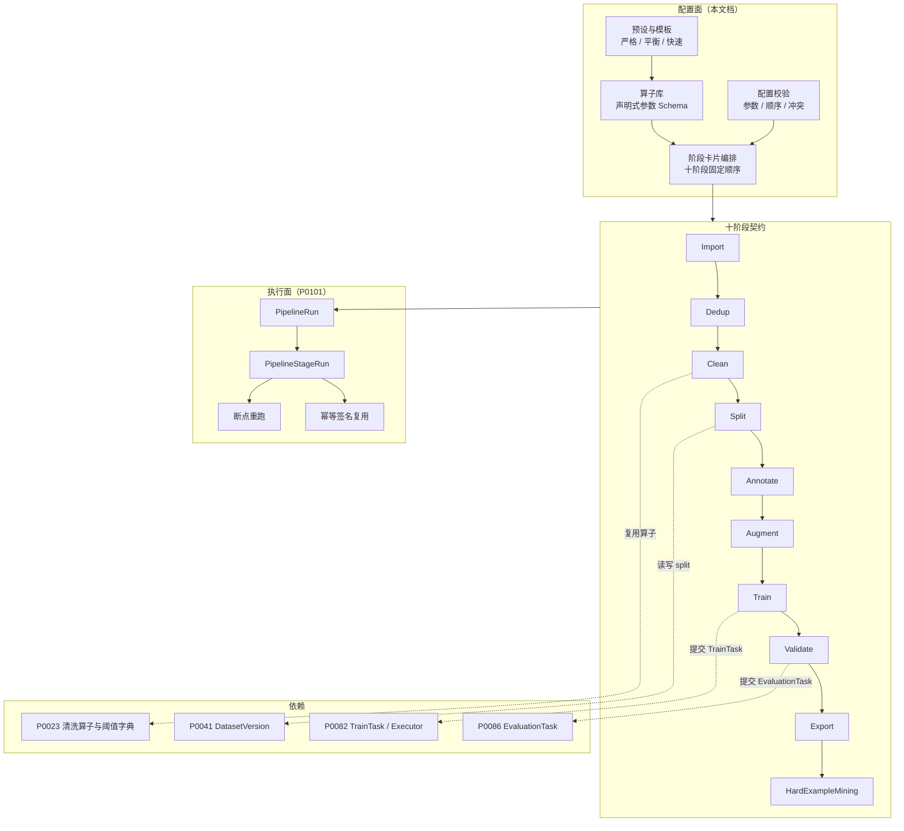
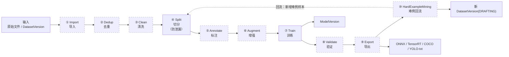
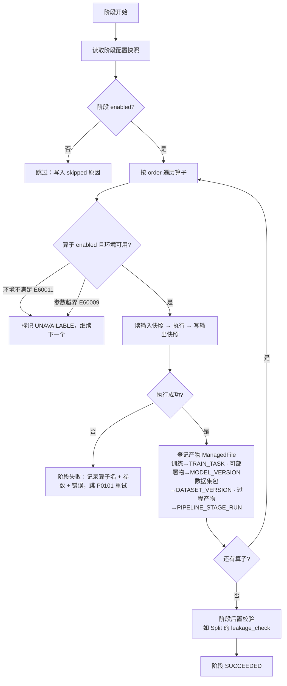
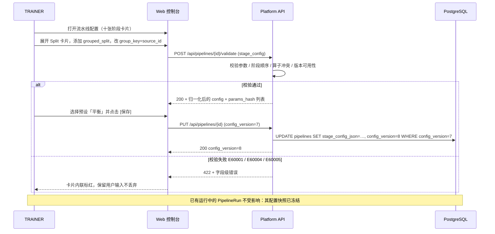
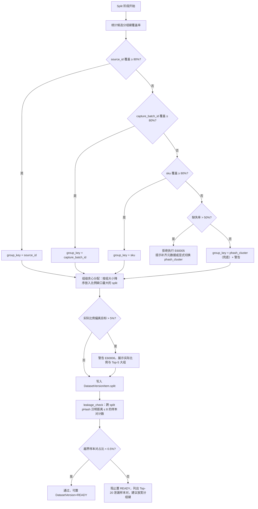
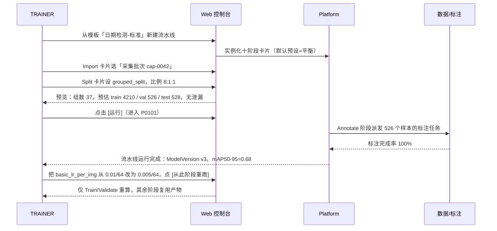
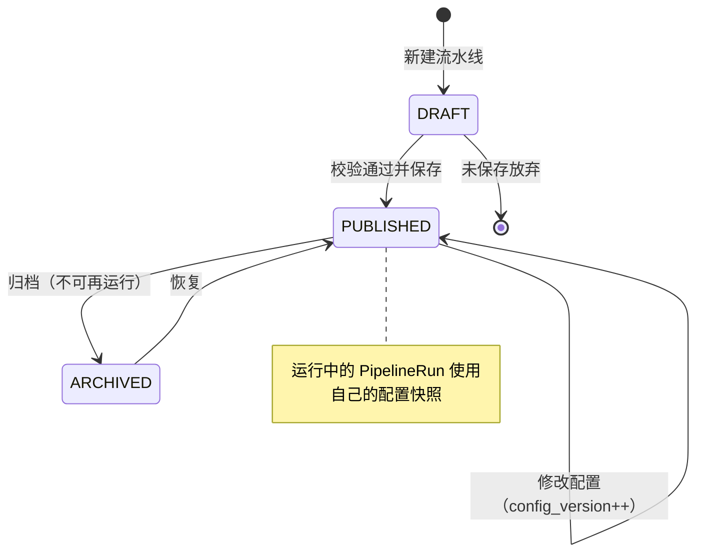

# PRD: P0100_流水线阶段与算子 (Pipeline Stages & Operators)

| 属性 | 内容 |
| :--- | :--- |
| **文档编号** | P0100 |
| **项目名称** | 轻眸识刻 |
| **功能模块** | M06_流水线 · 流水线阶段与算子 |
| **当前版本** | v1.0.2 |
| **文档状态** | Approved |
| **作者** | PipelineW |
| **最后更新** | 2026-10-01 |

---

## 1. 全局说明

> [!IMPORTANT]
> **核心定位**: 把「导入 → 去重 → 清洗 → 切分 → 标注 → 增强 → 训练 → 验证 → 导出 → 难例回流」这十件每周都在重复做的事固化成**十个固定阶段**。阶段顺序**不可自定义**，阶段内**算子可插拔、参数可配、顺序可调**。UI 呈现为**可展开的阶段卡片**，**没有自由画布**：2~3 人团队不需要一张图去表达一份本来就固定的流程，需要的是一份能复现、能重跑、能对比的配置。

### 名词解释

| 术语 | 说明 |
| :--- | :--- |
| Pipeline | 一条流水线配置，落库 `pipelines`。持有十阶段的算子与参数快照（`stage_config_json`），本身不承载执行记录 |
| Stage (阶段) | 十个固定环节之一，取值 `IMPORT / DEDUP / CLEAN / SPLIT / ANNOTATE / AUGMENT / TRAIN / VALIDATE / EXPORT / HARD_EXAMPLE_MINING` |
| Operator (算子) | 阶段内一个原子动作，有唯一 `operator` 名、声明式参数 schema、确定的输入与输出。同一阶段内可挂多个算子 |
| 算子链 (Operator Chain) | 一个阶段内算子的有序集合；按 `order` 串行执行，前一个算子的输出是后一个算子的输入 |
| 阶段卡片 (Stage Card) | UI 的编排单元：折叠态显示阶段名、启用状态、算子数、上次耗时；展开态显示算子列表与参数表单 |
| 输入快照 / 输出快照 | 阶段执行前后的**引用快照**（数据集版本、split 集合、文件 `file_id` + `etag` 清单、样本计数），写入 `PipelineStageRun`。不复制数据，只记录"当时用的是哪些东西" |
| 幂等签名 | `sha256(operator + '|' + params_hash + '|' + dataset_version_id)`。签名命中且产物文件仍在 → 直接复用旧产物，不重算（详见 P0101） |
| `params_hash` | 算子参数经**规范化 JSON**（key 升序、去除默认值、数值统一为 int/float 字面量）后取 `sha256` 前 16 位十六进制 |
| 防泄漏切分 (Leakage-Free Split) | 保证同一来源（同视频、同采集批次、同 SKU 版式）的样本**不同时**出现在 TRAIN 与 VAL/TEST。硬约束：同一 `DatasetVersion` 内同一 `group_key` 不得跨 split，违反即拒绝 |
| 分组键 (Group Key) | 用于分组的来源身份。**唯一真源是 `DataSample.group_key`**（视频 / 采集批次 / 会话 / SKU）；切分时把取值**快照**写入 `DatasetVersionItem.group_key`，使已冻结版本自洽、不依赖上游元数据变更 |
| 隔离区 (Quarantine) | 清洗/去重剔除的文件落点，不物理删除，30 天 TTL 后由 GC 回收 |
| `pipeline_kind` | `TRAIN`（以产出模型为终点）或 `DATA_PREP`（只做数据准备，跳过训练及之后所有阶段） |
| 标准产物名 | 训练产物沿用 **YOLOX 原生文件名**，落在 `YOLOX_outputs/<experiment_name>/`：`latest_ckpt.pth`（每 epoch）、`best_ckpt.pth`（AP50-95 提升时）、`epoch_<n>_ckpt.pth`（`save_history_ckpt=true` 时）、`last_mosaic_epoch_ckpt.pth`（进入 no-aug 阶段）、`train_log.txt`，指标事件目录 `tensorboard/` |
| 平台生成物 | `eval_<epoch>.json` / `PR_curve.png` / `confusion_matrix.png` **不是** YOLOX 写出的文件：YOLOX evaluator 只返回 `(ap50_95, ap50, summary)`，上述三项由 **P0086 平台自绘**并登记为 `ManagedFile(owner_type=EVALUATION_TASK)` |
| 产物归属 (owner_type) | `ManagedFile.owner_type` 全集固定 8 值：`DATASET_VERSION` / `MODEL_VERSION` / `TRAIN_TASK` / `CAPTURE_TASK` / `CLIENT_UPLOAD` / `PIPELINE_STAGE_RUN` / `EVALUATION_TASK` / `AUDIT_LOG`。本模块涉及：训练产物 → `TRAIN_TASK`；可部署导出物 → `MODEL_VERSION`；数据集导出包 → `DATASET_VERSION`；非训练阶段的过程产物 → `PIPELINE_STAGE_RUN`。**一个物理文件只登记一条记录**，`content_hash` 用于识别同一物理对象 |

### 统一异常处理

| Code | 场景 | 处理策略 |
| :--- | :--- | :--- |
| `E60001` | 算子参数校验失败（缺必填 / 类型不符 / 越界） | 保存阶段配置时拒绝，返回**字段级**错误（`operator` + `param` + 期望值），不落库 |
| `E60002` | 阶段配置缺失或乱序（十阶段必须齐全且顺序固定） | 拒绝保存并标出缺失/错位阶段；UI 在阶段卡片列表顶部横幅提示 |
| `E60003` | 不可跳过的阶段被禁用（`pipeline_kind=TRAIN` 时 `TRAIN` 必须启用） | 拒绝保存，提示「训练型流水线不可跳过训练阶段」，并给出改为 `DATA_PREP` 的入口 |
| `E60004` | 同阶段算子冲突（如 `grouped_split` 与 `stratified_split` 同时启用且分组键互斥） | 同一阶段内**至多一个切分算子置 `primary=true`**；未标记则校验失败 |
| `E60005` | 分组键缺失率过高（样本无 `source_id`/`capture_batch_id` 的比例 > 50%） | 拒绝执行 `grouped_split`，提示改用 `phash_cluster` 兜底分组或补齐元数据；20%~50% 则降级并警告 |
| `E60006` | 切分目标比例与分组完整性冲突（实际比例偏离目标 > 5%） | **完整组优先**，允许执行但警告并展示实际比例与偏离来源（列出最大的 5 个组） |
| `E60007` | 某 split 样本过少（VAL/TEST < 20 张，或某类实例 < 5） | 允许执行，标记 `metric_unreliable=true`；**VAL 与 TEST 同时为空**（`count=0`）时改为硬失败，提示回到 Split 阶段检查切分 |
| `E60008` | 分层不可行（稀有类实例数 < `min_per_class`） | 该类别退化为随机分配，写入 `degraded_classes[]`，不阻塞 |
| `E60009` | 增强算子参数越界（`mixup.alpha ≤ 0`、`mosaic.p > 1`、`n_copies > 10`） | 保存时拦截；执行期发现则跳过该算子并记录 `skipped_operators[]` |
| `E60010` | 配置引用的 `DatasetVersion` / `ModelVersion` 为 `ARCHIVED` 或已软删 | 拒绝保存与执行，给出可选 READY 版本列表 |
| `E60011` | 导出算子与执行环境不兼容（`to_tensorrt` 在无 TensorRT/无 GPU 节点） | 该算子标记 `UNAVAILABLE`，阶段仍可执行其余算子；不静默降级 |
| `E60012` | 阶段配置并发编辑冲突（乐观锁 `config_version` 不匹配） | 返回 `409`，前端提示「配置已被 {user} 修改」并提供差异对比 |
| `E60013` | 卡片引用的算子已下线（`deprecated=true`） | 保留可读可执行，卡片显示「已弃用」徽标并推荐替代算子；不允许**新增**该算子 |
| `E60014` | 分组完整性违反（同一 `DatasetVersion` 内同一 `group_key` 的样本跨了 split） | 拒绝写入该版本的 split 赋值，列出冲突的 `group_key` 与涉及样本数；必须重新切分 |

---

## 2. 项目背景

### 背景 (Context)
轻眸识刻 的首个落地任务是食品包装生产日期识别。数据来自产线相机抽帧与巡检连拍，每周新增数千张；一批数据从拿到手到变成可上线的 `ModelVersion`，固定要走一遍：筛掉重复与坏图、按来源切分、补标注、跑 YOLOX、看验证集指标、导出 ONNX、再把漏检的图捞回来。这十步在 2~3 人团队里**每一步都靠人记**：参数写在微信聊天记录里，切分比例靠脚本里的硬编码，上周跑出 0.82 mAP 的那套配置没人能完整复述。

### 问题陈述 (Problem Statement)
1. **流程不可复现**：同一个数据集重跑一次，指标差 5 个百分点，最后发现是切分随机种子变了。没有配置快照，就没有可对比的实验。
2. **验证集泄漏导致指标虚高**：抽帧数据相邻帧几乎相同，随机切分必然把"孪生图"分进 train 和 val，mAP50 虚高十几个点，上线后现场漏检。
3. **重复劳动无法沉淀**：每来一批新数据，都要从零写一遍清洗与增强脚本；参数散落在各人手里。
4. **改一个参数要全流程重来**：只想把 `basic_lr_per_img` 从 `0.01/64` 改成 `0.005/64`，却要把 40 分钟的清洗与切分重跑一遍——因为流程不是一个有记录的对象，而是"上次手敲的命令"。
5. **失败不可定位**：跑到第 7 步失败，只留下一句 `exit code 1`，不知道是哪张图、哪个算子、什么参数导致的。

### 目标与成功指标 (Goals & Success Metrics)
*   **北极星指标**: 从「决定改一个参数」到「看到新的验证集指标」，**人工操作次数 = 1**（在阶段卡片上改参数 → 点一次重跑）。
*   **次要指标**:
    *   任一 `PipelineRun` 都能精确回答「用了哪个数据集版本 / 哪套算子参数 / 哪个镜像 / 哪次训练 attempt」，**可复现率 100%**。
    *   防泄漏校验覆盖 100% 进入 `READY` 的数据集版本；跨 split 近重复样本对占比 **< 0.5%**。
    *   阶段配置非法（缺参、越界、冲突）在**保存时**被拦截，而不是执行到一半才失败。
    *   参数变更后的重跑，未受影响的阶段 **0 次重算**（靠幂等签名复用）。

### 风险与规避 (Risks & Mitigation)

| 风险 | 影响 | 规避方案 |
| :--- | :--- | :--- |
| 分组切分导致比例严重失衡 | 某 split 样本过少，指标不可信 | 完整组优先 + `E60006` 警告 + `E60007` 指标可信度标记；UI 引导改按视频切 |
| 算子参数组合爆炸 | 配置表单复杂到没人愿意用 | 每阶段提供 3 套预设（严格 / 平衡 / 快速）；参数分「基础 / 高级」两级折叠，高级默认收起 |
| 增强阶段把磁盘写满 | 阶段失败，整个 run 卡住 | `n_copies` 与剩余空间联动预检（需求空间 = 原集 × (1+n_copies) × 1.3）；不足则截断并警告 |
| 切分后才发现泄漏 | 白跑一次训练 | `leakage_check` 前置为 Split 阶段的后置校验，未通过不允许 `DatasetVersion` 置 `READY` |
| 算子版本升级导致旧配置语义漂移 | 同一配置两次结果不同 | 算子声明 `operator_version`；配置快照记录版本，执行时按快照版本执行，UI 提示可升级 |

---

## 3. 价值模型

*   **方案**: 用「十个固定阶段 + 阶段内可插拔算子」替代自由画布。阶段是**契约**（输入快照、输出快照、失败语义固定），算子是**实现**（可增删排序配参）。配置以 JSONB 快照落库，执行以幂等签名复用产物（P0101）。
*   **目标**:
    *   新数据集接入从「半天写脚本」压缩到「选模板 → 换数据集版本 → 点运行」。
    *   参数实验从「全流程重跑」压缩到「从改动阶段起重跑」，平均节省 60% 算力。
    *   指标可信：泄漏被结构性排除，验证集 mAP 与现场表现的相关性成为可依赖的决策依据。

---

## 4. 项目范围

### 功能结构图



### In Scope (包含范围)
1. **十阶段模型**：阶段名、顺序、输入/输出快照契约、失败语义、可跳过规则。
2. **算子库**：每个阶段的内置算子清单（名称、输入、输出、关键参数与默认值）。
3. **阶段卡片编排**：阶段启用/禁用、算子增删排序、参数配置、预设应用、配置校验与快照。
4. **防泄漏切分**：分组键选择、组级贪心分配、比例与完整性权衡、泄漏后置校验。
5. **配置载体**：`Pipeline` 实体与 `stage_config_json` 结构、配置版本与乐观锁。

### Out of Scope (不包含范围)
*   **自由画布 / 任意 DAG 编排**：阶段顺序固定，不做拖拽连线（见 P0060 Out of Scope 对应说明）。
*   **阶段执行、状态机、重跑与产物复用**：见 P0101。
*   **算子运行时实现**：本模块定义算子契约与参数，具体算法由各归属模块提供（清洗算法属 P0023，训练属 P0082/P0085，评估属 P0086）。
*   **用户自定义算子插件**：内置算子固定，只开放参数，不开放脚本上传（单机安全考虑）。
*   **多任务混跑调度**：并发控制见 P0101，本模块只声明各阶段/算子的资源需求。

---

## 5. 业务流程

### 5.1 十阶段主链路



> 虚线框阶段为**可跳过**；`TRAIN` 在 `pipeline_kind=TRAIN` 时不可跳过，`pipeline_kind=DATA_PREP` 时 `TRAIN` 及其后全部阶段不参与执行。

### 5.2 阶段内算子链执行顺序



### 5.3 阶段卡片配置与保存



### 5.4 防泄漏切分决策流



---

## 6. 用户分析

### 6.1 用户画像 (User Personas)

*   **算法工程师 / TRAINER**（主用户）
    *   **职责**: 决定数据怎么处理、参数怎么设、什么时候重跑；对指标负责。
    *   **核心诉求**: "改一个参数只重算该算的部分；三个月后能原样复现今天的实验。"
    *   **痛点**: 脚本与参数散落各处；重跑一次要等两小时；不知道指标虚高是因为泄漏。
*   **标注员 / ANNOTATOR**
    *   **职责**: 消费 Annotate 阶段产出的标注任务，回填标注。
    *   **核心诉求**: 任务来源清晰，返工有明确理由。
    *   **痛点**: 收到的图里有大量重复与模糊图，白标一遍。
*   **管理员 / ADMIN**
    *   **职责**: 维护平台与算力，处理磁盘、失败与权限。
    *   **核心诉求**: 一眼看出哪条流水线在占资源、失败在哪一步。
    *   **痛点**: 流水线把磁盘写满后无人知晓。

### 6.2 用户链路图 (User Journey Map)



---

## 7. 功能需求

### 7.1 防泄漏切分专题 (Leakage-Free Split)

*   **为什么会泄漏**: 日期检测的数据主要来自**视频抽帧**（P0022）与**连拍**。同一段 3 秒视频抽 15 帧，相邻帧的像素差只有几像素，pHash 汉明距离普遍在 `0~3`。随机切分下，第 N 帧进 TRAIN、第 N+1 帧进 VAL，验证集里出现的是训练样本的**近似复制品**：模型不是在"泛化"，而是在"回忆"。实测同一批数据下，随机切分比按视频切分的 `mAP50-95` 高出 **10~25 个百分点**，而这个虚高在上线后的现场图上会立刻消失。同理，同一采集批次（同一 SKU、同一光照、同一相机、同一班次）内部高度同质，按批次分组能进一步阻止"记住版式而非日期码"。
*   **分组键怎么选**: 取**第一个覆盖率 ≥ 80% 的键**，优先级如下：
    | 优先级 | 分组键 | 语义 | 适用与理由 |
    | :--- | :--- | :--- | :--- |
    | 1 | `source_id`（视频/采集作业 ID） | 同一段视频或同一次采集作业 | 抽帧数据的**根因**分组；覆盖率最高、最精确 |
    | 2 | `capture_batch_id`（`CaptureBatch`） | 同一采集批次 | 无视频来源时的次优；同批次共享设备与光照 |
    | 3 | `sku` / `product_code` | 同一产品包装版式 | 防止模型记住"这版包装的日期码大概在这个位置" |
    | 4 | `phash_cluster` | 去重阶段产出的近重复簇 | **兜底**：没有元数据时，用聚类结果当作天然分组 |
    *   覆盖率 20%~50% 时降级到下一优先级并写警告（`E60005` 软化态）；> 50% 缺失时直接拒绝，因为此时分组已不具备保护意义。
*   **真源与快照（硬约束）**: 分组身份的**唯一真源是 `DataSample.group_key`**——取值语义为样本的来源身份（视频 / 采集批次 / 会话 / SKU），抽帧血缘（`source_video_id` / `frame_index` / `timestamp` / `sampling_fps` 等）也挂在 `DataSample` 上。切分时把 `group_key` 的取值写入 **`DatasetVersionItem.group_key` 作为版本侧快照**，使已冻结版本自洽、不依赖上游元数据后续变更；兜底模式 `phash_cluster` 同样以 `phash:<cluster_id>` 的形式落 `group_key`。约束落在版本侧：**同一 `version_id` 内，同一 `group_key` 的所有样本必须落在同一个 split**，违反即整版拒绝（`E60014`）并列出冲突键与涉及样本数——这是结构性约束，不依赖 `leakage_check` 的概率阈值。取值命名与 `DataSample` 字段的对应：`source_id` ← `source_video_id`（视频/采集作业）、`capture_batch_id`、`session_id`、`sku`。
*   **切分比例与分组完整性如何兼顾**（完整性优先，比例让步）:
    1. **先组后点**: 以组为最小分配单位，绝不拆分一个组。
    2. **贪心装填**: 组按规模降序排列，依次放入"当前实际比例相对目标比例缺口最大"的 split。大组先落位可避免尾部分配时的剧烈失衡。
    3. **分层在组级施加**: `stratified_split` 与 `grouped_split` 组合时，按每个组的**类别构成向量**做分层，而不是按单张图；目标是最小化各 split 类别实例占比与全局占比的 KL 散度。
    4. **允许偏离**: 默认目标 `8:1:1`，允许实际比例偏离 ±5%；超出则警告（`E60006`）并展示实际比例与 Top-5 大组。**不允许**为了凑比例拆组——那是把泄漏重新引回来。
    5. **极端情形**: 只有 3 个视频、其中一个占了 70% 帧时，实际比例可能是 `7:1.5:1.5`。平台不自动"修正"，而是提示"建议改按视频抽样或补充采集"，由人决策。
*   **后置校验 `leakage_check`**: 切分完成后，在**跨 split** 的样本对之间计算 pHash 汉明距离，统计 `d ≤ 8` 的对数占比。`< 0.5%` 通过；否则阻止 `DatasetVersion` 置 `READY` 并列出 Top-20 泄漏对（图片并排 + 距离 + 各自 split）。这一步是最后一道闸门：分组键选错时它能兜住。
*   **验收标准**:
    ```gherkin
    场景: 按视频分组切分，组不跨 split
      Given 5000 张图来自 40 个视频，每个视频 100~200 帧
      When 以 group_key=source_id、比例 8:1:1 执行 grouped_split
      Then 任一视频的所有帧落在同一个 split 中
      And train/val/test 的帧数比例偏离目标不超过 5%

    场景: 检出跨 split 近重复并阻止置 READY
      Given 切分后仍有 120 对跨 split 样本的 pHash 汉明距离 ≤ 8，占比 1.2%
      When 执行 leakage_check
      Then 校验不通过，DatasetVersion 保持 DRAFTING
      And 返回 Top-20 泄漏样本对与建议的分组键

    场景: 同一 group_key 跨 split 被拒绝
      Given 某 DatasetVersion 中 3 个样本的 group_key 均为 source_id=video_0042
      When 切分结果把其中 1 个放入 VAL、另 2 个放入 TRAIN
      Then 平台拒绝写入该版本的 split 赋值并返回 E60014
      And 错误信息列出冲突的 group_key 与涉及样本数

    场景: 元数据缺失时兜底分组
      Given 样本均无 source_id 与 capture_batch_id，sku 覆盖率为 0
      When 配置 grouped_split
      Then 平台提示分组键缺失率过高（E60005）并推荐 phash_cluster 兜底
      And 用户显式确认后以 phash_cluster 分组执行，卡片上保留「兜底分组」徽标

    场景: 稀有类分层退化
      Given 类别 date_code 只有 3 个实例，min_per_class=5
      When 执行 stratified_split
      Then date_code 退化为随机分配并写入 degraded_classes
      And 流水线继续执行，不阻塞
    ```

*   **边界情况与异常处理**:

    | 场景 | 处理 |
    | :--- | :--- |
    | 全部样本同属一个组 | 拒绝切分：单组无法分割，提示「数据来源单一，请补充不同来源的采集」 |
    | 组数为 2，比例为 8:1:1 | 允许执行但 TEST 为空，标记 `test_empty=true`，Validate 阶段改用 VAL |
    | 用户把 seed 从 42 改成 43 后重跑 | 产生新 `params_hash` 与新签名，不复用旧 split；旧产物保留可对比 |
    | 同一 `DatasetVersion` 已被切分过 | 若 `verify_leakage=true` 则重算并在报告中对比新旧比例，不静默覆盖 |
    | `phash_cluster` 兜底聚类过粗（一簇 3000 张） | 提示「兜底分组粒度过粗，警惕仍存在泄漏」，并在 leakage_check 中以更严阈值（`d ≤ 4`）复核 |

### M06.F01 十阶段编排与阶段卡片 (Stage Orchestration & Stage Cards)
*   **用户故事**: 作为 TRAINER，我希望在一个页面上按固定顺序看到十个阶段，各自能展开配置、能单独启停，以便在不画流程图的前提下把一条完整流程配清楚。
*   **逻辑与业务规则**
    *   **前置条件**: 用户具备 `TRAINER`/`ADMIN` 角色；存在可用的 `DatasetVersion`（`READY` 或 `DRAFTING`）作为候选输入。
    *   **主流程**:
        1. 创建 `Pipeline` 时按固定顺序生成十张阶段卡片（`stage_config_json.stages` 十项齐全）。
        2. 每张卡片折叠态展示：阶段名（中英）、启用开关、算子数、上次运行耗时、上次状态。
        3. 展开态展示该阶段的输入快照摘要、算子列表（可拖拽排序）、参数表单、失败语义提示、[单独运行此阶段] 入口。
        4. `pipeline_kind=TRAIN` 时 `TRAIN` 卡片的启用开关**置灰不可关**（`E60003`）。
        5. 保存即写入 `stage_config_json` 并递增 `config_version`；同时计算每个算子的 `params_hash` 并回显在卡片上。
    *   **后置条件**: `Pipeline.config_status=PUBLISHED`，`config_version++`，返回逐算子 `params_hash` 列表。
*   **验收标准**
    ```gherkin
    场景: 十阶段卡片固定顺序
      Given TRAINER 新建流水线
      When 打开配置页
      Then 依次展示 Import/Dedup/Clean/Split/Annotate/Augment/Train/Validate/Export/HardExampleMining 十张卡片
      And 页面不提供任何拖拽改变阶段顺序的交互

    场景: 不可跳过阶段受保护
      Given pipeline_kind=TRAIN
      When 用户尝试关闭 TRAIN 阶段开关
      Then 开关不可用并提示「训练型流水线不可跳过训练阶段」
      And 提供「改为数据准备流水线」的跳转入口

    场景: 保存配置生成参数哈希
      Given 用户在 Dedup 卡片将 near_duplicate 的 d_high 从 4 改为 6
      When 点击 [保存]
      Then config_version 递增
      And 卡片回显该算子的新 params_hash
      And 校验器提示该算子签名变化将导致后续阶段重算
    ```
*   **边界情况与异常处理**:

    | 场景 | 处理 |
    | :--- | :--- |
    | 两人同时编辑同一流水线 | 乐观锁 `config_version` 拦截（`E60012`），后到者看到差异对比 |
    | 保存中途网络中断 | 前端保留草稿到 localStorage，重连后可恢复；服务端无半写入（单事务） |
    | 阶段全被禁用 | 拒绝保存：至少 `Import` + 一个产出阶段启用（`E60002`） |
    | `DATA_PREP` 型流水线 | `TRAIN`/`VALIDATE`/`EXPORT`/`HARD_EXAMPLE_MINING` 四张卡片置灰并标注「按 kind 不参与执行」 |

### M06.F02 算子配置与参数校验 (Operator Configuration & Validation)
*   **用户故事**: 作为 TRAINER，我希望在同一阶段内增删、排序算子并配置参数，参数写错时立即被告知，以便把"配置错误"挡在执行之前。
*   **逻辑与业务规则**
    *   **前置条件**: 目标阶段处于展开态；算子来自内置算子库。
    *   **主流程**:
        1. 每个算子声明 `operator_version`、`params_schema`（类型/默认值/范围/枚举）、`is_primary_capable`、`deprecated`、`required_env`。
        2. 参数表单按 Schema 渲染；「基础」参数直接露出，「高级」参数折叠。
        3. 保存前调用 `POST /api/pipelines/{id}/validate`：校验必填、类型、范围、跨字段约束（如 `d_low > d_high`）、同阶段算子冲突（`E60004`）、环境可用性（`E60011`）。
        4. 校验失败返回字段级错误，前端内联标红且**不丢弃**用户输入。
        5. 校验通过后计算 `params_hash`（`sha256` 规范化 JSON 前 16 位）；参数与默认值相同的算子不计入 hash 差异。
    *   **后置条件**: 阶段内算子按 `order` 形成确定链；`params_hash` 落库并参与幂等签名。
*   **验收标准**
    ```gherkin
    场景: 参数越界在保存时被拦截
      Given Clean 阶段启用 blur_detect
      When 将 laplacian_threshold 设为 -5
      Then 校验返回 422 且错误定位到该算子的该字段
      And 配置未落库

    场景: 同阶段切分算子冲突
      Given Split 阶段同时启用 grouped_split 与 random_split
      When 点击 [保存]
      Then 返回 E60004，要求至多一个算子标记 primary
      And 用户将 grouped_split 设为 primary 后可正常保存

    场景: 高级参数不影响默认哈希
      Given 用户未修改任何参数直接保存
      When 对比两次保存的 params_hash
      Then 两次 params_hash 完全一致
    ```
*   **边界情况与异常处理**:

    | 场景 | 处理 |
    | :--- | :--- |
    | 算子已弃用 | 保留可读可执行，标「已弃用」并提供替代算子一键替换；不允许新增 |
    | 参数引用已归档模型版本 | 拒绝保存（`E60010`），给出可用版本下拉 |
    | 浮点参数两次输入 `0.1` 与 `0.10` | 规范化 JSON 统一为 `0.1`，`params_hash` 相同，不产生无意义重算 |
    | 拖拽排序后未保存就关闭 | 提示未保存变更；`config_version` 未变则无副作用 |

### M06.F03 去重与清洗阶段 (Dedup & Clean Stages)
*   **用户故事**: 作为 TRAINER，我希望自动剔除重复图与坏图，并且去重与清洗的判定口径与导入预检一致，以便不重复定义标准、也不把噪声带进训练。
*   **逻辑与业务规则**
    *   **Dedup**: `exact_duplicate` 按 `file_size` 分桶后算内容哈希（默认 `MD5`，可选 `SHA-256`）；`near_duplicate` 用 64 bit pHash + 汉明距离双档（`d_high` 默认 4 判 HIGH，`d_low` 默认 8 判 LOW）。HIGH 默认隔离，LOW 仅标记。簇内保留代表帧（`(capture_time, file_name)` 排序首张）。
    *   **Clean**: 算子与阈值字典**复用 P0023**，本模块不重新定义算法，只重新定义"在流水线里如何被调用与被记录"。
    *   **去重与切分的协作**: Dedup 产出的 `phash_cluster` 会作为 Split 阶段的兜底分组键；因此 Dedup 必须在 Split 之前（顺序固定已保证）。
    *   **不物理删除**: 所有剔除走隔离区，`cleaning_report` 与 `dedup_report` 以 JSON 登记为 `ManagedFile`。
*   **验收标准**
    ```gherkin
    场景: 完全重复保留代表帧
      Given 5000 张图中 3 个文件字节完全相同
      When 执行 Dedup 阶段
      Then 生成 1 个 EXACT 簇，保留代表帧 1 张，隔离 2 张
      And 报告 JSON 登记为 ManagedFile 并可从阶段卡片下载

    场景: 清洗口径与导入预检一致
      Given 同一批数据在导入期已用 P0023 阈值字典产出报告
      When 在流水线 Clean 阶段使用相同算子与阈值
      Then 两次判定的命中集合完全一致
      And 卡片上显示「口径来源：P0023 阈值字典 v1」
    ```
*   **边界情况与异常处理**:

    | 场景 | 处理 |
    | :--- | :--- |
    | 清洗剔除 > 90% 样本 | 阶段标 `HIGH_RISK`，需 ADMIN 二次确认后才提交，并在运行详情保留红色提示 |
    | 隔离区写入失败（磁盘满 / 权限） | 阶段失败（`E60107` 由 P0101 承接），已处理文件保持原位，不回滚 |
    | 有标注的图被判定为近重复 | 不自动隔离，转 `QUARANTINE_PENDING` 待人工确认（避免误删已标注劳动成果） |
    | 去重后剩余样本为 0 | 终止流水线，提示「去重后无可用样本」，保留报告供排查 |

### M06.F04 增强、训练与验证阶段 (Augment, Train & Validate Stages)
*   **用户故事**: 作为 TRAINER，我希望增强、训练、验证三个阶段都能在卡片上配参并各自独立重跑，以便把"调增强"和"调超参"当成两件互不干扰的事。
*   **逻辑与业务规则**
    *   **Augment 双模式**:
        *   `OFFLINE`（默认）: 对 `TRAIN` split 生成增强副本，登记为新的 `DataSample`（`is_augmented=true`）并进入该 `DatasetVersion`；适合小样本扩充（首期日期检测样本 < 5000 张）。
        *   `ONLINE`：不下发副本，只把增强参数下发给 `yolox_train`，由训练期实时增强；提升吞吐，节省磁盘。参数直接映射 YOLOX Exp 字段：`mosaic_prob` / `mixup_prob` / `enable_mixup` / `hsv_prob` / `flip_prob` / `degrees` / `translate` / `shear` / `mosaic_scale` / `mixup_scale` / `no_aug_epochs`。
        *   同一流水线只允许一种模式；`DATA_PREP` 与 `TRAIN` 型都支持 `OFFLINE`。
    *   **Train**: 算子 `yolox_train`，本质是**通过 Executor 提交一个 `TrainTask`**（K8s Job），不在本模块重复实现训练逻辑。容器产出落在 `YOLOX_outputs/<experiment_name>/`：`latest_ckpt.pth`（每 epoch）、`best_ckpt.pth`（AP50-95 提升时）、`epoch_<n>_ckpt.pth`（`save_history_ckpt=true`）、`last_mosaic_epoch_ckpt.pth`、`train_log.txt`、`tensorboard/`，由容器回传后按 **`owner_type=TRAIN_TASK`、`owner_id=train_task_id`** 登记为 `ManagedFile`（**流水线触发也走同一规则**：`PipelineStageRun` 只引用 `train_task_id`，不重复登记文件）。**`eval_<epoch>.json` / `PR_curve.png` / `confusion_matrix.png` 由 P0086 在 Validate 阶段自绘**，本阶段不等框架产出这些文件。
    *   **超参命名以 YOLOX Exp 为准**: 字段名直接映射 `yolox/exp/yolox_base.py`（`max_epoch` / `input_size` / `basic_lr_per_img` / `scheduler` …），不做平台侧改名；CLI 侧的 `-f`（exp 文件）、`-expn`（实验名）与 `opts` REMAINDER 覆盖由 P0082 负责组装。
    *   **Validate**: 算子 `coco_eval` + `slice_eval`，复用 P0086 的 `EvaluationTask` 与指标口径（COCO 101 点插值）；切片维度取 `sku` / `lighting` / `source_id`。
    *   **资源声明**: 三个阶段各自声明 `resource_json`（GPU 张数、CPU、内存、临时磁盘），由 P0101 的并发控制与 P0082 的 Executor 使用。
*   **验收标准**
    ```gherkin
    场景: 离线增强只作用于训练集
      Given DatasetVersion 的 split 为 train 4210 / val 526 / test 528
      And Augment 配置 mode=OFFLINE, n_copies=2, operators=[hsv, flip, rotate]
      When 执行 Augment 阶段
      Then 新增 8420 个 is_augmented=true 的样本，全部 split=TRAIN
      And val 与 test 的样本数不变

    场景: 仅改超参触发从 Train 起重跑
      Given 一次已成功的运行，Train 阶段参数 basic_lr_per_img=0.01/64
      When 用户把 basic_lr_per_img 改为 0.005/64 并触发断点重跑
      Then Import 至 Augment 全部复用原产物（不重算）
      And 仅 Train 与 Validate 重新执行

    场景: 跳过验证阶段
      Given 用户禁用了 Validate 阶段
      When 运行完成
      Then 产出 ModelVersion 但 metrics_json 为空
      And 平台标记 has_metrics=false 且禁止该版本进入部署推理
    ```
*   **边界情况与异常处理**:

    | 场景 | 处理 |
    | :--- | :--- |
    | 离线增强触发磁盘不足 | 预检 `原集 × (1+n_copies) × 1.3`，不足则按剩余空间截断并警告，或建议切 `ONLINE` |
    | Train 阶段 OOM | 复用 TrainTask 的失败语义与 `attempt` 重试；卡片提示建议下调 `batch_size` 或 `input_size`，或开启 `fp16` |
    | 训练节点为 PINNED 目标但节点离线 | 阶段等待准入，`PipelineStageRun` 保持 `QUEUED` 并显示阻塞原因（不复用 P0080 的失效节点） |
    | 无 VAL split | `coco_eval` 退回 TEST；VAL 与 TEST **皆空**时阶段失败（`E60007`，不可重试），提示回到 Split 检查切分比例 |
    | 增强算子生成重复样本（如原图即翻转图） | 复用 Dedup 的 pHash 比对对新样本去重，命中则丢弃并计数 |

### M06.F05 导出与难例回流阶段 (Export & Hard Example Mining)
*   **用户故事**: 作为 TRAINER，我希望一键导出部署所需格式，并把模型判断错误的样本自动捞回来加入下一轮，以便闭环持续提升。
*   **逻辑与业务规则**
    *   **Export**: `to_coco` / `to_yolo_txt` 导出当前 `DatasetVersion`；`to_onnx` / `to_tensorrt` 导出 `ModelVersion`。**产物归属按用途三分**：① 可被推理端加载的产物（`.onnx` / `.engine` / OpenVINO 目录 / `.tflite` / `.ncnn`）→ `owner_type=MODEL_VERSION`、`owner_id=model_version_id`，供 `ModelService`（P0110）与 `EdgeExport`（P0112）引用；② 数据集导出包（COCO JSON / YOLO txt + `classes.txt` / zip·tar 包）→ `owner_type=DATASET_VERSION`，其 `manifest.json` 随包本身走；③ 导出过程产物（`export_manifest.json`、各格式转换校验结果、精度回跑报告）→ `owner_type=PIPELINE_STAGE_RUN`。**一个物理文件只登记一条 `ManagedFile`**，别处引用一律用 `managed_file_id` 外键，不重复建记录。
    *   **HardExampleMining**: 需要 per-image 匹配明细（由 Validate 阶段产出）。三类算子：
        *   `by_fp`：高 IoU 但预测类别/位置错误的误检，`fp_conf_threshold` 默认 0.25；
        *   `by_fn`：GT 未被任何预测匹配（`IoU < fn_iou_threshold`，默认 0.5）；
        *   `by_low_conf`：置信度落在 `[low_conf_min, low_conf_max]`（默认 `0.10 ~ 0.45`）的预测所对应的图，代表"模型犹豫"的边界样本。
    *   **回流语义**: 产出一个新的 `DatasetVersion(status=DRAFTING)`，成员为难例样本（去重后），并生成报告说明每类难例的数量与来源。**不自动进入训练**：需人工补标后走下一轮流水线。
    *   **无模型时**: 若流水线为 `DATA_PREP` 型或上一轮未训练，HardExampleMining 无法执行，卡片置灰并说明原因。
*   **验收标准**
    ```gherkin
    场景: 按漏检捞回难例
      Given 一次 Validate 产出 per-image 明细，含 68 张存在 FN 的图
      When 执行 HardExampleMining(by_fn, iou_threshold=0.5)
      Then 生成新的 DRAFTING 版本包含 68 个样本
      And 报告 JSON 记录每张图的漏检 GT 框与最高 IoU

    场景: 三类难例合并去重
      Given by_fp 命中 30 张、by_fn 命中 68 张、by_low_conf 命中 120 张，其中 25 张重叠
      When 三类算子全部启用
      Then 回流版本样本数为三者并集（去重后）且不超过 max_samples

    场景: 导出 TensorRT 环境不满足
      Given 目标节点未安装 TensorRT
      When Export 阶段包含 to_tensorrt
      Then 该算子标记 UNAVAILABLE（E60011），阶段继续执行其余算子
      And 卡片明确提示「引擎未构建」，不静默跳过
    ```
*   **边界情况与异常处理**:

    | 场景 | 处理 |
    | :--- | :--- |
    | 无 per-image 明细（Validate 被跳过） | HardExampleMining 阶段失败并提示「需先完成 Validate」，不做静默降级 |
    | 难例数量超过 `max_samples`（默认 2000） | 按 `by_fn > by_fp > by_low_conf` 优先级截断，报告注明截断数 |
    | 回流样本与现网数据重复 | 以 pHash 与现存 `DataSample` 比对，重复者不重复入版本 |
    | 导出产物过大（> 单文件 2GB） | 分片导出并在报告中登记分片清单 |
    | 连续两轮回流同一个样本 | 记录 `readd_count`，连续 3 次仍为难例则升级为 `HARD_SAMPLE` 并提醒人工检查标注质量 |

---

## 8. 技术架构与数据模型

### 8.1 数据实体

#### Table: `pipelines`（Pipeline）

| 字段名 | 类型 | 必填 | 说明 | 约束 |
| :--- | :--- | :--- | :--- | :--- |
| `id` | UUID | 是 | 主键 | PK |
| `name` | VARCHAR(128) | 是 | 流水线名称 | UNIQUE(name) WHERE deleted_at IS NULL |
| `description` | TEXT | 否 | 用途说明 | |
| `pipeline_kind` | VARCHAR(16) | 是 | 类型 | CHECK IN ('TRAIN','DATA_PREP')；DEFAULT 'TRAIN' |
| `is_template` | BOOLEAN | 是 | 是否为可复用模板 | DEFAULT false；模板不被直接运行 |
| `source_pipeline_id` | UUID | 否 | 另存来源 | FK → pipelines.id；仅记录，不做级联 |
| `config_status` | VARCHAR(16) | 是 | 配置状态 | CHECK IN ('DRAFT','PUBLISHED','ARCHIVED')；DEFAULT 'DRAFT' |
| `config_version` | INT | 是 | 乐观锁版本 | 每次保存 +1 |
| `stage_config_json` | JSONB | 是 | 十阶段算子与参数快照 | NOT NULL；结构见 8.3 |
| `stage_count` | INT | 是 | 启用阶段数（冗余计数） | CHECK BETWEEN 1 AND 10 |
| `augment_mode` | VARCHAR(8) | 否 | 增强模式 | CHECK IN ('OFFLINE','ONLINE') |
| `label_group_id` | UUID | 否 | 关联类别体系 | FK → label_groups.id |
| `last_run_at` | TIMESTAMPTZ | 否 | 最近一次运行时间 | 由 P0101 回写 |
| `created_by` | UUID | 是 | 创建人 | FK → users.id |
| `created_at` / `updated_at` / `deleted_at` | TIMESTAMPTZ | 是/是/否 | 通用字段 | 软删 |

> **不新建 `PipelineTemplate` / `PipelineStage` / `PipelineOperator` 实体**：模板由 `is_template=true` 的 `Pipeline` 表达；阶段是固定枚举，算子配置是 `stage_config_json` 中的数组元素。理由：阶段集合封闭、算子实例无需独立生命周期，拆表只会带来 join 开销与一致性风险。

### 8.2 十阶段契约表

| # | 阶段 | 输入快照 | 输出快照 | 内置算子 | 主要可配参数 | 失败语义 | 可跳过 |
| :--- | :--- | :--- | :--- | :--- | :--- | :--- | :--- |
| 1 | Import | 原始文件集（`CaptureTask` 产出 / 上传会话 / 压缩包）或已有 `DatasetVersion` | `DatasetVersion(DRAFTING)` + `DatasetVersionItem(split=UNASSIGNED)` | `local_upload` / `archive_extract` / `format_parse` / `frame_extract` | `source_type`、`format`、`fps`/`stride`、`class_mapping` | 单文件失败跳过；失败率 > `max_fail_ratio`(5%) → `PARTIAL_FAILED` | 是（输入已是 READY 版本） |
| 2 | Dedup | `DatasetVersion(DRAFTING)` + 文件清单 | 保留集 + 去重报告 JSON + `phash_cluster` 映射 | `exact_duplicate` / `near_duplicate` | `hash_algo`、`d_high`、`d_low`、`max_cluster_size`、`keep_policy` | 单图哈希失败跳过；比对内存超限自动切 BK-tree，仍失败则阶段失败 | 是 |
| 3 | Clean | 去重后保留集 | 清洗后保留集 + 清洗报告 + 隔离清单 | `blur_detect` / `corrupt_image` / `no_object_filter` / `size_outlier`（+ 复用 P0023 算子的 `exif_normalize` / `zero_area_filter` / `oob_fix`） | `laplacian_threshold`、`min_size`、`max_size`、`no_object_policy` | 剔除 > 90% 需二次确认；隔离写入失败 → 阶段失败 | 是 |
| 4 | Split | 保留集 + `DataSample.group_key`（分组身份真源） | `DatasetVersionItem.split` + **`group_key` 快照** + 切分报告 + `leakage_check` 结果 | `random_split` / `grouped_split` / `stratified_split` | `ratios`、`group_key`、`seed`、`min_per_class`、`stratify_by`、`leakage_tolerance` | 分组键缺失 > 50% 拒绝（`E60005`）；同一版本内同一 `group_key` 跨 split → 拒绝（`E60014`）；泄漏超阈阻止置 READY | 是（已有 split 且 `verify_leakage=false`） |
| 5 | Annotate | split 后未标注样本 | `Annotation` + 标注完成度 + `AnnotationTask` | `pre_annotation` / `human_task` / `auto_accept_gt` | `model_version_id`、`confidence_threshold`、`task_type`、`assignee_group` | 预标注模型不可用 → 降级纯人工并告警；等待人工时状态 `WAITING_HUMAN`（不判失败） | 是 |
| 6 | Augment | `TRAIN` split 样本 | OFFLINE：增强副本 `DataSample`；ONLINE：参数下发给 Trainer | `mosaic` / `mixup` / `hsv` / `flip` / `rotate` / `random_resize` | `mode`、`n_copies`、各算子 `p` 与幅度区间 | 空间不足按余量截断并警告；单图增强失败跳过；增强结果与现网重复则丢弃 | 是 |
| 7 | Train | `DatasetVersion(READY)` + 超参 + 镜像 digest | `TrainTask` → `ModelVersion` + `YOLOX_outputs/<exp>/` 产物（`ManagedFile(owner_type=TRAIN_TASK, owner_id=train_task_id)`） | `yolox_train` | `max_epoch`、`input_size`、`batch_size`、`basic_lr_per_img`、`scheduler`、`warmup_epochs`、`no_aug_epochs`、`ema`、`fp16`、`seed`、`eval_interval`、`scheduling_mode`、`target_node_id` | 复用 `TrainTask` 状态机与 `attempt` 重试（`FAILED → RETRYING → FINAL_FAILED`） | 否（`TRAIN` 型）；`DATA_PREP` 型整段跳过 |
| 8 | Validate | `ModelVersion` + `VAL` split | `EvaluationTask.metrics_json` + 报告产物 | `coco_eval` / `slice_eval` | `iou_thresholds`、`conf_sweep`、`slices[]`、`metric_engine_version` | 同 `EvaluationTask`；无 VAL → 退 TEST；VAL/TEST **皆空** → 阶段失败（`E60007`），不可重试 | 是（跳过则禁止部署） |
| 9 | Export | `ModelVersion`（+ `DatasetVersion` 用于标注导出） | 导出产物 `ManagedFile` 按用途归属：可部署物（`.onnx`/`.engine`/OpenVINO/`.tflite`/`.ncnn`）→ `MODEL_VERSION`；数据集包（COCO JSON / YOLO txt / zip）→ `DATASET_VERSION`；过程报告 → `PIPELINE_STAGE_RUN` | `to_coco` / `to_yolo_txt` / `to_onnx` / `to_tensorrt` | `opset`、`input_shape`、`dynamic_axes`、`fp16`、`split_scope` | 环境不满足标记 `UNAVAILABLE` 继续；引擎构建失败则该算子失败，已产出的 ONNX 保留 | 是 |
| 10 | HardExampleMining | `ModelVersion` + per-image 明细 | 新 `DatasetVersion(DRAFTING)`（难例集）+ 报告 | `by_fp` / `by_fn` / `by_low_conf` | `fp_conf_threshold`、`fn_iou_threshold`、`low_conf_range`、`max_samples` | 缺少 per-image 明细 → 阶段失败并提示先做 Validate | 是（默认关闭） |

### 8.3 算子目录

| 阶段 | 算子 | 输入 | 输出 | 关键参数 | 默认值 |
| :--- | :--- | :--- | :--- | :--- | :--- |
| Import | `local_upload` | 上传会话 `UploadSession` | `DataSample` + `ManagedFile` | `concurrency` | 4 |
| Import | `archive_extract` | zip/tar 归档 | 解压文件树 | `max_unzip_ratio`、`flatten` | 50、false |
| Import | `format_parse` | COCO / VOC / YOLO 标注 | `Annotation` | `format`、`class_mapping` | 必填、{} |
| Import | `frame_extract` | 视频文件 | 抽帧图片 | `fps`、`stride`、`dedup_inline` | 1、1、true |
| Dedup | `exact_duplicate` | 文件集 | 完全重复簇 | `hash_algo`、`keep_policy` | `MD5`、`keep_first` |
| Dedup | `near_duplicate` | 文件集 + pHash | 近重复簇 + `phash_cluster` | `d_high`、`d_low`、`max_cluster_size`、`algo` | 4、8、50、`pHash` |
| Clean | `blur_detect` | 图片 | 模糊标记 | `laplacian_threshold`、`mode` | 60、`mark` |
| Clean | `corrupt_image` | 图片 | 损坏标记 | `action` | `quarantine` |
| Clean | `no_object_filter` | 图片 + 标注 | 背景图清单 | `policy` | `keep_as_background` |
| Clean | `size_outlier` | 图片尺寸 | 尺寸异常标记 | `min_size`、`max_size` | 64、4096 |
| Clean | `exif_normalize` | 无标注图片 | 方向归一图 | `on_annotated` | `quarantine`（有标注不自动 bake） |
| Clean | `oob_fix` | 标注框 | 修正后标注 | `epsilon`、`max_oob` | 0.005、0.02 |
| Split | `random_split` | 样本集 | split 赋值 | `ratios`、`seed` | `8:1:1`、42 |
| Split | `grouped_split` | 样本集 + 分组键 | split 赋值（组完整） | `group_key`、`ratios`、`seed`、`prefer_group_integrity` | 必填、`8:1:1`、42、true |
| Split | `stratified_split` | 样本集 + 类别 | split 赋值（分层） | `stratify_by`、`min_per_class` | `class`、5 |
| Annotate | `pre_annotation` | 未标注样本 + 模型 | 候选 `Annotation` | `model_version_id`、`confidence_threshold` | 必填、0.25 |
| Annotate | `human_task` | 未标注样本 | `AnnotationTask` | `task_type`、`assignee_group`、`batch_size` | `RECT`、必填、50 |
| Annotate | `auto_accept_gt` | 已有标注 | `Annotation` | `source`、`overwrite` | `IMPORT`、false |
| Augment | `mosaic` | 训练图 + 标注 | 拼接图 + 标注 | `p`、`scale` | 1.0、`[0.5,1.5]` |
| Augment | `mixup` | 训练图 + 标注 | 混合图 + 标注 | `p`、`alpha` | 0.5、0.2 |
| Augment | `hsv` | 训练图 | 调色图 | `p`、`h_gain`、`s_gain`、`v_gain` | 0.5、0.015、0.7、0.4 |
| Augment | `flip` | 训练图 + 标注 | 翻转图 + 标注 | `p`、`horizontal`、`vertical` | 0.5、true、false |
| Augment | `rotate` | 训练图 + 标注 | 旋转图 + 标注 | `p`、`degrees`、`fill` | 0.3、`[-10,10]`、114 |
| Augment | `random_resize` | 训练图 + 标注 | 缩放图 + 标注 | `p`、`scale_range`、`keep_ratio` | 0.3、`[0.7,1.3]`、true |
| Train | `yolox_train` | `DatasetVersion` + 超参 + 镜像 digest | `ModelVersion` + `YOLOX_outputs/<exp>/` 产物 | Exp 文件（`-f`）、`experiment_name`（`-expn`）、`max_epoch`、`input_size`、`test_size`、`batch_size`、`basic_lr_per_img`、`min_lr_ratio`、`warmup_epochs`、`warmup_lr`、`weight_decay`、`scheduler`、`no_aug_epochs`、`ema`、`fp16`、`seed`、`data_num_workers`、`multiscale_range`、`eval_interval`、`save_history_ckpt`、`test_conf`、`nmsthre`、`train_ann`/`val_ann`/`test_ann`、`data_dir`、`scheduling_mode`、`target_node_id` | `yolox_s.py`、`yolox_s`、300、`(640,640)`、`(640,640)`、64、0.01/64、0.05、5、0、5e-4、`yoloxwarmcos`、15、true、true、42、4、5、10、false、0.01、0.65、`instances_{train,val,test}2017.json`、必填、`AUTO`、null |
| Validate | `coco_eval` | `ModelVersion` + VAL split | `metrics_json` + 报告产物 | `iou_thresholds`、`conf_sweep`、`metric_engine_version` | `0.5:0.95`、0.05 步长、`1.0` |
| Validate | `slice_eval` | 预测明细 + 切片维度 | `metrics_json.by_slice` | `dimensions[]`、`max_cardinality` | `[sku,lighting,source_id]`、200 |
| Export | `to_coco` | `DatasetVersion` | COCO JSON（owner=`DATASET_VERSION`） | `split_scope`、`include_images` | `ALL`、false |
| Export | `to_yolo_txt` | `DatasetVersion` | YOLO txt + `classes.txt`（owner=`DATASET_VERSION`） | `split_scope`、`normalized` | `ALL`、true |
| Export | `to_onnx` | `ModelVersion` | `.onnx`（owner=`MODEL_VERSION`，可部署物） | `opset`、`input_shape`、`dynamic_axes`、`fp16` | 11、`(640,640)`、false、false |
| Export | `to_tensorrt` | `.onnx` + 目标 GPU | `.engine`（owner=`MODEL_VERSION`，可部署物） | `precision`、`workspace_gb`、`dla` | `fp16`、4、false |
| HardExampleMining | `by_fp` | per-image 明细 | 误检难例清单 | `fp_conf_threshold`、`min_iou` | 0.25、0.5 |
| HardExampleMining | `by_fn` | per-image 明细 + GT | 漏检难例清单 | `fn_iou_threshold` | 0.5 |
| HardExampleMining | `by_low_conf` | 预测置信度分布 | 边界难例清单 | `low_conf_min`、`low_conf_max` | 0.10、0.45 |

> **命名口径**: 上表中 Train 算子与 Augment 的 `ONLINE` 参数**直接使用 YOLOX Exp 字段名**（`yolox/exp/yolox_base.py`），不做平台侧二次命名；不存在的参数（如 `save_period`、`occ_thr`）不得出现在配置中。数据侧 COCO 注释文件名由 Exp 的 `train_ann` / `val_ann` / `test_ann` 与 `data_dir` 决定，平台生成 COCO 时直接映射这两个字段。目录侧产物固定落在 `YOLOX_outputs/<experiment_name>/`。

### 8.4 配置结构与幂等契约

```json
{
  "schema_version": 1,
  "pipeline_kind": "TRAIN",
  "augment_mode": "OFFLINE",
  "stages": [
    {
      "stage": "SPLIT",
      "order": 4,
      "enabled": true,
      "skip_reason": null,
      "operators": [
        { "operator": "grouped_split", "operator_version": "1.0", "order": 1,
          "primary": true, "enabled": true,
          "params": { "group_key": "source_id", "ratios": {"train": 8, "val": 1, "test": 1},
                      "seed": 42, "prefer_group_integrity": true },
          "params_hash": "9f2c41ab77e0d381" }
      ]
    }
  ]
}
```

*   **`params_hash` 计算口径**：取算子的**非默认参数**子集 → key 升序序列化为紧凑 JSON → `sha256` → 前 16 位十六进制。默认值被剔除，因此「显式填一个等于默认值的参数」与「不填」产生同一哈希。
*   **幂等签名**：`signature = sha256(operator + '|' + params_hash + '|' + dataset_version_id)[:32]`；命中且产物 `ManagedFile.etag` 未变才复用（详见 P0101）。
*   **配置冻结**：`PipelineRun` 创建时把 `stage_config_json` 整份复制进运行快照；此后编辑 `Pipeline` 不影响在跑与已跑的运行。



---

## 9. UI/UX 规格说明

### 9.1 流水线配置页（阶段卡片列表）

```text
+-------------------------------------------------------------------------------------------+
| 流水线: 日期检测-标准 v12  [DATA_PREP|TRAIN]  配置版本: 8   [保存] [另存为模板] [运行 ▶]   |
+-------------------------------------------------------------------------------------------+
| [ ] ① Import          导入      ● 启用   4 算子   上次 2m 41s   ✅            [展开 ▾]   |
| [ ] ② Dedup           去重      ● 启用   2 算子   上次 1m 12s   ✅            [展开 ▾]   |
| [ ] ③ Clean           清洗      ● 启用   4 算子   上次 0m 58s   ✅            [展开 ▾]   |
| [x] ④ Split           切分      ● 启用   2 算子   上次 0m 06s   ✅ 防泄漏开    [收起 ▴]   |
|     +-----------------------------------------------------------------------------------+ |
|     | 分组键  [ source_id (覆盖 96.4%) ▾ ]   比例 [8:1:1]   seed [42]   [校验泄漏 ✓]     | |
|     | 算子链（拖拽排序）                                                                | |
|     |  1. ⇅ grouped_split   [primary]  ● 启用   params_hash 9f2c41ab…   [参数 ⚙]        | |
|     |  2. ⇅ stratified_split           ● 启用   stratify_by=class       [参数 ⚙]        | |
|     |  [+] 添加算子                                        ⚠ 添加 random_split 会冲突    | |
|     | 输入快照: dv-2026-1001 (DRAFTING, 5264 samples)                                   | |
|     | 输出快照: train 4210 / val 526 / test 528 · 泄漏对 0                               | |
|     +-----------------------------------------------------------------------------------+ |
| [ ] ⑤ Annotate        标注      ○ 跳过（已 100% 标注）                        [展开 ▾]   |
| [ ] ⑥ Augment         增强      ● 启用   4 算子   模式 OFFLINE                [展开 ▾]   |
| [ ] ⑦ Train           训练      ● 启用   1 算子   yolox_s · max_epoch 300 · bs64  [展开 ▾]   |
| [ ] ⑧ Validate        验证      ● 启用   2 算子   mAP50-95 = 0.68            [展开 ▾]   |
| [ ] ⑨ Export          导出      ● 启用   2 算子   onnx + coco                [展开 ▾]   |
| [ ] ⑩ HardExampleMining 难例回流 ○ 关闭                                      [展开 ▾]   |
+-------------------------------------------------------------------------------------------+
| ⚠ TRAIN 阶段参数 basic_lr_per_img 变更 → 重跑从 Train 起，Dedup~Augment 复用（省 ~42 分钟） |
+-------------------------------------------------------------------------------------------+
```

### 9.2 防泄漏校验未通过提示

```text
+-------------------------------------------------------------------+
|  ⛔ 切分校验未通过：跨 split 近重复样本对 120 对（占 1.2% > 0.5%） |
+-------------------------------------------------------------------+
|  建议：当前 group_key = sku，同款包装不同批次被混入                 |
|  1) 改用 source_id（覆盖率 96.4%）重新切分                         |
|  2) 或将 pHash 阈值收紧到 d ≤ 4 复核                               |
|                                                                   |
|  泄漏样本对 Top-3                                                 |
|  ┌──────────────┬──────────────┬────┬──────────────┐              |
|  │ 样本 A       │ 样本 B       │ d  │ split        │              |
|  ├──────────────┼──────────────┼────┼──────────────┤              |
|  │ img_003412   │ img_003413   │  1 │ train / val  │              |
|  │ img_007788   │ img_007789   │  2 │ train / test │              |
|  │ img_010002   │ img_010031   │  6 │ train / val  │              |
|  └──────────────┴──────────────┴────┴──────────────┘              |
|              [改用 source_id 重切]   [查看全部 120 对]   [取消]    |
+-------------------------------------------------------------------+
```

### 9.3 交互元素

| 元素 | 类型 | 状态 | 行为 |
| :--- | :--- | :--- | :--- |
| 阶段卡片 | Accordion | Collapsed / Expanded / Disabled | 点击展开算子与参数；`DATA_PREP` 下后四张卡片 Disabled |
| 阶段启用开关 | Switch | On / Off / Locked | `TRAIN` 在 `TRAIN` 型下 Locked，hover 说明原因（`E60003`） |
| 算子行拖拽手柄 | DragHandle | Default / Dragging | 调整 `order`；松手后本地重排，保存时校验冲突 |
| 添加算子 | Dropdown | Default / Disabled | 列出该阶段可用算子；弃用算子带「已弃用」标记，不可新增 |
| 参数 ⚙ | Drawer | — | 按 Schema 渲染表单，高级参数默认折叠 |
| 校验泄漏 | Button | Default / Loading / Passed / Failed | 触发 `leakage_check`，失败时弹出 9.2 的提示面板 |
| 保存 | Button | Default / Disabled / Loading / Saved | 先 validate 再 PUT；失败内联标红 |
| 另存为模板 | Button | Default | 复制为 `is_template=true`，`source_pipeline_id` 记录来源 |
| 运行 ▶ | Button | Default / Disabled | 进入 P0101 的运行向导（选输入数据集版本 / 训练节点） |

---

## 10. 非功能性需求 (NFR)

*   **性能 (Performance)**
    *   阶段卡片配置页首屏 < 1s（十阶段配置 ≤ 5KB JSON，一次请求返回）。
    *   配置校验接口 P95 < 200ms（纯内存 Schema 校验，不查数据）。
    *   `grouped_split` 分组分配 5 万样本 < 3s（组级贪心为 O(n log n)）。
    *   `leakage_check` 复用 Dedup 已算好的 pHash 缓存，5 万样本 < 20s；未命中缓存时按 P0023 的向量化路径。
*   **可靠性 (Reliability)**
    *   配置保存为单事务；半写入不可能发生。
    *   算子参数 Schema 变更向后兼容：新增参数必须带默认值；删除参数需 `operator_version` 升位并保留旧版本可执行。
    *   切分可复现：同 `(数据, 算子参数, seed)` 必得同一 split 结果。
*   **安全 (Security)**
    *   配置读写限 `TRAINER` / `ADMIN`；`VIEWER` 只读。
    *   算子不接受任意脚本/命令字符串，杜绝通过配置注入 shell。
    *   清洗与导出路径一律走 `ManagedFile`，配置中不出现绝对路径与 `s3://` 字面量。
*   **兼容性 (Compatibility)**
    *   `stage_config_json.schema_version` 当前为 `1`；读取时按版本迁移，未知字段忽略并告警。
    *   Web 端 Chrome / Edge 最新两个大版本；不依赖自由画布所需的重型图形库。
*   **可扩展性 (Scalability)**
    *   新增算子 = 注册一个 `params_schema` + 一个执行器绑定，不改阶段模型、不改 UI 骨架。
    *   新增阶段**不在设计内**（十阶段封闭）；确有需要时按 `stage_config_json` 的 `schema_version` 升版处理。
    *   阶段粒度资源声明（GPU / CPU / 内存 / 临时磁盘）为后续多机扩展留出接口，单机下仅用于并发准入（P0101）。

---

## 附录: 已确认的设计决策

| 决策项 | 结论 |
| :--- | :--- |
| 编排形态 | 十阶段**固定顺序**，UI 用可展开阶段卡片；**不做自由画布 DAG** |
| 阶段可跳过白名单 | Import / Dedup / Clean / Split / Annotate / Augment / Validate / Export / HardExampleMining 可跳过；`pipeline_kind=TRAIN` 时 TRAIN **不可**跳过 |
| `DATA_PREP` 型流水线 | 只跑 Import~Export（含 Split/Augment），Train/Validate/Export 由 `pipeline_kind` 决定参与与否，终点是新 `DatasetVersion` |
| 切分算子唯一性 | 同一阶段至多一个切分算子 `primary=true`（`E60004`） |
| 分组键优先级 | `source_id > capture_batch_id > sku > phash_cluster`，取首个覆盖率 ≥ 80% 者；全缺失 > 50% 时拒绝分组切分 |
| 比例 vs 完整性 | **完整性优先**；允许实际比例偏离目标 ±5%，超出仅告警不拆组 |
| 防泄漏兜底 | Split 后置 `leakage_check`（跨 split `d ≤ 8` 占比 < 0.5%）未通过则 `DatasetVersion` 不得置 `READY` |
| 增强模式 | `OFFLINE`（生成副本，默认）与 `ONLINE`（把增强参数下发给 YOLOX Exp 字段）二选一；离线增强只作用于 TRAIN split |
| 清洗算法来源 | **复用 P0023 的算子与阈值字典**，本模块不重新定义算法，只定义调用与记录方式 |
| 训练阶段实现 | `yolox_train` 算子只是**提交 `TrainTask`（K8s Job）**，训练逻辑与重试语义见 P0082/P0085；产物为 `YOLOX_outputs/<experiment_name>/` 下的 `latest_ckpt.pth` / `best_ckpt.pth` / `epoch_<n>_ckpt.pth` / `last_mosaic_epoch_ckpt.pth` / `train_log.txt` 与 `tensorboard/` |
| 超参命名 | 直接采用 YOLOX Exp 字段名（`max_epoch` / `input_size` / `basic_lr_per_img` / `scheduler` / `no_aug_epochs` …），平台不改名、不造同义词 |
| 平台生成物归属 | `eval_<epoch>.json` / `PR_curve.png` / `confusion_matrix.png` 由 P0086 自绘并登记为 `ManagedFile(owner_type=EVALUATION_TASK)`；Train 阶段不产出、也不等待这些文件 |
| 模板实体 | 不新建 `PipelineTemplate`；`pipelines.is_template=true` 表达模板，`source_pipeline_id` 记录另存来源 |
| 产物承载 | 一律 `ManagedFile`，**不新建 Artifact / Checkpoint / Metric 表**；报告与指标写 `PipelineStageRun.metrics_json` |
| 产物 owner_type（训练） | 训练产物（`latest_ckpt.pth` / `best_ckpt.pth` / `epoch_<n>_ckpt.pth` / `last_mosaic_epoch_ckpt.pth` / `train_log.txt` / `tensorboard/`）一律 `owner_type=TRAIN_TASK`、`owner_id=train_task_id`，**无论是否由流水线触发**；`PipelineStageRun` 只凭 `train_task_id` 引用，不重复登记文件 |
| 产物 owner_type（导出） | 可被推理端加载的产物（`.onnx` / `.engine` / OpenVINO 目录 / `.tflite` / `.ncnn`）→ `MODEL_VERSION`；数据集导出包（COCO JSON / YOLO txt / zip）→ `DATASET_VERSION` 且 `manifest.json` 随包走；导出过程产物（`export_manifest.json`、转换校验、精度回跑报告）→ `PIPELINE_STAGE_RUN` |
| 产物 owner_type（其余阶段） | Import / Dedup / Clean / Split / Annotate / Augment / HardExampleMining 的清单与报告 → `PIPELINE_STAGE_RUN`；**一个物理文件只登记一条记录**，别处引用用 `managed_file_id` 外键，`content_hash` 识别同一物理对象 |
| 分组键真源 | `DataSample.group_key` 为唯一真源（视频 / 采集批次 / 会话 / SKU）；`DatasetVersionItem.group_key` 是版本创建时的快照副本；同一 `version_id` 内同一 `group_key` 不得跨 split（`E60014`） |
| 算子插件化边界 | 算子内置固定，只开放参数；不接受用户脚本，避免单机环境下的注入与不可复现 |
| 参数哈希口径 | 仅非默认参数参与 `params_hash`（规范化 JSON + sha256 前 16 位） |

## 关联文档

*   **P0101_流水线执行与重跑**: 消费本模块的 `stage_config_json`，负责 `PipelineRun` / `PipelineStageRun`、幂等复用与断点重跑。
*   **P0023_导入预检与清洗**: 提供 Clean 阶段算子与阈值的**权威口径**（`E60xxx` 与 `E60xxx` 不重叠，本模块只引用）。
*   **P0041_数据集与版本**: `DatasetVersion` 不可变快照与 `DatasetVersionItem.split` 的落点；`READY` 前需通过 `leakage_check`。
*   **P0062_标注任务派单**: Annotate 阶段 `human_task` 算子的下游。
*   **P0082_训练任务提交与调度**: Train 阶段的 `TrainTask` 提交、两层调度与 `scheduling_mode ∈ AUTO|PINNED`。
*   **P0083_超参数与训练模板**: `yolox_train` 超参来源与模板。
*   **P0086_模型评估**: Validate 阶段的指标口径（COCO 101 点插值）、`metrics_json` 结构，以及平台自绘产物 `eval_<epoch>.json` / `PR_curve.png` / `confusion_matrix.png`（`ManagedFile(owner_type=EVALUATION_TASK)`）。
*   **P0112_端侧导出**: Export 阶段 `to_onnx` / `to_tensorrt` 的下游消费方。
*   **P0040_存储配置与桶绑定**: 阶段产物的物理落点由 `StorageConfig` 决定。

## Changelog

| 版本 | 日期 | 作者 | 变更说明 |
| :--- | :--- | :--- | :--- |
| v0.1.0-draft | 2026-10-01 | PipelineW | 初稿：十阶段契约与算子目录 |
| v1.0.0 | 2026-10-01 | PipelineW | 定稿：补齐阶段卡片交互、防泄漏切分专题、算子参数默认值与幂等签名口径 |
| v1.0.1 | 2026-10-01 | PipelineW | 按 YOLOX 源码核验更正：`yolox_train` 参数改为 Exp 原生字段（`max_epoch` / `input_size` / `basic_lr_per_img` / `scheduler` / `no_aug_epochs` 等），产物目录更正为 `YOLOX_outputs/<experiment_name>/`，明确 `eval_<epoch>.json` / `PR_curve.png` / `confusion_matrix.png` 属 P0086 平台生成物，COCO 注释名映射 `train_ann`/`val_ann`/`test_ann` |
| v1.0.2 | 2026-10-01 | PipelineW | 按 Main 裁定统一产物归属：训练产物 → `TRAIN_TASK`；可部署导出物（`.onnx`/`.engine`/OpenVINO/`.tflite`/`.ncnn`）→ `MODEL_VERSION`；数据集导出包 → `DATASET_VERSION`；非训练阶段过程产物 → `PIPELINE_STAGE_RUN`；一个物理文件只登记一条记录。补齐 `group_key` 真源（`DataSample` 为真源 / `DatasetVersionItem` 为快照）与跨 split 硬约束（新增 `E60014`），明确 `owner_type` 全集 8 值 |
