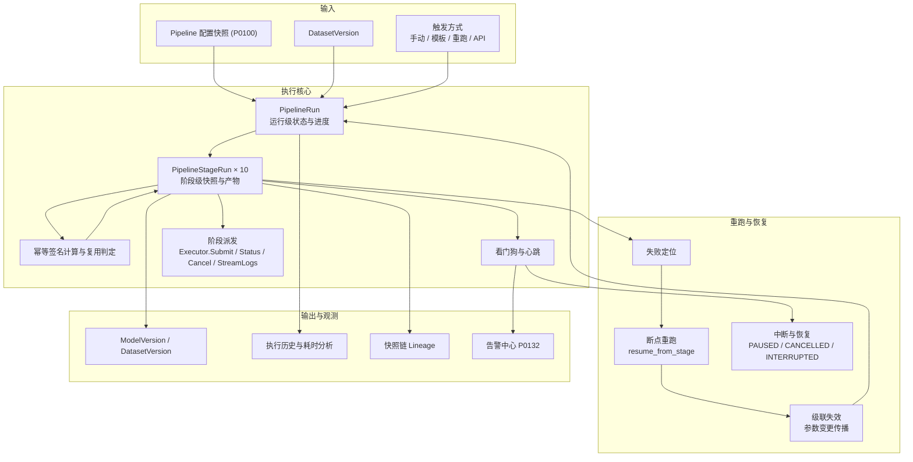
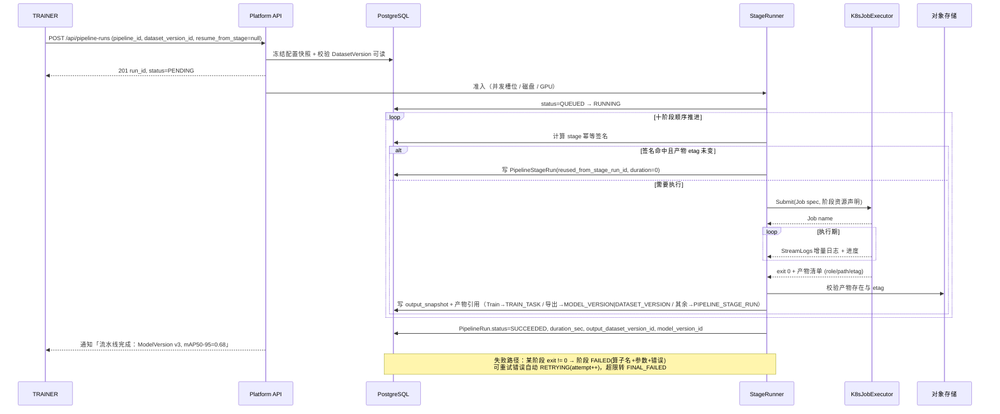
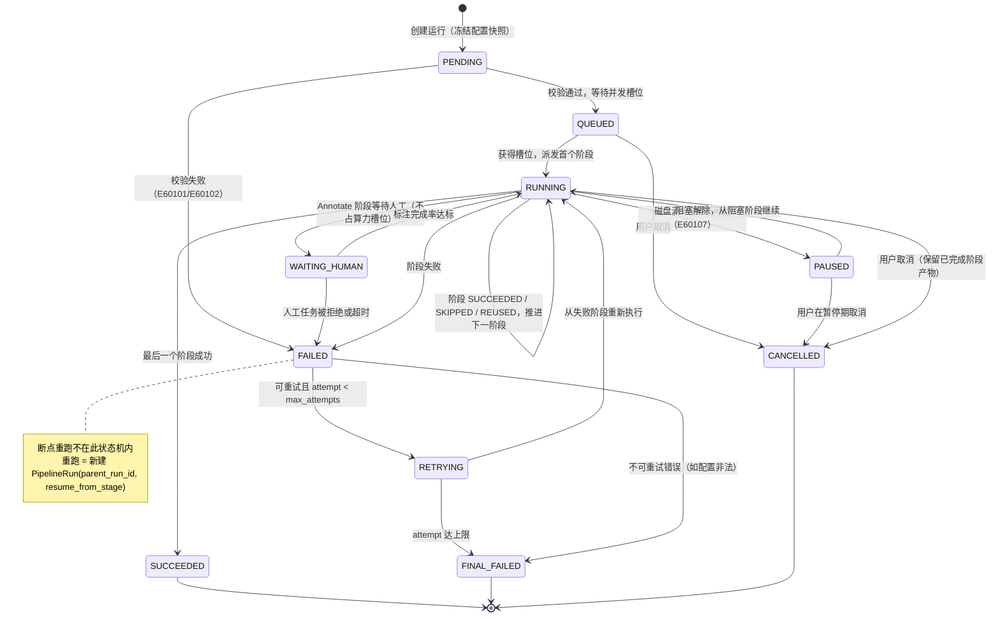
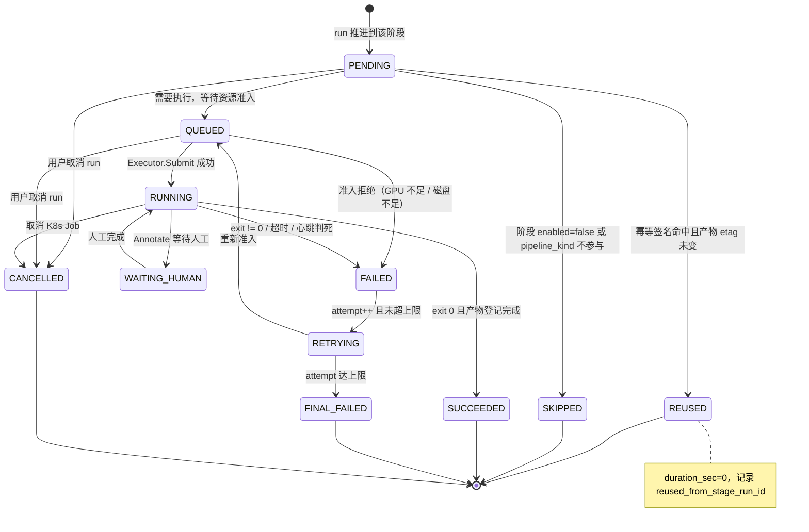
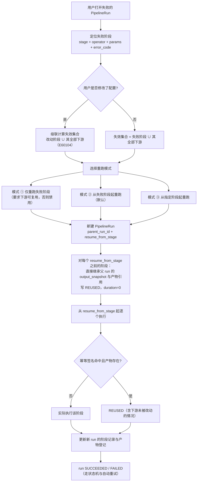
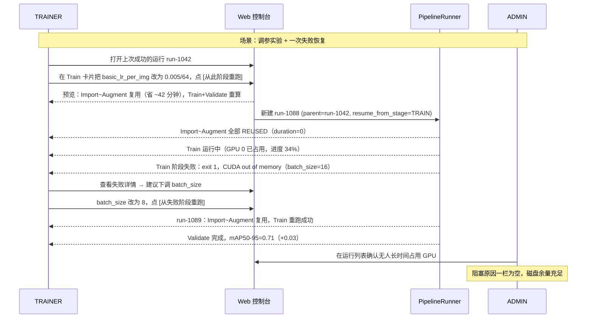
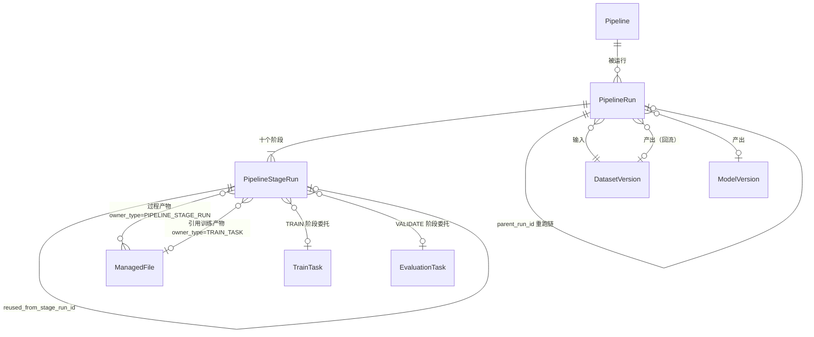
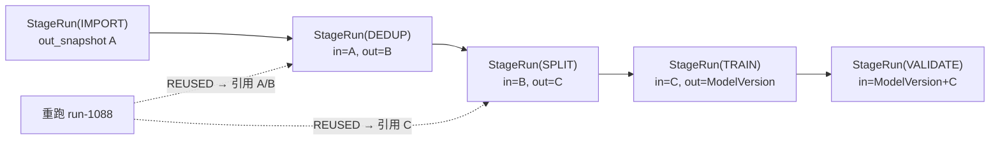

# PRD: P0101_流水线执行与重跑 (Pipeline Execution & Resume)

| 属性 | 内容 |
| :--- | :--- |
| **文档编号** | P0101 |
| **项目名称** | FoodYolo |
| **功能模块** | M06_流水线 · 流水线执行与重跑 |
| **当前版本** | v1.0.2 |
| **文档状态** | Approved |
| **作者** | PipelineW |
| **最后更新** | 2026-10-01 |

---

## 1. 全局说明

> [!IMPORTANT]
> **核心定位**: 流水线的配置（P0100）是"应该怎么做"，本模块负责"这次是怎么跑的"。一次执行拆成 `PipelineRun`（整体）+ `PipelineStageRun`（十个阶段各一行），每个阶段记录**输入快照 / 输出快照 / 算子参数哈希 / 是否复用**。**幂等签名命中且产物文件仍在 → 不重算，直接复用**。失败时精确到算子与参数，可从失败点起重跑，已完成阶段的产物与耗时零损失。

### 名词解释

| 术语 | 说明 |
| :--- | :--- |
| PipelineRun | 一次流水线执行，落库 `pipeline_runs`。持有创建时**冻结**的配置快照，与 `Pipeline` 后续编辑解耦 |
| PipelineStageRun | 一次执行中某个阶段的记录，落库 `pipeline_stage_runs`；含输入/输出快照、参数哈希、耗时、错误与产物引用 |
| 配置快照 (Config Snapshot) | `PipelineRun.pipeline_snapshot_json`，创建时整份复制 `Pipeline.stage_config_json`，永不回写 |
| 输入快照 / 输出快照 | 阶段执行前后的**引用快照**：数据集版本 ID、split 集合计数、文件 `file_id + etag` 清单、上游阶段产物引用。只记引用，不复制数据 |
| 幂等签名 (Idempotency Signature) | `sha256(operator + '|' + params_hash + '|' + dataset_version_id)[:32]`。命中且产物 `etag` 未变 = 可直接复用 |
| 产物复用 (Reuse) | 跳过实际执行，`PipelineStageRun.reused_from_stage_run_id` 指向提供产物的历史阶段记录，`duration_sec = 0` |
| 断点重跑 (Resume from Failure) | 用户触发的重跑：**新建** `PipelineRun`，带 `parent_run_id` 与 `resume_from_stage`；`resume_from_stage` 之前的阶段全部复用父运行的产物 |
| 自动重试 (Auto Retry) | 系统行为：同一 `PipelineRun` 内 `attempt++`，从失败阶段重新执行；**不新建实体** |
| 级联失效 (Cascade Invalidation) | 某阶段参数变化 → 它自己与**全部下游阶段**的签名失效，必须重算；上游阶段不受影响 |
| 快照链 (Snapshot Chain) | 由 `input_snapshot_json` → 上游 `output_snapshot_json` → `reused_from_stage_run_id` 构成的可回溯引用链，回答"这个模型是用哪些图、哪套参数跑出来的" |
| 阻塞 (Blocked) | 阶段因外部条件（磁盘满、存储不可达、等待人工标注）无法推进；`PipelineRun` 保持 `PAUSED`/`WAITING_HUMAN`，不消耗 GPU 槽位 |
| 看门狗 (Watchdog) | 平台侧定时探测：阶段心跳陈旧 + K8s Job 状态回查，判定阶段是"还活着"还是"已经死了" |
| `attempt` | 执行次数计数。**重试与重跑都只递增 `attempt`，不新建同义实体**（无 `StageRun` / `TrainRun` 之类的影子表） |

### 统一异常处理

| Code | 场景 | 处理策略 |
| :--- | :--- | :--- |
| `E60101` | 输入 `DatasetVersion` 不可用（`ARCHIVED` / 软删 / 未完成导入） | 拒绝创建 `PipelineRun`，返回当前可用的 READY 版本列表 |
| `E60102` | 配置快照校验失败（引用算子已下线、参数非法） | 拒绝创建，指向 P0100 的配置校验错误明细 |
| `E60103` | 上游产物不可复用（`ManagedFile` 已 `DELETED` 或 `etag` 变化） | 不复用，该阶段及其下游**重算**，写入 `reuse_miss_reason` |
| `E60104` | 断点重跑时上游阶段被改动 | 级联失效：改动阶段及其下游全部重算，弹窗展示受影响的阶段列表 |
| `E60105` | K8s Job 提交失败（API 不可达 / 镜像拉取失败 / GPU 准入拒绝） | 阶段 `FAILED`，可重试错误按 `attempt` 重试；不可重试错误直接 `FINAL_FAILED` |
| `E60106` | 阶段执行超时（超过 `stage_timeout`，默认 Train 12h、其余 2h） | 取消 K8s Job，阶段 `FAILED(TIMEOUT)`，可重试 |
| `E60107` | 磁盘 / 对象存储写满 | `PipelineRun` 转 `PAUSED`，不判失败；告警中心发 P0；空间恢复后从阻塞阶段继续，已完成阶段不重算 |
| `E60108` | 平台重启导致阶段与 K8s Job 失联 | 看门狗探测：Job 存在 → 重新挂接 `StreamLogs` 继续跟踪；Job 不存在 → `FAILED(INTERRUPTED)` 并按 `attempt` 重试 |
| `E60109` | 并发上限已满（`max_concurrent_pipelines`） | `PipelineRun` 保持 `QUEUED`，展示队列位置与阻塞原因（等谁、占了几张卡） |
| `E60110` | 用户取消运行 | 取消当前 K8s Job；**已完成阶段产物全部保留**，状态 `CANCELLED`，可从断点重跑 |
| `E60111` | 输出 `DatasetVersion` 名称冲突 | 自动追加 `_{run_id 前 8 位}` 后缀，不覆盖既有版本 |
| `E60112` | 幂等签名命中但产物文件缺失 | 视为未命中重算，`reuse_miss_reason=ARTIFACT_GONE` |
| `E60113` | 阶段产物回调丢失（容器已上传但未回平台） | 看门狗扫描当前阶段的产物前缀（非训练阶段 `PIPELINE_STAGE_RUN/{run_id}/{stage}/`，Train 阶段 `TRAIN_TASK/{train_task_id}/`）按 `etag` 补登记；超时未补则阶段失败 |

---

## 2. 项目背景

### 背景 (Context)
P0100 把流程固化成了十阶段配置，但真正消耗人耐心的是**执行**：一次完整流水线（5 万张图）要跑 2~3 小时，其中 Train 占 80%。绝大多数实验只改一个参数——把 `basic_lr_per_img` 调小、把 `d_high` 从 4 改到 6、换一个 `batch_size`。如果每次改动都把前面 40 分钟的导入、去重、清洗、切分重跑一遍，2~3 人团队的机器就会被无意义的重复计算占满。

### 问题陈述 (Problem Statement)
1. **重跑等于全跑**：没有阶段级记录，就没有"从哪一步继续"的依据，只能从头再来。
2. **失败不可定位**：第 7 阶段失败只留下一行 `exit code 1`；不知道是哪个算子、哪张图、哪组参数。
3. **产物与配置失联**："v3 模型指标 0.68"背后是哪个数据集版本、哪套增强参数、哪个镜像 digest？没人能答上来。
4. **重复产物堆积**：同一份去重结果被反复计算与反复落盘，磁盘被同一份数据的多个副本塞满。
5. **机器重启就断片**：平台或工作站重启后，之前的运行留在 `RUNNING` 状态，没人知道它其实已经死了。
6. **模板漂移**：上周导出的好配置，今天在新数据上跑出完全不同的结果，却无法逐项对比差异。

### 目标与成功指标 (Goals & Success Metrics)
*   **北极星指标**: 参数变更后的重跑，**受影响阶段的算力占比 < 30%**——即 70% 的算力花在真正改变结果的地方。
*   **次要指标**:
    *   幂等复用命中时，阶段端到端切换耗时 **< 3s**（不重新执行算子）。
    *   任一阶段失败后，平台在 **60s 内**给出确定的定位结论（阶段 + 算子 + 参数 + 错误摘要 + 可重试性）。
    *   平台重启后，所有 `RUNNING` 的 `PipelineRun` 在 **2min 内**收敛到确定状态（继续跑或明确失败）。
    *   同一份输入与配置重跑，指标复现差异 < **1e-6**；`PipelineStageRun` 的 `idempotency_signature` 100% 一致。
    *   历史运行可完整回答「模型 → 数据集版本 → 算子参数 → 镜像 digest → 代码 commit」五问，覆盖率 **100%**。

### 风险与规避 (Risks & Mitigation)

| 风险 | 影响 | 规避方案 |
| :--- | :--- | :--- |
| 产物复用导致"用错版本的数据" | 指标不可信 | 复用必须同时校验签名与产物 `etag`；`reused_from_stage_run_id` 在 UI 上显式标注「复用」徽标与来源运行 |
| 上游改了数据但下游仍复用 | 结果与配置不符 | 输入快照记录 `dataset_version_id`；`DatasetVersion` 不可变，任何数据变化必然产生新版本 → 新签名 |
| 重跑链无限增长 | 历史页面难以阅读 | 重跑传 `parent_run_id` 形成树；默认只展开最新一条链，`attempt` 与 `resume_from_stage` 在行内显示 |
| 单机磁盘被中间产物塞满 | 后续阶段全部失败 | 阶段声明临时空间需求，预检不足则拒绝启动（而非跑到一半失败）；中间产物 TTL 7 天由 P0046 GC |
| 看门狗误判存活任务为死亡 | 重复执行、产物冲突 | 判定需**心跳陈旧 + K8s Job 状态回查**双条件；只有 Job 确实不存在才判死 |
| 并发失控打满 GPU | 与其他训练任务抢占 | `max_concurrent_pipelines` 默认 1；阶段级 GPU 需求走 P0080 槽位准入，不做抢占 |

---

## 3. 价值模型

*   **方案**: 把执行拆成「运行 → 阶段」两级记录，每阶段带**输入/输出快照 + 幂等签名**。执行前先算签名，命中即复用；失败时按阶段落错误；重跑时新建 run 并继承 `resume_from_stage` 之前的所有产物引用。
*   **目标**:
    *   调参实验的算力开销从"每次全流程"降到"只算受影响阶段"。
    *   失败从"模糊的 exit code"变成"阶段 + 算子 + 参数 + 原因"的确定结论，平均排障时间从 30 分钟降到 5 分钟内。
    *   每一次上线评审都能给出完整的执行快照链，指标不再是无根之木。

---

## 4. 项目范围

### 功能结构图



### In Scope (包含范围)
1. **运行创建与阶段调度**：配置快照冻结、输入校验、排队与逐个阶段派发。
2. **幂等复用**：签名计算、命中判定、产物 `etag` 校验、复用链记录。
3. **失败定位与断点重跑**：阶段/算子级错误定位、三种重跑模式、级联失效计算。
4. **流水线模板**：保存为模板、另存为新流水线、在新 `DatasetVersion` 上实例化运行。
5. **执行历史与耗时分析**：运行列表、阶段时间轴、耗时瀑布与对比、失败率统计。
6. **并发与资源占用控制**：并发上限、优先级排队、阶段级资源声明与准入。
7. **中断与恢复**：取消、平台重启后的失联收敛、磁盘满暂停与续跑。

### Out of Scope (不包含范围)
*   **阶段与算子的定义**：见 P0100。本模块只执行已定义的配置。
*   **K8s 调度本身**：Pod 落哪个 Node 由 K8s scheduler 决定；平台只做排队、优先级、并发上限与资源准入（P0080/P0082）。
*   **训练与评估的内部逻辑**：Train 阶段委托 `TrainTask`（P0082/P0085），Validate 阶段委托 `EvaluationTask`（P0086）。
*   **定时调度 / 触发器编排**：不实现 cron 与事件触发流水线；仅支持手动、模板实例化与 API 触发。
*   **跨机器分布式执行**：单机 k3s 内执行，不做多集群联邦。
*   **自由 DAG 执行的并发分支**：十阶段严格串行，只有"等待人工"与"暂停"两种非执行态。

---

## 5. 业务流程

### 5.1 一次完整运行（含复用与失败）



### 5.2 `PipelineRun` 状态机



### 5.3 阶段状态机



### 5.4 断点重跑流程



---

## 6. 用户分析

### 6.1 用户画像 (User Personas)

*   **算法工程师 / TRAINER**（主用户）
    *   **职责**: 反复调参、对比实验、解释指标变化。
    *   **核心诉求**: "改了 `basic_lr_per_img` 就只重跑训练，别让我等清洗；失败告诉我卡在哪一步。"
    *   **痛点**: 全流程重跑浪费 40 分钟；失败原因只有 exit code；实验结果说不清来源。
*   **管理员 / ADMIN**
    *   **职责**: 保证机器不被占死、磁盘不爆、失败有人管。
    *   **核心诉求**: "一屏看到所有运行的阶段、资源与阻塞原因。"
    *   **痛点**: 运行卡在排队却显示"运行中"；磁盘满了没人知道是哪条流水线在写。
*   **标注员 / ANNOTATOR**（间接用户）
    *   **职责**: 响应 Annotate 阶段派发的任务。
    *   **核心诉求**: 任务清楚、返工有理由。
    *   **痛点**: 流水线状态因等待标注长期不动，无人知晓进度。

### 6.2 用户链路图 (User Journey Map)



---

## 7. 功能需求

### M06.F01 运行创建与阶段调度 (Run Creation & Stage Dispatch)
*   **用户故事**: 作为 TRAINER，我希望选好输入数据集版本后一键运行，并由平台按阶段顺序自动推进，以便不用守着终端。
*   **逻辑与业务规则**
    *   **前置条件**: `Pipeline.config_status=PUBLISHED`；输入 `DatasetVersion` 为 `READY` 或 `DRAFTING`（`ARCHIVED` 或软删拒绝，`E60101`）；用户角色 `TRAINER`/`ADMIN`。
    *   **主流程**:
        1. 创建 `PipelineRun`，**整份复制** `stage_config_json` 到 `pipeline_snapshot_json`（此后编辑 `Pipeline` 不影响本 run）。
        2. 准入检查：并发槽位（`max_concurrent_pipelines`）、目标节点 GPU/磁盘（阶段级 `resource_json`）、输入可读性。
        3. 准入通过 → `QUEUED → RUNNING`，按 `stage_order` 依次推进；每阶段完成即写入 `current_stage` 与 `progress_percent`。
        4. 阶段间**严格串行**：同一时刻只有一个阶段处于 `RUNNING`（Annotate 的 `WAITING_HUMAN` 除外）。
        5. 全部阶段结束 → 汇总 `output_dataset_version_id`、`model_version_id`、`metrics_json` 摘要，状态置 `SUCCEEDED`。
    *   **后置条件**: 运行记录可查、阶段产物已登记 `ManagedFile`、通知已发出（P0132）。
*   **验收标准**
    ```gherkin
    场景: 正常创建并推进十条阶段
      Given 一条 PUBLISHED 的 TRAIN 型流水线与一个 READY 的数据集版本
      When TRAINER 创建运行
      Then 返回 run_id 且 status 依次经过 PENDING → QUEUED → RUNNING
      And 阶段按 IMPORT..HARD_EXAMPLE_MINING 顺序逐个出现 SUCCEEDED 记录
      And 任一时刻至多一个阶段处于 RUNNING

    场景: 输入数据集版本不可用
      Given 目标 DatasetVersion 状态为 ARCHIVED
      When 创建运行
      Then 返回 422 且错误码 E60101
      And 不产生 PipelineRun 记录
    ```

*   **边界情况与异常处理**

    | 场景 | 处理 |
    | :--- | :--- |
    | 并发槽位已满 | 保持 `QUEUED`，展示队列位置与阻塞对象（哪个 run 占了几张卡）（`E60109`） |
    | 运行创建后用户又改了 `Pipeline` | 无影响：本 run 使用自己的配置快照；UI 提示「运行使用 v8 配置，当前为 v9」 |
    | 输入数据集在运行中被新建版本取代 | 运行锁定创建时的 `dataset_version_id`，不受影响 |
    | 阶段全被跳过（如 `DATA_PREP` 只剩 Export） | 运行仍正常完成，`SUCCEEDED`，阶段记录中保留 `SKIPPED` 原因 |

### M06.F02 阶段执行与幂等复用 (Stage Execution & Idempotent Reuse)
*   **用户故事**: 作为 TRAINER，我希望没变过的阶段不要重算，也希望能确切知道某一步用的是哪份产物，以便把算力花在真正变化的地方、并让结果可追溯。
*   **逻辑与业务规则**
    *   **签名计算**: 阶段内每个算子各算一个签名 `sig = sha256(operator + '|' + params_hash + '|' + dataset_version_id)[:32]`；阶段签名 = 全部算子签名按 `order` 拼接后的 `sha256[:32]`。
    *   **复用判定（三条件同时满足才复用）**:
        1. 在**同一 `dataset_version_id`** 的历史 `PipelineStageRun` 中找到同签名的 `SUCCEEDED` 记录；
        2. 其 `output_snapshot_json` 引用的全部 `ManagedFile` 状态为 `COMMITTED`；
        3. 每个文件的实际 `etag` 与快照记录一致（防外部篡改/迁移丢文件）。
        *   任一不满足 → 不复用，写入 `reuse_miss_reason ∈ {NO_MATCH, ARTIFACT_GONE, ETAG_CHANGED}`（`E60103`/`E60112`）。
    *   **输入快照内容**: `{ dataset_version_id, split_counts{train,val,test}, sample_count, file_manifest:[{file_id, etag, role}] }`。
    *   **输出快照内容**: `{ dataset_version_id | parent_stage, sample_count, split_counts, artifacts:[{file_id, etag, role, size_bytes}], operator_chain_result:[{operator, kept, dropped, degraded}] }`。
    *   **产物登记（按阶段归属，一个物理文件只登记一条）**:
        *   **Train 阶段**：产物（`latest_ckpt.pth` / `best_ckpt.pth` / `epoch_<n>_ckpt.pth` / `last_mosaic_epoch_ckpt.pth` / `train_log.txt` / `tensorboard/`）由容器按 `owner_type=TRAIN_TASK`、`owner_id=train_task_id` 登记；`PipelineStageRun` 只写 `train_task_id` 引用，**不重复登记**。
        *   **Export 阶段**：可部署物（`.onnx` / `.engine` / OpenVINO 目录 / `.tflite` / `.ncnn`）→ `owner_type=MODEL_VERSION`；数据集导出包 → `owner_type=DATASET_VERSION`；`export_manifest.json` 与转换校验、精度回跑报告 → `owner_type=PIPELINE_STAGE_RUN`。
        *   **其余阶段**（Import / Dedup / Clean / Split / Annotate / Augment / HardExampleMining）：清单与报告 → `owner_type=PIPELINE_STAGE_RUN`、`owner_id=<stage_run_id>`，路径前缀 `{path_prefix}/PIPELINE_STAGE_RUN/{run_id}/{stage}/`。
        *   `output_snapshot_json.artifacts[]` 一律以 `file_id` 外键引用既有 `ManagedFile`；`content_hash` 用于识别同一物理对象，**不得对同一对象建两条记录**。
    *   **快照链**: `PipelineStageRun.input_snapshot_json` 指向 `PipelineRun.dataset_version_id` 或上游阶段的输出；复用记录通过 `reused_from_stage_run_id` 指向**真正产出**那一刻的阶段记录。Lineage 查询从 `ModelVersion` 反向遍历得到完整链。
*   **验收标准**
    ```gherkin
    场景: 未变阶段零重算
      Given run-1042 已成功，Import~Augment 各有 SUCCEEDED 的阶段记录
      When 仅修改 Train 参数后新建 run-1088
      Then Import~Augment 四类阶段的 duration_sec 均为 0
      And 它们的 reused_from_stage_run_id 指向 run-1042 对应阶段
      And 仅 Train 与 Validate 实际执行

    场景: 产物丢失导致复用失败
      Given 某历史阶段的输出文件已被 GC 删除
      When 重跑该阶段
      Then reuse_miss_reason=ARTIFACT_GONE
      And 该阶段及下游实际重算，不报错中断

    场景: 同签名复用不依赖时间
      Given 同一份数据集与同一套参数在 30 天前跑过一次并保留产物
      When 今天再次运行同一配置
      Then 直接复用 30 天前的产物
      And 运行详情显示产物来源为那次历史运行
    ```
*   **边界情况与异常处理**

    | 场景 | 处理 |
    | :--- | :--- |
    | 历史记录中同签名有多条（曾重算过） | 取 `finished_at` 最新且产物完整的一条 |
    | 复用后 `ManagedFile` 被 GC | TTL 内由 P0046 跳过被引用的文件；TTL 外失效走 `ARTIFACT_GONE` |
    | 阶段算子为空（全部禁用） | 阶段 `SKIPPED`，输入快照直通为输出快照（不破坏链） |
    | `etag` 校验时存储不可达 | 视为校验失败重算，并写 `Alert`；不静默复用 |
    | 用户手动选择"强制重算" | 跳过复用判定，写 `force_recompute=true` 与操作人，审计留痕 |

### M06.F03 失败定位与断点重跑 (Failure Localization & Resume)
*   **用户故事**: 作为 TRAINER，我希望失败时看到具体是哪个阶段的哪个算子因为什么失败，并能从那里继续，以便不必从头再等两小时。
*   **逻辑与业务规则**
    *   **失败定位信息**（写入 `PipelineStageRun`）: `stage`、`operator`（失败算子名）、`params`（该算子执行时的参数快照）、`error_code`、`error_message`（截断 2000 字符）、`last_log_lines`（末 50 行）、`retryable`（布尔）。
    *   **可重试判定**: `TIMEOUT`、`INTERRUPTED`、`OOM`、`K8s_SUBMIT_FAILED`、`STORAGE_UNAVAILABLE` → 可重试；`CONFIG_INVALID`、`DATA_EMPTY`、`SCHEMA_MISMATCH` → 不可重试，直接 `FINAL_FAILED`。
    *   **自动重试**: 同一 `PipelineRun` 内 `attempt++`（默认 `max_attempts=3`），从失败阶段重建 Job；**不新建 PipelineRun**。
    *   **断点重跑（用户触发）**: **新建** `PipelineRun`，字段 `parent_run_id` = 被重跑的运行，`resume_from_stage` = 起始阶段，`trigger_type ∈ {RESUME, RESUME_WITH_CHANGES}`。
        *   `resume_from_stage` **之前**的阶段：不执行，直接继承父运行的 `output_snapshot_json` 与产物引用，状态记 `REUSED`。
        *   `resume_from_stage` **及其之后**的阶段：先算签名，命中则 `REUSED`，否则执行。
    *   **级联失效**: 重跑前若配置被改动，失效集合 = 所有签名发生变化的阶段 ∪ 其下游全部阶段。UI 必须在提交前展示「将重算 / 将复用」两张清单（`E60104`）。
    *   **重跑模式约束**: 「仅重跑失败阶段」仅在失败阶段的下游全部满足复用条件时可用；否则该选项禁用并说明原因。
*   **验收标准**
    ```gherkin
    场景: 定位到具体算子
      Given Train 阶段因显存不足失败
      When TRAINER 打开运行详情
      Then 失败节点显示 stage=TRAIN、operator=yolox_train、params.batch_size=16
      And 显示错误码、错误摘要与末 50 行日志
      And 显示「可重试」标记与建议操作（下调 batch_size 或 input_size）

    场景: 从失败阶段重跑且不给上游重算
      Given run-1042 在 VALIDATE 失败，Import~Train 已成功
      When 用户点击 [从失败阶段重跑]
      Then 新建 run-1088，parent_run_id=run-1042，resume_from_stage=VALIDATE
      And run-1088 中 Import~Train 全部为 REUSED 且 duration_sec=0
      And 仅 VALIDATE 实际执行

    场景: 改动上游参数触发级联失效
      Given run-1042 在 VALIDATE 失败
      When 用户把 Dedup 的 d_high 从 4 改为 6 后重跑
      Then 弹窗列出「将重算：Dedup/Split/Annotate/Augment/Train/Validate/…」与「将复用：Import」
      And 确认后从 Dedup 起执行

    场景: 不可重试错误不进入重试循环
      Given 阶段失败原因为 CONFIG_INVALID
      When 平台判定可重试性
      Then 状态直接进入 FINAL_FAILED，不产生 RETRYING
    ```
*   **边界情况与异常处理**

    | 场景 | 处理 |
    | :--- | :--- |
    | 失败阶段的下游无法全复用，却选了「仅重跑失败阶段」 | 选项禁用，hover 说明「下游 Split 签名已变化」 |
    | 连续重跑 5 次仍失败 | 第 3 次起提示「建议检查数据或配置」；第 5 次后不允许自动重试，只能人工确认 |
    | 重跑时父运行的产物所在存储不可达 | 视同产物缺失，相关阶段重算（`E60103`），并在弹窗预警 |
    | 重跑链过长（parent 链 > 20） | 历史页折叠展示，仅展开最近 5 层；不删除任何记录 |
    | 用户重跑时把 `pipeline_kind` 从 `TRAIN` 改为 `DATA_PREP` | 校验失败：kind 不可在重跑中变更，需新建流水线 |

### M06.F04 流水线模板 (Pipeline Templates)
*   **用户故事**: 作为 TRAINER，我希望把调好的配置存成模板，以后在新数据集上直接套用，以便不必每次重新配一遍十张卡片。
*   **逻辑与业务规则**
    *   **保存为模板**: 将当前 `Pipeline` 复制为 `is_template=true` 的新行（`source_pipeline_id` 记录来源），**不携带任何运行记录**。
    *   **另存为**: 从任意 `Pipeline`（含模板）复制出新 `Pipeline`，`config_status=DRAFT`，名称需唯一。
    *   **模板实例化运行**: 选模板 + 选 `DatasetVersion` + 选训练节点 → 平台创建（必要时）一条 `Pipeline` 并立刻创建 `PipelineRun`。**数据集版本不进模板**，永远是运行时的入参。
    *   **模板漂移检测**: 实例化前对比模板与目标数据集的元数据覆盖率（分组键、类别集合），差异项以清单形式提示（如「模板要求 group_key=source_id，本数据集覆盖 42%」）。
    *   **模板不冻结**: 模板可继续编辑；已创建运行使用各自的配置快照。
*   **验收标准**
    ```gherkin
    场景: 在新数据集上套用模板
      Given 模型为 is_template=true 的「日期检测-标准」
      And 存在一个新的 READY 数据集版本 dv-2026-1021
      When TRAINER 选择模板并指定 dv-2026-1021 运行
      Then 创建 PipelineRun 且 dataset_version_id=dv-2026-1021
      And 不修改模板本身
      And 运行详情显示「基于模板 日期检测-标准 v3 实例化」

    场景: 模板与数据不匹配时给出清单
      Given 模板配置 group_key=source_id
      And 新数据集 source_id 覆盖率仅 42%
      When 实例化运行
      Then 返回提示清单：分组键覆盖率不足（E60005 软化态）
      And 提供「改用 phash_cluster 兜底」与「继续并承担泄漏风险」两个选项

    场景: 另存为新流水线
      Given 一条已运行的流水线
      When 用户点击 [另存为]
      Then 生成新 Pipeline，config_status=DRAFT，config_version=1
      And 新流水线不包含任何 PipelineRun
    ```
*   **边界情况与异常处理**

    | 场景 | 处理 |
    | :--- | :--- |
    | 模板被归档 | 不可再实例化，但历史运行仍可查看（`E60101` 同族提示） |
    | 模板名与既有流水线重名 | 自动追加 `_copy` 后缀，不覆盖 |
    | 模板引用的模型版本已归档（预标注算子） | 实例化校验失败（`E60010`），提示替换 `model_version_id` |
    | 模板实例化后立刻修改配置再运行 | 允许；运行使用修改后的快照（模板未变） |

### M06.F05 执行历史与耗时分析 (Run History & Duration Analysis)
*   **用户故事**: 作为 TRAINER/ADMIN，我希望看到每一轮运行各阶段花了多久、失败在哪，以便找到真正的瓶颈并避免重复踩坑。
*   **逻辑与业务规则**
    *   **运行列表列**: 运行 ID、流水线、触发方式（手动/模板/重跑/API）、输入数据集版本、状态、当前阶段、进度、总耗时、发起人、开始时间、`parent_run_id`。
    *   **阶段时间轴**: 十阶段横向时间轴；`REUSED` 显示为 0 宽度的「复用」标记并标注来源运行；`SKIPPED` 显示灰色虚线段；失败阶段红色并可直接跳转错误详情。
    *   **耗时统计**（按流水线聚合最近 30 次运行）: 每阶段 P50/P95 耗时、复用率、失败率、平均排队等待时长。用于回答"瓶颈是不是训练"。
    *   **对比**: 支持选中两次运行并排对比：配置差异（按算子 `params_hash` 逐项 diff）、阶段耗时差异、指标差异。
    *   **保留策略**: 运行与阶段记录保留 **1 年**；日志文件保留 **90 天**（超期后列表中日志入口置灰并说明已过期）；中间产物 7 天 TTL。
*   **验收标准**
    ```gherkin
    场景: 时间轴区分复用与执行
      Given run-1088 中 Import~Augment 复用、Train 实际执行 42 分钟
      When 打开运行详情时间轴
      Then 复用阶段显示为 0 宽度标记并注明来源 run-1042
      And Train 段宽度与 42 分钟成比例

    场景: 对比两次运行的配置差异
      Given run-1042（basic_lr_per_img=0.01/64）与 run-1089（basic_lr_per_img=0.005/64）
      When 选择两次运行并点击 [对比]
      Then 差异清单仅列出 Train.yolox_train.basic_lr_per_img：0.01/64 → 0.005/64
      And 显示阶段耗时与指标差异（mAP50-95 0.68 → 0.71）
    ```
*   **边界情况与异常处理**

    | 场景 | 处理 |
    | :--- | :--- |
    | 超过 30 天没有运行 | 统计面板显示「数据不足」，不画误导性的曲线 |
    | 运行被取消后重跑 | 两次运行独立成行，通过 `parent_run_id` 关联展示 |
    | 日志已过期但产物仍在 | 时间轴正常，日志入口置灰并说明保留期 |
    | 阶段耗时为 0 但状态是执行 | 视为异常：标记 `suspicious_duration`，不参与 P95 统计 |

### M06.F06 并发与资源占用控制 (Concurrency & Resource Control)
*   **用户故事**: 作为 ADMIN，我希望流水线不会把 GPU 和磁盘占满，多个运行之间有序排队，以便机器始终处在可预测的状态。
*   **逻辑与业务规则**
    *   **运行级并发**: `max_concurrent_pipelines` 默认 **1**（单机通常只有 1 张卡）。超出者在 `QUEUED` 排队，按 `priority`（`NORMAL`/`HIGH`）降序、同级 FIFO 排序；**不抢占**正在运行的运行。
    *   **阶段级资源声明**: 每个阶段声明 `resource_json = {gpu, cpu, memory_gb, tmp_disk_gb}`；Train 阶段默认 `gpu=1`，其余阶段 `gpu=0`。
    *   **准入**: GPU 需求交给 P0080 的槽位准入与 P0082 的 `Executor`；CPU 与磁盘需求由平台预检（**磁盘不足直接拒绝启动**，而非跑到一半失败）。
    *   **同数据集写锁**: 同一 `dataset_version_id` 上涉及写操作的阶段（Annotate / Augment 落副本）串行执行，避免并发写同一版本。
    *   **阶段内串行**: 同一阶段的算子按 `order` 串行执行，保证结果确定（不做算子并行）。
    *   **资源可见性**: 运行列表与详情页展示每个运行的资源占用与其阻塞原因。
*   **验收标准**
    ```gherkin
    场景: 并发上限触发排队
      Given max_concurrent_pipelines=1 且 run-A 正在 Train 阶段
      When 用户创建 run-B
      Then run-B 保持 QUEUED，显示「等待 run-A 释放 GPU 槽位，队列位置 #1」
      And run-A 不受影响

    场景: 磁盘不足直接拒绝启动
      Given Train 阶段声明 tmp_disk_gb=20 且目标节点剩余 12GB
      When run 推进到 Train 阶段
      Then 阶段 FAILED(准入拒绝)，错误说明所需与可用空间
      And 不创建 K8s Job
    ```
*   **边界情况与异常处理**

    | 场景 | 处理 |
    | :--- | :--- |
    | 有人绕过平台在机器上跑脚本，内存被占 | 准入时读实测余量（P0080），不足则阶段保持 `QUEUED` |
    | 高优先级运行长期插队导致低优饥饿 | 单用户最多 3 个 `HIGH`；等待超过 30 分钟的排队运行在列表顶部告警 |
    | 同一运行内 GPU 需求叠加（Train 与 Validate 串行，不会叠加） | 阶段串行保证不会同时占用；资源按峰值而非累加计算 |
    | 运行取消后槽位未释放 | 看门狗定期校正槽位占用，以实际存在的 K8s Job 为准 |

### M06.F07 中断、取消与恢复 (Interruption, Cancel & Recovery)
*   **用户故事**: 作为 TRAINER/ADMIN，我希望取消或机器重启后，平台能明确告诉我运行是继续了还是失败了，而不是留一个永远转圈的"运行中"。
*   **逻辑与业务规则**
    *   **用户取消**: 取消当前阶段的 K8s Job（`Executor.Cancel`）→ 阶段 `CANCELLED` → 运行 `CANCELLED`。**已完成阶段的产物与记录全部保留**，可从断点重跑。
    *   **平台重启恢复**: 启动时扫描所有 `RUNNING`/`PAUSED`/`WAITING_HUMAN` 的运行：
        1. 阶段有 K8s Job 且 Job 仍在运行 → 重新挂接日志流（`StreamLogs`），继续跟踪，写一条 `RECONNECTED` 事件。
        2. Job 已不存在且阶段未回传结果 → `FAILED(INTERRUPTED)`，按 `attempt` 自动重试（可重试类）。
        3. Job Succeeded 但平台未登记产物 → 走 `E60113`：扫描对象存储前缀补登记，成功则推进到下一阶段。
    *   **心跳与看门狗**: 阶段每 **30s** 写一次心跳；超过 **90s** 未更新且 K8s Job 状态无法确认 → 标记 `SUSPECT`，进入探测；探测判定死亡才转 `FAILED`。
    *   **暂停与续跑**: 磁盘满/存储不可达 → 运行 `PAUSED`；条件恢复后从**阻塞阶段**继续，之前的阶段不回退。
*   **验收标准**
    ```gherkin
    场景: 平台重启后重新挂接
      Given 一个运行处于 Train 阶段且 K8s Job 仍在运行
      When 平台重启完成
      Then 该运行仍为 RUNNING，日志继续流入
      And 运行详情出现一条「已重新挂接」事件

    场景: 平台重启后判定阶段死亡
      Given 阶段标记 RUNNING 但对应 K8s Job 已不存在且无结果回传
      When 平台重启扫描
      Then 阶段转 FAILED(INTERRUPTED)
      And 若 attempt < max_attempts 则自动重试，否则 FINAL_FAILED

    场景: 磁盘满暂停后恢复
      Given 运行在 Export 阶段遇到磁盘写满
      When 平台捕获写入失败
      Then 运行状态为 PAUSED，告警中心收到 P0 告警
      And ADMIN 清理空间后，运行从 Export 阶段继续，前序阶段不重算

    场景: 用户取消
      Given 运行在 Train 阶段
      When TRAINER 点击 [取消]
      Then K8s Job 被取消，运行状态 CANCELLED
      And 已完成阶段记录与产物保留，可从断点重跑
    ```
*   **边界情况与异常处理**

    | 场景 | 处理 |
    | :--- | :--- |
    | 重启时 K8s API 不可达 | 运行保持 `SUSPECT`，不误判为失败；恢复连通后重新探测（`E60108`） |
    | 取消请求到达时阶段刚好完成 | 幂等：若阶段已 `SUCCEEDED` 则运行按正常流程推进，只取消后续阶段 |
    | `WAITING_HUMAN` 期间平台重启 | 状态保持，不涉 Job；人工完成后继续 |
    | 同一阶段重复探测到两个同名 Job | 以平台记录 `job_name` 为准，多余 Job 标记孤儿并告警，不自动删除 |
    | 暂停期间用户修改了配置 | 不允许修改正在运行的快照；提示需取消后重跑 |

---

## 8. 技术架构与数据模型

### 8.1 数据实体

#### Table: `pipeline_runs`（PipelineRun）

| 字段名 | 类型 | 必填 | 说明 | 约束 |
| :--- | :--- | :--- | :--- | :--- |
| `id` | UUID | 是 | 主键 | PK |
| `pipeline_id` | UUID | 是 | 所属流水线 | FK → pipelines.id |
| `parent_run_id` | UUID | 否 | 重跑来源运行 | FK → pipeline_runs.id；非空时 `trigger_type ∈ {RESUME, RESUME_WITH_CHANGES}` |
| `resume_from_stage` | VARCHAR(32) | 否 | 断点重跑起始阶段 | 枚举同阶段全集；`parent_run_id` 非空时必填 |
| `pipeline_snapshot_json` | JSONB | 是 | 创建时冻结的配置快照 | NOT NULL；不随 `pipelines` 变化 |
| `config_hash` | VARCHAR(64) | 是 | 快照整体的 `sha256[:32]` | 用于运行间配置对比 |
| `dataset_version_id` | UUID | 是 | 输入数据版本 | FK → dataset_versions.id；创建后不可改 |
| `output_dataset_version_id` | UUID | 否 | 产出的数据版本（如回流） | FK → dataset_versions.id |
| `model_version_id` | UUID | 否 | 产出的模型版本 | FK → model_versions.id |
| `status` | VARCHAR(16) | 是 | 运行状态 | CHECK IN ('PENDING','QUEUED','RUNNING','WAITING_HUMAN','PAUSED','SUCCEEDED','FAILED','RETRYING','FINAL_FAILED','CANCELLED') |
| `current_stage` | VARCHAR(32) | 否 | 当前阶段 | 枚举同阶段全集 |
| `attempt` | INT | 是 | 重试次数 | DEFAULT 1；CHECK >= 1；自动重试递增，**不新建实体** |
| `max_attempts` | INT | 是 | 最大重试次数 | DEFAULT 3 |
| `progress_percent` | NUMERIC(5,2) | 是 | 总进度 | DEFAULT 0；按阶段权重加权 |
| `priority` | VARCHAR(8) | 是 | 排队优先级 | CHECK IN ('NORMAL','HIGH')；DEFAULT 'NORMAL' |
| `trigger_type` | VARCHAR(24) | 是 | 触发方式 | CHECK IN ('MANUAL','TEMPLATE','RESUME','RESUME_WITH_CHANGES','API') |
| `blocked_reason` | VARCHAR(64) | 否 | 阻塞原因 | 如 `DISK_FULL` / `WAITING_SLOT` / `WAITING_HUMAN` |
| `error_code` | VARCHAR(16) | 否 | 错误码 | `E601xx` |
| `error_message` | TEXT | 否 | 错误摘要 | 截断 2000 字符 |
| `metrics_json` | JSONB | 否 | 指标汇总（末轮 mAP 等） | 成功时写入；**指标唯一真源，不新建 Metric 表** |
| `resource_json` | JSONB | 否 | 资源占用摘要 | `{gpu_seconds, cpu_seconds, peak_tmp_disk_gb}` |
| `started_at` / `finished_at` | TIMESTAMPTZ | 否 | 起止时间 | |
| `duration_sec` | INT | 否 | 总耗时 | 结束时间 - 开始时间 |
| `triggered_by` | UUID | 是 | 发起人 | FK → users.id |
| `created_at` / `updated_at` / `deleted_at` | TIMESTAMPTZ | 是/是/否 | 通用字段 | 软删 |

#### Table: `pipeline_stage_runs`（PipelineStageRun）

| 字段名 | 类型 | 必填 | 说明 | 约束 |
| :--- | :--- | :--- | :--- | :--- |
| `id` | UUID | 是 | 主键 | PK |
| `pipeline_run_id` | UUID | 是 | 所属运行 | FK → pipeline_runs.id ON DELETE CASCADE |
| `stage` | VARCHAR(32) | 是 | 阶段 | UNIQUE(pipeline_run_id, stage) |
| `stage_order` | INT | 是 | 阶段序号 1~10 | CHECK BETWEEN 1 AND 10 |
| `status` | VARCHAR(16) | 是 | 阶段状态 | CHECK IN ('PENDING','QUEUED','RUNNING','WAITING_HUMAN','REUSED','SKIPPED','SUCCEEDED','FAILED','RETRYING','FINAL_FAILED','CANCELLED') |
| `attempt` | INT | 是 | 阶段执行次数 | DEFAULT 1 |
| `reused_from_stage_run_id` | UUID | 否 | 复用来源 | FK → pipeline_stage_runs.id；非空时 `status=REUSED` |
| `idempotency_signature` | VARCHAR(32) | 否 | 阶段幂等签名 | 执行或复用判定时写入 |
| `params_hash` | VARCHAR(32) | 否 | 阶段算子链参数哈希 | 由各算子 `params_hash` 按 `order` 拼接再哈希 |
| `operator_chain_json` | JSONB | 是 | 该阶段算子与参数快照 | NOT NULL；含每个算子的 `operator`/`order`/`params`/`params_hash` |
| `input_snapshot_json` | JSONB | 是 | 输入快照 | NOT NULL；结构见 M06.F02 |
| `output_snapshot_json` | JSONB | 否 | 输出快照 | 成功时写入 |
| `reuse_miss_reason` | VARCHAR(24) | 否 | 复用未命中原因 | CHECK IN ('NO_MATCH','ARTIFACT_GONE','ETAG_CHANGED') |
| `force_recompute` | BOOLEAN | 是 | 是否强制重算 | DEFAULT false；为真时跳过复用判定 |
| `metrics_json` | JSONB | 否 | 阶段指标 | 如 `{kept, dropped, degraded, split_counts}` |
| `resource_json` | JSONB | 否 | 阶段资源声明与实测 | `{gpu, cpu, memory_gb, tmp_disk_gb, peak_disk_gb}` |
| `job_name` | VARCHAR(128) | 否 | K8s Job 名 | 供看门狗回查 |
| `train_task_id` | UUID | 否 | Train 阶段委托的训练任务 | FK → train_tasks.id；Train 阶段必填，产物由该任务的 `ManagedFile(owner_type=TRAIN_TASK)` 承载，本表**不重复登记文件** |
| `evaluation_task_id` | UUID | 否 | Validate 阶段委托的评估任务 | FK → evaluation_tasks.id；产物 `owner_type=EVALUATION_TASK` |
| `failed_operator` | VARCHAR(64) | 否 | 失败算子 | 失败定位核心字段 |
| `failed_params_json` | JSONB | 否 | 失败算子参数快照 | 便于原样复现 |
| `retryable` | BOOLEAN | 否 | 是否可重试 | 由错误码分类得出 |
| `error_code` | VARCHAR(16) | 否 | 错误码 | `E601xx` |
| `error_message` | TEXT | 否 | 错误摘要 | 截断 2000 字符 |
| `heartbeat_at` | TIMESTAMPTZ | 否 | 最近心跳 | 看门狗判活依据（30s 一次，> 90s 陈旧） |
| `log_file_id` | UUID | 否 | 阶段日志文件 | FK → managed_files.id；非训练阶段 `owner_type=PIPELINE_STAGE_RUN`，Train 阶段的训练日志属 `TRAIN_TASK` 并在此仅引用 |
| `started_at` / `finished_at` | TIMESTAMPTZ | 否 | 起止时间 | 复用阶段 `started_at=finished_at` |
| `duration_sec` | INT | 否 | 阶段耗时 | 复用/跳过时为 0 |
| `created_at` / `updated_at` / `deleted_at` | TIMESTAMPTZ | 是/是/否 | 通用字段 | 软删 |

### 8.2 实体关系



### 8.3 幂等签名与复用判定

```
算子级签名   sig_op      = sha256(operator + '|' + params_hash + '|' + dataset_version_id)[:32]
阶段级指纹   stage_fp    = sha256(concat(sig_op for op in operators ordered by order))[:32]
复用候选     SELECT * FROM pipeline_stage_runs
             WHERE stage = :stage
               AND idempotency_signature = :stage_fp
               AND status = 'SUCCEEDED'
               AND pipeline_run_id IN (runs with dataset_version_id = :dv)
             ORDER BY finished_at DESC LIMIT 1
复用裁决     候选存在
             AND 候选 output_snapshot_json.artifacts 全部 COMMITTED
             AND 每个 artifact 的当前 etag == 快照 etag
             → REUSED（reused_from_stage_run_id = 候选.id, duration_sec = 0）
             否则 → 实际执行，写 reuse_miss_reason
```

*   **`dataset_version_id` 进入签名**是关键：`DatasetVersion` 不可变（P0041），所以数据一改必然是新版本 → 新签名 → 不可能误用旧产物。
*   **段内阶段无独立数据集版本时**，用**上游阶段的输出快照指纹**替代：`upstream_fp = sha256(parent_stage_fp + output_snapshot.fingerprint)`，保证"上游变了、下游必然失效"。
*   **快照链查询**：从 `ModelVersion` → `TrainTask` → `PipelineStageRun(TRAIN)` → 逐级读取 `input_snapshot_json.parent_stage_run_id` → 直到 `IMPORT` → 输出完整血缘（含每阶段签名与耗时）。



---

## 9. UI/UX 规格说明

### 9.1 运行详情（阶段时间轴 + 失败节点）

```text
+-------------------------------------------------------------------------------------------+
| run-1088  日期检测-标准 v9   [RESUME_WITH_CHANGES]  父运行: run-1042   [重跑 ▾] [取消]     |
| 状态: ❌ FINAL_FAILED   attempt: 2/3   输入: dv-2026-1001   耗时: 47m 12s   发起: zhangsan |
+-------------------------------------------------------------------------------------------+
| 进度 ████████████████████████░░░░░░░░  72%   当前阶段: VALIDATE                            |
+-------------------------------------------------------------------------------------------+
| 时间轴 (十阶段)                                                                            |
|  ①Import  ✅REUSED 0s ←run-1042   ②Dedup ✅REUSED 0s ←run-1042   ③Clean ✅REUSED 0s        |
|  ④Split   ✅REUSED 0s ←run-1042   ⑤Annotate ✅REUSED 0s          ⑥Augment ✅REUSED 0s      |
|  ⑦Train   ⏱ 42m 08s (attempt 2)  ⑧Validate ❌FAILED 5m 04s       ⑨Export ⬜PENDING         |
|  ⑩HardExampleMining  ⬜PENDING                                                             |
+-------------------------------------------------------------------------------------------+
| ❌ 失败详情 (阶段 ⑧ Validate)                                                              |
|   算子        coco_eval                                                                   |
|   参数        iou_thresholds=0.5:0.95   conf_sweep=0.05   metric_engine_version=1.0        |
|   错误码      E60007   无可用 VAL/TEST 样本（val_count=0, test_count=0）                      |
|   可重试      否（不可重试错误，已置 FINAL_FAILED）                                        |
|   建议        回到 ④Split 检查切分比例与 leakage_check；确认 DatasetVersion 的 split 赋值   |
|   [查看完整日志] [查看输入快照] [对比父运行] [从该阶段重跑]                                   |
+-------------------------------------------------------------------------------------------+
```

### 9.2 断点重跑确认弹窗

```text
+-----------------------------------------------------------------------------------+
| 从失败阶段重跑 run-1088 (⑧ Validate)                                              |
+-----------------------------------------------------------------------------------+
| 配置自父运行以来的差异                                                             |
|   Train.yolox_train.batch_size   16 → 8            (params_hash 变化)              |
|                                                                                   |
| 将复用（不重算，0 秒）                                                             |
|   ①Import ②Dedup ③Clean ④Split ⑤Annotate ⑥Augment                                |
|                                                                                   |
| 将重算                                                                             |
|   ⑦Train（batch_size 变化）  ⑧Validate  ⑨Export                                   |
|   ⑩HardExampleMining（已关闭，跳过）                                                |
|                                                                                   |
| 预计节省: 约 42 分钟（Import~Augment 占比 48%）                                     |
| 重跑模式:  ( ) 仅重跑失败阶段（不可用：⑦Train 签名已变化）  (•) 从失败阶段起重跑      |
|                                                                                   |
|                        [取消]   [确认重跑]                                          |
+-----------------------------------------------------------------------------------+
```

### 9.3 执行历史与耗时分析

```text
+--------------------------------------------------------------------------------------------+
| 流水线: 日期检测-标准          时间范围: 最近 30 次运行       [只看失败] [对比选中(2)]       |
+--------------------------------------------------------------------------------------------+
| 运行 ID   | 触发      | 输入版本        | 状态        | 当前阶段  | 耗时    | 发起人     |
| run-1089  | RESUME    | dv-2026-1001    | ✅SUCCEEDED | —         | 44m 02s | zhangsan   |
| run-1088  | RESUME_WC | dv-2026-1001    | ❌FINAL_FAIL | VALIDATE  | 47m 12s | zhangsan   |
| run-1042  | TEMPLATE  | dv-2026-1001    | ✅SUCCEEDED | —         | 1h 29m  | lisi       |
| run-1039  | MANUAL    | dv-2026-0928    | ⛔CANCELLED  | TRAIN     | 31m 40s | zhangsan   |
+--------------------------------------------------------------------------------------------+
| 阶段耗时分布（最近 30 次，P50 / P95，单位 min）                                             |
|  Import   ▏2.5 / 6.1        Dedup    ▏1.2 / 3.4         Clean    ▏0.9 / 2.8               |
|  Split    ▏0.1 / 0.2        Annotate ▏WAITING_HUMAN      Augment  ▏3.4 / 9.7               |
|  Train    █████████████ 42.0 / 68.3   ← 瓶颈（占比 81%）                                    |
|  Validate ▏1.8 / 4.2        Export   ▏0.6 / 1.9                                           |
|  复用率: 62%    失败率: 17%（Train 8% / Validate 6% / Export 3%）    平均排队: 3m 20s      |
+--------------------------------------------------------------------------------------------+
```

### 9.4 交互元素

| 元素 | 类型 | 状态 | 行为 |
| :--- | :--- | :--- | :--- |
| 阶段时间轴节点 | TimelineNode | Pending / Queued / Running / Reused / Skipped / Failed / Cancelled | 点击展开该阶段详情（快照、算子、日志、产物） |
| 复用徽标 | Badge | — | hover 显示来源运行 ID 与产物 `etag` |
| 重跑 ▾ | Dropdown | Default / Disabled | 三选一：仅失败阶段 / 从失败阶段起 / 从指定阶段起；不可用项禁用并给原因 |
| 取消 | Button | Default / Loading | 二次确认；取消 K8s Job 并保留已完成阶段产物 |
| 强制重算 | Switch | On / Off | 关闭复用判定，需 ADMIN + 审计留痕 |
| 查看输入快照 | Link | — | 抽屉展示样本数、split 计数、文件清单（分页） |
| 对比 | Button | Disabled（选中 < 2）/ Default | 打开差异对比页（配置 diff + 耗时 + 指标） |
| 日志 | Drawer | Streaming / Ended / Expired | `StreamLogs` 实时追加；保留期外置灰 |

---

## 10. 非功能性需求 (NFR)

*   **性能 (Performance)**
    *   运行列表接口 P95 < 200ms（单机 ≤ 5000 条运行，分页 20）。
    *   复用判定（含 `etag` 校验）单阶段 < **3s**；批量推进十个阶段 < 8s。
    *   阶段状态写入延迟 < 1s（状态变更对 UI 可见的端到端时间）。
    *   运行详情首屏（时间轴 + 阶段摘要）< 800ms；日志按需增量拉取，不整包加载。
*   **可靠性 (Reliability)**
    *   阶段状态机转换在事务内完成，禁止非法跃迁（如 `PENDING → SUCCEEDED`）。
    *   心跳缺失与 K8s Job 回查**双条件**才判死，避免误杀。
    *   平台重启后 2min 内所有活跃运行收敛到确定状态。
    *   取消与完成竞态幂等：重复取消不产生第二次副作用。
*   **安全 (Security)**
    *   创建/取消/重跑限 `ADMIN` / `TRAINER`；`VIEWER` 只读列表与详情。
    *   产物访问一律签发预签名 URL（有效期 ≤ 15min），日志同理；不暴露存储凭证。
    *   `force_recompute` 与取消操作写入审计日志（P0131）。
    *   容器以非 root 运行，数据只读挂载；Job 不挂载 Docker socket 与宿主敏感路径。
*   **兼容性 (Compatibility)**
    *   `pipeline_snapshot_json.schema_version` 随 P0100 演进；旧快照按版本迁移读取，未知字段忽略并告警。
    *   执行层通过 `Executor` 抽象（`Submit / Status / Cancel / StreamLogs`），当前实现 `K8sJobExecutor`；替换实现不影响本模块的数据模型。
*   **数据保留 (Retention)**
    *   `pipeline_runs` / `pipeline_stage_runs` 保留 1 年；日志文件 90 天；阶段中间产物 7 天（TTL 由 P0046 GC 执行，被引用的产物跳过回收）。
    *   软删运行不物理删除记录，保证历史指标对比可回溯。
*   **可观测性 (Observability)**
    *   指标：`pipeline_run_duration_seconds{stage}`、`pipeline_stage_reuse_ratio{stage}`、`pipeline_failures_total{error_code}`、`pipeline_queue_wait_seconds`。
    *   事件流：每次状态跃迁写一条 `PipelineRunEvent`（可复用审计日志通道），用于时间轴回放。
    *   告警：磁盘满（P0）、阶段超时、连续失败 ≥ 3 次、运行排队 > 30 分钟 → 告警中心（P0132）。

---

## 附录: 已确认的设计决策

| 决策项 | 结论 |
| :--- | :--- |
| 执行记录粒度 | `PipelineRun` + `PipelineStageRun` 两级；**不引入 `StageRun` / `TrainRun` 等同义实体**，重试只递增 `attempt` |
| 配置冻结 | 运行创建时整份复制 `stage_config_json` 到 `pipeline_snapshot_json`；编辑 `Pipeline` 不影响任何运行 |
| 幂等签名 | `sha256(operator + '\|' + params_hash + '\|' + dataset_version_id)[:32]`；阶段签名为算子签名的有序聚合 |
| 复用条件 | 同签名历史 `SUCCEEDED` 阶段 + 产物 `COMMITTED` + `etag` 一致，三者同时满足；任一不满足即重算并记 `reuse_miss_reason` |
| 重跑语义 | 用户触发的断点重跑 = **新建 `PipelineRun`**（`parent_run_id` + `resume_from_stage`），父运行记录不变；系统自动重试 = 同一 run 内 `attempt++` |
| 断点之上阶段 | 一律 `REUSED`，继承父运行的 `output_snapshot_json` 与产物引用，`duration_sec=0` |
| 级联失效 | 参数变化 → 该阶段及其**全部下游**失效；上游不受影响；提交前必须展示「将重算 / 将复用」清单 |
| 阶段串行 | 同一运行内严格串行，任一时刻至多一个阶段 `RUNNING`；`WAITING_HUMAN` 与 `PAUSED` 为非执行态 |
| 并发控制 | `max_concurrent_pipelines` 默认 1；按优先级 + FIFO 排队，**不抢占**；GPU 需求走 P0080 槽位准入与 P0082 Executor |
| 磁盘准入 | 阶段启动前预检临时空间，不足直接拒绝启动（不跑到一半失败）；运行中写满则 `PAUSED` 而非失败 |
| 判死条件 | 心跳陈旧（> 90s）**且** K8s Job 回查确认不存在，双条件满足才判 `INTERRUPTED` |
| 取消语义 | 取消 K8s Job，已完成阶段产物**全部保留**，运行 `CANCELLED`，可从断点重跑 |
| 模板 | 复用 `pipelines.is_template=true` 表达；模板**不绑定** `dataset_version_id`，每次实例化时作为入参传入 |
| 指标承载 | `PipelineRun.metrics_json` / `PipelineStageRun.metrics_json`（JSONB）为唯一真源，**不新建 Metric 表** |
| 产物承载 | 一律 `ManagedFile`，**不新建 Artifact / Checkpoint 表**；`owner_type` 按阶段归属（见下两条） |
| 产物 owner_type（训练与导出） | 训练产物一律 `TRAIN_TASK`（`owner_id=train_task_id`，流水线触发也同规则，`PipelineStageRun` 用 `train_task_id` 引用不重复登记）；可部署导出物（`.onnx` / `.engine` / OpenVINO / `.tflite` / `.ncnn`）→ `MODEL_VERSION`；数据集导出包 → `DATASET_VERSION`；导出过程报告 → `PIPELINE_STAGE_RUN` |
| 产物 owner_type（其余阶段） | Import / Dedup / Clean / Split / Annotate / Augment / HardExampleMining 的清单与报告 → `PIPELINE_STAGE_RUN`（`owner_id=<stage_run_id>`）；一个物理文件只登记一条记录，别处引用用 `managed_file_id` 外键，`content_hash` 识别同一物理对象 |
| 执行层抽象 | 通过 `Executor`（`Submit / Status / Cancel / StreamLogs`）提交 K8s Job；阶段资源以 `resources.limits: nvidia.com/gpu` 声明 |
| YOLOX 命名与产物 | 超参直接使用 YOLOX Exp 字段名（`max_epoch` / `input_size` / `basic_lr_per_img` / `scheduler` …），不做平台改名；Train 阶段产物在 `YOLOX_outputs/<experiment_name>/`（`latest_ckpt.pth` / `best_ckpt.pth` / `epoch_<n>_ckpt.pth` / `last_mosaic_epoch_ckpt.pth` / `train_log.txt` / `tensorboard/`）；`eval_<epoch>.json` / `PR_curve.png` / `confusion_matrix.png` 由 P0086 生成 |
| 保留策略 | 运行记录 1 年、日志 90 天、中间产物 7 天；被引用的产物在 TTL 内跳过 GC |

## 关联文档

*   **P0100_流水线阶段与算子**: 提供十阶段契约、算子参数与 `stage_config_json`；本模块是其唯一的执行方。
*   **P0041_数据集与版本**: 输入/输出 `DatasetVersion` 的不可变语义，是幂等签名有效性的前提。
*   **P0046_数据回收与 GC**: 中间产物 TTL 与被引用产物的回收豁免。
*   **P0080_计算节点与资源池**: 阶段 GPU/磁盘准入与节点资源实测。
*   **P0082_训练任务提交与调度**: `Executor` 接口定义与 `TrainTask` 状态机；本模块 Train 阶段的委托对象。
*   **P0085_模型仓库与 Lineage**: `ModelVersion` 落库与血缘起点；本模块提供 `PipelineStageRun` 快照链。
*   **P0086_模型评估**: Validate 阶段委托的 `EvaluationTask` 与指标口径。
*   **P0131_审计日志**: 取消、强制重算、模板另存等操作的记录落点。
*   **P0132_告警中心**: 磁盘满、连续失败、排队超时的告警出口。

## Changelog

| 版本 | 日期 | 作者 | 变更说明 |
| :--- | :--- | :--- | :--- |
| v0.1.0-draft | 2026-10-01 | PipelineW | 初稿：运行/阶段两级记录与状态机 |
| v1.0.0 | 2026-10-01 | PipelineW | 定稿：补齐幂等复用三条件、断点重跑与级联失效、中断恢复与看门狗、并发与保留策略 |
| v1.0.1 | 2026-10-01 | PipelineW | 按 YOLOX 源码核验统一超参命名（`basic_lr_per_img` / `batch_size` / `input_size`），并对齐「VAL 与 TEST 皆空」的 Validate 失败语义（`E60007`） |
| v1.0.2 | 2026-10-01 | PipelineW | 按 Main 裁定统一产物归属：训练产物 `TRAIN_TASK`（`PipelineStageRun` 经 `train_task_id` 引用、不重复登记）、可部署导出物 `MODEL_VERSION`、数据集导出包 `DATASET_VERSION`、其余阶段过程产物 `PIPELINE_STAGE_RUN`；`pipeline_stage_runs` 增补 `train_task_id` / `evaluation_task_id` 引用字段并改写 `log_file_id` 归属 |
