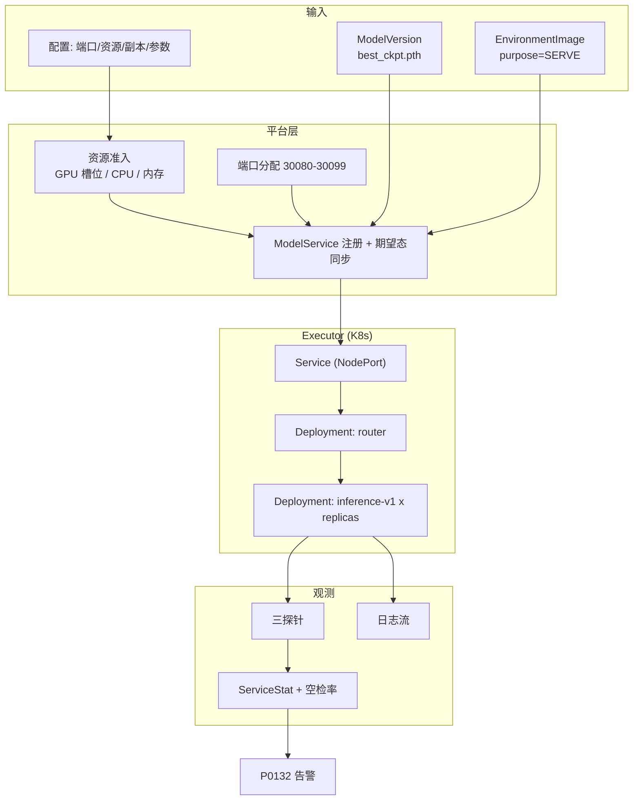
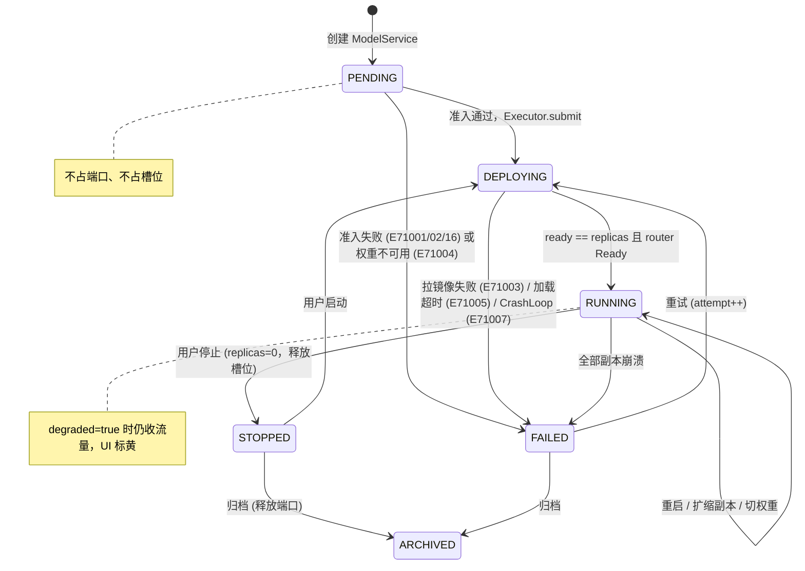
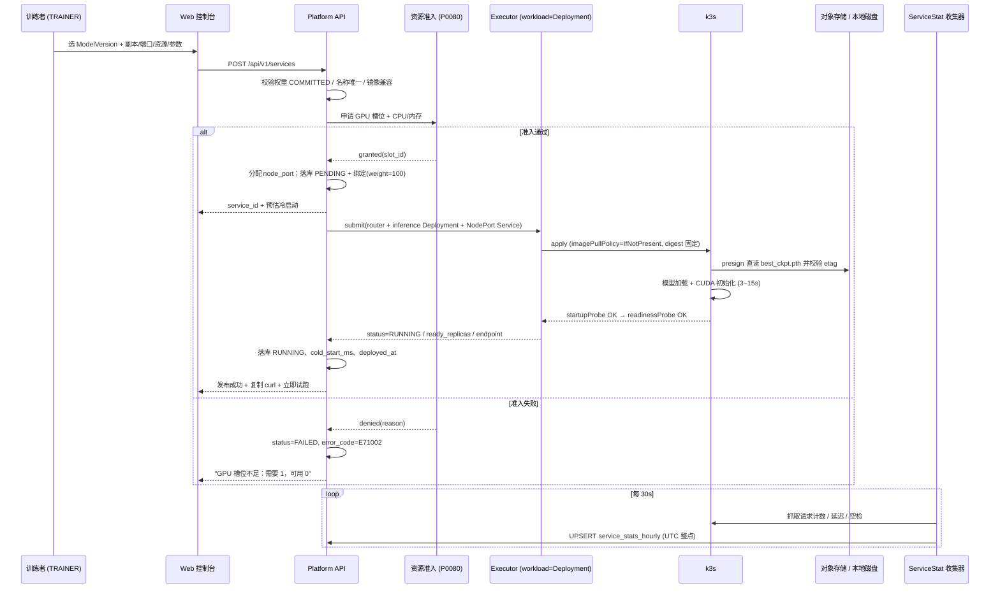
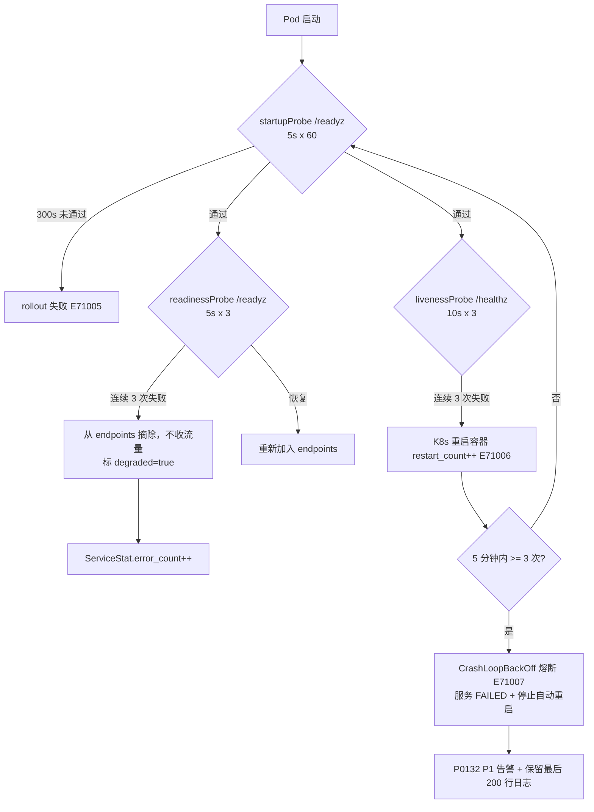
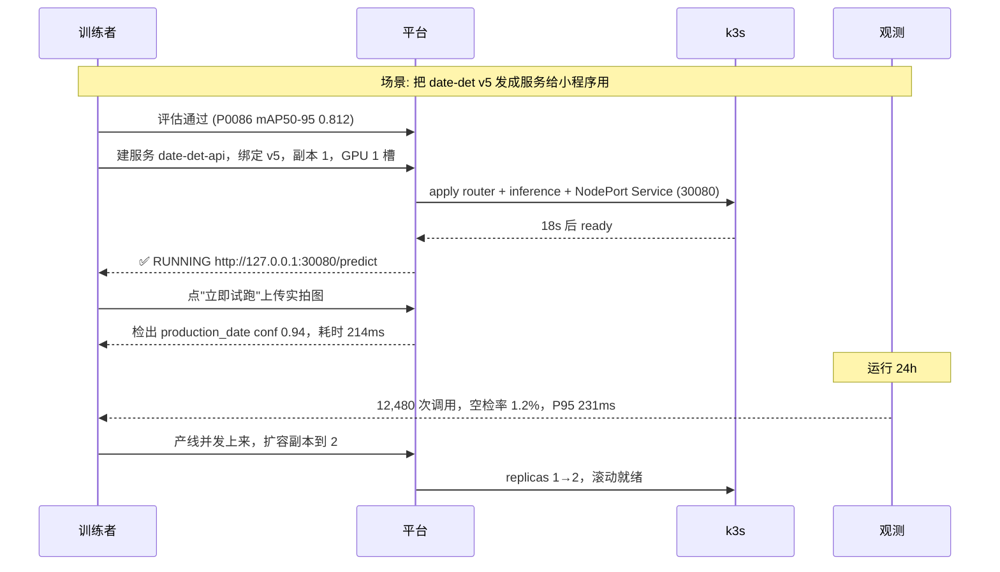

# PRD: P0110_模型服务发布 (Model Service Publishing)

| 属性 | 内容 |
| :--- | :--- |
| **文档编号** | P0110 |
| **项目名称** | FoodYolo 视觉检测模型训练基建 |
| **功能模块** | M07_部署推理 |
| **当前版本** | v1.0.0 |
| **文档状态** | Draft |
| **作者** | DeployW |
| **最后更新** | 2026-10-01 |

---

## 1. 全局说明

> [!IMPORTANT]
> **核心定位**: 把训练产出的 `ModelVersion` 变成**常驻、可调用、可观测的 HTTP 推理服务**。服务与训练**走同一套 K8s**（单机 k3s 时即本机），workload 从 `Job` 换成 `Deployment + Service`。平台不实现进程守护，Pod 崩了交给 K8s `restartPolicy`，平台只负责**准入、观测、路由与生命周期**。

### 名词解释

*   **ModelService (模型服务)**: 对外可调用的推理服务实体（`model_services`）；逻辑服务而非容器，同一服务下可挂多个模型版本（P0113 灰度）。
*   **ModelServiceVersion (服务版本绑定)**: `ModelService ↔ ModelVersion` 的绑定与路由表（`model_service_versions`），只承载**绑定关系 + 灰度权重 + 路由规则 + 生效状态**，不复制 `ModelVersion` 任何字段。
*   **Router (路由容器)**: 每个服务自带的轻量入口进程，按权重 / 请求头 / 设备 ID 分发到各版本推理 Pod；**不是微服务拆分**，只是该服务的流量入口。
*   **三探针**: `startupProbe`（模型加载期）、`readinessProbe`（能否收流量）、`livenessProbe`（是否重启），契约见 8.3。
*   **冷启动 (Cold Start)**: 从提交到 `readinessProbe` 通过；主成本是拉镜像 + 拉权重 + 模型加载 + CUDA 上下文初始化。
*   **资源准入 (Admission)**: 平台层提交前的资源判定（GPU 槽位 / CPU / 内存 / 镜像兼容 / 端口）；落哪个 Node 交给 K8s scheduler（复用 P0080）。
*   **槽位 (Slot)**: 平台层并发单位，默认 1 槽位 = 1 张 `nvidia.com/gpu`；服务 RUNNING 期间**长期持有**，与训练共用同一池。
*   **ServiceStat (调用统计)**: 表 `service_stats_hourly`，唯一约束 `(service_id, model_version_id, hour_bucket)`，是灰度观察与退化检测的唯一数据源。
*   **空检 (Empty Detection)**: 推理成功但返回 0 个框，等价于**漏识别**，是本项目第一业务指标。

### 统一异常处理

| Code | 场景 | 处理策略 |
| :--- | :--- | :--- |
| `E71001` | 端口冲突（被占用 / 不在 30080-30099） | 拒绝，返回占用者与可用端口列表 |
| `E71002` | GPU 槽位不足（准入失败） | 保持 `PENDING` 展示"等待资源"；不占端口、不占槽位 |
| `E71003` | 镜像拉取失败（`ImagePullBackOff`） | `FAILED`，保留失败 Pod 事件 24h |
| `E71004` | 权重缺失或 `ManagedFile.status != COMMITTED` | 拒绝发布："模型权重不可用：{file_id}" |
| `E71005` | 模型加载超时（`startupProbe` 连续失败） | 中止 rollout，`FAILED`，附最后 20 行加载日志 |
| `E71006` | 健康检查失败触发重启 | `restart_count++`、`ServiceStat.error_count++`；升级见 `E71007` |
| `E71007` | `CrashLoopBackOff`（5 分钟重启 ≥ 3 次） | `FAILED` + **停止自动重启** + P1 告警，等人工 |
| `E71008` | 副本不达期望持续 > 3 分钟 | `RUNNING` 标 `degraded=true`，告警不判失败 |
| `E71009` | 服务名重复（slug 冲突） | 拒绝，提示已有服务与建议名 `{name}-2` |
| `E71010` | 版本权重之和 ≠ 100 | 拒绝保存路由配置，返回权重明细 |
| `E71011` | 绑定版本已 `ARCHIVED` / 软删 | 拒绝绑定；已生效绑定标红为"待移除" |
| `E71012` | 状态不允许该操作 / 重复提交 | 幂等返回当前状态与上次结果 |
| `E71013` | 停止超时（超 `terminationGracePeriodSeconds`） | K8s 强杀，记 `forced=true` 并告警 |
| `E71014` | 日志拉取失败（Pod 已删 / 已轮转） | 410，给出归档路径 `_logs/services/{service_id}/` |
| `E71015` | 磁盘不足（ImageFS < 20GiB 或日志超限） | 拒绝新发布；运行中服务保留，< 10% 升级 P1 |
| `E71016` | 镜像 CUDA 与节点驱动不兼容 | 准入拒绝，比对 GFD label 并推荐可用镜像 |
| `E71017` | 配置漂移（外部删改 K8s 对象） | 标 `drift=true`，自动按期望态重建一次，仍失败 `FAILED` |

---

## 2. 项目背景

### 背景 (Context)

P0085 让权重有了不可变版本，P0086 让"能不能上线"有了量化结论。但模型的最终形态是**一个能被调用的 HTTP 接口**：小程序拍照要调它，RN 采集端要调它，产线抽检脚本要调它。首个落地任务是**食品包装生产日期区域检测**——产线需要的形态是"POST 一张图，200ms 内拿回日期区域的框"。

### 问题陈述 (Problem Statement)

1.  **模型只在训练脚本里活着**: `best_ckpt.pth` 是个文件，没有进程、端口与健康检查，别人拿不走也用不上。
2.  **手工 `docker run` 不可管理**: 谁想试模型就手工起容器，占卡没人知道，崩了没人重启，跑三天没人关。
3.  **发版无标准动作**: 停旧起新之间服务真空；出问题回退靠翻命令历史。
4.  **调用质量不可见**: 每天调多少次、多少张图一个框都没检出（**空检 = 漏识别**）、P95 多少，全靠猜。
5.  **与训练抢 GPU 无仲裁**: 服务长期占卡，训练排队却不知原因。

### 目标与成功指标 (Goals & Success Metrics)

*   **北极星指标**: 从"选定 `ModelVersion`"到"`RUNNING` 且探针绿灯" **≤ 90 秒**（镜像与权重已缓存），一次成功率 ≥ 95%。
*   **次要指标**: 单图 640×640 GPU 模式端到端 P95 **< 300ms**；月可用性 **≥ 99.5%**，异常退出到重启完成 **< 20s**；空检率可按版本逐小时观测且延迟 **≤ 5 分钟**；发布/停止/重启审计覆盖率 **100%**。

### 风险与规避 (Risks & Mitigation)

| 风险 | 影响 | 规避方案 |
| :--- | :--- | :--- |
| 服务长期占满 GPU | 训练饿死 | 服务与训练共用槽位池，占用在节点页可见；支持 `deploy_mode=CPU` 降级 |
| 模型缓存写满磁盘 | kubelet 驱逐 Pod，训练被牵连 | 缓存落 `emptyDir` + 5GiB 上限、按 digest 去重；ImageFS < 20GiB 拒发（`E71015`） |
| 端口分配混乱 | 服务起不来或互相打架 | 平台独占 30080-30099，DB 唯一约束 + 宿主进程占用双检 |
| 探针过严导致雪崩重启 | 加载完就被判死 | 三段探针分离，`startupProbe` 独占加载期（≤300s） |
| 冷启动期间请求全 500 | 发版后错误率尖峰 | 先就绪再加入 Router 路由，未就绪返回 503 + `Retry-After` |
| 权重被 GC 而服务在跑 | Pod 重启拉不到模型 | 被 `model_service_versions` 引用的 `ManagedFile` 打引用标记，GC 跳过 |

---

## 3. 价值模型

*   **方案**: 把"起推理服务"从手工运维变成**平台上的一次发布**——发布 = 建服务 + 建绑定 + 准入（槽位/端口/镜像）+ 提交一组 K8s workload；观测 = 三探针 + `service_stats_hourly`（调用量、延迟、**空检率**）；运维 = 启停/重启/扩缩/换版本全是按钮，全进 `AuditLog`。
*   **目标**: "这版模型能用了"的交付时间从半天降到 90 秒，且运行质量**始终有数**。

---

## 4. 项目范围



### In Scope

1.  服务注册与配置（名称、绑定版本、副本、端口、资源、推理参数）。
2.  生命周期：发布 / 停止 / 启动 / 重启 / 扩缩副本 / 归档。
3.  多版本绑定能力（权重与路由规则由 P0113 消费）。
4.  三探针健康检查、Pod 自动重启、`CrashLoopBackOff` 熔断。
5.  日志查看（实时跟随 + 本机归档）与调用统计（含空检率）。
6.  配置漂移自愈（检测到外部改动按期望态重建一次）。

### Out of Scope

*   **HPA 自动扩缩容**：第一版副本数手工设定。
*   **模型热加载**：换版本靠新 Pod + 路由切换，不做进程内重载。
*   **多租户与对外鉴权**：鉴权与限额由 P0122 统一定义。
*   **流量回放 / 压测**、**OCR 串联**（第二阶段独立定义）、**跨机容灾**（单机 `replicas=1` 时随机器一起宕）。

---

## 5. 业务流程

### 5.1 服务状态机



### 5.2 发布时序（注册 → 就绪）



### 5.3 端口分配与健康检查

端口：未指定时取 `30080-30099` 内第一个空闲端口，写入 `model_services.node_port`（DB 唯一约束，`ARCHIVED` 置 NULL）；再校验宿主机无其他进程监听；NodePort Service apply 若报"端口已分配"则回滚本次 apply 并自动换端口重试一次。区间耗尽或被占用均报 `E71001`，UI 列出已占用端口表供人工指定。



---

## 6. 用户分析

### 6.1 用户画像 (User Personas)

*   **训练者 (TRAINER)**: 迭代日期检测模型并推成服务给产线用。诉求"点一下就有能用的地址，崩了自己起来"；痛点是手工起容器、记端口、服务挂了要别人打电话才知道。
*   **外部集成方 (VIEWER / 端侧)**: 在小程序或产线脚本里调接口。诉求"地址别变、超时别超 1 秒、返回格式固定"；痛点是手工重启换端口导致地址漂移、失败无法归因。
*   **管理员 (ADMIN)**: 守机器的 GPU 与磁盘。诉求"服务占了哪张卡、占多久、还剩多少给我训练"；痛点是匿名容器占卡、缓存塞满磁盘。

### 6.2 用户链路图 (User Journey Map)



---

## 7. 功能需求

### M07.F01 服务创建与配置 (Service Creation)

*   **用户故事**: 作为训练者，我希望把某个 `ModelVersion` 登记成推理服务并配好端口、资源与参数，以便不用关心容器与命令。
*   **前置条件**: 角色 ∈ `ADMIN`/`TRAINER`；目标 `ModelVersion` 权重 `COMMITTED`；存在 `ACTIVE` 且 CUDA 兼容的 `EnvironmentImage(purpose=SERVE)`；服务名唯一。
*   **主流程**: 1) 填名称、绑定版本、`deploy_mode ∈ GPU|CPU`；2) 填 `replicas`、`node_port`(AUTO)、CPU/内存、`gpu_slots`；3) 填推理参数 `conf/nms_iou/input_size/max_det/batch_max/return_image`；4) 准入（槽位/CPU/内存/镜像/磁盘），失败即 `E71002/E71016/E71015`；5) 分配 `node_port`（见 5.3）；6) 写 `model_services(PENDING)` 与 `model_service_versions(weight=100)`；7) 触发发布或留作草稿；8) 写 `AuditLog(SERVICE_CREATE)`。
*   **后置条件**: 服务记录存在，端口被独占，列表可见。

*   **验收标准**:

    ```gherkin
    场景: 创建绑定模型版本的服务
      Given ModelVersion "date-det v5" 权重为 COMMITTED，平台有 1 个空闲 GPU 槽位
      When 训练者创建服务 "date-det-api"，绑定 v5，replicas=1，gpu_slots=1，端口 AUTO
      Then 服务为 PENDING 并立即进入 DEPLOYING，系统分配 node_port=30080
      And AuditLog 记录 SERVICE_CREATE

    场景: GPU 槽位不足
      Given 平台可用槽位为 0
      When 用户以 gpu_slots=1 创建服务
      Then 返回 E71002，服务为 FAILED，信息"GPU 槽位不足：需要 1，可用 0"
      And 不占用任何端口
    ```

*   **边界情况与异常处理**

    | 场景 | 处理 |
    | :--- | :--- |
    | 服务名含中文/emoji | slug 退化为 `svc-{短uuid}`，原名称保留在 `name` 展示 |
    | `replicas > 1` 但只有 1 个槽位 | 允许创建并标 `degraded`，UI 提示"当前 1/2 副本就绪" |
    | 尝试绑定训练中间态权重 | 拒绝：只允许绑定已固化的 `ModelVersion` |
    | ImageFS 可用 < 20GiB | 拒绝 `E71015`，提示 `crictl rmi --prune` |

### M07.F02 发布与滚动就绪 (Deploy & Rollout Readiness)

*   **用户故事**: 作为训练者，我希望发布是"先就绪再收流量"，以便发版期间不会有请求打到还没加载完模型的 Pod。
*   **前置条件**: 服务存在且 `status ∈ {PENDING, STOPPED, FAILED}`，准入通过。
*   **主流程**: 1) 置 `desired_state=READY`、`status=DEPLOYING`；2) `Executor.submit` 以 `workload_kind=Deployment` 提交 router / inference / NodePort Service；3) Router 周期探测各 upstream `/readyz`，未就绪者权重为 0；4) 平台每 2s 轮询 `Status` 直到 `ready_replicas == replicas`；5) 记录 `cold_start_ms`；6) 写 `AuditLog(SERVICE_DEPLOY)`。
*   **后置条件**: `endpoint_url` 可用，三探针绿灯，`deployed_at` 更新。

*   **验收标准**:

    ```gherkin
    场景: 首次发布
      Given 服务处于 PENDING，镜像与权重已缓存
      When 用户点击 [发布]
      Then 状态依次为 DEPLOYING → RUNNING，ready_replicas == replicas 且记录 cold_start_ms
      And 未就绪期间 /api/v1/inference/sync 返回 503 + Retry-After

    场景: 加载超时
      Given 权重异常导致加载超过 300s
      When 发布
      Then startupProbe 连续失败 60 次，服务为 FAILED，error_code=E71005
      And 详情页展示容器日志最后 20 行
    ```

*   **边界情况与异常处理**

    | 场景 | 处理 |
    | :--- | :--- |
    | 发布中重复点发布 | 幂等，返回 `E71012` 与当前进度 |
    | 平台重启（服务原为 RUNNING） | 按 `desired_state` 对齐，K8s 中 Deployment 仍在则直接复用 |
    | 权重 etag 与入库不一致 | 中止发布 `E71004`，提示重新固化 `ModelVersion` |
    | 冷启动 > 90s 但未超 300s | 发布继续，UI 标"冷启动偏慢"并记入服务详情 |

### M07.F03 健康检查与自动重启 (Health Check & Auto-Restart)

*   **用户故事**: 作为训练者，我希望容器崩了自动起来、卡死自动重启，并能看到重启次数，以便把运维交给平台。
*   **前置条件**: 服务 `status ∈ {DEPLOYING, RUNNING}`。
*   **主流程**: 1) 按 8.3 注入三探针；2) `readinessProbe` 失败 → 摘 endpoint、标 `degraded`、**不重启**；3) `livenessProbe` 连续失败 3 次 → K8s 重启容器、`restart_count++`；4) 5 分钟窗口内重启 ≥ 3 次判 `CrashLoopBackOff` → `FAILED`（`E71007`）+ 停自动重启 + P1 告警；5) 人工处理后重试发布，`attempt++`；6) `/healthz` 须返回 `{"status":"ok","model_loaded":true,...}`，`model_loaded=false` 视为不健康。
*   **后置条件**: 健康快照写 `health_json`，重启次数入 `restart_count`。

*   **验收标准**:

    ```gherkin
    场景: 进程被杀后自动恢复
      Given 服务 RUNNING，restart_count=0
      When 容器内推理进程被 OOM Killer 杀死
      Then 20 秒内容器被重启并重新加入 endpoints，restart_count=1
      And 对应小时 ServiceStat.error_count +1

    场景: 连续崩溃熔断
      Given 权重损坏导致每次启动都在加载阶段崩溃
      When 5 分钟内容器重启 3 次
      Then 服务为 FAILED，error_code=E71007，不再自动重启
      And 告警中心产生 P1 告警并附最后 200 行日志
    ```

*   **边界情况与异常处理**

    | 场景 | 处理 |
    | :--- | :--- |
    | GPU 掉卡导致 liveness 失败 | 同 CrashLoop 判定；若节点已 `UNHEALTHY` 则直接 `FAILED` 不重建 |
    | 探针超时但进程正常（大 batch 阻塞） | `timeoutSeconds=3`；1 小时内因此重启 > 5 次则建议降低 `batch_max` |
    | `degraded` 持续 30 分钟 | 告警 P2，不自动判失败，避免误杀可用服务 |
    | 重启次数累积 | 每次成功发布（进入 RUNNING）清零，历史值入 `AuditLog` |

### M07.F04 服务启停、重启与扩缩副本 (Lifecycle Operations)

*   **用户故事**: 作为训练者，我希望不用服务时能停掉把 GPU 还给训练，需要时一键启动。
*   **前置条件**: 目标操作在当前状态下合法（否则 `E71012`）。
*   **主流程**: 1) **停止**：inference Deployment `replicas=0`（保留 Deployment 与端口），释放槽位，`status=STOPPED`；2) **启动**：复用 Deployment 与端口，走 M07.F02 就绪判定；3) **重启**：`rollout restart`，单副本允许 ≤5s 的 503 窗口并提示；4) **扩缩副本**：扩容需重新准入，缩容直接生效；5) **归档**：仅 `STOPPED`/`FAILED` 可归档，删除 Deployment 与 Service、释放端口，保留记录与统计历史；6) 全部操作写 `AuditLog`（含变更前后值）。
*   **后置条件**: K8s 实际态与 `desired_state` 一致，释放的槽位回到 P0080 可用池。

*   **验收标准**:

    ```gherkin
    场景: 停止服务归还 GPU
      Given 服务 RUNNING 且占用 1 个 GPU 槽位
      When 用户点击 [停止]
      Then 30 秒内 replicas=0，status=STOPPED，节点页可用槽位 +1
      And node_port 仍被保留，重启后地址不变

    场景: 归档释放端口
      Given 服务为 STOPPED 且占用端口 30080
      When 用户点击 [归档]
      Then Deployment 与 Service 被删除，端口回到空闲池
      And status=ARCHIVED，ServiceStat 历史保留
    ```

*   **边界情况与异常处理**

    | 场景 | 处理 |
    | :--- | :--- |
    | 停止时 Pod 卡在 `Terminating` | 超 30s 由 K8s 强杀，记 `E71013` + `forced=true` |
    | 扩副本时槽位不足 | 保持原副本数，返回 `E71002`，不进入部分扩容中间态 |
    | 10s 内反复启停 ≥ 3 次 | 拒绝并提示"操作过于频繁"（防误触） |
    | 灰度窗口内重启（P0113） | 允许，但灰度窗口自动延长 10 分钟，避免观察数据被噪声污染 |
    | 归档后仍被端侧调用 | endpoint 立即 404，端侧应退避并切换到新服务地址 |

### M07.F05 服务与模型版本的绑定 (Version Binding)

*   **用户故事**: 作为训练者，我希望一个服务能挂多个模型版本并分配权重，以便不断服地做灰度（细节见 P0113）。
*   **前置条件**: 服务非 `ARCHIVED`；版本权重可读；`(service_id, model_version_id)` 未重复绑定。
*   **主流程**: 1) 在"版本"页签绑定 `ModelVersion`（按 `Model` 分组，附 P0086 评估摘要链接）；2) 设 `traffic_weight` 与 `enabled`；3) 校验 enabled 权重之和 = 100（`E71010`）、禁止绑定已归档版本（`E71011`）；4) 按权重换算副本 `max(1, round(weight/100 × replicas))` 并创建/调整对应 Deployment；5) 路由配置热更新到 Router（< 5s 生效，不重建 Pod）；6) 写 `AuditLog`。
*   **后置条件**: `model_service_versions` 与 Router 实际路由一致，`primary_version_id` 指向权重最高版本。

*   **验收标准**:

    ```gherkin
    场景: 权重校验
      Given 服务原绑定 v5(weight=100)
      When 用户绑定 v6 并把两者都设为 50
      Then 返回 E71010，提示"权重之和须为 100"

    场景: 纯切换式换版本
      Given 服务绑定 v5=0、v6=100，v6 Deployment 已就绪
      When 用户保存路由配置
      Then v5 Deployment 缩到 0（不删除），5 秒内新请求全部走 v6
      And AuditLog 记录权重变更前后值
    ```

*   **边界情况与异常处理**

    | 场景 | 处理 |
    | :--- | :--- |
    | 权重 1%/99% 导致低权版本副本为 0 | 强制至少 1 副本；权重 < 10% 时提示"无法有效分流" |
    | 绑定版本类别体系不同 | 允许，UI 标红"类别体系与主版本不同"，提示返回结构差异 |
    | 解绑正在接流量的版本 | 拒绝，须先改权重为 0 并确认无流量 |
    | 绑定权重被 GC | 发布/启动时校验 `COMMITTED`，否则 `E71004`；GC 跳过被引用的文件 |

### M07.F06 服务日志查看 (Service Logs)

*   **用户故事**: 作为训练者，我希望在平台上直接看服务日志，以便不用 `kubectl logs` 就能定位"为什么这张图返回 500"。
*   **前置条件**: 服务存在；`ADMIN`/`TRAINER` 全量，`VIEWER` 仅最近 100 行。
*   **主流程**: 1) 进入"日志"页签，按 Pod 分组（含 router 与各版本 Pod）；2) 经 `Executor.StreamLogs` 拉取最近 200 行，[实时跟随] 走 SSE/WebSocket 最多 30 分钟；3) 容器 stdout 为结构化单行 JSON `{ts, level, request_id, model_version, detections, timing_ms}`，支持按 `request_id` 过滤；4) 按天落 `_logs/services/{service_id}/{date}.log`（本机磁盘，**不走对象存储、不登记 `ManagedFile`**）；5) Pod 已删返回 `E71014`(410) 并给出归档路径；6) 日志访问写 `AuditLog(SERVICE_LOG_VIEW)`。
*   **后置条件**: 无副作用。

*   **验收标准**:

    ```gherkin
    场景: 通过 request_id 定位失败请求
      Given 端侧报错携带 request_id "req-8f21"
      When 训练者在日志页输入该 request_id 过滤
      Then 命中结构化日志行，含模型版本、耗时与错误堆栈

    场景: 查看已销毁 Pod 的日志
      Given 目标 Pod 已因重启被删除
      When 用户选择该 Pod
      Then 返回 410 与归档路径提示
    ```

*   **边界情况与异常处理**

    | 场景 | 处理 |
    | :--- | :--- |
    | 单 Pod 日志 > 50MB/小时 | `INFO` 按 10% 采样、`ERROR` 全量，UI 明示"已采样" |
    | 实时跟随期间 Pod 重建 | 推送 `pod_changed` 事件并自动切换，无需重连 |
    | 日志含图片 base64 | 镜像侧禁止打印图片数据，只打 `request_id` 与 `file_id` |
    | 日志写满磁盘 | 单服务上限 2GiB，超限按天滚动删最旧并触发 `E71015` |

### M07.F07 调用统计 (Service Statistics)

*   **用户故事**: 作为训练者，我希望看到逐小时的调用量、延迟与**空检率**，以便尽早发现模型在真实数据上退化。
*   **前置条件**: 服务至少产生过一次成功推理。
*   **主流程**: 1) 收集器每 30s 从各 Pod 拉取计数（Prometheus 兼容 `/metrics`），**不回捞原始请求与图片**；2) 按 `(service_id, model_version_id, hour_bucket)` UPSERT，`hour_bucket` 为 **UTC 整点截断**，UI 默认按本地时区展示并标注 `(UTC+8)`；3) 按 8.4 口径计算；4) 详情页展示最近 24 小时折线（调用量 / P95 / 空检率）与当日合计，支持导出 CSV；5) 空检率连续 3 个整点超过基线 2 倍或绝对 5% → P2 告警并标红；6) 原始小时行保留 90 天后按 8.5 归档。
*   **后置条件**: 统计延迟 ≤ 5 分钟（当前小时为滚动值）。

*   **验收标准**:

    ```gherkin
    场景: 展示小时统计与空检率
      Given 10:00-11:00 (UTC) 共 1200 次成功推理，其中 12 次返回 0 个框
      When 训练者打开服务详情 → 统计页签
      Then 该小时行显示 request_count=1200、empty_detection_count=12、空检率 1.0%
      And 延迟分位数标注"服务端耗时，不含网络"

    场景: 空检率异常告警
      Given 该服务近 7 天基线空检率 1.0%
      When 连续 3 小时空检率 > 2.0%
      Then 告警中心产生 P2 告警，详情页统计卡片标红
      And 提示"疑似模型退化，建议用 P0111 试跑抽样核查"
    ```

*   **边界情况与异常处理**

    | 场景 | 处理 |
    | :--- | :--- |
    | 服务中途重启，计数器归零 | 按 `restart_count` 与容器启动时间做差值补偿；无法补偿时该小时标 `partial=true` |
    | 服务停止中（replicas=0） | 该小时不产生行，UI 画 0 而非断线 |
    | 多版本共存 | 按 `model_version_id` 分行，UI 支持按版本对比（灰度观察数据源） |
    | 磁盘满导致写失败 | 内存队列缓存（上限 1000 条）待磁盘恢复后补写，丢数则标 `partial=true` |

---

## 8. 技术架构与数据模型

### 8.1 数据实体

#### `model_services`

| 字段名 | 类型 | 必填 | 说明 |
| :--- | :--- | :--- | :--- |
| `id` | UUID | Y | PK |
| `name` / `slug` | String(64) | Y | 展示名唯一；slug 用于 K8s 资源名，唯一索引 |
| `status` | Enum | Y | `PENDING/DEPLOYING/RUNNING/FAILED/STOPPED/ARCHIVED` |
| `desired_state` | Enum | Y | `READY/STOPPED/ARCHIVED`，用于漂移自愈 |
| `primary_version_id` | UUID | N | FK → `model_service_versions.id`，权重最高者 |
| `deploy_mode` | Enum | Y | `GPU/CPU` |
| `environment_image_id` / `image_digest` | UUID / String(128) | Y | `EnvironmentImage(purpose=SERVE)` + 固定 digest |
| 权重来源说明 | — | — | `best_ckpt.pth` 的 `ManagedFile.owner_type = TRAIN_TASK`（P0085 登记，本表只引用 `model_version_id`） |
| `replicas` / `ready_replicas` | Int | Y | 期望/实际就绪副本，默认 1 |
| `node_port` / `container_port` | Int | Y | 30080-30099 唯一；容器端口固定 8080 |
| `endpoint_url` | String(255) | N | `http://<host>:<node_port>` |
| `cpu_request`/`cpu_limit`/`memory_request`/`memory_limit` | String(16) | Y | 如 `500m`/`2Gi` |
| `gpu_slots` | Int | N | `deploy_mode=GPU` 时必填，默认 1 |
| `infer_params_json` | JSONB | Y | `{conf,nms_iou,input_size,max_det,batch_max,return_image}` |
| `health_json` | JSONB | N | 最近一次三探针快照 |
| `restart_count` / `degraded` / `drift` | Int / Bool / Bool | Y | 发布成功时 `restart_count=0` |
| `cold_start_ms` / `attempt` | Int | N/Y | 发布尝试从 1 起 |
| `error_code` / `error_message` | String(16) / Text | N | 如 `E71003` |
| `deployed_at` / `stopped_at` / `created_by` | — | N/Y | |
| `created_at` / `updated_at` / `deleted_at` | timestamptz | Y | 通用字段 |

**Index**: `UNIQUE(slug) WHERE deleted_at IS NULL`；`UNIQUE(node_port) WHERE node_port IS NOT NULL`；`(status)`。

#### `model_service_versions`

| 字段名 | 类型 | 必填 | 说明 |
| :--- | :--- | :--- | :--- |
| `id` | UUID | Y | PK |
| `model_service_id` / `model_version_id` | UUID | Y | 双 FK，**只存引用，不复制字段** |
| `traffic_weight` | Int | Y | 0-100；enabled 行之和必须 = 100 |
| `routing_rules_json` | JSONB | N | P0113：`{header_match, device_id_mod, sticky_ttl_s}` |
| `enabled` | Boolean | Y | 是否参与分流 |
| `state` | Enum | Y | `PENDING/READY/DRAINING/RETIRED` |
| `deployment_name` | String(80) | N | `msvc-<slug>-v<n>` |
| `effective_at` / `retired_at` | timestamptz | N | |
| `created_by` / `created_at` / `updated_at` / `deleted_at` | — | Y | 通用字段 |

**Index**: `UNIQUE(model_service_id, model_version_id) WHERE deleted_at IS NULL`。

#### `service_stats_hourly`

| 字段名 | 类型 | 必填 | 说明 |
| :--- | :--- | :--- | :--- |
| `service_id` / `model_version_id` | UUID | Y | FK（`id` 为 UUID PK） |
| `hour_bucket` | timestamptz | Y | **UTC 整点截断** |
| `request_count` / `success_count` / `error_count` | Int | Y | 到达总数 / 2xx 完成 / 4xx-5xx 与超时 |
| `latency_p50` / `latency_p95` / `latency_p99` | Int | N | ms，**仅服务端处理耗时** |
| `empty_detection_count` | Int | Y | 成功但 0 个框 = 漏识别 |
| `avg_box_count` | Numeric(6,2) | N | 成功请求平均框数 |
| `low_conf_ratio` | Numeric(5,4) | N | 最高置信度 < 0.5 的请求 / `success_count` |
| `status_code_dist` / `partial` | JSONB / Bool | N/Y | `{"200":1180,"500":20}` / 数据不全标记 |
| `created_at` / `updated_at` | timestamptz | Y | |

**Index**: `UNIQUE(service_id, model_version_id, hour_bucket)`；`(service_id, hour_bucket DESC)`。

### 8.2 K8s 对象映射

| 平台概念 | K8s 对象 | 关键字段 |
| :--- | :--- | :--- |
| `ModelService` 对外入口 | `Service(type=NodePort)` | `nodePort = model_services.node_port`；`selector: app=msvc-<slug>, role=router` |
| Router | `Deployment msvc-<slug>-router` | `replicas=1`，`imagePullPolicy: IfNotPresent` |
| `ModelServiceVersion` | `Deployment msvc-<slug>-v<n>` | `replicas=max(1, round(weight/100 × replicas))`，`labels: role=inference, version=<n>` |
| GPU 声明 | `resources.limits` | `nvidia.com/gpu: <gpu_slots>` + `runtimeClassName: nvidia` |
| 模型缓存 | `emptyDir` + 初始化容器 | `sizeLimit 5GiB`，按权重 digest 命名，命中跳过下载 |
| 重启 / 落点 | Deployment 默认 `restartPolicy: Always` | `terminationGracePeriodSeconds: 30`；落点由 K8s scheduler 决定，平台不写 `nodeName` |

### 8.3 探针契约

| 探针 | 路径 | 判定 | 参数 |
| :--- | :--- | :--- | :--- |
| `startupProbe` | `GET /readyz` | 200 且 `model_loaded=true` | `period=5s`，`failureThreshold=60`（≤300s） |
| `readinessProbe` | `GET /readyz` | 同上 | `period=5s`，`failureThreshold=3`，`timeout=2s` |
| `livenessProbe` | `GET /healthz` | 200（进程存活） | `period=10s`，`failureThreshold=3`，`timeout=3s` |

### 8.4 统计口径（写死）

| 指标 | 公式 | 说明 |
| :--- | :--- | :--- |
| `empty_detection_count` | `count(success ∧ detections.length = 0)` | **业务第一指标**：空检对应产线漏检风险 |
| `low_conf_ratio` | `count(success ∧ max(conf) < 0.5) / success_count` | 阈值固定 **0.5**，"检出了但不够信" |
| `avg_box_count` | `sum(detections.length) / success_count` | 突增往往意味着误检变多 |
| `latency_p*` | 服务端 `timing_ms.total` 分位数 | **不含网络**，网络耗时由端侧埋点单独统计 |
| `hour_bucket` | `date_trunc('hour', ts AT TIME ZONE 'UTC')` | 全表 UTC，展示层换算本地时区 |

### 8.5 统计保留与清理调度

`service_stats_hourly` 保留 **90 天**原始小时行；每日 03:00（`TZ=Asia/Shanghai`）把超期行导出为 JSONL 落本机 `_stats/services/{service_id}/{yyyy-mm}.jsonl` 后删除表内行，以 `(service_id, year_month)` 文件名去重保证幂等。该任务与 P0046 GC **独立调度**：它只做统计降采样归档，不删除任何对象存储文件、不释放磁盘配额，二者互不触发。归档失败保留原行次日重试，连续 3 天失败发 P2 告警；服务归档后统计行照常保留 90 天再归档。

### 8.6 推理接口契约（端侧与平台共用）

统一前缀 `/api/v1`，鉴权 `Authorization: Bearer <token>`（P0122 定义）。

| 接口 | 方法与路径 | 说明 |
| :--- | :--- | :--- |
| 同步单图 | `POST /api/v1/inference/sync` | 单图即时推理，超时 10s |
| 提交批量 | `POST /api/v1/inference/jobs` | 返回 `job_id` |
| 批量状态 / 结果 | `GET /api/v1/inference/jobs/{job_id}` / `.../results` | 进度摘要 / 分页明细 |
| 批量取消 | `DELETE /api/v1/inference/jobs/{job_id}` | 取消未完成任务 |
| 容器内直连 | `POST /predict`（NodePort） | 仅同机场景，端上**不要**直连 |

**同步单图请求**（二选一，行为等价）：`multipart/form-data` 传 `file` 原始字节；或 `application/json` 传 `{file_id, service_id|model_version_id, params:{conf,iou,input_size,max_det,return_image}}`。**端侧一律走 `file_id` 变体**：图片先经 P0020 的 `UploadSession` 分片上传并 commit 为 `ManagedFile`，推理只传引用，避免弱网重复上传；服务端校验 `status = COMMITTED`，否则 422 + `E71004`。

```json
{
  "request_id": "req-8f21", "model_version": "date-det v5",
  "image_size": {"w": 1920, "h": 1080},
  "detections": [{"cls_id": 0, "cls_name": "production_date", "conf": 0.94, "bbox": [812, 640, 1104, 712]}],
  "timing_ms": {"preprocess": 12, "inference": 168, "postprocess": 34, "total": 214}
}
```

| 字段 | 口径 |
| :--- | :--- |
| `bbox` | **原图绝对像素** `[x1,y1,x2,y2]`，左上-右下，`x2/y2` 为右下角像素坐标（非独占，可取到 `w/h`） |
| `image_size` | **原图**尺寸；内部以 `input_size=640` 推理时也由服务映射回原图后再返回，端上直接叠加、无需缩放 |
| `detections` | 按 `conf` 降序，最多 `max_det` 条；0 条即空检，**是正常 200 而非错误** |
| `timing_ms` | 服务端处理耗时，不含网络 |

**OCR 字段（第二阶段，当前未落地）**: 日期字符串识别不在本模块当前范围。二期以可选字段扩展同一响应体（`detections[i].text`、`detections[i].ocr_conf`、顶层 `"ocr":{"enabled":true,...}`），并预留 `POST /api/v1/ocr/recognize`。在此之前端侧**不得**依赖或自行命名任何 OCR 字段。

**错误响应**: `{"error_code":"E71002","message":"GPU 槽位不足：需要 1，可用 0","request_id":"req-8f21"}`。端侧动作：422 不重试提示用户；503 读 `Retry-After` 后退避；429 指数退避；410（服务已归档）停止调用并提示更新地址。

---

## 9. UI/UX 规格说明

### 9.1 服务列表

```text
+--------------------------------------------------------------------------------+
|  模型服务                                              [刷新]  [+ 新建服务]      |
+--------------------------------------------------------------------------------+
|  名称            绑定版本     状态        副本   端口    空检率(24h)   P95      |
|  date-det-api    v5 (100%)   ● RUNNING   1/1   30080   1.2%        231ms      |
|  qr-api          v2 (100%)   ○ STOPPED   0/1   30081   -           -          |
|  old-date-api    v3 (100%)   ▲ FAILED    0/1   30082   -           - [日志]   |
|  demo-svc        v4 (60%)    ● RUNNING   2/2   30083   0.8%        268ms      |
|                  v6 (40%)                                                      |
+--------------------------------------------------------------------------------+
|  ● RUNNING  ▲ FAILED  ○ STOPPED  ◐ DEPLOYING  ▣ ARCHIVED          共 4 个      |
+--------------------------------------------------------------------------------+
```

### 9.2 创建/发布向导

```text
+------------------------------------------------------------------+
|  新建模型服务                                            [✕]     |
+------------------------------------------------------------------+
|  服务名称 *  [date-det-api                    ]                  |
|  模型版本 *  [date-det ▾]  v5 2026-09-28 mAP50-95 0.812  ← 选中   |
|  推理镜像 *  [foodyolo/yolox-serve:0.3.1 (sha256:9f2c…) ▾]       |
|  运行模式 *  (•) GPU  ( ) CPU      GPU 槽位 [1]  (可用 2/4)      |
|  副本数 [1]   CPU [500m]/[2000m]   内存 [1Gi]/[4Gi]              |
|  对外端口 (•) 自动分配  ( ) 指定 [30080▾]  (已占用: 30081)        |
|  推理参数 conf [0.25]  NMS IoU [0.70]  input_size [640▾]  max_det [300]|
|  单次最大 batch [8]   返回标注图 [ ]                             |
|  ⚠ 预估冷启动 15~25s（镜像与权重已缓存）                          |
+------------------------------------------------------------------+
|                          [保存草稿]   [发布]                     |
+------------------------------------------------------------------+
```

### 9.3 服务详情（概览 / 统计 / 日志）

```text
+--------------------------------------------------------------------------------+
| ← 返回  date-det-api                                    [重启] [停止] [⋯]      |
+--------------------------------------------------------------------------------+
| ● RUNNING   http://127.0.0.1:30080/predict              [复制 curl] [试跑]     |
| 绑定 v5 (100%) | 副本 1/1 | 冷启动 18s | 重启 0 次 | 发布人 DeployW             |
+--------------------------------------------------------------------------------+
| 健康: startup✅ 13:20:04   readiness✅   liveness✅   最近探测 13:45:10         |
+--------------------------------------------------------------------------------+
| 调用统计 (口径 UTC，按 UTC+8 展示)                                              |
|  调用量 12,480   空检率 1.2% (150)   P50 132ms   P95 231ms                     |
|  空检率趋势(24h):  5%|        ╭─╮                                              |
|                    0%|▁▁▁▁▁▁▁▁╯ ╰▁▁▁▁▁▁▁▁▁▁                                     |
+--------------------------------------------------------------------------------+
| 日志  Pod [msvc-date-det-api-v5-6d9f7 ▾]  [x]实时跟随  过滤[req-8f21]          |
|  13:44:02 INFO  req-8f21 v5 det=1 total=214ms conf_max=0.94                    |
|  13:44:05 ERROR req-9a02 v5 CUDA OOM (batch=8) → 降档 batch=4 重试成功          |
|  13:44:11 INFO  req-9a11 v5 det=0 total=198ms  ← 空检                          |
+--------------------------------------------------------------------------------+
```

### 9.4 交互元素

| 元素 | 类型 | 状态 | 行为 |
| :--- | :--- | :--- | :--- |
| 新建服务 | Button | Default / Disabled(无 SERVE 镜像) | 打开创建向导（绑定版本 + 资源 + 推理参数） |
| 发布 | Button | Default / Loading / Disabled | 走 M07.F02，进度条展示拉镜像/加载/探针 |
| 停止 / 启动 / 重启 | Button | Default | 二次确认；停止提示"将释放 1 个 GPU 槽位"，重启提示 503 窗口 |
| 版本权重 | Number | 0-100 | 失焦校验总和 = 100，否则禁用保存并标红 |
| 统计卡片 | Card | Normal / Warn | hover 显示口径 tooltip（服务端耗时、UTC 口径） |
| 日志跟随 | Toggle | On / Off | 开启走 SSE，Pod 重建自动切换 |
| 归档 | MenuItem | 仅 STOPPED/FAILED | 提示"将释放端口，统计历史保留 90 天" |

---

## 10. 非功能性需求 (NFR)

*   **性能**: 单图 640×640 GPU 模式服务端 P95 **< 300ms**（CPU 模式 < 1.5s）；发布到 RUNNING（已缓存）**≤ 90s**；服务列表接口 P95 **< 200ms**；统计页 24h 数据 P95 **< 300ms**；路由配置热更新 **< 5s**。
*   **可靠性**: 容器异常退出后自动重启 **< 20s**，5 分钟 ≥ 3 次熔断；平台重启后 60s 内完成期望态对齐；停止后槽位释放 **< 30s**。
*   **安全**: 创建/发布/停止/归档限 `ADMIN`/`TRAINER`，`VIEWER` 只读；容器非 root、只读根文件系统，禁止挂载宿主机 Docker socket；权重经 presign 读取（TTL ≤ 2h）；`/predict` 不落盘用户图片；全量生命周期操作进 `AuditLog`。
*   **可观测性**: 指标 `service_ready_replicas`、`service_cold_start_ms`、`service_restart_total`、`service_request_total{code}`、`service_empty_detection_ratio`；日志按天落 `_logs/services/{service_id}/`（单服务 ≤ 2GiB）；统计刷新间隔 30s、页面 ≤ 5 分钟可见。
*   **兼容性 / 可扩展性**: 单机 k3s + `nvidia-container-toolkit`，GPU 统一 `nvidia.com/gpu`，镜像 CUDA 标签准入比对（`E71016`）；`POST /predict` 响应字段向后兼容（新增字段不破坏旧端）；单机默认支撑 **≤ 8** 个并发运行服务，端口区间限制同机 **≤ 20** 个服务；Router 是唯一分流点，灰度能力不需要新组件。

---

## 附录: 已确认的设计决策

| 决策项 | 结论 |
| :--- | :--- |
| 部署方式 | 与训练统一走 K8s：`Deployment + Service(NodePort)`，单机 k3s 即本机；**不引入 Docker Compose / 裸进程守护** |
| 执行抽象 | 复用 `Executor` 四能力（`Submit/Status/Cancel/StreamLogs`），`workload_kind=Deployment`；不新增执行器接口 |
| 两层调度 | 平台只做准入（槽位/CPU/内存/镜像/端口），落哪个 Node 交给 K8s scheduler |
| 端口策略 | 平台独占 `30080-30099`，DB 唯一约束 + 宿主进程占用检测双保险 |
| 路由实现 | 每服务自带 Router 容器（非微服务拆分），承担权重/Header/Device 分流，P0113 复用 |
| 版本绑定 | 独立实体 `ModelServiceVersion`，只存绑定 + 权重 + 路由规则 + 生效状态，不复制 `ModelVersion` 字段 |
| 统计实体 | `ServiceStat(service_stats_hourly)`，唯一约束 `(service_id, model_version_id, hour_bucket)`，UTC 整点，保留 90 天后归档 |
| 空检定义 | 推理成功但返回 0 个框计为 `empty_detection_count`，是漏识别的第一业务指标 |
| 延迟口径 | 只统计服务端处理耗时；网络耗时留给端侧埋点（P0120/P0121） |
| 日志归属 | 服务日志走本机磁盘 `_logs/services/`，不登记 `ManagedFile`（无合适 `owner_type` 且不适合对象存储） |
| 健康检查 | 三探针分离，`startupProbe` 最长 300s 覆盖加载期；liveness 连续 3 次失败重启，5 分钟 3 次熔断 |
| 可复现性 | 镜像固定 digest、权重校验 etag，发布可复现 |
| 归档语义 | 删除 Deployment 与 Service、释放端口，保留记录与统计历史 |
| 错误码区间 | `E71001` - `E71017`（本模块 P0110 专属段） |

## 关联文档

*   **P0085_模型仓库与 Lineage** / **P0086_模型评估**: `ModelVersion`、权重 `ManagedFile` 与上线判据
*   **P0080_计算节点与资源池** / **P0081_训练环境与镜像**: GPU 槽位与准入、`EnvironmentImage(purpose=SERVE)` 与 CUDA 兼容矩阵
*   **P0040_存储配置与桶绑定**: `ManagedFile` 与 presign 读取契约
*   **P0111_在线试跑** / **P0112_端侧导出** / **P0113_版本灰度与回滚**: 本服务的试跑入口、另一条交付路径、权重与路由规则的消费方
*   **P0120_小程序接入契约** / **P0121_RN 客户端接入契约** / **P0122_开放 API 与鉴权**: `/api/v1/inference/*` 的消费方与鉴权定义
*   **P0132_告警中心**: 服务失败、崩溃熔断、空检率异常的告警出口

## Changelog

| 版本 | 日期 | 作者 | 变更说明 |
| :--- | :--- | :--- | :--- |
| v0.1.0-draft | 2026-10-01 | DeployW | 初稿创建 |
| v1.0.0 | 2026-10-01 | DeployW | 按共享契约定稿：K8s Deployment+Service 发布、三探针、`ModelServiceVersion` 绑定表、`ServiceStat` 小时统计与空检率口径、`/api/v1/inference/*` 契约 |
