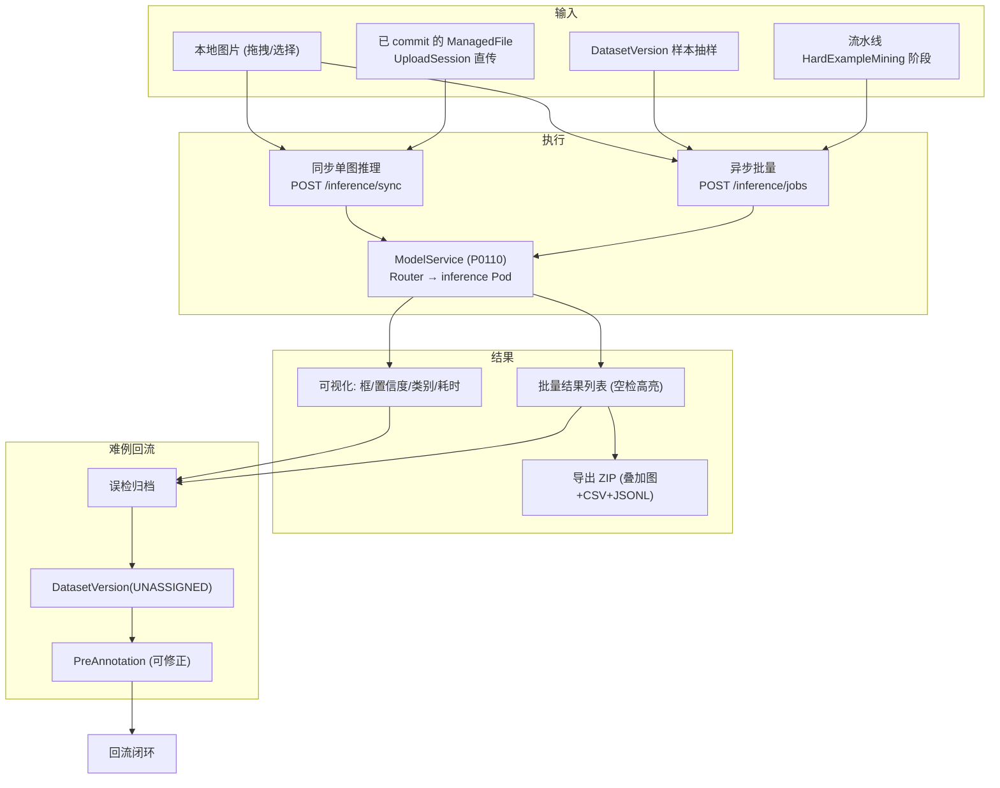
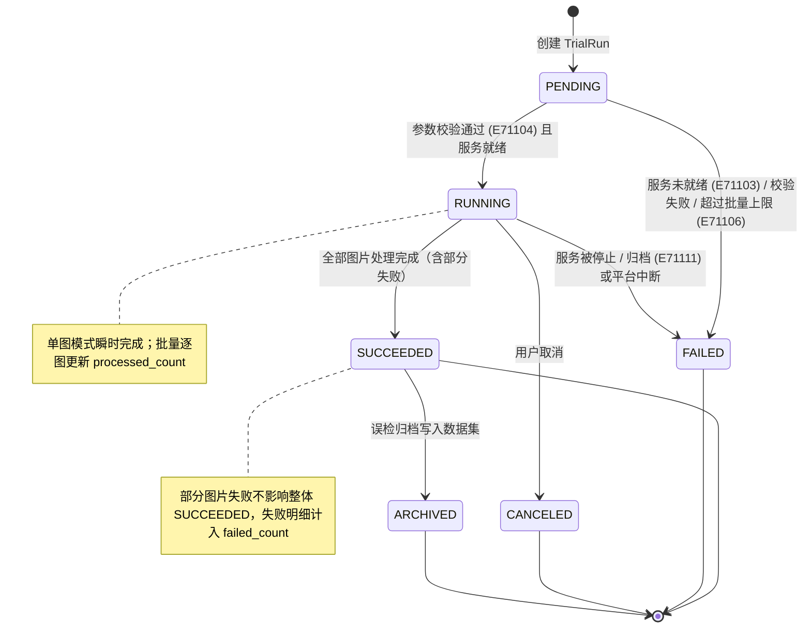
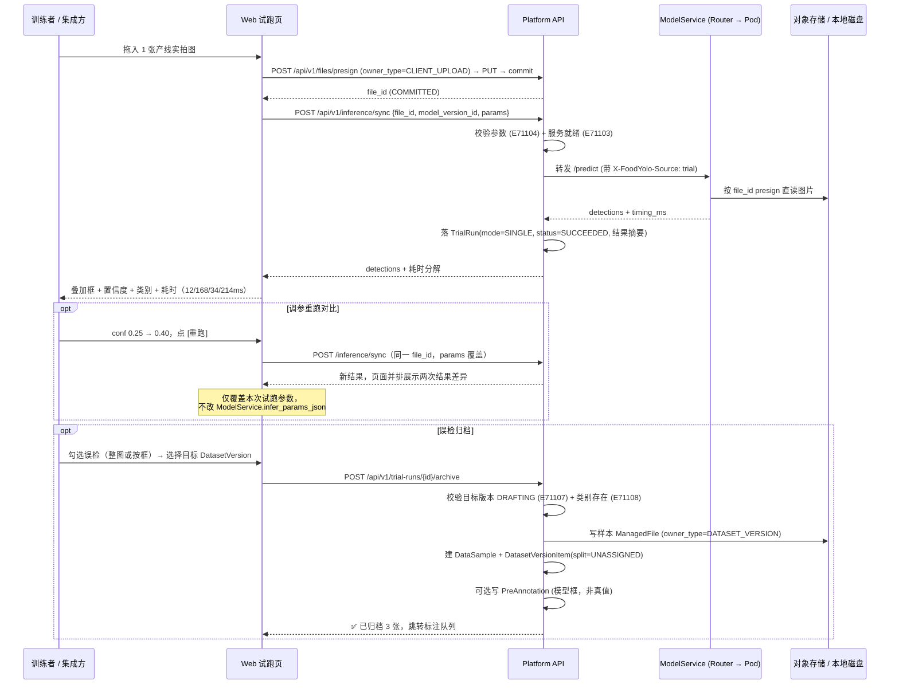
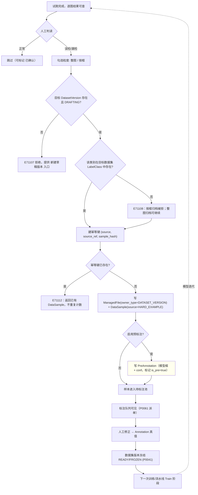
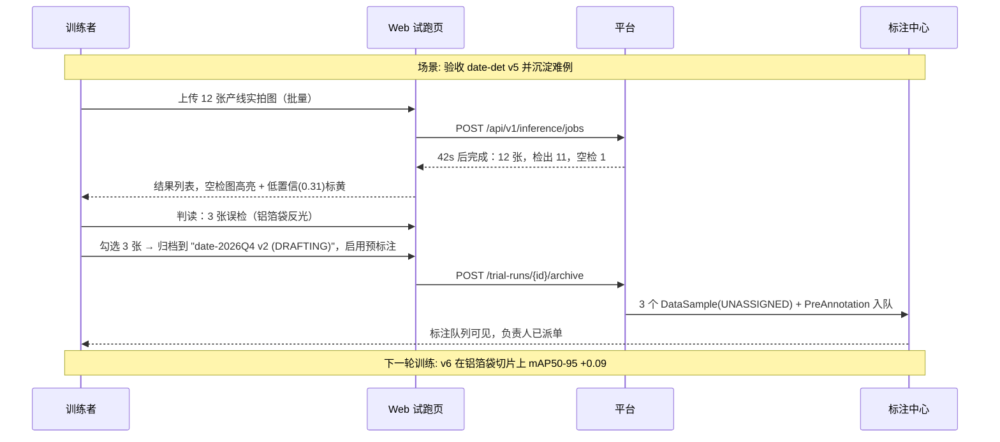
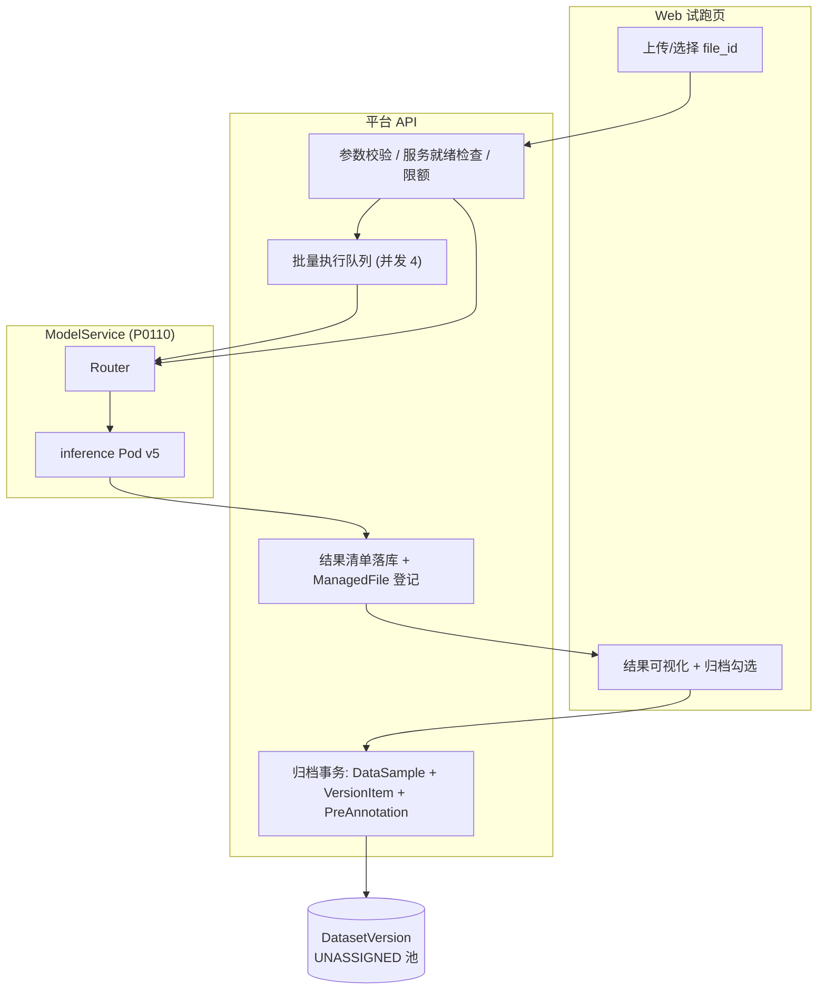

# PRD: P0111_在线试跑 (Online Trial Run)

| 属性 | 内容 |
| :--- | :--- |
| **文档编号** | P0111 |
| **项目名称** | FoodYolo 视觉检测模型训练基建 |
| **功能模块** | M07_部署推理 |
| **当前版本** | v1.0.0 |
| **文档状态** | Draft |
| **作者** | DeployW |
| **最后更新** | 2026-10-01 |

---

## 1. 全局说明

> [!IMPORTANT]
> **核心定位**: 试跑是**服务发布后的即时验收动作**，也是**难例回流的第一入口**。上传一张（或一批）真实拍摄图片，立刻看到框、置信度、类别与耗时；看到误检/漏检就**一键归档**进指定 `DatasetVersion` 的待标注区，形成 `部署推理 → 标注 → 训练` 的闭环。试跑**不产出评估指标**——它不做标注匹配、不算 mAP；需要正式指标一律走 `EvaluationTask`（P0086）。

### 名词解释

*   **TrialRun (试跑)**: 一次在线推理运行的事实记录（`trial_runs`），只记录**输入来源、绑定版本、结果摘要、耗时、误检归档去向**，不存指标。
*   **试跑模式**: `SINGLE`（单图即时，同步返回，超时 10s）/ `BATCH`（批量异步，单次 ≤ 200 张）。
*   **结果清单 (Result Manifest)**: 逐图检测结果的 JSONL，登记为 `ManagedFile`，用于批量结果列表的分页读取与导出。
*   **叠加图 (Overlay)**: 把检测框、类别、置信度烧录到原图上生成的预览图，仅用于人工判读。
*   **误检归档 (False-Positive Archiving)**: 把被人工判为误检的图（或框）写入指定 `DatasetVersion` 的 `UNASSIGNED` 切分，成为待标注样本。
*   **难例回流 (Hard Example Mining)**: 流水线第十阶段；与本模块共用**同一条写入路径**与同一个幂等键，区别只是触发者是人还是流水线。
*   **PreAnnotation (预标注)**: 归档时可把模型预测写成预标注，标注员在其上修正而非从零画框；**但它不是真值**，不得直接转正。
*   **空检 (Empty Detection)**: 返回 0 个框；试跑页面显式渲染"未检出"而不是报错。

### 统一异常处理

| Code | 场景 | 处理策略 |
| :--- | :--- | :--- |
| `E71101` | 图片损坏 / 格式不支持（非 jpg/png/webp/bmp） | 该图标记失败，批量任务跳过并汇总，不中断整批 |
| `E71102` | 图片过大（> 20MB 或任一边 > 8000px） | 拒绝该图并提示压缩；批量任务按失败计入 `failed_count` |
| `E71103` | 目标服务未就绪（503，发布中或 `replicas=0`） | 提示"服务未就绪"，读 `Retry-After` 后重试，不消耗批量配额 |
| `E71104` | 参数非法（`conf`/`iou` 越界、`input_size` 非 32 倍数） | 拒绝提交并回显合法范围 |
| `E71105` | 单图推理超时（> 10s） | 该图标记失败；批量任务继续，UI 建议降低 `input_size` 或 `batch_max` |
| `E71106` | 批量超过单次上限（> 200 张） | 拒绝提交，提示分批或改用流水线 `HardExampleMining` |
| `E71107` | 目标 `DatasetVersion` 不可写（非 `DRAFTING`） | 拒绝归档并给出"新建草稿版本"跳转 |
| `E71108` | 目标数据集缺少该类别（`LabelClass` 不存在） | 拒绝归档该类别的框，提示先建类别；整图归档不受影响 |
| `E71109` | 归档写入失败（存储满 / 权限） | 归档事务回滚，`E71109`，无法回滚时标记 `orphan=true` 待 GC 清理 |
| `E71110` | 结果包导出失败（磁盘满 / 打包超时） | 提示导出失败，结果页数据仍可读 |
| `E71111` | 试跑进行中服务被停止 / 归档 | 批量任务置 `FAILED`，已完成的图结果保留可下载 |
| `E71112` | 重复归档（同图同来源再次归档） | 幂等：返回已有 `DataSample`，提示"已归档过"并不重复计数 |

---

## 2. 项目背景

### 背景 (Context)

P0110 让模型变成了一个能调的接口。但"能调"不等于"敢用"：训练者拿到 `mAP50-95 0.812` 的报告，仍然需要**用自己手机随手拍几张产线照片**看一眼——框准不准、有没有把包装上的其他文字当日期、暗光下还认不认。

这一步今天缺失，导致两个具体问题：一是发布验收靠"感觉"，二是**发现的坏样本没有去处**——试完就没了，下周再拍一批，模型还是那样。

### 问题陈述 (Problem Statement)

1.  **验收靠感觉**: 评估报告只回答"固定测试集上多好"，不回答"现在这张图行不行"。
2.  **试跑成本高**: 今天验模型要写 curl、存图、自己画框、自己看置信度，2~3 人团队里这一步经常被跳过。
3.  **坏样本流失**: 试跑中发现的误检/漏检样本随手删掉，没有沉淀进数据集，模型问题反复出现。
4.  **难例回流只有一条入口**: 只有流水线 `HardExampleMining` 能回流，人工发现的难例反而进不来，回流闭环缺一半。
5.  **参数调不了**: 想知道 `conf` 从 0.25 调到 0.4 会怎样，只能改服务配置影响线上，不能在试跑里临时试。

### 目标与成功指标 (Goals & Success Metrics)

*   **北极星指标**: 试跑中发现的误检样本，**≥ 50%** 被归档进数据集并最终进入下一次训练（归档可用率，按月统计）。
*   **次要指标**:
    *   单图试跑：上传完成到看到结果 **P95 < 1s**（不含网络上传，GPU 模式）。
    *   批量 200 张试跑：端到端 **< 60s**。
    *   归档动作：从点击"归档为待标注"到样本出现在标注队列 **< 3 分钟**（含预标注写入）。
    *   试跑结果与正式评估在同一批图上的**判定一致性**：人工标注后回算，无明显系统性偏差（抽样复核）。

### 风险与规避 (Risks & Mitigation)

| 风险 | 影响 | 规避方案 |
| :--- | :--- | :--- |
| 试跑图片被当成标注数据直接训练 | 误检被当真值，模型越训越歪 | 归档样本一律进 `split=UNASSIGNED`；预标注写入 `PreAnnotation`，**不写 `Annotation`** |
| 归档把草稿版本污染 | 正在冻结的版本被塞入未审核样本 | 只允许写入 `status=DRAFTING` 的版本；`READY/FROZEN` 一律拒绝（`E71107`） |
| 批量试跑把服务打满，影响线上 | 端侧请求变慢 | 批量任务在平台侧限速（默认 4 并发），并向服务打 `X-FoodYolo-Source: trial` 标记，Router 可按来源降优先级 |
| 结果清单文件膨胀 | 磁盘与对象存储被试跑数据吃掉 | 单次 ≤ 200 张；试跑结果清单默认保留 30 天，超期由 P0046 GC 回收（叠加图可选保留） |
| 上传的图含敏感信息（工牌、人脸） | 数据合规风险 | 试跑不落盘原图到对象存储：使用 `CLIENT_UPLOAD` 会话并默认 30 天回收；UI 明示"试跑图仅用于本机验证" |
| 误检判读主观 | 归档质量参差 | 归档支持"整图"与"按框"两种粒度，并可填原因标签，供后续质量分析 |

---

## 3. 价值模型

*   **方案**: 在部署推理模块里放一个**低门槛的验收入口**（Web 上传即推理）与**一条硬回流通道**（误检一键归档）。
    *   单图：拖拽上传 → 200ms 出框 → 可临时改 `conf/iou/input_size` 重跑对比。
    *   批量：拖入 ≤ 200 张 → 结果列表（含空检高亮）→ 导出 ZIP。
    *   归档：勾选误检图/框 → 写入目标 `DatasetVersion(UNASSIGNED)` + 可选预标注 → 标注队列立即可见。
*   **目标**: 让"发现模型不行"到"这个样本进入下一次训练"的路径从**不存在**变成**3 分钟内闭环**。

---

## 4. 项目范围



### In Scope

1.  单图即时试跑（同步）、批量试跑（异步，≤ 200 张）。
2.  结果可视化：框叠加、类别、置信度、耗时分解（预处理/推理/后处理）。
3.  试跑时可临时覆盖推理参数（`conf/iou/input_size/max_det`）并对比，**不改动服务线上配置**。
4.  批量结果列表（分页、筛选空检/低置信）、结果导出 ZIP。
5.  误检归档（整图 / 按框）+ 可选写入 `PreAnnotation`。
6.  与流水线 `HardExampleMining` 共用写入路径、幂等键与审计口径。

### Out of Scope

*   **指标计算**：试跑不算 mAP / 混淆矩阵，不产生 `EvaluationTask` 结论；需要正式指标走 P0086。
*   **视频推理 / 实时流**：只做静态图片；视频抽帧走 P0020。
*   **OCR 结果展示**：第二阶段；当前只显示检测框。
*   **在线压测 / 吞吐benchmark**：不做。
*   **标注交互**：试跑页只做"归档"，不提供画框工具（标注在 P0060）。
*   **自动判错**：误检判定由人给出，平台不自动标注难例（自动策略属于流水线 `HardExampleMining` 的算子配置）。

---

## 5. 业务流程

### 5.1 试跑状态机



### 5.2 单图试跑与参数比对时序



### 5.3 误检归档与难例回流



> 同一张 `ManagedFile` 从不让两个 `DatasetVersion` 共享写入：归档是**复制引用**（新建 `DataSample` 指向同一物理对象或复制一份，取决于存储配置），保证版本不可变语义不被破坏（P0041）。

---

## 6. 用户分析

### 6.1 用户画像 (User Personas)

*   **训练者 (TRAINER)**: 发布前验收 + 日常抽查模型退化。诉求"上传一张马上看到框和耗时，不对劲就把它存下来"；痛点是今天只能写 curl、结果无处沉淀。
*   **标注负责人 (ANNOTATOR / 质检视角)**: 诉求"我要拿到的是**具体的坏图**，不是一句 mAP 偏低"；痛点是难例清单不可执行，试跑产生的坏样本没人交给他们。
*   **集成方 (VIEWER)**: 在接入前用试跑验证接口契约与返回结构。诉求"能照着示例请求跑通一次"；痛点是文档与真实响应不一致时没有验证手段。

### 6.2 用户链路图 (User Journey Map)



---

## 7. 功能需求

### M07.F01 单图即时试跑 (Single Image Trial)

*   **用户故事**: 作为训练者，我希望能拖一张图就立刻看到检测结果，以便在发布前后快速验证模型在真实场景下的表现。

*   **前置条件**: 角色 ∈ `ADMIN`/`TRAINER`/`VIEWER`（`VIEWER` 可试跑但不可归档）；目标服务存在且 `status = RUNNING`（或指定 `model_version_id` 直接试跑，此时走服务内 Router 的按版本路由）；图片格式 ∈ `jpg/png/webp/bmp`。
*   **主流程**: 1) 上传（走 P0020 `UploadSession` / presign，落 `ManagedFile(owner_type=CLIENT_UPLOAD)`）或直接以 `file_id` 引用；2) 选目标 `ModelService` 或 `ModelVersion`；3) 可选覆盖参数 `conf/iou/input_size/max_det/return_image`；4) 调 `POST /api/v1/inference/sync`；5) 返回 `detections + image_size + timing_ms`；6) 落 `TrialRun(mode=SINGLE)`，只记摘要不记指标；7) 页面并排展示原图与叠加框；8) 支持改参数 [重跑] 做 A/B 对比，仅覆盖本次试跑。
*   **后置条件**: 页面可同时对比最多 3 次参数组合的结果；结果可直接进入归档（M07.F05）。

*   **验收标准**:

    ```gherkin
    场景: 上传单图并即时看到结果
      Given 服务 "date-det-api" 状态为 RUNNING
      When 训练者上传一张 1920x1080 的产线实拍图并点击 [推理]
      Then 返回 1 个类别为 production_date、conf 0.94、bbox 为原图像素坐标的检测框
      And 页面显示耗时分解：预处理 12ms / 推理 168ms / 后处理 34ms / 合计 214ms
      And 生成一条 TrialRun(mode=SINGLE, status=SUCCEEDED)

    场景: 服务未就绪
      Given 目标服务正在 DEPLOYING
      When 用户提交单图试跑
      Then 返回 503 与 E71103，提示"服务未就绪，请稍后重试"
      And 不生成 TrialRun 记录

    场景: 参数覆盖重跑不影响线上配置
      Given 线上服务 conf=0.25
      When 用户在试跑页把 conf 改为 0.40 并重跑
      Then 本次试跑按 0.40 返回结果，页面并排展示两次差异
      And ModelService.infer_params_json 保持 0.25 不变
    ```

*   **边界情况与异常处理**

    | 场景 | 处理 |
    | :--- | :--- |
    | 上传 20MB 以上图片 | 拒绝 `E71102`，提示压缩到 ≤ 20MB 或任一边 ≤ 8000px |
    | 图片 EXIF 带旋转 | 服务端按 EXIF 自动转正后再推理；返回的 `image_size` 为转正后尺寸 |
    | 空检（0 个框） | 正常 200，页面显式渲染"未检出（可能是漏检）"并提供 [归档为待标注] |
    | 服务在推理过程中被停止 | 返回 503 + `E71111`；已完成的试跑记录保留 |
    | `VIEWER` 尝试归档 | 按钮禁用，API 返回 403 |

### M07.F02 结果可视化与耗时分解 (Visualization & Timing)

*   **用户故事**: 作为训练者，我希望结果页把框、类别、置信度和耗时一次显示清楚，以便判断"是模型不准还是接口太慢"。

*   **前置条件**: `TrialRun.status = SUCCEEDED` 且结果可读。
*   **主流程**: 1) 渲染原图（等比缩放，最大 1600px 宽），叠加矩形框；2) 框左上角标注 `cls_name conf`；3) 按 `conf` 分档配色：≥0.7 绿、0.4-0.7 黄、<0.4 橙（低于 `conf` 阈值的框不返回）；4) 显示耗时分解三段时间 + 合计 + `image_size`；5) 提供 [显示/隐藏框]、[显示置信度] 开关；6) 批量模式下点击缩略图进入同一详情视图。
*   **后置条件**: 无数据写入；可视化是纯展示层。

*   **验收标准**:

    ```gherkin
    场景: 低置信度框的视觉区分
      Given 一张图检出 2 个框，conf 分别为 0.92 与 0.31
      When 打开结果详情
      Then 0.92 的框为绿色，0.31 的框为橙色并在列表中标"低置信"
      And 每段耗时分别显示，合计与 timing_ms.total 一致

    场景: 坐标叠加正确
      Given 原图 1920x1080，返回 bbox [812,640,1104,712]，service 内部 input_size=640
      When 页面以 800px 宽渲染该图
      Then 框位置按比例映射后仍落在原位置（缩放比 800/1920）
    ```

*   **边界情况与异常处理**

    | 场景 | 处理 |
    | :--- | :--- |
    | 图片过大导致前端渲染卡顿 | 前端生成缩略图预览（最长边 1600px），叠加基于缩略图比例换算 |
    | 检测框超出图边界（越界预测） | 渲染前裁剪到 `[0,w]×[0,h]`，原始值保留在 JSON 中 |
    | 检测框过密（> 50 个） | 默认只渲染 conf 最高的 50 个并提示"已折叠 N 个" |
    | 原图已被 GC | 只展示结果数据与空图占位，提示"原图已回收" |

### M07.F03 批量试跑与结果列表 (Batch Trial & Result List)

*   **用户故事**: 作为训练者，我希望一次上传一批图并分页查看结果，以便快速找出空检与低置信的坏样本。

*   **前置条件**: 角色 ∈ `ADMIN`/`TRAINER`；服务 `RUNNING`；本次图片数 ≤ 200。
*   **主流程**: 1) 提交 `POST /api/v1/inference/jobs`（`files:[file_id]` 或 `dataset_version_id` 抽样）；2) 平台落 `TrialRun(mode=BATCH, status=PENDING)`；3) 平台侧限速 4 并发向服务发请求，逐图更新 `processed_count`；4) 单图失败（`E71101/E71102/E71105`）不打断整批，计入 `failed_count` 并在列表标失败原因；5) 全部完成置 `SUCCEEDED`，写结果清单 JSONL 到 `ManagedFile`；6) 结果列表支持：按状态筛选（全部/检出/空检/失败）、按 `conf` 升序（先看可疑的）、按 `max_conf` 排序、分页 50 条；7) 支持勾选整页或按条件全选（"选中全部空检"）。
*   **后置条件**: 结果清单可下载；`TrialRun` 摘要可查。

*   **验收标准**:

    ```gherkin
    场景: 批量 200 张并高亮空检
      Given 服务 RUNNING，用户上传 200 张图
      When 提交批量试跑
      Then 端到端在 60 秒内完成，列表显示"总数 200 / 检出 194 / 空检 5 / 失败 1"
      And 空检行以黄色高亮，失败行可展开查看错误码
      And 结果清单 JSONL 登记为 ManagedFile

    场景: 超过单次上限
      Given 用户选中 260 张图
      When 提交
      Then 返回 E71106，提示"单次最多 200 张"，并提供 [拆成 2 批] 一键操作
    ```

*   **边界情况与异常处理**

    | 场景 | 处理 |
    | :--- | :--- |
    | 批量执行中用户关闭页面 | 任务在平台侧继续，重进页面按 `job_id` 恢复进度显示 |
    | 服务中途被停止 | `TrialRun` 置 `FAILED`（`E71111`），已完成图的结果保留可下载 |
    | 同一图重复提交 | 允许，各自产生一条结果；列表按 `file_id + params_hash` 标"重复"提示 |
    | `dataset_version_id` 抽样为空 | 拒绝提交，提示该版本无 `READY/FROZEN` 可用样本 |
    | 批量结果 > 200 条的历史试跑 | 列表分页读取 JSONL 的偏移区间，不一次载入内存 |

### M07.F04 结果导出 (Result Export)

*   **用户故事**: 作为训练者，我希望把批量结果打包下载，以便离线分析或作为发布验收证据留存。

*   **前置条件**: `TrialRun.status ∈ {SUCCEEDED, FAILED}` 且结果清单存在。
*   **主流程**: 1) 点 [导出] 选择内容：叠加图（可选）/ `results.jsonl`（必含）/ `trial_results.csv`（扁平化：`file_name,cls,conf,x1,y1,x2,y2`）/ 失败明细 `failed.csv`；2) 平台异步打包为 ZIP（≤ 2GB）；3) 完成后生成下载链接（有效期 24 小时）；4) 产物登记为 `ManagedFile(owner_type=MODEL_VERSION, owner_id=model_version_id)`，命名含 `trial_run_id`。
*   **后置条件**: 导出包可下载；导出动作写 `AuditLog(TRIAL_EXPORT)`。

*   **验收标准**:

    ```gherkin
    场景: 导出批量结果包
      Given 一个 SUCCEEDED 的批量试跑（200 张）
      When 用户点击 [导出] 并勾选"叠加图 + CSV"
      Then 生成 ZIP，含 results.jsonl、trial_results.csv 与 200 张叠加图目录
      And 产物登记为 ManagedFile(owner_type=MODEL_VERSION)
      And 下载链接 24 小时内有效

    场景: 导出失败不丢数据
      Given 目标磁盘可用空间不足
      When 用户点击导出
      Then 返回 E71110，提示"导出失败：存储空间不足"
      And 结果页与结果清单仍可在线阅读
    ```

*   **边界情况与异常处理**

    | 场景 | 处理 |
    | :--- | :--- |
    | 叠加图过大导致 ZIP > 2GB | 默认不勾选叠加图，或按 50 张分卷为多个 ZIP |
    | 导出期间试跑结果清单被 GC | 提示"结果已回收"，只允许导出数据库中的摘要 |
    | 同一试跑重复导出 | 复用已有产物（按 `trial_run_id + 选项指纹` 去重） |
    | CSV 中文类别名乱码 | 统一 UTF-8 with BOM |

### M07.F05 误检归档为待标注数据 (False-Positive Archiving)

*   **用户故事**: 作为训练者，我希望把误检的图一键存进指定数据集，以便这些坏样本能进入下一轮标注与训练，而不是随手删掉。

*   **前置条件**: 角色 ∈ `ADMIN`/`TRAINER`；`TrialRun.status = SUCCEEDED`；目标 `DatasetVersion.status = DRAFTING`（`E71107`）；按框归档时目标数据集存在对应 `LabelClass`（`E71108`）。
*   **主流程**: 1) 在结果列表或详情页勾选样本，选择粒度：**整图**（图像级难例，进待标注池）或**按框**（指定误检框，记录为负样本线索）；2) 选择目标 `DatasetVersion`（下拉只列 `DRAFTING` 且调用者有写权限的版本）；3) 可填原因标签（`反光/模糊/遮挡/类别混淆/其他`）与备注；4) 可选启用**预标注**：把模型预测写入 `PreAnnotation(is_pre=true)` 供标注员修正；5) 系统按幂等键 `(source=TRIAL, source_ref=trial_run_id+file_id, sample_hash)` 判重（`E71112`）；6) 写 `ManagedFile(owner_type=DATASET_VERSION, owner_id=dataset_version_id)` + `DataSample(source=HARD_EXAMPLE)` + `DatasetVersionItem(split=UNASSIGNED)`；7) 抽取缩略图与 `sample_hash` 供去重算子使用；8) 返回归档结果，提供"跳转标注队列"。
*   **后置条件**: 样本在标注队列可见；`TrialRun.archived_*` 字段更新；写 `AuditLog(TRIAL_ARCHIVE)`。

*   **验收标准**:

    ```gherkin
    场景: 整图归档为待标注样本
      Given 一次 SUCCEEDED 的批量试跑，"date-2026Q4 v2" 为 DRAFTING
      When 训练者勾选 3 张误检图并点击 [归档为待标注]
      Then 生成 3 条 DataSample(source=HARD_EXAMPLE) 与 3 条 DatasetVersionItem(split=UNASSIGNED)
      And 标注队列 3 分钟内可见这 3 个样本
      And TrialRun.archived_sample_count = 3

    场景: 预标注不等于真值
      Given 归档时勾选"启用预标注"
      When 归档完成
      Then 每个样本有一条 PreAnnotation(is_pre=true)，携带模型框与 conf
      And 系统不生成任何 Annotation 记录

    场景: 目标版本已冻结
      Given 目标 DatasetVersion 状态为 FROZEN
      When 用户点击归档
      Then 返回 E71107，提示"只能归档到 DRAFTING 版本"，并提供 [新建草稿版本]

    场景: 重复归档幂等
      Given 同一张图已归档过一次
      When 用户再次归档同一张图到同一版本
      Then 返回 E71112 与已有 DataSample，不新增记录、不重复计数
    ```

*   **边界情况与异常处理**

    | 场景 | 处理 |
    | :--- | :--- |
    | 按框归档但目标数据集无该类别 | 拒绝该类别的框（`E71108`），若同批还有其他类别则部分成功并逐条回报 |
    | 目标数据集与源数据类别体系不同 | 允许整图归档（无需类别）；UI 提示"类别体系不同，预标注将被跳过" |
    | 归档写入存储失败 | 事务回滚（不产生半截结构），返回 `E71109`；已写对象标记 `orphan=true` 交 P0046 GC |
    | 归档图来自已 GC 的临时试跑图 | 拒绝归档并提示"原图已回收，无法归档"；可在归档关闭前优先保留 |
    | 一次归档 200 张全部 | 允许，异步执行（> 50 张）并在完成后通知；期间可继续操作 |
    | 无写权限的 `VIEWER` | 按钮禁用；API 403 |

### M07.F06 与流水线 HardExampleMining 的衔接 (Pipeline Integration)

*   **用户故事**: 作为训练者，我希望人工归档与流水线自动难例回流使用同一条通道，以便样本来源统一可查、不产生两套逻辑。

*   **前置条件**: 流水线第十阶段 `HardExampleMining` 已配置目标 `DatasetVersion` 与算子参数（P0100/P0101）。
*   **主流程**: 1) 两者共用写入路径：`ManagedFile(DATASET_VERSION)` → `DataSample(source ∈ HARD_EXAMPLE|PIPELINE)` → `DatasetVersionItem(split=UNASSIGNED)`；2) 共用幂等键 `(source_ref, sample_hash)`，`sample_hash` 由 P0023 去重算子统一计算，避免人工与自动重复入同一张图；3) 流水线试跑侧复用本模块的批量执行路径（同样的限速与失败语义），阶段产物登记 `ManagedFile(owner_type=PIPELINE_STAGE_RUN)`；4) 平台在数据集内以 `source` 区分来源，标注队列可按来源筛选；5) `HardExampleMining` 的自动策略（低置信/空检/与真值不一致）与人工归档**互不覆盖**，冲突同一 `sample_hash` 时以先到者为准并记 `E71112`。
*   **后置条件**: 数据集内难例来源可追溯；下一轮训练直接消费 `UNASSIGNED` 池。

*   **验收标准**:

    ```gherkin
    场景: 人工与流水线归档同一张图不重复
      Given 流水线已把 sample_hash "h-77a1" 归档进 "date-2026Q4 v2"
      When 训练者把同一张图（同 hash）从试跑页归档到同一版本
      Then 返回 E71112 并指向已有的 DataSample
      And 数据集中该 hash 只有 1 条记录

    场景: 来源可区分
      Given 数据集中同时有人工与流水线归档的样本
      When 在标注队列按来源筛选 "人工试跑"
      Then 只列出 source=HARD_EXAMPLE 且 source_ref 指向 TrialRun 的样本

    场景: 流水线复用试跑执行路径
      Given HardExampleMining 阶段配置了对 VAL 集做批量推理
      When 流水线运行到该阶段
      Then 该阶段按 ≤4 并发调用模型服务，逐图结果写入阶段产物
      And 空检样本按算子配置自动归档进目标 DatasetVersion
    ```

*   **边界情况与异常处理**

    | 场景 | 处理 |
    | :--- | :--- |
    | 流水线运行中服务被归档 | 阶段失败并标 `E71111`，按 P0101 从失败点重跑 |
    | 目标版本在流水线运行期间被冻结 | 该阶段归档部分失败，阶段标记 `partial=true`，重跑时跳过已归档 hash |
    | 同 hash 不同图片（哈希碰撞/内容微改） | 由 P0023 的感知哈希算子判定，未达阈值视为不同样本 |
    | 人工归档量过大污染数据集 | UI 在单版本 `UNASSIGNED` 占比 > 30% 时提示，并给出按来源统计 |

---

## 8. 技术架构与数据模型

### 8.1 数据实体

#### `trial_runs`

| 字段名 | 类型 | 必填 | 说明 |
| :--- | :--- | :--- | :--- |
| `id` | UUID | Y | PK |
| `mode` | Enum | Y | `SINGLE / BATCH` |
| `source` | Enum | Y | `WEB_UPLOAD / CLIENT_UPLOAD / DATASET_SAMPLE / PIPELINE` |
| `model_service_id` | UUID | N | FK → `model_services.id`（按版本直跑时为空） |
| `model_version_id` | UUID | Y | FK → `model_versions.id`（实际执行的版本，灰度下由 Router 决定并回填） |
| `params_json` | JSONB | Y | `{conf, iou, input_size, max_det, return_image, params_hash}` |
| `input_ref_json` | JSONB | Y | `{file_ids:[…]} \| {upload_session_id} \| {dataset_version_id, sample_count}` |
| `sample_count` / `processed_count` | Int | Y | 计划 / 已完成 |
| `success_count` / `empty_count` / `failed_count` | Int | Y | 成功（含空检）/ 空检 / 失败 |
| `avg_latency_ms` / `p95_latency_ms` | Int | N | **仅服务端处理耗时**，用于展示，不作为评估结论 |
| `status` | Enum | Y | `PENDING / RUNNING / SUCCEEDED / FAILED / CANCELED / ARCHIVED` |
| `error_code` / `error_message` | String(16) / Text | N | |
| `result_manifest_file_id` | UUID | N | FK → `managed_files.id`（JSONL，`owner_type=MODEL_VERSION`） |
| `export_file_id` | UUID | N | FK → `managed_files.id`（ZIP 导出包） |
| `archived_dataset_version_id` | UUID | N | FK → `dataset_versions.id` |
| `archived_sample_count` / `archived_box_count` | Int | N | 归档计数 |
| `archive_mode` | Enum | N | `WHOLE_IMAGE / BY_BOX` |
| `archive_reason` | String(32) | N | `反光/模糊/遮挡/类别混淆/其他` |
| `preannotation_written` | Boolean | Y | 是否写入 `PreAnnotation`，默认 false |
| `pipeline_run_id` / `stage_run_id` | UUID | N | 来源为 `PIPELINE` 时回指 P0101 |
| `created_by` | UUID | Y | FK → `users.id` |
| `created_at` / `updated_at` / `deleted_at` | timestamptz | Y | 通用字段 |

**Index**: `(model_version_id, created_at DESC)`；`(status)`；`(archived_dataset_version_id)`；`(created_by, created_at DESC)`。

> **约束**: 本表**不存** mAP / precision / recall 等指标字段——试跑不构成评估结论（需要指标走 `EvaluationTask`，P0086）。

#### 结果清单 JSONL 结构（`result_manifest_file_id` 指向的对象）

| 字段 | 说明 |
| :--- | :--- |
| `file_id` / `file_name` | 输入图片引用与原始文件名 |
| `status` | `OK / EMPTY / FAILED` |
| `error_code` | 失败时的错误码（`E71101/02/05`） |
| `image_size` | 原图 `{w,h}` |
| `detections[]` | `{cls_id, cls_name, conf, bbox:[x1,y1,x2,y2]}`，原图绝对像素 |
| `timing_ms` | `{preprocess, inference, postprocess, total}` |
| `overlay_file_id` | 叠加图引用（启用时） |

#### 复用实体

| 实体 | 复用方式 |
| :--- | :--- |
| `ManagedFile` | 输入图 `owner_type=CLIENT_UPLOAD`；结果清单与导出包 `owner_type=MODEL_VERSION`；归档样本 `owner_type=DATASET_VERSION` |
| `DataSample` / `DatasetVersionItem` | 归档样本以 `source=HARD_EXAMPLE`、`split=UNASSIGNED` 写入；`DataSample.group_key` 取 `trial_run_id`（同一次试跑的误检图必须落在同一 split，版本侧禁止同一 `group_key` 跨 split） |
| `PreAnnotation` | 归档可选写入，`is_pre=true`，**不写 `Annotation`** |
| `UploadSession` / `UploadChunk` | 试跑上传复用 P0020 的分片上传与断点续传 |

### 8.2 参数与限额默认值

| 参数 | 默认值 | 说明 |
| :--- | :--- | :--- |
| `conf` | 0.25 | 可被单次试跑覆盖，不改服务配置 |
| `iou` (NMS) | 0.70 | 同上 |
| `input_size` | 640 | 必须是 32 的倍数 |
| `max_det` | 300 | |
| `return_image` | false | 需要叠加图时置 true（批量默认 false 以省带宽） |
| 单图大小上限 | 20MB / 单边 8000px | 超出 `E71102` |
| 批量单次上限 | 200 张 | 超出 `E71106` |
| 平台侧批量并发 | 4 | 避免打满在线服务 |
| 单图超时 | 10s | 超出 `E71105` |
| 结果清单保留 | 30 天 | 超期由 P0046 GC 回收；叠加图可选保留 7 天 |
| 导出包大小上限 | 2GB | 超出按分卷导出 |

### 8.3 执行架构



---

## 9. UI/UX 规格说明

### 9.1 单图试跑页

```text
+--------------------------------------------------------------------------------+
|  在线试跑    目标 [date-det-api (v5) ▾]   参数 conf[0.25] iou[0.70] input_size[640▾]|
+--------------------------------------------------------------------------------+
|  ┌──────────────── 拖拽图片到此处 ────────────────┐   ┌──────── 结果 ────────┐|
|  │                                                │   │ 检出 1 个  conf 0.94 │|
|  │      [ 原图 1920x1080 ]                        │   │ production_date      │|
|  │      ┌──────────────┐                          │   │ ── 耗时 ──           │|
|  │      │production_date│ 0.94  ← 叠加框            │   │ 预处理   12ms        │|
|  │      └──────────────┘                          │   │ 推理    168ms        │|
|  │                                                │   │ 后处理   34ms        │|
|  └────────────────────────────────────────────────┘   │ 合计    214ms        │|
|                                                        └──────────────────────┘|
+--------------------------------------------------------------------------------+
|  [重新推理]  [对比上一次 (conf 0.25 → 0.40)]   [⚠ 归档为待标注]                 |
+--------------------------------------------------------------------------------+
```

### 9.2 批量结果列表

```text
+--------------------------------------------------------------------------------+
|  批量试跑 #tr-20261001-0042   200 张 | 检出 194 | 空检 5 | 失败 1    [导出 ▾]   |
+--------------------------------------------------------------------------------+
|  ☑ 全选   筛选 [全部▾]  [空检 5]   排序 [置信度 ↑]    已选 3 项                 |
+--------------------------------------------------------------------------------+
|  ☑  IMG_2041.jpg  ← 空检            框 0     -        198ms   [归档为待标注]    |
|  ☑  IMG_2047.jpg  ← 空检            框 0     -        204ms   [归档为待标注]    |
|  ☐  IMG_2050.jpg  低置信            框 1     0.31     221ms   [归档为待标注]    |
|  ☑  IMG_2063.jpg  误检(反光)        框 2     0.88     236ms   [归档为待标注]    |
|  ☐  IMG_2071.jpg  失败 E71105        -       -        TIMEOUT                  |
+--------------------------------------------------------------------------------+
|  [归档选中的 3 项]  目标版本 [date-2026Q4 v2 (DRAFTING) ▾]  [x]启用预标注        |
+--------------------------------------------------------------------------------+
```

### 9.3 归档确认对话框

```text
+--------------------------------------------------------------------------+
|  归档为待标注数据                                                 [✕]    |
+--------------------------------------------------------------------------+
|  目标数据集版本 *  [date-2026Q4 v2 (DRAFTING) ▾]                          |
|  归档粒度 *        (•) 整图   ( ) 按框（仅归档勾选的误检框）              |
|  原因标签          [反光 ▾]   备注 [铝箔袋反光导致误检            ]       |
|  预标注            [x] 把模型预测写入 PreAnnotation（标注员可修正）       |
|                                                                          |
|  ⚠ 预标注不是真值，不会直接进入训练集；样本进入 UNASSIGNED 待标注池。      |
|  本次将归档 3 张图 / 0 个框。                                             |
+--------------------------------------------------------------------------+
|                                        [取消]   [确认归档]                |
+--------------------------------------------------------------------------+
```

### 9.4 交互元素

| 元素 | 类型 | 状态 | 行为 |
| :--- | :--- | :--- | :--- |
| 拖拽上传区 | Dropzone | Idle / Uploading / Uploaded / Error | 上传走 presign 分片；失败可重试，断点续传 |
| 推理 | Button | Default / Loading / Disabled(服务未就绪) | 调 sync 接口，展示耗时分解 |
| 对比上一次 | Button | Disabled(无历史) | 并排展示两次参数的结果差异（含新增/消失的框） |
| 结果行 | TableRow | Normal / Empty(黄) / LowConf(橙) / Failed(红) | 点击展开详情；复选框支持"选中全部空检" |
| 归档为待标注 | Button | Default / Disabled(非 TRAINER / 无 DRAFTING 版本) | 打开归档确认对话框 |
| 导出 | Dropdown | Default / Disabled(无结果清单) | JSONL / CSV / ZIP（含叠加图） |
| 框显示开关 | Toggle | On / Off | 控制叠加层渲染 |

---

## 10. 非功能性需求 (NFR)

*   **性能**: 单图（1920×1080，GPU 模式）端到端 P95 **< 1s**（不含上传）；批量 200 张端到端 **< 60s**；结果列表分页接口 P95 **< 200ms**；叠加图首屏渲染 **< 500ms**。
*   **可靠性**: 批量任务进度持久化，页面关闭/刷新后可恢复；平台重启后 `RUNNING` 的批量任务重新排队（`attempt++`）；单图失败不影响其余图。
*   **安全**: 试跑上传限 `ADMIN`/`TRAINER`/`VIEWER`，归档限 `ADMIN`/`TRAINER`；上传经 presign（TTL ≤ 15 分钟）且不带可执行权限；试跑图片不落盘到长期存储（默认 30 天回收）；归档与导出写 `AuditLog`。
*   **数据一致性**: 归档是"引用 + 版本成员"的原子事务；部分失败逐条回报；`sample_hash` 去重与 P0023 一致；预标注与真值严格分离（`PreAnnotation` vs `Annotation`）。
*   **兼容性**: 支持 `jpg/png/webp/bmp`；端侧契约 `POST /api/v1/inference/sync|jobs` 字段向后兼容；OCR 字段为第二阶段可选扩展。
*   **可观测性**: 指标 `trial_run_duration_seconds`、`trial_run_failed_images_total{error_code}`、`trial_archive_samples_total{source}`、`trial_archive_ratio`（归档数 / 空检+误检数，北极星指标的数据源）。

---

## 附录: 已确认的设计决策

| 决策项 | 结论 |
| :--- | :--- |
| 试跑与评估的关系 | 试跑**不产出指标**，只记录运行事实与结果；正式指标一律走 `EvaluationTask`（P0086） |
| 试跑实体 | `TrialRun(trial_runs)`，只存输入来源 / 绑定版本 / 结果摘要 / 耗时 / 归档去向 |
| 逐图结果存放 | 结果清单 JSONL 落 `ManagedFile`，批量列表按偏移分页读取，不入库避免行爆炸 |
| 输入方式 | 端侧一律传 `file_id`（复用 P0020 `UploadSession`）；Web 支持直传字节 |
| 参数覆盖 | 试跑可临时覆盖 `conf/iou/input_size/max_det`，**不改动 `ModelService.infer_params_json`** |
| 批量上限与限速 | 单次 ≤ 200 张，平台侧并发 4，带 `X-FoodYolo-Source: trial` 标记供 Router 降优先级 |
| 归档粒度 | 支持整图与按框两种；目标版本必须是 `DRAFTING`，样本进 `split=UNASSIGNED` |
| 预标注边界 | 归档可选写 `PreAnnotation(is_pre=true)`；**绝不写 `Annotation`**，预标注不是真值 |
| 难例回流统一 | 人工归档与流水线 `HardExampleMining` 共用写入路径与幂等键 `(source_ref, sample_hash)` |
| 产物归属 | 结果清单与导出包 `owner_type=MODEL_VERSION`；归档样本 `owner_type=DATASET_VERSION`；输入图 `CLIENT_UPLOAD`；**不新增 `owner_type` 枚举** |
| 结果保留 | 结果清单 30 天、叠加图 7 天，由 P0046 GC 回收；数据库摘要长期保留 |
| 错误码区间 | `E71101` - `E71112`（本模块 P0111 专属段） |

## 关联文档

*   **P0110_模型服务发布**: 试跑的服务来源、`/api/v1/inference/*` 契约与统计口径
*   **P0020_本地上传与断点续传**: `UploadSession` / presign 上传，试跑图片的入口
*   **P0023_导入预检与清洗**: `sample_hash` 去重算子的口径来源
*   **P0040_存储配置与桶绑定**: `ManagedFile` 登记与对象键规则
*   **P0041_数据集与版本**: `DatasetVersion` / `DatasetVersionItem(split=UNASSIGNED)` 与不可变语义
*   **P0060_标注器与标注几何 / P0063_质检与返工**: 归档样本的标注与质检去向
*   **P0086_模型评估**: 正式指标的唯一来源（与试跑区分）
*   **P0100_流水线阶段与算子 / P0101_流水线执行与重跑**: `HardExampleMining` 阶段与本模块的共用写入路径
*   **P0112_端侧导出**: 端侧机型上验证导出产物时的等价入口
*   **P0120_小程序接入契约 / P0121_RN 客户端接入契约**: 端上试跑与推理调用

## Changelog

| 版本 | 日期 | 作者 | 变更说明 |
| :--- | :--- | :--- | :--- |
| v0.1.0-draft | 2026-10-01 | DeployW | 初稿创建 |
| v1.0.0 | 2026-10-01 | DeployW | 按共享契约定稿：`TrialRun` 只记运行事实不产指标、`file_id` 入参、误检归档与 `HardExampleMining` 共路径与幂等键 |
