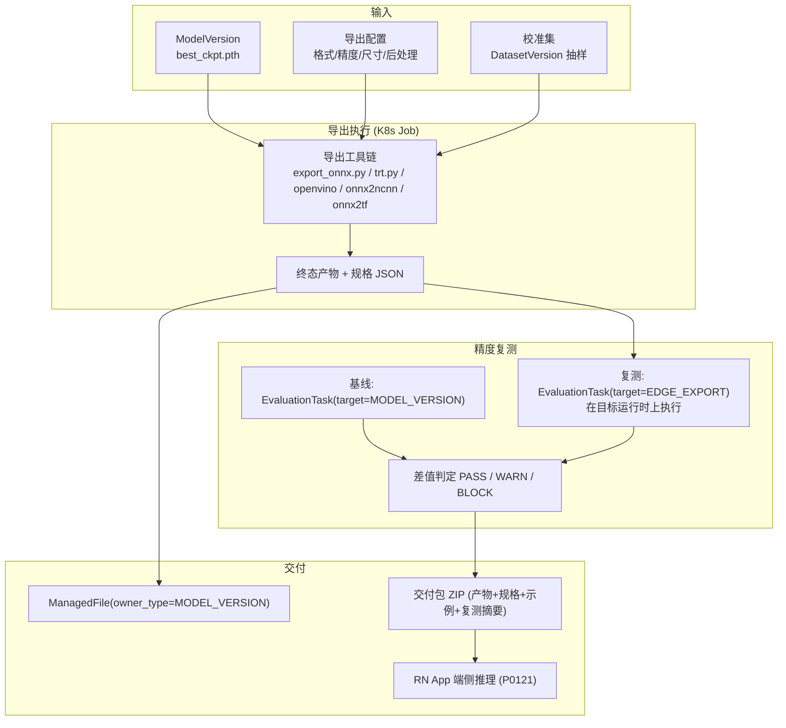
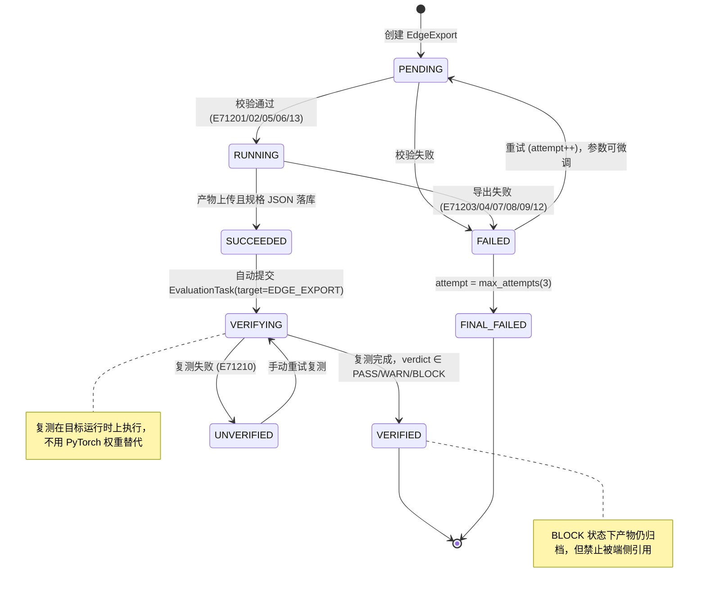
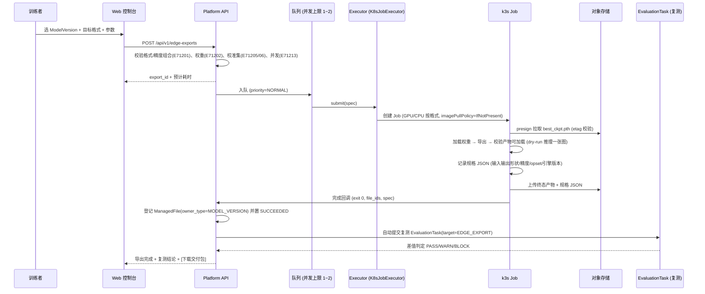
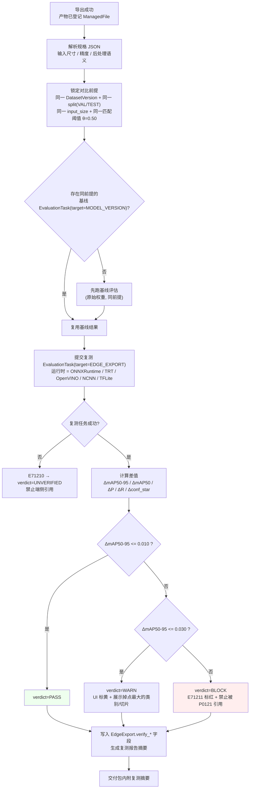
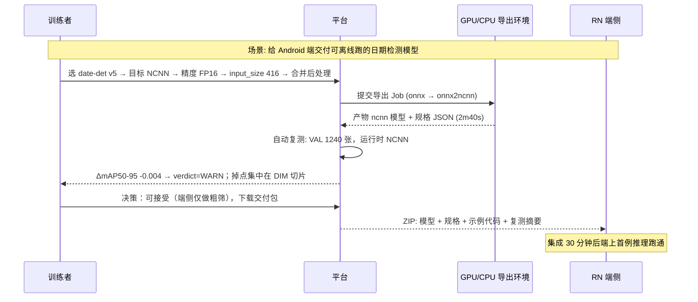

# PRD: P0112_端侧导出 (Edge Export)

| 属性 | 内容 |
| :--- | :--- |
| **文档编号** | P0112 |
| **项目名称** | 轻眸识刻 视觉检测模型训练基建 |
| **功能模块** | M07_部署推理 |
| **当前版本** | v1.0.0 |
| **文档状态** | Draft |
| **作者** | DeployW |
| **最后更新** | 2026-10-01 |

---

## 1. 全局说明

> [!IMPORTANT]
> **核心定位**: 把训练产出的 PyTorch 权重**转成能在边缘设备上跑的推理文件**，并且**证明它没变差**。导出不是"转换完就完事"：产物必须在一台真实运行时上复测、与原始模型在同一验证集上比指标，只有 `PASS` 的产物才允许被 RN App 端侧推理（P0121）引用。RN App 的离线推理能力依赖本模块的产物。

### 名词解释

*   **EdgeExport (端侧导出)**: 一次"模型版本 × 目标格式 × 参数"的导出执行单元（`edge_exports`）。
*   **YOLOX 原生产物**: `YOLOX_outputs/<experiment_name>/` 下的 `latest_ckpt.pth`（每 epoch）、`best_ckpt.pth`（AP50-95 提升时）、`epoch_<n>_ckpt.pth`（`save_history_ckpt` 开启）。导出源固定为 **`best_ckpt.pth`**。
*   **target_format**: 目标格式，`ONNX / TENSORRT / OPENVINO / NCNN / TFLITE`。其中 ONNX / TensorRT / OpenVINO 为 YOLOX **原生导出脚本**支持；NCNN / TFLite 由平台导出镜像内的 `onnx2ncnn` / `onnx2tf` 工具链产出。
*   **merge_postprocess**: 是否把 decode + NMS 合并进计算图。合并后输出即最终框（端上少写后处理代码），但打开会降低图层可分离性与部分后端优化空间。
*   **INT8 量化校准**: 用一批代表性图片统计激活分布以生成量化参数；校准集必须来自训练/验证分布，样本量不足会显著掉点。
*   **精度复测 (Re-verification)**: 导出产物在目标运行时上，用**同一 `DatasetVersion` 的同一 `VAL/TEST` 切分、同一 `input_size`、同一匹配阈值**重跑评估，与原始模型基线对比。复测**复用 `EvaluationTask`**，通过 `EvaluationTask.target` 区分来源。
*   **verdict**: 复测结论，`PASS`（可直接用）/ `WARN`（可用但需知悉掉点）/ `BLOCK`（超过阈值，禁止被端侧引用）。
*   **交付包 (Delivery Bundle)**: 产物文件 + 运行时示例代码 + 输入输出规格 + 复测报告摘要的 ZIP，供端侧集成方一次性拿走。

### 统一异常处理

| Code | 场景 | 处理策略 |
| :--- | :--- | :--- |
| `E71201` | 格式与参数组合不被支持（如 `NCNN + INT8`） | 提交时拒绝，给出该格式支持的精度集合 |
| `E71202` | 源权重缺失 / `ManagedFile.status != COMMITTED` | 拒绝导出："模型权重不可用：{file_id}" |
| `E71203` | 导出镜像缺失或引擎缺失（`trtexec` / `mo` / `openvino` / `onnx2ncnn` 不在 PATH） | 任务 `FAILED`，提示所需镜像与标签 |
| `E71204` | TensorRT 导出失败（GPU 不在位、驱动版本不匹配、workspace 不足） | `FAILED`，记录驱动/CUDA/TRT 版本三元组与最后 50 行日志 |
| `E71205` | INT8 校准集样本不足（< 100 张） | 拒绝提交，提示补充校准样本或改为 FP16 |
| `E71206` | 校准集类别体系与模型不一致 | 拒绝提交，列出差异类别 |
| `E71207` | 导出超时（看门狗，默认 30 分钟） | 平台判 `FAILED`，允许重试 |
| `E71208` | 产物上传失败（存储满 / 权限） | `FAILED` 保留本地产物至下次重试，`E71212` 时提示清理 |
| `E71209` | OP 不支持（自定义算子 / opset 过低 / 动态 shape 不可表示） | `FAILED`，给出不支持算子清单与建议 `onnx_opset` |
| `E71210` | 精度复测任务失败（`EvaluationTask` 失败） | 导出产物保留，`verdict=UNVERIFIED`，**不允许**被端侧引用 |
| `E71211` | 精度下降超阈值 | 产物归档但标 `WARN`/`BLOCK`；`BLOCK` 禁止被 P0121 引用 |
| `E71212` | 磁盘不足（导出中间产物 + 镜像） | 拒绝新导出；运行中的任务继续，可用 < 10% 升级告警 |
| `E71213` | 并发导出超限（同一 `ModelVersion` 同时 > 2 个导出） | 拒绝并提示当前进行中的导出 |
| `E71214` | 产物已被 GC，端侧仍请求下载 | 410，提示重新导出（导出可复现） |

---

## 2. 项目背景

### 背景 (Context)

线上服务（P0110）解决"有网时的推理"。但采集场景经常没有稳定网络：RN App 在仓库里离线拍摄，小程序在信号差的车间。端侧推理的好处是**零网络依赖 + 零传输成本 + 数据不出设备**（对客户的包装批次图尤其重要）。

端侧意味着**格式地狱**：Android 端要 NCNN/TFLite，iOS 要 CoreML/TFLite，工业相机盒子要 TensorRT，Intel 工控机要 OpenVINO。每个后端对算子支持、精度、输入尺寸都有自己的脾气。

### 问题陈述 (Problem Statement)

1.  **没有导出能力**: 训练产出是 `.pth`，端上跑不了；今天只能在本机写转换脚本，结果不可复现、无人记录参数。
2.  **精度没人验证**: 转换后掉点没人知道，端上"感觉还行"就发了，出事故才发现 `conf` 分布整体偏移。
3.  **参数靠口口相传**: 到底是 `input_size=416` 还是 `640`、要不要合并后处理、INT8 用哪批图校准，全在个人脑子里。
4.  **产物无处归档**: 导出的 `.onnx` 散落在各人电脑上，端侧集成分不清哪个是最新、对应哪个模型版本。
5.  **失败无诊断**: TRT 导出报错信息动辄几百行，非 GPU 工程师看不懂"是驱动不匹配还是 shape 不支持"。

### 目标与成功指标 (Goals & Success Metrics)

*   **北极星指标**: 被端侧引用的导出产物 **100%** 有 `PASS` 或明示的 `WARN` 复测结论（`UNVERIFIED` 引用数为 0）。
*   **次要指标**:
    *   单个导出任务（ONNX FP32）端到端 **< 5 分钟**；TensorRT FP16 **< 15 分钟**。
    *   复测自动完成率 **100%**（导出成功即自动触发，无需人工点）。
    *   FP16 相对原始模型 `mAP50-95` 掉点 **≤ 0.002**；INT8 掉点 **≤ 0.02**（超阈值即告警/阻断）。
    *   交付包下载到端侧跑通首个样例 **< 30 分钟**。

### 风险与规避 (Risks & Mitigation)

| 风险 | 影响 | 规避方案 |
| :--- | :--- | :--- |
| INT8 掉点严重 | 端上漏检，业务事故 | 校准集强制 ≥ 100 张且必须来自目标 `DatasetVersion`；复测阈值硬拦截（`E71211`） |
| TensorRT 产物与端侧驱动不匹配 | 换了台机器 engine 直接加载失败 | TRT 产物**必须记录构建三元组**（TRT 版本 / CUDA / 驱动）并在交付包中标"仅限相同环境"；同时提供 ONNX 作为兜底产物 |
| 合并后处理导致框全错 | 端上输出格式误读 | `merge_postprocess=true` 时交付包内附"输出张量语义说明 + 示例宿主代码"，复测必须走端上等价解码 |
| 导出占满 GPU 影响训练 | 训练排队 | 导出复用训练槽位但默认 `priority=NORMAL`，GPU 模式导出并发上限 1 |
| 权重是 AGPL 系框架产物 | 许可风险 | 训练后端固定 Apache-2.0 系（YOLOX），导出链路不使用 AGPL 组件 |
| 产物体积撑爆磁盘 | ImageFS 驱逐 Pod | 导出中间产物落 `emptyDir` 且限制 20GiB；导出结束后清理中间文件，只留终态产物 |

---

## 3. 价值模型

*   **方案**: 把"格式转换"做成**一等公民任务**，与训练/评估共用同一套执行与产物抽象：
    *   **导出**：`EdgeExport` 任务 → K8s Job（复用 Executor）→ 容器内完成转换 → 产物登记 `ManagedFile(owner_type=MODEL_VERSION)`。
    *   **复测**：导出成功即自动提交 `EvaluationTask(target=EDGE_EXPORT)`，在目标运行时上跑同一 `VAL/TEST` 切分，与 `EvaluationTask(target=MODEL_VERSION)` 基线比差值。
    *   **交付**：一键生成交付包（产物 + 规格说明 + 示例代码 + 复测摘要）。
*   **目标**: 端侧上线从"某人在自己电脑上转了一天、没人知道靠不靠谱"变成"5~15 分钟一条可复现、有精度背书的产物"。

---

## 4. 项目范围



### In Scope

1.  五种目标格式：`ONNX` / `TENSORRT` / `OPENVINO` / `NCNN` / `TFLITE`。
2.  导出参数：输入尺寸、`FP32/FP16/INT8`、动态 batch、`simplify`、后处理合并、`onnx_opset`、TRT workspace。
3.  INT8 量化校准（校准集选择、样本量校验、校准报告）。
4.  产物归档为 `ManagedFile(owner_type=MODEL_VERSION)` + 导出规格 JSON。
5.  **精度复测**：自动触发、目标运行时执行、与基线对比、`PASS/WARN/BLOCK` 判定。
6.  交付包生成（产物 + 输入输出规格 + 示例宿主代码 + 复测摘要）。
7.  失败诊断（不支持算子清单、环境三元组、最后日志）。

### Out of Scope

*   **端侧 SDK 与 App 代码**：交付包只给示例代码片段，RN/小程序集成见 P0121/P0120。
*   **模型裁剪 / 蒸馏 / 换 backbone**：导出只做格式转换，不改结构（降点靠量化与输入尺寸）。
*   **训练后量化感知训练 (QAT)**：第一版只做 PTQ（训练后量化）。
*   **异构加速（NPU/VPU）**：不做 Hailo/RKNN 等专用编译。
*   **OCR 模型导出**：仅检测模型；OCR 为第二阶段独立定义。
*   **自动选择"最优格式"**：由人决策，平台只给对比参考。

---

## 5. 业务流程

### 5.1 导出状态机



### 5.2 导出执行时序



### 5.3 精度复测流程（导出后自动执行）



### 5.4 格式选择决策（人决策，平台给参考）

| 端侧目标 | 首选格式 | 备选 | 说明 |
| :--- | :--- | :--- | :--- |
| Android RN App（离线推理） | `NCNN` | `TFLITE` | NCNN 体积小、ARM CPU 上快；TFLite 生态与 RN 绑定更顺 |
| iOS RN App | `TFLITE` | `ONNX` | 端上以浮点/半精度为主，避免 INT8 兼容性差异 |
| Jetson / 工控 GPU 盒子 | `TENSORRT` | `ONNX` | 必须与设备驱动匹配；同时导出 ONNX 兜底 |
| Intel 工控机 / NUC | `OPENVINO` | `ONNX` | IR + CPU/GPU 插件 |
| 语言不确定 / 服务侧复用 | `ONNX` | — | 通用中间格式，也是其余格式的转换起点 |

---

## 6. 用户分析

### 6.1 用户画像 (User Personas)

*   **训练者 (TRAINER)**: 迭代模型并负责给端侧交付可用产物。诉求"点一下导出、告诉我掉不掉点、给我一个能直接给客户的文件"；痛点是转换脚本各自为政、掉点无人验证。
*   **端侧开发 (RN 工程师)**: 把产物集成进 App。诉求"输入输出规格明确、有示例代码、别让我猜张量含义"；痛点是拿到裸 `.onnx` 不知道前处理要不要归一化、输出是不是已经 NMS 过。
*   **管理员 (ADMIN)**: 关心磁盘与 GPU 占用。诉求"导出别把训练卡死、别把磁盘塞满"；痛点是导出中间产物到处乱丢。

### 6.2 用户链路图 (User Journey Map)



---

## 7. 功能需求

### M07.F01 导出任务创建与格式选择 (Export Submission)

*   **用户故事**: 作为训练者，我希望选定目标格式与参数就能创建一个导出任务，以便不用在本机写转换脚本、参数集中留档。

*   **前置条件**: 角色 ∈ `ADMIN`/`TRAINER`；`ModelVersion` 的 `best_ckpt.pth` `status = COMMITTED`；格式与精度组合被支持（见 8.2）；同一 `ModelVersion` 并发导出 ≤ 2。
*   **主流程**: 1) 选择 `ModelVersion`；2) 选择 `target_format`；3) 配置 `input_size`（默认 640×640）、`precision`、`dynamic_batch`、`simplify`、`merge_postprocess`、`onnx_opset`（默认 11）、TRT `max_workspace_gib`；4) INT8 时选择校准集 `DatasetVersion` 与抽样数；5) 系统校验组合与校准集（`E71201/E71205/E71206/E71213`）并给出预计耗时；6) 落库 `edge_exports(PENDING)` 并触发执行（M07.F02）；7) 写 `AuditLog(EDGE_EXPORT_CREATE)`。
*   **后置条件**: 任务入队；列表可见参数与状态。

*   **验收标准**:

    ```gherkin
    场景: 创建 ONNX 导出
      Given ModelVersion "date-det v5" 的 best_ckpt.pth 为 COMMITTED
      When 训练者以 target_format=ONNX、precision=FP16、input_size=640x640 提交导出
      Then 创建 edge_exports(status=PENDING) 并给出预计耗时
      And 队列位置与并发占用在列表可见

    场景: 不支持的组合被拒
      Given 用户选择 target_format=NCNN、precision=INT8
      When 提交导出
      Then 返回 E71201，提示"NCNN 仅支持 FP32/FP16"，并高亮可用精度

    场景: INT8 校准集不足
      Given 用户选择 precision=INT8 且校准集仅 42 张
      When 提交导出
      Then 返回 E71205，提示"校准集至少 100 张"，并给出可选的数据集版本
    ```

*   **边界情况与异常处理**

    | 场景 | 处理 |
    | :--- | :--- |
    | 同一版本重复提交相同参数 | 幂等：返回已有 `export_id`，并提示"参数相同，可直接复用产物" |
    | 输入尺寸非 32 倍数 | 拒绝 `E71201`，提示最近的两个合法值 |
    | 选择 `dynamic_batch=true` 且目标为 TensorRT | 允许，但提示 TRT 需 `--minShapes/--optShapes/--maxShapes`，且端上 profile 必须匹配 |
    | 并发导出已达上限 | 返回 `E71213` 与进行中导出列表，可选"排队等待" |
    | 磁盘可用 < 20GiB | 拒绝 `E71212`，提示清理历史导出中间产物 |

### M07.F02 导出执行与产物归档 (Export Execution & Archiving)

*   **用户故事**: 作为训练者，我希望导出过程自动完成并产出可追溯的文件，以便知道每份产物对应哪个模型版本、用什么参数生成的。

*   **前置条件**: `EdgeExport.status = PENDING` 且已通过校验。
*   **主流程**: 1) `Executor.submit` 提交 K8s Job（镜像按格式选择：ONNX/TRT 用 GPU 镜像，OpenVINO/NCNN/TFLite 可用 CPU 镜像）；2) 容器内按 8.3 的工具链执行转换；3) 转换后做 **dry-run 校验**：用目标运行时加载产物并对一张样例图推理，验证输出形状与框数合理；4) 生成规格 JSON（输入/输出张量形状与语义、精度、opset、引擎版本、是否合并后处理）；5) 上传终态产物与规格 JSON；6) 平台登记 `ManagedFile(owner_type=MODEL_VERSION, owner_id=model_version_id)` 并置 `SUCCEEDED`；7) 自动触发复测（M07.F04）。
*   **后置条件**: 产物可下载；`EdgeExport` 带 `output_file_id`、`output_size_bytes`、`duration_ms`、`engine_version`。

*   **验收标准**:

    ```gherkin
    场景: 导出 ONNX 并归档
      Given 一个 PENDING 的 ONNX FP32 导出
      When 执行完成
      Then 产物登记为 ManagedFile(owner_type=MODEL_VERSION)
      And 规格 JSON 含输入 [1,3,640,640]、输出语义与 opset=11
      And dry-run 用 onnxruntime 加载并成功推理 1 张样例图

    场景: 产物不可加载即判失败
      Given 导出过程生成了损坏的 .onnx
      When dry-run 加载抛异常
      Then 任务置 FAILED，error_code=E71209，附不支持算子清单与最后 50 行日志
      And 不登记任何 ManagedFile
    ```

*   **边界情况与异常处理**

    | 场景 | 处理 |
    | :--- | :--- |
    | 导出耗时超 30 分钟 | 看门狗判 `FAILED`（`E71207`），保留容器日志与中间文件 24h |
    | 产物上传中断（网络抖动） | 支持断点续传重试一次；仍失败置 `E71208` 并在本机保留产物 |
    | 同一产物重复导出 | 产物按 `(model_version_id, format, precision, params_hash)` 指纹去重，命中则复用并提示 |
    | 权重 etag 与入库不一致 | 中止导出 `E71202`，提示重新固化 `ModelVersion` |
    | TRT 产物跨机不可用 | 记录构建三元组（TRT/CUDA/驱动）并在交付包与 UI 标"仅限相同环境" |

### M07.F03 INT8 量化校准 (INT8 Calibration)

*   **用户故事**: 作为训练者，我希望 INT8 导出能有明确可追溯的校准流程，以便在体积与速度收益和精度损失之间做出有依据的取舍。

*   **前置条件**: `precision = INT8`；指定 `calib_dataset_version_id` 且该校验集在目标 `DatasetVersion` 内样本数 ≥ 100（`E71205`）；校准集类别体系与模型一致（`E71206`）。
*   **主流程**: 1) 从指定 `DatasetVersion` 按 `split ∈ {TRAIN, VAL}` 分层随机抽取 `calib_sample_count`（默认 300，上限 1000）；2) 抽取覆盖策略：按 `SKU / 光照` 等切片属性分层，尽量与线上分布一致；3) 生成校准清单（JSONL，登记为 `ManagedFile`，可复现）；4) 导出容器内使用校准清单统计激活分布（min-max / entropy 二选一，默认 entropy）；5) 生成量化参数并写入产物规格（含 `calib_dataset_version_id`、`calib_sample_count`、`calib_method`、`calib_manifest_hash`）；6) 复测时若 INT8 掉点超阈值，UI 直接给出"扩大校准集 / 换方法 / 退 FP16"的建议。
*   **后置条件**: 产物规格中校准信息可追溯，任何一次 INT8 导出都能被复现。

*   **验收标准**:

    ```gherkin
    场景: INT8 导出并记录校准信息
      Given 校准集选定于 "date-2026Q3 v3" 的 VAL 切分，抽 300 张，方法 entropy
      When 导出完成
      Then 规格 JSON 含 calib_dataset_version_id / calib_sample_count=300 / calib_method=entropy
      And 校准清单 JSONL 登记为 ManagedFile（可复算）

    场景: 校准不掉点则 PASS
      Given 基线 mAP50-95 = 0.812
      When INT8 复测得 0.803（Δ = -0.009）
      Then verdict=PASS，交付包标注 INT8 量化参数与校准来源
    ```

*   **边界情况与异常处理**

    | 场景 | 处理 |
    | :--- | :--- |
    | 校准集含大量空图/损坏图 | 预检剔除并把剔除数写入校准报告，剔除后不足 100 张则 `E71205` |
    | 校准集与训练分布差异大（全部亮光图） | UI 提示"校准集光照分布与 TRAIN 差异显著"，建议重选（不阻断） |
    | INT8 掉点 > 0.03 | `BLOCK`（`E71211`），建议改 FP16 或扩大校准集 |
    | 同一模型不同校准集结果差异大 | 允许并存为两个 `EdgeExport`，UI 并排对比复测结论 |

### M07.F04 导出后精度复测与对比 (Post-Export Re-verification)

*   **用户故事**: 作为训练者，我希望导出后自动在目标运行时上复测并与原始模型比指标，以便确认这份产物真的能上端，而不是"看着差不多"。

*   **前置条件**: `EdgeExport.status = SUCCEEDED` 且产物可加载；存在可复用的基线评估或可触发基线评估（`EvaluationTask.target=MODEL_VERSION`，同 `DatasetVersion` + 同 `split` + 同 `input_size` + 同匹配阈值）。
*   **主流程**: 1) 解析产物规格，锁定对比前提；2) 查找同前提基线，无则先跑基线（原始权重，PyTorch 运行时）；3) 提交 `EvaluationTask(target=EDGE_EXPORT)`，**在目标运行时上执行**（ONNXRuntime / TensorRT / OpenVINO Runtime / NCNN / TFLite interpreter），保证复测反映端上真实行为；4) 计算 `ΔmAP50-95 / ΔmAP50 / ΔP / ΔR / Δconf_star`，并输出掉点集中在哪些类别与切片（复用 P0086 的切片能力）；5) 按 5.3 阈值判定 `PASS/WARN/BLOCK`；6) 复测摘要写入 `EdgeExport.verify_delta_json`，报告链接指向 `EvaluationTask` 详情；7) `BLOCK` 时禁止被 P0121/R0121 引用（RN 端侧）。
*   **后置条件**: `verdict` 落库；导出列表与交付包均展示结论。

*   **验收标准**:

    ```gherkin
    场景: FP16 导出复测 PASS
      Given 基线（原始模型，VAL 1240 张，input_size=640）mAP50-95 = 0.812
      When ONNX FP16 产物在同前提复测得 0.811
      Then Δ = -0.001 <= 0.010，verdict=PASS
      And 交付包内附含基线与复测两栏的对比摘要

    场景: INT8 掉点超阈值被阻断
      Given 基线 mAP50-95 = 0.812
      When INT8 复测得 0.771（Δ = -0.041 > 0.030）
      Then verdict=BLOCK，error_code=E71211，列表标红
      And 该产物不可被端侧引用；UI 建议"改 FP16 或扩大校准集"

    场景: 复测必须在目标运行时执行
      Given 导出为 TENSORRT
      When 提交复测
      Then 复测任务使用 TensorRT 运行时加载 engine
      And 规格 JSON 中不存在"用 PyTorch 权重代替"的路径
    ```

*   **边界情况与异常处理**

    | 场景 | 处理 |
    | :--- | :--- |
    | 目标运行时在平台机器上不可用（如 NCNN 需 ARM） | 使用平台内置的对应 runtime 复用容器（x86 上 NCNN/TFLite 亦可运行，仅性能不代表端上）；**性能数字标注"不代表端上"**，精度仍有效 |
    | 基线评估与复测前提不一致（`input_size` 不同） | 拒绝对比并提示差异项；`input_size` 变化视为新基线，强制重跑 |
    | 复测任务失败 | `verdict=UNVERIFIED`（`E71210`），产物保留但**不可被端侧引用**，可手动重试 |
    | 复测结论与端上实测不符 | 交付包附"端上自测清单"，端侧须在目标机型复跑同一 VAL 子集并回填结果（P0121） |
    | 产物被 GC 后复测 | 复测依赖产物 `ManagedFile`，GC 跳过被 `edge_exports` 引用的文件 |

### M07.F05 导出失败与重试 (Failure & Retry)

*   **用户故事**: 作为训练者，我希望导出失败时能看懂原因并低成本重试，以便不用重新配一遍参数。

*   **前置条件**: `EdgeExport.status = FAILED` 且 `attempt < max_attempts(3)`。
*   **主流程**: 1) 失败时记录 `error_code`、`error_message`、最后 50 行日志（登记 `ManagedFile`）；2) UI 展示**诊断卡片**：错误码 + 人话解释 + 建议动作（如"TRT workspace 不足 → 调到 4GiB"）；3) 重试复用上次参数，允许就地微调（`attempt++`，不新建实体）；4) `attempt = 3` 置 `FINAL_FAILED` 并要求人工介入；5) 相同 `error_code` 连续 3 次失败时提示"环境问题"，附构建三元组。
*   **后置条件**: 失败原因可追溯；重试不产生重复产物。

*   **验收标准**:

    ```gherkin
    场景: TRT 导出失败并给出可执行建议
      Given 导出 TensorRT 时 workspace 仅 512MiB，trtexec 报内存不足
      When 任务失败
      Then 列表显示 E71204 与建议"将 max_workspace_gib 提高到 4"
      And 用户点击 [按建议重试] 后 attempt=2 且参数已更新

    场景: 三次失败后停止自动重试
      Given 同一导出连续失败 3 次
      When 第 3 次失败
      Then 状态为 FINAL_FAILED，不再自动重试
      And UI 提示"疑似环境问题"并展示 TRT/CUDA/驱动三元组
    ```

*   **边界情况与异常处理**

    | 场景 | 处理 |
    | :--- | :--- |
    | 失败原因是环境（驱动不匹配） | 建议换镜像标签或改导出 ONNX；不消耗剩余 attempt 的"参数变更重试"另计 |
    | 失败后磁盘留有中间产物 | 保留 24h 便于排查，超期清理；被引用的产物不清理 |
    | 用户中途取消 | `CANCELED`，不计入失败率，可重新提交 |
    | 同一报错在多个版本复现 | 平台汇总为"已知问题"，在 UI 顶部给出一次性说明 |

### M07.F06 端侧适配说明与交付包 (Edge Adaptation & Delivery Bundle)

*   **用户故事**: 作为端侧开发，我希望拿到产物时同时拿到输入输出规格与示例代码，以便 30 分钟内跑通第一个样例。

*   **前置条件**: `verdict ∈ {PASS, WARN}`（`BLOCK`/`UNVERIFIED` 不允许生成"可交付"包，仅允许下载诊断包）。
*   **主流程**: 1) 交付包内容：产物文件、`spec.json`（输入/输出张量语义、归一化方式、颜色通道顺序、是否合并后处理、NMS 参数）、`README.md`（目标平台、运行时版本、构建三元组）、`samples/`（Python/C++/Kotlin 或 Swift 的最小推理示例）、`verify_summary.json`（基线与复测对比）；2) 打包为 ZIP（≤ 2GB），登记 `ManagedFile(owner_type=MODEL_VERSION)`；3) 下载链接有效期 24 小时；4) 端侧集成后在目标机型复跑指定 VAL 子集（默认 200 张）并回填结果，平台记录"端上实测"与复测结论的差异。
*   **后置条件**: 交付包可下载；端上回填结果与复测结论并列展示。

*   **验收标准**:

    ```gherkin
    场景: 生成交付包
      Given 一个 verdict=PASS 的 NCNN 导出
      When 用户点击 [生成交付包]
      Then ZIP 内含 模型文件、spec.json、README.md、samples/、verify_summary.json
      And spec.json 明确写出输入归一化（/255）、通道顺序（RGB）、输出是否已含 NMS

    场景: BLOCK 产物不可交付
      Given 一个 verdict=BLOCK 的 INT8 导出
      When 用户点击 [生成交付包]
      Then 按钮禁用，提示"精度未达标，仅可下载诊断包"
    ```

*   **边界情况与异常处理**

    | 场景 | 处理 |
    | :--- | :--- |
    | 端上实测与复测结论差异 > 0.02 | UI 标"端上差异显著"，提示检查设备预处理实现是否与 `spec.json` 一致 |
    | 交付包被二次分发 | 包内含"来源版本 + export_id + 生成时间"水印字段，可追溯 |
    | 产物被 GC 后仍要交付包 | 提示"产物已回收"，可一键重新导出（参数完整保留，结果可复现） |
    | 端侧目标是"TFLite + INT8" | 交付包额外附 INT8 校准信息与量化参数，便于端侧解释掉点 |

---

## 8. 技术架构与数据模型

### 8.1 数据实体

#### `edge_exports`

| 字段名 | 类型 | 必填 | 说明 |
| :--- | :--- | :--- | :--- |
| `id` | UUID | Y | PK |
| `model_version_id` | UUID | Y | FK → `model_versions.id`（源为 `best_ckpt.pth`） |
| `target_format` | Enum | Y | `ONNX / TENSORRT / OPENVINO / NCNN / TFLITE` |
| `input_size` | String(16) | Y | `HxW`，默认 `640x640`，须为 32 倍数 |
| `precision` | Enum | Y | `FP32 / FP16 / INT8` |
| `dynamic_batch` | Boolean | Y | 默认 false |
| `simplify` | Boolean | Y | ONNX onnxsim，默认 true |
| `merge_postprocess` | Boolean | Y | 是否把 decode+NMS 合并进图，默认 false |
| `onnx_opset` | Int | N | 默认 11（TFLite/NCNN 链路常需 11~13） |
| `trt_max_workspace_gib` | Numeric(3,1) | N | 仅 TENSORRT，默认 4.0 |
| `calib_dataset_version_id` | UUID | N | INT8 必填，FK → `dataset_versions.id` |
| `calib_sample_count` | Int | N | 默认 300，上限 1000，下限 100 |
| `calib_method` | Enum | N | `ENTROPY / MINMAX`，默认 `ENTROPY` |
| `calib_manifest_file_id` | UUID | N | FK → `managed_files.id`（校准清单 JSONL，可复现） |
| `params_hash` | String(64) | Y | 以上参数指纹，用于产物去重与幂等 |
| `status` | Enum | Y | `PENDING / RUNNING / SUCCEEDED / FAILED / FINAL_FAILED / CANCELED / VERIFYING / VERIFIED / UNVERIFIED` |
| `attempt` | Int | Y | 从 1 开始，最大 3 |
| `output_file_id` | UUID | N | FK → `managed_files.id`（**`owner_type=MODEL_VERSION`**） |
| `output_size_bytes` | BigInt | N | 产物大小 |
| `spec_json` | JSONB | N | 输入/输出张量语义、精度、opset、是否合并后处理、NMS 参数 |
| `engine_version_json` | JSONB | N | 构建三元组：`{trt, cuda, driver}` 或 `{openvino, onnxruntime, tflite, ncnn}` |
| `duration_ms` | BigInt | N | 导出耗时 |
| `log_file_id` | UUID | N | FK → `managed_files.id`（最后 50 行 + 完整日志） |
| `error_code` / `error_message` | String(16) / Text | N | |
| `baseline_evaluation_task_id` | UUID | N | FK → `evaluation_tasks.id`（`target=MODEL_VERSION`） |
| `verify_evaluation_task_id` | UUID | N | FK → `evaluation_tasks.id`（`target=EDGE_EXPORT`） |
| `verify_delta_json` | JSONB | N | `{delta_map50_95, delta_map50, delta_p, delta_r, conf_star, worst_slices[]}` |
| `verdict` | Enum | N | `PASS / WARN / BLOCK / UNVERIFIED` |
| `bundle_file_id` | UUID | N | FK → `managed_files.id`（交付包 ZIP） |
| `device_spot_check_json` | JSONB | N | 端上实测回填：`{device_model, sample_count, map50_95, delta_vs_verify}` |
| `created_by` | UUID | Y | FK → `users.id` |
| `created_at` / `updated_at` / `deleted_at` | timestamptz | Y | 通用字段 |

**Index**: `(model_version_id, target_format, precision)`；`(status)`；`UNIQUE(model_version_id, params_hash) WHERE deleted_at IS NULL`。

#### 跨模块字段新增（在 `EvaluationTask` 上）

| 字段 | 类型 | 说明 |
| :--- | :--- | :--- |
| `target` | Enum | `MODEL_VERSION`（默认，评估原始权重）\| `EDGE_EXPORT`（评估导出产物） |

> `EdgeExport.verify_evaluation_task_id` 反向引用复测任务；**不新建表**。`target=EDGE_EXPORT` 时评估容器加载的运行时与文件来自 `edge_exports.output_file_id`，其余指标口径与 P0086 完全一致。

#### 复用实体

| 实体 | 复用方式 |
| :--- | :--- |
| `ManagedFile` | 导出产物 / 校准清单 / 导出日志 / 交付包登记为 **`owner_type=MODEL_VERSION`**；源权重 `best_ckpt.pth` 自身是训练产物，`owner_type=TRAIN_TASK`（P0085 登记），本模块只引用不重登记 |
| `EvaluationTask` | 基线与复测均复用，靠 `target` 区分（见上表） |
| `EnvironmentImage` | 导出镜像（`purpose=EXPORT`），固定 digest；TRT 镜像固定 torch/TRT/CUDA 版本三元组 |

**产物归属逐项口径**——判定只有一句：**归属跟「谁创建了它、谁是它的生命周期主体」走，不跟「它出现在哪个流程环节」走**。一物一条 `ManagedFile`，别处一律用 `managed_file_id` 引用，不重复登记:

| 文件 | `owner_type` / `owner_id` | 依据 |
| :--- | :--- | :--- |
| `model.onnx` / `model.engine` / OpenVINO IR 目录 / `*.ncnn.*` / `*.tflite` / 交付包 ZIP | `MODEL_VERSION` / `model_version_id` | **可被推理端加载的产物**，`ModelService` 与 `EdgeExport` 引用 |
| `export_manifest.json`、各格式转换校验结果、校准清单 JSONL、导出日志 | `PIPELINE_STAGE_RUN` / 导出阶段运行 id | 导出**过程**的清单与报告，非可部署物 |
| 复测的指标报告（`report.json` / 混淆矩阵 / 曲线，P0086 口径） | `EVALUATION_TASK` / `verify_evaluation_task_id` | 复测本身就是一次 `EvaluationTask(target=EDGE_EXPORT)`，其产物按评估任务登记（与 P0086 同款） |
| 源权重 `best_ckpt.pth` | `TRAIN_TASK` / `train_task_id` | 训练产物，P0085 登记一次，本模块只校验 `COMMITTED` 与 etag |
| `TrainNode` / 槽位 | GPU 格式导出占用槽位（并发上限 1），CPU 格式不占槽位 |
| `DatasetVersion` | 校准集与复测集来源，只读引用 |

### 8.2 格式与参数支持矩阵

| 格式 | 支持精度 | 输入尺寸 | 需要 GPU | 后处理合并 | 备注 |
| :--- | :--- | :--- | :--- | :--- | :--- |
| `ONNX` | FP32 / FP16 | 任意 32 倍数 | 否 | 支持 | 通用中间格式，其余格式均以 ONNX 为起点 |
| `TENSORRT` | FP32 / FP16 / INT8 | 任意 32 倍数 | **是** | 支持 | engine 与 TRT/CUDA/驱动强绑定，必须记录三元组 |
| `OPENVINO` | FP32 / FP16 | 任意 32 倍数 | 否 | 支持 | 需 `mo` / `openvino` 工具链 |
| `NCNN` | FP32 / FP16 | 任意 32 倍数 | 否 | 支持 | 经 `onnx2ncnn`；**不支持 INT8**（`E71201`） |
| `TFLITE` | FP32 / FP16 / INT8 | 任意 32 倍数 | 否 | 支持 | 经 `onnx2tf`，INT8 走 TFLite 全整数量化 |

### 8.3 格式对比表（同一模型：YOLOX-S 单类日期检测，输入 640×640）

> 以下为**量级参考**（模型 `best_ckpt.pth` 约 9M 参数），用于选型；**真实数字以导出后复测为准**，且性能依赖目标设备。R 列在平台内固定展示此表并标注"参考值"。

| 格式 | 典型适用端 | 精度（相对 FP32 原模型） | 推理速度（量级参考） | 文件大小（量级参考） |
| :--- | :--- | :--- | :--- | :--- |
| `ONNX` FP32 | 通用：服务侧 / x86 / 有 ONNXRuntime 的端 | 基准（Δ ≈ 0，容差 1e-4） | 1×（CPU 慢于 PyTorch-CUDA；GPU EP 相近） | ~36MB |
| `ONNX` FP16 | 同上，追求体积与 GPU 速度 | ΔmAP50-95 **≤ 0.002** | 1.2~1.6×（GPU EP） | ~18MB |
| `TENSORRT` FP16 | Jetson / 工控 GPU 盒子 | ΔmAP50-95 **≤ 0.002** | **3~5×**（相对 ONNX FP32 CPU；GPU 上最快） | ~20~30MB（含 kernel 缓存） |
| `TENSORRT` INT8 | 同上，极限吞吐 | ΔmAP50-95 **≤ 0.02**（需校准） | **6~10×** | ~10~15MB |
| `OPENVINO` FP16 | Intel 工控机 / NUC | ΔmAP50-95 **≤ 0.002** | 2~3×（Intel CPU/GPU） | ~18MB |
| `NCNN` FP16 | Android RN App（离线） | ΔmAP50-95 **≤ 0.005** | 2~4×（ARM CPU） | ~18MB |
| `TFLITE` FP16 | iOS / Android | ΔmAP50-95 **≤ 0.005** | 1.5~3×（ARM，GPU delegate 更快） | ~18MB |
| `TFLITE` INT8 | 低端 Android / 极致体积 | ΔmAP50-95 **≤ 0.02**（需校准） | 3~6× | ~9MB |

**结论性指引**: 端侧首选 FP16 档（体积减半、速度提升明显、掉点可忽略）；INT8 只在端侧算力/存储确实吃紧时使用，且必须看复测结论与校准集来源。

### 8.4 INT8 阈值与判定

| 指标 | PASS | WARN | BLOCK |
| :--- | :--- | :--- | :--- |
| `ΔmAP50-95` | ≤ 0.010 | 0.010 < Δ ≤ 0.030 | > 0.030 |
| `ΔmAP50` | ≤ 0.010 | 0.010 < Δ ≤ 0.030 | > 0.030 |
| 单切片 `ΔmAP50-95` | ≥ -0.03 | -0.08 ~ -0.03 | < -0.08 |

> 任一项落入更差档位即取更差档。`WARN` 允许交付但必须在交付包与 UI 双处标注；`BLOCK` 禁止被端侧引用，也不允许生成"可交付"包。

### 8.5 复测前提锁定（可比性）

| 前提项 | 要求 | 不一致时 |
| :--- | :--- | :--- |
| `dataset_version_id` | 与基线相同 | 拒绝对比，要求重选 |
| `split` | 与基线相同（`VAL` 或 `TEST`） | 拒绝对比 |
| `input_size` | 与导出 `input_size` 一致（非方形输入时报"纵横比映射差异"） | 视为新基线，强制重跑基线 |
| 匹配阈值 `θ` | 0.50（COCO 口径 mAP50-95 序列不变） | 不可比 |
| `metric_engine_version` | 与基线一致 | 禁止差值，只展示绝对值 |

---

## 9. UI/UX 规格说明

### 9.1 导出向导

```text
+--------------------------------------------------------------------------------+
|  端侧导出                                            [✕]                        |
+--------------------------------------------------------------------------------+
|  模型版本 *  [date-det v5 (mAP50-95 0.812) ▾]                                   |
|                                                                                 |
|  目标格式 *                                                                     |
|   ┌──────────┐ ┌──────────┐ ┌──────────┐ ┌──────────┐ ┌──────────┐             |
|   │  ONNX    │ │TensorRT  │ │OpenVINO  │ │  NCNN ◉  │ │ TFLite   │             |
|   │ 通用中间 │ │ Jetson   │ │ Intel    │ │ Android  │ │ iOS/And  │             |
|   └──────────┘ └──────────┘ └──────────┘ └──────────┘ └──────────┘             |
|                                                                                 |
|  输入尺寸 [640x640▾]   精度 [FP16 ▾]  (NCNN 支持 FP32/FP16)                     |
|  [x] simplify   [ ] 动态 batch   [x] 合并后处理(decode+NMS)                      |
|  onnx_opset [11▾]                                                                |
|                                                                                 |
|  ── 校准（INT8 时必填）──────────────────────────────────────────────            |
|  校准集 [date-2026Q3 v3 (VAL) ▾]   抽样 300 张   方法 [entropy▾]                 |
|                                                                                 |
|  ⚠ 预计耗时 3~6 分钟；导出后自动在 NCNN 运行时上复测 VAL 1240 张并对比基线。      |
+--------------------------------------------------------------------------------+
|                                    [取消]   [开始导出]                          |
+--------------------------------------------------------------------------------+
```

### 9.2 导出列表与复测结论

```text
+--------------------------------------------------------------------------------+
|  端侧导出                                              [+ 新建导出]              |
+--------------------------------------------------------------------------------+
|  版本   格式/精度      尺寸   后处理  状态        复测 ΔmAP50-95   结论          |
|  v5     NCNN/FP16     640    合并    ✅ VERIFIED  -0.004          ⚠ WARN       |
|  v5     ONNX/FP32     640    分离    ✅ VERIFIED  -0.000          ✅ PASS       |
|  v5     TFLITE/INT8   416    合并    ✅ VERIFIED  -0.041          ⛔ BLOCK      |
|  v4     TENSORRT/FP16 640    分离    ⏳ VERIFYING  —               —            |
|  v4     OPENVINO/FP16 640    合并    ▲ FAILED E71203  —            —  [诊断]   |
+--------------------------------------------------------------------------------+
|  复测前提: date-2026Q3 v3 (VAL 1240) | input_size=640 | θ=0.50 | engine v1.0.3       |
+--------------------------------------------------------------------------------+
```

### 9.3 复测对比详情

```text
+--------------------------------------------------------------------------------+
| ← 返回  export #ex-20261001-0007 (NCNN FP16, 640, 合并后处理)      [生成交付包]   |
+--------------------------------------------------------------------------------+
| 判定: ⚠ WARN  ΔmAP50-95 = -0.004 (阈值 0.010 内为 PASS，0.010~0.030 为 WARN)    |
+--------------------------------------------------------------------------------+
| 指标             基线(原模型)   复测(NCNN)    差值                              |
|   mAP50            0.961         0.958       ▼ -0.003                          |
|   mAP50-95         0.812         0.808       ▼ -0.004                          |
|   precision        0.938         0.935       ▼ -0.003                          |
|   recall           0.912         0.908       ▼ -0.004                          |
|   conf_star        0.341         0.352       ▲ +0.011                          |
+--------------------------------------------------------------------------------+
| 掉点最大切片:  DIM (210 张)  Δ -0.012   |  铝箔袋-B (240 张)  Δ -0.009           |
+--------------------------------------------------------------------------------+
| 产物: model.ncnn.bin (18.2MB)   spec.json   日志    [下载]  [生成交付包]        |
| 构建: ncnn 20240820 / onnx2ncnn 1.0  |  导出耗时 2m40s  |  参数指纹 7c9a…        |
+--------------------------------------------------------------------------------+
```

### 9.4 交互元素

| 元素 | 类型 | 状态 | 行为 |
| :--- | :--- | :--- | :--- |
| 格式卡片 | Card Select | Selected / Disabled(镜像缺失) | 切换后联动刷新支持的精度集合与预计耗时 |
| 精度选择 | Select | 受格式约束 | `NCNN` 时隐藏 `INT8` 并提示 `E71201` 原因 |
| 校准集选择 | DatasetPicker | 仅 INT8 显示 | 实时显示样本数与切片覆盖率，< 100 张禁用提交 |
| 导出进度 | Progress | Queued / Running / Done | 显示阶段（拉权重 / 转换 / dry-run / 上传） |
| 复测结论徽标 | Badge | PASS 绿 / WARN 黄 / BLOCK 红 / UNVERIFIED 灰 | hover 显示阈值口径与差值明细 |
| 生成交付包 | Button | Default / Disabled(BLOCK/UNVERIFIED) | 打包并给出 24h 下载链接 |
| 诊断 | Button | 仅 FAILED | 展开错误码、人话解释、建议动作与最后 50 行日志 |
| 端上实测回填 | Form | 仅交付包已下载 | 记录机型、样本数、实测 mAP50-95，与复测并列展示 |

---

## 10. 非功能性需求 (NFR)

*   **性能**: ONNX FP32 导出（640×640）**< 5 分钟**；TensorRT FP16 **< 15 分钟**；INT8 复测在 VAL 1240 张上 **< 6 分钟**；导出列表接口 P95 **< 200ms**；交付包打包（≤2GB）**< 3 分钟**。
*   **可复现性**: 产物必须可由 `(model_version_id, params_hash, 镜像 digest, 构建三元组)` 复现；`calib_manifest_hash` 保证 INT8 可复算；同参数重复导出返回同一 `EdgeExport`。
*   **可靠性**: 导出失败最多重试 3 次后 `FINAL_FAILED`；复测失败置 `UNVERIFIED` 且禁止端侧引用；导出中断后中间产物保留 24h。
*   **安全**: 导出限 `ADMIN`/`TRAINER`，`VIEWER` 只读；权重经 presign 读取（TTL ≤ 2h）；导出容器非 root、只读挂载、禁止 Docker socket；凡下载产物、生成交付包、端上回填均写 `AuditLog`。
*   **资源约束**: GPU 格式导出并发上限 **1**（复用训练槽位，`priority=NORMAL`）；CPU 格式不占槽位但并发 ≤ 2；导出中间产物每任务 ≤ 20GiB，结束后清理。
*   **兼容性**: 导出镜像固定 torch 版本（YOLOX 源码依赖 `torch.cuda.amp.GradScaler` 旧路径，**不得使用 latest**）；TensorRT 产物严格绑定构建三元组并在交付包声明；TFLite/NCNN 产物须通过 dry-run 加载校验。
*   **可观测性**: 指标 `edge_export_duration_seconds{format}`、`edge_export_failures_total{error_code}`、`edge_export_verify_delta{format}`、`edge_export_verdict_total{verdict}`、`edge_export_unverified_ratio`（北极星：应为 0）。

---

## 附录: 已确认的设计决策

| 决策项 | 结论 |
| :--- | :--- |
| 导出源 | 固定 `YOLOX_outputs/<experiment_name>/best_ckpt.pth`；不使用 `latest_ckpt.pth` 与 `epoch_<n>_ckpt.pth` |
| 目标格式 | `ONNX / TENSORRT / OPENVINO`（YOLOX 原生脚本）+ `NCNN / TFLITE`（平台镜像内 `onnx2ncnn` / `onnx2tf`） |
| 执行方式 | 复用 `Executor` 提交为一次性 K8s Job；导出不是常驻服务，不走 P0110 的 Deployment |
| 产物归属 | 可部署产物（onnx/engine/OpenVINO/NCNN/TFLite/交付包）→ `MODEL_VERSION`；导出过程清单与转换校验结果（含校准清单、导出日志）→ `PIPELINE_STAGE_RUN`；复测报告 → `EVALUATION_TASK`（`EvaluationTask(target=EDGE_EXPORT)`，归属跟实体走不跟环节走）。**一物一条记录，不新增 `owner_type` 枚举** |
| 复测复用评估 | 复用 `EvaluationTask`，新增字段 `target ∈ MODEL_VERSION \| EDGE_EXPORT`，`EdgeExport.verify_evaluation_task_id` 反向引用；**不新建表** |
| 复测运行时 | 必须在**目标运行时**（ONNXRuntime / TRT / OpenVINO / NCNN / TFLite）上执行，不用 PyTorch 权重代替 |
| 阈值 | `ΔmAP50-95`：≤0.010 PASS / ≤0.030 WARN / >0.030 BLOCK；单切片 < -0.08 直接 BLOCK |
| UNVERIFIED 语义 | 复测未完成或失败 ⇒ 禁止被端侧引用，产物仍归档可下载（诊断用） |
| INT8 门槛 | 校准集 ≥ 100 张、必须来自指定 `DatasetVersion`、记录清单 hash 与量化方法 |
| 后处理合并 | 默认关闭；开启时规格 JSON 必须写明输出张量语义，且复测走端上等价解码 |
| 环境约束 | 导出镜像固定 torch 版本（YOLOX 依赖已弃用的 `torch.cuda.amp.GradScaler` 路径），禁用 `latest` 标签 |
| 交付包 | 仅 `PASS`/`WARN` 可生成"可交付"包；`BLOCK`/`UNVERIFIED` 只能下载诊断包 |
| 错误码区间 | `E71201` - `E71214`（本模块 P0112 专属段） |

## 关联文档

*   **P0085_模型仓库与 Lineage**: `ModelVersion` 与 `best_ckpt.pth` 来源
*   **P0086_模型评估**: 复测复用的指标口径、切片能力与 `EvaluationTask` 定义（本模块新增 `target` 字段）
*   **P0087_断点续训与失败重试**: 导出继承的重试与 attempt 语义
*   **P0081_训练环境与镜像**: 导出镜像（`purpose=EXPORT`）与 torch/CUDA 固定版本约束
*   **P0080_计算节点与资源池**: GPU 槽位与导出的资源准入
*   **P0040_存储配置与桶绑定**: `ManagedFile` 登记与 presign
*   **P0041_数据集与版本**: 校准集与复测集来源
*   **P0110_模型服务发布**: 在线服务（与端侧导出并列的交付路径）
*   **P0111_在线试跑**: 端侧产物在端上跑通前的等价在线验证入口
*   **P0121_RN 客户端接入契约**: 端侧推理消费 `verdict ∈ {PASS, WARN}` 的产物；`BLOCK` 禁止引用

## Changelog

| 版本 | 日期 | 作者 | 变更说明 |
| :--- | :--- | :--- | :--- |
| v0.1.0-draft | 2026-10-01 | DeployW | 初稿创建 |
| v1.0.0 | 2026-10-01 | DeployW | 按共享契约定稿：五格式支持矩阵与对比表、INT8 校准门槛、`EvaluationTask.target` 复测判定、交付包与构建三元组约束 |
