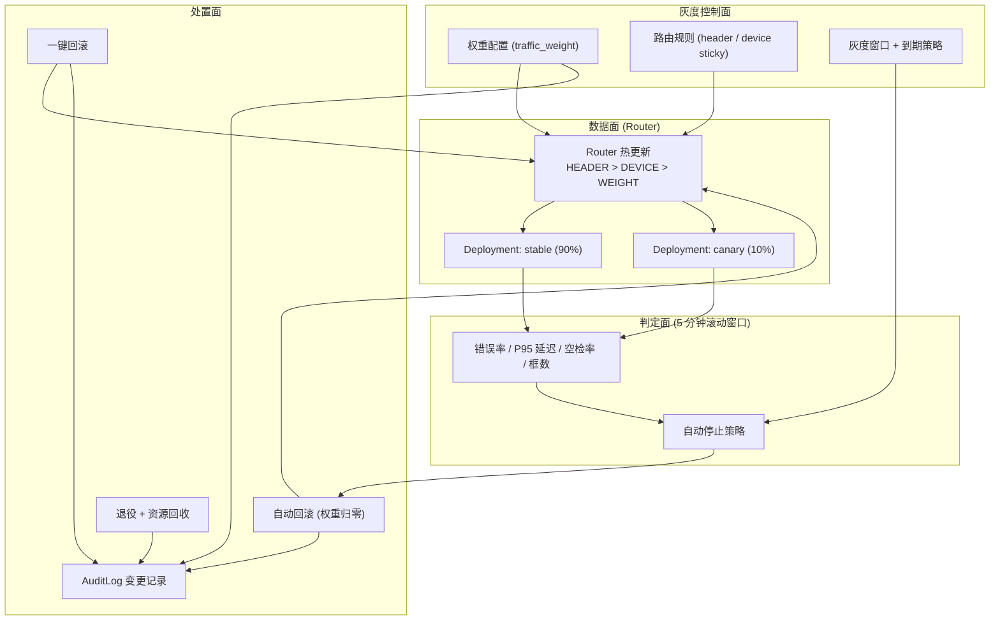
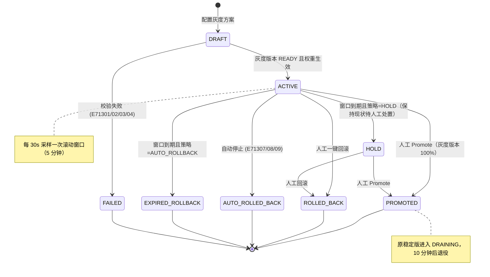
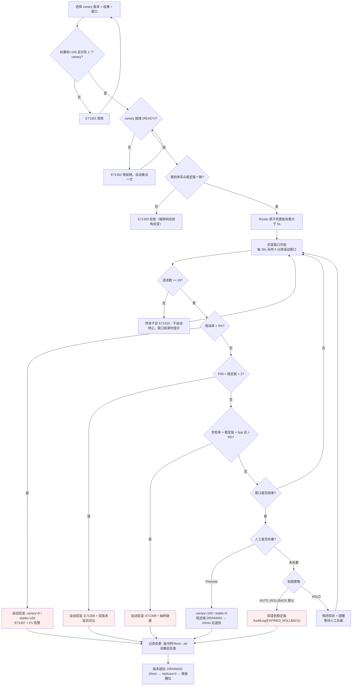
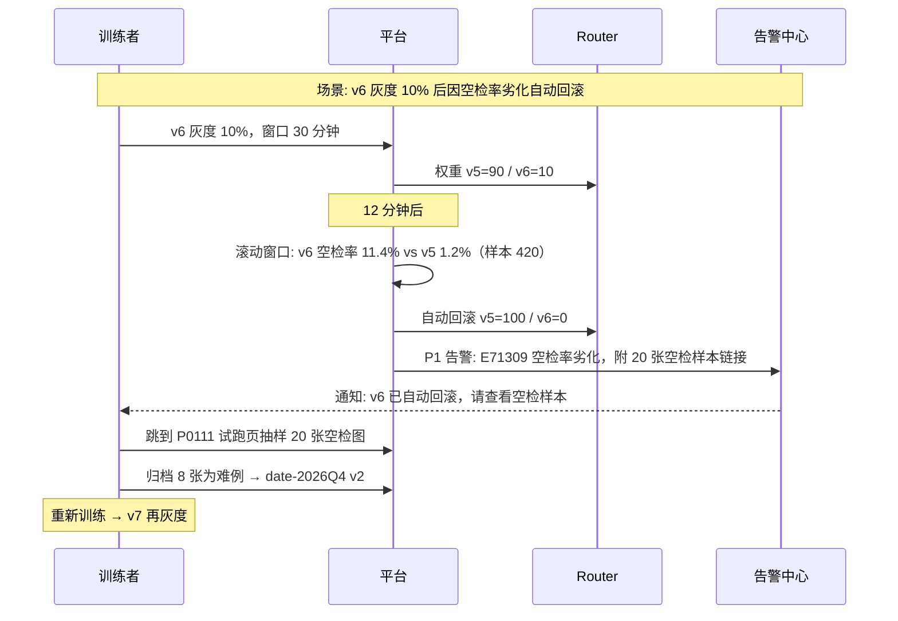
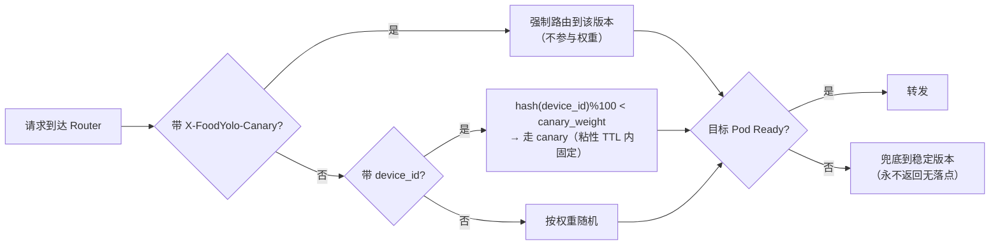

# PRD: P0113_版本灰度与回滚 (Canary Release & Rollback)

| 属性 | 内容 |
| :--- | :--- |
| **文档编号** | P0113 |
| **项目名称** | FoodYolo 视觉检测模型训练基建 |
| **功能模块** | M07_部署推理 |
| **当前版本** | v1.0.0 |
| **文档状态** | Draft |
| **作者** | DeployW |
| **最后更新** | 2026-10-01 |

---

## 1. 全局说明

> [!IMPORTANT]
> **核心定位**: 让新模型版本**带流量上线**，并让"上错了"能在**秒级撤回**。灰度不是拆分微服务，而是复用 P0110 已经建好的结构：每个版本一个 Deployment，Router 按权重 / 请求头 / 设备 ID 分流。**回滚 = 改一次 Router 配置**（热更新 < 5s），不重建 Pod、不重启服务、地址不变。

### 名词解释

*   **稳定版本 (Stable)**: 当前承担主流量（默认 100%）的 `ModelServiceVersion`，回滚的落点。
*   **灰度版本 (Canary)**: 新增的、只承接部分流量的版本。
*   **灰度窗口 (Canary Window)**: 灰度开始后的观察时长，默认 **30 分钟**（可配 10~1440）；窗口内系统持续自动判定，窗口结束时按 `on_window_expire` 处置。
*   **流量分配三档优先级**: `HEADER`（强制路由）> `DEVICE_STICKY`（设备粘性）> `WEIGHT`（按权重随机）。
*   **自动停止 (Auto-Stop)**: 灰度版本指标越过阈值时，平台自动把它的权重归零、流量全部退回稳定版本。
*   **一键回滚 (Rollback)**: 人工把稳定版本的权重恢复到 100%、灰度版本置 0 并进入 `DRAINING`。
*   **DRAINING**: 已不接新流量但 Pod 仍在的状态，保留用于排查（日志、`/metrics`、复现问题）。
*   **退役 (Retire)**: `DRAINING` 超时后缩容到 0 并释放 GPU 槽位；记录与统计保留。
*   **滚动窗口 (Rolling Window)**: 内存中维护的 **5 分钟**滑动统计，用于自动停止判定；落库统计仍是小时粒度（`ServiceStat`）。
*   **空检率 (Empty Ratio)**: 推理成功但 0 个框的请求占比，本项目**最重要的业务指标**（漏识别直接对应产线漏检）。

### 统一异常处理

| Code | 场景 | 处理策略 |
| :--- | :--- | :--- |
| `E71301` | 权重配置非法（enabled 之和 ≠ 100 / 灰度版本权重为 0 / 同时灰度 > 1 个版本） | 拒绝保存，回显权重明细与合法范围 |
| `E71302` | 灰度版本未就绪（`state != READY` 或 `ready_replicas = 0`） | **拒绝切流量**，提示等就绪（可自动重试一次） |
| `E71303` | 灰度版本与稳定版本类别体系不一致 | 拒绝灰度，列出差异类别（响应结构会变，端侧会崩） |
| `E71304` | 已有进行中的灰度窗口 | 拒绝并发灰度，提示剩余窗口时间与 [立即结束当前灰度] |
| `E71305` | 回滚落点不可用（稳定版已退役或 `state = RETIRED`） | 拒绝回滚，列出可回滚的版本候选 |
| `E71306` | Router 配置热更新失败 | 自动重试 3 次（间隔 2s）；仍失败回退到上一次生效配置并告警，**绝不停留在权重和 ≠ 100 的中间态** |
| `E71307` | 自动停止触发：错误率超阈 | 灰度权重归零 + 稳定版回 100% + P1 告警 + 保留 DRAINING |
| `E71308` | 自动停止触发：延迟劣化 | 同上，告警附两版本 P50/P95 对比 |
| `E71309` | 自动停止触发：空检率劣化 | 同上，**业务优先级最高**，告警正文附空检样本抽样链接（跳 P0111 试跑） |
| `E71310` | 灰度样本不足（窗口内请求 < 20）无法判定 | 不自动停止；窗口结束时提示"流量过低，结论不可靠"，默认按 `on_window_expire` 处置 |
| `E71311` | 版本退役失败（Pod 未在超时内退出） | 记录 `forced=true`，重试一次；仍失败保留 DRAINING 并告警 |
| `E71312` | 变更记录写入失败（审计不可丢） | **阻断灰度/回滚操作**：审计写失败则整个操作回滚并报错 |

---

## 2. 项目背景

### 背景 (Context)

P0110 让服务可发布，P0112 让模型能上端。但 2~3 人团队最容易踩的坑是**换版本**：`date-det v5` 在固定测试集上比 v4 好，不代表产线上就好——换个 SKU、换个班次的灯光，指标可能反过来。又没有专职 SRE 做金丝雀，通常做法是"直接换，出问题再换回来"，而"换回来"往往要 20 分钟手工操作。

### 问题陈述 (Problem Statement)

1.  **换版本是全有全无**: 只能整量切换，无法先放 10% 流量试水。
2.  **坏了才发现**: 错误率、延迟、空检率的劣化没有自动判定，靠客户投诉发现。
3.  **回滚靠记忆**: 回滚 = 手工找上一版权重、改配置、重启服务，中间有服务真空，且没人记录"谁在什么时候换的"。
4.  **旧版本占资源不释放**: 换过的版本 Pod 一直挂着吃显存，没人敢删（"万一还要回滚呢"）。
5.  **变更无痕**: 三个月后没人说得清 `date-det-api` 现在跑的是哪一版、什么时候换的、为什么换。

### 目标与成功指标 (Goals & Success Metrics)

*   **北极星指标**: **回滚耗时（从点击到流量全部回到稳定版本）P95 < 30 秒**，且回滚期间请求成功率 ≥ 99%。
*   **次要指标**:
    *   灰度期间劣化自动发现率 **100%**（三类阈值任一触发即自动处置，不依赖人工盯屏）。
    *   灰度→全量（Promote）操作 **≤ 2 次点击**，配置生效 **< 5s**。
    *   退役后资源回收：GPU 槽位释放 **< 60s**，无"僵尸版本"（`DRAINING` 超过 24h 的版本数 = 0）。
    *   变更记录覆盖率 **100%**（每次权重变化都有 `AuditLog`，含前后版本与操作人）。

### 风险与规避 (Risks & Mitigation)

| 风险 | 影响 | 规避方案 |
| :--- | :--- | :--- |
| 灰度版本未就绪就切流量 | 一部分请求直接 5xx | 切流量前强制 `READY` 校验（`E71302`）；Router 只把请求发给 Ready 的 Pod |
| 权重和 ≠ 100 的中间态 | 部分请求无落点 | 权重变更是一次原子写入 + Router 配置整体替换；失败回退上一次生效配置（`E71306`） |
| 灰度窗口没人管，草草结束 | 放量了却没看数据 | 窗口到期默认 `AUTO_ROLLBACK`（安全优先），并提前 5 分钟通知 |
| 端侧缓存了旧版本特征 | 回滚后仍有问题 | 端侧只依赖 endpoint（不变），版本由 Router 决定；端侧不得缓存版本号（P0120/P0121 契约约束） |
| 设备 ID 粘性导致灰度样本偏斜 | 结论失真 | 粘性只影响"同一设备固定走某一版本"，权重仍决定设备入组比例；UI 展示两版本各自的请求量与设备数 |
| 小流量下误判 | 仅 3 个请求 1 个失败就回滚 | 自动停止设**最小样本量**门槛（`E71310`），样本不足只提示不动作 |

---

## 3. 价值模型

*   **方案**: 在既有 `ModelService` 上增加**灰度控制面**：
    *   配置面：`ModelServiceVersion.traffic_weight` + `routing_rules_json`（header / device sticky）。
    *   数据面：Router 热更新路由表，地址不变、Pod 不重建。
    *   判定面：5 分钟滚动窗口指标（错误率 / 延迟 / **空检率** / 框数）+ 自动停止策略。
    *   处置面：一键回滚、自动回滚、版本退役与资源回收、全量审计。
*   **目标**: 把"换模型版本"从一次高风险的手工运维，变成**一次有流量保护、有数据背书、可秒级撤回**的常规操作。

---

## 4. 项目范围



### In Scope

1.  流量分配：按权重、按请求头、按设备 ID（含粘性 TTL）。
2.  灰度窗口与到期策略（`AUTO_ROLLBACK` / `HOLD`）。
3.  灰度观察指标（5 分钟滚动窗口）：错误率、P95 延迟、**空检率**、平均框数、请求量。
4.  自动停止与自动回滚（含最小样本量门槛与告警）。
5.  一键回滚（含回滚耗时统计与连接排空）。
6.  版本退役与资源回收（`DRAINING` → 缩容 → 释放 GPU 槽位）。
7.  变更记录（谁、何时、从哪个版本到哪个版本、权重前后值、原因）。

### Out of Scope

*   **按内容/像素特征分流**：不做"按图片亮度分流"这类请求内容路由。
*   **A/B 实验框架与显著性检验**：灰度只看运行指标，不做统计假设检验；模型效果对比走 P0086 评估报告。
*   **自动 Promote**：全量与否由人决定（默认到期自动回滚，不自动放量）。
*   **跨服务的全局流量治理**：灰度粒度是单个 `ModelService`。
*   **蓝绿双集群**：单机 k3s 场景下靠权重切换而非双环境。
*   **旧版本权重清理**：`ManagedFile` 的回收走 P0046 GC，本模块只释放计算资源。

---

## 5. 业务流程

### 5.1 灰度窗口状态机



### 5.2 灰度发布时序

```mermaid
sequenceDiagram
    participant U as 训练者
    participant Web as Web 控制台
    participant API as Platform API
    participant SVC as ModelService (P0110)
    participant RT as Router
    participant C as canary Deployment
    participant OB as 滚动窗口指标

    U->>Web: 选择 canary 版本 v6，权重 10%，窗口 30min
    Web->>API: POST /api/v1/services/{id}/canary
    API->>API: 校验: 权重和=100(E71301)、v6 READY(E71302)、类别体系一致(E71303)、无并发灰度(E71304)
    API->>C: 扩容并等待就绪 (replicas = max(1, round(10% × replicas)))
    C-->>API: v6 Ready
    API->>RT: 原子替换路由配置 {stable:90, canary:10, rules}
    RT-->>API: applied (< 5s)
    API->>API: 写 AuditLog(GRAY_START, from=v5 to=v6, weights)
    API-->>Web: 灰度生效，窗口 30 分钟
    loop 每 30s
        RT->>OB: 上报 (version, code, latency, detections)
        OB->>API: 更新滚动窗口
        API->>API: 自动停止判定 (样本量 + 三类阈值)
    end
    alt 指标正常
        U->>Web: 窗口结束，点 [Promote]
        Web->>API: POST /canary/promote
        API->>RT: 权重 v6=100, v5=0
        API->>SVC: v5 → DRAINING，10 分钟后缩容到 0
        API->>API: AuditLog(GRAY_PROMOTE); 释放 1 个 GPU 槽位
    else 指标劣化
        API->>RT: 自动回滚 v6=0, v5=100 (E71307/08/09)
        API->>API: AuditLog(AUTO_ROLLBACK) + P1 告警 + 保留 DRAINING
    end
```

### 5.3 灰度与回滚流程



### 5.4 流量分配优先级

| 优先级 | 规则 | 匹配方式 | 说明 |
| :--- | :--- | :--- | :--- |
| 1 | `HEADER` | 请求头 `X-FoodYolo-Canary: <version>` 或 `X-FoodYolo-Canary: canary` | 内部压测/内测账号强制路由；不参与权重计算 |
| 2 | `DEVICE_STICKY` | `hash(device_id) % 100 < canary_weight` | 同一设备在 `sticky_ttl_s`（默认 3600s）内固定走同一版本，避免设备视角抖动 |
| 3 | `WEIGHT` | 无 `device_id` 时按权重随机 | 端侧未上报 `device_id` 时兜底 |
| — | 兜底 | 全部规则都不匹配且目标 Pod 不 Ready | 回落到稳定版本（**永不返回"无落点"**） |

---

## 6. 用户分析

### 6.1 用户画像 (User Personas)

*   **训练者 (TRAINER)**: 迭代模型并负责换版本。诉求"先放 10% 流量跑半小时，指标不对自动退回，我不用盯着"；痛点是今天全量切换 + 手工回滚，还容易被客户先发现。
*   **产线/客户对接人 (VIEWER)**: 每天看服务表现。诉求"换版本别让产线停、出现漏检立刻退回上一版"；痛点是不知道什么时候换的、出了问题是哪一版。
*   **管理员 (ADMIN)**: 管 GPU 与磁盘。诉求"旧版本别一直占着卡"；痛点是"怕回滚"导致所有历史版本常驻，显存被吃光。

### 6.2 用户链路图 (User Journey Map)



---

## 7. 功能需求

### M07.F01 灰度方案配置 (Canary Configuration)

*   **用户故事**: 作为训练者，我希望配置灰度版本、权重与路由规则，以便控制新版本能拿到多少真实流量。

*   **前置条件**: 角色 ∈ `ADMIN`/`TRAINER`；服务 `status = RUNNING`；canary 版本已绑定且为 `READY`；无进行中的灰度窗口。
*   **主流程**: 1) 选择 canary `ModelVersion`（下拉只列该服务已绑定且 `state = READY` 的版本）；2) 设 `traffic_weight`（默认 10，范围 5~50）；3) 设灰度窗口 `window_minutes`（默认 30，范围 10~1440）；4) 设到期策略 `on_window_expire ∈ AUTO_ROLLBACK（默认）/ HOLD`；5) 可选配路由规则：强制 Header 值、device sticky 与 `sticky_ttl_s`；6) 可选配自动停止策略覆盖（阈值与最小样本量）；7) 校验 `E71301/E71302/E71303/E71304`；8) 保存为方案（`DRAFT`）或直接生效（M07.F02）。
*   **后置条件**: 方案落库到 `model_service_versions`（`traffic_weight` / `routing_rules_json` / `gray_policy_json`）。

*   **验收标准**:

    ```gherkin
    场景: 配置 10% 灰度
      Given 服务 date-det-api 绑定 v5(100%) 与 v6(READY)
      When 训练者配置 v6=10%、v5=90%、窗口 30 分钟、到期策略 AUTO_ROLLBACK
      Then 校验通过，方案状态为 DRAFT
      And UI 显示"窗口结束前 5 分钟提醒；逾期自动回滚"

    场景: 权重和不为 100
      Given 已配置 v5=90、v6=10
      When 用户把 v6 改为 20 且未调整 v5
      Then 返回 E71301，提示"权重之和须为 100（当前 110）"，保存按钮禁用

    场景: 类别体系不一致
      Given v5 类别 ["production_date","qrcode"]，v6 类别 ["production_date"]
      When 用户配置 v6 灰度
      Then 返回 E71303，列出缺失类别 qrcode，拒绝灰度
    ```

*   **边界情况与异常处理**

    | 场景 | 处理 |
    | :--- | :--- |
    | 权重设为 1%（样本会极少） | 允许但不推荐：提示"低权重下自动判定样本可能不足（E71310）" |
    | `replicas=1` 且权重 10% | canary 仍强制 1 副本，UI 明示"实际流量按权重分配，副本数不按比例缩到 0" |
    | 同时灰度 2 个版本 | 拒绝 `E71301`（第一版只支持单 canary，避免结论混淆） |
    | 已有窗口进行中 | 拒绝 `E71304`，提供 [立即结束当前灰度] |
    | 无 `device_id` 上报的端侧 | 自动只按权重分流，UI 提示"端侧未上报设备 ID，粘性规则不生效" |

### M07.F02 灰度发布与流量切换 (Canary Rollout)

*   **用户故事**: 作为训练者，我希望切流量是"原子且无感"的，以便灰度期间不会出现请求无落点或服务中断。

*   **前置条件**: 方案校验通过；canary Deployment `ready_replicas ≥ 1`。
*   **主流程**: 1) 确保 canary Deployment 就绪（未就绪则先创建并等待，超时 `E71302`）；2) 构造完整路由配置（所有版本权重 + 规则 + 兜底稳定版）；3) 原子替换 Router 配置（`PUT /router/config`，整体替换而非增量改）；4) 校验 Router 实际生效配置与期望一致，不一致则重试 3 次（间隔 2s），仍失败回退上一次生效配置并告警（`E71306`）；5) 写 `AuditLog(GRAY_START)`：操作人、时间、from 版本、to 版本、权重前后、窗口时长；6) 启动窗口计时与 30s 采样循环。
*   **后置条件**: 流量按配置分配；窗口状态 `ACTIVE`；地址与 Pod 均未变化。

*   **验收标准**:

    ```gherkin
    场景: 原子切流量
      Given 服务 RUNNING 且 Router 当前配置 v5=100
      When 提交 v6=10% 灰度
      Then 5 秒内 Router 新配置生效，新请求按 9:1 分配
      And 切换过程中成功率无下降（无请求落空），endpoint 地址不变

    场景: canary 未就绪拒绝切流
      Given v6 的 Deployment ready_replicas=0
      When 提交灰度
      Then 返回 E71302，不修改任何 Router 配置
      And UI 显示"版本未就绪，已自动等待重试一次"

    场景: 变更记录必须落库
      Given 审计写入不可用
      When 提交灰度
      Then 返回 E71312 并整体回滚本次操作
      And Router 配置保持灰度前状态
    ```

*   **边界情况与异常处理**

    | 场景 | 处理 |
    | :--- | :--- |
    | Router 配置更新超时 | 重试 3 次；仍失败回退上次配置 + 告警 `E71306`，**不允许权重处于中间态** |
    | 灰度期间 Router Pod 重启 | Router 启动即从平台拉取期望配置，恢复后自动回到灰度态（配置源在平台，不在 Pod 内存） |
    | 灰度期间服务执行[重启] | 允许；灰度窗口自动延长 10 分钟，避免重启噪声污染观察数据 |
    | 灰度期间服务被[停止] | 停止优先：灰度窗口置 `ROLLED_BACK`，`AuditLog` 记明原因 |
    | 端侧持有长连接 | Router 采用连接排空（drain）语义，切换不切断在途请求 |

### M07.F03 灰度观察指标 (Canary Observation)

*   **用户故事**: 作为训练者，我希望灰度期间能实时看到两版关键指标的对比，以便判断能不能放量。

*   **前置条件**: 窗口状态 `ACTIVE`；Router 已上报指标流。
*   **主流程**: 1) Router 对每个请求上报 `(service_id, version, http_code, latency_ms, detections_count, max_conf)`；2) 平台维护 **5 分钟滚动窗口**（内存），每 30s 刷新一次；3) 页面按版本并列展示：`request_count / error_rate / latency_p50 / latency_p95 / empty_ratio / low_conf_ratio / avg_box_count / unique_device_count`；4) 小时级历史落 `ServiceStat`（P0110），页面支持"窗口实时值 + 小时历史"切换；5) 两版差值展示（Δerror_rate、Δp95、Δempty_ratio）并标注方向；6) 阈值触顶的行标黄/标红，附触发的错误码。
*   **后置条件**: 指标仅用于观察与自动判定；不产生评估结论（模型效果对比走 P0086）。

*   **验收标准**:

    ```gherkin
    场景: 并列展示两版指标
      Given 灰度窗口进行中，stable 样本 1800、canary 样本 210
      When 打开灰度面板
      Then 并列展示两版的 request_count / error_rate / P95 / 空检率 / 平均框数
      And 差值列按方向着色（劣化为红）

    场景: 样本不足时明确标注
      Given canary 窗口内仅 12 个请求
      When 打开灰度面板
      Then 显示"样本不足（12 < 20），结论不可靠"
      And 不触发自动停止（E71310）
    ```

*   **边界情况与异常处理**

    | 场景 | 处理 |
    | :--- | :--- |
    | canary 权重极低导致样本稀少 | UI 建议提高到 ≥ 10%；可选延长窗口而非缩短 |
    | 指标上报中断（Router 重启） | 该时间片标记 `gap`，窗口判定跳过缺口；缺口 > 3 分钟时暂停自动停止判定并提示 |
    | 两版 `input_size`/`conf` 参数不同 | 允许灰度，但 UI 标注"参数不同，指标差异包含参数影响"，并提示优先只改版本 |
    | 服务被多端混合调用（小程序 + 产线脚本） | 面板支持按 `client_type` 分组展示，避免端差异掩盖版本差异 |

### M07.F04 自动停止与自动回滚 (Auto-Stop & Auto-Rollback)

*   **用户故事**: 作为训练者，我希望指标劣化时系统自己把流量退回去，以便不用整晚盯着屏幕。

*   **前置条件**: 窗口 `ACTIVE`；滚动窗口内 canary `request_count ≥ min_samples`（默认 20，可配）。
*   **主流程**: 1) 每 30s 评估以下条件（任一命中即触发，按 8.4 阈值）：`error_rate > 5%`；`latency_p95 > 稳定版 × 2`；`empty_ratio > 稳定版 + 5pp 且 > 8%`；`restart_count(该版本) > 2 / 10 分钟`；2) 触发后原子回滚：canary 权重 0、稳定版 100%；3) 灰度版本保持 `DRAINING`（不删 Pod），便于取日志与复现；4) 写 `AuditLog(AUTO_ROLLBACK)` 含触发条件、触发时刻、两版指标快照；5) 发 P1 告警（`E71307/E71308/E71309`），正文附指标对比与抽样链接；6) `avg_box_count > 稳定版 × 1.5` 只产生 WARN 与黄标，不自动回滚（可能是真实检出变多）。
*   **后置条件**: 流量全部回到稳定版；被回滚版本 `state = RETIRED`（待退役）或 `DRAINING`。

*   **验收标准**:

    ```gherkin
    场景: 错误率劣化自动回滚
      Given canary 窗口内请求 300 个，错误率 12%（稳定版 0.3%）
      When 自动停止判定执行
      Then 5 秒内权重切换为 stable=100 / canary=0
      And 产生 P1 告警 E71307，含两版错误率与错误码分布

    场景: 空检率劣化自动回滚
      Given 稳定版空检率 1.2%，canary 空检率 11.4%，canary 样本 420
      When 判定执行
      Then 触发 E71309 自动回滚
      And 告警正文附 20 张 canary 空检样本的试跑链接（跳 P0111）

    场景: 样本不足不误杀
      Given canary 仅 8 个请求，其中 1 个失败（错误率 12.5%）
      When 判定执行
      Then 不触发自动停止，仅显示 E71310 提示
    ```

*   **边界情况与异常处理**

    | 场景 | 处理 |
    | :--- | :--- |
    | 稳定版自身也在劣化 | 自动回滚照常执行（先退回已长期运行的版本），并额外提示"稳定版指标亦异常，建议检查上游数据分布" |
    | 触发后 Router 更新失败 | 重试 3 次；仍失败升级为 P0 告警（因为流量仍在问题版本上） |
    | 短时间反复触发 | 同一版本 24 小时内被自动回滚 ≥ 2 次，则该版本禁止再次灰度，需人工确认（防抖） |
    | 端侧有重试风暴 | 自动回滚期间的 5xx 由端侧退避重试消化；Router 保证回滚后立即恢复成功率 |
    | 窗口到期与自动停止同时发生 | 以自动停止为准（记录 `AUTO_ROLLED_BACK`），不重复写两条处置记录 |

### M07.F05 一键回滚 (Manual Rollback)

*   **用户故事**: 作为训练者，我希望一键把流量退回上一版，以便出问题时最快止血。

*   **前置条件**: 服务 `status = RUNNING`；存在可用落点版本（`state = READY` 且非当前 canary，`E71305`）。
*   **主流程**: 1) 用户在灰度面板或服务详情点 [一键回滚]，选择落点版本（默认上一个稳定版）与原因（必填枚举：指标劣化 / 客户反馈 / 数据异常 / 主动避险）；2) 平台原子更新 Router 配置：落点 100%、其余 0%；3) 被回滚版本置 `DRAINING`，10 分钟后缩容到 0；4) 记录变更：`AuditLog(ROLLBACK)` 含 who/when/from→to/权重前后/原因/回滚耗时；5) UI 展示"回滚耗时 xx ms"与回滚后 1 分钟的实时成功率。
*   **后置条件**: 流量回到落点版本；灰度窗口状态 `ROLLED_BACK`；端侧无需改地址。

*   **验收标准**:

    ```gherkin
    场景: 一键回滚耗时达标
      Given 服务 RUNNING，v6 灰度 30%，v5 稳定 70%
      When 用户一键回滚到 v5，原因"指标劣化"
      Then Router 配置 5 秒内生效（v5=100 / v6=0）
      And 回滚后请求成功率 ≥ 99%（不含端侧自身错误）
      And AuditLog 记录 from=v6 to=v5、权重前后值与回滚耗时

    场景: 无可用落点
      Given 服务的其他版本均为 RETIRED 且 v6 是唯一 READY 版本
      When 用户点 [一键回滚]
      Then 返回 E71305 并列出所有版本的 state
    ```

*   **边界情况与异常处理**

    | 场景 | 处理 |
    | :--- | :--- |
    | 落点版本 Deployment 已被缩容到 0 | 回滚前自动扩容并等就绪（目标 < 90s），期间可先切权重（Router 兜底到 Ready 的 Pod） |
    | 回滚后又想回到灰度版本 | 支持重新灰度，但需重新走 F01 校验；24 小时内被自动回滚过的版本需人工确认 |
    | 回滚目标与当前版本类别体系不同 | 允许回滚（回到已知可用状态优先），UI 提示端侧可能仍需适配 |
    | 用户连续点击回滚 | 幂等：第二次返回"已在该版本，无变更" |
    | 回滚原因未填 | 必填，阻止提交（回滚是最关键审计事件） |

### M07.F06 版本退役与资源回收 (Retire & Resource Reclaim)

*   **用户故事**: 作为管理员，我希望不再接流量的版本能自动退出并释放 GPU，以便显存不被人人都不敢删的历史版本吃光。

*   **前置条件**: `ModelServiceVersion.state = DRAINING`（由 Promote / Rollback 触发）。
*   **主流程**: 1) `DRAINING` 起算保留期 **10 分钟**（可配 5~60），期间 Pod 保留、`/metrics` 与日志可查；2) 保留期满且确认无流量（该版本请求数在最近 1 分钟为 0）→ 缩容 `replicas=0`；3) 释放 GPU 槽位回 P0080 可用池；4) `state = RETIRED`；5) 记录释放的槽位数与时间到 `AuditLog(RETIRE)`；6) `ModelVersion` 本身与权重 `ManagedFile` **不受影响**（回滚或重新灰度随时可再拉起，成本 = 冷启动时间）。
*   **后置条件**: 资源回收；服务配置中仍保留该绑定（`traffic_weight = 0`）以便快速复用。

*   **验收标准**:

    ```gherkin
    场景: 退役释放资源
      Given v5 在 Promote 后进入 DRAINING
      When 10 分钟保留期结束且该版本无请求
      Then v5 的 Deployment 缩容到 0，GPU 槽位 +1 回到可用池
      And model_service_versions.state = RETIRED，绑定与统计历史保留

    场景: 保留期内有流量不退役
      Given v5 处于 DRAINING 但仍收到少量 sticky 请求
      When 保留期结束
      Then 不缩容，保留期顺延 5 分钟并提示"仍有在途流量"
    ```

*   **边界情况与异常处理**

    | 场景 | 处理 |
    | :--- | :--- |
    | 缩容超时（Pod 不退出） | 重试一次，仍失败标 `forced=true` 并告警 `E71311`；保留 `DRAINING` |
    | `replicas=1` 且是唯一版本 | 不允许退役（服务会无落点），UI 禁用并解释 |
    | 退役后立刻重新灰度 | 允许，需重新扩容并等就绪（计入冷启动耗时），校验走 F01 |
    | 管理员手工删了 Deployment | 平台按期望态重建（P0110 漂移自愈）；`RETIRED` 状态下则保持删除 |
    | 长期 `DRAINING`（> 24h） | 平台汇总为"僵尸版本"清单，允许一键批量退役 |

### M07.F07 变更记录与审计 (Change Log & Audit)

*   **用户故事**: 作为团队成员，我希望能查到"谁在什么时候把服务从哪一版换到了哪一版、为什么"，以便事后复盘与追责。

*   **前置条件**: 任意灰度/回滚/退役操作已发生。
*   **主流程**: 1) 每次操作写一条 `AuditLog`（`action ∈ GRAY_START / GRAY_PROMOTE / ROLLBACK / AUTO_ROLLBACK / EXPIRED_ROLLBACK / RETIRE`）；2) 记录字段：`actor`、`occurred_at`、`service_id`、`from_version_id`、`to_version_id`、`weights_before_json`、`weights_after_json`、`reason`、`trigger_code`（自动回滚时）、`rollback_duration_ms`；3) 服务详情"变更记录"页签按时间倒序展示时间线，支持按版本与动作筛选；4) 支持导出 CSV（登记 `ManagedFile(owner_type=MODEL_VERSION, owner_id=primary_version_id)`）；5) `AuditLog` 为 append-only，不可编辑删除；6) 自动回滚记录额外存指标快照，便于复现判定依据。
*   **后置条件**: 时间线可读、可导出；与 P0131 审计日志共用存储与检索。

*   **验收标准**:

    ```gherkin
    场景: 查看变更时间线
      Given 服务 date-det-api 经历过一次灰度与一次自动回滚
      When 打开服务详情 → 变更记录
      Then 时间线依次显示 GRAY_START(v5→v6, 100→90/10) 与 AUTO_ROLLBACK(v6→v5, 触发 E71309)
      And 每条含操作人、时间、原因与回滚耗时

    场景: 变更记录不可篡改
      Given 某条变更记录已写入
      When 任何用户尝试编辑或删除
      Then 操作被拒绝（append-only），且尝试行为记入审计
    ```

*   **边界情况与异常处理**

    | 场景 | 处理 |
    | :--- | :--- |
    | 审计写入失败 | 阻断操作（`E71312`），不允许"无记录地换版本" |
    | 短时间大量同向变更 | UI 折叠为一条"批量变更"，但底层记录不合并 |
    | 自动回滚的判定依据需复盘 | 快照保存触发时的两版指标与阈值，附在记录详情 |
    | 需要对比"哪次变更后开始劣化" | 变更时间线可叠加到统计曲线（P0110 小时统计）上标注变更点 |

---

## 8. 技术架构与数据模型

### 8.1 数据实体

#### `model_service_versions`（复用 P0110，本模块新增灰度相关字段）

| 字段名 | 类型 | 必填 | 说明 |
| :--- | :--- | :--- | :--- |
| `id` / `model_service_id` / `model_version_id` | UUID | Y | PK 与双 FK，**不复制 `ModelVersion` 任何字段** |
| `traffic_weight` | Int | Y | 0-100；enabled 行之和必须 = 100 |
| `routing_rules_json` | JSONB | N | `{header_match, device_id_mod, sticky_ttl_s}`（本模块消费） |
| `enabled` | Boolean | Y | 是否参与分流 |
| `state` | Enum | Y | `PENDING / READY / DRAINING / RETIRED` |
| `gray_policy_json` | JSONB | N | `{window_minutes, on_window_expire, min_samples, thresholds:{error_rate, latency_ratio, empty_ratio_abs, empty_ratio_delta, box_ratio}}` |
| `gray_started_at` / `gray_ends_at` | timestamptz | N | 灰度窗口起止；写入时即确定，便于前端倒计时 |
| `last_promoted_at` / `retired_at` | timestamptz | N | |
| `deployment_name` | String(80) | N | `msvc-<slug>-v<n>` |
| `created_by` / `created_at` / `updated_at` / `deleted_at` | — | Y | |

**Index**: `UNIQUE(model_service_id, model_version_id) WHERE deleted_at IS NULL`；`(model_service_id, state)`。

> **职责边界**: 本表只承载**绑定关系 + 灰度权重 + 路由规则 + 生效状态**。指标与统计一律在 `ServiceStat`（小时）与内存滚动窗口（5 分钟）中，不在本表存时序数据。

#### 滚动窗口（不落业务表）

| 项 | 说明 |
| :--- | :--- |
| 粒度 | 每 `(service_id, model_version_id)` 维护 **5 分钟** 滑动窗口 |
| 存储 | 平台进程内存 + Router 上报的原始计数；进程重启后从 `ServiceStat` 当前小时行与 Router 计数重建 |
| 刷新 | 每 **30s** 重算一次，供自动停止判定与灰度面板展示 |
| 用途 | 仅用于灰度判定与实时展示；小时历史以 `ServiceStat` 为准 |
| 缺口 | Router 重启导致的上报缺口标记 `gap`，缺口 > 3 分钟时**暂停自动停止判定**并提示 |

#### 变更记录（复用 `AuditLog`）

| 字段 | 说明 |
| :--- | :--- |
| `action` | `GRAY_START / GRAY_PROMOTE / ROLLBACK / AUTO_ROLLBACK / EXPIRED_ROLLBACK / RETIRE` |
| `target_type` / `target_id` | `MODEL_SERVICE` / `service_id` |
| `detail_json` | `{from_version_id, to_version_id, weights_before, weights_after, reason, trigger_code, rollback_duration_ms, metrics_snapshot}` |
| `actor_id` / `occurred_at` | 操作人与时间；append-only |

### 8.2 灰度窗口与到期策略

| 参数 | 默认值 | 范围 | 说明 |
| :--- | :--- | :--- | :--- |
| `traffic_weight`（canary） | 10 | 5~50 | 低于 5% 时样本量通常不足 |
| `window_minutes` | 30 | 10~1440 | 窗口结束前 5 分钟发出提醒 |
| `on_window_expire` | `AUTO_ROLLBACK` | `AUTO_ROLLBACK` / `HOLD` | 默认安全优先：无人确认不放量 |
| `min_samples` | 20 | 10~200 | 低于该样本量不做自动判定（`E71310`） |
| `sticky_ttl_s` | 3600 | 60~86400 | 设备粘性有效期 |
| `draining_keep_minutes` | 10 | 5~60 | `DRAINING` 保留期，之后缩容释放槽位 |

### 8.3 路由优先级与兜底



### 8.4 自动停止阈值（写死）

| 指标 | 触发条件 | 动作 | 错误码 |
| :--- | :--- | :--- | :--- |
| 错误率 | `error_rate > 5%`（5 分钟窗口，样本 ≥ `min_samples`） | 自动回滚 + P1 | `E71307` |
| 延迟 | `canary.latency_p95 > stable.latency_p95 × 2` | 自动回滚 + P1 | `E71308` |
| **空检率** | `canary.empty_ratio > stable.empty_ratio + 5pp` **且** `> 8%` | 自动回滚 + P1（附样本链接） | `E71309` |
| 稳定性 | 该版本容器 10 分钟内重启 > 2 次 | 自动回滚 + P1 | `E71307` |
| 误检增多 | `canary.avg_box_count > stable.avg_box_count × 1.5` | **仅 WARN 标黄**，不自动回滚 | — |
| 样本不足 | 窗口内 `request_count < min_samples` | 不动作，提示结论不可靠 | `E71310` |

> 低置信占比 `low_conf_ratio` 差值 > 10pp 时同样只 WARN，不自动回滚。

### 8.5 回滚耗时目标拆解

| 阶段 | 目标 | 说明 |
| :--- | :--- | :--- |
| 点击 → Router 配置生效 | **< 5s** | 原子替换 + 热加载；不重建 Pod |
| 配置生效 → 失败请求归零 | **< 10s** | 在途请求走连接排空，不切断 |
| 落点 Pod 若已缩容 → 就绪 | **< 90s** | 冷启动成本；权重可先切，Router 兜底到 Ready Pod |
| 整体（端到端止血） | **P95 < 30s** | 北极星指标；仅在落点 Pod 已缩容时才可能接近 90s |

---

## 9. UI/UX 规格说明

### 9.1 灰度控制面板

```text
+--------------------------------------------------------------------------------+
|  date-det-api  ›  灰度                                        [一键回滚]        |
+--------------------------------------------------------------------------------+
|  当前灰度: v6  (窗口剩余 18:24 / 30:00)   到期策略: AUTO_ROLLBACK  [结束灰度]   |
+--------------------------------------------------------------------------------+
|  版本    权重    请求数    错误率    P95     空检率    平均框数   设备数         |
|  v5 ★  [====90====]  1800   0.3%    228ms   1.2%     1.1      126            |
|  v6 ⚑  [==10==]       210   0.5%    241ms  11.4% ⚠   1.4 ⚠     23            |
|  ── 差值:                +0.2%  +13ms  +10.2pp ⛔                          |
+--------------------------------------------------------------------------------+
|  ⚠ 空检率劣化: canary 11.4% > stable 1.2% + 5pp 且 > 8%（样本 210 ≥ 20）       |
|     [查看 20 张空检样本]   [归档为难例]                                        |
+--------------------------------------------------------------------------------+
|  趋势 (5 分钟滚动)   空检率:  v5 ▁▁▁▁   v6 ▁▂▅▇                                 |
|                      P95:    v5 ────   v6 ╱╲╱─                                 |
+--------------------------------------------------------------------------------+
|                                        [结束灰度并回滚]   [Promote 到 100%]    |
+--------------------------------------------------------------------------------+
```

### 9.2 一键回滚确认

```text
+--------------------------------------------------------------------------+
|  一键回滚                                                        [✕]    |
+--------------------------------------------------------------------------+
|  当前流量      v6 (10%)  ← 灰度中                                        |
|  回滚到 *      (•) v5 (上次稳定版)   ( ) 指定其他版本 [选择 ▾]            |
|  原因 *        [指标劣化 ▾]   (指标劣化 / 客户反馈 / 数据异常 / 主动避险) |
|  备注          [产线反馈铝箔袋漏检                          ]            |
|                                                                          |
|  影响: v6 权重归零并进入 DRAINING（保留 10 分钟供排查），                    |
|        endpoint 地址不变，端侧无需改动，预估止血 < 30 秒。                  |
+--------------------------------------------------------------------------+
|                                        [取消]   [确认回滚]                |
+--------------------------------------------------------------------------+
```

### 9.3 变更记录时间线

```text
+--------------------------------------------------------------------------------+
|  变更记录                                          [筛选: 全部▾]  [导出 CSV]    |
+--------------------------------------------------------------------------------+
|  10-01 14:12  AUTO_ROLLBACK  DeployW  v6 → v5   90/10 → 100/0                  |
|               触发 E71309（空检率 11.4% > 1.2%+5pp）  回滚耗时 3.1s             |
|  10-01 13:41  GRAY_START     DeployW  v5 → v6   100/0 → 90/10  窗口 30min      |
|  09-28 09:05  GRAY_PROMOTE   DeployW  v4 → v5   90/10 → 100/0                   |
|  09-27 20:10  ROLLBACK       Admin    v5 → v4   50/50 → 0/100  原因: 客户反馈   |
|  09-27 19:30  RETIRE         System   v3        保留期 10min 后缩容，释放 1 槽位 |
+--------------------------------------------------------------------------------+
```

### 9.4 交互元素

| 元素 | 类型 | 状态 | 行为 |
| :--- | :--- | :--- | :--- |
| 权重滑块 | Slider | 5-95 / Disabled(非 TRAINER) | 实时显示两版权重；拖到边界自动联动另一版本 |
| 灰度按钮 | Button | Default / Loading / Disabled(不满足前置) | 校验 → 原子切流 → 启动窗口计时 |
| 一键回滚 | Button | Default / Danger(灰度中高亮) | 弹确认框，原因必填；5s 内止血 |
| Promote | Button | Default / Disabled(窗口未开始) | 灰度版本置 100%，稳定版 DRAINING |
| 自动停止开关 | Toggle | On(默认) / Off | 关闭需二次确认并记审计（关闭后仅告警不自动回滚） |
| 指标行 | TableRow | Normal / Warn(黄) / Danger(红) | 点击下钻到该版本的空检样本（跳 P0111） |
| 时间线项 | TimelineItem | — | 点击展开指标快照与触发条件 |
| 僵尸版本清理 | Button | 仅 ADMIN，DRAINING > 24h 时显示 | 批量退役并释放槽位 |

---

## 10. 非功能性需求 (NFR)

*   **性能**: Router 配置热更新生效 **< 5s**；回滚端到端止血 **P95 < 30s**；灰度面板刷新 **≤ 5s**（滚动窗口 30s 采样，前端 5s 轮询）；变更时间线接口 P95 **< 200ms**。
*   **可靠性**: 路由配置更新失败自动回退上一次生效配置，**绝不出现权重和 ≠ 100 的中间态**；Router 重启后从平台拉取期望配置自愈；自动停止判定在指标缺口 > 3 分钟时暂停，避免误判。
*   **一致性**: 权重变更与 `AuditLog` 写入在同一事务语义内（审计失败即操作回滚，`E71312`）；灰度期内的服务重启会延长窗口 10 分钟以免噪声污染。
*   **安全**: 灰度/回滚/退役限 `ADMIN`/`TRAINER`；`VIEWER` 只读面板与时间线；原因字段必填；关闭自动停止需二次确认并落审计；所有操作 append-only 不可篡改。
*   **可观测性**: 指标 `canary_weight{service,version}`、`canary_rollback_total{trigger_code}`、`canary_rollback_duration_ms`、`canary_empty_ratio{service,version}`、`canary_window_expired_total{policy}`；告警经 P0132 出口（P1 自动回滚 / P2 误检增多）。
*   **可扩展性**: 第一版单 canary；路由配置结构预留多 canary（`weights[]` 数组）与规则扩展位，新增分流维度不需改 Router 协议。
*   **兼容性**: 端侧只依赖不变的 endpoint，**不得缓存或依赖模型版本号**（P0120/P0121 契约）；`X-FoodYolo-Canary` 为内部调试头，端侧不得使用。

---

## 附录: 已确认的设计决策

| 决策项 | 结论 |
| :--- | :--- |
| 实现方式 | **不改服务拓扑**：复用 P0110 的 Router + 每版本一个 Deployment，灰度只改路由权重 |
| 分流优先级 | `HEADER` > `DEVICE_STICKY`(hash%100 + TTL) > `WEIGHT`；全部不匹配时兜底到稳定版 |
| 回滚语义 | 回滚 = 改一次 Router 配置（热更新 < 5s），**不重建 Pod、不改 endpoint、端侧无感** |
| 单 canary | 第一版同一服务只允许 1 个灰度版本（避免结论混淆），配置结构预留多 canary |
| 观察口径 | 灰度面板与自动判定用 **5 分钟内存滚动窗口**（30s 刷新）；小时历史以 `ServiceStat` 为准，**滚动窗口不落业务表** |
| 自动停止阈值 | 错误率 > 5% / P95 > 稳定版 ×2 / 空检率 > 稳定版 +5pp 且 > 8% / 10 分钟重启 > 2 → 自动回滚；框数与低置信只 WARN |
| 最小样本量 | `min_samples = 20`（可配），低于该值不自动判定，只提示结论不可靠（`E71310`） |
| 到期策略 | 默认 `AUTO_ROLLBACK`（无人确认不放量），可改 `HOLD`；窗口结束前 5 分钟提醒 |
| 资源回收 | Promote/回滚后被替换版本进入 `DRAINING` 保留 10 分钟（供排查），随后缩容到 0 并释放 GPU 槽位 |
| 回滚耗时目标 | Router 生效 < 5s；端到端止血 P95 < 30s；落点 Pod 已缩容时最坏 < 90s |
| 审计 | 复用 `AuditLog`，append-only；**审计写入失败即阻断操作**（`E71312`）；记录 from/to 版本、权重前后值、原因、触发码与耗时 |
| 防抖 | 同一版本 24 小时内被自动回滚 ≥ 2 次则禁止再次灰度，需人工确认 |
| 错误码区间 | `E71301` - `E71312`（本模块 P0113 专属段） |

## 关联文档

*   **P0110_模型服务发布**: `ModelService` / `ModelServiceVersion` / Router / `ServiceStat` 与本模块的基础
*   **P0111_在线试跑**: 空检样本抽样核查与归档入口（自动回滚告警的落地动作）
*   **P0112_端侧导出**: 端侧产物的版本管理（端侧不走灰度通道，靠重新交付）
*   **P0086_模型评估**: 版本效果对比的正式依据（灰度只看运行指标）
*   **P0080_计算节点与资源池**: 退役后 GPU 槽位的回收去向
*   **P0131_审计日志**: 变更记录的存储与检索（本模块的写入方）
*   **P0132_告警中心**: 自动回滚 P1 / 误检增多 P2 的出口
*   **P0120_小程序接入契约 / P0121_RN 客户端接入契约**: 端侧不得依赖版本号、只依赖 endpoint 的约束来源

## Changelog

| 版本 | 日期 | 作者 | 变更说明 |
| :--- | :--- | :--- | :--- |
| v0.1.0-draft | 2026-10-01 | DeployW | 初稿创建 |
| v1.0.0 | 2026-10-01 | DeployW | 按共享契约定稿：三档分流优先级、5 分钟滚动窗口自动停止阈值（含空检率）、一键回滚耗时目标、退役与资源回收、append-only 变更记录 |
