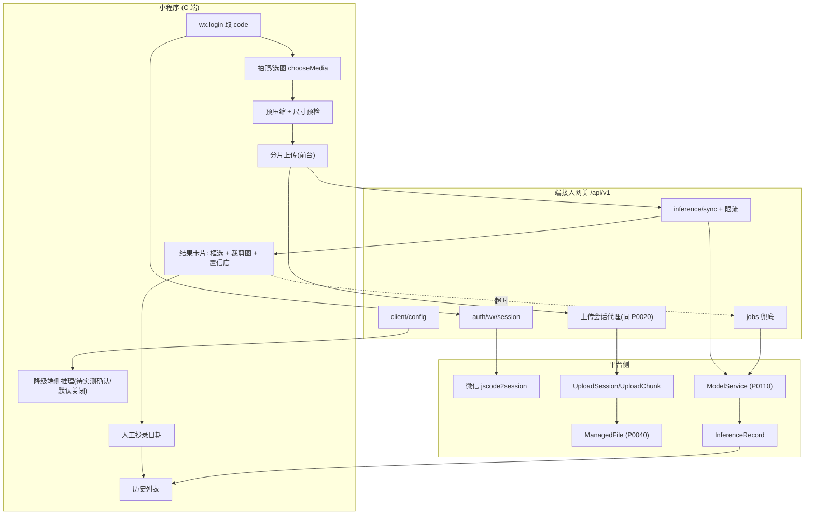
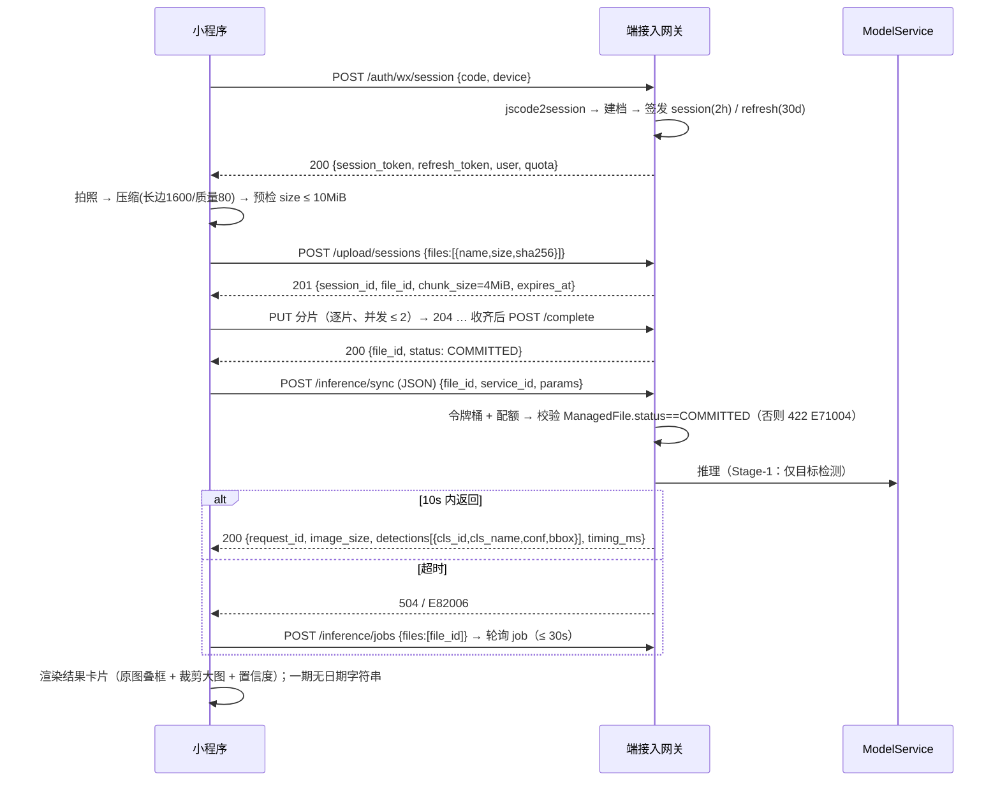
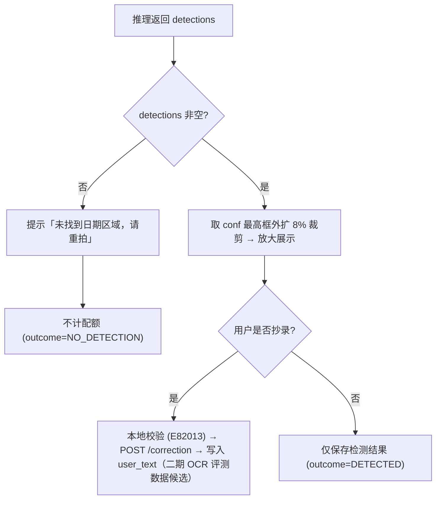
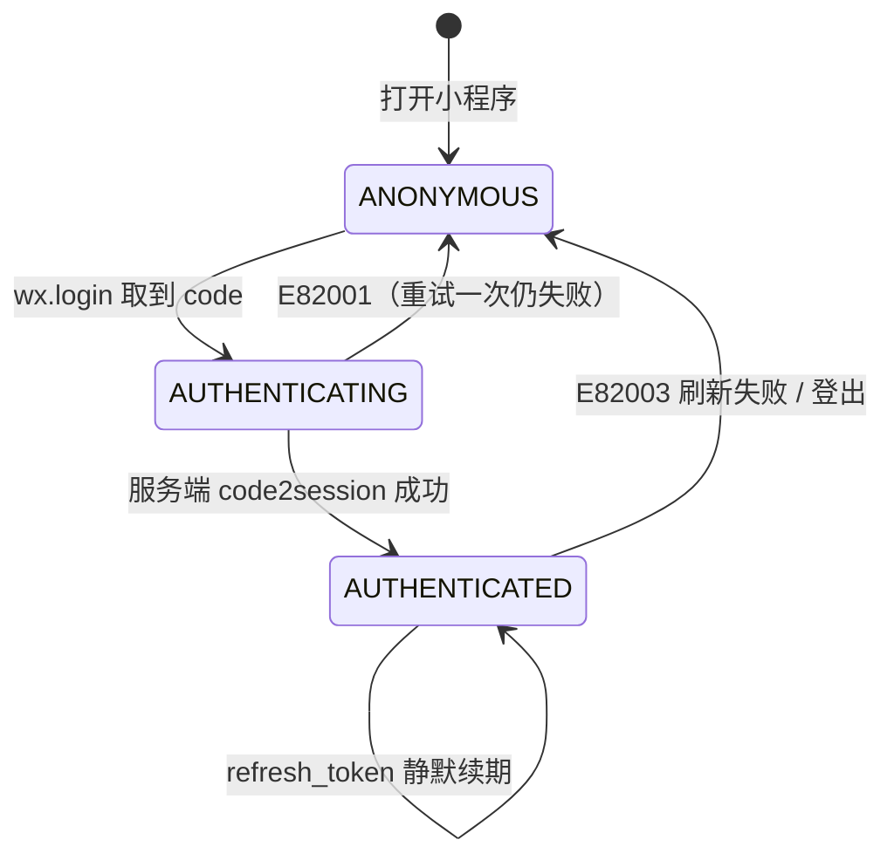
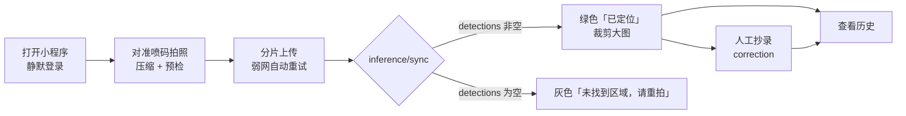

# PRD: P0120_小程序接入契约 (Mini Program Integration Contract)

| 属性 | 内容 |
| :--- | :--- |
| **文档编号** | P0120 |
| **项目名称** | FoodYolo |
| **功能模块** | M08_端接入 · 小程序接入契约 |
| **当前版本** | v1.0.0 |
| **文档状态** | Approved |
| **作者** | ClientW |
| **最后更新** | 2026-10-01 |

---

## 1. 全局说明

> [!IMPORTANT]
> **核心定位**: 小程序是 **C 端「拍一张、拿结果」的轻客户端**。唯一主方案是 **拍照/选图 → 上传服务端 → 服务端推理 → 返回结果**；**小程序内不做模型推理**。端侧推理（WXWebAssembly）仅为「服务端不可达时的可选降级」，可行性**尚未验证**，相关描述一律标记 **待实测确认**，实测通过前**不进入开发排期**。
> **一期能力现状**: 推理接口一期**只做目标检测**，返回 `detections`，**不返回日期字符串**。C 端展示「检测区域 + 裁剪大图 + 置信度」并提供**人工抄录**；OCR 属 **Stage-2**（响应可选字段 `detections[i].text` / 顶层 `ocr{}`，另预留 `POST /api/v1/ocr/recognize`），**二期前客户端不得依赖**。

### 名词解释

| 术语 | 说明 |
| :--- | :--- |
| `wx.login` code / code2session | 微信一次性临时凭证（5 分钟、仅用一次）；换 `openid` 必须由**服务端**调 `jscode2session` |
| Session / Refresh Token | 平台自签 JWT（2h）与长效刷新凭证（30d，**仅存哈希**、可吊销） |
| UploadSession / UploadChunk | 上传会话与分片（定义见 P0020）；小程序**单文件单会话**，承载断点续传 |
| ManagedFile | 统一文件登记实体（P0040）；推理只接受 `status = COMMITTED` 的 `file_id` |
| ModelService / InferenceRecord / InferenceJob | 已部署的在线推理服务（P0110）；推理记录读模型；批量异步作业（小程序仅在同步超时时以单文件兜底用 Job）。小程序**只消费不部署** |
| Stage-1 / Stage-2 | 一期目标检测（无文本）/ 二期 OCR 转写（未落地） |
| `bbox` / `image_size` | `[x1,y1,x2,y2]` **原图绝对像素**；响应固定携带原图尺寸 `{w,h}`（内部 `input_size=640` 也映射回原图） |
| `user_text` | 用户**人工抄录**的日期文本，写入 `InferenceRecord`，供一期兜底与二期评测 |
| 降级端侧推理 / 合法域名 | 前者指在 WXWebAssembly 内跑量化模型，**待实测确认**、默认关闭；后者指微信后台配置的 `request` / `uploadFile` / `downloadFile` 白名单，须 HTTPS + 已备案 |

### 统一异常处理

| Code | 场景 | 处理策略 |
| :--- | :--- | :--- |
| `E82001` | `code` 无效 / 已用 / 过期（微信 `40029`、`40163`） | 静默重新 `wx.login` 重试一次；二次失败提示「登录失败」 |
| `E82002` | 域名未加入合法域名白名单 | 开发期直接拦截并提示「域名未配置：{host}」；生产为发布前检查项 |
| `E82003` | 会话令牌过期（`401`） | `refresh_token` 换新令牌并**重放原请求一次**；失败则跳登录，未上传分片不丢 |
| `E82004` | 分片校验失败（`checksum`/`size` 不符） | 丢弃该分片重传 ≤ 3 次；仍失败中止会话，已收分片保留 |
| `E82005` | 单文件超过上限（默认 10 MiB，可下调） | 提交前本地预检拦截，不发起请求 |
| `E82006` | 同步推理超时（服务端 10s 上限） | 保留 `file_id`，转 `POST /inference/jobs`（单文件）兜底，轮询窗口 30s |
| `E82007` | 模型服务不可用（`status != RUNNING`） | `503` + `retry_after_ms`；倒计时后自动重试 1 次 |
| `E82008` | 图像无法解码 / 格式不支持（HEIC 等） | `422`；提示「请重新拍摄」，不做统一重试 |
| `E82009` | 超出速率限额（`429`） | 按 `Retry-After` 退避；同一记录最多 2 次，不无限重试 |
| `E82010` | 每日配额耗尽（`429` + `quota_exhausted`） | 提示「今日次数已用完（{used}/{limit}）」，**不做隐式降级** |
| `E82011` | 切后台导致 `wx.request` 被挂起 | 会话保持；回前台 `GET /upload/sessions/{id}` 拉已收分片续传 |
| `E82012` | 降级端侧推理不可用 | 静默回退服务端路径，不提示用户；写 `client_degrade_failure` 埋点 |
| `E82013` | 人工抄录非法（控制字符 / 超长 / 空白） | 本地校验拦截，保留输入并提示原因 |
| `E71004` | 引用的 `file_id` 非 `COMMITTED`（上游 P0110） | 不可重试；回到上传步骤重试 `complete`，仍失败提示重拍 |

---

## 2. 项目背景

### 背景 (Context)
FoodYolo 首个落地任务是**食品包装生产日期识别**，路线为两阶段：先做日期区域检测（Stage-1，已具备），再接入 OCR 读出字符串（Stage-2，规划中）。现场最自然的操作是「掏手机拍一张包装照片，看日期在哪」。相比安装 App，小程序零安装、可当场转发，是 C 端最合适的载体。平台已完成 01~07，需要定义**小程序如何安全、受限地消费这些能力**，并如实说明「一期只有检测、没有文本」。

### 问题陈述 (Problem Statement)
1. **能力阶段容易讲错**：「日期识别」听起来就是返回字符串，一期却只有检测框；契约按「返回日期」写会让前端、宣发与用户预期全部落空。
2. **端侧能力被高估**：社区「小程序可跑 WASM 模型」的说法易诱导端侧排期，而 WASM 支持范围、SIMD/线程、包体积与缓存上限均未验证。
3. **身份不可信**：`openid` 只能服务端通过 code2session 获取，交给客户端自报等于没有鉴权。
4. **上传是主路径也最脆弱**：4G 弱网、地下仓库无信号、切后台挂起请求，都会让「拍完就丢」。
5. **限额与域名是两条硬约束**：一张 4090 就是全部算力，C 端无限制调用会把训练与内部推理挤爆；而无公网备案域名时，小程序方案直接不成立。

### 目标与成功指标 (Goals & Success Metrics)
*   **北极星指标**: 从「点击拍照」到「看到日期区域高亮」中位耗时 ≤ **6 秒**（4G 良好网络）。
*   **次要指标**: 上传成功率（含一次重试）≥ **98%**、弱网 ≥ **90%**；切后台/断网后已拍照片 100% 不丢；超限/超时被拒 < **2%**；一期**人工抄录完成率 ≥ 40%**；端侧推理 2 周内**有明确实测结论**。

### 风险与规避 (Risks & Mitigation)

| 风险 | 影响 | 规避方案 |
| :--- | :--- | :--- |
| 一期无文本被用户视为「没用」 | 留存低 | 结果页给出**裁剪放大图** + 一键抄录；文案明确「文本识别即将上线」 |
| 端侧 WASM 实测不通过 | 已排期则整体返工 | 本阶段不排期，仅技术预研；主方案独立可交付 |
| 平台无 HTTPS 备案域名 | 无法上线 | 前置条件写死在 M08.F06；开发期用「不校验域名」+ 局域网调试 |
| 单机算力被 C 端打满 | 训练被饿死 | `ModelService` 独立配额 + C 端令牌桶限流（M08.F06） |
| 二期 OCR 字段被提前依赖 | 一期无法交付 | 契约明确二期前不得引用；前端做**防御式渲染** |

---

## 3. 价值模型

*   **方案**: 定义**能力受限的端侧契约**——划清端能做的（拍、压、传、显）与必须交给平台的（鉴权签发、存储、推理、历史）；用「上传会话 + 推理调用 + 结果回看」三条主链路覆盖 C 端场景，以「检测区域 + 裁剪图 + 人工抄录」在一期形成**可用闭环**，二期 OCR 落地后原地升级。
*   **目标**: 端侧代码量极小（无本地库、无队列、无模型），能力变更由服务端配置下发、**不依赖客户端发版**；上传中断网/切后台可续传；C 端调用永远走限额网关，不影响训练。

---

## 4. 项目范围

### 功能结构图



### In Scope (包含范围)
1. **登录与身份**：`wx.login` → code → 平台会话；续期、登出、`openid` 绑定与首次建档。
2. **拍照与上传**：拍照/相册选图、本地预压缩与预检、单文件分片上传与断点续传。
3. **推理调用**：以 `file_id` 调用 `POST /api/v1/inference/sync`，同步优先、超时转 `/inference/jobs` 兜底。
4. **结果展示与人工抄录**：原图叠框、日期区域裁剪大图、置信度、一键抄录、历史回看。
5. **能力边界与降级策略**：端/平台职责划分表；端侧推理条件化预留与开关。
6. **限额、错误码映射与弱网重试**：速率限额、每日配额、错误码文案映射、退避策略；所有阈值由 `GET /client/config` 下发。

### Out of Scope (不包含范围)
*   **日期字符串（OCR 文本）**：一期不提供，属 Stage-2，由 P0110 以可选字段扩展；一期人工抄录兜底。
*   **小程序内做模型推理作为主方案**：明确排除；端侧仅可选降级且**待实测确认**。
*   **训练 / 标注 / 数据管理 / 后台常驻上传**：C 端只读结果，只承诺「下次打开可续传」。
*   **多租户 / 多 AppID**、**支付 / 分享裂变 / 营销**、**微信云开发**：均不做。
*   **批量上传（>1 张）**：C 端一次一张；批量归 RN 客户端（P0121）。

---

## 5. 业务流程

### 5.1 主链路：拍照 → 上传 → 推理 → 结果



### 5.2 人工抄录闭环（一期兜底）



### 5.3 端会话状态机



本地视图（不落库，仅供 UI 与重试决策）: `IDLE → UPLOADING → (RETRY_WAIT | PAUSED) → COMMITTED → INFERRING → DONE → CORRECTED`；失败分支 `FAILED → IDLE`，超时分支 `INFERRING → ASYNC_POLLING → DONE`。上传会话的**权威状态在服务端**（P0020 `UploadSession.status`）。

---

## 6. 用户分析

### 6.1 用户画像 (User Personas)

| 角色 | 核心职责 | 核心诉求 | 核心痛点 |
| :--- | :--- | :--- | :--- |
| **C1 门店/经销商业务员**（主） | 收货核对包装生产日期 | 拍一张就知道日期区域在哪 | 仓库信号差；切走回来就没了 |
| **C2 品控抽检员** | 每日抽检 N 个 SKU 日期喷码 | 结果可回看、可截图留证 | 读错要重新跑一趟；无法证明拍的是哪张 |
| **C3 终端消费者 / C4 算法同学** | 查询生产日期 / 收集 C 端难例 | 免注册即用 / 结果回流成训练数据 | 一期只框位置会觉得「没解决问题」；二期 OCR 缺带真值评测集 |

### 6.2 用户链路图 (User Journey Map)



---

## 7. 功能需求

> 端接口统一挂载 `/api/v1`；上传语义与字段**以 P0020 为准**，推理接口**以 P0110 为准**，本模块只约束客户端如何消费。

### M08.F01 微信登录与会话身份 (WeChat Login & Session Identity)

*   **用户故事**: 作为 C 端用户，我希望打开小程序就已经登录好，不用填手机号，以便最快拿到结果。
*   **逻辑与业务规则**: **前置** 平台已配置 `appid`/`secret`，`api.weixin.qq.com` 可达，域名已在微信白名单。**主流程** 1) `wx.login()` 取一次性 `code` 并提交 `device_info`；2) 服务端 `jscode2session` 换 `openid`/`unionid`/`session_key`，**`session_key` 不下发**；3) 以 `openid` UPSERT `users`（`source=WECHAT_MP`，默认 `VIEWER`）；4) 签发 `session_token`(JWT 2h) 与 `refresh_token`(30d，仅存哈希)；5) 响应携带 `quota` 与 `config_version`。**续期** `401 + E82003` → `POST /auth/refresh` 后**重放原请求一次**，再失败回 `ANONYMOUS`。**后置** `users` 唯一 `openid` 记录、`mp_sessions` 一行可吊销会话。
*   **验收标准**
    ```gherkin
    场景: 首次登录自动建档
      Given 一个从未登录过的微信号
      When 用户打开小程序并提交 wx.login 得到的 code
      Then 返回 200 与 session_token
      And users 新增 source=WECHAT_MP 且 role=VIEWER 的记录
      And 响应中不包含 session_key

    场景: code 重复使用
      Given 客户端已用某个 code 换取过会话
      When 用同一个 code 再次请求 /auth/wx/session
      Then 返回 401 且 code=E82001
      And 不创建新用户、不吊销已有会话
    ```
*   **边界情况与异常处理**

    | 场景 | 处理 |
    | :--- | :--- |
    | `jscode2session` 超时 | 服务端 3 次退避重试（300ms/900ms/2.7s），仍失败 `502` |
    | `refresh_token` 过期 | 回 `ANONYMOUS` 清令牌缓存；**不删除**已上传未推理的会话 |
    | `secret` 缺失 | 启动自检失败返回 `503` 并告警（P0132），不静默放行 |

### M08.F02 拍照选图与分片上传 (Capture & Chunked Upload)

*   **用户故事**: 作为业务员，我希望弱网下也能传上去，中途切出去接个电话回来还能接着传。
*   **逻辑与业务规则**: **前置** 已 `AUTHENTICATED`，存在可用 `StorageConfig`。**主流程** 1) `wx.chooseMedia({count:1, sourceType:[camera,album], mediaType:[image]})`；2) 长边 > 1600 等比缩放、JPEG 质量 80；3) 本地预检 `size ≤ max_image_bytes`（默认 10 MiB）否则 `E82005`；4) `POST /upload/sessions`（**单文件**）取 `session_id`/`file_id`/`chunk_size`；5) 逐分片 `PUT`，**并发 ≤ 2**；6) `POST /complete` → 合并、校验 SHA-256、写 `ManagedFile(owner_type=CLIENT_UPLOAD, status=COMMITTED)`。**续传判定** 以服务端已收分片为准，客户端只补缺失索引。**过期** 沿用 P0020 `expires_at = last_progress_at + 24h`，超 2h 未推进在 UI 标「已过期，请重新拍摄」。**后置** 得到 `COMMITTED` 的 `file_id`。
*   **验收标准**
    ```gherkin
    场景: 正常单张照片上传
      Given 用户已登录且已拍好一张 2.4 MiB 的包装照片
      When 客户端创建上传会话、提交唯一分片并调用 complete
      Then 返回 file_id 且 ManagedFile.status=COMMITTED
      And 响应中的 size_bytes 与客户端本地一致

    场景: 上传中切后台后回来续传
      Given 上传会话已收到分片 0..4，共 11 片
      When 用户切到微信聊天 2 分钟后回到小程序
      Then GET /upload/sessions/{sid} 返回缺失分片 [5..10]
      And 只重新提交这 6 个分片，未重传 0..4，最终 complete 成功且 file_id 不变
    ```
*   **边界情况与异常处理**

    | 场景 | 处理 |
    | :--- | :--- |
    | 图片 > 10 MiB | 本地拦截 `E82005`，提供「降低画质重拍」，不消耗配额 |
    | 服务端磁盘满 | `507 + E34007`；提示「服务端存储不足，请联系管理员」 |
    | 分片连续 3 次 5xx | 暂停会话，不无限重试；显示「网络不稳定，点击继续」 |

### M08.F03 推理调用与结果展示 (Inference Invocation & Result Rendering)

*   **用户故事**: 作为品控员，我希望上传后立刻看到日期区域被框出来并能放大看清，以便自己读出日期并记录。
*   **逻辑与业务规则**: **前置** `file_id` 的 `ManagedFile.status = COMMITTED`；目标 `ModelService.status = RUNNING`；调用者未超限。**主流程** 1) `POST /api/v1/inference/sync`（`application/json`）`{file_id, service_id, params:{conf,iou,input_size,max_det}}`——**不重传字节**；2) 网关先做令牌桶 + 配额校验（`E82009`/`E82010`），再校验 `ManagedFile.status`，不通过返回 `422 + E71004`；3) 返回**一期仅检测、无文本**：`{request_id, model_service_id, model_version, image_size:{w,h}, detections:[{cls_id,cls_name,conf,bbox:[x1,y1,x2,y2]}], timing_ms}`；4) 同步超时上限 **10s**，超时改走 `POST /inference/jobs`→轮询→`GET .../results`，总窗口 30s；5) 按 `bbox`（**原图绝对像素**）叠加，`image_size` 保证无需反算；6) 附加**日期区域裁剪大图**（`bbox` 四边外扩 8%、不越界）。**置信度分档** `≥0.85` 绿「已定位」/`0.70~0.85` 黄「请核对」/`<0.70` 红「建议重拍」，结果页恒显「AI 结果，仅供参考」。**一期文案约束** 不得出现「识别出的日期是 X」，统一为「已定位日期区域，请在下方放大框中读取」。**后置** 写入 `InferenceRecord`（`user_id`/`file_id`/`model_version_id`/`result_json`/`outcome`/`latency_ms`/`status`）。
*   **验收标准**
    ```gherkin
    场景: 同步推理成功并叠加检测框
      Given 用户已上传一张清晰的日期喷码照片得到 COMMITTED 的 file_id
      And ModelService "date-det" 处于 RUNNING
      When 客户端以 JSON 提交 POST /api/v1/inference/sync
      Then 10 秒内返回 200，含 detections 与 image_size
      And 每个 bbox 为 4 个整数且 0 ≤ x1 < x2 ≤ image_size.w
      And 生成 InferenceRecord（status=SUCCEEDED, outcome=DETECTED）

    场景: 一期不展示日期字符串
      Given 一次成功的检测返回 1 个 bbox
      When 渲染结果卡片
      Then 页面不包含任何由模型输出的日期文本
      And 展示「已定位日期区域，请在下方放大框中读取」并提供人工抄录入入口

    场景: file_id 未提交时被拒
      Given 客户端持有一个 status=PENDING 的 file_id
      When 调用 /inference/sync
      Then 返回 422 且 code=E71004，客户端回到上传步骤提示「图片尚未上传完成」
    ```
*   **边界情况与异常处理**

    | 场景 | 处理 |
    | :--- | :--- |
    | 图片无日期区域 | `200 + detections:[]`；提示重拍，**不计配额**（`NO_DETECTION`） |
    | 检测到多个框 | 全部返回；默认取 `conf` 最高者裁剪，允许点选切换 |
    | 服务正在重启 | `503 + E82007 + retry_after_ms`；倒计时后自动重试 1 次 |
    | 二期 OCR 字段意外出现 | **防御式渲染**：有则作为建议值展示，无则不报错 |

### M08.F04 结果裁剪、人工抄录与历史回看 (Crop, Transcription & History)

*   **用户故事**: 作为业务员，我希望把日期区域放大看清并记录我读到的日期，下次还能翻到。
*   **逻辑与业务规则**: **前置** 已登录，存在 `SUCCEEDED` 且 `detections` 非空的记录。**主流程** 1) 按选定 `bbox` 外扩 8% 裁剪；2) 用户输入日期 → 本地校验（非空、≤32 字符、剔除控制字符，否则 `E82013`）；3) `POST /inference/records/{id}/correction {text}` 写 `user_text` 与 `corrected_at`，重复提交为**覆盖**并写审计；4) `GET /inference/history?cursor=&limit=20` 按 `created_at desc` 游标分页，仅返回当前 `user_id` 的记录；5) 详情 `GET /inference/records/{id}` 返回原图预签名 URL（TTL 600s）+ `result_json` + `user_text`。**保留期** 默认 90 天；文件 GC 后保留元数据并标 `file_expired=true`，**文本仍可读**。**数据价值** `user_text` 是二期 OCR 带真值评测集来源，**不自动进入训练集**。**后置** 抄录与读取均写审计（P0131）。
*   **验收标准**
    ```gherkin
    场景: 抄录文本落库且可覆盖
      Given 一条 InferenceRecord 已存在
      When 用户提交 text="2026-10-01"
      Then user_text="2026-10-01" 且 corrected_at 非空
      When 用户再次提交 text="2026-10-02"
      Then user_text 被覆盖，仅保留一行记录

    场景: 文件已被 GC
      Given 一条 100 天前的记录，其 ManagedFile.status=DELETED
      When 用户打开该记录详情
      Then 返回 200 且 file_expired=true、不返回原图 URL，但 user_text 仍可读
    ```
*   **边界情况与异常处理**

    | 场景 | 处理 |
    | :--- | :--- |
    | 抄录为空 / 仅空白 / 超 32 字符 | 本地拦截 `E82013`，保留输入不提交 |
    | 框贴近边缘导致外扩越界 | 裁到图像边界内，不报错 |
    | 记录归属他人 | 返回 `404`（**不返回 403**，避免存在性探测） |

### M08.F05 端侧降级推理（可行性预留，待实测确认）

> [!WARNING]
> 本节全部为**待验证假设**，不构成能力承诺。实测结论产出前相关任务不得排期，端侧开关默认 `false`。

*   **用户故事**: 作为业务员，我希望在完全没信号的冷库里也能看到大概的框选位置，以便先记下来。
*   **逻辑与业务规则**（设计意图，未验证）: **触发** `enable_on_device_fallback = true` 且能力探测通过 且服务端推理连续 2 次失败。**能力探测** 检测 `WXWebAssembly` 可用性、操作码特性、`FileSystemManager` 可用空间。**模型获取** 从 `downloadFile` 白名单域名下载量化权重到本地缓存，校验 SHA-256 后使用。**失败即回退** 任一步失败 → 静默走服务端路径并埋点 `client_degrade_failure`。**结果标注** 必须显示「离线结果，未经服务端确认」，**不写入平台历史**。
*   **待实测确认清单**

    | 待验项 | 为什么关键 | 判定方法 |
    | :--- | :--- | :--- |
    | WASM 运行时能否加载并执行 ONNX / TFLite 模型 | 不支持则整条链路不成立 | 真机基础库跑最小推理 demo |
    | 是否支持 SIMD / 多线程 | 决定耗时是否可接受 | 对比开启/关闭的实测耗时 |
    | 可用线性内存与缓存空间上限 | 决定最大可加载模型体积与能否常驻 | 逐步增大模型观察 OOM 阈值；写入大文件后读剩余空间 |
    | 模型体积是否受代码包体积限制 | 决定是否需分包/CDN 下载 | 分包与下载两条路径分别验证 |
    | 单张图端侧推理耗时（目标机型） / 端云一致性误差 | 决定预览是否成立、降级结果能否采信 | 真机实测 P50/P95；同批图对比 IoU 与类别一致率 |

    > 上表全部结论为 **待实测确认**，未产生实测数字前不得写入任何性能承诺。
*   **验收标准**
    ```gherkin
    场景: 降级开关关闭时不加载任何端侧资源
      Given client_config.enable_on_device_fallback = false
      When 用户完成一次推理
      Then 客户端未发起任何模型权重下载请求，且未创建本地模型缓存目录

    场景: 探测失败时静默回退
      Given enable_on_device_fallback = true 但基础库不支持所需 WASM 特性
      When 用户完成一次推理且服务端超时
      Then 不展示任何端侧推理相关提示
      And 上报一条 client_degrade_failure 埋点，用户看到的仍是 E82006
    ```
*   **边界情况与异常处理**

    | 场景 | 处理（设计意图） |
    | :--- | :--- |
    | 模型下载中途断网 | 支持 Range 续传；校验失败整体丢弃 |
    | 端侧置信度极低 | 直接丢弃按失败处理，不展示 |
    | 端侧与云端结果不一致 | 以云端为准，云端返回后覆盖端侧展示 |

### M08.F06 限额、错误码映射与弱网重试 (Quota, Error Mapping & Retry)

*   **用户故事**: 作为 ADMIN，我希望 C 端用量可控，不要让小程序流量把本机算力打满。
*   **逻辑与业务规则**: **限流三层**（取最先命中者）1) 单用户速率 推理 `6 次/分`、全部接口 `20 次/分`（`burst=3`）；2) 全局 推理 `30 次/分`；3) 每日配额 单用户 `100 次/天`（ADMIN 可调）。`NO_DETECTION` 与全部 `E82xxx` 失败**不计数**。**响应** `429 + Retry-After`（速率）或 `429 + {code:"E82010", quota:{used,limit,reset_at}}`（配额）。**重试原则** 单次操作内**任何接口总重试 ≤ 3**，指数退避 + 抖动（`base=1s`、`cap=8s`），`4xx`（除 `E82003`）不重试。
*   **错误码映射**

    | 服务端码 | 用户可见文案 | 可重试 | 客户端动作 |
    | :--- | :--- | :--- | :--- |
    | `E82001` / `E82003` | 登录失败，请重试 / 会话已过期 | 是 | 重新 `wx.login` / refresh 后重放 |
    | `E82004` / `E82005` | 上传失败，正在重传 / 图片过大，请重拍 | 是 / 否 | 重传分片 / 本地拦截 |
    | `E82006` / `E82007` | 识别较慢，已转后台处理 / 服务重启中 | 是 | 转 `inference/jobs` / 倒计时后重试 1 次 |
    | `E82008` / `E82013` | 图片格式不支持，请重拍 / 请填写有效日期 | 否 | 引导重拍 / 高亮输入框 |
    | `E82009` / `E82010` | 操作太频繁 / 今日次数已用完 | 是 / 否 | 禁用按钮至倒计时 / 展示重置时间 |
    | `E71004` / 其他 `5xx` | 图片尚未上传完成 / 服务繁忙 | 否 / 是 | 回到上传步骤 / 退避重试 ≤ 2 次 |

*   **配置下发** `GET /api/v1/client/config`

    | 字段 | 默认值 | 说明 |
    | :--- | :--- | :--- |
    | `max_image_bytes` / `chunk_size` / `max_upload_concurrency` | 10485760 / 4194304 / 2 | 单图上限 / 分片大小（弱网 1048576）/ 分片并发 |
    | `sync_timeout_ms` / `poll_window_ms` | 10000 / 30000 | 同步超时（与 P0110 一致）/ 异步轮询窗口 |
    | `rate_limit_per_min` / `daily_quota` / `config_version` | 6 / 100 / 1 | 速率、每日配额；客户端据 `config_version` 刷新本地缓存 |
    | `enable_on_device_fallback` | false | 端侧降级开关（实测前恒为 false） |

*   **验收标准**
    ```gherkin
    场景: 触发速率限额
      Given 用户在一分钟内已发起 6 次推理
      When 用户发起第 7 次推理
      Then 返回 429 且带 Retry-After 与 code=E82009
      And 客户端将按钮置灰并显示倒计时，且不消耗每日配额

    场景: 配额耗尽后不给隐式降级
      Given 用户当日配额 100 已用完
      When 用户发起拍照识别
      Then 返回 429 且 code=E82010，含 used/limit/reset_at
      And 客户端在预检阶段提示，不上传图片、不切换端侧推理

    场景: 未检测到日期不消耗配额
      Given 用户当日剩余配额 5
      When 上传一张不含日期区域的照片并完成推理
      Then 返回 200 且 detections=[]
      And 用户剩余配额仍为 5，该记录 outcome=NO_DETECTION
    ```
*   **边界情况与异常处理**

    | 场景 | 处理 |
    | :--- | :--- |
    | 客户端时钟偏差大 | `Retry-After` 与 `reset_at` 以服务端绝对时间为准，客户端按时延校正 |
    | 同用户多设备并发 | 共享同一份配额（按 `user_id`），速率按 `user_id` 聚合 |
    | `Retry-After` > 60s | 直接提示「当前繁忙，请稍后再试」，不展示倒计时 |
    | 限流规则热更新 | 通过 `client_config` 下发，服务端变更立即生效 |

### 7.7 接口清单（小程序 ↔ 平台）

> Base URL `https://<platform-host>/api/v1`（HTTPS + 已加入微信合法域名白名单）。推理接口体**以 P0110 为准**。

| # | 路径 | 方法 | 鉴权 | 入参 | 出参 | 错误码 |
| :--- | :--- | :--- | :--- | :--- | :--- | :--- |
| 1 | `/auth/wx/session` | POST | — | `code`, `device_info` | `session_token`, `refresh_token`, `expires_in`, `user`, `quota` | `E82001` `503` |
| 2 | `/auth/refresh` | POST | — | `refresh_token` | `session_token`, `expires_in` | `E82003` |
| 3 | `/auth/logout` | POST | Bearer | `refresh_token` | `204` | `E82003` |
| 4 | `/me` | GET | Bearer | — | `user`, `quota{used,limit,reset_at}` | `E82003` |
| 5 | `/client/config` | GET | Bearer | `config_version?` | 见 M08.F06 配置表 | `E82003` |
| 6 | `/upload/sessions` | POST | Bearer | `files[{name,size_bytes,sha256,mime_type}]`（小程序限 1） | `session_id`, `file_id`, `chunk_size`, `expires_at` | `E82005` `E22004` |
| 7 | `/upload/sessions/{sid}` | GET | Bearer | — | `status`, `uploaded:{file_id:[index...]}` | `E82003` |
| 8 | `/upload/sessions/{sid}/files/{fid}/chunks/{i}` | PUT | Bearer | body=分片字节, `X-Chunk-Sha256` | `204` | `E82004` `E82011` |
| 9 | `/upload/sessions/{sid}/complete` | POST | Bearer | `{file_id, size_bytes, sha256}` | `file_id`, `status`, `size_bytes` | `E82004` `E34004` |
| 10 | `/model-services` | GET | Bearer | `task_type?` | `[{id,name,status,task_type,labels}]` | `E82003` |
| 11 | `/inference/sync` | POST | Bearer | **JSON** `{file_id, service_id\|model_version_id, params:{conf,iou,input_size,max_det,return_image}}` | `{request_id, model_service_id, model_version, image_size{w,h}, detections[{cls_id,cls_name,conf,bbox[x1,y1,x2,y2]}], timing_ms}` | `E71004` `E82006` `E82007` `E82008` `E82009` `E82010` |
| 12 | `/inference/jobs` | POST | Bearer | `{service_id\|model_version_id, files:[file_id], params}`（≤200） | `{job_id, status:"QUEUED"}` | `E82006` `E71004` |
| 13 | `/inference/jobs/{job_id}` | GET / DELETE | Bearer | — | `status`, `progress`, `summary` / `204` | `404` |
| 14 | `/inference/jobs/{job_id}/results` | GET | Bearer | `page`, `page_size` | 结果分页（含 `detections`、`image_size`） | `404` |
| 15 | `/inference/records/{id}` | GET | Bearer | — | `status`, `result_json`, `user_text`, `file_expired` | `E82003` `404` |
| 16 | `/inference/records/{id}/correction` | POST | Bearer | `{text}`（≤32 字符） | `user_text`, `corrected_at` | `E82013` `404` |
| 17 | `/inference/history` | GET | Bearer | `cursor?`, `limit?`(≤50) | `items[]`, `next_cursor`, `total_estimate` | `E82003` |
| 18 | `/files/{file_id}/presign` | GET | Bearer | `ttl?` | `url`, `expires_at` | `E34008` |

**载荷约定**: 请求头 `Authorization: Bearer <session_token>` / `X-Client-Platform: MP` / `X-Client-Version`；时间一律 ISO-8601 UTC；`bbox` 为原图绝对像素且响应带 `image_size`；一期**无模型输出文本字段**（二期 `detections[i].text` / 顶层 `ocr{}` 为预留，端上防御式渲染）；分页游标不透明、不得解析。

---

## 8. 技术架构与数据模型

### 8.1 端能力 vs 平台能力职责划分（硬边界）

| 能力 | 小程序（端） | 平台（服务端） | 边界说明 |
| :--- | :--- | :--- | :--- |
| 身份认证 | 仅获取 `code`、保存令牌 | **独占** `code2session`、`openid` 落库、签发与吊销 | 端永不接触 `secret` / `session_key` |
| 图像采集 | **独占** 拍照 / 相册选图 | — | 端是唯一图像来源 |
| 图像预处理 | 压缩、缩放、尺寸预检 | 二次规范化、格式判定 | 端做体验优化，服务端不信任端结论 |
| 存储 | 仅保存临时文件与 `file_id` 引用 | **独占** 对象存储写入与 `ManagedFile` 生命周期 | 端不持有持久副本 |
| 上传调度 | 分片切分、并发控制、退避重试 | **独占** 分片落盘、合并、完整性校验、续传权威 | 进度以服务端为准 |
| 模型推理 | **不做**（降级为待实测确认的可选项） | **独占** 检测执行与 `ModelVersion` 选择 | 主方案在服务端 |
| 文本转写 (OCR) | 一期：**人工抄录**并上报 | 二期：**独占** OCR 执行与文本生成 | 一期抄录 ≠ 模型输出，字段分列 |
| 结果后处理 | 按 `bbox` 裁剪、放大、置信度分档 | **独占** 坐标映射回原图、候选排序 | `image_size` 由服务端给出，端不反算 |
| 历史与检索 | 展示与分页交互 | **独占** 记录落库、保留期、GC | 端不缓存历史全量 |
| 配额与限流 | 按 `Retry-After` 退避、按钮置灰 | **独占** 令牌桶、配额计数与重置 | 端不可信，仅做体验配合 |
| 配置 | 消费 `client/config` | **独占** 配置定义与版本号 | 端行为可被服务端远程调整 |

### 8.2 数据实体

新增会话、推理记录、配额三张表；文件一律走 `ManagedFile(owner_type=CLIENT_UPLOAD)`。

#### `mp_sessions`（会话，服务端私有）

| 字段名 | 类型 | 必填 | 说明 | 约束 |
| :--- | :--- | :--- | :--- | :--- |
| `id` / `user_id` | UUID | Y | 主键 / 关联 `users` | PK / FK → users.id |
| `refresh_token_hash` | String(64) | Y | 刷新令牌哈希 | 仅存哈希；UNIQUE |
| `device_info` | JSONB | N | 机型 / 系统 / 基础库版本 | 用于排障 |
| `issued_at` / `expires_at` / `revoked_at` / `last_used_at` | Timestamptz | Y/N | 签发 / 到期 / 吊销 / 最近使用 | 默认 30 天；`revoked_at` 非空即失效 |

#### `inference_records`（推理记录，C 端可读）

| 字段名 | 类型 | 必填 | 说明 | 约束 |
| :--- | :--- | :--- | :--- | :--- |
| `id` | UUID | Y | 主键 | PK |
| `user_id` / `file_id` | UUID | Y | 调用者 / 输入图片 | FK → users.id（列表按此隔离）/ FK → managed_files.id |
| `model_service_id` / `model_version_id` | UUID | Y/N | 使用的服务 / 实际执行的版本 | FK → model_services.id / model_versions.id |
| `channel` / `status` / `outcome` | Enum | Y | 渠道 / 状态 / 配额口径 | `MP`/`RN`/`OPEN_API`/`WEB`；`RUNNING`/`SUCCEEDED`/`FAILED`/`TIMEOUT`；`DETECTED`/`NO_DETECTION`/`ERROR` |
| `result_json` | JSONB | N | `{image_size, detections[{cls_id,cls_name,conf,bbox}]}` | **一期无 text 字段** |
| `user_text` / `corrected_at` | String(32) / Timestamptz | N | **用户人工抄录**的日期文本与时间 | 与模型输出严格分列 |
| `latency_ms` / `error_code` / `expires_at` | Int / String(8) / Timestamptz | N | 耗时 / 失败码 / 记录保留到期 | 保留期默认创建 + 90 天 |
| 通用字段 | — | Y | `created_at`/`updated_at`/`deleted_at` | — |

**Index**: `(user_id, created_at DESC)`；`(status)`；`(file_id)`；`(user_text)` WHERE 非空。

#### `client_quota_counters`

字段: `id`(UUID PK) / `user_id`(UUID, FK) / `quota_date`(Date, 服务端时区) / `used_count`(Int) / `limit_count`(Int，默认 100，ADMIN 可调) / 通用字段。**UNIQUE**(`user_id`, `quota_date`)；`used_count` 仅 `outcome=DETECTED` 时递增。

### 8.3 架构要点

*   **零信任端**：端上报的一切（进度、置信度、格式）只用于体验优化，服务端独立复核。
*   **无状态网关**：会话令牌为 JWT；配额计数落库（单机 PostgreSQL 足够）。
*   **与 P0020 / P0110 的关系**：上传**不做第二套实现**，网关只做鉴权 + 字段收敛，底层复用同一张 `upload_sessions` / `upload_chunks`；推理**不重传字节**，一律以 `file_id` 引用已 `COMMITTED` 的 `ManagedFile`，坐标映射由服务端完成。

---

## 9. UI/UX 规格说明

### 9.1 结果卡片（一期：定位 + 裁剪 + 人工抄录）

```text
+---------------------------------------------------+
|  ←  识别结果                          [分享] [存] |
|  +---------------------------------------------+  |
|  |  ┌──────────────┐  ← 检测框（原图绝对像素）  |  |
|  |  └──────────────┘      （原图缩略图）        |  |
|  +---------------------------------------------+  |
|   日期区域（已放大 8% 外扩裁剪）: 2026-10-01       |
|   置信度 0.93 ● 已定位   用时 59ms   模型 v1.4.0  |
|   ⓘ 本版本仅定位日期区域，不自动读出文本           |
|   我读到的日期: [ 2026-10-01        ] [ 保存 ]    |
|   [ 重拍 ]                    [ 完成 ]            |
+---------------------------------------------------+
|  低置信度（< 0.70）: 0.58 ● 建议重拍；候选框 2 个  |
+---------------------------------------------------+
```

### 9.2 交互元素

| 元素 | 类型 | 状态 | 行为 |
| :--- | :--- | :--- | :--- |
| 拍照识别 | Button (Primary) | Default / Loading / Disabled | Disabled 于配额耗尽或上传中 |
| 进度条 | Progress | Active / Paused / Failed | 断网变灰并显示「点击继续」；重试按钮由 `Retry-After` 驱动倒计时 |
| 检测框叠加 | Canvas | 单框 / 多框 / 无框 | 多框时可点选切换裁剪区域 |
| 裁剪图 | Image | Default / Zoom | 双指缩放；长按可保存到相册 |
| 置信度徽标 | Badge | 绿(≥0.85)/黄(0.70~0.85)/红(<0.70)/灰(无框) | 点击展开分档说明 |
| 抄录输入框 | Input | Default / Focus / Error / Saved | 失焦即本地校验；保存后置灰显示「已保存」 |
| 历史项 | List Item | Default / Transcribed / FileExpired | 过期项展示占位图但文本仍可读 |
| 配额提示 | Text | >20% / ≤20% / 0 | ≤20% 标黄；0 时禁用拍摄并显示重置时间 |

### 9.3 表单与校验

| 字段 | 类型 | 校验规则 | 默认值 |
| :--- | :--- | :--- | :--- |
| 拍摄图片 | Media | `size ≤ 10 MiB`；长边自动压至 1600 | — |
| 抄录日期 | Input | 非空、≤ 32 字符、剔除控制字符 | — |

---

## 10. 非功能性需求 (NFR)

*   **性能**: 登录 P95 < 600ms（含一次微信往返）；压缩 2.4 MiB 原图 ≤ 800ms（中端机）；分片吞吐 ≥ 200 KiB/s、并发 2；推理遵循 P0110（单图 640、P95 < 300ms）；端到端中位 ≤ 6s；首屏可交互 ≤ 1.5s。
*   **可靠性**: 续传命中率 100%（以服务端已收分片为准）；对微信与 `ModelService` 均设超时 + ≤ 2 次退避重试；平台重启后 `mp_sessions` / `inference_records` 不受影响，进行中的 `UploadSession` 可续传。
*   **安全**: 全链路 HTTPS；`secret` / `session_key` 永不下发；`refresh_token` 仅存哈希可吊销；历史按 `user_id` 隔离、越权返回 `404`；响应剥离 `storage_path`/`bucket`/`etag`；请求体上限 12 MiB；登录、登出、吊销、配额调整、**人工抄录**均写审计。
*   **兼容性**: 微信基础库 ≥ 2.20.0（`chooseMedia`/`compressImage`/`canvasToTempFilePath` 为必需）；`request`/`uploadFile`/`downloadFile` 三类域名均需配置；**上线前置条件 = 已备案 HTTPS 域名**；iOS 14+ / Android 8+；2G 不承诺可用。
*   **可扩展性**: 单机目标 ≤ 50 并发 C 端用户、≤ 200 次推理/天（受单卡约束，超出应扩容）；限流阈值可由服务端配置调整、**不需客户端发版**；端侧降级与二期 OCR 均为独立开关，未就绪不影响主链路。

---

## 附录: 已确认的设计决策

| 决策项 | 结论 |
| :--- | :--- |
| 推理位置 | **主方案 = 服务端推理**；端侧仅可选降级且**待实测确认**，默认关闭 |
| 一期能力口径 | **只有目标检测、无日期字符串**；展示「区域 + 裁剪图 + 置信度」，文本由**人工抄录**兜底 |
| 二期 OCR 约定 | 以可选字段扩展 `detections[i].text` / `detections[i].ocr_conf` + 顶层 `ocr{enabled,engine}`；另预留 `POST /api/v1/ocr/recognize`；**落地前不得依赖** |
| 推理调用方式 | 以 `file_id` 走 JSON 调 `POST /api/v1/inference/sync`，**不重传字节**；非 `COMMITTED` 返回 `422 / E71004`。同步上限 10s，超时转 `POST /api/v1/inference/jobs`（单文件）轮询，总窗口 30s |
| 坐标约定 | `bbox = [x1,y1,x2,y2]` **原图绝对像素**；响应带 `image_size{w,h}`，端上仅做展示缩放 |
| 抄录数据用途 | `user_text` 与模型输出**严格分列**；作为二期 OCR 评测集候选，**不自动进入训练集** |
| 身份来源 | `openid` 必须由服务端 `code2session` 获取；平台自签 JWT(2h) + refresh_token(30d) |
| 上传粒度 | 单文件单会话；分片默认 4 MiB、弱网 1 MiB；并发 ≤ 2；单图上限 10 MiB（预压缩长边 ≤1600、质量 80） |
| 配额口径 | 仅 `outcome=DETECTED` 计费；`NO_DETECTION` 与全部 `E82xxx` 失败不计费；限流三层 6/min、30/min、100/天；置信度分档 ≥0.85 绿 / 0.70~0.85 黄 / <0.70 红 |
| 数据模型 | **不新建产物表**；新增 `mp_sessions`、`inference_records`、`client_quota_counters`；历史保留 90 天，图片 GC 后 `user_text` 仍可读 |
| 越权语义 / 后台能力 | 访问他人记录返回 `404`；小程序无后台常驻，只承诺「下次打开可续传」 |
| E-code 区间 | 本篇占用 `E82001–E82013`（另引用上游 `E71004`）；功能编号 `M08.F01–M08.F06` |

---

## 关联文档

*   **P0020_本地上传与压缩包导入**: `UploadSession` / `UploadChunk` 权威定义
*   **P0040_存储配置与桶绑定**: `ManagedFile` 生命周期、`presign_get`
*   **P0085_模型仓库与Lineage**: `ModelVersion` 指标与产物来源
*   **P0110_模型服务管理**: 推理接口权威定义；一期仅检测、二期 OCR 扩展
*   **P0113_端侧导出**: 端侧降级推理的模型产物来源
*   **P0121_RN客户端接入契约 / P0122_开放API与鉴权**: B 端 App 对照端；对外鉴权模型与限流配额总则
*   **P0130 / P0131 / P0132**: RBAC、审计与告警

---

## Changelog

| 版本 | 日期 | 作者 | 变更说明 |
| :--- | :--- | :--- | :--- |
| v0.1.0-draft | 2026-10-01 | ClientW | 初稿：以端侧 WASM 为主方案，且按「返回日期字符串」设计结果 |
| v0.9.0-draft | 2026-10-01 | ClientW | 端侧推理降级为可选降级并标「待实测确认」；对齐 P0110：JSON + `file_id`、`bbox` 原图绝对像素 + `image_size`；澄清一期仅检测、OCR 属二期，补人工抄录兜底 |
| v1.0.0 | 2026-10-01 | ClientW | 正式发布：补齐状态机、抄录闭环、限额与错误码映射、配置下发与 NFR |
