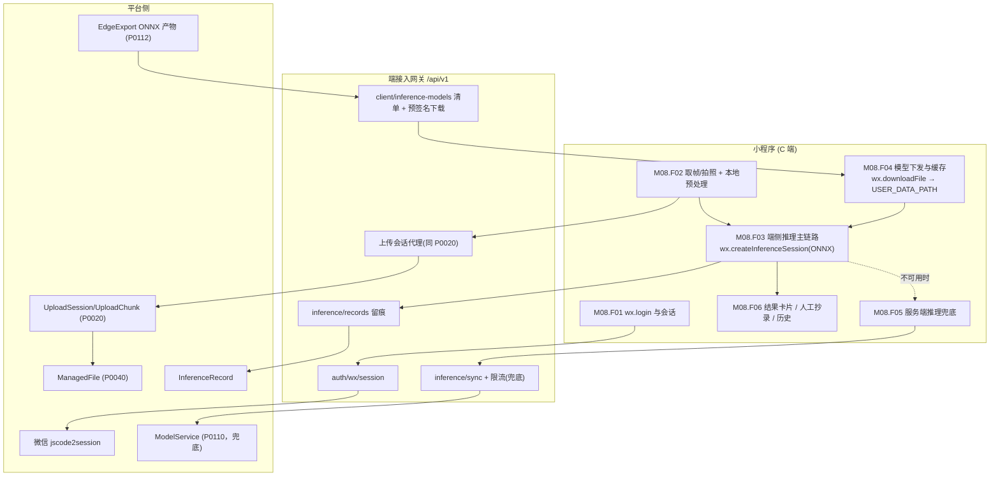
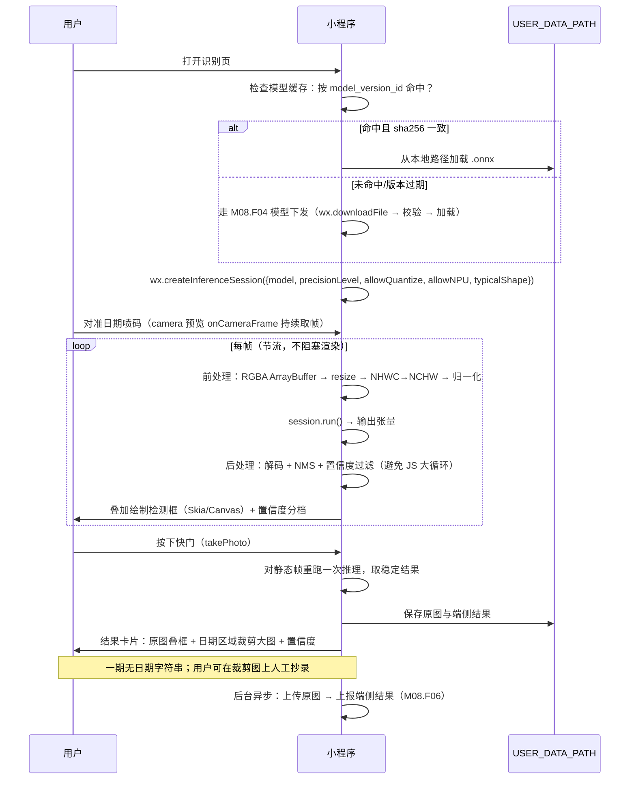
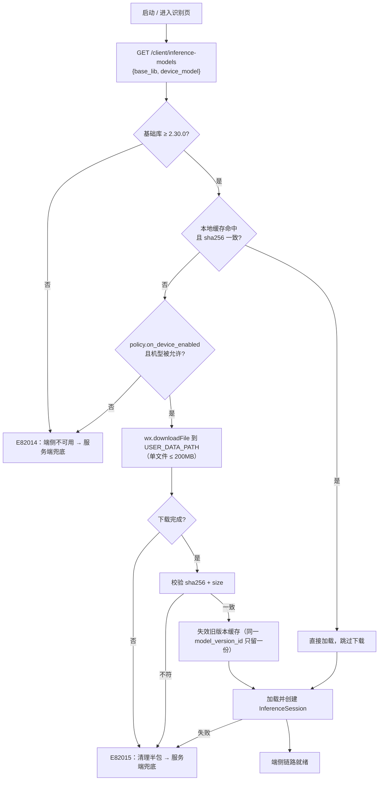
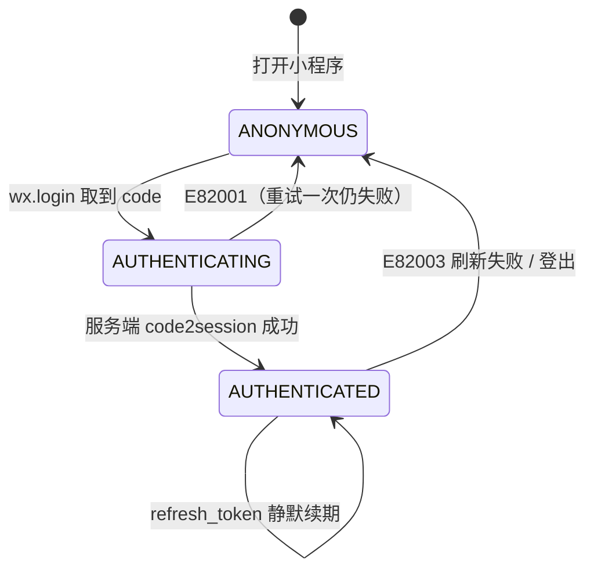
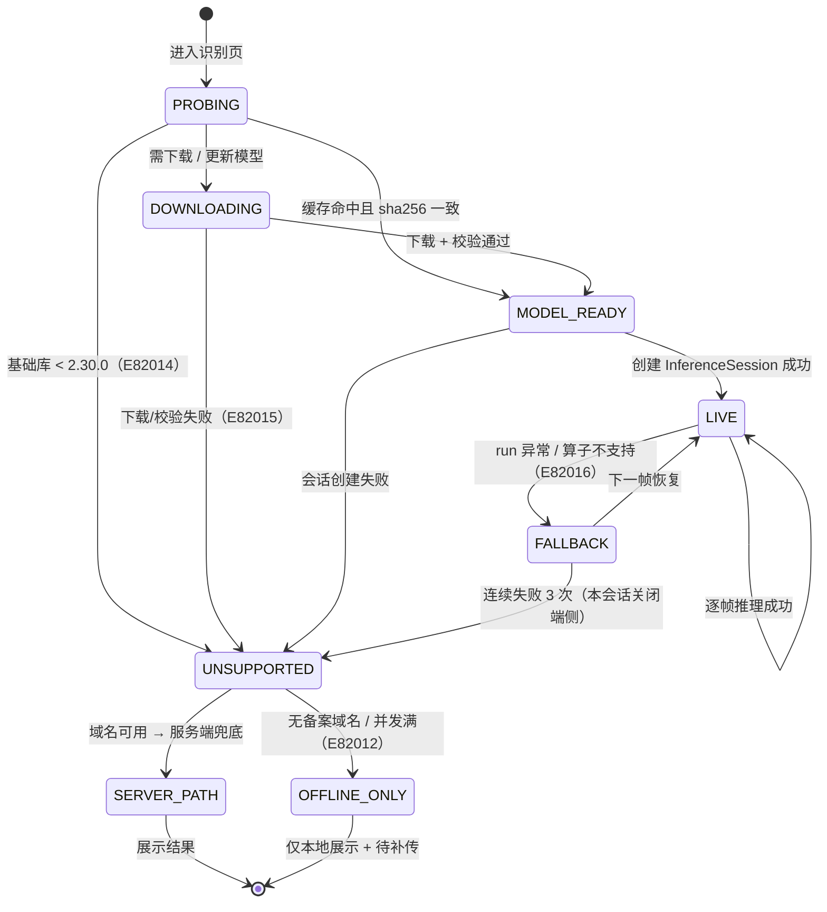
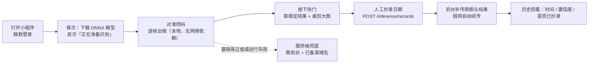

# PRD: P0120_小程序接入契约 (Mini Program Integration Contract)

| 属性 | 内容 |
| :--- | :--- |
| **文档编号** | P0120 |
| **项目名称** | 轻眸识刻 |
| **功能模块** | M08_端接入 · 小程序接入契约 |
| **当前版本** | v2.0.0 |
| **文档状态** | Approved |
| **作者** | ClientW |
| **最后更新** | 2026-10-01 |

---

## 1. 全局说明

> [!IMPORTANT]
> **核心定位**: 小程序是 **C 端「拍一张、拿结果」的轻客户端**。**主方案 = 端侧推理**：拍照或取实时帧 → 本地前处理 → `wx.createInferenceSession` 跑 ONNX → 本地后处理（解码 + NMS）→ 直接画框出结果，**结果不依赖网络**。
> **服务端推理降级为兜底**，仅在「基础库版本不足 / 端侧算子不支持 / 端侧模型超规格 / 端侧运行失败」时启用。
> **端侧推理是微信官方一等能力，不是实验性方案**：`wx.createInferenceSession` 自**基础库 2.30.0** 起提供，**只接受 `.onnx`**，支持 `precisionLevel` / `allowQuantize` / `allowNPU`（iOS）/ `typicalShape`。可行性由官方 API 与文档背书；**待实测确认的只是具体数值**（单帧耗时、前/后处理耗时、内存峰值、int8 精度损失、机型覆盖）。
> **模型不能打进代码包**：`.onnx` 不在可上传文件白名单内，必须运行期 `wx.downloadFile` 下载到 `USER_DATA_PATH` 后加载。
> **一期能力口径（与 P0110 一致）**: 仅做**日期区域检测**，输出 `bbox` 与置信度，**不返回日期字符串**；OCR 属二期，端上须防御式渲染。

### 名词解释

| 术语 | 说明 |
| :--- | :--- |
| InferenceSession | `wx.createInferenceSession` 返回的端侧推理会话；从**代码包路径或本地文件路径**加载 `.onnx`，`run()` 执行推理 |
| 端侧推理 / 服务端兜底 | 在手机本地（CPU/NPU）跑量化 ONNX / 端侧不可用时改由平台 `ModelService` 推理 |
| `onCameraFrame` | `camera` 组件的实时帧回调，返回 `width` / `height` 与 **RGBA ArrayBuffer**，可做流式推理 |
| `takePhoto` | 拍照 API，`quality ∈ normal/high/low/original`，返回 `tempImagePath`（Android jpg / iOS png） |
| 前处理 / 后处理 | 前处理：RGBA→RGB、resize、NHWC→NCHW、归一化；后处理：解码 + NMS + 置信度过滤 |
| `precisionLevel` / `allowQuantize` / `allowNPU` / `typicalShape` | 会话创建参数：精度档位（0–4）、是否允许量化、是否允许用 NPU（iOS）、典型输入形状 |
| `USER_DATA_PATH` | 小程序本地用户目录，模型与缓存文件落于此；**本地文件合计上限 200 MB** |
| 模型清单 (Model Manifest) | 平台下发的端侧模型描述：`model_version_id` / `format=ONNX` / `download_url` / `sha256` / `size_bytes` / `input_spec` / `policy` |
| 服务端兜底链路约束 | 请求域名需 HTTPS + **ICP 备案**；`wx.request` 并发上限 **10**；默认超时 **60s**；进后台 **5s 即中断** |
| Stage-1 / Stage-2 | 一期目标检测（无文本）/ 二期 OCR 转写（未落地） |
| `bbox` / `image_size` | `[x1,y1,x2,y2]`，**原图绝对像素**；响应与记录固定携带原图尺寸 `{w,h}` |
| `user_text` | 用户**人工抄录**的日期文本，写入 `InferenceRecord`，供一期兜底与二期 OCR 评测 |
| 合法域名 | 微信后台配置的 `request` / `uploadFile` / `downloadFile` 白名单，须 HTTPS + 已备案 |

### 统一异常处理

| Code | 场景 | 处理策略 |
| :--- | :--- | :--- |
| `E82001` | `code` 无效 / 已用 / 过期（微信 `40029`、`40163`） | 静默重新 `wx.login` 重试一次；二次失败提示「登录失败」 |
| `E82002` | 域名未加入合法域名白名单 | 开发期直接拦截并提示「域名未配置：{host}」；生产为发布前检查项 |
| `E82003` | 会话令牌过期（`401`） | `refresh_token` 换新令牌并**重放原请求一次**；失败则跳登录，未上传分片不丢 |
| `E82004` | 分片上传失败（网络错误，或上游 `E22002` 分片 `sha256` 不符） | 丢弃该分片重传 ≤ 3 次；仍失败中止会话，已收分片保留 |
| `E82005` | 单文件超过上限（默认 10 MiB，可下调） | 提交前本地预检拦截，不发起请求 |
| `E82006` | **服务端兜底**推理超时（默认 60s 客户端上限或服务端 10s 上限） | 保留 `file_id`，转 `POST /inference/jobs` 异步兜底，轮询窗口 30s |
| `E82007` | 服务端 `ModelService` 不可用 | `503` + `retry_after_ms`；倒计时后自动重试 1 次，仍失败则提示「识别服务暂不可用」 |
| `E82008` | 图像无法解码 / 格式不支持（HEIC 等） | `422`；本地拦截并提示「请重新拍摄」，不做统一重试 |
| `E82009` | 超出速率限额（`429`） | 按 `Retry-After` 退避；同一记录最多 2 次，不无限重试 |
| `E82010` | 每日配额耗尽（`429` + `quota_exhausted`） | 提示「今日次数已用完（{used}/{limit}）」；**端侧结果不受影响**，仅服务端复核与留痕受限 |
| `E82011` | 进后台导致网络请求被挂起（5s 中断） | **端侧推理为纯本地链路，不受影响**；仅上传/兜底会暂停，回前台后续传 |
| `E82012` | 服务端兜底通道不可用（域名未备案 / 未配置合法域名 / `wx.request` 并发 10 已满） | 提示「当前仅支持离线识别」；端侧链路继续可用，结果先本地留存待补传 |
| `E82013` | 人工抄录非法（控制字符 / 超长 / 空白） | 本地校验拦截，保留输入并提示原因 |
| `E82014` | 基础库版本 < **2.30.0**，无 `wx.createInferenceSession` | 端侧不可用 → 走服务端兜底；在「我」页展示基础库版本与升级引导 |
| `E82015` | 模型下载 / 校验 / 加载失败（网络中断、`sha256` 不符、本地空间不足、超 200 MB 缓存上限） | 回退服务端兜底；清理半包，不保留损坏模型 |
| `E82016` | 端侧推理执行失败（`session.run` 异常 / 算子不支持 / `typicalShape` 不匹配） | 单帧降级为服务端兜底；连续失败 3 次则本会话关闭端侧链路并埋点 |
| `E22002` | 上游 P0020：分片 `sha256` 不符 | 由客户端按 `E82004` 策略处置（丢弃该片重传） |
| `E71004` | 上游 P0110：引用的 `file_id` 非 `COMMITTED` | 不可重试；回到上传步骤重试 `complete`，仍失败提示重拍 |

---

## 2. 项目背景

### 背景 (Context)
轻眸识刻 首个落地任务是**食品包装生产日期识别**，路线为两阶段：先做日期区域检测（Stage-1），再接入 OCR 读出字符串（Stage-2）。现场最自然的操作是「掏手机拍一张包装照片，看日期在哪」。相比安装 App，小程序零安装、可当场转发，是 C 端最合适的载体。

**关键变化**：微信已把**端侧推理**作为官方能力开放（`wx.createInferenceSession`，基础库 2.30.0+，接受 `.onnx`，可配精度档位与 NPU）。这意味着「拍完立刻出框」不必再把图片传上服务端——识别结果可以在本地几百毫秒内产生，网络只用于**留痕、人工抄录与服务端复核**。

### 问题陈述 (Problem Statement)
1. **服务端路线在 C 端量级下是硬天花板**：请求域名需 HTTPS + **ICP 备案**并在微信后台配置白名单；`wx.request` 并发上限 **10**；默认超时 **60s**；**进入后台 5s 即中断**。仓库、产线、地下门店排队上传时必然拥堵，且「切出去看一眼再回来」会直接打断请求。
2. **端侧能力容易被误判为不可行**：WASM 路线确实走不通（`WXWebAssembly.instantiate` 只接受代码包内路径，无法加载 CDN 下载的 wasm；而 onnxruntime-web 最小 wasm 产物 **12.8 MB**，远超单包 **2 MB** 上限）。但**官方原生推理 API 恰恰可用**，两者不能混为一谈。
3. **模型体积与包体积是两条独立约束**：`.onnx` **不在可上传文件白名单**内，无法打包进代码包；单包 ≤ **2 MB**、分包总计 ≤ **30 MB**、本地用户/缓存文件合计 ≤ **200 MB**。因此模型必须**运行期下载**到 `USER_DATA_PATH` 再加载，并要有版本比对与缓存失效。
4. **阶段口径容易讲错**：「日期识别」听起来就是返回字符串，一期却只有检测框；若按「返回日期」写契约，前端、宣发与用户预期全部落空。
5. **端侧不是白送的**：CPU 上算子覆盖有限（`Conv2D` / `Pooling2D` / `Resize2D` / `Concat` / `NMS` / `Softmax`，**GPU 未对外开放**）；iOS 逻辑层是 JavaScriptCore、**无 JIT**，前/后处理要避免在 JS 里做大循环。

### 目标与成功指标 (Goals & Success Metrics)
*   **北极星指标**: 从「按下快门」到「看到日期区域高亮」的中位耗时 ≤ **1.5 秒**，且**全程不依赖网络**。
*   **次要指标**:
    *   端侧推理成功率（成功出结果 / 尝试端侧推理）≥ **95%**；端侧不可用时 100% 有兜底路径（不出现「无结果可看」）。
    *   模型首次下载 + 加载耗时**有实测数字**，并据此决定是否在首启时预下载。
    *   弱网/断网场景下**结果可用率 100%**（端侧本地出结果），上传与留痕允许延迟补传。
    *   一期**人工抄录完成率 ≥ 40%**（抄录文本即二期 OCR 评测集）。
    *   端侧模型的单帧耗时、内存峰值、int8 精度损失在 2 周内**有明确实测结论**。

### 风险与规避 (Risks & Mitigation)

| 风险 | 影响 | 规避方案 |
| :--- | :--- | :--- |
| 端侧模型在低端机上太慢/OOM | 体验劣化 | 以 `precisionLevel` / `allowQuantize` 降档；仍不达标则由 `policy` 关闭该机型的端侧链路，切服务端兜底（`E82016`） |
| 模型下载体积大、首启等待 | 首屏体验差 | 下载与加载解耦：先出相机，模型就绪前显示「正在准备识别」；支持后台预下载与版本增量替换 |
| 无 ICP 备案域名 | 服务端兜底不可用 | 兜底链路前置条件写死在 M08.F05；此时**端侧为唯一路径**，结果先本地留存待补传 |
| 端侧结果被用户当「法律依据」 | 误读风险 | 结果页恒显「AI 结果，仅供参考」；低置信度标黄/标红；抄录文本与模型输出严格分列 |
| 二期 OCR 字段被提前依赖 | 一期无法交付 | 契约明确二期前不得引用；前端做**防御式渲染** |
| 端侧模型与平台模型版本不一致 | 结论冲突 | 记录中固化 `model_version_id`；端云不一致以服务端为准并埋点 |
| 基础库版本碎片化 | 部分用户无端侧能力 | `E82014` 探测 + 服务端兜底 + 版本升级引导；不阻断主流程 |

---

## 3. 价值模型

*   **方案**: 把**识别主链路整体下沉到端上**——`onCameraFrame` / `takePhoto` → 前处理 → `InferenceSession.run` → 后处理（解码 + NMS）→ 画框；平台侧只提供三件事：**登录与身份**、**ONNX 模型下发**（走 `ManagedFile(owner_type=MODEL_VERSION)` + 预签名下载）、**结果留痕与人工抄录**。服务端推理作为兜底通道保留，不再是主路径。
*   **目标**:
    *   结果延迟与网络质量**彻底解耦**：断网、弱网、切后台都不影响出框，网络只影响「留痕」的时效。
    *   平台算力不再被 C 端拍照流量占用（单机一张 4090 留给训练与内部推理）。
    *   模型迭代通过**服务端下发 ONNX + 版本比对**完成，不需要小程序发版。

---

## 4. 项目范围

### 功能结构图



### In Scope (包含范围)
1. **登录与身份**：`wx.login` → code → 平台会话；续期、登出、`openid` 绑定与首次建档。
2. **采集与本地预处理**：`takePhoto` / `onCameraFrame` 取帧、RGBA→NCHW、resize、归一化、本地尺寸预检。
3. **端侧推理主链路**：模型加载、`InferenceSession.run`、解码 + NMS、置信度分档、画框展示。
4. **模型下发与缓存**：平台下发 ONNX 清单与预签名下载地址，客户端下载到 `USER_DATA_PATH`、校验 `sha256`、版本比对失效旧缓存、200 MB 上限管理。
5. **服务端推理兜底**：端侧不可用时的降级通道，含其自身的域名/并发/超时约束与异步 job 兜底。
6. **结果留痕与人工抄录**：图片分片上传、端侧结果上报、结果卡片（裁剪大图）、人工抄录日期文本、历史回看。
7. **限额、错误码映射与配置下发**：速率限额、每日配额、错误码文案映射、`client_config` 下发（含端侧开关与精度档位）。

### Out of Scope (不包含范围)
*   **WASM 推理路线**：**明确排除**。`WXWebAssembly.instantiate` 只接受代码包内路径，无法加载 CDN 下载的 wasm；onnxruntime-web 最小产物 12.8 MB 也远超单包 2 MB 上限。
*   **日期字符串（OCR 文本）**：一期不提供，属 Stage-2；一期由人工抄录兜底。
*   **非 ONNX 的端侧格式**：小程序端侧导出目标**只有 ONNX**；TFLite / NCNN / TensorRT 归 RN 端（P0121）或边缘设备（P0112），不进小程序。
*   **训练 / 标注 / 数据管理 / 后台常驻上传**：C 端只读结果，只承诺「下次打开可续传」。
*   **视频流的长期录制与端侧逐帧落盘**：仅做实时预览帧推理与单张拍照。
*   **多租户 / 多 AppID**、**支付 / 分享裂变 / 营销**、**微信云开发**：均不做。

---

## 5. 业务流程

### 5.1 端侧推理主链路（主方案，纯本地）



### 5.2 模型下发与缓存失效



### 5.3 服务端兜底链路（降级）

```mermaid
flowchart TD
    A["端侧链路不可用<br/>E82014/E82015/E82016"] --> B{"域名已备案且在白名单?"}
    B -->|否| C["E82012：提示「当前仅支持离线识别」<br/>结果本地留存，待网络恢复后补传"]
    B -->|是| D["上传图片（UploadSession，弱网可续传）"]
    D --> E{"wx.request 并发 ≤ 10 且未超限?"}
    E -->|否| F["E82012：排队等待，界面显示排队中"]
    E -->|是| G["POST /inference/sync（JSON + file_id）"]
    G --> H{"10s 内返回?"}
    H -->|是| I["服务端结果覆盖端侧展示（若有），记录端云差异"]
    H -->|超时| J["转 POST /inference/jobs 轮询（窗口 30s）"]
    J --> K{"取得结果?"}
    K -->|是| I
    K -->|否| L["E82006：提示稍后重试；端侧结果（若有）继续展示并标「未经服务端确认」"]
    Note over A,D: 兜底链路受现实约束：进后台 5s 即中断请求，故兜底仅在前台有效
```

### 5.4 端会话与端侧链路状态机





---

## 6. 用户分析

### 6.1 用户画像 (User Personas)

| 角色 | 核心职责 | 核心诉求 | 核心痛点 |
| :--- | :--- | :--- | :--- |
| **C1 门店/经销商业务员**（主） | 收货核对包装生产日期 | 拍一张立刻知道日期区域在哪 | 仓库信号差；切走回来就没了 |
| **C2 品控抽检员** | 每日抽检 N 个 SKU 日期喷码 | 结果可回看、可截图留证 | 读错要重新跑一趟；无法证明拍的是哪张 |
| **C3 终端消费者** | 查询手边商品生产日期 | 免注册即用、即时出结果 | 一期只框位置会觉得「没解决问题」 |
| **C4 算法同学** | 收集 C 端真实难例 | 结果回流成训练数据 | 二期 OCR 缺带真值评测集 |

### 6.2 用户链路图 (User Journey Map)



---

## 7. 功能需求

> 端接口统一挂载 `/api/v1`。上传语义与字段**以 P0020 为准**，服务端推理接口**以 P0110 为准**，端侧 ONNX 产物**以 P0112 为准**；本模块只规定客户端如何消费。

### M08.F01 微信登录与会话身份 (WeChat Login & Session Identity)

*   **用户故事**: 作为 C 端用户，我希望打开小程序就已经登录好，不用填手机号，以便最快拿到识别结果。
*   **逻辑与业务规则**: **前置** 平台已配置 `appid`/`secret`，`api.weixin.qq.com` 可达，域名已在微信白名单。**主流程** 1) `wx.login()` 取一次性 `code` 并提交 `device_info`（含 `base_lib`，用于端侧能力判定）；2) 服务端 `jscode2session` 换 `openid`/`unionid`/`session_key`，**`session_key` 不下发**；3) 以 `openid` UPSERT `users`（`source=WECHAT_MP`，默认 `VIEWER`）；4) 签发 `session_token`(JWT 2h) 与 `refresh_token`(30d，仅存哈希)；5) 响应携带 `quota`、`client_config` 与端侧能力判定结果。**关键点** 登录失败**只影响留痕与兜底**，端侧推理链路不依赖会话；未登录也应能出框（结果暂存本地，登录后补传）。**后置** `users` 唯一 `openid` 记录、`mp_sessions` 一行可吊销会话。
*   **验收标准**
    ```gherkin
    场景: 首次登录自动建档并下发端侧配置
      Given 一个从未登录过的微信号，基础库版本 2.32.0
      When 用户打开小程序并提交 wx.login 得到的 code
      Then 返回 200 与 session_token
      And users 新增 source=WECHAT_MP 且 role=VIEWER 的记录
      And 响应中不包含 session_key，且携带 client_config 与 on_device_supported=true

    场景: code 重复使用
      Given 客户端已用某个 code 换取过会话
      When 用同一个 code 再次请求 /auth/wx/session
      Then 返回 401 且 code=E82001
      And 不创建新用户、不吊销已有会话
    ```
*   **边界情况与异常处理**

    | 场景 | 处理 |
    | :--- | :--- |
    | `jscode2session` 超时 | 服务端 3 次退避重试（300ms/900ms/2.7s），仍失败 `502` |
    | 登录失败但用户已进入识别页 | 端侧链路照常出结果；结果写入本地待补传队列，登录后自动上报 |
    | `secret` 缺失 | 启动自检失败返回 `503` 并告警（P0132），不静默放行 |
    | `refresh_token` 过期 | 回 `ANONYMOUS` 清令牌缓存；**不删除**本地结果与已上传未推理的会话 |

### M08.F02 采集取帧与本地预处理 (Capture & Local Preprocessing)

*   **用户故事**: 作为业务员，我希望对准喷码就能实时看到框，而不是先拍照再等结果。
*   **逻辑与业务规则**: **前置** 相机权限已授予。**主流程** 1) `camera` 组件打开后置相机，`onCameraFrame` 持续回调得到 `width`/`height` 与 **RGBA ArrayBuffer**；2) 前处理：RGBA→RGB、按 `typicalShape` resize、NHWC→NCHW、归一化（**全部用 TypedArray 向量化，避免 JS 大循环**——iOS 逻辑层为 JavaScriptCore，无 JIT）；3) 帧推理**节流**（默认每 200ms 一帧，可被 `client_config` 调整），不阻塞渲染；4) 用户按快门 → `takePhoto({quality:'high'})` 返回 `tempImagePath`（Android jpg / iOS png）并对静态帧**重跑一次推理**取稳定结果；5) 原图保存到本地待传队列。**尺寸** 相机帧与拍照图尺寸不同，检测框需按各自 `image_size` 换算后叠加。**后置** 本地持有一张原图与一组端侧检测结果。
*   **验收标准**
    ```gherkin
    场景: 实时帧出框
      Given 用户已进入识别页且端侧链路处于 LIVE
      When 相机对准日期喷码并平稳持握 1 秒
      Then 预览层在 1 秒内出现至少 3 次检测框刷新
      And 帧推理节流间隔不小于 client_config 下发值
      And 期间无网络请求发出

    场景: 拍照取稳定结果
      Given 实时预览已给出 2 个候选框
      When 用户按下快门
      Then 对静态帧重跑一次推理
      And 结果卡片展示的框来自静态帧结果而非最后一帧预览结果
      And 原图已落入本地待传队列（状态 LOCAL_QUEUED）
    ```
*   **边界情况与异常处理**

    | 场景 | 处理 |
    | :--- | :--- |
    | 相机权限被拒绝 | 展示权限说明与「去设置」入口；同时提供「从相册选图」路径 |
    | 取帧回调频率过高导致发热 | 动态降节流（200ms → 500ms → 停帧只留拍照），并埋点上报 |
    | 拍照输出为 png（iOS）体积偏大 | 本地转 JPEG 后按 10 MiB 预检，超限则等比压缩（长边 ≤ 1600、质量 80） |
    | 前处理耗时挤占主线程 | 前/后处理放 `wx.createWorker` 或按 TypedArray 批处理；仍超预算则降 `typicalShape` |
    | 机床/车间光照极端（过曝、反光） | 端侧低置信度时提示「请避开反光重拍」，不强行展示结果 |

### M08.F03 端侧推理主链路 (On-device Inference Pipeline)

*   **用户故事**: 作为门店业务员，我希望在完全没信号的仓库里也能立刻看到日期区域，不必等上传。
*   **逻辑与业务规则**: **前置** 基础库 ≥ **2.30.0**；端侧模型已就绪（见 M08.F04）；`policy.on_device_enabled=true`。**主流程**
    1. `wx.createInferenceSession({ model: <USER_DATA_PATH 下的 .onnx>, precisionLevel, allowQuantize, allowNPU, typicalShape })`——**模型格式只支持 ONNX**，来源为**本地文件路径**。
    2. 对前处理后的张量调 `session.run()`，得到输出张量。
    3. 后处理：解码检测头 → 置信度过滤（默认 `conf ≥ 0.25`）→ **NMS**（默认 `iou 0.45`）→ 得到 `detections[{cls_id, cls_name, conf, bbox}]`。
    4. 结果按置信度分档渲染：`≥0.85` 绿「已定位」/`0.70~0.85` 黄「请核对」/`<0.70` 红「建议重拍」；无框则灰「未找到日期区域」。
    5. 结果连同 `model_version_id`、`image_size`、`client_latency_ms` 落本地，供 M08.F06 上报。
    **算子约束** CPU 上可用 `Conv2D` / `Pooling2D` / `Resize2D` / `Concat` / **`NMS`** / `Softmax` 等；**GPU 未对外开放**，仅 CPU 与 iOS 上的 NPU（`allowNPU`）。导出时若引入不支持的算子，运行期会失败并触发 `E82016`。
    **后置** 端侧结果在本地可用，**不依赖任何网络调用**。
*   **端侧推理参数（默认值与可调范围）**

    | 参数 | 默认 | 说明 |
    | :--- | :--- | :--- |
    | `precisionLevel` | `1` | 精度档位 0–4；越高越准、越慢；由 `client_config` 按机型下发 |
    | `allowQuantize` | `true` | 允许量化执行（配合 ONNX int8 产物） |
    | `allowNPU` | `true`（iOS） | iOS 上允许使用 NPU；不可用时静默回落 CPU |
    | `typicalShape` | `[1, 3, H, W]` 由 `input_spec` 给定 | 典型输入形状，影响会话预分配 |
    | 帧推理节流 | 200 ms | `onCameraFrame` 推理频率上限 |
    | `conf` / `iou` | 0.25 / 0.45 | 后处理阈值，可由 `client_config` 下发 |

*   **验收标准**
    ```gherkin
    场景: 端侧推理出框
      Given 基础库 2.32.0，模型已加载，端侧链路 LIVE
      When 对准一处清晰的日期喷码
      Then 检测到至少 1 个 class 为日期区域的框
      And 每个 bbox 满足 0 ≤ x1 < x2 ≤ image_size.w 且 0 ≤ y1 < y2 ≤ image_size.h
      And 结果携带 model_version_id 与 client_latency_ms
      And 整个过程中未发起任何网络请求

    场景: 端侧运行失败时回退而不中断
      Given 端侧链路 LIVE
      When 某一帧 session.run 抛出异常（算子不支持）
      Then 该帧不展示结果并触发 E82016
      And 下一帧继续尝试端侧推理
      And 连续失败 3 次后本会话转 UNSUPPORTED 并改走服务端兜底
    ```
*   **边界情况与异常处理**

    | 场景 | 处理 |
    | :--- | :--- |
    | 端侧无检测框 | 展示灰色「未找到日期区域，请对准喷码重拍」；**不计入服务端配额**（无服务端调用） |
    | 一次检测到多个框 | 全部保留；默认取 `conf` 最高者裁剪，允许点选切换 |
    | 低端机单帧耗时超阈值 | 按 `policy.max_latency_ms` 判定 → 降 `precisionLevel` → 降 `typicalShape` → 仍超则关闭端侧（切兜底） |
    | 内存峰值接近上限 | 释放上一帧张量、复用缓冲；连续 2 次 OOM 则本会话关闭端侧并埋点 |
    | 端侧模型与平台模型版本不一致 | 上报时固化端侧 `model_version_id`；端云不一致以服务端为准并埋点 |
    | 二期 OCR 字段意外出现 | **防御式渲染**：有则作为建议值展示，无则不报错 |

### M08.F04 模型下发与缓存生命周期 (Model Delivery & Cache Lifecycle)

*   **用户故事**: 作为业务员，我希望模型自己准备好，不用我手动下载或更新。
*   **逻辑与业务规则**: **前置** 已登录（或至少能访问网关）。**主流程**
    1. `GET /api/v1/client/inference-models?base_lib=&device_model=` 取清单：`model_version_id`、`format=ONNX`、`download_url`（预签名，TTL 600s）、`sha256`、`size_bytes`、`input_spec`、`policy`。
    2. 基础库 < 2.30.0 → 直接 `E82014`，不发下载。
    3. 版本比对：本地已缓存同 `model_version_id` 且 `sha256` 一致 → 直接加载，**跳过下载**。
    4. 否则 `wx.downloadFile({url: download_url, filePath: USER_DATA_PATH/models/<model_version_id>.onnx})`；**单文件 ≤ 200 MB**，本地用户/缓存文件合计 **≤ 200 MB**。
    5. 下载完成后校验 `sha256` 与 `size_bytes`；不一致或下载中断 → **整体丢弃半包**（`E82015`），不留损坏文件。
    6. 新版本就绪后**失效同机型旧版本缓存**（同一 `model_version_id` 只保留一份）。
    **约束** `.onnx` **不在可上传文件白名单**，无法打进代码包，因此下载是唯一路径；包体积（单包 ≤ 2 MB、分包总计 ≤ 30 MB）与模型体积**互不影响**，但下载体积与首帧耗时必须实测。
    **后置** `USER_DATA_PATH/models/` 下存在一份校验通过的 ONNX，可被 `createInferenceSession` 加载。
*   **验收标准**
    ```gherkin
    场景: 首次下载并缓存模型
      Given 本地无任何模型缓存，基础库 2.32.0
      When 进入识别页触发清单拉取
      Then 客户端发起一次 wx.downloadFile 到 USER_DATA_PATH
      And 下载完成后 sha256 与清单一致
      And 再次进入识别页时不再发起下载（缓存命中）

    场景: 服务端发布新模型版本
      Given 本地已缓存 model_version_id=A 且额度充足
      When 平台清单返回 model_version_id=B
      Then 客户端下载 B 并校验通过后加载 B
      And A 的缓存文件被失效删除，目录下同一机型只保留一份模型
    ```
*   **边界情况与异常处理**

    | 场景 | 处理 |
    | :--- | :--- |
    | 下载中途断网 | `E82015`：丢弃半包，回退服务端兜底；下次进入重新下载 |
    | 本地空间不足 / 超 200 MB 缓存上限 | 先清理其它 `model_version_id` 的缓存（保留当前生效版本）；仍不足则 `E82015` |
    | `sha256` 校验不符 | 视为下载损坏，整体丢弃并重试一次；二次失败 `E82015` |
    | 清单中 `policy.on_device_enabled=false`（该机型被熔断） | 不下载、不加载，直接走服务端兜底 |
    | 预签名 URL 过期（> 600s） | 重新请求清单一节换取新 URL，不向用户报错 |
    | 模型体积超过单文件 200 MB 上限 | 视为规格错误：拒绝下载并上报；由 P0112 调整导出档位（Nano/Tiny） |

### M08.F05 服务端推理兜底 (Server-side Inference Fallback)

*   **用户故事**: 作为低端机用户，我希望即使本地跑不动模型，也能通过服务端拿到结果。
*   **逻辑与业务规则**: **前置** 端侧链路不可用（`E82014`/`E82015`/`E82016`），且**平台具备可用的 HTTPS + ICP 备案域名**并在微信后台完成 `request`/`uploadFile` 白名单配置。**主流程** 1) 图片经 `UploadSession` 分片上传（弱网可续传，见 M08.F06）；2) `POST /api/v1/inference/sync`（JSON）`{file_id, service_id, params:{conf,iou,input_size,max_det}}`——**不重传字节**；3) 服务端校验 `ManagedFile.status == COMMITTED`，不通过返回 `422 + E71004`；4) 10s 内返回则展示服务端结果并**覆盖**端侧结果（若有），记录端云差异埋点；5) 超时转 `POST /inference/jobs`（`files:[file_id]`）轮询，总窗口 30s。
    **兜底链路的现实约束（必须写进产品预期）**: 请求域名须 HTTPS + **ICP 备案**；`wx.request` **并发上限 10**；默认**超时 60s**；**进入后台 5s 请求即中断**——因此兜底**只在前台有效**，且高峰期需排队。
    **后置** 写入/更新 `InferenceRecord`（`source=SERVER`），并把 `server_latency_ms` 与端侧耗时并列记录。
*   **验收标准**
    ```gherkin
    场景: 基础库过低时走兜底
      Given 用户基础库版本为 2.20.0（无 wx.createInferenceSession）
      When 用户完成拍照
      Then 客户端不做端侧模型下载
      And 直接上传图片并调用 POST /inference/sync
      And 结果卡片标注来源为「服务端识别」

    场景: 兜底通道不可用时不出现空结果页
      Given 端侧链路不可用且平台域名未加入微信合法域名白名单
      When 用户完成拍照
      Then 客户端不发起网络请求
      And 提示「当前仅支持离线识别，结果已保存在本地」
      And 该记录进入本地待补传队列，网络恢复后自动上报
    ```
*   **边界情况与异常处理**

    | 场景 | 处理 |
    | :--- | :--- |
    | 并发 10 已满 | 请求排队，界面显示「排队中」；超过 30s 未取得槽位则 `E82012` |
    | 用户在中途切后台 | 请求 5s 后中断；回前台后按 `file_id` 重新发起（图片已上传则不重传） |
    | 服务端返回 `detections=[]` | 展示「未找到日期区域」；不计入当日配额（`outcome=NO_DETECTION`） |
    | 服务端与服务端结果冲突 | 以服务端为准，覆盖展示并记录端云差异（用于评估端侧质量） |
    | 平台未部署任何 `ModelService` | 直接提示端侧为唯一路径，不反复重试兜底 |

### M08.F06 结果留痕、人工抄录与历史 (Persistence, Transcription & History)

*   **用户故事**: 作为品控员，我希望回看今天拍的记录、把读到的日期记下来，并能把原图留给算法同学。
*   **逻辑与业务规则**: **前置** 已登录（未登录时结果先落本地队列，登录后补传）。**主流程**
    1. **留痕（异步，不阻塞出结果）**：把原图经 `UploadSession` 上传（单文件单会话、分片 4 MiB、并发 ≤ 2），得到 `COMMITTED` 的 `file_id`。
    2. **结果上报**：`POST /api/v1/inference/records`，携带 `file_id`、`source=ON_DEVICE`、`model_version_id`（端侧版本）、`result_json`、`image_size`、`client_latency_ms`；服务端落 `InferenceRecord`。
    3. **人工抄录**：用户输入日期文本 → 本地校验（非空、≤32 字符、剔除控制字符，否则 `E82013`）→ `POST /inference/records/{id}/correction`，写 `user_text` 与 `corrected_at`（重复提交为覆盖）。
    4. **历史**：`GET /inference/history?cursor=&limit=20`，按 `created_at desc` 游标分页，仅返回当前 `user_id` 的记录；列表项含缩略图、`source`、最高 `conf`、是否已抄录。
    5. **详情**：`GET /inference/records/{id}` 返回原图预签名 URL（TTL 600s）+ `result_json` + `user_text`。
    **保留期** 默认 90 天；文件 GC 后保留元数据并标 `file_expired=true`，**`user_text` 仍可读**。**数据价值** `user_text` 是二期 OCR 的带真值评测集来源，**不自动进入训练集**。**后置** 抄录与读取均写审计（P0131）。
*   **验收标准**
    ```gherkin
    场景: 端侧结果留痕并绑定端侧模型版本
      Given 一次端侧推理成功，model_version_id=A，client_latency_ms=380
      When 客户端上传原图并调用 POST /inference/records
      Then 生成 InferenceRecord（source=ON_DEVICE, model_version_id=A）
      And result_json 含 image_size 与 detections，且不含任何模型输出的文本字段

    场景: 未登录时结果不丢
      Given 用户在未登录状态下完成一次端侧推理
      When 用户稍后完成登录
      Then 本地队列中的结果自动上报并生成 InferenceRecord
      And 记录中的 created_at 使用端侧推理发生的本地时间（含 clock_skew_ms）

    场景: 文件已被 GC 但文本仍可读
      Given 一条 100 天前的记录，其 ManagedFile.status=DELETED
      When 用户打开该记录详情
      Then 返回 200 且 file_expired=true、不返回原图 URL，但 user_text 仍可读
    ```
*   **边界情况与异常处理**

    | 场景 | 处理 |
    | :--- | :--- |
    | 上传中断网/切后台 | 保留本地文件与进度；回前台 `GET /upload/sessions/{sid}` 续传 |
    | 抄录为空 / 仅空白 / 超 32 字符 | 本地拦截 `E82013`，保留输入不提交 |
    | 记录归属他人 | 返回 `404`（**不返回 403**，避免存在性探测） |
    | 本地未上报结果堆积 | 队列按 `created_at` 升序补传；超过 500 条时提示并优先上报最近记录 |
    | 本地空间不足 | 提示清理；**不自动删除**未上报的原图 |

### M08.F07 限额、错误码映射与配置下发 (Quota, Error Mapping & Configuration)

*   **用户故事**: 作为 ADMIN，我希望 C 端的服务端兜底用量可控，不要让兜底流量把本机算力打满。
*   **逻辑与业务规则**: **前置** 网关启用。**限流只作用于服务端链路**（端侧推理为纯本地计算，不消耗平台配额）。
    *   **限流三层**: 1) 单用户速率 兜底推理 `6 次/分`、全部接口 `20 次/分`（`burst=3`）；2) 全局 兜底推理 `30 次/分`（并且受 `wx.request` 并发 10 的客户端上限约束）；3) 每日配额 单用户 `100 次/天`（仅计服务端兜底调用）。
    *   **配额口径**: 仅 `outcome=DETECTED` 的**服务端**调用计费；端侧结果留痕、`NO_DETECTION` 与全部 `E82xxx` 失败不计费。
    *   **配置下发** `GET /api/v1/client/config` 覆盖端侧行为，使端侧参数**不发版即可调**（见下表）。
*   **配置项**

    | 字段 | 默认值 | 说明 |
    | :--- | :--- | :--- |
    | `on_device_enabled` | true | 端侧主链路总开关 |
    | `precision_level` / `allow_quantize` / `allow_npu` | 1 / true / true | 会话创建参数默认值 |
    | `frame_interval_ms` | 200 | 帧推理节流间隔 |
    | `conf_threshold` / `iou_threshold` | 0.25 / 0.45 | 后处理阈值 |
    | `model_cache_limit_bytes` | 209715200 | 本地模型/缓存合计上限（200 MB） |
    | `max_image_bytes` / `chunk_size` / `max_upload_concurrency` | 10485760 / 4194304 / 2 | 单图上限 / 分片大小（弱网 1048576）/ 分片并发 |
    | `sync_timeout_ms` / `poll_window_ms` | 10000 / 30000 | 兜底同步超时 / 异步轮询窗口 |
    | `rate_limit_per_min` / `daily_quota` | 6 / 100 | 服务端兜底速率与每日配额 |
    | `config_version` | 1 | 客户端据此刷新本地缓存 |

*   **错误码映射**

    | 服务端/端侧码 | 用户可见文案 | 可重试 | 客户端动作 |
    | :--- | :--- | :--- | :--- |
    | `E82001` / `E82003` | 登录失败，请重试 / 会话已过期 | 是 | 重新 `wx.login` / refresh 后重放 |
    | `E82004` | 上传失败，正在重传 | 是 | 重传分片（上游 `E22002` 时丢弃该片） |
    | `E82005` | 图片过大，请重拍 | 否 | 本地拦截 |
    | `E82006` | 识别较慢，已转后台处理 | 是 | 提交 `inference/jobs` 轮询 |
    | `E82007` | 识别服务暂不可用 | 是（1 次） | 倒计时后重试 |
    | `E82008` / `E82013` | 图片格式不支持，请重拍 / 请填写有效日期 | 否 | 引导重拍 / 高亮输入框 |
    | `E82009` / `E82010` | 操作太频繁 / 今日次数已用完 | 是 / 否 | 禁用按钮至倒计时 / 展示重置时间 |
    | `E82011` | （无文案） | — | 端侧不受影响；回前台后自动续传 |
    | `E82012` | 当前仅支持离线识别 | 否 | 结果本地留存，不反复请求 |
    | `E82014` | 当前微信版本不支持离线识别，已切换服务端 | 否 | 服务端兜底 + 展示升级引导 |
    | `E82015` | 识别模型准备失败，已切换服务端 | 是（下次进入） | 清理半包，回退兜底 |
    | `E82016` | （无文案，静默降级） | — | 单帧跳过；连续 3 次转兜底 |
    | `E71004` / 其他 `5xx` | 图片尚未上传完成 / 服务繁忙 | 否 / 是 | 回到上传步骤 / 退避重试 ≤ 2 次 |

*   **验收标准**
    ```gherkin
    场景: 端侧推理不消耗配额
      Given 用户当日服务端配额已用尽（100/100）
      When 用户使用端侧链路完成 20 次识别
      Then 20 次全部成功出框
      And 平台侧配额计数保持不变，不产生任何兜底调用

    场景: 触发兜底速率限额
      Given 用户在一分钟内已发起 6 次服务端兜底推理
      When 用户发起第 7 次兜底推理
      Then 返回 429 且带 Retry-After 与 code=E82009
      And 客户端将兜底入口置灰并提示「本地识别仍可用」
    ```
*   **边界情况与异常处理**

    | 场景 | 处理 |
    | :--- | :--- |
    | 客户端时钟偏差大 | `Retry-After` 与 `reset_at` 以服务端绝对时间为准，客户端按时延校正 |
    | 配置更新导致端侧参数变化 | 以 `config_version` 为准热更新；**正在进行的会话不打断**，下次创建会话生效 |
    | 端侧被熔断但用户已拍好照片 | 自动走服务端兜底，不向用户展示熔断原因（`E82016` 静默） |
    | 同用户多设备并发 | 服务端配额按 `user_id` 聚合；端侧算力各自独立 |

### 7.8 接口清单（小程序 ↔ 平台）

> Base URL `https://<platform-host>/api/v1`（HTTPS + **ICP 备案** + 已加入微信合法域名白名单）。服务端推理接口体**以 P0110 为准**，上传**以 P0020 为准**。

| # | 路径 | 方法 | 鉴权 | 入参 | 出参 | 错误码 |
| :--- | :--- | :--- | :--- | :--- | :--- | :--- |
| 1 | `/auth/wx/session` | POST | — | `code`, `device_info{model,os,base_lib}` | `session_token`, `refresh_token`, `expires_in`, `user`, `quota`, `on_device_supported` | `E82001` `503` |
| 2 | `/auth/refresh` | POST | — | `refresh_token` | `session_token`, `expires_in` | `E82003` |
| 3 | `/auth/logout` | POST | Bearer | `refresh_token` | `204` | `E82003` |
| 4 | `/me` | GET | Bearer | — | `user`, `quota{used,limit,reset_at}` | `E82003` |
| 5 | `/client/config` | GET | Bearer | `config_version?` | 见 M08.F07 配置表 | `E82003` |
| 6 | `/client/inference-models` | GET | Bearer | `base_lib`, `device_model` | `[{model_version_id, format:"ONNX", download_url, sha256, size_bytes, input_spec, policy{on_device_enabled,max_latency_ms}}]` | `E82003` |
| 7 | `/upload/sessions` | POST | Bearer | `files[{name,size_bytes,sha256,mime_type}]`（小程序限 1） | `session_id`, `file_id`, `chunk_size`, `expires_at` | `E22004` `E82005` |
| 8 | `/upload/sessions/{sid}` | GET | Bearer | — | `status`, `uploaded:{file_id:[index...]}` | `E82003` |
| 9 | `/upload/sessions/{sid}/files/{fid}/chunks/{i}` | PUT | Bearer | body=分片字节, `X-Chunk-Sha256` | `204` | `E22002` `E82011` |
| 10 | `/upload/sessions/{sid}/complete` | POST | Bearer | `{file_id, size_bytes, sha256}` | `file_id`, `status`, `size_bytes` | `E34004` |
| 11 | `/inference/records` | POST | Bearer | `{file_id, source:"ON_DEVICE", model_version_id, result_json{image_size,detections[]}, client_latency_ms, clock_skew_ms?}` | `record_id`, `created_at` | `E71004` `E82003` |
| 12 | `/inference/records/{id}` | GET | Bearer | — | `source`, `status`, `result_json`, `user_text`, `file_expired` | `E82003` `404` |
| 13 | `/inference/records/{id}/correction` | POST | Bearer | `{text}`（≤32 字符） | `user_text`, `corrected_at` | `E82013` `404` |
| 14 | `/inference/history` | GET | Bearer | `cursor?`, `limit?`(≤50) | `items[]`, `next_cursor`, `total_estimate` | `E82003` |
| 15 | `/model-services` | GET | Bearer | `task_type?` | `[{id,name,status,task_type,labels}]` | `E82003` |
| 16 | `/inference/sync` | POST | Bearer | **JSON** `{file_id, service_id\|model_version_id, params:{conf,iou,input_size,max_det}}`（**不重传字节**） | `{request_id, model_service_id, model_version, image_size{w,h}, detections[{cls_id,cls_name,conf,bbox[x1,y1,x2,y2]}], timing_ms}` | `E71004` `E82006` `E82007` `E82008` `E82009` `E82010` `E82012` |
| 17 | `/inference/jobs` | POST | Bearer | `{service_id\|model_version_id, files:[file_id], params}`（≤200） | `{job_id, status:"QUEUED"}` | `E82006` `E71004` |
| 18 | `/inference/jobs/{job_id}` | GET / DELETE | Bearer | — | `status`, `progress`, `summary` / `204` | `404` |
| 19 | `/inference/jobs/{job_id}/results` | GET | Bearer | `page`, `page_size` | 结果分页（含 `detections`、`image_size`） | `404` |
| 20 | `/client/telemetry` | POST | Bearer | `[{kind:"on_device_inference", model_version_id, device_model, base_lib, precision_level, allow_npu, image_size, latency_ms, p50_ms?, p95_ms?, memory_peak_kb?}]` | `202` | — |
| 21 | `/files/{file_id}/presign` | GET | Bearer | `ttl?` | `url`, `expires_at` | `E34008` |

**载荷与语义约定**: 请求头 `Authorization: Bearer <session_token>` / `X-Client-Platform: MP` / `X-Client-Version`；时间一律 ISO-8601 UTC，并同时上报 `clock_skew_ms`；`bbox = [x1,y1,x2,y2]` 为**原图绝对像素**且响应固定带 `image_size{w,h}`，端上叠加仅需按显示宽度缩放、**不做推理坐标反算**；一期**无模型输出文本字段**（二期 `detections[i].text` / 顶层 `ocr{}` 为预留，端上防御式渲染）；`user_text` 与模型输出**严格分列**；分页游标不透明、不得解析；端侧模型下载走 `download_url`（预签名，TTL 600s），**不经由网关转发字节**。

---

## 8. 技术架构与数据模型

### 8.1 端能力 vs 平台能力职责划分（硬边界）

| 能力 | 小程序（端） | 平台（服务端） | 边界说明 |
| :--- | :--- | :--- | :--- |
| 身份认证 | 仅获取 `code`、保存令牌 | **独占** `code2session`、`openid` 落库、签发与吊销 | 端永不接触 `secret` / `session_key` |
| 图像采集 | **独占** `takePhoto` / `onCameraFrame` | — | 端是唯一图像来源 |
| 图像预处理 | **独占** RGBA→NCHW、resize、归一化 | 二次规范化（服务端兜底路径） | 端上处理必须向量化（iOS 无 JIT） |
| **模型推理** | **独占主链路**：`wx.createInferenceSession` + `run` + 解码 + NMS | **仅兜底**：`ModelService` 执行检测 | 主方案在端上；服务端是降级通道 |
| 模型分发 | 下载 / 校验 / 缓存 / 失效旧版本 | **独占** ONNX 产物与清单下发（P0112）+ 预签名 URL | 端不自行选模型 |
| 存储 | 仅保存临时文件与本地缓存（≤200 MB） | **独占** 对象存储写入与 `ManagedFile` 生命周期 | 端不持有持久副本（除待传队列） |
| 上传调度 | 分片切分、并发控制、退避重试 | **独占** 分片落盘、合并、完整性校验、续传权威 | 进度以服务端为准 |
| 文本转写 (OCR) | 一期：**人工抄录**并上报 | 二期：**独占** OCR 执行与文本生成 | 一期抄录 ≠ 模型输出，字段分列 |
| 结果留痕 | 生成端侧结果并上报 | **独占** `InferenceRecord` 落库、保留期、GC | 端侧结果以 `source=ON_DEVICE` 记录 |
| 历史与检索 | 展示与分页交互 | **独占** 记录查询、权限隔离 | 端不缓存历史全量 |
| 配额与限流 | 按 `Retry-After` 退避 | **独占** 令牌桶、配额计数与重置（**只作用于兜底**） | 端侧推理不消耗配额 |
| 配置 | 消费 `client/config` | **独占** 配置定义与版本号 | 端侧参数可远程调整、不发版 |
| 标注 / 训练 / 数据管理 | 无 | 全量（P0060 / P0080 / P0040） | C 端不暴露 |

### 8.2 端侧能力硬约束（官方文档依据）

| # | 约束 | 要求 / 数值 | 不满足时的降级路径 |
| :--- | :--- | :--- | :--- |
| 1 | 端侧推理 API | `wx.createInferenceSession`，**基础库 ≥ 2.30.0** | 基础库过低 → `E82014`，走服务端兜底 |
| 2 | 模型格式 | **只接受 `.onnx`** | 非 ONNX 产物不可端侧运行；导出侧统一出 ONNX |
| 3 | 模型来源 | 代码包路径或**本地文件路径**；`.onnx` **不在可上传文件白名单**，**不能打进代码包** | 必须运行期 `wx.downloadFile` 下载；下载失败 → `E82015` |
| 4 | 单文件下载上限 | `wx.downloadFile` **单文件 ≤ 200 MB**，可指定 `filePath` | 超限视为导出规格错误，由 P0112 调整档位 |
| 5 | 本地文件总量 | 用户 / 缓存文件合计 **≤ 200 MB** | 超限先清理旧模型缓存；仍不足 → 服务端兜底 |
| 6 | 包体积 | 单包/主包 **≤ 2 MB**；分包总计 **≤ 30 MB**（服务商代开发 ≤ 20 MB） | 与模型解耦（模型走下载）；业务代码需分包 |
| 7 | WASM 路线 | `WXWebAssembly.instantiate` **只接受代码包内路径**，无法加载 CDN 下载的 wasm；onnxruntime-web 最小 wasm **12.8 MB** > 单包上限 | **明确排除**，不作为备选 |
| 8 | 会话参数 | `precisionLevel`(0–4)、`allowQuantize`、`allowNPU`(iOS)、`typicalShape` | NPU 不可用 → 静默回落 CPU；精度档位由 `client_config` 下发 |
| 9 | 相机取帧 | `camera.onCameraFrame` 返回 `width`/`height` + **RGBA ArrayBuffer**；`takePhoto` 返回 `tempImagePath`（Android jpg / iOS png） | 取帧不可用 → 仅 `takePhoto` 单帧推理 |
| 10 | 算子覆盖 | CPU 支持 `Conv2D` / `Pooling2D` / `Resize2D` / `Concat` / **`NMS`** / `Softmax` 等；**GPU 未对外开放** | 引入不支持算子 → 运行期 `E82016`，服务端兜底 |
| 11 | iOS 逻辑层 | JavaScriptCore，**无 JIT**，JS/WASM 性能受限 | 前/后处理用 TypedArray 向量化，避免 JS 大循环 |
| 12 | 兜底：域名 | HTTPS + **ICP 备案**，且在微信后台配置合法域名 | 不满足 → `E82012`，端侧为唯一路径 |
| 13 | 兜底：并发与超时 | `wx.request` **并发 ≤ 10**；默认超时 **60s**；**进后台 5s 中断** | 并发满则排队；后台中断 → 回前台按 `file_id` 重发 |

**模型规格参考（用于选择导出档位，来源：YOLOX，Apache-2.0）**

| 档位 | 参数量 | 计算量 | mAP | 端侧适配建议 |
| :--- | :--- | :--- | :--- | :--- |
| YOLOX-Nano | 0.91 M | 1.08 GFLOPs @416 | 25.8 | 低端机 / 追求帧率时首选（`typicalShape` 取 416） |
| YOLOX-Tiny | 5.06 M | 6.45 GFLOPs | 32.8 | 中高端机；若单帧耗时超标则降回 Nano |

> 上表为**参数量与计算量**的公开事实。ONNX 导出后的**文件体积**（fp32 / int8 各档）、**下载耗时**、**首帧加载耗时**、**单帧推理耗时**、**内存峰值**、**int8 精度损失**、**机型覆盖率**均需实测确认，未出实测数字前不得写入性能承诺。

### 8.3 数据实体

小程序**不新增产物表**；文件一律走 `ManagedFile`（`owner_type = CLIENT_UPLOAD`，端侧 ONNX 走 `owner_type = MODEL_VERSION`）。

#### Table: `mp_sessions`（会话，服务端私有）

| 字段名 | 类型 | 必填 | 说明 | 约束 |
| :--- | :--- | :--- | :--- | :--- |
| `id` / `user_id` | UUID | Y | 主键 / 关联 `users` | PK / FK → users.id |
| `refresh_token_hash` | String(64) | Y | 刷新令牌哈希 | 仅存哈希；UNIQUE |
| `device_info` | JSONB | N | 机型 / 系统 / **基础库版本** | 基础库版本用于端侧能力判定 |
| `issued_at` / `expires_at` / `revoked_at` / `last_used_at` | Timestamptz | Y/N | 签发 / 到期 / 吊销 / 最近使用 | 默认 30 天；`revoked_at` 非空即失效 |

#### Table: `inference_records`（推理记录，C 端可读）

| 字段名 | 类型 | 必填 | 说明 | 约束 |
| :--- | :--- | :--- | :--- | :--- |
| `id` | UUID | Y | 主键 | PK |
| `user_id` / `file_id` | UUID | Y | 调用者 / 输入图片 | FK → users.id（列表按此隔离）/ FK → managed_files.id |
| `source` | Enum | Y | **结果来源** | `ON_DEVICE` / `SERVER` / `MANUAL` |
| `model_version_id` | UUID | Y | 执行推理的模型版本（端侧或服务端） | FK → model_versions.id（P0085） |
| `model_service_id` | UUID | N | 服务端兜底时的服务 | FK → model_services.id（P0110）；`source=ON_DEVICE` 时为空 |
| `channel` / `status` / `outcome` | Enum | Y | 渠道 / 状态 / 配额口径 | `MP`/`RN`/`OPEN_API`/`WEB`；`SUCCEEDED`/`FAILED`/`TIMEOUT`；`DETECTED`/`NO_DETECTION`/`ERROR` |
| `result_json` | JSONB | N | `{image_size, detections[{cls_id,cls_name,conf,bbox}]}` | **一期无 text 字段** |
| `client_latency_ms` | Int | N | 端侧推理耗时 | 端侧结果必填 |
| `server_latency_ms` | Int | N | 服务端推理耗时 | 兜底结果必填 |
| `baseline_json` | JSONB | N | 端云差异记录 `{server_bbox, on_device_bbox, iou}` | 用于评估端侧质量 |
| `user_text` / `corrected_at` | String(32) / Timestamptz | N | **用户人工抄录**的日期文本与时间 | 与模型输出严格分列 |
| `error_code` / `expires_at` | String(8) / Timestamptz | N | 失败码 / 记录保留到期 | 保留期默认创建 + 90 天 |
| 通用字段 | — | Y | `created_at`/`updated_at`/`deleted_at` | — |

**Index**: `(user_id, created_at DESC)`；`(source, status)`；`(file_id)`；`(user_text)` WHERE 非空。

#### Table: `client_model_artifacts`（端侧模型分发清单，与 P0121 共用）

| 字段名 | 类型 | 必填 | 说明 | 约束 |
| :--- | :--- | :--- | :--- | :--- |
| `id` / `model_version_id` | UUID | Y | 主键 / 源模型版本 | FK → model_versions.id（P0085） |
| `target_platform` | Enum | Y | `MP`（小程序）/ `RN`（App） | 小程序只取 `format=ONNX` 且 `target_platform=MP` |
| `format` | Enum | Y | `ONNX`（小程序）/ `EXECUTORCH` / `TFLITE` | 小程序端侧**只支持 ONNX** |
| `file_id` | UUID | Y | 权重文件 | FK → managed_files.id（**`owner_type=MODEL_VERSION`**） |
| `sha256` / `size_bytes` / `is_active` | String(64) / BigInt / Bool | Y | 校验、体积、是否当前有效版本 | 同 `model_version_id` + `target_platform` 下 `is_active` 唯一 |
| `input_spec` | JSONB | Y | `{w,h,layout:"NCHW",normalize,classes[]}` | 对应 `typicalShape` |
| `policy` | JSONB | Y | `{on_device_enabled, max_latency_ms, allowed_device_models[], precision_level}` | 平台下发，用于熔断与分档 |
| 通用字段 | — | Y | 通用 | — |

#### Table: `client_quota_counters`

字段: `id`(UUID PK) / `user_id`(UUID, FK) / `quota_date`(Date, 服务端时区) / `used_count`(Int) / `limit_count`(Int，默认 100，ADMIN 可调) / 通用字段。**UNIQUE**(`user_id`, `quota_date`)；`used_count` **仅统计服务端兜底调用**且 `outcome=DETECTED` 时递增。

### 8.4 架构要点

*   **主链路本地化**：出框不经网络；网络仅用于留痕、抄录与服务端复核，因此弱网/断网/切后台都不影响结果可用性。
*   **模型与代码解耦**：ONNX 走 `ManagedFile(owner_type=MODEL_VERSION)` + 预签名下载 + 版本比对，模型换代不发版。
*   **兜底可降级**：兜底链路的域名/并发/后台中断约束写在契约里；不满足时端侧是唯一路径，而不是失败。
*   **不自建上传协议**：上传仍复用 P0020 的 `UploadSession` / `UploadChunk`，网关只做鉴权与字段收敛。

---

## 9. UI/UX 规格说明

### 9.1 识别页（实时帧 + 端侧出框）

```text
+---------------------------------------------------+
|  轻眸识刻 日期定位                    [历史] [我] |
+---------------------------------------------------+
|  ┌─────────────────────────────────────────────┐  |
|  │                                             │  |
|  │   （camera 实时预览）                        │  |
|  │        ┌───────────────┐                    │  |
|  │        │ 日期区域 0.93 │ ← 端侧逐帧检测框    │  |
|  │        └───────────────┘                    │  |
|  └─────────────────────────────────────────────┘  |
|   ● 离线识别中（本地）      帧耗时 84ms（实测前隐藏）|
|   今日剩余服务端次数: 92 / 100                     |
+---------------------------------------------------+
|        [ 相册 ]      (  快门  )      [ 手电筒 ]   |
+---------------------------------------------------+
```

### 9.2 模型准备中（首次进入）

```text
+---------------------------------------------------+
|  正在准备识别模型                                  |
+---------------------------------------------------+
|  [====================------------]  68%          |
|  12.4 MB / 18.2 MB ·  仅需一次，之后离线可用       |
|                                                   |
|  ⓘ 期间仍可从相册选图，将先使用在线识别             |
|                              [ 稍后再说 ]         |
+---------------------------------------------------+
```

### 9.3 结果卡片（一期：定位 + 裁剪 + 人工抄录）

```text
+---------------------------------------------------+
|  ←  识别结果           来源: 端侧 · 380ms  [分享] |
+---------------------------------------------------+
|  +---------------------------------------------+  |
|  |  ┌──────────────┐  ← 检测框（原图绝对像素）  |  |
|  |  └──────────────┘      （原图缩略图）        |  |
|  +---------------------------------------------+  |
|   日期区域（已放大 8% 外扩裁剪）: 2026-10-01       |
|   置信度 0.93 ● 已定位    模型 date-det-onnx v3   |
|   ⓘ 本版本仅定位日期区域，不自动读出文本           |
|   我读到的日期: [ 2026-10-01        ] [ 保存 ]    |
|   [ 重拍 ]                    [ 完成 ]            |
+---------------------------------------------------+
|  低置信度（< 0.70）: 0.58 ● 建议重拍；候选框 2 个  |
+---------------------------------------------------+
```

### 9.4 降级提示态

```text
+---------------------------------------------------+
|  本机暂不支持离线识别，已切换在线识别               |
+---------------------------------------------------+
|  原因: 微信版本过低（基础库 2.20.0 < 2.30.0）      |
|  [ 查看升级指引 ]        [ 继续在线识别 ]          |
+---------------------------------------------------+
```

### 9.5 交互元素

| 元素 | 类型 | 状态 | 行为 |
| :--- | :--- | :--- | :--- |
| 快门 | Button (Primary) | Default / Busy / Disabled | Disabled 于端侧与兜底均不可用时；点击后对静态帧重跑一次推理 |
| 识别模式角标 | Badge | `离线识别中` / `在线识别` / `准备中` | 明确告知当前结果来源，避免用户误判可用性 |
| 检测框叠加 | Canvas | 单框 / 多框 / 无框 | 多框时可点选切换裁剪区域 |
| 裁剪图 | Image | Default / Zoom | 双指缩放；长按可保存到相册 |
| 置信度徽标 | Badge | 绿(≥0.85)/黄(0.70~0.85)/红(<0.70)/灰(无框) | 点击展开分档说明 |
| 抄录输入框 | Input | Default / Focus / Error / Saved | 失焦即本地校验；保存后置灰显示「已保存」 |
| 模型准备进度 | Progress | Downloading / Verifying / Ready / Failed | 失败时提供「重试」与「改用在线识别」 |
| 历史项 | List Item | Default / Transcribed / FileExpired | 展示来源（端侧/服务端）；过期项占位图但文本仍可读 |
| 配额提示 | Text | >20% / ≤20% / 0 | 标注「服务端次数」；耗尽时不影响端侧链路 |

### 9.6 表单与校验

| 字段 | 类型 | 校验规则 | 默认值 |
| :--- | :--- | :--- | :--- |
| 拍摄图片 | Media | `size ≤ 10 MiB`；长边自动压至 1600 | — |
| 抄录日期 | Input | 非空、≤ 32 字符、剔除控制字符 | — |
| 帧推理间隔 | 内部 | 100~1000 ms，由 `client_config` 下发 | 200 ms |

---

## 10. 非功能性需求 (NFR)

*   **性能**: 端侧单帧推理耗时、前处理/后处理耗时、模型下载与首次加载耗时、内存峰值**均以实测为准**（目标：端到端「按下快门 → 出框」中位 ≤ 1.5s，端到端不含网络）；帧推理节流默认 200 ms 且不阻塞渲染；兜底链路 P95 遵循 P0110（单图 640、P95 < 300 ms），但受 `wx.request` 并发 10 与 60s 超时约束。
*   **可靠性**: 端侧推理失败**必有余量**——单帧跳过、连续 3 次转兜底，任何情况下不出现「无结果可看」；模型下载半包必须整体丢弃；本地结果在未上报前不得因网络失败被删除；平台重启后 `mp_sessions` / `inference_records` 不受影响，进行中的 `UploadSession` 可续传。
*   **安全**: 全链路 HTTPS（含模型下载）；`secret` / `session_key` 永不下发；`refresh_token` 仅存哈希可吊销；历史按 `user_id` 隔离、越权返回 `404`；响应剥离 `storage_path`/`bucket`/`etag`；端侧模型下载强制 `sha256` 校验；请求体上限 12 MiB；登录、登出、吊销、配额调整、**人工抄录**均写审计（P0131）。
*   **兼容性**: 微信基础库 **≥ 2.30.0** 才具备端侧推理能力（低于此走兜底）；`request`/`uploadFile`/`downloadFile` 三类域名均需配置且**必须 ICP 备案**；iOS 14+ / Android 8+；`allowNPU` 仅 iOS 生效；2G 不承诺可用（端侧链路除外，因其不依赖网络）。
*   **可扩展性**: 端侧算力不占用平台资源，平台侧容量目标仅针对**兜底**链路（≤ 50 并发 C 端用户、≤ 200 次/天，受单卡约束）；端侧参数（精度档位、阈值、节流、模型版本）全部经 `client_config` 与清单下发，**不需要客户端发版**。

---

## 附录: 已确认的设计决策

| 决策项 | 结论 |
| :--- | :--- |
| **推理拓扑** | **主方案 = 端侧推理**（`wx.createInferenceSession`，基础库 ≥ 2.30.0，ONNX）；**服务端推理为兜底**，仅在基础库过低/算子不支持/模型超规格/运行失败时启用 |
| 端侧可行性 | 可行性由**官方 API 与文档**背书，不再整体标「待确认」；**待实测确认的只有数值**：文件体积、下载与首帧耗时、单帧耗时、内存峰值、int8 精度损失、机型覆盖率 |
| WASM 路线 | **明确排除**：`WXWebAssembly.instantiate` 只接受代码包内路径，无法加载 CDN 下载的 wasm；onnxruntime-web 最小 wasm 12.8 MB 远超单包 2 MB |
| 模型格式与来源 | 小程序端侧**只支持 ONNX**；`.onnx` 不在可上传白名单、**不能打进代码包**，必须运行期 `wx.downloadFile` 到 `USER_DATA_PATH` |
| 模型体积预算 | 走下载，故不受单包 2 MB 限制；但受 `wx.downloadFile` **单文件 200 MB** 与本地文件合计 **200 MB** 约束；档位在 YOLOX-Nano（0.91M/1.08GFLOPs@416，mAP 25.8）与 Tiny（5.06M/6.45GFLOPs，mAP 32.8）间选择 |
| 与 P0112 对齐 | 小程序端侧导出目标 = **ONNX**（不是 TFLite/NCNN）；产物登记 `ManagedFile(owner_type=MODEL_VERSION)`，经清单 + 预签名 URL 下发 |
| 服务端兜底约束 | 域名需 HTTPS + **ICP 备案**；`wx.request` 并发 **10**；默认超时 **60s**；**进后台 5s 请求中断**（故兜底只在前台有效） |
| 兜底调用方式 | 以 `file_id` 走 JSON 调 `POST /api/v1/inference/sync`，**不重传字节**；非 `COMMITTED` 返回 `422 / E71004`；超时转 `/inference/jobs` |
| 一期能力口径 | **只有目标检测、无日期字符串**；展示「区域 + 裁剪图 + 置信度」，文本由**人工抄录**兜底 |
| 二期 OCR 约定 | 以可选字段扩展 `detections[i].text` / `detections[i].ocr_conf` + 顶层 `ocr{enabled,engine}`；另预留 `POST /api/v1/ocr/recognize`；**落地前不得依赖** |
| 坐标约定 | `bbox = [x1,y1,x2,y2]` **原图绝对像素**；响应与记录固定带 `image_size{w,h}`，端上仅做展示缩放 |
| 配额口径 | 端侧推理**不消耗平台配额**；仅服务端兜底且 `outcome=DETECTED` 计费；限流三层 6/min、30/min、100/天 |
| 结果来源可追溯 | `InferenceRecord.source ∈ ON_DEVICE / SERVER / MANUAL`，并分别记录 `client_latency_ms` 与 `server_latency_ms`；端云不一致以服务端为准并记 `baseline_json` |
| 数据模型 | **不新建产物表**；新增 `mp_sessions`、`inference_records`、`client_quota_counters`；`client_model_artifacts` 与 P0121 共用 |
| 越权与后台能力 | 访问他人记录返回 `404`；小程序无后台常驻，只承诺「下次打开可续传」 |
| E-code 区间 | 本篇占用 `E82001–E82016`（另引用上游 `E22002` / `E71004`）；功能编号 `M08.F01–M08.F07` |

---

## 关联文档

*   **P0020_本地上传与压缩包导入**: `UploadSession` / `UploadChunk` 权威定义、`E22002`（分片校验）与 `E22004`（建会话空间预检）
*   **P0040_存储配置与桶绑定**: `ManagedFile` 生命周期、`presign_get`、`E34004`/`E34007`/`E34008`
*   **P0085_模型仓库与Lineage**: `ModelVersion` 指标与产物来源
*   **P0110_模型服务管理**: 服务端兜底推理接口（`/inference/sync`、`/inference/jobs`）与二期 OCR 扩展位
*   **P0112_端侧导出**: 小程序端侧 ONNX 产物与导出档位（Nano / Tiny）的权威定义
*   **P0121_RN客户端接入契约**: B 端 App（离线队列、端侧推理、批量作业）对照端；共用 `client_model_artifacts`
*   **P0122_开放API与鉴权**: 对外 API 的鉴权模型与限流配额总则
*   **P0130 / P0131 / P0132**: RBAC、审计与告警

---

## Changelog

| 版本 | 日期 | 作者 | 变更说明 |
| :--- | :--- | :--- | :--- |
| v0.1.0-draft | 2026-10-01 | ClientW | 初稿：以端侧 WASM 为主方案，且按「返回日期字符串」设计结果 |
| v0.9.0-draft | 2026-10-01 | ClientW | 端侧推理降级为可选降级并标「待实测确认」；对齐 P0110：JSON + `file_id`、`bbox` 原图绝对像素 + `image_size`；澄清一期仅检测、OCR 属二期，补人工抄录兜底 |
| v1.0.0 | 2026-10-01 | ClientW | 正式发布：补齐状态机、抄录闭环、限额与错误码映射、配置下发与 NFR |
| v1.9.0-draft | 2026-10-01 | ClientW | 跨模块错误码归一为五位码：分片校验 → `E22002`、建会话空间预检 → `E22004`、对象校验 → `E34004`、存储水位 → `E34007`、对象缺失 → `E34008`、幂等复用 → `E22009` |
| **v2.0.0** | 2026-10-01 | ClientW | **推理拓扑重构**：依据官方文档证据，主方案改为**端侧推理**（`wx.createInferenceSession` + ONNX），服务端推理降为兜底；新增端侧硬约束表（13 条，含基础库 ≥2.30.0、单包 2MB/分包 30MB、下载 200MB、本地 200MB、算子与 iOS 无 JIT）、模型下发与缓存失效流程、`source` 与端云差异字段；WASM 路线明确排除；「待实测确认」收窄为纯数值项 |
