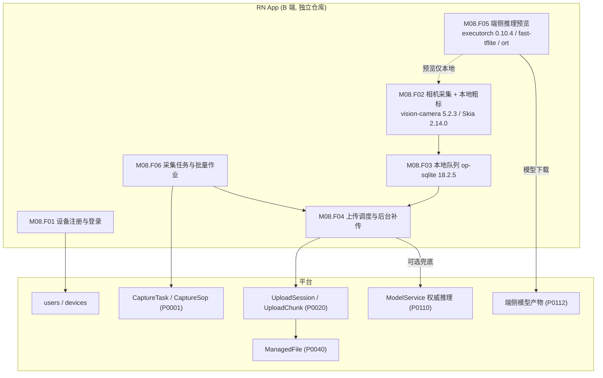
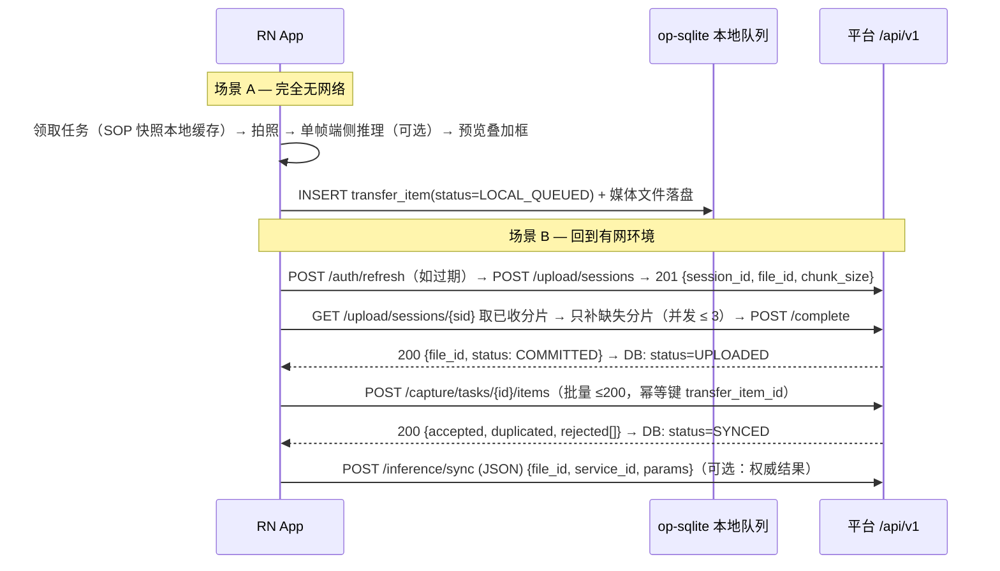
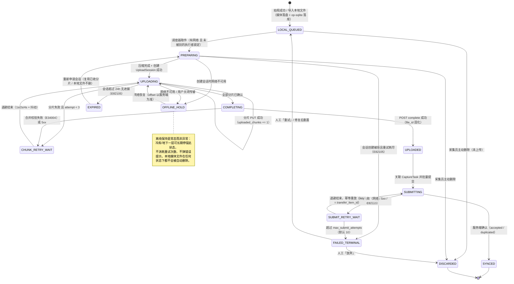
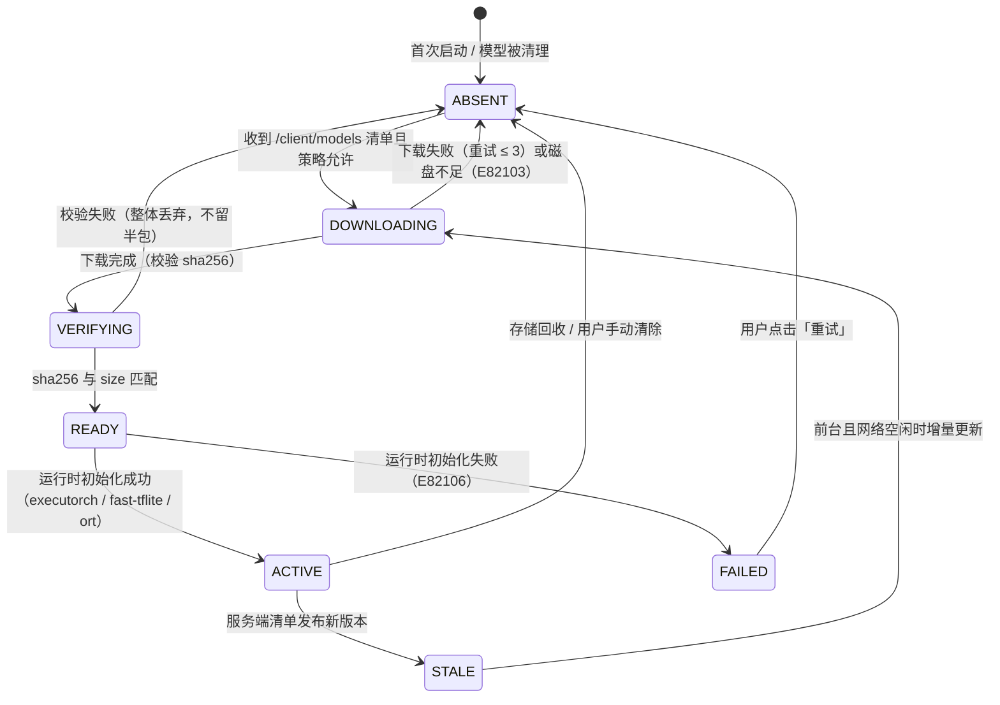
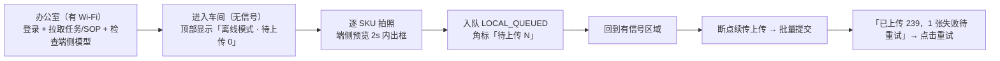

# PRD: P0121_RN客户端接入契约 (React Native Client Integration Contract)

| 属性 | 内容 |
| :--- | :--- |
| **文档编号** | P0121 |
| **项目名称** | FoodYolo |
| **功能模块** | M08_端接入 · RN 客户端接入契约 |
| **当前版本** | v1.0.0 |
| **文档状态** | Approved |
| **作者** | ClientW |
| **最后更新** | 2026-10-01 |

---

## 1. 全局说明

> [!IMPORTANT]
> **核心定位**: React Native App 是 **B 端现场采集客户端**（独立仓库），服务采集员与品控员。与小程序（P0120）的本质差别：**① 必须能在完全离线环境下连续采集并持久化；② 具备端侧推理，用于现场「即时预览」；③ 承担批量作业与断点续传上传。**
> 端侧推理结果**只用于现场即时反馈**，平台推理结果才是权威结论，冲突时以平台为准。端侧模型的**输入尺寸 / 量化 / 耗时均为待实测确认的假设**，本文不给出任何未经测量的数字。
> **一期能力口径（与 P0110 一致）**: 平台推理**只做目标检测**，返回 `detections`（`bbox` 为原图绝对像素）与 `image_size`，**不返回日期文本**；OCR 属二期可选扩展，端上须防御式渲染。

### 名词解释

| 术语 | 说明 |
| :--- | :--- |
| CaptureTask / CaptureSop | 采集任务与拍摄标准作业流程（P0001）；App 内以快照形式只读展示 |
| UploadSession / UploadChunk | 断点续传上传的权威实体（P0020）；App **不自建上传协议** |
| 本地队列 (Local Queue) | App 内基于 `@op-engineering/op-sqlite` 的持久化待传队列，是**离线采集的唯一事实源** |
| 传输项 (Transfer Item) | 本地队列中的一条待上传记录，与一个本地媒体文件一一对应 |
| 补传 (Backfill) | 网络恢复后由调度器自动续传本地队列中的传输项 |
| tus 类续传协议 | 「offset 查询 + 幂等分片 + 完成确认」的续传语义；**对齐语义但不引入 tus 服务端**，服务端仍是 P0020 `UploadSession` |
| 端侧推理 / 权威结果 | 设备本地量化模型推理（**仅预览**）/ 平台 `ModelService` 结果（用于入库与回流） |
| 派生资产 (Derived Asset) | 端侧生成的缩略图、压缩副本、预览标注图；**不上传**，仅本地展示 |
| `transfer_item_id` | 客户端生成、终身不变的 UUID，是上传与提交的**幂等键** |

### 选型事实（已调研，2026-10）

| 依赖 | 版本 | 用途 |
| :--- | :--- | :--- |
| `react-native-vision-camera` | 5.2.3 | 相机、拍照、连拍、帧处理（Frame Processor） |
| `react-native-executorch` | 0.10.4 | 端侧推理运行时，含 YOLO 目标检测支持 |
| `react-native-fast-tflite` | 3.0.1 | LiteRT / TFLite 后端（备选运行时） |
| `onnxruntime-react-native` | 1.24.3 | ONNX 运行时（备选，用于 ONNX 导出产物） |
| `@op-engineering/op-sqlite` | 18.2.5 | 本地队列与元数据持久化 |
| `@shopify/react-native-skia` | 2.14.0 | 自绘标注画布与预览叠加层 |

> [!WARNING]
> **明确禁用**: `react-native-background-upload` 自 **2022-10 起停止维护**，不得引入。后台上传必须**自建**：`op-sqlite` 队列（事实源）+ 原生侧系统级后台传输（iOS `URLSession` background configuration / Android `WorkManager` + 前台服务）+ 对 P0020 `UploadSession` 的续传调用。

### 统一异常处理

| Code | 场景 | 处理策略 |
| :--- | :--- | :--- |
| `E82101` | 设备未注册 / 设备指纹被吊销 | 阻断业务操作进入注册流程；本地队列**保留不清空** |
| `E82102` | 登录态过期且 `refresh_token` 失效 | 进入登录页；本地队列与已采集文件**完整保留**，登录后自动补传 |
| `E82103` | 本地存储不足（< 500 MiB 或 < 队列总大小 × 1.2） | 暂停采集并强提示清理；**禁止静默丢弃**任何未上传传输项 |
| `E82104` | 分片上传失败 | 指数退避重试 ≤ 3 次；仍失败转 `CHUNK_RETRY_WAIT`，由调度器稍后接管 |
| `E82105` | 上传会话过期（> 24h 无进展，P0020 语义） | 重新申请会话并复用已收分片；本地文件不删除 |
| `E82106` | 端侧模型不可用（未下载 / 校验失败 / 运行时初始化失败） | 预览降级为「原图 + 无框」，**不阻断采集** |
| `E82107` | 端侧推理耗时超阈值（阈值待实测确认） | 关闭逐帧推理，降为「拍照后单次推理」；埋点上报实测耗时 |
| `E82108` | 端侧结果与平台结果不一致 | 以平台结果为准；本地记录差异用于评估端侧模型质量 |
| `E82109` | 后台传输被系统挂起 / 应用被 kill | 传输项保持 `UPLOADING` 或回 `LOCAL_QUEUED`；下次启动按服务端已收分片续传 |
| `E82110` | GPS / EXIF 写入失败（无权限或无信号） | 允许采集，字段置空并标 `metadata_incomplete=true` |
| `E82111` | 采集任务已被他人领取 / 已关闭 | 本地已采集内容保留，提示可转投其他任务 |
| `E82112` | 批量作业超过服务端上限（单请求 ≤ 200） | 客户端自动分批（默认 50/批），**不因上限失败** |
| `E82113` | 提交回平台失败（网络 / 5xx） | 提交动作进入本地队列，幂等键 = `transfer_item_id`，可重放 |
| `E82114` | 设备时间被手动修改导致时间戳乱序 | 以 `server_time` 校正漂移；失败时记录 `client_time` 与 `clock_skew_ms` |
| `E82115` | 同一媒体文件重复入队 | 按 `(local_file_sha256, size_bytes)` 去重，第二次入队直接拒绝 |

---

## 2. 项目背景

### 背景 (Context)
采集员的工作现场是**产线、冷库、仓库卸货口**——普遍没有稳定 Wi-Fi，4G 时断时续甚至完全无信号。同时现场需要**当场判断「这张能不能用」**（日期区域是否清晰、是否被反光遮挡）。若每拍一张都要等上传+服务端返回，现场节奏会被彻底打断。因此 B 端 App 必须同时满足两件看似矛盾的事：**离线连续采集** + **当场获得视觉反馈**。

### 问题陈述 (Problem Statement)
1. **网络是最不可控变量**：冷库与地下一层无信号，采集必须能在完全离线状态下持续进行且不丢数据。
2. **后台上传没有现成方案**：`react-native-background-upload` 已于 2022-10 停更，继续使用等于把上传链路押在无人维护的库上。
3. **断点续传语义必须统一**：切后台、被系统 kill、跨网络切换都会中断上传；客户端若自建协议会与 P0020 的 `UploadSession` 权威状态冲突。
4. **现场即时反馈缺位 + 批量压力**：没有端侧推理时，采集员要等上传完成才知道「拍废了」，一次返工就是一趟来回；而单次任务动辄数百张，逐个同步会耗尽电量与带宽。

### 目标与成功指标 (Goals & Success Metrics)
*   **北极星指标**: 在**完全无网络**环境下连续采集 **≥ 4 小时 / ≥ 500 张**，恢复网络后 **0 丢失**地补传完成。
*   **次要指标**: 断网→恢复后补传启动延迟 ≤ **5 秒**（前台）；上传成功率（含重试）≥ **99%**；跨网络切换不产生重复文件；端侧推理耗时**有实测数字**（P50/P95）并据此决定逐帧预览是否开启；存储不足导致的采集中断 = **0**；App 崩溃/被 kill 后本地队列恢复率 **100%**。

### 风险与规避 (Risks & Mitigation)

| 风险 | 影响 | 规避方案 |
| :--- | :--- | :--- |
| 后台上传自建成本被低估 | 交付延期 | 先交付「前台续传 + 回前台自动补传」，后台上传作为**独立增量**（M08.F04），互不阻塞 |
| 端侧模型实测不达预期（慢/大/不准） | 预览体验差 | 端侧定义为**可选能力**，规格全部标「待实测确认」；关闭后 App 功能完整 |
| iOS 后台传输被系统回收 | 后台上传中断 | 依赖 `URLSession` background 的断点续传；每次启动/进前台对账 |
| 本地 SQLite 队列损坏 | 采集记录丢失 | WAL 模式；每日启动做完整性检查；媒体文件独立于数据库存于文件系统 |
| 设备存储被媒体吃满 | App 崩溃 / 采集中断 | 采集前空间预检（`E82103`）+ 已同步副本按策略回收 |
| 端侧与平台结果长期不一致 | 采集员信任错误结论 | 抽样对比，差异率超阈值时**自动关闭端侧预览**并告警（P0132） |

---

## 3. 价值模型

*   **方案**: 以「**本地队列为唯一事实源**」的离线优先架构——拍照即落本地队列（媒体文件 + 元数据），上传、提交、推理都是**队列的消费者**而非前置条件；端侧推理作为队列生产阶段的可选增强，给出现场即时反馈；上传链路完全复用平台 `UploadSession` / `UploadChunk`，客户端只实现「offset 查询 + 幂等分片」的 tus 类语义。
*   **目标**: 采集动作与网络状态**完全解耦**（离线照常采集、联网自动补传）；上传链路可观测、可续传、可去重且不与服务端状态打架；端侧推理的收益与代价都有实测数字支撑，可随时开关而不影响主线。

---

## 4. 项目范围

### 功能结构图



### In Scope (包含范围)
1. **设备注册与身份**：设备指纹登记、登录/续期、设备级令牌吊销。
2. **相机采集**：拍照、连拍、可选录像、EXIF/GPS 采集、SOP 引导叠加、Skia 本地粗标画布。
3. **本地队列**：`op-sqlite` 持久化传输项、状态机、去重、空间预检与回收。
4. **断点续传上传**：向 P0020 的 `UploadSession` / `UploadChunk` 提交，offset 查询、幂等分片、会话过期重建。
5. **后台补传**：系统级后台传输（iOS `URLSession` background / Android `WorkManager` + 前台服务），由自建调度器驱动。
6. **端侧推理**：量化模型下载与校验、帧处理/单次推理、预览叠加、耗时上报（规格待实测确认）。
7. **采集任务与批量作业**：任务领取、批量提交、分批（≤200/请求）、幂等重放。

### Out of Scope (不包含范围)
*   **训练 / 数据集管理 / 质检**：App 只做采集侧。
*   **使用 `react-native-background-upload`**：明确禁用（已停更）。
*   **引入 tus 服务端**：只对齐续传语义，服务端权威实体仍是 P0020 的 `UploadSession`。
*   **端侧结果直接写入平台数据集**：端侧结论**不落库**，只有平台推理结果入库。
*   **视频流的端侧逐帧推理**：仅对**拍照后的单帧**推理；实时流推理需实测后再定。
*   **多租户 / 多组织**；**iOS / Android 之外的平台**（Web / HarmonyOS）。

---

## 5. 业务流程

### 5.1 离线采集 → 补传 → 权威推理



### 5.2 本地队列状态机（离线队列）



> **端侧推理与上传状态解耦**：`local_inference` 是传输项上的**独立字段**（`PENDING / DONE / SKIPPED / FAILED`），不参与上述状态机；端侧推理失败或不可用**不影响**上传与提交。

### 5.3 端侧模型资源状态机



### 5.4 端侧预览与平台结果的优先级

端侧结果仅作**过渡展示**：平台 `/inference/sync` 返回后**覆盖**端侧展示并记录端云差异埋点（`E82108`）；若平台调用失败，保留端侧预览但标注「未经服务端确认」。两侧结果分别存于 `authoritative_result_json` 与 `local_preview_result_json`，互不覆盖。

---

## 6. 用户分析

### 6.1 用户画像 (User Personas)

| 角色 | 核心职责 | 核心诉求 | 核心痛点 |
| :--- | :--- | :--- | :--- |
| **B1 现场采集员**（主） | 按 SOP 在产线/仓库拍摄指定 SKU | 离线也能拍；拍完立刻知道「这张行不行」 | 冷库无信号；拍废了要回办公室才知道，白跑一趟 |
| **B2 品控巡检员** | 巡线抽检，逐批次拍摄并记录 | 拍照带时间/位置，能证明「何时何地拍的」 | 车间内 GPS 漂移；时间戳不可信 |
| **B3 采集组长** | 派单、看进度、收尾 | 知道谁采了多少、还剩多少 | 采集员说「传上去了」但平台里没有 |
| **B4 算法同学** | 消费采集数据做训练 | 数据带正确元数据、不重复 | 重复图片与元数据缺失导致清洗成本高 |

### 6.2 用户链路图 (User Journey Map)



---

## 7. 功能需求

> 端接口统一挂载 `/api/v1`。上传语义与字段**以 P0020 为准**，推理接口**以 P0110 为准**，采集任务**以 P0001 为准**；本模块只规定客户端如何消费。

### M08.F01 设备注册与身份绑定 (Device Registration & Identity)

*   **用户故事**: 作为采集员，我希望只在第一次打开 App 时登录一次，之后即使长时间离线也不用反复登录。
*   **逻辑与业务规则**: **前置** App 已安装，首次注册必须联网。**主流程** 1) 生成**设备指纹** `device_id`（安装级随机 UUID，存 Keychain/Keystore，**不采集** IMEI/MAC 等不可重置标识）；2) `POST /client/devices` 上报 `{device_id, platform, os_version, app_version, model, push_token?}`；3) 以平台账号登录，平台将 `device_id` 与 `user_id` 绑定；4) 签发 `access_token`(JWT 2h) 与 `refresh_token`(30d，可吊销)；5) 离线期令牌过期**不阻断采集与本地队列操作**，只阻断需要服务端的功能。**多设备** 同一账号允许多设备，`(user_id, device_id)` 唯一。**后置** `devices` 表存在一行，本地缓存 `device_id` 与令牌。
*   **验收标准**
    ```gherkin
    场景: 首次注册并登录
      Given 一台全新的安装
      When 采集员完成登录
      Then 平台 devices 表新增一行且 device_id 稳定（重装前不变）
      And App 本地安全存储中存在 refresh_token，后续 30 天内离线启动不再要求登录

    场景: 账号在后台被停用
      Given 管理员在平台停用了该账号
      When App 尝试刷新令牌
      Then 返回 401 且 code=E82102，App 进入登录页
      And 本地队列与已采集媒体文件完整保留（数量与状态不变）
    ```
*   **边界情况与异常处理**

    | 场景 | 处理 |
    | :--- | :--- |
    | 用户卸载重装 | `device_id` 重新生成；旧设备记录由平台按 90 天闲置回收 |
    | 系统时间被修改 | 以服务端 `Date` 头校正漂移，记录 `clock_skew_ms`（`E82114`） |
    | 登录时无网络 / 推送令牌获取失败 | 提示「首次使用需要联网登录一次」，不做假登录态；`push_token` 可空、后续重试 |

### M08.F02 相机采集与帧处理 (Camera Capture & Frame Processing)

*   **用户故事**: 作为采集员，我希望按 SOP 指引拍照，并在拍完的瞬间看到日期区域被框出来，以便当场决定要不要重拍。
*   **逻辑与业务规则**: **前置** 相机权限已授予，采集任务已领取且 SOP 已本地缓存。**主流程** 1) `vision-camera` 打开后置相机，用 Skia 在预览层叠加**引导框/水平线/距离提示**（来自 SOP）；2) 拍照支持单张与连拍（间隔由 SOP 配置，默认 1.5s），输出本地 `file://`；3) 采集元数据：服务端校正后的拍摄时间、GPS（若有权限与信号）、设备型号、`sop_version`、`capture_task_id`、SKU 标识；4) 生成派生资产：缩略图（长边 320）与预览图（长边 1600）；5) 写入本地队列 `LOCAL_QUEUED`，媒体原文件保存在 App 沙盒媒体目录。**帧处理（可选）** 预览流上可用 Frame Processor 做轻量质量检测（清晰度/过曝）实时提示；**能否承载端侧模型推理需实测确认**（见 M08.F05）。**本地粗标** 用 Skia 2.14.0 绘制画布（拖拽画矩形、删除、缩放/平移），结果写入 `local_annotation_json`（归一化坐标），**仅随 `metadata_json` 作为参考提交**，不写入平台 `Annotation`（正式标注归属 P0060，须经 `AnnotationTask` 流程），平台侧 `DataSample.annotation_status` 保持 `UNLABELED`。**后置** 本地队列新增一条 `transfer_item`，元数据齐备或标记缺失。
*   **验收标准**
    ```gherkin
    场景: 按 SOP 连拍
      Given 采集任务要求每个 SKU 拍 6 张，SOP 版本 3
      When 采集员连续拍摄 6 张
      Then 本地队列新增 6 条 transfer_item，状态均为 LOCAL_QUEUED
      And 每条记录携带 capture_task_id、sop_version=3、sku、拍摄时间与设备型号
      And 缩略图已生成（长边 320），且全程未发起任何网络请求

    场景: 相机权限被拒绝
      Given 用户在系统设置中拒绝了相机权限
      When 进入采集页
      Then 展示权限说明与「去设置」入口，不进入相机预览，且不产生空队列项
    ```
*   **边界情况与异常处理**

    | 场景 | 处理 |
    | :--- | :--- |
    | 采集过程中来电/切后台 | 相机会话暂停；已拍内容已落盘，不受影响 |
    | GPS 无信号（车间内漂移） | 允许采集并记录 `gps_accuracy_m`；精度 > 100m 时标 `metadata_incomplete`（`E82110`） |
    | 存储空间不足 / 连拍温度过高 | 每 20 张校验一次余量，低于阈值即暂停并提示（`E82103`），已拍内容全部保留；动态降级为暂停帧处理与端侧预览 |
    | 拍摄过程 App 崩溃 | 媒体文件已独立落盘；重启后扫描媒体目录与队列对账，孤儿文件补建队列项 |
    | 图片旋转 / 高分辨率绘制 | 按 EXIF 校正后方向计算坐标；编辑时用预览图绘制，提交时按比例映射回原图；0 面积框丢弃 |

### M08.F03 本地队列与断点续传上传 (Offline Queue & Resumable Upload)

*   **用户故事**: 作为采集员，我希望拍完不用管，等有网了自己传上去，中途断网也不会从头再来。
*   **逻辑与业务规则**: **前置** 存在 `LOCAL_QUEUED` 传输项，网络可用，令牌有效（否则先刷新）。**主流程** 1) 调度器按 `created_at` 升序取件（默认并发 **3** 个传输项，每项串行分片）；2) 上传前压缩（长边 > 2048 时压缩，JPEG 质量按 SOP，默认 90），压缩产物随传输项记录以免重复计算；3) `POST /upload/sessions`（可批量声明多个文件）取 `session_id`/`file_id`/`chunk_size`；4) **续传判定**：`GET /upload/sessions/{sid}` 拉取服务端已收分片索引，只补缺片，**不信任本地 `uploaded_chunks`**；5) 分片 `PUT` 携带 `X-Chunk-Sha256`，2xx 即认为该片已收；6) 全部收齐后 `POST /complete` 提交 `size_bytes` 与整文件 `sha256`，成功即 `UPLOADED` 并固化 `file_id`。**tus 类语义对齐** 客户端实现「offset 查询 → 幂等分片 → 完成确认」三段式；分片 `PUT` 对同一 `(session_id, file_id, index)` 幂等，**不引入 tus 服务端依赖**。**会话过期** `E82105` → 重新 `POST /upload/sessions`，服务端按 `size_bytes + sha256` 复用（命中 P0020 `E22009`）。**后置** `transfer_item.status = UPLOADED` 且 `file_id` 由 `ManagedFile(owner_type=CLIENT_UPLOAD, status=COMMITTED)` 支撑。
*   **验收标准**
    ```gherkin
    场景: 断点续传只补缺失分片
      Given 一个 40 MiB 的视频文件已成功上传分片 0..6（共 10 片）
      When App 被系统 kill 后重新启动并恢复传输
      Then 客户端先 GET /upload/sessions/{sid}
      And 仅提交分片 7、8、9，不重复提交 0..6
      And 最终 complete 成功且 file_id 与中断前一致

    场景: 会话过期后重建而不重传，且 Wi-Fi 切换 4G 不产生重复文件
      Given 一个传输项的 UploadSession 已超过 24h 未推进
      When 调度器再次取件上传，并在上传中途从 Wi-Fi 切到 4G
      Then 客户端重新创建 UploadSession（正确处理 E82105），服务端按 (size_bytes, sha256) 复用既有文件
      And 连接中断被识别为可重试错误，重连后仅补传剩余分片
      And complete 后 ManagedFile 仅有 1 条记录，且本地媒体文件未被删除
    ```
*   **边界情况与异常处理**

    | 场景 | 处理 |
    | :--- | :--- |
    | 服务端磁盘满 | `507 + E34007`；转 `CHUNK_RETRY_WAIT` 并延长退避，提示用户联系管理员 |
    | 分片校验失败 `E22002` | 丢弃该片重传；连续 3 次失败则转 `FAILED_TERMINAL` 并上报日志（`E82104`） |
    | 令牌在上传中途过期 | 刷新令牌后重放当前分片请求；已收分片不丢 |
    | 本地文件被系统清理 | 校验存在性；缺失则标 `FAILED_TERMINAL` 并保留队列项供人工处理，**不静默删除** |
    | 队列积压 1000+ 项 | 并发仍为 3；UI 显示剩余数量与预估时间，**不提升并发**（避免打满单机带宽） |

### M08.F04 上传调度与后台补传 (Transfer Scheduling & Background Backfill)
*   **用户故事**: 作为采集员，我希望 App 在后台也能慢慢把照片传上去，不用一直把 App 开在前台。
*   **逻辑与业务规则**: **前置** 存在未完成传输项，系统允许后台执行。**主流程** 1) **前台**：进入前台或网络变为「已连接」时立即触发一次调度 tick；2) **后台（自建）**：iOS 用 `URLSession` background configuration 提交分片 `PUT`，App 被挂起甚至终止后由系统继续，完成后经 `URLSessionDidFinishEvents` 唤醒对账；Android 用 `WorkManager`（`NetworkType.CONNECTED`）驱动，长时传输使用前台服务 + 通知（采集场景用户可接受）；3) **对账（reconcile）**：每次启动 / 回前台 / 后台任务结束，执行「本地队列 vs 服务端会话」对账——`GET /upload/sessions/{sid}` 校正 `uploaded_chunks`，重置卡在 `UPLOADING` 超过 10 分钟且无进展的项；4) **网络策略**：默认「大文件（> 50 MiB）仅 Wi-Fi，照片任意网络」，可在设置中改为「仅 Wi-Fi」。**不依赖 `react-native-background-upload`**：后台传输由原生模块实现，JS 侧只消费状态。**后置** 传输项在无用户交互下推进至 `UPLOADED`，对账后本地进度与服务端一致。
*   **验收标准**
    ```gherkin
    场景: App 被系统 kill 后仍能续传
      Given 一个 12 MiB 的照片传输项已提交 4/6 分片
      When 系统在后台回收了 App 进程
      Then 系统级后台传输继续完成剩余分片（iOS）或在下个 WorkManager 窗口继续（Android）
      And 用户下次打开 App 时该传输项状态为 UPLOADED，无需人工干预（E82109）

    场景: 对账修正本地错误进度
      Given 本地记录 uploaded_chunks=6，但服务端实际只收到 4
      When App 进入前台触发对账
      Then 本地 uploaded_chunks 被校正为 4，补传分片 4、5，最终文件完整性校验通过
    ```
*   **边界情况与异常处理**

    | 场景 | 处理 |
    | :--- | :--- |
    | iOS 后台传输被系统限流 | 不报错，保持 `UPLOADING`；下次前台 tick 对账续传 |
    | Android 厂商 ROM 杀后台 | 依赖 `WorkManager` 周期任务兜底；引导用户将 App 加入白名单 |
    | 用户关闭 App 后台数据 | 网络探测失败 → `OFFLINE_HOLD`，不累计失败次数 |
    | 后台任务与前台 tick 并发 | 以 `transfer_item.lock_token` 互斥，同一项同一时刻只有一个执行者 |

### M08.F05 端侧推理与现场即时预览 (On-device Inference & Instant Preview)

> [!WARNING]
> 本节所有**模型规格与性能数字均为待实测确认的假设**。实测报告产出前，端侧预览默认**关闭**（开关由 `/client/models` 的 `policy` 控制），且不得据此做交付承诺。

*   **用户故事**: 作为采集员，我希望拍完立刻在屏幕上看到日期区域被框出来，以便当场判断这张能不能用。
*   **逻辑与业务规则**: **前置** 端侧模型资源处于 `ACTIVE`（见 5.3），设备未被策略禁用。**主流程** 1) 启动时 `GET /client/models` 拉取清单（`model_version_id`/`format`/`url`/`sha256`/`size_bytes`/`input_spec`/`policy`）；2) 按 5.3 状态机下载并校验，同一时刻仅保留一个 `ACTIVE` 模型；3) 拍照后对**单帧预览图（长边 1600）**执行推理，输出检测框；4) Skia 叠加层将 `detections` 与照片对齐绘制，同时叠加 SOP 引导线；5) `POST /client/telemetry` 上报实测指标（`model_version_id`/`device_model`/`backend`/`input_size`/`latency_ms`）。**与平台结果的优先级** 端侧结果仅作**过渡展示**，平台推理返回后**覆盖**端侧结果并记录 `E82108` 差异（见 5.4）。**自动熔断** 若某机型实测 P95 超策略阈值（**待实测确认**），或端云差异率超阈值，平台 `policy` 将关闭该机型的端侧预览（`E82107`/`E82108`）。**后置** `authoritative_result_json` 与 `local_preview_result_json` 分列存储，互不覆盖。
*   **端侧模型规格（全部待实测确认）**

    | 待确认项 | 为什么关键 | 实测方法 |
    | :--- | :--- | :--- |
    | 运行时选型（`executorch` 0.10.4 / `fast-tflite` 3.0.1 / `onnxruntime` 1.24.3） | 三者能力与体积差异大，直接影响交付 | 同一模型分别导出并跑通最小 demo，比较集成成本与稳定性 |
    | 模型输入尺寸 | 决定精度与耗时的权衡 | 320 / 416 / 640 三档在同一机型实测 |
    | 量化方式（int8 / fp16 / 动态量化） | 决定体积、速度与精度损失 | 各量化版本对比体积、耗时与漏检率 |
    | 模型体积与峰值内存 | 决定下载成本、本地占用与是否 OOM | 记录各后端产物字节数；推理中采样 RSS 峰值 |
    | 单帧推理耗时 P50 / P95（目标机型） | 决定逐帧预览是否可行 | 目标安卓机型 × 500 次实测 |
    | 连续推理的发热与降频曲线 | 决定长时间采集能否维持 | 连续 10 分钟压测记录帧率衰减 |
    | 端侧与平台结果差异率 | 决定端侧结果能否采信 | 抽样 500 张对比 IoU 与类别一致性 |

    > 上表全部结论为 **待实测确认**，未产生实测数字前不得写入任何性能承诺。
*   **验收标准**
    ```gherkin
    场景: 端侧预览不阻断采集
      Given 端侧模型处于 ABSENT（未下载）
      When 采集员拍照
      Then 照片正常入队（LOCAL_QUEUED），预览显示「端侧预览不可用」角标
      And 不产生任何错误弹窗阻断拍摄

    场景: 端侧结果被平台结果覆盖，且熔断可关闭预览
      Given 端侧预览对某张图给出 2 个检测框，而平台 /inference/sync 返回 1 个
      When 平台响应到达
      Then 界面最终展示平台的 1 个检测框，本地分别保留两侧结果并记录端云差异埋点（E82108）
      When 平台下发 policy 中该机型 on_device_enabled=false 且 App 刷新 /client/models
      Then 不再加载端侧模型并释放其内存与磁盘占用，采集与上传流程不受影响
    ```
*   **边界情况与异常处理**

    | 场景 | 处理 |
    | :--- | :--- |
    | 模型下载中途断网 | 支持 Range 续传；校验失败整体丢弃（不留半包） |
    | 低端机 OOM | 捕获异常 → 该机型标记不支持并上报；转「拍照后单次推理」或彻底关闭 |
    | 端侧推理卡住（不返回） | 单次推理设硬超时；超时即放弃并上报（`E82107`） |
    | 推理中连续拍照 | 推理队列深度 = 1，只处理最新一帧；跳过的帧上报 `skipped` 计数 |
    | 设备时间跳变 | 耗时统计使用单调时钟，不使用墙钟 |

### M08.F06 采集任务与批量作业 (Capture Tasks & Batch Jobs)

*   **用户故事**: 作为采集员，我希望一次把几十张照片一起交上去，而不是一张一张点提交。
*   **逻辑与业务规则**: **前置** 已登录，任务已领取（`POST /capture/tasks/{id}:claim`）。**主流程** 1) 启动时拉取「我的任务」与 SOP 快照并本地缓存（含 `sop_version`、必拍部位、张数要求）；2) 采集完成后把 `UPLOADED` 的传输项按任务聚合；3) `POST /capture/tasks/{id}/items` 批量提交，**单请求 ≤ 200 项**，超出自动分批（默认 50/批）；4) 每项携带 `file_id`、`sku`、`capture_time`、`metadata_json`（EXIF/GPS/设备）、`local_preview_result_json`（仅参考）、`local_annotation_json`（仅参考）、`transfer_item_id`（幂等键）；5) 服务端返回逐项结果 `accepted[]` / `duplicated[]` / `rejected[{transfer_item_id, code}]`；6) 客户端据返回更新状态：`accepted`/`duplicated` → `SYNCED`，`rejected` 按错误码决定重试或转人工；7) `POST /capture/tasks/{id}/submit` 触发平台侧验收（P0001 语义）。**幂等** `transfer_item_id` 终身不变，服务端以其为幂等键，重复提交返回既有结果（不产生重复 `DataSample`）。**后置** 传输项 `SYNCED`；平台侧生成对应采集产物与验收记录。
*   **验收标准**
    ```gherkin
    场景: 大批量自动分批且不重复
      Given 一个任务下已上传 437 张照片（状态 UPLOADED）
      When 采集员点击 [批量提交]，且其中一批的响应丢失后客户端重放
      Then 客户端共发出 9 个请求（每批 50，最后一批 37），全部返回 200
      And 重放的一批返回 duplicated=50、accepted=0
      And 平台侧产生的 DataSample 数量恰好 437，437 个传输项全部变为 SYNCED

    场景: 部分项被拒
      Given 一批 20 项中有 2 项的 file_id 已被 GC 标记为 DELETED
      When 提交该批
      Then 返回 accepted=18、rejected=2；这 2 项在本地位于 FAILED_TERMINAL，其余 18 项为 SYNCED
    ```
*   **边界情况与异常处理**

    | 场景 | 处理 |
    | :--- | :--- |
    | 任务已被他人领取 / 已关闭 | `E82111`；已采集内容保留，提示可转投其他任务 |
    | 提交时部分图片仍在上传 | 只提交 `UPLOADED` 的项；其余传输完成后自动进入下一批，不阻塞提交 |
    | 平台侧验收打回 | 由平台通知（P0132 + 任务状态变更），App 拉取打回清单并在本地标红 |
    | 任务 SOP 在本地缓存后更新 | 展示当前缓存快照并标 `sop_stale=true`；**不静默切换版本**（保证现场一致性） |
    | 本地队列混有多个任务的文件 | 按 `capture_task_id` 分组提交，不做跨任务合并请求 |

### 7.7 接口清单（RN App ↔ 平台）

> Base URL `https://<platform-host>/api/v1`；鉴权 `Bearer` = `Authorization: Bearer <access_token>`。上传与推理的请求/响应体以 P0020 / P0110 为准，本表只列客户端使用的字段子集。

| # | 路径 | 方法 | 鉴权 | 入参 | 出参 | 错误码 |
| :--- | :--- | :--- | :--- | :--- | :--- | :--- |
| 1 | `/client/devices` | POST | Bearer | `device_id`, `platform`, `os_version`, `app_version`, `model`, `push_token?` | `device_row_id`, `bound` | `E82101` |
| 2 | `/auth/login` | POST | — | `username`, `password`, `device_id` | `access_token`, `refresh_token`, `expires_in`, `user{id,role}` | `E82102` |
| 3 | `/auth/refresh` | POST | — | `refresh_token` | `access_token`, `expires_in` | `E82102` |
| 4 | `/capture/tasks` | GET | Bearer | `assignee=me`, `status`, `updated_after?` | `items[{task_id,batch_id,sop_version,required_shots,status,progress}]` | `E82102` |
| 5 | `/capture/tasks/{id}` | GET | Bearer | `include_sop=true` | `task`, `sop_snapshot{version,angles,lighting,min_shots}` | `E82111` |
| 6 | `/capture/tasks/{id}:claim` | POST | Bearer | — | `status=IN_PROGRESS`, `claimed_at` | `E82111` |
| 7 | `/capture/tasks/{id}/items` | POST | Bearer | `items[{transfer_item_id,file_id,sku,capture_time,metadata_json,local_preview_result_json?,local_annotation_json?}]`（**≤200/请求**） | `accepted[]`, `duplicated[]`, `rejected[{transfer_item_id,code}]` | `E82112` `E82113` `E34008` |
| 8 | `/capture/tasks/{id}/submit` | POST | Bearer | `{sop_version, shot_count}` | `status=SUBMITTED`, `acceptance_rule_snapshot` | `E82111` |
| 9 | `/upload/sessions` | POST | Bearer | `files[{name,size_bytes,sha256,mime_type}]`（单会话多文件，建议 ≤ 50） | `session_id`, `files[{file_id,chunk_size}]`, `expires_at` | `E22004` `E82105` |
| 10 | `/upload/sessions/{sid}` | GET | Bearer | — | `status`, `uploaded:{file_id:[index...]}` | `E82105` |
| 11 | `/upload/sessions/{sid}/files/{fid}/chunks/{i}` | PUT | Bearer | body=分片, `X-Chunk-Sha256` | `204` | `E22002` `E82104` |
| 12 | `/upload/sessions/{sid}/complete` | POST | Bearer | `{file_id, size_bytes, sha256}` | `file_id`, `status=COMMITTED`, `size_bytes` | `E34004` `E34008` |
| 13 | `/client/models` | GET | Bearer | `device_model`, `platform` | `[{model_version_id,format,url,sha256,size_bytes,input_spec,policy{on_device_enabled,max_latency_ms}}]` | `E82106` |
| 14 | `/inference/sync` | POST | Bearer | **JSON** `{file_id, service_id\|model_version_id, params:{conf,iou,input_size,max_det,return_image}}`（**不重传字节**） | `{request_id, model_service_id, model_version, image_size{w,h}, detections[{cls_id,cls_name,conf,bbox[x1,y1,x2,y2]}], timing_ms}` | `E71004` `503` |
| 15 | `/inference/jobs` | POST | Bearer | `{service_id\|model_version_id, files:[file_id]（≤200）, params}` | `{job_id, status:"QUEUED"}` | `E82112` |
| 16 | `/inference/jobs/{job_id}` | GET / DELETE | Bearer | — | `status`, `progress`, `summary` / `204` | `404` |
| 17 | `/inference/jobs/{job_id}/results` | GET | Bearer | `page`, `page_size` | 结果分页（含 `detections`、`image_size`） | `404` |
| 18 | `/client/telemetry` | POST | Bearer | `[{kind:"on_device_inference",model_version_id,device_model,backend,input_size,latency_ms}]` | `202` | — |
| 19 | `/files/presign` | POST | Bearer | `owner_type`, `owner_id`, `filename`, `size_bytes`, `mime_type`, `sha256` | `file_id`, `upload_url`, `headers`, `expires_at` | `E34007` |
| 20 | `/files/{file_id}/presign` | GET | Bearer | `ttl?` | `url`, `expires_at` | `E34008` |

**载荷与语义约定**: 幂等键 `transfer_item_id`（客户端生成、终身不变），上传侧另有服务端 `(session_id, file_id, chunk_index)` 幂等；**续传以 `GET /upload/sessions/{sid}` 为准**，本地 `uploaded_chunks` 仅作缓存；`bbox = [x1,y1,x2,y2]` 为**原图绝对像素**且响应固定带 `image_size{w,h}`，端上叠加仅需按显示宽度缩放、**不做推理坐标反算**；一期推理**只返回检测框、无文本**（二期 `detections[i].text` / 顶层 `ocr{}` 为预留，端上须防御式渲染）；时间一律 ISO-8601 UTC 并同时上报 `clock_skew_ms`；`metadata_json` 为开放对象，平台原样存入 `DataSample.metadata_json`；单请求 ≤ 200 项，客户端默认 50/批。

---

## 8. 技术架构与数据模型

### 8.1 端能力 vs 平台能力职责划分（硬边界）

| 能力 | RN App（端） | 平台（服务端） | 边界说明 |
| :--- | :--- | :--- | :--- |
| 身份 | 生成并持有 `device_id`、缓存令牌 | **独占** 账号体系、设备绑定、令牌签发与吊销 | 端不产生身份，只保存凭据 |
| 媒体采集 | **独占** 相机、录像、EXIF/GPS 采集 | — | 端是唯一采集源 |
| 本地持久化 | **独占** 本地队列（`op-sqlite`）与媒体文件 | 不感知本地队列 | 离线事实源在端上 |
| 上传调度 | **独占** 取件、并发、退避、后台调度 | — | 端决定「何时传」 |
| 上传语义 | 实现「offset 查询 + 幂等分片 + complete」 | **独占** `UploadSession`/`UploadChunk` 状态、合并、完整性校验、去重 | 权威状态在服务端 |
| 文件登记 | 仅持有 `file_id` | **独占** `ManagedFile` 生命周期与 `owner_type=CLIENT_UPLOAD` | — |
| 端侧推理 | **独占** 本地推理，产出**预览** | — | 结果不落库为标注 |
| 权威推理 | 发起调用 | **独占** 推理执行、模型版本选择、结果落库 | 冲突时以平台为准 |
| 端侧模型分发 | 下载 / 校验 / 缓存 | **独占** 模型产物与分发策略（`/client/models`） | 端不自行选择模型 |
| 采集任务 | 领取、展示 SOP 快照、批量提交 | **独占** 任务下发、验收规则、状态机（P0001） | 端不做验收判定 |
| 元数据 | 采集并上报（EXIF/GPS/设备） | **独占** 校验、补全、落库 | 端上报可能缺失，标 `metadata_incomplete` |
| 标注 | 本地粗标（仅参考元数据） | **独占** 正式标注与质检（P0060/P0063） | 本地框**不得**进入数据集标注 |
| 空间管理 | 本地回收策略 | 服务端空间预检（P0040） | 两端各自管理，无共享 |

### 8.2 数据实体

平台侧新增两张支撑表；本地表只存在于 App 沙盒，**不进平台 schema**。

#### `devices`

| 字段名 | 类型 | 必填 | 说明 | 约束 |
| :--- | :--- | :--- | :--- | :--- |
| `id` / `device_id` | UUID / String(64) | Y | 主键 / 安装级设备指纹 | `device_id` UNIQUE |
| `user_id` | UUID | N | 绑定用户 | FK → users.id |
| `platform` / `device_model` / `os_version` / `app_version` | Enum / String | Y/N | 平台类型与机型版本信息 | `platform ∈ IOS\|ANDROID` |
| `push_token` / `last_seen_at` / `status` | String(256) / Timestamptz / Enum | N/Y | 推送令牌、最近活跃、`ACTIVE`\|`REVOKED` | 90 天闲置可回收；默认 ACTIVE |
| 通用字段 | — | Y | `created_at`/`updated_at`/`deleted_at` | — |

#### `client_model_artifacts`（端侧模型分发清单）

| 字段名 | 类型 | 必填 | 说明 | 约束 |
| :--- | :--- | :--- | :--- | :--- |
| `id` / `model_version_id` | UUID | Y | 主键 / 源模型版本 | FK → model_versions.id（P0085） |
| `target_platform` | Enum | Y | `MP`（小程序）/ `RN`（App） | 与 P0120 共用同一张表 |
| `format` | Enum | Y | `EXECUTORCH` / `TFLITE` / `ONNX` | RN 端可选；小程序端侧只支持 `ONNX` |
| `file_id` | UUID | Y | 权重文件 | FK → managed_files.id（`owner_type=MODEL_VERSION`） |
| `sha256` / `size_bytes` / `is_active` | String(64) / BigInt / Bool | Y | 校验、体积、是否当前有效版本 | 同 `model_version_id` + `target_platform` 下 `is_active` 唯一 |
| `input_spec` | JSONB | Y | `{w,h,layout,normalize,classes[]}` | **待实测确认**后回填 |
| `policy` | JSONB | Y | `{on_device_enabled, max_latency_ms, allowed_device_models[]}` | 平台下发 |

#### App 内本地表（`op-sqlite`，仅存在于设备）

| 表 | 关键字段 | 说明 |
| :--- | :--- | :--- |
| `transfer_items` | `id`(=`transfer_item_id`), `capture_task_id`, `media_path`, `media_sha256`, `size_bytes`, `status`, `session_id`, `file_id`, `uploaded_chunks_json`, `chunk_size`, `attempt`, `next_retry_at`, `lock_token`, `local_inference_status`, `local_preview_result_json`, `local_annotation_json`, `metadata_json`, `created_at`, `updated_at` | 本地队列**唯一事实源** |
| `transfer_logs` | `id`, `transfer_item_id`, `kind`, `code`, `detail_json`, `created_at` | 排障用，保留 7 天 |
| `model_cache` | `model_version_id`, `format`, `path`, `sha256`, `size_bytes`, `state`, `verified_at` | 端侧模型缓存 |
| `sweep_state` | `key`, `value` | 对账/清扫的游标与时间戳 |

### 8.3 架构要点

*   **离线优先**：网络是加速器不是前置条件；任何需要网络的步骤失败，都不得回滚本地已采集数据。
*   **单一事实源**：本地队列 = 端侧事实源，`UploadSession` = 服务端事实源；两者通过对账收敛，**不做双向同步**。
*   **能力可降级**：端侧推理、后台传输、批量提交三条能力彼此独立，任一失效不阻断其余两条。

---

## 9. UI/UX 规格说明

### 9.1 传输队列页

```text
+---------------------------------------------------------------+
|  ←  待上传 (12)                        [全部重试] [仅 Wi-Fi ▾] |
+---------------------------------------------------------------+
|  ⟳ 上传中  3 / 12        ██████████░░░░░░░  62%               |
+---------------------------------------------------------------+
|  img | SKU-8841 · 3 张 · 6.2 MB  UPLOADING  分片 4/6  1.4 MB/s |
|  img | SKU-8842 · 6 张 · 12.4 MB LOCAL_QUEUED  等待网络        |
|  img | SKU-8843 · 1 张 · 2.1 MB  CHUNK_RETRY_WAIT 重试 2/3 · 3s |
|  img | SKU-8844 · 6 张 · 12.0 MB FAILED_TERMINAL  [重试][放弃]  |
+---------------------------------------------------------------+
|  本地占用 3.2 GB · 剩余空间 8.1 GB    [清理已同步的本地副本]   |
+---------------------------------------------------------------+
```

采集页（含端侧预览）: 相机预览上叠加端侧检测框与 SOP 对齐线，底部显示 `已拍 4 / 6 张`、「ⓘ 离线预览结果，仅供参考」与 `[相册] (拍照) [连拍 6 张]`。批量提交确认弹窗展示 `accepted / duplicated / rejected` 明细，并提示「本地绘制的粗标框只作为参考元数据提交，不会成为数据集标注」。

### 9.2 交互元素

| 元素 | 类型 | 状态 | 行为 |
| :--- | :--- | :--- | :--- |
| 网络状态角标 | Badge | 在线 / 离线 / 弱网 | 离线时点击展示「已离线采集 N 张，联网后自动上传」 |
| 拍照按钮 | Button (Primary) | Default / Disabled / Busy | 端侧推理队列满时仍可拍，仅预览延迟 |
| 端侧预览开关 | Switch | On / Off / Unavailable | 不可用时置灰并说明原因 |
| 传输项行 | List Item | 7 态（对应 5.2） | 左滑删除（仅未上传项）、点击展开分片与日志；重试按钮在 `next_retry_at` 前禁用并倒计时 |
| 网络策略选择 | Select | 仅 Wi-Fi / 任意网络 | 立即影响调度器取件范围 |
| 本地占用条 | Progress | 正常 / 警告(>80%) / 危险(>95%) | 危险态暂停采集入口 |
| 粗标画布 | Canvas (Skia) | View / Edit | 双指缩放、单指绘制；退出自动保存草稿 |

### 9.3 表单与校验

| 字段 | 类型 | 校验规则 | 默认值 |
| :--- | :--- | :--- | :--- |
| 上传并发 / 分片大小 | 内部 | 1~3（上限写死，不可调高）/ 以服务端下发为准 | 3 / 服务端值 |
| 批量提交大小 | 内部 | 1~200 | 50 |
| 压缩长边 / 端侧推理队列深度 | 内部 | ≤ 2048 / 固定 1 | 2048 / 1 |
| 元数据完整性 | 校验 | `gps_accuracy_m > 100` 或缺失即标黄 | — |

---

## 10. 非功能性需求 (NFR)

*   **性能**: App 冷启动到可采集 ≤ 2s（中端安卓机，端侧模型**不阻塞**启动）；连拍间隔 1.5s 时连续 100 张不丢帧；12 MiB 原图压缩（长边 2048、质量 90）≤ 1.2s；1000 项队列状态列表首屏 ≤ 300ms（SQLite 索引支撑）；上传并发 ≤ 3，**不追求更高并发**（单机平台带宽与磁盘 IO 有限）；端侧推理耗时**待实测确认**，不作为承诺值。
*   **可靠性**: 本地队列 WAL 模式，崩溃后 `op-sqlite` 自动恢复，启动时对孤儿媒体文件与队列做对账；**任何状态下不得自动删除本地媒体文件**（除用户显式清理已 `SYNCED` 副本）；上传链路全程幂等，重复提交不产生重复 `ManagedFile` / `DataSample`；令牌过期、网络切换、App 被 kill 三类中断均可无人工干预恢复。
*   **安全**: 令牌存于 iOS Keychain / Android Keystore，不写入普通偏好存储；`device_id` 为安装级随机 UUID，**不采集** IMEI / MAC / 广告标识；HTTPS 强制，证书异常直接失败（调试构建除外）；媒体文件存于 App 私有沙盒，不写入系统相册；端侧模型下载校验 `sha256`，失败整体丢弃；账号停用后本地数据保留但禁止上传（`E82102`）。
*   **兼容性**: iOS ≥ 15；Android ≥ 8.0（API 26）；六个选型依赖版本在 `package.json` 锁定，升级需登记到决策表；低于 `vision-camera` 5.2.3 最低系统要求的设备**降级为相册导入**；不支持 HarmonyOS / 小程序容器 / Web。
*   **可扩展性**: 单设备本地队列 ≤ **10,000 项**、媒体占用 ≤ 20 GiB，超出应提高压缩率或降低单批采集量；服务端侧目标 **≤ 10 台设备**同时补传（单机平台），上传并发由服务端限流兜底；端侧推理后端可替换（executorch / fast-tflite / onnxruntime），通过 `format` 字段分发，**不需客户端发版**。

---

## 附录: 已确认的设计决策

| 决策项 | 结论 |
| :--- | :--- |
| 架构基调 | **离线优先**：本地 `op-sqlite` 队列是端侧唯一事实源；网络是加速器，不是前置条件 |
| 上传协议 | 复用 P0020 `UploadSession` / `UploadChunk`；客户端实现 tus 类语义（offset 查询 + 幂等分片 + complete），**不引入 tus 服务端** |
| 后台上传 | **自建**；明确禁用已停更的 `react-native-background-upload`；iOS 用 `URLSession` background、Android 用 `WorkManager` + 前台服务 |
| 端侧推理定位 | 仅作**现场即时预览**；结果不落库为标注，平台结果为准；端云不一致以平台覆盖并记录差异 |
| 端侧模型规格 | 运行时选型、输入尺寸、量化、体积、耗时**全部待实测确认**；实测前默认关闭并由 `/client/models` 的 `policy` 控制 |
| 依赖版本 | 锁定 `vision-camera` 5.2.3 / `executorch` 0.10.4 / `fast-tflite` 3.0.1 / `onnxruntime` 1.24.3 / `op-sqlite` 18.2.5 / `skia` 2.14.0 |
| 端侧模型分发 | 统一走 `/api/v1/client/models` 清单 + `ManagedFile` 下载，端不自行选模型 |
| 上传并发 | 传输项并发固定 3、分片串行；不因队列积压提升并发；调度与后台任务以 `lock_token` 互斥 |
| 幂等键 | `transfer_item_id` 客户端生成、终身不变；上传与提交双幂等 |
| 批大小 | 服务端 ≤ 200/请求；客户端默认 50/批，自动分批 |
| 本地粗标 | 仅作为 `metadata_json.local_annotation` 参考提交，**不进入** `Annotation` / 数据集 |
| 坐标与文本 | `bbox = [x1,y1,x2,y2]` 原图绝对像素 + `image_size`；一期推理无文本，OCR 为二期 |
| 文件删除 | 任何状态下不自动删除本地媒体文件；仅允许用户清理已 `SYNCED` 的本地副本 |
| E-code 区间 | 本篇占用 `E82101–E82115`（另引用上游 `E71004`）；功能编号 `M08.F01–M08.F06` |

---

## 关联文档

*   **P0001_采集项目与SOP**: `CaptureTask` / `CaptureSop` / 验收规则与领取语义
*   **P0020_本地上传与压缩包导入**: `UploadSession` / `UploadChunk` 权威定义与幂等复用（`E22009`）
*   **P0040_存储配置与桶绑定**: `ManagedFile` 生命周期与 `presign_get`
*   **P0085_模型仓库与Lineage / P0112_端侧导出**: 端侧模型产物来源 `ModelVersion` 与 `EdgeExport`
*   **P0110_模型服务管理**: 权威推理接口（`/inference/sync`、`/inference/jobs`）与二期 OCR 扩展位
*   **P0120_小程序接入契约 / P0122_开放API与鉴权**: C 端轻客户端对照；对外鉴权模型与限流配额
*   **P0060_标注器与标注几何 / P0063_质检与返工**: 正式标注与质检（App 本地粗标不进入该链路）
*   **P0131_审计日志 / P0132_告警中心**: 设备吊销、端云差异率超阈值的告警

---

## Changelog

| 版本 | 日期 | 作者 | 变更说明 |
| :--- | :--- | :--- | :--- |
| v0.1.0-draft | 2026-10-01 | ClientW | 初稿：使用 `react-native-background-upload` 作为后台上传方案 |
| v0.9.0-draft | 2026-10-01 | ClientW | 选型更正：该库自 2022-10 停更，改为自建（op-sqlite 队列 + 系统级后台传输）；端侧推理规格改为待实测确认；对齐 P0110 推理契约（JSON + `file_id`、原图绝对像素 bbox + `image_size`） |
| v1.0.0 | 2026-10-01 | ClientW | 正式发布：补齐离线队列与端侧模型状态机、端侧预览优先级流程、职责划分表、接口清单与 NFR |
