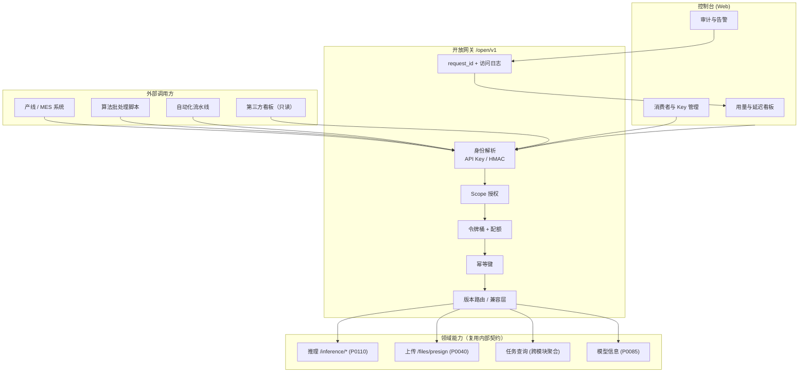
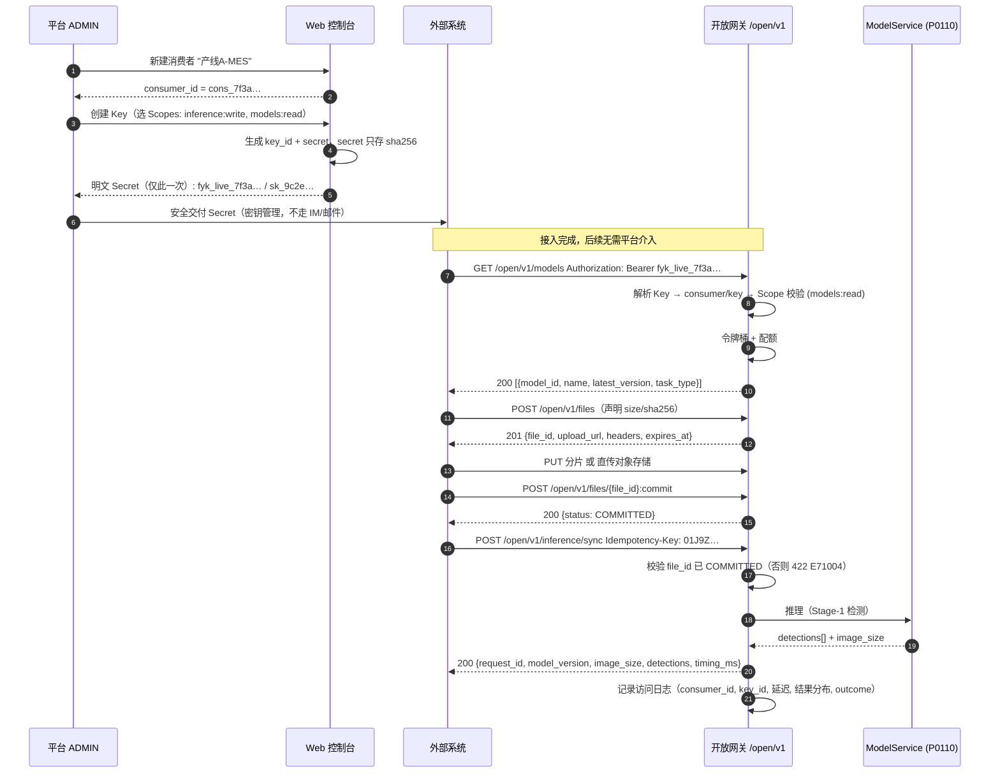
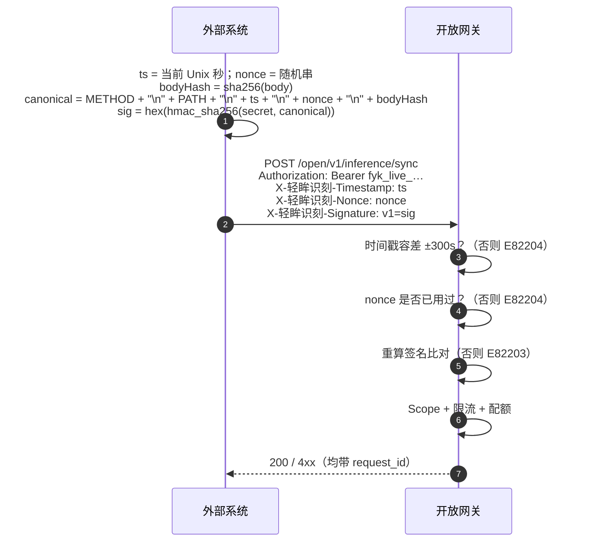
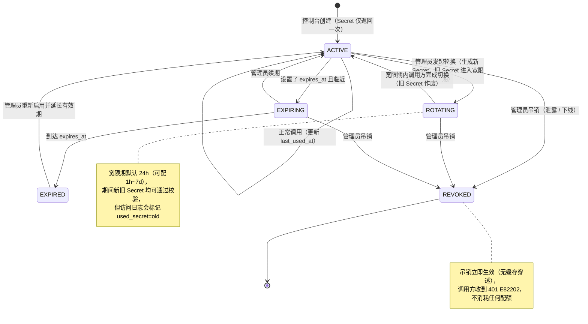
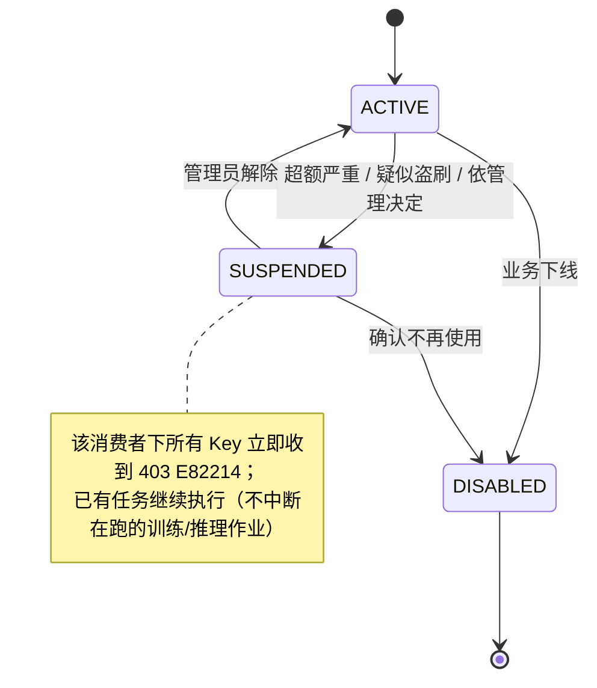
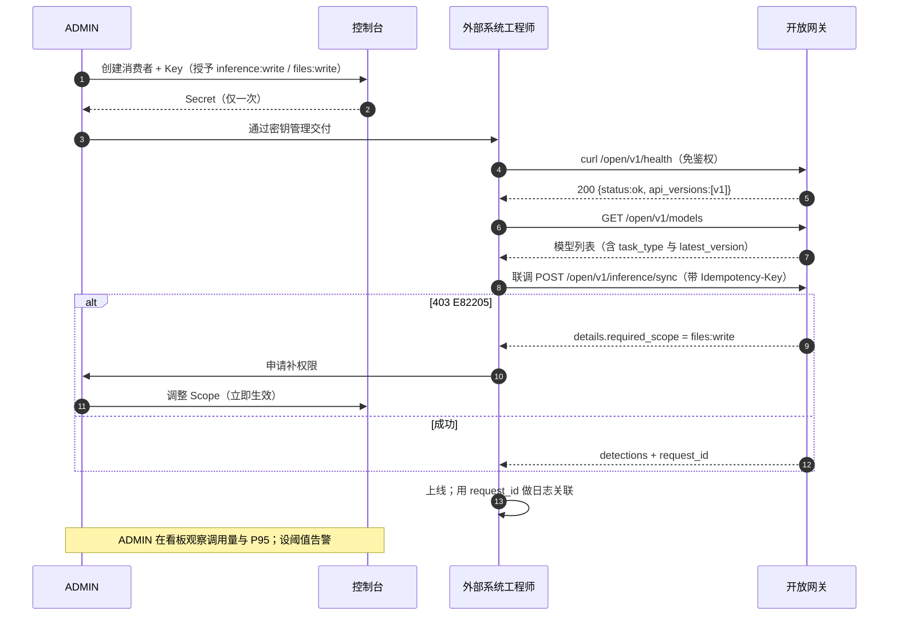
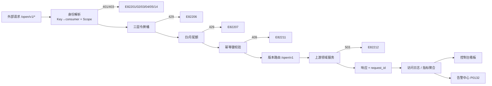
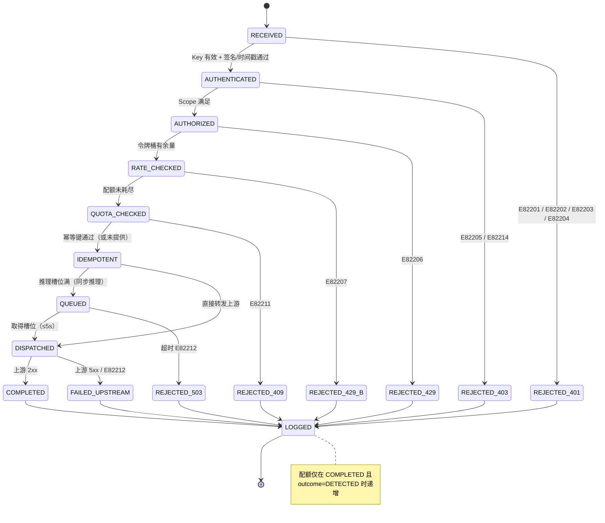

# PRD: P0122_开放API与鉴权 (Open API & Authentication)

| 属性 | 内容 |
| :--- | :--- |
| **文档编号** | P0122 |
| **项目名称** | 轻眸识刻 |
| **功能模块** | M08_端接入 · 开放 API 与鉴权 |
| **当前版本** | v1.0.0 |
| **文档状态** | Approved |
| **作者** | ClientW |
| **最后更新** | 2026-10-01 |

---

## 1. 全局说明

> [!IMPORTANT]
> **核心定位**: 提供一个**面向系统集成方的最小 API 集合**（推理、上传、任务查询、模型信息），让外部脚本、MES/产线系统、自动化流水线能够以**机器身份**调用 轻眸识刻。
> 开放 API 与「Web 控制台 / 小程序 / RN」的**用户身份体系完全分离**：用户侧走 JWT 会话（P0130），开放 API 走 **API Key + Secret**。两者共用同一套业务语义与错误码骨架。
> 平台是**单机 Local-First**，开放 API 是「给 2~3 人团队及其周边系统用」，**不做第三方开发者生态、不做 OAuth2 授权码流程、不做多租户隔离**。

### 名词解释

| 术语 | 说明 |
| :--- | :--- |
| 消费者 (Consumer) | 一个调用开放 API 的外部实体（某个系统 / 某个人的脚本），是配额与审计的单位 |
| API Key | 机器身份标识，形如 `fyk_live_<key_id>`；**可明文存储于调用方配置文件** |
| API Secret | 与 Key 配对的密钥，**仅在创建时明文返回一次**，服务端只存哈希 |
| Scope | 凭据的权限集合，如 `inference:write`；缺失即拒绝（`E82205`） |
| HMAC 签名模式 | 用 Secret 对「方法 + 路径 + 时间戳 + 请求体哈希」签名，防篡改与重放 |
| Bearer 模式 | 直接 `Authorization: Bearer <api_key>`，仅适用于内网 / 已受信链路 |
| 令牌桶 (Token Bucket) | 限流算法；`rate` 为补充速率，`burst` 为桶容量 |
| 配额 (Quota) | 按天/按月累计的调用次数或算力单位上限，超额即拒绝（`E82207`） |
| 幂等键 (Idempotency-Key) | 客户端生成的唯一串，用于安全重试；同键不同体返回 `E82211` |
| Major / Minor | 版本号两段：`/open/v1` 中的 `1`；Major 变更 = 破坏性 |
| Sunset | 被移除的 API 版本/端点；响应 `410 Gone`（`E82213`） |
| `request_id` | 平台为每次请求生成的追踪 ID，**所有响应的响应头与错误体都携带** |
| 租户 | **本平台不存在此概念**。所有数据属于同一团队，不按 AppID / Consumer 隔离 |

### 统一异常处理

开放 API 的错误响应统一为：

```json
{ "code": "E82206", "message": "rate limit exceeded",
  "request_id": "req_01J9Z...", "retryable": true, "retry_after_ms": 4000,
  "details": { "limit_per_min": 60, "scope": "consumer" } }
```

| Code | HTTP | 场景 | 处理策略 |
| :--- | :--- | :--- | :--- |
| `E82201` | 401 | 缺少凭据 / 格式非法（非 `fyk_` 前缀） | 不消耗任何配额；返回具体缺哪个头 |
| `E82202` | 401 | Key 不存在 / 已吊销 / 已过期 | 不消耗配额；建议立即停止重试并通知管理员 |
| `E82203` | 401 | HMAC 签名不匹配 | 不消耗配额；返回 `signature_version` 期望值，不回显期望签名 |
| `E82204` | 401 | 时间戳超出容差（±300s）或 `nonce` 已使用 | 视为重放；不消耗配额；提示校准时钟 |
| `E82205` | 403 | Scope 不足 | 不消耗配额；`details.required_scope` 给出所需权限 |
| `E82206` | 429 | 超出速率限制（令牌桶为空） | 返回 `Retry-After` 与 `retry_after_ms`；**不消耗每日配额** |
| `E82207` | 429 | 超出配额（日/月上限） | 返回 `details:{used, limit, reset_at}`；不自动降级 |
| `E82208` | 413 | 请求体超过上限（JSON 1 MiB / 分片 12 MiB） | 建议改用 `file_id` 引用而非内联字节 |
| `E82209` | 400 | 请求的 API 版本不受支持（如 `/open/v9/`） | 返回支持版本列表与当前推荐版本 |
| `E82210` | 404 | 目标资源不存在**或**不可见 | **统一 404**，避免通过 403/404 差异探测资源是否存在 |
| `E82211` | 409 | 幂等键冲突（同 `Idempotency-Key` 但请求体不同） | 返回首次请求的 `request_id`；**不执行**第二次请求 |
| `E82212` | 503 | 上游依赖不可用（`ModelService` 未 RUNNING / 存储不可达） | 返回 `retry_after_ms`；重试建议见 M08.F05 |
| `E82213` | 410 | 调用了已 Sunset 的端点或版本 | 返回替代端点路径；**不可重试** |
| `E82214` | 403 | 消费者被停用（`suspended`）或 Key 被冻结 | 不消耗配额；控制台展示停用原因与时间 |

> 约定：`4xx` 一律**不消耗**每日配额（除 `E82206`/`E82207` 本身即为配额语义外）；`5xx` 不消耗配额。所有请求（含被拒）均写访问日志。

---

## 2. 项目背景

### 背景 (Context)
轻眸识刻 的 Web 控制台、小程序（P0120）、RN App（P0121）都是**人**在操作。但真实场景里还有一批**机器调用方**：产线 PLC/MES 想把每个包装盒的照片推过来做日期定位；算法同学的批处理脚本想对一整个目录跑推理；未来的自动化流水线想轮询训练任务状态。这些调用方没有浏览器、没有微信登录、也不会点验证码——它们需要一个**长期有效、可吊销、可限额、可审计**的机器身份。

### 问题陈述 (Problem Statement)
1. **没有机器入口就只能靠人肉**：目前只能人工在控制台点「在线试跑」，无法被产线系统调用。
2. **凭据滥用无法控制**：若直接把用户 JWT 交给脚本，等于把某个员工的账号密码扩散出去，无法独立吊销，也分不清是「谁在用」。
3. **单机平台最怕无上限调用**：平台是**单机 Local-First**，一张 4090 就是全部算力。一条写错的 `while true` 轮询就能把训练与内部推理全部挤死。
4. **对外契约一旦发布就不能随便改**：集成方写好了代码，平台改一个字段名就会导致对方线上故障，必须有明确的版本化与兼容承诺。
5. **出问题时要能追责与复现**：没有 `request_id` 与稳定的错误码，跨系统排障只能靠猜。

### 目标与成功指标 (Goals & Success Metrics)
*   **北极星指标**: 一个外部系统**在一个工作日内**完成接入（拿到 Key → 调通单图推理 → 拿到结果），**不需要平台方改一行代码**。
*   **次要指标**:
    *   单图同步推理开放接口 P95 延迟 ≤ **500ms**（不含排队；内部为 300ms 量级，网关开销 ≤ 50ms）。
    *   因限流/配额被拒的请求 < 总请求量的 **1%**（阈值设置合理的体现）。
    *   开放 API 的**非计划性破坏性变更 = 0**；所有破坏性变更走新 Major 且提前 ≥ 90 天公告。
    *   任一 5xx 均可通过 `request_id` 在访问日志中**5 分钟内**定位到具体上游与错误。
    *   凭据泄露后的吊销生效延迟 ≤ **1 秒**（无缓存穿透）。

### 风险与规避 (Risks & Mitigation)

| 风险 | 影响 | 规避方案 |
| :--- | :--- | :--- |
| 调用方写死轮询导致打满单机 | 训练被饿死 | 三层限流 + 对批量任务返回建议轮询间隔；`Retry-After` 强制生效 |
| Key 泄露 | 被外部盗刷算力 | Secret 只存哈希、仅一次明文返回；支持秒级吊销；HMAC 模式避免 Key 明文出现在日志 |
| 版本升级打断集成方 | 对方线上故障 | **同 Major 内只做向后兼容增量**；破坏性变更走新 Major；Sunset 提前 90 天 |
| 平台无公网域名 | 外部无法接入 | 明确前置条件：需 HTTPS + 已备案/可用域名（或内网 VPN / 反代） |
| 开放 API 被误当作产品接口 | 外部依赖内部实现细节 | 开放集合**刻意收窄**（见 4.2 Out of Scope）；内部端点不承诺兼容 |
| 错误语义漂移 | 集成方无法写重试逻辑 | 错误码**只增不改语义**；每个码标注 `retryable` |
| 缺少消费者归属 | 无法定位是谁在打 | 每个 Key 绑定唯一 Consumer；访问日志必带 `consumer_id` + `key_id` |

---

## 3. 价值模型

*   **方案**: 建立一层**薄开放网关**（`/open/v1`），承担四件事——**身份（API Key/HMAC）→ 授权（Scope）→ 限流（令牌桶 + 配额）→ 可观测（request_id + 访问日志）**；业务语义**全部复用内部领域契约**（推理用 P0110，上传与文件用 P0020/P0040，任务查询跨模块聚合），不复制一套逻辑。
*   **目标**:
    *   机器调用方接入成本 = 一个 Key + 三行 curl。
    *   平台侧任何算力风险（打满、盗刷、误轮询）都由网关层兜住，**不需要改业务代码**。
    *   对外承诺可度量、可追溯、可灰度：版本有 Major/Minor、错误码稳定、`request_id` 贯穿。

---

## 4. 项目范围

### 功能结构图



### In Scope (包含范围)
1. **最小 API 集合**：推理（同步/批量）、上传（签发直传）、任务查询（跨模块统一）、模型信息、用量查询、健康检查。
2. **鉴权与授权**：API Key + Secret、可选 HMAC 签名模式、Scope 授权、秒级吊销。
3. **限流与配额**：单 Key / 单消费者 / 全局三层令牌桶；日配额与月配额。
4. **版本化与兼容承诺**：URL Major 版本、兼容规则、弃用与 Sunset 流程。
5. **错误模型与重试语义**：稳定错误码、`retryable`、`Retry-After`、幂等键。
6. **可观测性**：`request_id`、访问日志、按 Key 的调用量/延迟/失败率/输入分布、用量看板与阈值告警。
7. **消费者与凭据治理**：控制台创建/轮换/吊销、用量限额调整、审计记录。

### Out of Scope (不包含范围)
*   **多租户 / 数据隔离**：平台是单团队单机系统，所有消费者看到同一份资源，**不做租户隔离**。
*   **OAuth2 授权码 / 刷新令牌流程**：没有第三方开发者生态，不引入。
*   **开发者门户、SDK 生成、沙箱环境**：超出 2~3 人团队规模。
*   **mTLS 设备证书的正式支持**：**预留但首版不做**（见 M08.F02 选型对比）。
*   **训练提交、标注操作、数据删除等写操作开放**：开放 API **不开**控制类写接口，避免外部系统误删数据。
*   **细粒度行级权限**：Scope 只到「能力域」，不到「单个数据集/模型」。
*   **公网计费与结算**：不做商业化计费，仅做本地配额限流。
*   **Web 控制台内部接口的兼容承诺**：控制台可自由演进，不在本契约覆盖范围。

---

## 5. 业务流程

### 5.1 接入与调用主链路（Bearer 模式）



### 5.2 HMAC 签名模式（公网推荐）



> **模式选择**: 内网 / 单机同机 / VPN 内调用推荐 **Bearer 模式**（简单）；跨公网调用推荐 **HMAC 模式**。两种模式可对同一 Key 分别开启（`auth_mode ∈ BEARER | HMAC | BOTH`）。

### 5.3 API Key 生命周期状态机



### 5.4 消费者停用（连带影响）



---

## 6. 用户分析

### 6.1 用户画像 (User Personas)

| 角色 | 核心职责 | 核心诉求 | 核心痛点 |
| :--- | :--- | :--- | :--- |
| **A1 平台 ADMIN**（主用户） | 发放与吊销凭据、设限额、看用量 | 谁能调、调了多少、出问题能立刻掐断 | 凭据扩散到人手里就失控；被打了不知道 |
| **A2 外部系统工程师**（产线/MES） | 把图像接进 轻眸识刻 并消费结果 | 文档清楚、错误码稳定、能写重试逻辑 | 错误码含糊；改了字段导致线上故障 |
| **A3 算法同学（写脚本）** | 批量跑推理、拉模型信息 | 一个 Key 跑通，别动不动就被限流 | 不知道限流规则，脚本半夜挂了 |
| **A4 只读看板** | 展示模型版本与推理量 | 只读、够用、不要给写权限 | 权限给大了不安全，给小了拿不到数据 |

### 6.2 用户链路图 (User Journey Map)



---

## 7. 功能需求

### M08.F01 开放 API 最小集合 (Minimal API Surface)

*   **用户故事**: 作为外部系统工程师，我希望只用很少几个接口就能完成「上传图片 → 推理 → 拿结果」，以便一天内接入完成。

*   **逻辑与业务规则**
    *   **前置条件**: 已持有有效 Key 且 Scope 满足。
    *   **设计原则**:
        1. **只开放四类能力**：推理 / 上传 / 任务查询 / 模型信息（外加用量与健康检查）。
        2. **不复制业务逻辑**：网关只做身份、授权、限流、路由与日志；请求转译到内部领域契约（推理 → P0110；文件 → P0020/P0040）。
        3. **大对象不内联**：优先用 `file_id` 引用；仅在小于 1 MiB 时才允许内联字节。
        4. **写操作最小化**：只允许「创建推理作业 / 上传文件 / 提交文件」，**不允许删除、修改、训练提交**。
    *   **统一任务查询**: `GET /open/v1/jobs/{job_id}` 覆盖 `job_type ∈ INFERENCE | TRAIN | IMPORT | EVALUATION | PIPELINE`，屏蔽各模块内部任务表的差异，只暴露 `status / progress / summary / created_at / finished_at`。
    *   **后置条件**: 每次调用写访问日志（`consumer_id`、`key_id`、`endpoint`、`status`、`latency_ms`、`request_id`、`outcome`）。
*   **接口清单**

    | # | 路径 | 方法 | 鉴权 | 入参 | 出参 | 错误码 |
    | :--- | :--- | :--- | :--- | :--- | :--- | :--- |
    | 1 | `/open/v1/health` | GET | **免鉴权** | — | `{status, api_versions:[v1], build}` | — |
    | 2 | `/open/v1/models` | GET | Bearer + `models:read` | `task_type?`, `keyword?`, `page?`, `page_size?` | `[{model_id,name,task_type,latest_version,version_count,updated_at}]` | `E82205` `E82206` |
    | 3 | `/open/v1/models/{model_id}/versions/{version_label}` | GET | Bearer + `models:read` | — | `{version_label, model_version_id, status, metrics_json, artifacts[{role,file_id,size_bytes}]}` | `E82210` |
    | 4 | `/open/v1/files` | POST | Bearer + `files:write` | `{filename, size_bytes, mime_type, sha256, owner_type:"CLIENT_UPLOAD"}` | `{file_id, upload_url, headers, expires_at}` | `E82205` `E82208` `E82211` `E34007` |
    | 5 | `/open/v1/files/{file_id}:commit` | POST | Bearer + `files:write` | `{size_bytes, sha256, etag?}` | `{file_id, status:"COMMITTED"}` | `E82210` `E34004` |
    | 6 | `/open/v1/files/{file_id}` | GET | Bearer + `files:read` | `ttl?` | `{file_id, status, size_bytes, mime_type, download_url, expires_at}` | `E82210` `E34008` |
    | 7 | `/open/v1/inference/sync` | POST | Bearer + `inference:write` | **JSON**: `{file_id, service_id\|model_version_id, params{conf,iou,input_size,max_det}}`；或 multipart `file`（≤1 MiB） | `{request_id, model_service_id, model_version, image_size{w,h}, detections[{cls_id,cls_name,conf,bbox[x1,y1,x2,y2]}], timing_ms}` | `E71004` `E82205` `E82206` `E82207` `E82211` `E82212` |
    | 8 | `/open/v1/inference/jobs` | POST | Bearer + `inference:write` | `{service_id\|model_version_id, files:[file_id] (≤200) 或 dataset_version_id, params}` | `{job_id, status:"QUEUED"}` | `E82205` `E82207` `E82211` `E82212` |
    | 9 | `/open/v1/inference/jobs/{job_id}` | GET | Bearer + `inference:read` | — | `{job_id,status,progress,summary,created_at,finished_at}` | `E82210` |
    | 10 | `/open/v1/inference/jobs/{job_id}/results` | GET | Bearer + `inference:read` | `page?`, `page_size?`(≤500) | `{items:[{file_id, detections, image_size}], page, page_size, total}` | `E82210` |
    | 11 | `/open/v1/inference/jobs/{job_id}:cancel` | POST | Bearer + `inference:write` | — | `{job_id, status:"CANCELED"}` | `E82210` `E82211` |
    | 12 | `/open/v1/inference/jobs/{job_id}:export` | GET | Bearer + `inference:read` | `format?`(JSONL/COCO) | `{file_id, download_url, expires_at}` | `E82210` |
    | 13 | `/open/v1/jobs/{job_id}` | GET | Bearer + `jobs:read` | `job_type` | `{job_id,job_type,status,progress,summary,created_at,finished_at}` | `E82210` |
    | 14 | `/open/v1/usage` | GET | Bearer + `usage:read` | `from?`, `to?`, `granularity?(HOUR\|DAY)` | `{calls, errors_4xx, errors_5xx, p50_ms, p95_ms, p99_ms, quota:{used,limit,reset_at}}` | `E82205` |

    > **一期能力口径（与 P0110 保持一致）**：推理**只做目标检测**，返回 `detections`，**不返回文本**。OCR（`detections[i].text` / 顶层 `ocr{}`）为二期可选扩展，另预留 `POST /open/v1/ocr/recognize`；**二期落地前调用方不得依赖**。

*   **验收标准**:
    ```gherkin
    场景: 用 file_id 完成一次推理
      Given 消费者 "产线A-MES" 持有 inference:write 与 files:write
      And 一个 status=COMMITTED 的 file_id
      When 调用 POST /open/v1/inference/sync（JSON，带 Idempotency-Key）
      Then 返回 200 且响应包含 request_id、image_size 与 detections
      And 每个 detection 的 bbox 为 4 个整数且满足 0 ≤ x1 < x2 ≤ image_size.w
      And 访问日志中存在该 request_id 且 consumer_id 正确

    场景: 未提交的文件被拒
      Given 一个 status=PENDING 的 file_id
      When 调用 POST /open/v1/inference/sync
      Then 返回 422 且 code=E71004
      And 不消耗每日配额

    场景: 统一任务查询屏蔽模块差异
      Given 一个 job_id 实际来自训练模块
      When 调用 GET /open/v1/jobs/{job_id}?job_type=TRAIN
      Then 返回 status/progress/summary 三字段
      And 响应中不包含训练模块的内部字段（如 gpu_index、node_name）
    ```
*   **边界情况与异常处理**:

    | 场景 | 处理 |
    | :--- | :--- |
    | 调用方请求未开放的端点（如 `/open/v1/datasets`） | 返回 `404 E82210`，并在 `details.hint` 指向可用端点列表 |
    | 批量请求 > 200 张 | `400` + 提示「单请求 ≤ 200，请分批」；不静默截断 |
    | 内联字节 > 1 MiB | `413 E82208`，提示改用 `file_id` 引用 |
    | `job_id` 属于其他类型 | 返回 `404`（不泄漏存在性）；`job_type` 不匹配时提示正确取值 |
    | 结果分页超过 500 | 按 500 返回并在响应中回显实际 `page_size` |
    | 上游服务临时不可用 | `503 E82212` + `retry_after_ms`，不返回部分结果 |

### M08.F02 鉴权方式选型与 API Key 生命周期 (Auth Model & Key Lifecycle)

*   **用户故事**: 作为 ADMIN，我希望给每个调用方一个独立凭据，泄露时能单独掐断，以便不用为了一个脚本去改密码。

*   **鉴权方式对比与选型**

    | 维度 | API Key（Bearer） | API Key + HMAC 签名 | 用户 JWT 会话 | 设备证书 (mTLS) |
    | :--- | :--- | :--- | :--- | :--- |
    | 适用对象 | 内网脚本、同机调用 | 公网 / 跨网络系统集成 | Web / 小程序 / RN（人） | 边缘设备（`EdgeExport` 产物） |
    | 凭据形态 | `Bearer fyk_live_…` | Key + Secret 派生签名 | 短时 JWT + refresh | X.509 客户端证书 |
    | 防重放 | ❌ 无 | ✅ 时间戳 + nonce | ✅ 短时效 | ✅ TLS 层 |
    | 吊销粒度 | 单 Key，秒级 | 单 Key，秒级 | 单会话，秒级 | 单证书，需 CRL/OCSP（复杂） |
    | 客户端改造量 | 极低（一个头） | 中（签名逻辑 ~20 行） | 高（登录流程） | 高（证书下发/轮换/续期） |
    | 单机团队运维成本 | 低 | 低 | 低（已有） | **高**（CA、轮换、设备生命周期） |
    | 泄露影响 | 可被重放直至吊销 | 需先拿到 Secret | 有时效上限 | 可被设备冒用 |
    | **本平台结论** | ✅ **默认启用** | ✅ **可选启用**（公网推荐） | ✅ 用于人类用户（P0130） | ⛔ **首版不做**，仅预留字段 |

    *   **选型决策**:
        1. **开放 API 一律使用 API Key**，`auth_mode ∈ BEARER | HMAC | BOTH`，由消费者维度配置。
        2. **不引入 OAuth2**：无第三方开发者生态，授权码流程的复杂度（回调、state、PKCE）与收益不匹配。
        3. **不做 mTLS**：需要自建 CA、证书轮换与设备生命周期管理，对 2~3 人团队是净负担；仅保留 `cert_fingerprint` 字段作为未来扩展位（**不写入本版本 API**）。
        4. **用户 JWT 与开放 API 凭据彻底分离**：任何人不得用用户账号密码换取调用开放 API 的长期凭据。
    *   **Key 格式与存储**:
        *   Key 明文：`fyk_<env>_<key_id>`（`env ∈ live | test`；`key_id` 为 16 位 base32）。
        *   Secret 明文：`sk_<32 位 base62>`，**仅创建时返回一次**。
        *   服务端存储：`key_hash = sha256(key_id + "." + secret)`；`key_id` 明文建索引用于定位（不参与校验）。
    *   **Scope 集合**: `inference:read` / `inference:write` / `files:read` / `files:write` / `models:read` / `jobs:read` / `usage:read`。默认最小授予。
    *   **轮换**: 支持生成新 Secret 并保留旧 Secret 宽限期（默认 24h，可配 1h~7d）；宽限期内访问日志标记 `used_secret=old`，便于确认切换完成。
    *   **吊销**: 立即生效，**不做本地缓存穿透**（凭据校验每请求查一次，规模足够小）；吊销写 `AuditLog`（P0131）。
    *   **后置条件**: `api_keys` 存在唯一活跃记录；每次校验都会更新 `last_used_at`（异步、每 Key 每分钟最多一次）。
*   **验收标准**:
    ```gherkin
    场景: Secret 只返回一次
      Given ADMIN 在控制台创建一个 Key
      When 创建成功
      Then 响应中包含一次性的明文 Secret
      And 控制台后续任何页面都不再展示该 Secret
      And 数据库中仅存在 key_hash，不存在明文 Secret

    场景: 吊销立即生效
      Given 一个 ACTIVE 的 Key 每分钟产生 20 次调用
      When ADMIN 吊销该 Key
      Then 下一次调用返回 401 且 code=E82202
      And 生效延迟不超过 1 秒
      And 该次调用不消耗任何配额
      And 写入一条 AuditLog（action=api_key.revoke）

    场景: 轮换期间新旧 Secret 均可用
      Given 一个 ACTIVE 的 Key
      When ADMIN 发起轮换并设置宽限期 24h
      Then 新 Secret 立即可用
      And 旧 Secret 在 24h 内仍可通过校验，且访问日志标记 used_secret=old
      And 24h 后旧 Secret 返回 401 E82202

    场景: HMAC 签名不匹配
      Given 消费者配置 auth_mode=HMAC
      When 使用错误的 Secret 计算签名发起请求
      Then 返回 401 且 code=E82203
      And 响应不回显期望签名
    ```
*   **边界情况与异常处理**:

    | 场景 | 处理 |
    | :--- | :--- |
    | 客户端时钟不准（> ±300s） | 返回 `E82204` 并在 `details.server_time` 给出服务端时间 |
    | 同一 nonce 重复使用 | 返回 `E82204`；nonce 保留 10 分钟（覆盖时间戳容差窗口） |
    | 凭据出现在 URL query 中 | **拒绝**（`E82201`）；凭据只允许出现在 Header，避免进入代理日志 |
    | Key 超过 90 天未使用 | 控制台标记「疑似废弃」，**不自动吊销**（小团队需人工确认） |
    | 消费者被停用后有在跑作业 | 作业继续执行不中断；仅拒绝新请求（`E82214`） |
    | 同时创建两个同名消费者 | 允许，但控制台提示重名；以 `consumer_id` 为唯一标识 |
    | Secret 丢失 | **无法找回**，只能轮换或新建；控制台在创建时强提示备份 |

### M08.F03 限流与配额 (Rate Limiting & Quota)

*   **用户故事**: 作为 ADMIN，我希望一个写错的脚本不会把单机算力打满，以便训练任务还能跑。

*   **逻辑与业务规则**
    *   **前置条件**: 请求已通过身份与 Scope 校验。
    *   **三层令牌桶**（自上而下依次判定，先命中先返回）:

        | 层级 | 默认 `rate` | 默认 `burst` | 说明 |
        | :--- | :--- | :--- | :--- |
        | 单 Key | 60 次/分钟 | 20 | 防止单个脚本失控 |
        | 单消费者 | 120 次/分钟 | 40 | 消费者下多个 Key 的聚合上限 |
        | 全局（开放 API） | 300 次/分钟 | 100 | 保护单机平台整体 |

    *   **推理类端点额外限流**: 同步推理另受「并发推理槽位」约束（默认 `2` 并发）；达到上限时**不拒绝**，而是排队并在响应头返回 `X-Queue-Depth`；排队超过 5s 返回 `503 E82212` + `retry_after_ms`。
    *   **配额**:

        | 配额项 | 默认值 | 计数口径 |
        | :--- | :--- | :--- |
        | 日调用次数 | 5,000 次/消费者 | 所有 `2xx` 与 `429` 之外的请求；`4xx` 不计 |
        | 日推理图片数 | 2,000 张/消费者 | 同步 1 张算 1；批量按 `files.length` 累加 |
        | 月推理图片数 | 40,000 张/消费者 | 自然月，服务端时区 |
        | 批量作业并发 | 3 个 RUNNING | 超出则新作业保持 `QUEUED` |

    *   **响应头**（所有请求都带）: `X-RateLimit-Limit`、`X-RateLimit-Remaining`、`X-RateLimit-Reset`（Unix 秒）、`X-Quota-Remaining`；超限时额外 `Retry-After`。
    *   **超额行为**: `429` + 具体 `E82206` / `E82207`，**不做静默降级、不做排队等待**（除推理槽位排队外）。
    *   **后置条件**: 计数器落库（`api_usage_daily`），供 `/open/v1/usage` 与控制台看板读取。
*   **验收标准**:
    ```gherkin
    场景: 单 Key 触发速率限制
      Given 某 Key 的 rate=60/min、burst=20
      When 该 Key 在 1 秒内发起 25 次请求
      Then 前 20 次返回 2xx
      And 第 21 次起返回 429 且 code=E82206
      And 响应含 Retry-After 与 X-RateLimit-Remaining=0
      And 不消耗每日配额

    场景: 推理槽位排队而非直接失败
      Given 同步推理并发槽位上限为 2 且当前已占满
      When 发起第 3 次同步推理
      Then 请求进入排队（响应头 X-Queue-Depth ≥ 1）
      And 若 5 秒内取得槽位则正常返回 200
      And 若超过 5 秒则返回 503 E82212 且 retry_after_ms > 0

    场景: 日配额耗尽
      Given 消费者日调用次数配额 5000 已用尽
      When 发起任意需鉴权请求
      Then 返回 429 且 code=E82207
      And details 含 used=5000、limit=5000、reset_at
      And 该请求不改变任何业务状态

    场景: 4xx 不消耗配额
      Given 消费者当日已用 4999/5000
      When 发起 10 次参数非法的请求（全部 400）
      Then 全部返回 400/422
      And 当日已用仍为 4999
    ```
*   **边界情况与异常处理**:

    | 场景 | 处理 |
    | :--- | :--- |
    | 计数器在平台重启后丢失 | 计数落库（非纯内存），重启后从库恢复；每分钟最多一次批量落库以减少写入 |
    | 同一秒内跨层命中 | 报最具体的一层（Key > 消费者 > 全局），便于调用方定位 |
    | 管理员临时提额 | 控制台调整立即生效；`reset_at` 不变（只改 `limit`） |
    | 配额跨越自然日 | 以服务端时区 00:00 重置；响应 `reset_at` 给出绝对时间 |
    | 批量作业提交 200 张 | 按 200 计图片数；若剩余不足则拒绝整批（不部分执行） |
    | 长轮询/`export` 大文件下载 | 计入调用次数但不计入图片数 |
    | 全局层被打满（多为异常） | 触发告警（P0132）；单 Key 层仍独立生效，避免一个消费者拖垮全体 |

### M08.F04 版本化与兼容承诺 (Versioning & Compatibility)

*   **用户故事**: 作为外部系统工程师，我希望平台升级不会突然改坏我的代码，以便我不用天天盯着你们的发版。

*   **逻辑与业务规则**
    *   **版本载体**: **URL 路径 Major 版本**（`/open/v1/...`）。不使用 Header 版本协商（对调用方心智负担更高、调试更麻烦）。
    *   **Major / Minor 定义**:
        *   **Major** 变更 = 任何**破坏性**变更：删除/重命名字段、改变字段语义、收紧校验、改变默认值、删除端点、改变错误码语义。→ **发布 `/open/v2`，`v1` 继续可用**。
        *   **Minor** 变更 = **向后兼容**增量：新增端点、新增**可选**请求参数、新增响应字段、放宽校验、新增错误码（调用方须容忍未知码）。→ **不升 Major，直接在同版本内发布**。
    *   **兼容承诺（对 `v1` 的硬承诺）**:
        1. 已发布的响应字段**不删除、不改名、不改类型、不改语义**。
        2. 已发布的**必需**请求参数语义不变；新增参数一律可选且有默认值（默认值 = 旧行为）。
        3. 枚举值**只增不减**；调用方必须容忍未知枚举值（返回 400 时不视为兼容性破坏）。
        4. 错误码**只增不改语义**；`code` 为稳定标识，`message` 为人类可读文本、**不作为程序判断依据**。
        5. 时间一律 ISO-8601 UTC；坐标一律原图像素 `[x1,y1,x2,y2]`（语义不因优化而变）。
    *   **弃用与退场流程**:
        1. 标记弃用：响应增加 `Deprecation: <HTTP-date>` 与 `Sunset: <HTTP-date>` 头；控制台与文档同步公告。
        2. 公告期 **≥ 90 天**（自 `Deprecation` 起）。
        3. 到期后端点返回 `410 Gone` + `E82213`，`details.replacement` 给出替代路径。
        4. 写 `AuditLog` 并通知所有持有对应 Scope 的消费者。
    *   **第一期版本策略**: 只发布 `v1`；在 `v1` 生命周期内保证上述承诺。**不承诺** `v1` 无限期存在，但退场必须走上述流程。
    *   **后置条件**: `api_version_registry` 记录每个 Major 的状态（`CURRENT / DEPRECATED / SUNSET`）与时间线。
*   **验收标准**:
    ```gherkin
    场景: 新增响应字段不破坏既有调用方
      Given 调用方按 v1 契约解析响应并忽略未知字段
      When 平台在 v1 内新增一个可选响应字段 ocr
      Then 响应的既有字段与语义不变
      And 不返回 Deprecation 头
      And 调用方无需改动即可继续工作

    场景: 破坏性变更走新 Major
      Given 平台需要把 detections 中的 bbox 从像素改为归一化坐标
      When 该变更发布
      Then 发布为 /open/v2/inference/sync
      And /open/v1/inference/sync 继续按像素语义工作
      And 文档与控制台给出 v1 → v2 迁移说明

    场景: 弃用端点走完整流程
      Given 某端点被标记弃用，Deprecation 头生效
      When 90 天公告期结束
      Then 该端点返回 410 且 code=E82213
      And details.replacement 给出替代路径
      And 调用该端点的消费者在控制台收到通知记录

    场景: 调用不存在的版本
      Given 一个已 Sunset 的 Major 版本
      When 调用 /open/v0/health
      Then 返回 400 且 code=E82209
      And details.supported 列出 [v1]
    ```
*   **边界情况与异常处理**:

    | 场景 | 处理 |
    | :--- | :--- |
    | 调用方依赖 `message` 文案做判断 | 文档强提示以 `code` 为准；`message` 变更不算破坏性 |
    | 调用方用未声明字段做分支 | 视为调用方缺陷；平台不承诺未声明字段的稳定性 |
    | 同一 Major 内需紧急修 bug 改变行为 | 仅允许**修复明显错误**（如坐标越界），并在 Changelog 明确标注 |
    | 调用方无版本号（`/open/inference/...`） | 302 到最新 Major 并在响应头提示固定版本号；日志记录一次告警埋点 |
    | 弃用期未结束但要紧急下线（安全漏洞） | 允许立即 Sunet 但必须：走 ADMIN 二次确认 + 全量通知 + 记审计，并在 Changelog 说明原因 |
    | `/open/v1/health` 的版本列表 | 始终返回全部**当前可用** Major，便于调用方探测 |

### M08.F05 错误模型与重试建议 (Error Model & Retry Guidance)

*   **用户故事**: 作为外部系统工程师，我希望知道哪些错误能重试、等多久重试，以便写出不会雪崩的客户端。

*   **逻辑与业务规则**
    *   **错误响应结构**（所有 `4xx` / `5xx` 统一）:
        ```json
        { "code": "E82212", "message": "upstream model service unavailable",
          "request_id": "req_01J9Z…", "retryable": true, "retry_after_ms": 3000,
          "details": { "service_id": "…", "service_status": "RESTARTING" } }
        ```
    *   **三类语义**:
        *   `retryable=false`（`E82201/02/03/04/05/09/10/11/13/14`、`E71004`）：**不要重试**，重试只会消耗调用次数并掩盖真实问题。
        *   `retryable=true` 且服务端给 `retry_after_ms`（`E82206/07/12`）：按给定间隔重试。
        *   `5xx`（未映射）：指数退避 + 抖动重试 ≤ 3 次。
    *   **重试建议表（写进对外文档）**:

        | 错误码 | retryable | 建议动作 |
        | :--- | :--- | :--- |
        | `E82201` `E82202` | 否 | 检查凭据配置；`E82202` 立即停止并联系 ADMIN |
        | `E82203` `E82204` | 否（可修正后重试） | 校验签名算法/字段顺序；校准系统时钟后重发 |
        | `E82205` `E82214` | 否 | 申请补充 Scope / 联系 ADMIN 解除停用 |
        | `E82206` `E82207` | 是 | 按 `Retry-After` 等待；同时降低本地并发 |
        | `E82208` | 否 | 改用 `file_id` 引用，不要内联大对象 |
        | `E82209` `E82213` | 否 | 按 `details.supported` / `details.replacement` 迁移 |
        | `E82210` | 否 | 校验资源 ID 与归属 |
        | `E82211` | 否 | 复用同一 `Idempotency-Key` 但携带**原始**请求体；或换新 Key |
        | `E82212` | 是 | 按 `retry_after_ms` 重试；批量作业可降低并发 |
        | `E71004` | 否（可修正） | 先 `complete` 文件再推理 |
        | 其他 `5xx` | 是 | 指数退避 1s/2s/4s + 抖动，最多 3 次 |

    *   **幂等**: 所有**创建类**端点支持 `Idempotency-Key` 头（`POST /files`、`POST /inference/sync`、`POST /inference/jobs`、`:commit`、`:cancel`）。同键同体 = 返回首次结果；同键异体 = `409 E82211`。幂等记录保留 **24 小时**。
    *   **批量作业的轮询建议**: 响应 `summary` 中回传 `suggested_poll_after_ms`（起始 2s，随作业时长递增，上限 30s），**主动抑制高频轮询**。
    *   **后置条件**: 每条错误写访问日志（含 `code`），用于统计各错误的占比。
*   **验收标准**:
    ```gherkin
    场景: 幂等重试返回首次结果
      Given 一次 POST /open/v1/inference/sync 已成功并返回 request_id R1
      When 调用方用相同 Idempotency-Key 与相同请求体重试
      Then 返回 200 且 request_id 仍为 R1
      And 不产生第二次推理、不消耗第二次配额

    场景: 幂等键冲突被拒绝
      Given 一个 Idempotency-Key 已用于请求体 A
      When 用同一 Key 提交请求体 B
      Then 返回 409 且 code=E82211
      And details 含首次请求的 request_id
      And 不执行请求体 B

    场景: 不可重试错误明确标注
      Given 请求因 Scope 不足被拒
      Then 响应 code=E82205 且 retryable=false
      And 响应中不包含 Retry-After

    场景: 批量轮询被抑制
      Given 一个刚提交的批量推理作业
      When 查询 GET /open/v1/inference/jobs/{job_id}
      Then 响应 summary 含 suggested_poll_after_ms ≥ 2000
      And 随着作业推进该值单调不减
    ```
*   **边界情况与异常处理**:

    | 场景 | 处理 |
    | :--- | :--- |
    | 调用方忽略 `retryable=false` 疯狂重试 | 由限流兜底（`E82206`），并在访问日志标记异常重试模式供 ADMIN 观察 |
    | 幂等键超过 24h 后重放 | 视为新请求（幂等窗口过期）；文档明确该窗口 |
    | 相同幂等键跨不同端点 | 幂等键作用域为 `(key_id, endpoint, idempotency_key)`，不跨端点冲突 |
    | 5xx 由网关自身产生（未到上游） | 同样带 `request_id`，`details.stage=gateway` 便于区分 |
    | 请求体过大在解析前被拒 | 仍返回标准错误结构（网关直接构造），保证 `request_id` 存在 |
    | 时钟偏差导致幂等键时间戳异常 | 幂等键为不透明串，平台不解析其内容，不做时间校验 |

### M08.F06 可观测性 (Observability)

*   **用户故事**: 作为 ADMIN，我希望一眼看到谁在调、调了多少、慢在哪、错在哪，以便出问题时 5 分钟内定位。

*   **逻辑与业务规则**
    *   **访问日志（每请求一条，异步写）**: `request_id`、`consumer_id`、`key_id`、`endpoint`、`method`、`http_status`、`code`、`latency_ms`、`upstream_latency_ms`、`queue_ms`、`request_bytes`、`response_bytes`、`image_size`（若有）、`outcome`（`DETECTED / NO_DETECTION / ERROR`）、`auth_mode`、`client_ip`、`ts`。
    *   **指标聚合**（按 `consumer` / `key` / `endpoint` 三个维度，1 分钟粒度，保留 30 天）:
        *   调用量（`calls`）与错误量（`errors_4xx` / `errors_5xx` 分列）。
        *   延迟分位：P50 / P95 / P99。
        *   输入分布：图像尺寸分桶（≤640 / ≤1280 / ≤2048 / >2048）、`model_version` 分布、`outcome` 分布。
        *   限流命中数、配额使用率。
    *   **`request_id` 贯穿**: 网关生成（或透传调用方提供的合法 `X-Request-Id`），写入上游调用链日志；**所有响应（含错误）在响应头 `X-Request-Id` 与错误体中同时返回**。
    *   **控制台看板**: 概览（今日调用量/成功率/P95）、按消费者下钻、按端点下钻、错误码 Top N、慢请求样本（保留 7 天，含脱敏后的请求摘要）。
    *   **告警（对接 P0132）**:

        | 规则 | 默认阈值 | 动作 |
        | :--- | :--- | :--- |
        | 5xx 比例过高 | 5 分钟内 > 5% | P1 告警 |
        | P95 延迟劣化 | 5 分钟内 > 2000ms | P2 告警 |
        | 单消费者配额使用率 | > 90% | 通知 ADMIN |
        | 限流频繁命中 | 1 小时内 > 100 次 | 通知 ADMIN（可能存在失控脚本） |
        | 消费者停用/Key 吊销 | 立即 | 记录 + 通知 |

    *   **保留策略**: 原始访问日志 30 天；聚合指标 30 天；慢请求样本 7 天；**日志中不记录 API Secret、请求体中的图片字节、用户敏感字段**。
    *   **后置条件**: `/open/v1/usage` 与看板数据同源（同一张聚合表），避免口径不一致。
*   **验收标准**:
    ```gherkin
    场景: 通过 request_id 定位一次失败调用
      Given 一次调用返回 503 且响应体含 request_id
      When ADMIN 在控制台按该 request_id 检索
      Then 5 分钟内可查到该请求的完整访问日志
      And 日志包含 consumer_id、endpoint、http_status、code、latency_ms 与 details.stage

    场景: 用量查询与看板口径一致
      Given 某消费者今日产生 1,204 次调用、其中 11 次 5xx
      When 调用 GET /open/v1/usage?granularity=DAY
      Then calls=1204 且 errors_5xx=11
      And 数值与控制台看板显示一致

    场景: 敏感信息不落日志
      Given 一次带 Authorization 头与 multipart 图片的请求
      When 查看该请求的访问日志
      Then 日志中不存在 API Secret 明文
      And 日志中不包含图片字节内容
      And 日志中保留 file_id（非字节）
    ```
*   **边界情况与异常处理**:

    | 场景 | 处理 |
    | :--- | :--- |
    | 访问日志写入失败 | 不影响主流程（异步、可丢弃）；连续失败触发 P1 告警 |
    | 调用方自带 `X-Request-Id` 但格式非法 | 平台重新生成并在响应头返回实际使用的 ID |
    | 大量 4xx 导致指标倾斜 | 4xx/5xx 分列统计；成功率默认只统计 `2xx / (2xx+5xx)`，4xx 单列展示 |
    | 慢请求样本过大 | 仅保留请求摘要（截断至 1 KiB）与指标，不保留完整体 |
    | 单机磁盘被日志写满 | 日志按大小滚动 + 到期限删除；磁盘阈值告警复用 P0132 规则 |
    | 指标聚合任务中断 | 重启后按分钟粒度补算最近 2 小时；超过则标注数据缺口而非静默补零 |

### M08.F07 消费者与凭据治理 (Consumer & Credential Governance)

*   **用户故事**: 作为 ADMIN，我希望知道每个凭据是谁在用、还能不能用，以便离职或系统下线时能干净地回收。

*   **逻辑与业务规则**
    *   **前置条件**: 调用者为 `ADMIN` 角色（P0130）。
    *   **主流程**:
        1. 创建消费者：`name`（唯一，1~64 字符）、`owner`（团队/系统名）、`description`、`default_scopes`。
        2. 创建 Key：选择 Scopes、可选 `expires_at`、可选 `auth_mode`、可选自定义限流（不得高于全局上限）。
        3. 使用中：控制台展示 `last_used_at`、近 7 天调用量、当前配额使用率。
        4. 轮换 / 吊销 / 停用消费者：见 5.3 / 5.4 状态机；全部写 `AuditLog`。
        5. 过期与闲置巡检：每日巡检；`expires_at` 前 14 天 / 3 天各提示一次；闲置 90 天标记「疑似废弃」。
    *   **权限边界**: 只有 `ADMIN` 能创建/吊销凭据；`TRAINER` / `VIEWER` 可在控制台**只读**查看消费者列表与用量（不展示 Secret，Secret 永不回显）。
    *   **二次确认**: 吊销 Key、停用消费者、立即 Sunset 端点均需二次确认并填写原因（写入审计）。
    *   **后置条件**: `api_consumers` / `api_keys` 状态与审计一致；不产生孤立 Key（消费者删除需先吊销其全部 Key）。
*   **验收标准**:
    ```gherkin
    场景: 非 ADMIN 不能管理凭据
      Given 一个 TRAINER 角色的用户
      When 尝试创建或吊销 API Key
      Then 返回 403
      And 不产生任何 api_keys 变更
      And 写一条审计（action=api_key.create, result=denied）

    场景: 删除消费者前必须回收 Key
      Given 消费者 "产线A-MES" 下仍有 2 个 ACTIVE Key
      When ADMIN 尝试删除该消费者
      Then 删除被拒绝并列出未吊销的 Key
      And 需先吊销全部 Key 才能删除

    场景: 闲置巡检不自动吊销
      Given 一个 Key 已 91 天未被使用
      When 每日巡检运行
      Then 该 Key 被标记「疑似废弃」并在控制台提示
      And 其 status 仍为 ACTIVE，仍可正常调用

    场景: 吊销需填写原因
      Given ADMIN 在控制台点击 [吊销] 并进入二次确认
      When 未填写原因直接提交
      Then 提交被拒绝且提示原因必填
      And Key 状态不变
    ```
*   **边界情况与异常处理**:

    | 场景 | 处理 |
    | :--- | :--- |
    | 同一消费者创建第 11 个 Key | 允许但提示；上限默认 10 个活跃 Key，超出需先吊销（避免凭据扩散） |
    | 自定义限流高于全局上限 | 拒绝并在表单提示全局上限值 |
    | 删除消费者时仍有进行中作业 | 允许删除（消费者仅代表凭据归属），作业继续执行；已产生的数据不变 |
    | ADMIN 误吊销 | 可在 24 小时内通过「恢复」重建同 `key_id`（**Secret 无法恢复，必须轮换新 Secret**） |
    | 消费者改名 | 允许；`consumer_id` 不变，历史用量归属不变 |
    | 凭据交接（人员离职） | 走轮换流程：生成新 Secret → 通知新负责人 → 宽限期后旧 Secret 失效；不建议直接吊销再建（会丢失用量连续性） |

---

## 8. 技术架构与数据模型

### 8.1 架构要点



*   **薄网关原则**：网关**不实现业务**，只做身份 → 授权 → 限流 → 幂等 → 路由 → 日志；所有业务语义转译到内部领域契约。
*   **无状态**：身份校验每请求查库（规模足够小），不用本地缓存以避免吊销延迟；限流与配额计数落库（每分钟批量落盘以降低写入）。
*   **与用户侧体系分离**：`api_keys` 与用户 JWT 是两套凭据，互不派生；用户侧会话定义见 P0130。

### 8.2 数据实体

#### Table: `api_consumers`

| 字段名 | 类型 | 必填 | 说明 | 约束 |
| :--- | :--- | :--- | :--- | :--- |
| `id` | UUID | Y | 主键 | PK |
| `name` | String(64) | Y | 消费者名（如「产线A-MES」） | UNIQUE（`deleted_at IS NULL`） |
| `owner` | String(64) | N | 归属团队 / 系统 | — |
| `description` | String(256) | N | 用途说明 | — |
| `status` | Enum | Y | `ACTIVE` / `SUSPENDED` / `DISABLED` | 默认 ACTIVE |
| `rate_limit_per_min` | Int | N | 覆盖默认速率 | ≤ 全局上限 |
| `daily_call_quota` | Int | N | 日调用配额覆盖 | 默认 5000 |
| `daily_image_quota` | Int | N | 日图片配额覆盖 | 默认 2000 |
| `monthly_image_quota` | Int | N | 月图片配额覆盖 | 默认 40000 |
| `created_by` | UUID | Y | 创建人 | FK → users.id |
| 通用字段 | — | Y | `created_at` / `updated_at` / `deleted_at` | — |

#### Table: `api_keys`

| 字段名 | 类型 | 必填 | 说明 | 约束 |
| :--- | :--- | :--- | :--- | :--- |
| `id` | UUID | Y | 主键 | PK |
| `consumer_id` | UUID | Y | 所属消费者 | FK → api_consumers.id |
| `key_id` | String(16) | Y | 对外可见的 Key 标识 | UNIQUE；出现在明文 Key 中 |
| `key_hash` | String(64) | Y | `sha256(key_id + "." + secret)` | **不存明文**；校验用 |
| `previous_key_hash` | String(64) | N | 轮换宽限期内的旧哈希 | 宽限期结束后置空 |
| `grace_expires_at` | Timestamptz | N | 宽限期截止 | 与 `previous_key_hash` 同生共死 |
| `scopes` | JSONB | Y | Scope 数组 | 非空；取值受限 |
| `auth_mode` | Enum | Y | `BEARER` / `HMAC` / `BOTH` | 默认 BEARER |
| `status` | Enum | Y | `ACTIVE` / `ROTATING` / `EXPIRED` / `REVOKED` | 默认 ACTIVE |
| `expires_at` | Timestamptz | N | 有效期 | 可空 = 长期有效 |
| `last_used_at` | Timestamptz | N | 最近使用 | 异步更新，每 Key 每分钟 ≤ 1 次 |
| `revoked_at` / `revoked_by` / `revoke_reason` | — | N | 吊销信息 | 吊销时必填 |
| 通用字段 | — | Y | `created_at` / `updated_at` / `deleted_at` | — |

**Index**: `(consumer_id, status)`；`(status, last_used_at)`（闲置巡检）。

#### Table: `api_usage_daily`

| 字段名 | 类型 | 必填 | 说明 | 约束 |
| :--- | :--- | :--- | :--- | :--- |
| `id` | UUID | Y | 主键 | PK |
| `consumer_id` / `key_id` | UUID / String(16) | Y | 归属 | UNIQUE(`consumer_id`,`key_id`,`usage_date`,`endpoint_group`) |
| `usage_date` | Date | Y | 归属日期 | 服务端时区 |
| `endpoint_group` | Enum | Y | `INFERENCE_SYNC` / `INFERENCE_JOB` / `FILES` / `QUERY` / `OTHER` | — |
| `calls` | Int | Y | 调用次数 | ≥ 0 |
| `images` | Int | Y | 图片数 | ≥ 0 |
| `errors_4xx` / `errors_5xx` | Int | Y | 错误分列计数 | ≥ 0 |
| `p50_ms` / `p95_ms` / `p99_ms` | Int | N | 延迟分位 | 由聚合任务写入 |
| `outcome_counts` | JSONB | N | `{DETECTED, NO_DETECTION, ERROR}` | — |
| 通用字段 | — | Y | `created_at` / `updated_at` | — |

#### Table: `api_idempotency`

| 字段名 | 类型 | 必填 | 说明 | 约束 |
| :--- | :--- | :--- | :--- | :--- |
| `id` | UUID | Y | 主键 | PK |
| `key_id` | String(16) | Y | 凭据 | UNIQUE(`key_id`,`endpoint`,`idem_key`) |
| `endpoint` | String(128) | Y | 端点路径 | — |
| `idem_key` | String(128) | Y | 客户端幂等键 | — |
| `request_hash` | String(64) | Y | 请求体哈希 | 用于检测同键异体（`E82211`） |
| `response_snapshot` | JSONB | N | 首次响应摘要 | 重放时返回 |
| `expires_at` | Timestamptz | Y | 幂等窗口到期 | 默认创建 + 24h |
| 通用字段 | — | Y | `created_at` / `updated_at` | — |

#### Table: `api_version_registry`

| 字段名 | 类型 | 必填 | 说明 | 约束 |
| :--- | :--- | :--- | :--- | :--- |
| `id` | UUID | Y | 主键 | PK |
| `major` | Int | Y | Major 版本号 | UNIQUE |
| `status` | Enum | Y | `CURRENT` / `DEPRECATED` / `SUNSET` | — |
| `deprecated_at` / `sunset_at` | Timestamptz | N | 时间线 | `SUNSET` 时必填 `sunset_at` |
| `notes` | String(512) | N | 迁移说明 | — |
| 通用字段 | — | Y | — | — |

### 8.3 请求处理状态机（单次调用）



---

## 9. UI/UX 规格说明

> 开放 API 本身无图形界面；本节描述 **Web 控制台的开放 API 管理页**（管理者视角）。

### 9.1 消费者与 Key 列表

```text
+--------------------------------------------------------------------------------------+
|  开放 API · 消费者                                    [ + 新建消费者 ]               |
+--------------------------------------------------------------------------------------+
|  消费者            | 状态     | Key      | 今日调用 | 配额使用 | 5xx  | 操作         |
+--------------------+----------+----------+----------+----------+------+--------------+
| 产线A-MES          | 🟢 ACTIVE| 3 个     | 1,204    | 24%      | 0.1% | [详情][停用] |
| 算法-批量脚本      | 🟢 ACTIVE| 1 个     | 340      | 7%       | 0%   | [详情][停用] |
| 看板-只读          | 🟢 ACTIVE| 2 个     | 96       | 2%       | 0%   | [详情][停用] |
| 旧仓WMS            | 🟡 SUSP. | 0 个     | 0        | —        | —    | [详情][启用] |
+--------------------------------------------------------------------------------------+
|  全局: 1,640 次/今日 · P95 412ms · 成功率 99.6% · 限流命中 3 次                        |
+--------------------------------------------------------------------------------------+
```

### 9.2 消费者详情

```text
+--------------------------------------------------------------------------------------+
|  ← 返回    产线A-MES     [停用消费者]                         状态: 🟢 ACTIVE       |
+--------------------------------------------------------------------------------------+
|  归属: 制造部 · 负责人: 张工 · 创建于 2026-09-12                                      |
|  限流: 120 次/分（自定义）   配额: 日 5,000 次 / 日 2,000 张 / 月 40,000 张           |
+--------------------------------------------------------------------------------------+
|  Key                                                                                 |
|  +--------------------------------------------------------------------------------+  |
|  | key_id      | Scopes                          | 模式   | 状态    | 最近使用 | 操作 ||
|  | fyk_live_7f3| inference:write, files:write     | BOTH   | ACTIVE  | 2 分钟前 | ⋯    ||
|  | fyk_live_a91| inference:read, jobs:read        | BEARER | ROTATING| 1 小时前 | ⋯    ||
|  | fyk_live_c22| models:read                     | BEARER | REVOKED | 18 天前  | ⋯    ||
|  +--------------------------------------------------------------------------------+  |
|  ⋯ 菜单: [轮换 Secret] [调整 Scope] [调整限流] [吊销]                                 |
|  ⓘ Secret 仅在创建/轮换时展示一次，平台不留存明文，无法找回。                          |
+--------------------------------------------------------------------------------------+
|  近 7 天用量                                                                          |
|   调用量  ▁▂▃▅▇▇▅▃▂  峰值 1,204/日                                                   |
|   P95     ▁▂▂▃▃▄▃▂▂  当前 412ms                                                       |
|   错误    4xx 12 · 5xx 1 · 限流 3                                                     |
+--------------------------------------------------------------------------------------+
```

### 9.3 创建 Key（含一次性 Secret）

```text
+-------------------------------------------------------------------+
|  创建 API Key — 产线A-MES                                   [✕]   |
+-------------------------------------------------------------------+
|  名称        [ 产线A-主凭据                        ]               |
|  Scopes      [x] inference:read   [x] inference:write              |
|              [x] files:read       [x] files:write                  |
|              [ ] models:read      [ ] jobs:read  [ ] usage:read     |
|  鉴权模式    ( ) Bearer   (•) Bearer + HMAC   ( ) 仅 HMAC           |
|  有效期      [ 长期有效 ▾ ]    或 [ 2027-01-01 ]                    |
+-------------------------------------------------------------------+
|  ⚠ 请立即保存，Secret 仅显示一次，关闭后无法再次查看。              |
|  API Key     fyk_live_7f3a9c2e1b4d                                   |
|  API Secret  sk_9Kd2mVq7Xr4TzP1LbN8sWcYe0AfHj3Ug   [ 复制 ]         |
|                                                                     |
|  [x] 我已知悉：Secret 无法找回，丢失需轮换                          |
+-------------------------------------------------------------------+
|                                       [取消]   [创建并展示 Secret]  |
+-------------------------------------------------------------------+
```

### 9.4 用量看板

```text
+--------------------------------------------------------------------------------------+
|  开放 API 用量        [今日 ▾]   [消费者: 全部 ▾]   [导出 CSV]                        |
+--------------------------------------------------------------------------------------+
|  调用量 4,182     成功率 99.6%     P50 118ms   P95 412ms   P99 1.2s                   |
|  限流命中 3        配额使用 24%    活跃 Key 6                                           |
+--------------------------------------------------------------------------------------+
|  按端点                                                                               |
|  /inference/sync    3,204  ██████████████████░░  1.1% 错误   P95 380ms               |
|  /files             612    ████░░░░░░░░░░░░░░░░  0.3% 错误   P95 96ms                |
|  /jobs              226    ██░░░░░░░░░░░░░░░░░░  0.0% 错误   P95 60ms                |
|  /models            140    █░░░░░░░░░░░░░░░░░░░  0.0% 错误   P95 42ms                |
+--------------------------------------------------------------------------------------+
|  错误码 Top                                                                           |
|  E71004  8 次   (文件未提交)                                                          |
|  E82206  3 次   (速率限制)                                                            |
|  E82212  1 次   (上游不可用)                                                          |
+--------------------------------------------------------------------------------------+
|  慢请求样本（保留 7 天）                                          [查看全部]          |
|  req_01J9ZQ…  /inference/sync  2,340ms  200  consumer=产线A-MES  10:42:11            |
+--------------------------------------------------------------------------------------+
```

### 9.5 交互元素

| 元素 | 类型 | 状态 | 行为 |
| :--- | :--- | :--- | :--- |
| 新建消费者 | Button (Primary) | Default / Loading | 打开创建抽屉 |
| Secret 展示区 | Readonly Field | 一次性 | 关闭后永久不可再查看；提供 [复制] |
| 复制 Secret | Button | Default / Copied | 写入剪贴板；3 秒后恢复文案 |
| 轮换 Secret | Button | Default / Confirm | 生成新 Secret 并选择宽限期（1h/24h/7d） |
| 吊销 Key | Button (Danger) | Disabled（非 ADMIN）/ Confirm | 二次确认 + 必填原因；成功后列表标记 REVOKED |
| 停用消费者 | Button (Danger) | Disabled（非 ADMIN） | 二次确认；不影响在跑作业 |
| Scope 勾选 | Checkbox Group | Default / Disabled | 至少勾选 1 项，否则提交按钮禁用 |
| 限流输入 | Number | Default / Error | 不得高于全局上限；超出即时提示 |
| 用量时间范围 | Select | 今日 / 7 天 / 30 天 | 切换后重拉聚合数据 |
| 慢请求样本行 | Table Row | Hover | 点击复制 `request_id` |

### 9.6 表单与校验

| 字段 | 类型 | 校验规则 | 默认值 |
| :--- | :--- | :--- | :--- |
| 消费者名称 | Input | required, 1~64 字符，全局唯一 | — |
| 归属 | Input | ≤ 64 字符 | — |
| Scopes | Checkbox | 至少 1 项；取值受枚举限制 | 最小集（按用途推荐） |
| 鉴权模式 | Radio | BEARER / HMAC / BOTH | BEARER |
| 有效期 | Date | 可空；非空需 > 今日 | 长期有效 |
| 自定义速率 | Number | 1 ~ 全局限流值 | 继承默认 |
| 吊销原因 | Textarea | required, ≥ 5 字符 | — |
| 宽限期 | Select | 1h / 24h / 7d | 24h |

---

## 10. 非功能性需求 (NFR)

*   **性能 (Performance)**
    *   网关自身开销 ≤ **50ms**（P95，不含上游耗时）。
    *   鉴权 + 授权 + 限流 + 幂等校验合计 P95 ≤ **20ms**（单机 PostgreSQL）。
    *   `/open/v1/models`、`/open/v1/usage` P95 ≤ **150ms**（规模 ≤ 50 个模型、≤ 20 个消费者）。
    *   单图同步推理端到端 P95 ≤ **500ms**（含排队与网关开销）。
    *   访问日志异步写；日志写入不得进入请求关键路径。
*   **可靠性 (Reliability)**
    *   身份校验无本地缓存 → 吊销延迟 ≤ 1s。
    *   限流计数落库，平台重启后配额不丢失（允许 ≤ 1 分钟内的计数丢失）。
    *   上游不可用时返回结构化 `E82212` 而非裸 502；**不返回部分结果**。
    *   幂等记录保留 24h；期间重放返回首次结果。
    *   健康检查 `/open/v1/health` 免鉴权且不依赖上游，可在上游故障时仍返回 200 以区分「网关挂」与「上游挂」。
*   **安全 (Security)**
    *   仅 HTTPS；HTTP 请求直接 301 到 HTTPS（不降级）。
    *   Secret 只存哈希；日志、错误体、看板均不出现 Secret 与请求体中的二进制内容。
    *   凭据仅允许通过 Header 传递；出现在 query 或 body 一律拒绝（`E82201`）。
    *   HMAC 时间戳容差 ±300s；nonce 保留 10 分钟防重放。
    *   资源越权统一 `404`，不通过 403/404 差异泄漏存在性。
    *   凭据管理操作全部写 `AuditLog`（P0131），含操作者、目标、原因、前后状态。
    *   **不做**：mTLS、IP 白名单（单机小团队收益低；如需可用反向代理在网关外实现）。
*   **兼容性 (Compatibility)**
    *   协议：HTTP/1.1 与 HTTP/2；JSON 一律 UTF-8。
    *   时间：ISO-8601 UTC；数值时间（`retry_after_ms`、`reset_at`）显式标注单位与时区语义。
    *   客户端无需特定 SDK；官方示例为 `curl` + Python `requests` 两种。
    *   字段命名：`snake_case`；枚举值 `UPPER_SNAKE` 或小写字符串，**同一端点内保持一致**。
    *   `v1` 生命周期内遵守 M08.F04 的兼容承诺；弃用提前 ≥ 90 天。
*   **可扩展性 (Scalability)**
    *   设计目标：**≤ 20 个消费者、≤ 50 个活跃 Key、≤ 100 QPS 峰值**。超出应优先扩容算力而非优化网关。
    *   新增能力域只需新增 Scope 与端点，**不改变鉴权与限流骨架**。
    *   新增 Major 版本通过 `api_version_registry` 路由，旧版本代码路径保持不动。

---

## 附录: 已确认的设计决策

| 决策项 | 结论 |
| :--- | :--- |
| 开放范围 | **收窄的四类能力**：推理 / 上传 / 任务查询 / 模型信息（+ 用量、健康检查）；**不开放**控制类写接口 |
| 鉴权选型 | 开放 API 用 **API Key**（`BEARER` 默认，`HMAC` 可选，`BOTH` 支持）；人类用户仍用 JWT 会话（P0130） |
| 明确排除 | **不做 OAuth2 授权码流程**（无第三方生态）；**不做 mTLS 设备证书**（保留 `cert_fingerprint` 扩展位，本版本不实现） |
| 租户模型 | **无多租户**；所有消费者共享同一份资源，不按消费者隔离数据 |
| 凭据形态 | Key 明文 `fyk_<env>_<key_id>`；Secret `sk_<32>` **仅返回一次**，服务端只存 `sha256(key_id.secret)` |
| 轮换与吊销 | 轮换保留旧 Secret 宽限期（默认 24h）；吊销秒级生效、无缓存穿透；均写审计 |
| 限流三层 | 单 Key 60/min → 单消费者 120/min → 全局 300/min；推理另受并发槽位（默认 2）约束，超时改排队 |
| 配额口径 | 日调用 5,000 / 日图片 2,000 / 月图片 40,000；**`4xx` 不消耗配额** |
| 幂等 | 创建类端点支持 `Idempotency-Key`，作用域 `(key_id, endpoint, key)`，窗口 24h；同键异体 `409 E82211` |
| 版本化 | **URL Major 版本**（`/open/v1`）；同 Major 内只做向后兼容增量；弃用公告 **≥ 90 天**，到期 `410 E82213` |
| 兼容承诺 | 字段不删不改不换义；新增参数一律可选且默认 = 旧行为；枚举只增不减；错误码只增不改语义；`message` 不稳定 |
| 错误模型 | 统一 `{code, message, request_id, retryable, retry_after_ms, details}`；`code` 稳定、`message` 不稳定 |
| 越权语义 | 资源不存在/不可见一律 `404 E82210`，避免存在性探测 |
| 观测 | `request_id` 全链路贯穿；访问日志 30 天、聚合指标 30 天、慢请求样本 7 天；`/usage` 与看板同源 |
| 推理能力口径 | 与 P0110 一致：**一期仅目标检测**，返回 `detections` 与 `image_size`；OCR 为二期可选扩展（`detections[i].text` / `ocr{}` / `POST /open/v1/ocr/recognize`），**二期前不得依赖** |
| 凭据治理 | 仅 `ADMIN` 可创建/吊销；单消费者活跃 Key 上限 10；闲置 90 天仅标记不自动吊销 |
| E-code 区间 | 本模块统一 `E82xxx`；本篇占用 `E82201–E82214`（另在错误表中引用上游 `E71004`） |
| 功能编号 | `### M08.F01 – M08.F07`（每篇从 F01 重新开始） |

---

## 关联文档

*   **P0110_模型服务管理**: 推理接口（`/inference/sync`、`/inference/jobs`）权威定义；`E71004` 等上游错误码；二期 OCR 扩展位
*   **P0020_本地上传与压缩包导入 / P0040_存储配置与桶绑定**: 文件上传（`presign` / `commit`）与 `ManagedFile` 生命周期，开放 API 的 `/files/*` 转译目标
*   **P0085_模型仓库与Lineage**: `/open/v1/models` 的数据来源（`ModelVersion`、`metrics_json`、`artifacts_json`）
*   **P0120_小程序接入契约 / P0121_RN客户端接入契约**: 人类用户侧端（JWT 会话），与开放 API 的凭据体系完全分离
*   **P0130_用户与角色**: 用户 JWT 会话与 RBAC（`ADMIN` 才能管理开放 API 凭据）
*   **P0131_审计日志**: 消费者/Key 的创建、轮换、吊销、停用审计
*   **P0132_告警中心**: 5xx 比例、P95 劣化、配额使用率、限流频繁命中的告警规则

---

## Changelog

| 版本 | 日期 | 作者 | 变更说明 |
| :--- | :--- | :--- | :--- |
| v0.1.0-draft | 2026-10-01 | ClientW | 初稿：拟采用 OAuth2 授权码流程 + 全量 API 开放 |
| v0.9.0-draft | 2026-10-01 | ClientW | 收敛：改为 API Key 双模式（Bearer/HMAC）；砍掉 OAuth2 与 mTLS；明确开放集合只含四类能力 |
| v1.0.0 | 2026-10-01 | ClientW | 正式发布：补齐 Key/消费者状态机、请求处理状态机、限流三层与配额口径、版本化与兼容承诺、可观测性与控制台规格 |
