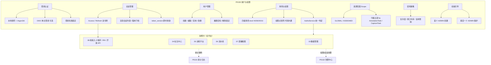
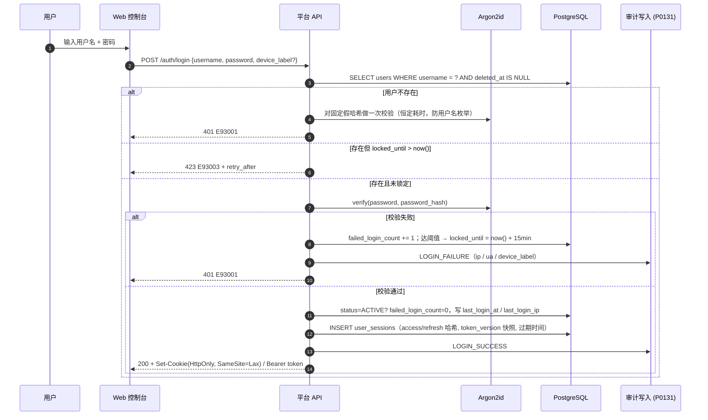
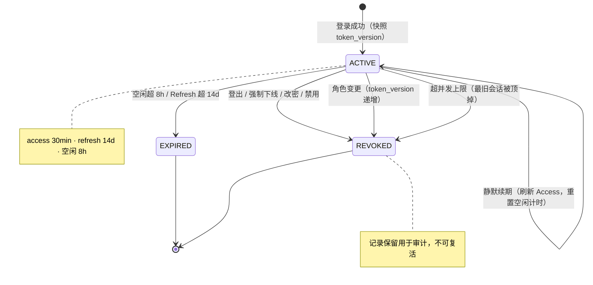
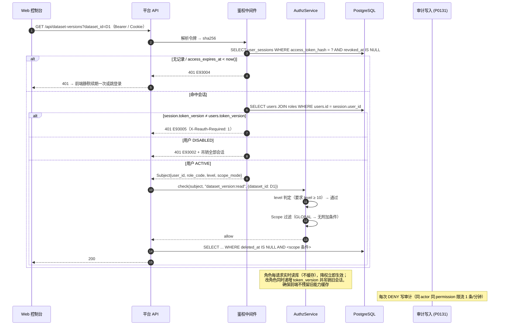
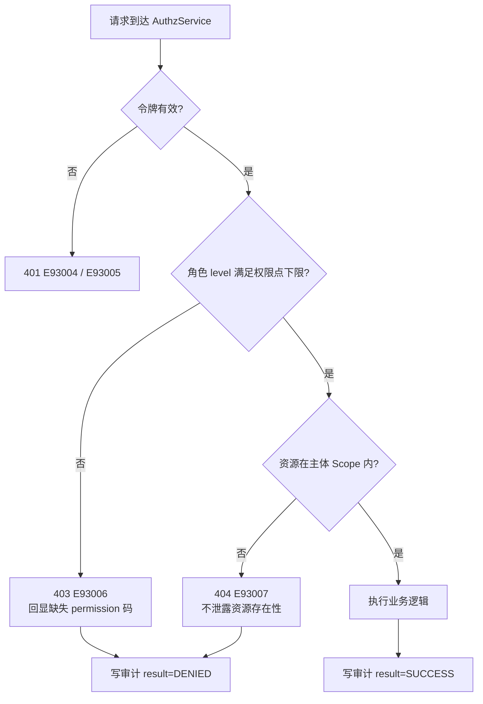
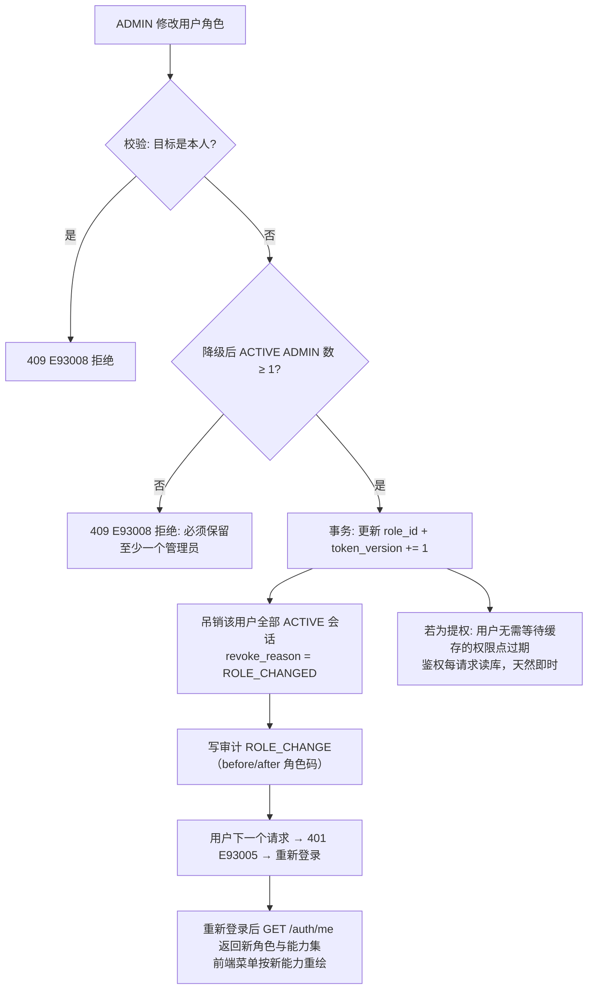
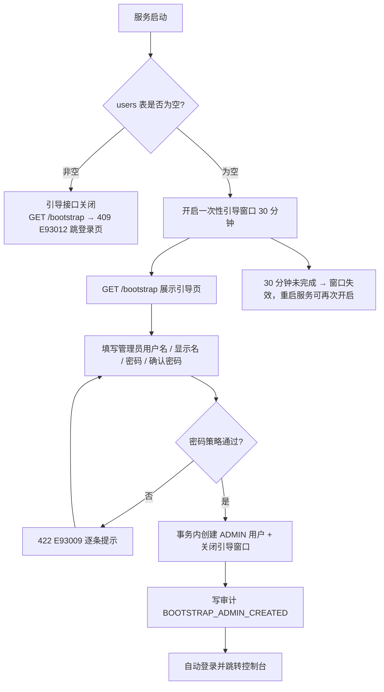
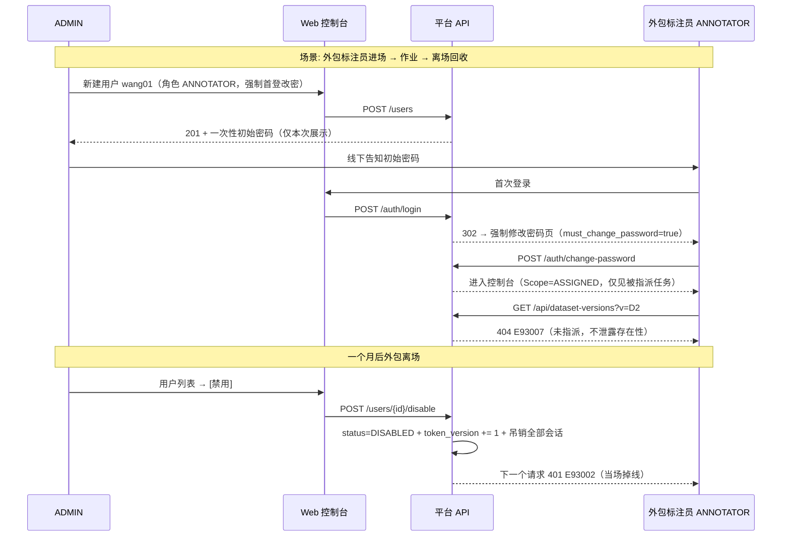

# PRD: P0130_用户与权限 (User & Permission)

| 属性 | 内容 |
| :--- | :--- |
| **文档编号** | P0130 |
| **功能模块** | M09_系统管理 |
| **当前版本** | v1.0.0 |
| **文档状态** | Approved |
| **作者** | 轻眸识刻 Team |
| **最后更新** | 2026-10-01 |

---

## 1. 全局说明

> [!IMPORTANT]
> **核心定位**: 全平台**唯一的身份与授权判定源 (SSOT)**。任何模块要做 RBAC 判断，都必须调用本模块的 `AuthzService.check(subject, permission, resource)`，**禁止**在业务代码里自行写 `if (role === 'ADMIN')`。前端隐藏按钮只是体验优化，**不是**权限控制。

### 名词解释

*   **User (用户)**: 一个可登录的身份，全平台唯一。1 个用户 1 个角色。
*   **Role (角色)**: 固定四级 `ADMIN / TRAINER / ANNOTATOR / VIEWER`，**内置不可增删改**，带整数 `level`（40 / 30 / 20 / 10）构成严格包含关系。
*   **Permission (权限点)**: 形如 `dataset_version:delete` 的字符串常量，声明在代码 `permissions.ts`（`{code, required_level, scope_filtered}`），随发版变更。
*   **Subject (主体)**: 一次请求的身份上下文 = `{user_id, role_code, level, scope_mode}`，由鉴权中间件构造。
*   **Scope (资源范围)**: 主体能访问的数据子集，`GLOBAL`（全量）或 `ASSIGNED`（仅被指派任务覆盖的样本）。
*   **Session (会话)**: 一次登录产生的登录态，服务端可即时吊销。同一用户可并存多个会话（Web + 小程序 + RN），各自带 `device_label`。
*   **Access / Refresh Token**: 不透明随机令牌（256 bit），前者 30 分钟随请求发送，后者 14 天用于静默续期。库中只存 **SHA-256 哈希**。
*   **Token Version (令牌版本)**: `users.token_version` 单调递增计数；会话在签发时快照该值，二者不一致即判定会话失效。是"一键踢线"与"权限即刻收敛"的统一开关。
*   **Session Revocation (会话吊销)**: 强制下线 / 改密 / 禁用 / 改角色时把相关会话置 `REVOKED` 并递增 `token_version`，**下一个请求即失效**。
*   **Bootstrap Admin (引导管理员)**: 首次启动且库中无任何用户时，通过一次性引导流程创建的第一个 `ADMIN`。
*   **Argon2id**: 密码哈希算法（内存硬），本模块唯一承认的本地密码存储形式。
*   **Lockout (锁定)**: 连续登录失败达阈值后临时拒绝登录（与"禁用"不同，可自动解锁，且不针对不存在的用户名）。
*   **OIDC (OpenID Connect)**: 可选单点登录方式；接入后本地密码认证仍可对 `LOCAL` 用户保留（混合模式）。
*   **Data Domain (数据域)**: 按 `Dataset` / `DatasetVersion` 划分的数据归属边界，行级隔离的最小单位。

### 统一异常处理 (E93xxx)

| Code | 场景 | 处理策略 |
| :--- | :--- | :--- |
| `E93001` | 用户名或密码错误 | 统一 401 + `invalid_credentials`，**不区分**用户名不存在与密码错误；失败计数 +1（仅对真实存在且未锁定的账号计数） |
| `E93002` | 账号已禁用（`status=DISABLED`） | 401 + `account_disabled`，已登录会话同步吊销 |
| `E93003` | 账号临时锁定（失败次数达阈值） | 423 + `account_locked`，回显剩余解锁时间 |
| `E93004` | Access Token 过期 | 401 + `token_expired`，前端静默续期一次；续期亦失败则跳登录 |
| `E93005` | 会话已失效（吊销 / `token_version` 不匹配 / 空闲超时） | 401 + `session_revoked`，前端清空本地态并提示"会话已失效，请重新登录" |
| `E93006` | 权限不足（角色 level 不够） | 403 + `permission_denied` + 缺失的 `permission` 码，**不回显**资源是否存在 |
| `E93007` | 越出资源范围（`ASSIGNED` 主体访问未指派样本） | 404 + `not_found`（不泄露存在性），按 `E93006` 记审计 |
| `E93008` | 违规的用户管理操作（改自己角色、删自己、移除最后一个 ADMIN） | 409 + 具体原因；操作被拒并写审计 |
| `E93009` | 密码不符合策略（长度 / 复杂度 / 弱口令 / 历史复用） | 422 + 逐条列出未通过的规则 |
| `E93010` | OIDC 回调校验失败（state / nonce / iss / aud / 签名） | 401 + `oidc_invalid_callback`，中止登录并记审计，不泄露 IdP 细节 |
| `E93011` | OIDC 用户未在平台预创建 | 403 + `user_not_provisioned`，提示联系管理员开通；**首次 SSO 不自动建号** |
| `E93012` | 引导接口已关闭（已存在用户） | 409 + `bootstrap_closed`，引导页重定向登录页 |
| `E93013` | 跨站请求 / Origin 校验失败 | 403 + `csrf_rejected`，不执行业务逻辑 |
| `E93014` | 并发会话数超上限（默认 10） | 拒绝新登录并列出活跃会话清单，引导先下线旧设备 |
| `E93015` | 令牌版本不匹配（他处改密/改角色后仍持旧令牌） | 按 `E93005` 处理；响应头带 `X-Reauth-Required: 1` 便于客户端区分 |

---

## 2. 项目背景

### 背景 (Context)
轻眸识刻 的默认部署形态是**单机 Local-First**：全套服务跑在一台工作站上，团队 2~3 人。但"人少"不等于"可以不做权限"——数据会经过**外包标注员**（微信小程序 / RN App 进场）、**只读的老板或质检方**、以及未来可能加入的实习算法同学。

平台里有一批**不可逆操作**：删除数据集版本、物理回收文件、回滚线上模型服务、切换默认存储、轮换存储凭据。这些操作在 2~3 人团队里通常只有一个人会做，一旦做错，没有权限边界也没有追溯手段，损失以"人天"计。

同时首个落地任务（食品包装生产日期识别）会引入**进场拍摄 + 外包标注**的协作模式：外包人员只能看到被派给他们的那批图，不能看整库数据、不能导出、不能训练。这是数据域隔离最现实的诉求。

### 问题陈述 (Problem Statement)
1.  **谁都能删**: 无鉴权时，任何能访问端口的人都能一键删除 `DatasetVersion`，两天标注成果蒸发。
2.  **前端即权限**: 前端隐藏按钮后一条 `curl` 即可绕过——不做服务端判定等于没做权限。
3.  **数据域无隔离**: 外包标注员与算法工程师看到同一份数据列表，客户包装图存在外泄风险。
4.  **权限改动不生效**: 角色只在登录时取一次并缓存，改完要等对方重登，越权窗口长期存在。
5.  **弱口令与撞库**: 内网机器上 `admin/admin` 是常态；登录接口无失败限制，脚本可无限试。
6.  **无法归因**: 出问题后查不到"是谁在什么时候删的"，只能在群里问。

### 目标与成功指标 (Goals & Success Metrics)
*   **北极星指标**: **生产环境中越权写操作成功次数 = 0** —— 所有越权请求返回 403/404 并留下审计记录。
*   **次要指标**:
    *   登录（含 Argon2id 校验）P95 < **300ms**。
    *   角色变更 / 强制下线生效延迟 = **下一个请求**（鉴权不缓存角色，`token_version` 即时收敛）。
    *   首次部署从启动到可登录 < **5 分钟**（引导流程 ≤ 3 步）。
    *   写操作 100% 可归因到 `actor_id`（匿名写入路径为 0）。
    *   暴力破解脚本在 **5 次尝试**内被拒。

### 风险与规避 (Risks & Mitigation)
| 风险 | 影响 | 规避方案 |
| :--- | :--- | :--- |
| 单机部署，服务与用户同机 | 能 SSH 上机的人可绕过平台直接改库 | 文档明示"平台权限不防机器管理员"；DB 账号与应用分离，`audit_logs` 对应用账号只读 |
| 忘记 ADMIN 密码且无邮件找回 | 全平台锁死 | 提供离线应急命令 `foodyolo-cli user reset-admin`（需服务器 shell 权限），文档写死步骤 |
| 角色包含关系让 ANNOTATOR 无法临时承担 TRAINER 职责 | 一人多岗受阻 | 明示"升角色即取得全部下级能力"，由 ADMIN 临时提权并留审计；不引入多角色叠加（见附录决策） |
| 外包标注员共用一台电脑登录 | 无法归因到个人 | 一人一号、禁止共享账号；会话列表展示 IP/UA，异地登录写审计 |
| 长期会话被盗用 | 内网漫游 | Access 30 分钟 / Refresh 14 天 / 空闲 8 小时；改密、禁用、改角色即全量吊销 |
| OIDC 接入后本地密码仍可用 | 双入口扩大攻击面 | 用户级 `auth_source`；设 `OIDC` 时本地密码登录被拒（除非 ADMIN 临时开启逃生开关） |
| 角色变更踢线影响正在作业的人 | 标注到一半被登出 | 踢线只回收会话，不丢数据：标注草稿按 P0060 存 IndexedDB，重新登录后自动重放 |

---

## 3. 价值模型

*   **方案**: 四级**包含式** RBAC（`level` 判定）+ 服务端统一 `AuthzService` + 行级 `Scope` 过滤 + 可即时吊销的服务端会话（`token_version`）。权限点内置于代码，`roles` 表只存角色字典，矩阵变更走发版评审，避免"改库即改权限"。
*   **目标**:

| 指标 | 现状（无本模块） | 目标 |
| :--- | :--- | :--- |
| 越权写操作 | 无法拦截 | 服务端 100% 拦截并审计 |
| 外包可见数据范围 | 全库 | 仅被指派样本（`ASSIGNED`） |
| 角色变更生效 | 需重启 / 重登且可能残留 | 下一个请求即收敛 |
| 强制下线 | 不支持 | 递增 `token_version`，秒级生效 |
| 弱口令 | 无策略 | 长度 ≥ 10 + 弱口令库 + 失败锁定 |

---

## 4. 项目范围

### 功能结构图


### In Scope (包含范围)
1.  **本地账号认证**：用户名 + 密码，Argon2id 哈希，登录 / 注销。
2.  **会话与令牌**：不透明双令牌、静默续期、多设备会话列表、强制下线、`token_version` 收敛、并发会话上限。
3.  **OIDC 单点登录（可选）**：Authorization Code + PKCE，支持标准 IdP（Keycloak / Authentik / 企业微信 OIDC 网关）。
4.  **用户管理**：创建、编辑、禁用、软删除、重置密码、解除锁定、查看活跃会话。
5.  **角色与权限矩阵**：四级角色，逐资源逐操作的能力矩阵，服务端统一判定。
6.  **资源范围（数据域）**：`GLOBAL` / `ASSIGNED` 两种模式与行级过滤规则。
7.  **密码策略与登录失败锁定**：复杂度、弱口令库、历史复用、失败计数、临时锁定。
8.  **初始管理员引导与自我保护**：首个 ADMIN 创建、"最后一个 ADMIN"与"不能改自己角色"的保护。

### Out of Scope (不包含范围)
*   **多租户 / 组织架构 / 部门树**：单机产品，不做租户隔离与部门层级。
*   **自定义角色与权限编辑器**：四级角色内置，不提供后台勾选式权限配置（避免"改库即改权限"）。
*   **ABAC / 策略引擎（OPA 等）**：判定规则全部为代码常量。
*   **LDAP / SAML / Kerberos / OAuth2 密码模式**：只做 OIDC。
*   **双因素认证（TOTP / 短信）**：内网单机收益低，保留 `users.mfa_enabled` 字段但不实现。
*   **邮件找回密码 / 邮件通知**：单机默认无外网 SMTP；忘记密码由 ADMIN 重置或走离线应急命令。
*   **字段级权限**：仅做资源 + 操作级；字段脱敏由各业务模块在响应层处理。
*   **审计日志与告警的实现**：分别归 P0131、P0132；本模块只负责**产生**审计事件与权限/会话类告警。

---

## 5. 业务流程

### 5.1 登录与会话建立（本地账号）


### 5.2 会话生命周期状态机


### 5.3 请求鉴权与授权链路（服务端判定）


### 5.4 越权请求的两种失败语义


### 5.5 角色变更即时收敛


### 5.6 首次启动引导流程

---

## 6. 用户分析

### 6.1 用户画像 (User Personas)

*   **P1 — 平台管理员 (`ADMIN`)**：团队里那台工作站的"机主"，通常也是算法负责人。
    *   **职责**: 建号、发角色、装存储、发布服务、出事时查审计。
    *   **核心诉求**: "别让我为了加一个人去改数据库；权限改完立刻生效；出问题能查到是谁干的。"
    *   **痛点**: 忘记密码的人找他重置；外包人员离场后不清楚该回收哪些权限。

*   **P2 — 算法 / 训练工程师 (`TRAINER`)**：日常产出主力。
    *   **职责**: 导入数据、起流水线、提训练任务、导出模型、发布服务。
    *   **核心诉求**: "我不关心权限，但不能做到一半被拦住。"
    *   **痛点**: 提交任务时报 403 却不知道缺哪个权限点（因此 403 必须回显 `permission` 码）。

*   **P3 — 标注员 / 外包标注 (`ANNOTATOR`)**：通过 Web 控制台或小程序作业。
    *   **职责**: 领取并完成 `AnnotationTask`、响应返工。
    *   **核心诉求**: "我只需要看到派给我的图；不要让我点错删掉东西。"
    *   **痛点**: 看到不该看的数据；误操作造成不可逆后果（因此本角色**无任何删除权限**）。

*   **P4 — 只读访客 (`VIEWER`)**：老板、客户、质检方。
    *   **职责**: 看进度、看指标、看试跑结果。
    *   **核心诉求**: "给我一个能看的东西，别让我能改坏任何东西。"
    *   **痛点**: 权限开大了会误操作；开小了看不到想要的看板。

### 6.2 用户链路图 (User Journey Map)


---

## 7. 功能需求

### M09.F01 本地账号登录与注销 (Local Login & Logout)
*   **用户故事**: 作为团队成员，我希望用平台分配的账号密码登录，以便我的所有操作都能被归因到个人。

*   **逻辑与业务规则**:
    *   **前置条件**: 用户 `status = ACTIVE`、未被锁定、`deleted_at IS NULL`。
    *   **主流程**: 1) `POST /auth/login {username, password, device_label?}`；2) 恒定耗时校验（用户不存在也走一次 Argon2id）；3) 成功则建会话并签发双令牌；4) `must_change_password = true` 时强制跳改密页，改密前除 `/auth/*` 外全部接口返回 403。
    *   **令牌下发**: 浏览器用 `HttpOnly + SameSite=Lax + Secure(HTTPS)` Cookie；小程序 / RN 用响应体 Bearer token（见 P0120 / P0121）。
    *   **注销**: `POST /auth/logout` 吊销**当前**会话（不影响其他设备）；前端清空本地态。
    *   **后置条件**: 写 `user_sessions` 与会话审计（`LOGIN_SUCCESS` / `LOGOUT`）。
*   **验收标准**:
    ```gherkin
    场景: 登录成功
      Given 用户 wang01 存在且 status=ACTIVE，密码正确
      When 提交登录请求
      Then 返回 200 与 expires_in=1800
      And user_sessions 新增一条 ACTIVE 记录，token_version 等于用户当前值
      And 审计写入 LOGIN_SUCCESS（含 ip 与 user_agent）

    场景: 用户名不存在与密码错误返回一致
      Given 用户名 "nobody" 不存在
      When 提交登录请求
      Then 返回 401 E93001，文案与"密码错误"完全相同
      And 与真实用户校验的响应耗时偏差 < 50ms
    ```

*   **边界情况与异常处理**:

    | 场景 | 处理 |
    | :--- | :--- |
    | 用户已被软删除 | 与"用户名不存在"同构处理（E93001），不提示"已删除" |
    | 服务重启 | 会话存于数据库，重启后登录态不丢；内存无会话状态 |
    | 数据库暂时不可用 | 返回 503 "认证服务不可用，请稍后重试"，**不降级放行** |
    | 用户名大小写 | 统一小写存储与比较；`Wang01` 与 `wang01` 视为同一账号 |
    | 浏览器禁用 Cookie | 前端提示"请允许本站 Cookie"；不使用 localStorage 存令牌（扩大 XSS 面） |

### M09.F02 会话与令牌管理 (Session & Token Management)
*   **用户故事**: 作为管理员，我希望看到谁在哪台设备登录着并能一键把他踢下线，以便设备丢失或人员离场时立即止损。

*   **逻辑与业务规则**:
    *   **令牌规则**: Access 30 分钟；Refresh 14 天（固定不滑动）；每次续期刷新 Access 并把空闲计时重置，空闲 **8 小时**未续期即整会话失效。
    *   **存储规则**: 库中只存 `sha256(token)`；明文仅在下发那一刻存在。
    *   **令牌版本**: 会话在签发时快照 `users.token_version`；每请求比对，不一致即 `E93005`。递增 `token_version` 是**唯一**的批量踢线手段（禁用 / 改密 / 改角色 / 手工"全部下线"）。
    *   **会话列表**: 用户可查看自己的会话（`device_label`、UA、IP、最近活跃）；`ADMIN` 可查看任意用户的会话。
    *   **强制下线**: `POST /users/{id}/sessions/{sid}/revoke` 或 `POST /users/{id}/revoke-all`；被吊销后**下一个请求** 401 `E93005`。
    *   **并发上限**: 单用户默认 10 个活跃会话，超出时按 `last_seen_at` 最旧者被顶掉（`revoke_reason = SESSION_LIMIT`）。
    *   **后置条件**: `user_sessions.revoked_at / revoke_reason` 落库并写审计。
*   **验收标准**:
    ```gherkin
    场景: 管理员强制下线
      Given 用户 li02 在 3 台设备上有活跃会话
      When 管理员点击 [全部下线]
      Then users.token_version 递增 1，3 条会话置 REVOKED（reason=ADMIN_REVOKED）
      And li02 的下一个请求返回 401 E93005
      And 审计记录操作人、目标用户、被吊销会话数

    场景: 改密后旧会话失效而当前会话保留
      Given 用户 wang01 在浏览器 A 与 B 登录
      When wang01 在浏览器 A 修改密码
      Then 递增 token_version，浏览器 B 的下一个请求 401 E93005
      And 浏览器 A 自动用新 token_version 重建当前会话，不被打断
    ```

*   **边界情况与异常处理**:

    | 场景 | 处理 |
    | :--- | :--- |
    | 令牌泄露被盗用 | 会话列表展示异常 IP/UA 并可一键吊销；改密亦全量收敛 |
    | 多标签页同时续期 | 续期接口幂等：同一 refresh 令牌 5 秒内重复使用返回同一新令牌，不重复建会话 |
    | 系统时钟回拨 | 过期判定一律以**数据库 `now()`** 为准，不用应用服务器时钟 |
    | `last_seen_at` 写放大 | 同一会话 60 秒内只落库一次（应用内存节流），空闲超时允许 60 秒误差 |
    | 会话记录膨胀 | 已终结（EXPIRED/REVOKED）记录保留 30 天后清理 |
    | 小程序长时间后台 | 恢复前台时续期失败（超 8h）→ 引导重新登录，**不清空**本地待上传队列（P0121 负责） |

### M09.F03 OIDC 单点登录（可选）(Optional OIDC SSO)
*   **用户故事**: 作为管理员，我希望把平台接到公司已有身份系统上，以便同事不用记第二个密码。

*   **逻辑与业务规则**:
    *   **前置条件**: `ADMIN` 在系统设置填写 `issuer / client_id / client_secret / scopes`，且回调地址 `https://{host}/auth/oidc/callback` 已在 IdP 注册。
    *   **流程**: Authorization Code + PKCE(S256)；校验 `state`、`nonce`、`iss`、`aud`、`exp` 与签名（JWKS 缓存 1 小时）。
    *   **账号绑定**: `users.oidc_subject` 唯一；**不自动建号**（`E93011`），由 ADMIN 预建用户并把 `auth_source` 置 `OIDC`。
    *   **混合模式**: `auth_source = LOCAL` 的用户继续用密码；`OIDC` 用户本地密码开关默认关闭，ADMIN 可开启逃生（IdP 故障时用）。
    *   **后置条件**: 建同样的会话（`auth_method = OIDC`）；写审计 `LOGIN_SUCCESS(method=OIDC)`。
*   **验收标准**:
    ```gherkin
    场景: SSO 登录成功
      Given 已配置 OIDC 且用户 li02 的 oidc_subject 已绑定
      When 从登录页点击 [使用 SSO 登录] 并在 IdP 完成认证
      Then 平台建立会话并跳转控制台
      And 审计记录 method=OIDC 与 IdP 返回的 sub

    场景: 未开通的同事尝试 SSO
      Given IdP 认证成功但平台无匹配 oidc_subject
      When 回调到达平台
      Then 返回 403 E93011，提示联系管理员开通
      And 不创建任何用户记录
    ```

*   **边界情况与异常处理**:

    | 场景 | 处理 |
    | :--- | :--- |
    | IdP 不可达 | 登录页提示"SSO 暂不可用"；`LOCAL` 用户不受影响 |
    | JWKS 轮换 | 签名校验失败时强制刷新 JWKS 重试一次，二次失败才判 `E93010` |
    | IdP 的 email 与平台记录不一致 | 以 `sub` 为准，email 仅作展示与提示，不参与鉴权 |
    | 同一 sub 绑定到两个用户 | DB 唯一约束拒绝，界面提示冲突的两个账号 |
    | 离职后 IdP 侧禁用但平台未禁用 | 平台不轮询 IdP，由 ADMIN 主动禁用并留审计 |

### M09.F04 用户管理 (User Management)
*   **用户故事**: 作为管理员，我希望在页面上建号、改角色、重置密码、禁用离职人员，以便不必碰数据库。

*   **逻辑与业务规则**:
    *   **前置条件**: 操作者 `role = ADMIN`。
    *   **创建**: 用户名（3–32，`[a-z0-9._-]`，全局唯一，创建后不可改）、显示名、初始密码或"随机生成"、角色、`must_change_password`（默认 true）。
    *   **编辑**: 可改显示名、角色、`scope_mode`；不可改用户名。
    *   **禁用**: `status = DISABLED` + `token_version += 1` + 吊销全部会话；历史数据与审计保留。
    *   **软删除**: 仅当该用户无未终结任务（未提交的 `AnnotationTask` / `RUNNING` 的 `TrainTask`）时允许；用户名仍占用（防冒名），30 天内可恢复。
    *   **重置密码**: 生成一次性密码（12 位随机）并置 `must_change_password = true`；旧密码立即失效、全部会话吊销。
    *   **后置条件**: 所有变更写审计（含 before / after diff，**不含**密码明文）。
*   **验收标准**:
    ```gherkin
    场景: 创建标注员
      Given 操作者为 ADMIN
      When 创建用户 wang01，角色 ANNOTATOR，勾选"首登修改密码"
      Then 返回一次性初始密码（仅本次展示，之后不可再查）
      And users 新增记录且 password_hash 为 Argon2id 格式
      And 审计写入 USER_CREATE，after_json 不含密码明文

    场景: 禁用有在办任务的标注员
      Given wang01 有 1 个进行中的 AnnotationTask
      When ADMIN 点击 [禁用]
      Then 账号状态变为 DISABLED 且会话全部吊销
      And 提示"该用户有 1 个进行中的任务，建议先转派"
      And 经二次确认后仍可执行，审计标注 has_active_tasks=true
    ```

*   **边界情况与异常处理**:

    | 场景 | 处理 |
    | :--- | :--- |
    | 用户名重复（含大小写变体） | 409 + "用户名已存在"，不静默改名 |
    | 管理员误删自己 | 拒绝（`E93008`）；要删先由另一位 ADMIN 操作 |
    | 重置密码后对方仍在作业 | 会话被吊销，未提交的标注草稿按 P0060 的 IndexedDB 恢复 |
    | 离职人员重新入职 | 30 天内恢复同一账号（保留历史归因）；超期则新建 |
    | 用户规模 | 单团队预期 ≤ 20 人，列表不分页；> 200 时提示归档离职账号 |

### M09.F05 角色与权限矩阵 (Role & Permission Matrix)
*   **用户故事**: 作为开发者，我希望有一套明确的角色能力表，以便知道每个接口该要求哪个权限点；作为管理员，我希望知道每个角色能做什么。

*   **逻辑与业务规则**:
    *   **角色字典**: `ADMIN`(40) > `TRAINER`(30) > `ANNOTATOR`(20) > `VIEWER`(10)，**严格包含**：高角色天然具备低角色的全部能力。
    *   **判定算法**: `allow = (user.role.level >= permission.required_level) && resource ∈ scope(user)`；权限点声明在 `permissions.ts`，每项含 `required_level` 与 `scope_filtered`。
    *   **不做 per-user 例外授权**：小团队靠临时提权解决，避免权限来源不可解释。
    *   **矩阵可见性**: 全部角色可在"帮助 > 权限说明"页查看只读矩阵（见 §8.2）。
    *   **后置条件**: 角色变更写审计 `ROLE_CHANGE`（`before.role_code` / `after.role_code`）并递增 `token_version`。
*   **验收标准**:
    ```gherkin
    场景: 标注员无删除权限
      Given 用户角色为 ANNOTATOR 且对目标 DatasetVersion 有 ASSIGNED 范围
      When 调用 DELETE /api/dataset-versions/{id}
      Then 返回 403 E93006，permission=dataset_version:delete
      And 审计写入 result=DENIED

    场景: 提权即时生效
      Given 用户 wang01 当前为 VIEWER
      When ADMIN 将其角色改为 ANNOTATOR
      Then wang01 的旧会话被吊销，重新登录后按 ANNOTATOR 判定
      And 审计写入 ROLE_CHANGE，含前后角色码
    ```

*   **边界情况与异常处理**:

    | 场景 | 处理 |
    | :--- | :--- |
    | 前端缓存旧角色导致按钮可见 | 后端仍拒绝；前端收到 403 后强制刷新 `GET /auth/me` 并重绘菜单 |
    | 权限点与前端菜单不一致 | 菜单由 `GET /auth/me` 返回的能力集合推导，禁止硬编码 |
    | 同一用户既是 TRAINER 又想当 ANNOTATOR | 用高角色即可（包含关系），不引入多角色 |
    | 需要临时给出格权限 | 不支持；由 ADMIN 临时升角色，用完降回，两次变更均留审计 |

### M09.F06 数据域与资源范围 (Data Domain & Scope)
*   **用户故事**: 作为外包标注员，我希望只看到被派给我的那批图，以便客户数据不外泄。

*   **逻辑与业务规则**:
    *   **`scope_mode`**: `GLOBAL`（`ADMIN` / `TRAINER` / `VIEWER` 默认）与 `ASSIGNED`（`ANNOTATOR` 默认）。
    *   **`ASSIGNED` 可见集合**: `被指派且未终结的 AnnotationTask 覆盖的 DatasetVersionItem ∪ 该用户历史提交过标注的样本（只读）`。
    *   **过滤位置**: Repository 层统一注入 `scope_predicate`（SQL 条件），**禁止**在 Controller 层过滤后再返回（易漏口）。
    *   **越界语义**: 访问范围外资源返回 **404**（`E93007`），与"资源不存在"不可区分。
    *   **例外**: `Dataset` / `DatasetVersion` 的**名称与统计摘要**对 `ANNOTATOR` 可见（用于显示"你正在标注的数据集"），样本列表、导出、下载受范围限制。
    *   **后置条件**: 不新增表；范围由 `AnnotationTask` 指派关系推导（P0062 为唯一事实来源）。
*   **验收标准**:
    ```gherkin
    场景: 标注员看不到未指派的版本
      Given wang01 被指派了 D1 的 TaskA，未被指派 D2
      When wang01 请求 GET /api/dataset-versions?v=D2
      Then 返回 404 E93007
      And 响应体不包含 D2 的任何字段

    场景: 被指派后样本立即可见
      Given ADMIN 新建 AnnotationTask 并把 D1 的 100 个样本指派给 wang01
      When wang01 刷新任务页
      Then 该 100 个样本可读且可编辑
      And 任务终结且质检通过后，样本转为只读仍可见
    ```

*   **边界情况与异常处理**:

    | 场景 | 处理 |
    | :--- | :--- |
    | 任务被转派给他人 | 立即失去编辑权；原提交标注仍可只读查看（保留归因） |
    | 样本同时属于两个任务 | 取并集；任一任务覆盖即可见 |
    | 缩略图 / 导出直链绕过列表过滤 | 所有文件访问走 P0040 的 presign 接口并二次校验 Scope（P0043 已依赖此约定） |
    | VIEWER 需要看全部 | `VIEWER` 为 `GLOBAL` 只读；需按客户隔离时建独立部署实例（不做多租户） |
    | 用户从 ANNOTATOR 升为 TRAINER | `scope_mode` 随角色默认值切 `GLOBAL`；已提交标注的归因不变 |

### M09.F07 密码策略与登录失败锁定 (Password Policy & Lockout)
*   **用户故事**: 作为管理员，我希望平台强制最低密码强度与失败锁定，以便内网机器不会被随手试出密码。

*   **逻辑与业务规则**:
    *   **复杂度**: 长度 ≥ 10，含字母与数字，允许符号；**不做**大小写混合与定期强制改密的硬要求（NIST 趋势，小团队反感）。
    *   **弱口令库**: 内置 Top-10000 常见弱口令 + 用户名/显示名子串匹配；命中即拒（`E93009`）。
    *   **复用限制**: 不得与最近 3 次历史密码相同（仅存哈希数组）。
    *   **哈希参数**: Argon2id `m=64MiB, t=3, p=4`，每条独立 salt；参数写入 `password_algo` 便于将来迁移。
    *   **失败锁定**: 连续失败 5 次 → 锁 15 分钟；锁定期内即使密码正确也拒绝（`E93003`）；成功登录清零计数。锁定**不针对不存在的用户名**（避免账号枚举与 DoS）。
    *   **首登改密**: `must_change_password = true` 者改密前只能访问 `/auth/*`。
    *   **后置条件**: 写审计 `PASSWORD_CHANGE`（**不记录**任何密码或哈希片段）。
*   **验收标准**:
    ```gherkin
    场景: 弱口令被拒
      Given 用户尝试把密码设为 "foodyolo123"
      When 提交修改密码
      Then 返回 422 E93009，列出未通过的规则项
      And 密码不变，审计不记录密码内容

    场景: 连续失败锁定
      Given 用户 li02 已连续失败 4 次
      When 第 5 次输入错误密码
      Then 账号被锁定 15 分钟，返回 423 E93003 与 retry_after
      And 锁定期内即使输入正确密码也返回 423
      And 审计写入 LOGIN_LOCKED
    ```

*   **边界情况与异常处理**:

    | 场景 | 处理 |
    | :--- | :--- |
    | ADMIN 自己忘记密码且无人能重置 | 走服务器离线命令 `foodyolo-cli user reset-admin --username X`（需 shell + DB 权限），同样写审计 |
    | 攻击者对不存在的用户名爆破 | 不累加计数、不锁定，仅按 IP 限流（20 次/分钟） |
    | 锁定期间需要立即解锁 | 用户详情页 `[解除锁定]`，写审计 `LOCKOUT_CLEARED` |
    | 历史密码存储膨胀 | 只存哈希数组（≤ 3 条），不存历史明文 |
    | 弱口令库误杀（如 `foodyolo2026!`） | 允许 ADMIN 在系统设置追加"允许词"，需二次确认并写审计 |

### M09.F08 初始管理员引导与自我保护 (Bootstrap & Self-Protection)
*   **用户故事**: 作为部署者，我希望第一次打开页面就能创建管理员账号，而不是去翻数据库；作为管理员，我希望系统阻止我把仅有的管理员权限搞没。

*   **逻辑与业务规则**:
    *   **引导判定**: `SELECT count(*) FROM users` = 0 时开启引导窗口（进程内标记，30 分钟有效）；创建首个用户后立即关闭且**永不再开**（除非清库）。
    *   **自我保护规则**（对所有 ADMIN 生效）:
        1. 不能修改自己的角色（`E93008`）；
        2. 不能禁用 / 删除自己；
        3. 系统内至少保留 **1 个** `ACTIVE` 的 ADMIN，否则拒绝降级 / 禁用 / 删除；
        4. 引导创建的 ADMIN 不允许删除，只允许转移权限后禁用。
    *   **后置条件**: 引导创建写 `BOOTSTRAP_ADMIN_CREATED`；保护性拒绝写 `result=DENIED`。
*   **验收标准**:
    ```gherkin
    场景: 首个管理员创建
      Given 全新部署且 users 表为空
      When 访问 /bootstrap 并提交合法表单
      Then 创建 ADMIN 用户并自动登录
      And 再次访问 /bootstrap 返回 409 E93012

    场景: 阻止移除最后一个管理员
      Given 系统中只有 1 个 ACTIVE 的 ADMIN（自己）
      When 尝试把自己降级为 TRAINER
      Then 返回 409 E93008，提示"系统必须保留至少一个管理员"
      And 角色不变
    ```

*   **边界情况与异常处理**:

    | 场景 | 处理 |
    | :--- | :--- |
    | 引导窗口被外人抢先完成 | 窗口仅 30 分钟且需接触部署机；完成后引导接口关闭，部署者需自行把握窗口 |
    | 两个 ADMIN 同时互相降级 | 事务内校验 `ACTIVE ADMIN 数 ≥ 2` 才允许降级任一方，避免并发清零 |
    | 唯一 ADMIN 绕过前端直调 API 自降 | 服务端同样拦截（`E93008`），不仅靠前端禁用按钮 |
    | 清库重装 | 引导重新可用；文档提示先备份 `audit_logs` |
---

## 8. 技术架构与数据模型

### 8.1 数据实体

#### Table: `users`（User）

| 字段名 | 类型 | 必填 | 说明 | 约束 |
| :--- | :--- | :--- | :--- | :--- |
| `id` | UUID | Y | 主键 | PK |
| `username` | String(32) | Y | 登录名 | UNIQUE，`[a-z0-9._-]{3,32}`，小写存储，不可改 |
| `display_name` | String(64) | Y | 展示名 | 1–64 |
| `email` | String(255) | N | 邮箱（仅展示） | |
| `role_id` | UUID | Y | 角色 | FK → `roles.id` |
| `auth_source` | Enum | Y | 认证来源 | `LOCAL` / `OIDC`，default `LOCAL` |
| `password_hash` / `password_algo` | String(255) / String(32) | N | Argon2id 字符串与参数标识 | `OIDC` 且未开逃生时可为 NULL |
| `password_changed_at` | Timestamptz | N | 上次改密时间 | |
| `password_history_hash` | JSONB | N | 最近 3 次密码哈希 | 长度 ≤ 3 |
| `must_change_password` | Boolean | Y | 首登强制改密 | default true |
| `status` | Enum | Y | 账号状态 | `ACTIVE` / `DISABLED`，default `ACTIVE` |
| `scope_mode` | Enum | Y | 资源范围 | `GLOBAL` / `ASSIGNED`，默认随角色 |
| `token_version` | Int | Y | 令牌版本 | default 0；递增即吊销该用户全部会话 |
| `failed_login_count` | Int | Y | 连续失败次数 | ≥ 0，default 0 |
| `locked_until` | Timestamptz | N | 锁定截止 | NULL = 未锁定 |
| `oidc_subject` | String(255) | N | IdP 唯一标识 | UNIQUE（NULL 不参与唯一） |
| `mfa_enabled` | Boolean | Y | 预留 | 首版恒 false |
| `last_login_at` / `last_login_ip` | Timestamptz / String(45) | N | 最近登录 | 支持 IPv6 |
| `created_by` | UUID | N | 创建人 | FK → `users.id`，引导创建为 NULL |
| `created_at` / `updated_at` | Timestamptz | Y | 通用字段 | |
| `deleted_at` | Timestamptz | N | 软删除 | 30 天内可恢复 |

#### Table: `roles`（Role，内置字典）

| 字段名 | 类型 | 必填 | 说明 | 约束 |
| :--- | :--- | :--- | :--- | :--- |
| `id` | UUID | Y | 主键 | PK |
| `code` | Enum | Y | 角色码 | `ADMIN`/`TRAINER`/`ANNOTATOR`/`VIEWER`，UNIQUE |
| `name` | String(32) | Y | 中文名 | 管理员 / 训练者 / 标注员 / 只读访客 |
| `level` | Int | Y | 能力等级 | 40 / 30 / 20 / 10，UNIQUE |
| `default_scope_mode` | Enum | Y | 默认范围 | `GLOBAL`（前三者）/ `ASSIGNED`（ANNOTATOR） |
| `is_builtin` | Boolean | Y | 是否内置 | 恒 true，禁止删除 |

> 权限点**不落库**：`permissions.ts` 声明 `{code, required_level, scope_filtered}`，随发版变更；`roles` 只存角色字典与等级。

#### Table: `user_sessions`（UserSession）

| 字段名 | 类型 | 必填 | 说明 | 约束 |
| :--- | :--- | :--- | :--- | :--- |
| `id` | UUID | Y | 主键 | PK |
| `user_id` | UUID | Y | 所属用户 | FK → `users.id`，索引 `(user_id, status)` |
| `access_token_hash` | String(64) | Y | SHA-256(access) | UNIQUE，**不存明文** |
| `refresh_token_hash` | String(64) | Y | SHA-256(refresh) | UNIQUE，**不存明文** |
| `token_version` | Int | Y | 签发时快照的 `users.token_version` | 与用户当前值不等 → `E93005` |
| `device_label` | String(64) | N | 设备名（"MacBook Pro" / "iPhone 15"） | 客户端上报，可空 |
| `ip` / `user_agent` | String(45) / String(512) | N | 登录环境 | 会话列表展示 |
| `auth_method` | Enum | Y | 登录方式 | `LOCAL` / `OIDC` |
| `status` | Enum | Y | 会话状态 | `ACTIVE` / `EXPIRED` / `REVOKED` |
| `access_expires_at` | Timestamptz | Y | Access 过期 | 续期时刷新（now + 30min） |
| `refresh_expires_at` | Timestamptz | Y | Refresh 过期 | 固定 now + 14d，不滑动 |
| `idle_expires_at` | Timestamptz | Y | 空闲过期 | 续期时重置 now + 8h |
| `last_seen_at` | Timestamptz | Y | 最近活跃 | 每会话 60s 落库一次 |
| `revoked_at` / `revoke_reason` | Timestamptz / Enum | N | 吊销信息 | `LOGOUT`/`ADMIN_REVOKED`/`ROLE_CHANGED`/`PASSWORD_CHANGED`/`DISABLED`/`SESSION_LIMIT` |
| `created_at` / `updated_at` / `deleted_at` | Timestamptz | Y/N | 通用字段 | 终结 30 天后清理 |

### 8.2 权限矩阵（逐资源逐操作）

> 图例：`✅` 允许 · `🔸` 允许但受资源范围 / 本人约束 · `⛔` 拒绝（403 `E93006`） · `🔐` 允许但需二次确认

**核心资源**

| 资源 | 操作 | ADMIN | TRAINER | ANNOTATOR | VIEWER |
| :--- | :--- | :---: | :---: | :---: | :---: |
| 数据集版本 `DatasetVersion` | 查看列表 / 详情 | ✅ | ✅ | 🔸 仅被指派数据集 | ✅ |
| | 创建版本 / 编辑元数据 / 打 Tag | ✅ | ✅ | ⛔ | ⛔ |
| | 增删版本内样本 | ✅ | ✅ | ⛔ | ⛔ |
| | 冻结（FROZEN） | ✅ | ✅ | ⛔ | ⛔ |
| | 归档 | ✅ | 🔸 仅未被训练/部署引用 | ⛔ | ⛔ |
| | 软删除 | ✅ 🔐 | 🔸 未被引用 + 二次确认 | ⛔ | ⛔ |
| | 物理回收（GC） | ✅ 🔐 | ⛔ | ⛔ | ⛔ |
| | 导出数据集 | ✅ | ✅ | ⛔ | ⛔ |
| | 下载原图 / 预览 | ✅ | ✅ | 🔸 仅指派样本 | ✅ |
| 数据集 `Dataset`（容器） | 查看 / 统计摘要 | ✅ | ✅ | 🔸 仅被指派所含数据集 | ✅ |
| | 创建 / 重命名 / 软删 | ✅ | ✅ | ⛔ | ⛔ |
| 标注任务 `AnnotationTask` | 查看任务列表 | ✅ | ✅ | 🔸 仅本人被指派 | ✅ |
| | 创建 / 派单 / 转派 | ✅ | ✅ | ⛔ | ⛔ |
| | 领取 / 提交标注 | ✅ | ✅ | ✅ | ⛔ |
| | 质检 / 打回 | ✅ | ✅ | ⛔ | ⛔ |
| | 申诉 | ✅ | ✅ | 🔸 仅本人被打回项 | ⛔ |
| | 删除本人未提交的标注 | ✅ | ✅ | ✅ | ⛔ |
| 训练任务 `TrainTask` | 查看列表 / 日志 / 指标 | ✅ | ✅ | ⛔ | ✅ |
| | 提交任务（含 `PINNED` 指定节点） | ✅ | ✅ | ⛔ | ⛔ |
| | 取消 / 重试本人任务 | ✅ | ✅ | ⛔ | ⛔ |
| | 终止他人任务 | ✅ 🔐 | ⛔ | ⛔ | ⛔ |
| | 调整队列优先级 | ✅ | ⛔ | ⛔ | ⛔ |
| 模型版本 `ModelVersion` | 查看 / 下载 | ✅ | ✅ | ⛔ | 🔸 仅查看，不可下载 |
| | 归档 / 恢复 | ✅ | 🔸 仅归档 | ⛔ | ⛔ |
| | 设 / 取消生产标记 | ✅ | ✅ | ⛔ | ⛔ |
| 模型服务 `ModelService` | 查看服务与调用指标 | ✅ | ✅ | ⛔ | ✅ |
| | 发布 / 更新版本 / 灰度权重 / 回滚 | ✅ | ✅ | ⛔ | ⛔ |
| | 下线 / 删除服务 | ✅ 🔐 | ⛔ | ⛔ | ⛔ |
| 存储配置 `StorageConfig` | 查看列表（名称 / 状态） | ✅ | 🔸 仅名称与状态 | ⛔ | ⛔ |
| | 创建 / 编辑 / 连接测试 | ✅ | ⛔ | ⛔ | ⛔ |
| | 轮换凭据 / 设为默认 / 迁移 / 停用删除 | ✅ 🔐 | ⛔ | ⛔ | ⛔ |
| 用户管理 `User` | 查看用户列表 / 权限矩阵页 | ✅ | ⛔ | ⛔ | ⛔ |
| | 创建 / 编辑 / 禁用 / 软删 | ✅ | ⛔ | ⛔ | ⛔ |
| | 修改角色 | ✅ 🔸 不可改自己，须保留 ≥1 ADMIN | ⛔ | ⛔ | ⛔ |
| | 重置密码 / 解除锁定 | ✅ | ⛔ | ⛔ | ⛔ |
| | 查看 / 吊销他人会话 | ✅ | ⛔ | ⛔ | ⛔ |

**扩展资源**

| 资源 | 操作 | ADMIN | TRAINER | ANNOTATOR | VIEWER |
| :--- | :--- | :---: | :---: | :---: | :---: |
| 采集项目 / 任务 `CaptureProject`/`CaptureTask` | 查看项目与 SOP | ✅ | ✅ | 🔸 仅被纳入范围 | ✅ |
| | 创建项目 / 下发任务 / 验收 | ✅ | ✅ | ⛔ | ⛔ |
| | 现场拍摄 / 提交产物 | ✅ | ✅ | ✅ | ⛔ |
| 流水线 `Pipeline` / `PipelineRun` | 查看运行记录 | ✅ | ✅ | ⛔ | ✅ |
| | 创建 / 编辑 / 删除流水线 | ✅ | ✅ | ⛔ | ⛔ |
| | 触发运行 / 从失败点重跑 | ✅ | ✅ | ⛔ | ⛔ |
| 环境镜像 `EnvironmentImage` | 查看 | ✅ | ✅ | ⛔ | ✅ |
| | 注册镜像 / 删除镜像 | ✅ | 🔸 注册；删除仅本人提交 | ⛔ | ⛔ |
| 超参模板 `HyperparamTemplate` | 查看 / 使用 / 增删改 | ✅ | ✅ | ⛔ | ⛔ |
| 审计日志 `AuditLog` | 查看 | ✅ | 🔸 仅本人相关记录 | ⛔ | ⛔ |
| | 导出 | ✅ 🔐 | ⛔ | ⛔ | ⛔ |
| | 删除 / 修改 | ⛔（含 ADMIN，任何角色均不可） | ⛔ | ⛔ | ⛔ |
| 告警 `Alert` | 查看 / 确认 | ✅ | ✅ | ⛔ | 🔸 仅查看 |
| | 规则阈值 / Webhook 配置 | ✅ | ⛔ | ⛔ | ⛔ |
| 系统设置 | 查看 / 修改 | ✅ | ⛔ | ⛔ | ⛔ |

### 8.3 关键实现约定

*   **令牌哈希**: `sha256(token)` 落库并用索引等值查询（256 bit 随机，无彩虹表风险，且需高频校验，不用慢哈希）。
*   **`last_seen_at` 写放大**: 每请求 UPDATE 会打爆单机 DB，约定同一会话 **60 秒只写一次**（内存节流），空闲超时允许 60 秒误差。
*   **鉴权不缓存**: 会话与角色每请求读库（单机查询 < 1ms），换取"改角色 / 踢人下一个请求生效"。
*   **恒定耗时登录**: 用户名不存在时对固定哈希做一次 Argon2id，抹平时间差。
*   **索引**: `users(username) UNIQUE WHERE deleted_at IS NULL`、`user_sessions(access_token_hash)`、`user_sessions(refresh_token_hash)`、`user_sessions(user_id, status)`、`roles(level)`。
*   **可配项**: `max_sessions_per_user=10`、`access_ttl=30m`、`refresh_ttl=14d`、`idle_timeout=8h`、`lockout_threshold=5`、`lockout_duration=15m`。

---

## 9. UI/UX 规格说明

### 9.1 登录页与引导页
```text
+-------------------------------------------------------+   +---------------------------------------+
|                    轻眸识刻                           |   |  首次启动 · 创建管理员                 |
|             视觉检测模型训练基建                        |   |                                       |
|                                                       |   |  用户名 *  [ admin                  ] |
|   用户名  [ wang01                                 ]   |   |  显示名 *  [ 张工                    ] |
|   密码    [ ••••••••••••                     ] [👁]   |   |  密码   *  [ ••••••••••••      ] [👁] |
|                                                       |   |  确认   *  [ ••••••••••••      ] [👁] |
|   [              登  录              ]                |   |  强度: ███████░░░ 中                  |
|   ────────────  或  ────────────                      |   |  [x] 首次登录后强制修改密码            |
|   [        使用 SSO 登录（OIDC）      ]                |   |                  [ 创建并进入控制台 ] |
|                                                       |   |  ⚠ 该入口仅在本机无任何用户时可用      |
|   ⚠ 连续失败 5 次将锁定 15 分钟                        |   +---------------------------------------+
+-------------------------------------------------------+
```

### 9.2 用户管理列表
```text
+------------------------------------------------------------------------------------------+
|  系统管理 > 用户与权限                                  [+ 新建用户] [权限矩阵] [刷新]     |
+--------------------------------------------------------------------------------------------------+
|  用户名    显示名    角色        范围       状态      会话   最近登录              操作        |
|  ------------------------------------------------------------------------------------------  |
|  admin     张工      ADMIN       GLOBAL     ACTIVE     2·    10-01 09:12        [编辑]      |
|  li02      李工      TRAINER     GLOBAL     ACTIVE     1     10-01 08:40        [编辑]      |
|  wang01    王五      ANNOTATOR   ASSIGNED   ACTIVE     1·    10-01 07:55        [编辑][禁用] |
|  zhao99    赵六      ANNOTATOR   ASSIGNED   LOCKED→    0     09-30 18:20   [解除锁定][重置]  |
|  guest     客户A     VIEWER      GLOBAL     DISABLED   0     09-12 15:02        [启用]      |
+------------------------------------------------------------------------------------------+
|  · = 存在活跃会话，点击查看设备明细            共 5 个用户 · 2 个活跃会话 · 今天 3 条登录失败 |
+------------------------------------------------------------------------------------------+
```

### 9.3 用户详情（角色与会话）
```text
+-----------------------------------------------------------+  +--------------------------------------+
|  用户 wang01                                    [保存]     |  |  活跃会话 (1)              [全部下线] |
|                                                           |  +--------------------------------------+
|  显示名   [ 王五                                        ]  |  |  MacBook Pro · Chrome 130            |
|  用户名   wang01（创建后不可修改）                          |  |  192.168.1.31 · 最近 2 分钟前        |
|  角色 *   ( ) VIEWER  (•) ANNOTATOR  ( ) TRAINER  ( ) ADMIN|  |  [吊销]                              |
|  范围 *   ( ) GLOBAL  (•) ASSIGNED                         |  |  iPhone 15 · 小程序                  |
|  认证     (•) 本地密码   ( ) OIDC（sub: ...）               |  |  192.168.1.77 · 最近 3 小时前        |
|  [x] 首次登录强制修改密码       [重置密码] [解除锁定]        |  |  [吊销]                              |
|  ⚠ 改角色会立即吊销该用户全部会话，需重新登录                |  +--------------------------------------+
+-----------------------------------------------------------+  |  ⚠ 权限变更即时生效（token_version）  |
                                                               +--------------------------------------+
```

### 9.4 交互元素与表单校验

| 元素 | 类型 | 状态 | 行为 |
| :--- | :--- | :--- | :--- |
| 登录按钮 | Button | Default / Loading / Disabled | 提交登录；失败按 E 码就地提示，不跳页 |
| 角色下拉 | Select | Default / Disabled(自己) | 修改自己角色时禁用并提示 `E93008` 原因 |
| 保存（用户详情） | Button | Default / Loading / Disabled | 角色变更弹二次确认（提示将踢线）后提交 |
| 吊销会话 | Button | Default / Loading | 单会话吊销；`[全部下线]` 需二次确认 |
| 权限矩阵 | Button | Default | 打开只读矩阵页（全员可用） |

| 字段 | 类型 | 校验规则 | 默认值 |
| :--- | :--- | :--- | :--- |
| 用户名 | Input | required, `[a-z0-9._-]{3,32}`, 全局唯一 | - |
| 显示名 | Input | required, 1–64 | - |
| 密码 | Password | required, ≥ 10 且含字母与数字, 非弱口令, 不复用最近 3 次 | 随机生成 |
| 角色 | Select | required, 四选一 | VIEWER |
| 范围 | Radio | required, `GLOBAL` / `ASSIGNED` | 随角色默认值 |

---

## 10. 非功能性需求 (NFR)

*   **性能 (Performance)**:
    *   登录（含 Argon2id 校验）P95 < **300ms**；鉴权中间件单请求开销 < **5ms**（一次索引查询 + 一次 JOIN）。
    *   `GET /auth/me` P95 < **50ms**（返回角色、能力集合、`scope_mode`）。
    *   用户列表规模 ≤ 20，不做分页；会话列表 ≤ 10/用户。
    *   强制下线生效 < **1 个请求周期**（无缓存，实测为下一个 HTTP 请求）。
*   **安全 (Security)**:
    *   密码仅以 Argon2id（`m=64MiB, t=3, p=4`）存储；令牌仅存 SHA-256 哈希；日志、审计、API 响应中**不出现**明文密码或令牌。
    *   Cookie 一律 `HttpOnly` + `SameSite=Lax`（HTTPS 下加 `Secure`）；写接口校验 `Origin`（`E93013`）。
    *   登录接口按 IP 限流 20 次/分钟；账号级失败锁定 5 次/15 分钟。
    *   权限判定全部走服务端 `AuthzService`，前端能力集合仅用于渲染，不作为信任边界。
    *   越权访问返回 404 而非 403（不泄露资源存在性），并全部写审计。
*   **兼容性 (Compatibility)**:
    *   浏览器：Chrome / Edge ≥ 120、Safari ≥ 17；Cookie 与 Fetch 语义一致。
    *   小程序 / RN 使用 Bearer 令牌（P0120 / P0121），不依赖 Cookie。
    *   OIDC：兼容 Authorization Code + PKCE 的标准实现（Keycloak、Authentik、企业微信 OIDC 网关）；不支持仅 Implicit 流程的 IdP。
*   **可扩展性 (Scalability)**:
    *   角色等级为整数，新增角色（如 `QA`）只需插入一条 `roles` 记录 + 定义权限点，不改判定算法。
    *   权限点定义集中在单文件，新增资源权限为纯增量改动。
    *   单机目标：≤ 50 用户、≤ 200 活跃会话；超过则需引入缓存（当前明确不引入）。
*   **可观测性 (Observability)**:
    *   登录失败率、锁定次数、越权（DENIED）次数、活跃会话数暴露为指标；连续 10 分钟内登录失败 ≥ 20 次触发 `Alert`（P0132）。

---

## 附录: 已确认的设计决策

| 决策项 | 结论 |
| :--- | :--- |
| 权限模型 | 四级**包含式** RBAC：`ADMIN`(40) > `TRAINER`(30) > `ANNOTATOR`(20) > `VIEWER`(10)，`level` 比较即判定 |
| 一人多角色 | 不支持。取高角色即可获得全部下级能力；临时出格权限由 ADMIN 提权并留审计 |
| 权限点存储 | 内置代码 `permissions.ts`，**不落库**；`roles` 表只存字典，避免"改库即改权限" |
| 会话形态 | 服务端不透明令牌（`UserSession`），**不用 JWT**；令牌只存 SHA-256 哈希 |
| 即时生效机制 | 鉴权每请求读库（角色不缓存）+ `users.token_version` 递增吊销全部会话（改角色/改密/禁用/强制下线） |
| 会话时效 | Access 30 分钟 · Refresh 14 天（固定）· 空闲 8 小时 · 单用户并发上限 10 |
| 认证方式 | 本地账号（Argon2id）为默认；OIDC 为可选增量，SSO 用户须由 ADMIN 预建（不自动建号） |
| 密码策略 | ≥ 10 位含字母与数字 + Top-10000 弱口令库 + 不复用最近 3 次；**不做**定期强制改密 |
| 登录锁定 | 连续失败 5 次锁 15 分钟；不针对不存在的用户名计数（防枚举与 DoS） |
| 资源范围 | `GLOBAL` / `ASSIGNED` 两种；`ASSIGNED` 由 `AnnotationTask` 指派关系推导，**不新建 ACL 表** |
| 越权语义 | 角色不足 → 403 + `permission` 码；范围不足 → 404（不泄露存在性） |
| 初始管理员 | 空库时 30 分钟一次性引导窗口；永远保护"至少 1 个 ACTIVE ADMIN"与"不可改自己角色" |
| 找回密码 | 不做邮件找回；由 ADMIN 重置或服务器离线命令 `foodyolo-cli user reset-admin` |
| 不做的事 | 多租户 / 自定义角色 / ABAC / LDAP / SAML / 双因素 / 字段级权限 |
| 文档别名 | 其他模块引用本文件时亦称 "P0130_用户与角色"，以本文件为准 |

---

## 关联文档

*   **P0131_审计日志**：本模块所有权限变更、登录、越权 DENIED 事件的落点。
*   **P0132_告警中心**：登录爆破、会话异常、管理员缺失类告警的接收方。
*   **P0040_存储配置与桶绑定**：仅 `ADMIN` 可管理存储；文件读取需二次 Scope 校验。
*   **P0062_标注任务与派单**：`ASSIGNED` 范围的唯一事实来源。
*   **P0080_计算节点与资源池**：节点管理操作要求 `ADMIN`，其 RBAC 由本模块判定。
*   **P0120 / P0121 / P0122**：小程序、RN 与开放 API 的令牌下发与刷新契约。
*   **P0060_标注器与标注几何**：会话被吊销时的离线草稿恢复约定。

---

## Changelog

| 版本 | 日期 | 作者 | 变更说明 |
| :--- | :--- | :--- | :--- |
| v0.1.0-draft | 2026-10-01 | 轻眸识刻 Team | 初稿：本地登录、四级角色、权限矩阵 |
| v1.0.0 | 2026-10-01 | 轻眸识刻 Team | 补全会话与令牌（`UserSession` / `token_version`）、OIDC、资源范围、引导与自我保护；矩阵扩展至 15 类资源 |


