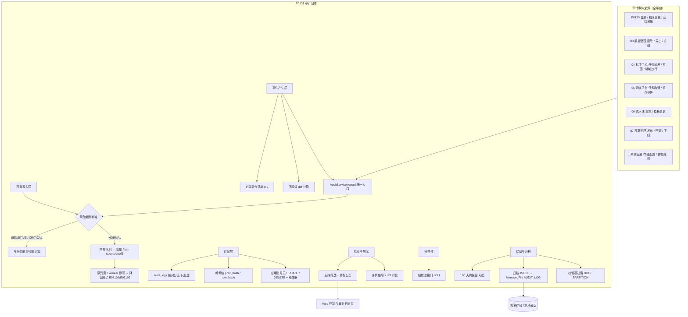
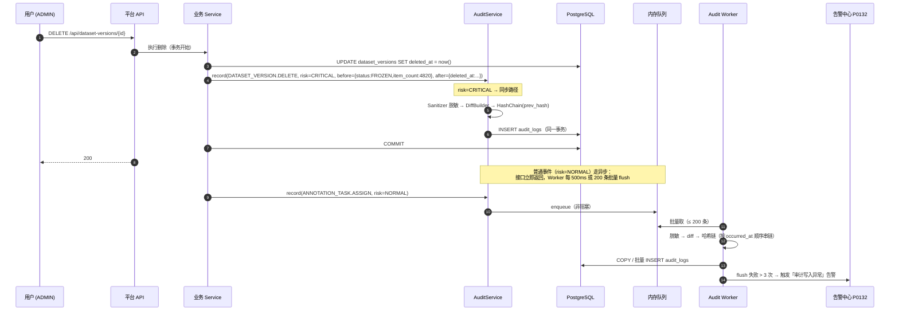
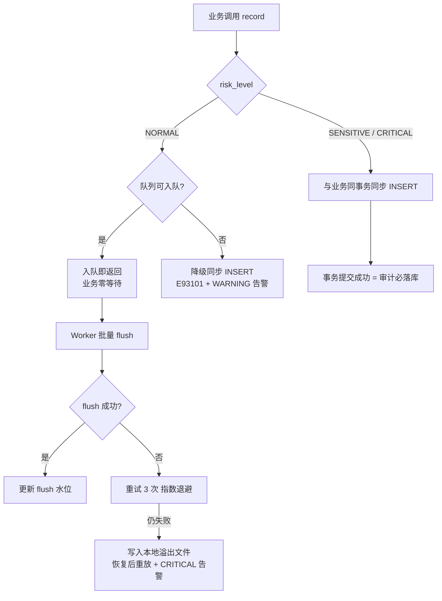
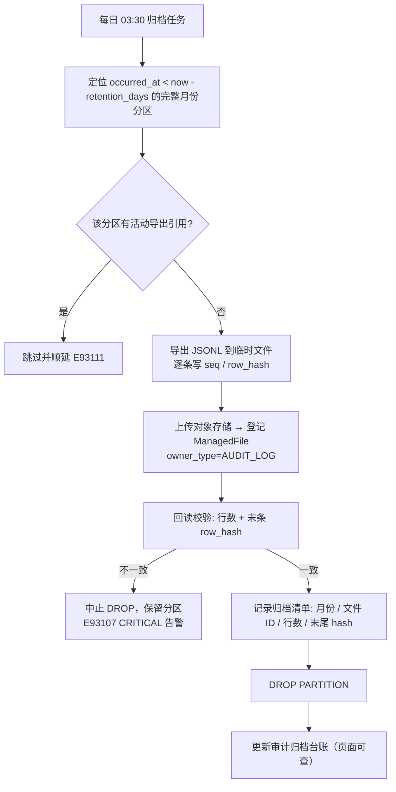
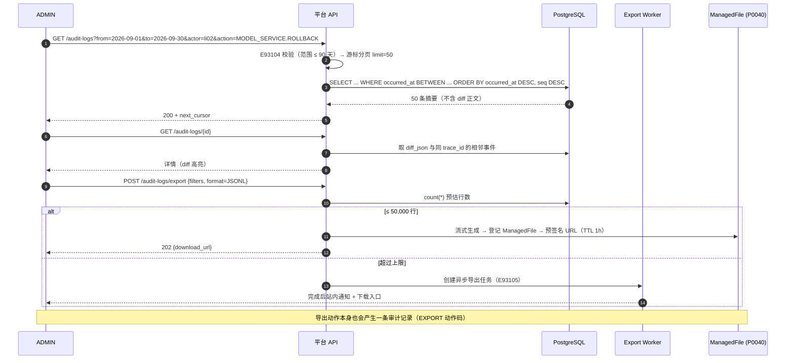
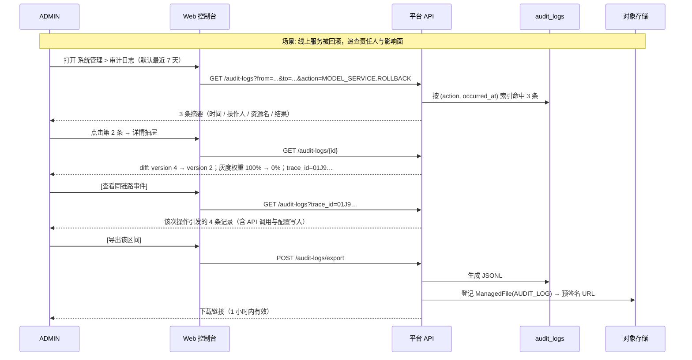

# PRD: P0131_审计日志 (Audit Log)

| 属性 | 内容 |
| :--- | :--- |
| **文档编号** | P0131 |
| **功能模块** | M09_系统管理 |
| **当前版本** | v1.0.0 |
| **文档状态** | Approved |
| **作者** | FoodYolo Team |
| **最后更新** | 2026-10-01 |

---

## 1. 全局说明

> [!IMPORTANT]
> **核心定位**: 平台**唯一不可篡改的操作追溯源**。回答三个问题：**谁 (actor)** 在 **什么时候 (occurred_at)** 对 **什么资源 (resource)** 做了 **什么 (action)**，**改前改后 (diff)** 是什么。审计日志**只追加**，任何角色（含 `ADMIN`）都不可修改或删除。

### 名词解释

*   **AuditLog (审计日志)**: 一条"人对资源的写操作"记录。是不可变事实，不是调试日志。
*   **Actor (操作人)**: 触发操作的主体。`actor_type ∈ USER | SYSTEM | PIPELINE`；`SYSTEM` 指平台自身的自动行为（看门狗重试、GC 回收），此时 `actor_id` 为 NULL 但 `actor_name` 记 `"system:watchdog"`。
*   **Action (动作)**: 形如 `DATASET_VERSION.DELETE` 的动作码（资源类型.动词），全集见 8.2。
*   **Resource (资源)**: `resource_type` + `resource_id` + `resource_name`（**名称快照**，防资源被删后无法阅读）。
*   **Diff (差异)**: 变更前后的字段级差异 `{field, before, after}` 列表。仅记录白名单字段，不是整行快照。
*   **Risk Level (风险级别)**: `NORMAL` / `SENSITIVE` / `CRITICAL`，决定写入模式（同步/异步）与保留期。
*   **Append-only (只追加)**: 表仅允许 `INSERT` 与 `SELECT`；应用数据库账号**无** `UPDATE` / `DELETE` 权限，且有触发器兜底。
*   **Hash Chain (哈希链)**: 每条记录携带 `prev_hash` 与 `row_hash`，形成链式结构；任一条被篡改都会导致后续校验失败。
*   **Retention (保留期)**: 热库在线可查的时间窗（默认 180 天）。
*   **Archive (归档)**: 超期数据导出为 JSONL 落对象存储（走 `ManagedFile`，`owner_type = AUDIT_LOG`），冷保留 3 年（`CRITICAL` 5 年）。
*   **Trace ID (链路标识)**: 贯穿一次用户操作的关联 ID，跨模块串联同一动作引发的多个写入。
*   **Dedup (去重)**: 同一 `trace_id` + 同一动作在一分钟内重复上报时合并，避免循环调用产生日志风暴。

### 与相邻概念的边界

| 概念 | 归属 | 特征 |
| :--- | :--- | :--- |
| **审计日志 (AuditLog)** | 本模块 | 人的写操作、不可篡改、长期保留、可追责 |
| **业务日志 (Application Log)** | 运维（stdout / 文件） | 调试信息、可轮转、可丢弃、不保证顺序 |
| **事件 (Event)** | 各模块自有表（如 `train_node_events`） | 系统状态变化全量流水，可高频，不面向追责 |
| **告警 (Alert)** | P0132 | 事件/日志经规则判定后**需要人处理**的子集，有级别与通知 |

> 原则：**审计记录"人做了什么"，事件记录"系统变成了什么"，告警记录"需要谁去看"。** 三者不互相替代。

### 统一异常处理 (E93xxx)

| Code | 场景 | 处理策略 |
| :--- | :--- | :--- |
| `E93101` | 审计写入队列满（默认容量 10,000） | 降级为**同步写入**（业务请求多等一次 INSERT），并触发 `Alert`（WARNING） |
| `E93102` | 审计 Worker 停滞 > 5 秒（崩溃 / 死锁） | 全局切换为同步写入模式，触发 `Alert`（CRITICAL），恢复后自动切回并记录切换事件 |
| `E93103` | 哈希链校验失败（检测到篡改或断链） | 页面顶部红色横幅 + `Alert`（CRITICAL），冻结审计导出，输出首个断裂点 `seq` 供人工核查 |
| `E93104` | 检索条件非法（时间范围缺失 / 起止倒置 / 跨度 > 90 天） | 400 + 明确提示，默认回落到"最近 7 天" |
| `E93105` | 导出结果超过 50,000 行 | 转为异步导出任务，完成后在"导出中心"提供下载（`ManagedFile` 预签名 URL，TTL 1 小时） |
| `E93106` | 归档目标存储不可达（磁盘满 / MinIO 掉线） | **不删除**热库分区，保留原数据并重试（最多 3 次，间隔 1h），触发 `Alert`（WARNING） |
| `E93107` | 归档校验不一致（行数或末尾 `row_hash` 不符） | 中止 `DROP PARTITION`，保留分区并告警（CRITICAL），人工确认后再重跑归档 |
| `E93108` | 脱敏规则未覆盖待写入字段（发现疑似敏感字段名） | **阻止该条写入**并告警；宁可少一条日志，不可泄露一次凭据 |
| `E93109` | 无权限查看（`ANNOTATOR` / `VIEWER` / 越范围的 `TRAINER`） | 403 `permission_denied`；列表接口返回空集，不泄露条数 |
| `E93110` | 审计表磁盘占用超阈值（> 20GB 或 > 全库 30%） | 触发 `Alert`（WARNING），自动提前执行一次归档，并在系统页展示占用 |
| `E93111` | 分区 `DROP` 时仍有导出任务引用该区间 | 拒绝 `DROP`，顺延至次日归档窗口，记录跳过原因 |

---

## 2. 项目背景

### 背景 (Context)
单机 2~3 人团队，没有专职运维，也没有集中式日志平台。但平台承载的资产（数据集版本、模型权重、线上推理服务、存储凭据）**都不可再生**：数据集重标要人天，权重丢了自己重训要 GPU 小时。

现实中会出现这些场景：某天发现 `DatasetVersion v3` 不见了，只记得"上周谁好像动过"；线上服务被回滚到旧版本，但没人承认；存储配置被改过，`secret_key` 何时轮的、谁轮的说不清；外包标注员导出过一批数据，事后要证明"导出了多少、哪些图"。

这些诉求无法用应用日志回答（日志会被轮转、会被覆盖、重启即丢），也不能靠"事件表"回答（事件表按模块分散、没有操作人语义、且允许删除）。必须有一张**只追加、有操作人、有 diff、有保留期**的表。

### 问题陈述 (Problem Statement)
1.  **不可追溯**: 资源被删/被改后没有操作人记录，只能靠人回忆与群里对质。
2.  **日志会丢**: stdout 日志随容器重启消失，`docker logs` 有上限，无法作为追溯依据。
3.  **无法区分对错**: 只知道"变了"，不知道"从什么变成什么"，判断不了是否越权。
4.  **可被掩盖**: 有 DB 权限的人可以顺手 `DELETE FROM` 把记录抹掉——追溯链在"自己人"面前脆弱。
5.  **无保留策略**: 全量留存会让单机磁盘爆掉；一键清空又会让历史归零，缺少"热查 + 冷归档"的分层。
6.  **敏感值写入**: 若把请求体整体落库，`secret_key`、密码、presigned URL 会被永久保存，审计表反而成了泄露源。

### 目标与成功指标 (Goals & Success Metrics)
*   **北极星指标**: **关键操作可追溯到"人 + 时间 + 前后值"的比例 = 100%**（见 8.2 必录清单，一条不缺）。
*   **次要指标**:
    *   审计写入对业务事务的额外延迟：异步路径 **0ms**、同步路径 P95 < **5ms**。
    *   单条审计写入（含 diff 计算与脱敏）异步批处理吞吐 ≥ **5,000 条/秒**（远超单机需要）。
    *   检索（最近 7 天 + 单条件）P95 < **500ms**；时间 + 操作人 + 资源三条件组合 < **1.5s**。
    *   篡改检出能力：任意一条记录被修改后，校验接口 **100%** 能在该点报错。
    *   热库在线保留 180 天，归档后冷数据可查（导出 JSONL 可读、可导入临时库）。

### 风险与规避 (Risks & Mitigation)
| 风险 | 影响 | 规避方案 |
| :--- | :--- | :--- |
| 异步队列在进程崩溃时丢事件 | 关键操作无记录，追溯断链 | `SENSITIVE` / `CRITICAL` 风险级别**强制同步**写；崩溃窗口内的普通事件在下次启动时记录一条 `AUDIT_GAP` 说明 |
| 审计表体积过大拖慢单机 DB | 检索变慢、磁盘写满 | 按月分区 + 180 天热保留 + 归档后 `DROP PARTITION`；占用超阈值提前归档（E93110） |
| diff 记录整行导致日志膨胀 | 单条记录数十 KB | 只记录**白名单字段**的差异；大对象（如 `plan_json`）仅记录摘要哈希与行数 |
| 敏感值被写入 | 审计表成为泄露源 | 字段级脱敏白名单 + 兜底正则拦截（E93108）；写入前统一过 `Sanitizer` |
| 数据库管理员直接改表 | 追溯链失效 | 应用账号无 `UPDATE`/`DELETE` + 触发器拒绝 + 哈希链校验（E93103）；文档明示"防不了超级用户，但能发现" |
| 高频操作（如自动保存）写爆日志 | 表膨胀、噪声淹没关键记录 | 白名单动作码控制；自动保存**合并**为"每图每会话一条"；同 `trace_id` 一分钟去重 |
| 归档后无法检索冷数据 | 审计断裂 | 归档文件按 `YYYY-MM` 命名并记录在案，提供"导入临时库只读查询"的 CLI 指引 |

---

## 3. 价值模型

*   **方案**: 三层结构 —— **事件产生**（业务侧调用 `AuditService.record()`，声明动作码与 diff）+ **可靠写入**（按风险级别选择同步/异步，同事务或批量 flush）+ **不可篡改存储**（只追加表 + 哈希链 + 分区归档）。查询侧提供"时间 + 操作人 + 资源 + 动作 + 结果"五维检索与 diff 详情。
*   **目标**:

| 指标 | 现状（无本模块） | 目标 |
| :--- | :--- | :--- |
| 删除数据集后追责 | 无法回答 | 5 秒内查出操作人 / 时间 / 版本快照 |
| 服务回滚定责 | 靠对质 | 一条 `MODEL_SERVICE.ROLLBACK` 记录含前后版本号 |
| 权限变更历史 | 无 | 完整 `ROLE_CHANGE` 序列（含操作人） |
| 数据导出留痕 | 无 | 导出人 / 行数 / 筛选条件 / 文件 ID |
| 日志被改写 | 无法发现 | 哈希链校验，定位到具体序号 |

---

## 4. 项目范围

### 功能结构图


### In Scope (包含范围)
1.  **统一采集入口**：`AuditService.record(event)`，业务侧只声明动作码、资源、diff 与风险级别。
2.  **必录动作清单**：删除数据集/版本、发布或回滚模型服务、权限变更、存储配置变更、导出数据、批量删除等（见 8.2）。
3.  **同步 / 异步双写入模式**：按风险级别自动选择，队列异常自动降级。
4.  **字段级 diff**：变更前 / 变更后白名单字段对比，支持嵌套 JSON 的一层展开。
5.  **五维检索**：时间范围、操作人、动作、资源类型/ID、结果 + 关键字（资源名 / Trace ID）。
6.  **详情视图**：单条记录的完整字段、diff 高亮、同一 `trace_id` 的相邻事件。
7.  **不可篡改**：只追加表结构、DB 权限约束、`BEFORE UPDATE/DELETE` 触发器、哈希链与校验接口。
8.  **保留与归档**：热库保留期可配（90~730 天），超期归档为 JSONL 至对象存储，校验一致后删除分区。
9.  **导出**：CSV / JSONL 导出（≤ 5 万行同步，超过转异步任务）。
10. **脱敏**：字段白名单 + 正则兜底，阻止敏感值落库。

### Out of Scope (不包含范围)
*   **读操作全量审计**：浏览列表、查看详情不记录（只有"下载原图 / 导出 / 下载权重"等敏感读取记录），避免日志被浏览噪声淹没。
*   **请求体 / 响应体全量抓取**：不做网关级镜像，只记录结构化 diff。
*   **实时流式订阅（Kafka / Webhook 推送审计事件）**：单机产品不引入领域消息队列；审计事件经 Web 站内查询即可。
*   **审计日志的全文搜索引擎（ES / Loki）**：单机 PostgreSQL `LIKE` + GIN 足够覆盖 2~3 人团队；超期数据靠归档文件。
*   **法律合规级别的 WORM 存储 / 第三方时间戳**：明确不做，只保证"可发现篡改"，不保证"不可否认"。
*   **用户行为分析 / 画像**：审计不是埋点。
*   **告警与通知**：归 P0132；本模块负责产生审计事件并触发对应告警。

---

## 5. 业务流程

### 5.1 事件产生与写入链路


### 5.2 写入模式决策


### 5.3 不可篡改：只追加 + 哈希链
```mermaid
flowchart TD
    A[新记录] --> B[seq = 全局单调递增序号]
    B --> C[prev_hash = 上一条 row_hash]
    C --> D[canonical = 规范化 JSON<br/>字段排序 + 时间统一 UTC ISO8601]
    D --> E[row_hash = SHA256(prev_hash || seq || canonical)]
    E --> F[INSERT audit_logs]
    F --> G{是否有 UPDATE / DELETE?}
    G -->|应用账号| H[无权限 → 拒绝]
    G -->|超级用户绕过权限| I[触发器 RAISE EXCEPTION<br/>audit_logs is append-only]
    G -->|直接改磁盘上的数据文件| J[链校验发现: 第 N 条 row_hash 不匹配]
    J --> K[GET /audit-logs/verify 或 CLI<br/>输出首个断裂点 seq]
    K --> L[页头红色横幅 + CRITICAL 告警<br/>冻结导出 E93103]
```

### 5.4 保留、归档与校验


### 5.5 检索与导出

---

## 6. 用户分析

### 6.1 用户画像 (User Personas)

*   **P1 — 平台管理员 (`ADMIN`)**：审计的主要读者与唯一导出者。
    *   **职责**: 出事时定位责任人、回答"谁删了""谁改了存储"。
    *   **核心诉求**: "给我时间、操作人、资源、前后值，一次查清；别让我翻日志文件。"
    *   **痛点**: 日志分散在容器 stdout 里，重启即丢；事件表没有操作人语义。

*   **P2 — 算法 / 训练工程师 (`TRAINER`)**：**受限读者**。
    *   **职责**: 自查自己的操作（"我昨天到底把哪个版本冻结了"）。
    *   **核心诉求**: "能看到我自己的操作历史就够了，不想看别人的。"
    *   **痛点**: 记不清自己改过什么，导致复现实验时对不上口径。

*   **P3 — 标注员 / 只读访客 (`ANNOTATOR` / `VIEWER`)**：**无权限**。
    *   **诉求**: 不需要该页面；误入时应得到清晰的"无权访问"而非空白页。

*   **P4 — 外部审计方 / 客户合规**：**离线读者**。
    *   **职责**: 核查某段时间内的数据导出与权限变更。
    *   **核心诉求**: "给我一份可校验的导出文件，而不是一张截图。"
    *   **痛点**: 平台若只给页面截图，无法作为凭证。

### 6.2 用户链路图 (User Journey Map)


---

## 7. 功能需求

### M09.F01 审计事件统一采集与可靠写入 (Event Collection & Reliable Write)
*   **用户故事**: 作为开发者，我希望用一行调用记录审计事件，以便不必在每个业务模块里重复实现日志逻辑。

*   **逻辑与业务规则**:
    *   **入口**: `AuditService.record({action, resource_type, resource_id, resource_name, diff, trace_id, risk_level})`；`actor` 与 `occurred_at` 由上下文自动填充。
    *   **风险级别与写入模式**: `CRITICAL` / `SENSITIVE` → 与业务**同事务**同步写（业务回滚则审计也不写，业务成功则审计必在）；`NORMAL` → 内存队列异步批量 flush（500ms 或 200 条）。
    *   **队列保护**: 容量 10,000；满则降级同步（`E93101`）；Worker 停滞 > 5 秒全局切同步（`E93102`）并告警。
    *   **进程崩溃窗口**: 未 flush 的 `NORMAL` 事件可能丢失；启动时写入一条 `AUDIT_GAP` 记录（含丢失区间与条数估计），**不静默**。
    *   **去重**: 同 `trace_id` + 同 `action` + 同 `resource_id` 在 60 秒内重复上报合并为一条，`occurrence_count` 递增。
    *   **后置条件**: `audit_logs` 落库，`seq`、`prev_hash`、`row_hash` 已计算。
*   **验收标准**:
    ```gherkin
    场景: 关键操作与业务同事务
      Given 一个 risk_level=CRITICAL 的删除操作
      When 业务事务回滚
      Then 不产生任何 audit_logs 记录
      And 业务重试成功后恰好产生 1 条记录

    场景: 队列满自动降级
      Given 审计队列已满（10,000 条未 flush）
      When 业务记录一条 risk_level=NORMAL 的事件
      Then 该事件被同步写入数据库
      And 触发「审计写入队列积压」WARNING 告警
      And 接口响应时间仍在 P95 5ms 以内
    ```

*   **边界情况与异常处理**:

    | 场景 | 处理 |
    | :--- | :--- |
    | 同一事务写入多条审计 | 允许，按 `seq` 顺序串链，同一 `trace_id` |
    | Worker 崩溃后重启 | 从本地溢出文件重放；重放顺序按 `occurred_at`，允许 `seq` 与时间不完全单调（以 `seq` 为准） |
    | 数据库磁盘写满 | 同步路径返回业务失败（宁可业务失败也不留无审计的成功操作）；异步路径写溢出文件并 CRITICAL 告警 |
    | 审计表被误删分区 | 链校验立即发现断链（E93103），页面横幅提示 |
    | 时钟漂移 | `occurred_at` 由数据库 `now()` 生成，不使用应用服务器时间 |

### M09.F02 必录动作清单与字段规范 (Mandatory Action Catalog)
*   **用户故事**: 作为管理员，我希望关键操作一个不漏地被记录，以便追溯没有盲区。

*   **逻辑与业务规则**:
    *   **清单即契约**：8.2 列出的动作码**必须**记录；新增高危接口时须同步补充清单（评审项）。
    *   **字段规范**: 每条记录必含 `actor` / `occurred_at` / `action` / `resource` / `result` / `risk_level`；`CRITICAL` 动作必含 `before` 与 `after`。
    *   **批量操作**: 以 `batch_id` 归组，记录"单条 + 汇总"（如批量删除 200 个样本：1 条汇总 + 受影响 ID 列表，附每项一条精简记录）。
    *   **结果语义**: `SUCCESS` / `FAILURE` / `DENIED`；`DENIED` 专用于权限拒绝（P0130 的 `E93006` / `E93007`）。
    *   **后置条件**: 每条记录可在列表页被检索到，并按风险级别影响保留期。
*   **验收标准**:
    ```gherkin
    场景: 删除数据集版本被记录
      Given ADMIN 删除 DatasetVersion v3（含 4,820 个样本）
      When 操作成功
      Then 产生 1 条 DATASET_VERSION.DELETE 记录，risk=CRITICAL
      And diff 含 name / status / item_count / deleted_at
      And 记录含 batch_id 与受影响样本数的汇总

    场景: 权限拒绝留痕
      Given ANNOTATOR 调用 DELETE /api/dataset-versions/{id}
      When 请求被 AuthzService 拒绝
      Then 产生 1 条记录 result=DENIED，action=DATASET_VERSION.DELETE
      And 同一 actor 同一 permission 的记录限流为 1 条/分钟
    ```

*   **边界情况与异常处理**:

    | 场景 | 处理 |
    | :--- | :--- |
    | 高频自动保存 | 按"每图每会话一条"聚合，`occurrence_count` 递增，不逐次落库 |
    | 平台自动行为（看门狗重试、GC） | `actor_type=SYSTEM`，`actor_name` 记具体组件，便于区分人与机器 |
    | 操作失败但产生了副作用 | `result=FAILURE` 仍记录，`after` 记实际观察到的状态 |
    | 前端重复提交（双击） | 幂等键去重，不产生两条记录 |
    | 清单外的新接口 | 代码评审门禁：新增写接口若未声明动作码，启动时打印告警并在审计页展示"未覆盖接口"清单 |

### M09.F03 审计检索与筛选 (Search & Filter)
*   **用户故事**: 作为管理员，我希望按时间、人、资源、动作快速定位记录，以便几分钟内查清一件事。

*   **逻辑与业务规则**:
    *   **筛选维度**: 时间范围（**必填**，默认最近 7 天，上限 90 天）、`actor`、`action`、`resource_type`、`resource_id`、`result`、`risk_level`、关键字（`resource_name` / `trace_id` / `actor_ip`）。
    *   **排序与分页**: 固定 `occurred_at DESC, seq DESC`；游标分页（`(occurred_at, seq)`），每页 50，不支持跳页（避免深分页开销）。
    *   **超范围**: 时间跨度 > 90 天 → `E93104`，提示改用导出；已归档区间 → 提示"该区间已归档，见归档台账"。
    *   **权限**: `ADMIN` 全量；`TRAINER` 强制附加 `actor_id = 自己`；`ANNOTATOR` / `VIEWER` → `E93109`。
    *   **后置条件**: 纯只读，不产生审计（避免自我放大）。
*   **验收标准**:
    ```gherkin
    场景: 五维筛选定位
      Given 9 月共 12,000 条记录
      When 查询 from=2026-09-01&to=2026-09-30&actor=li02&action=MODEL_SERVICE.ROLLBACK&result=SUCCESS
      Then 返回 3 条，按时间倒序
      And P95 响应 < 1.5s

    场景: 时间范围非法
      Given 未提供 from 与 to
      When 调用检索接口
      Then 返回 400 E93104，并自动回落到最近 7 天
    ```

*   **边界情况与异常处理**:

    | 场景 | 处理 |
    | :--- | :--- |
    | 区间跨越已归档月份 | 热库返回部分结果 + 顶部提示"部分数据已归档（2026-03 及以前）" |
    | `TRAINER` 试图查询他人 | 静默附加自身条件，返回空集而非报错（不暴露他人是否有操作） |
    | 关键字查询过慢 | 仅对 `resource_name` / `trace_id` 做前缀索引匹配，不做全表 `LIKE %x%` |
    | 结果为空 | 展示"无匹配记录"并回显生效的筛选条件，避免误以为系统故障 |
    | 导出与检索并发 | 导出走只读副本连接，不阻塞在线查询 |

### M09.F04 事件详情与 diff 展示 (Detail & Diff View)
*   **用户故事**: 作为管理员，我希望看到"改成了什么"，而不只是"改过"。

*   **逻辑与业务规则**:
    *   **展示内容**: 头部（动作、结果、时间、操作人、IP/UA、`trace_id`）+ 资源卡片（类型、ID、名称快照、所属数据集）+ **字段级 diff 表格**（字段 / 变更前 / 变更后，变化处高亮）。
    *   **同链路视图**: 按 `trace_id` 拉取相邻事件，按 `occurred_at` 升序展示为时间线。
    *   **大字段**: 超过 2KB 的字段只展示摘要（长度 / 哈希 / 前 200 字符），完整值需导出。
    *   **脱敏**: 详情页同样不展示 `secret_key` / `password` / 令牌，展示为 `****{last4}`。
    *   **后置条件**: 纯只读；访问 `CRITICAL` 记录详情时**不**额外记录审计（避免查看行为污染追溯）。
*   **验收标准**:
    ```gherkin
    场景: 查看回滚的 diff
      Given 一条 MODEL_SERVICE.ROLLBACK 记录
      When 打开详情
      Then diff 表格显示 version_no: 4 → 2、traffic_weight: 100% → 0%
      And 变更字段高亮，未变字段折叠
      And 页面展示同一 trace_id 的其余 3 条事件
    ```

*   **边界情况与异常处理**:

    | 场景 | 处理 |
    | :--- | :--- |
    | 资源已被物理删除 | 用记录中的 `resource_name` 快照展示，并标注"资源已删除" |
    | diff 为空（如纯导出动作） | 展示"该动作无字段变更"，不显示空表 |
    | 关联事件跨归档区间 | 时间线中断处标注"部分事件已归档" |
    | 操作人已离职 / 被删除 | 仍展示 `actor_name` 快照与 `actor_id`，标注"账号已停用" |

### M09.F05 不可篡改与完整性校验 (Append-only & Integrity)
*   **用户故事**: 作为管理员，我希望即使有人拿到数据库也改不掉历史，以便追溯结论可信。

*   **逻辑与业务规则**:
    *   **只追加**: 应用数据库角色仅授予 `INSERT` / `SELECT`（`audit_logs` 无 `UPDATE` / `DELETE`）；另加 `BEFORE UPDATE OR DELETE` 触发器 `RAISE EXCEPTION` 兜底。
    *   **哈希链**: `row_hash = SHA256(prev_hash || seq || canonical_json(row))`，`seq` 由数据库序列生成，全局单调递增。
    *   **校验接口**: `GET /audit-logs/verify?from_seq=&to_seq=`（默认全量活跃分区）返回 `{ok, checked_count, first_broken_seq?}`；CLI `foodyolo-cli audit verify --month 2026-09` 用于离线校验归档文件。
    *   **校验时机**: 每日归档前自动校验一次；`ADMIN` 可手动触发；校验失败触发 `E93103` + CRITICAL 告警。
    *   **不可做的边界**: 明确声明"防不了拿到机器 root 的超级用户重写整条链"，但**能发现**——这是单机部署可达成的诚实保证。
*   **验收标准**:
    ```gherkin
    场景: 篡改被检出
      Given 有人用超级用户权限把某条记录的 after_json 改掉
      When 触发一次链校验
      Then 返回 ok=false 并给出首个断裂点的 seq
      And 页面顶部出现红色横幅，触发 CRITICAL 告警
      And 审计导出被冻结（E93103）

    场景: 正常链校验通过
      Given 9 月分区共 12,000 条记录未被改动
      When 执行校验
      Then 返回 ok=true, checked_count=12000
      And 校验动作本身产生一条 AUDIT.INTEGRITY_CHECK 记录（risk=NORMAL）
    ```

*   **边界情况与异常处理**:

    | 场景 | 处理 |
    | :--- | :--- |
    | 校验耗时过长（百万行） | 按月分批校验，单批 ≤ 20 万条，进度可见；不锁表 |
    | 异步批量写入导致 `seq` 顺序与 `occurred_at` 不一致 | 链以 `seq` 为准；解释文档写入页面帮助区 |
    | 归档文件被改动 | 归档清单记录了行数与末尾 `row_hash`，重新校验即可发现 |
    | 数据库迁移 / 恢复备份 | 恢复后必须校验；若断链，记录 `RESTORED_AT` 说明并保留异常状态 |
    | 触发器与维护脚本冲突 | 维护脚本需先 `ALTER TABLE ... DISABLE TRIGGER`（需 DBA 手动），文档中禁止常规运维使用 |

### M09.F06 保留期、归档与导出 (Retention, Archive & Export)
*   **用户故事**: 作为管理员，我希望历史留得住又不撑爆磁盘，并且能按需导出给外部。

*   **逻辑与业务规则**:
    *   **热保留**: 默认 **180 天**（可配 90~730）；`CRITICAL` 记录热保留期**加倍**（防近期调查需要）。
    *   **归档**: 每日 03:30 任务，把超出保留期的**完整月份分区**导出为 JSONL（含 `seq` / `prev_hash` / `row_hash`），经 P0040 presign 上传并登记 `ManagedFile(owner_type = AUDIT_LOG)`。
    *   **删除策略**: 回读校验（行数 + 末条 `row_hash`）一致后才 `DROP PARTITION`；不一致则中止并告警（E93107）。
    *   **冷保留**: 归档文件保留 **3 年**，`CRITICAL` 月度的归档文件保留 **5 年**；到期由 P0046 GC 回收（需 ADMIN 二次确认）。
    *   **归档台账**: 页面提供"归档清单"（月份 / 行数 / 文件 ID / 大小 / 末尾 hash / 校验状态）。
    *   **导出**: `CSV`（给人看）与 `JSONL`（给机器校验）；≤ 50,000 行同步返回下载链接，超过转异步任务（E93105）；导出动作本身留审计。
*   **验收标准**:
    ```gherkin
    场景: 归档并删除分区
      Given 策略为热保留 180 天，当前 2026-10-01
      When 归档任务执行
      Then 2026-03 及更早的完整月份分区被导出为 JSONL 并登记 ManagedFile
      And 回读校验行数与末尾 row_hash 一致后 DROP PARTITION
      And 归档台账新增对应条目

    场景: 导出超限转异步
      Given 导出条件命中 180,000 行
      When 提交导出
      Then 返回 202 与任务 ID（E93105）
      And 任务完成后站内通知并提供 1 小时有效的下载链接
      And 产生一条 AUDIT.EXPORT 记录（含筛选条件与行数）
    ```

*   **边界情况与异常处理**:

    | 场景 | 处理 |
    | :--- | :--- |
    | 归档目标存储不可达 | 不删除分区，保留数据并重试 3 次（间隔 1h），WARNING 告警（E93106） |
    | 归档期间有人查询该月份 | 查询正常；`DROP` 仅在有活动导出引用时顺延（E93111） |
    | 热库磁盘占用超阈值 | 提前执行归档（E93110）+ WARNING 告警 |
    | 导出包含敏感 diff | 导出前同样过 `Sanitizer`；导出文件标注"已脱敏"，并记录脱敏字段清单 |
    | 客户要求提供未脱敏原始记录 | **不支持**；如确需，走服务器本地 CLI 离线导出并全程留痕（ADMIN + 二次确认） |

### M09.F07 敏感信息脱敏 (Sanitization)
*   **用户故事**: 作为管理员，我希望审计表里永远不出现密码和密钥，以便审计表本身不成为泄露源。

*   **逻辑与业务规则**:
    *   **字段白名单**: 每个动作码声明允许记录的 diff 字段集合；白名单外字段**一律不落库**（默认拒绝，而非默认允许）。
    *   **兜底规则**: 字段名匹配 `(?i)(password|secret|token|credential|key)$` 或值匹配疑似 JWT / presigned URL 特征 → 替换为 `****{last4}`（`E93108` 时阻止写入并告警）。
    *   **禁止项**: 明文密码、`secret_key` / `access_key`、Access/Refresh Token、预签名 URL 的签名串、完整请求体。
    *   **保留项**: 用户名、资源 ID/名称、状态码、字段级业务差异、行数、字节数、哈希。
    *   **后置条件**: `sanitized_fields` 列表写入记录，供审查"哪些字段被脱敏了"。
*   **验收标准**:
    ```gherkin
    场景: 存储配置变更不泄露密钥
      Given ADMIN 轮换 MinIO 存储凭据
      When 产生 STORAGE_CONFIG.ROTATE_CREDENTIAL 记录
      Then diff 中 secret_key 显示为 ****cd12，access_key 显示为 minio（非敏感）
      And 记录含 sanitized_fields=["secret_key"]

    场景: 未覆盖字段被拦截
      Given 某动作的 diff 中出现未在白名单且疑似敏感的新字段 private_key
      When 写入审计
      Then 该条记录被拒绝写入并触发 WARNING 告警（E93108）
      And 业务操作本身不受影响（仅审计缺失）
    ```

*   **边界情况与异常处理**:

    | 场景 | 处理 |
    | :--- | :--- |
    | 敏感值出现在 `resource_name` | `resource_name` 同样过脱敏规则（如文件名含 token 时截断） |
    | 业务方要求记录完整 JSON 便于排查 | 拒绝；排查需要完整载荷时使用业务模块自己的调试日志（可轮转、不长期保留） |
    | 脱敏导致 diff 无信息量 | 保留 `changed_field_names` 列表（仅字段名，不含值），保证"改过什么字段"仍可读 |
    | 误报（普通字段名含 key，如 `keypoint_count`） | 白名单优先于兜底正则；兜底命中时写告警而非静默丢弃，由 ADMIN 调整规则 |
---

## 8. 技术架构与数据模型

### 8.1 数据实体

#### Table: `audit_logs`（AuditLog，按月 RANGE 分区，只追加）

| 字段名 | 类型 | 必填 | 说明 | 约束 |
| :--- | :--- | :--- | :--- | :--- |
| `id` | UUID | Y | 主键 | PK（分区内唯一） |
| `seq` | BigInt | Y | 全局单调序号 | 取自序列，哈希链排序依据 |
| `occurred_at` | Timestamptz | Y | 业务发生时间 | 分区键，由 DB `now()` 生成 |
| `recorded_at` | Timestamptz | Y | 落库时间 | 与 `occurred_at` 的差值反映异步延迟 |
| `actor_type` | Enum | Y | 主体类型 | `USER` / `SYSTEM` / `PIPELINE` |
| `actor_id` | UUID | N | 操作人 | FK → `users.id`；`SYSTEM` 时 NULL |
| `actor_name` | String(64) | Y | 操作人名称快照 | 账号被删后仍可读 |
| `actor_ip` | String(45) | N | 来源 IP | 支持 IPv6；系统行为为 NULL |
| `actor_agent` | String(512) | N | UA / 客户端标识 | |
| `action` | String(64) | Y | 动作码 | `RESOURCE.VERB`，见 8.2 |
| `resource_type` | String(32) | Y | 资源类型 | 见 8.2 枚举 |
| `resource_id` | UUID | N | 资源 ID | 批量操作时为 NULL，见 `batch_id` |
| `resource_name` | String(255) | N | 资源名称快照 | 已过脱敏 |
| `before_json` | JSONB | N | 变更前白名单字段 | `CRITICAL` 动作必填 |
| `after_json` | JSONB | N | 变更后白名单字段 | `CRITICAL` 动作必填 |
| `changed_fields` | Text[] | N | 发生变化的字段名 | 仅字段名，不含值 |
| `sanitized_fields` | Text[] | N | 被脱敏的字段名 | 供审查 |
| `result` | Enum | Y | 结果 | `SUCCESS` / `FAILURE` / `DENIED` |
| `error_code` | String(16) | N | 失败时的 E 码 | 如 `E34007` |
| `risk_level` | Enum | Y | 风险级别 | `NORMAL` / `SENSITIVE` / `CRITICAL` |
| `trace_id` | String(32) | N | 链路标识 | 同一次用户操作跨模块串联 |
| `batch_id` | UUID | N | 批量操作标识 | 与 `occurred_count` 配合 |
| `occurred_count` | Int | Y | 聚合次数 | 去重合并时递增，default 1 |
| `summary` | String(255) | N | 人类可读摘要 | 列表页直接展示 |
| `prev_hash` | String(64) | Y | 上一条 `row_hash` | 链首为 64 个 `0` |
| `row_hash` | String(64) | Y | `SHA256(prev_hash‖seq‖canonical_json)` | 唯一 |

#### Table: `audit_archives`（归档台账，普通表，可增删）

| 字段名 | 类型 | 必填 | 说明 | 约束 |
| :--- | :--- | :--- | :--- | :--- |
| `id` | UUID | Y | 主键 | PK |
| `month` | String(7) | Y | 归档月份 | `YYYY-MM`，UNIQUE |
| `file_id` | UUID | Y | 归档文件 | FK → `ManagedFile`（`owner_type=AUDIT_LOG`） |
| `row_count` | BigInt | Y | 行数 | 与源分区一致 |
| `first_seq` / `last_seq` | BigInt | Y | 区间序号 | |
| `last_row_hash` | String(64) | Y | 末条哈希 | 校验锚点 |
| `verified` | Boolean | Y | 回读校验结果 | 为 true 才允许 `DROP PARTITION` |
| `partition_dropped_at` | Timestamptz | N | 热库分区删除时间 | NULL = 仍保留 |
| `expire_at` | Timestamptz | Y | 冷数据到期日 | 3 年 / CRITICAL 5 年 |
| `created_at` / `updated_at` / `deleted_at` | Timestamptz | Y/N | 通用字段 | |

### 8.2 必录动作清单（契约，只增不减）

> 风险级别决定写入模式：`CRITICAL` / `SENSITIVE` 与业务同事务同步写；`NORMAL` 异步批量写。

| 动作码 | 触发点 | 必录字段（diff 白名单） | 风险级别 |
| :--- | :--- | :--- | :--- |
| `DATASET.CREATE` / `DATASET.UPDATE` / `DATASET.DELETE` | P0041 数据集容器 | `name` / `task_type` / `version_count` / `deleted_at` | SENSITIVE（`DELETE` 为 CRITICAL） |
| `DATASET_VERSION.CREATE` / `FREEZE` / `ARCHIVE` | P0041 | `name` / `status` / `item_count` / `split_summary` | SENSITIVE |
| `DATASET_VERSION.DELETE` | P0041/P0046 | `name` / `status` / `item_count` / `referenced_by` | **CRITICAL** |
| `DATASET_VERSION.GC_PURGE` | P0046 物理回收 | `file_count` / `bytes_freed` / `storage_config_id` | **CRITICAL** |
| `DATA_SAMPLE.BATCH_DELETE` | P0043 画廊批量删除 | `batch_id` / `count` / `sample_ids_digest` / `reason` | **CRITICAL** |
| `DATA_EXPORT.CREATE` | P0045 数据集导出 | `format` / `filters` / `row_count` / `file_id` | SENSITIVE |
| `FILE.DOWNLOAD` | P0040 presign 下载 | `file_id` / `owner_type` / `ttl` / `bytes` | NORMAL |
| `IMPORT_TASK.CANCEL` / `CLEANING.DESTROY` | P0020 / P0023 | `task_id` / `destroyed_bytes` / `reason` | SENSITIVE（`DESTROY` 为 CRITICAL） |
| `ANNOTATION.BATCH_DELETE` | P0060 | `count` / `annotation_ids_digest` / `task_id` | **CRITICAL** |
| `ANNOTATION_TASK.ASSIGN` / `TRANSFER` | P0062 | `assignee_id` / `item_count` / `due_at` | NORMAL |
| `QC.FORCE_PASS` | P0063 打 `qc_waived` 标签 | `version_id` / `reason` / `operator` | **CRITICAL** |
| `TRAIN_TASK.SUBMIT` / `CANCEL` / `FORCE_TERMINATE` | P0082 | `dataset_version_id` / `node_id` / `reason` | NORMAL（终止他人为 SENSITIVE） |
| `TRAIN_NODE.MAINTENANCE` / `DISABLE` / `FORCE_DRAIN` | P0080 | `node_id` / `target_status` / `reason` | SENSITIVE |
| `MODEL_VERSION.ARCHIVE` / `RESTORE` / `SET_PRODUCTION` | P0085 | `model_id` / `version_no` / `is_production` | SENSITIVE |
| `MODEL_SERVICE.PUBLISH` | P0110 | `model_version_id` / `endpoint` / `port` | **CRITICAL** |
| `MODEL_SERVICE.ROLLBACK` | P0113 | `from_version` / `to_version` / `traffic_weight` | **CRITICAL** |
| `MODEL_SERVICE.TAKEDOWN` / `DELETE` | P0110 | `service_id` / `status` | **CRITICAL** |
| `EDGE_EXPORT.CREATE` | P0112 | `model_version_id` / `format` / `target` | SENSITIVE |
| `PIPELINE.UPDATE` / `PIPELINE_RUN.RERUN` | P0100/P0101 | `stage` / `from_stage` / `reason` | NORMAL |
| `USER.CREATE` / `UPDATE` / `DISABLE` / `DELETE` | P0130 | `username` / `display_name` / `status` / `scope_mode` | SENSITIVE |
| `USER.ROLE_CHANGE` | P0130 权限变更 | `before.role_code` / `after.role_code` | **CRITICAL** |
| `USER.PASSWORD_RESET` / `LOCKOUT_CLEAR` | P0130 | `target_user_id` / `must_change_password` | SENSITIVE |
| `SESSION.REVOKE` / `REVOKE_ALL` | P0130 | `target_user_id` / `session_count` / `reason` | SENSITIVE |
| `AUTH.LOGIN_SUCCESS` / `LOGOUT` | P0130 | `auth_method` / `device_label` | NORMAL |
| `AUTH.LOGIN_FAILURE` / `LOGIN_LOCKED` | P0130 | `fail_count` / `reason` | SENSITIVE |
| `STORAGE_CONFIG.CREATE` / `UPDATE` / `SET_DEFAULT` / `DISABLE` / `DELETE` | P0040 | `name` / `type` / `bucket` / `is_default`（**不含密钥**） | **CRITICAL** |
| `STORAGE_CONFIG.ROTATE_CREDENTIAL` | P0040 | `key_id` / `secret_key=****last4` / `access_key` | **CRITICAL** |
| `STORAGE_MIGRATION.START` | P0040 | `from_config` / `to_config` / `file_count` | **CRITICAL** |
| `ALERT_RULE.UPDATE` / `WEBHOOK_CONFIG.UPDATE` | P0132 | `rule_code` / `threshold` / `enabled` | SENSITIVE |
| `AUDIT.EXPORT` / `AUDIT.INTEGRITY_CHECK` / `AUDIT.ARCHIVE` | P0131 | `filters` / `row_count` / `month` / `result` | SENSITIVE |
| `SYSTEM_SETTING.UPDATE` | 系统设置 | `key` / `before` / `after` | SENSITIVE |
| `AUDIT.GAP` | P0131 自身 | `from` / `to` / `estimated_lost` | SENSITIVE |

### 8.3 存储与索引约定

*   **分区**: `audit_logs` 按 `RANGE(occurred_at)` 月分区（`audit_logs_2026_10`），提前建未来 2 个月分区；`DROP PARTITION` 是唯一的物理清除手段（无逐行 `DELETE`）。
*   **索引**（各分区本地索引）:
    *   `(occurred_at DESC, seq DESC)` — 默认列表与游标。
    *   `(actor_id, occurred_at DESC)` — 按人查。
    *   `(resource_type, resource_id, occurred_at DESC)` — 按资源查。
    *   `(action, occurred_at DESC)` — 按动作查。
    *   `(trace_id)` — 同链路。
    *   `(result)` 部分索引 `WHERE result = 'DENIED'` — 越权统计。
*   **体积控制**: 单条平均 < 1.5KB（diff 白名单）；12,000 条/月 → 约 18MB/月，180 天热库 < 120MB，可忽略。
*   **`canonical_json`**: 字段按键排序、时间统一 UTC ISO8601 毫秒、浮点保留 6 位，保证哈希可复现（跨语言重算一致）。
*   **溢出文件**: 异步 Worker 写入失败时落到 `{data_dir}/audit-spill/{ts}.jsonl`，恢复后按 `occurred_at` 重放并删除文件。

---

## 9. UI/UX 规格说明

### 9.1 审计日志列表
```text
+------------------------------------------------------------------------------------------------+
|  系统管理 > 审计日志                              [完整性校验] [导出 JSONL] [导出 CSV] [刷新]    |
+------------------------------------------------------------------------------------------------+
|  时间  [ 2026-09-24 00:00 ] ~ [ 2026-10-01 23:59 ]  操作人 [ 全部 ▾ ]  动作 [ 全部 ▾ ]          |
|  资源类型 [ 全部 ▾ ]  资源 ID [            ]  结果 [ 全部 ▾ ]  风险 [ 全部 ▾ ]  关键字 [      ]  |
|  快捷: (•) 最近 7 天  ( ) 最近 30 天  ( ) 本月  ( ) 危险操作  ⚠ 单次查询跨度上限 90 天           |
+------------------------------------------------------------------------------------------------+
|  时间        操作人   动作                         资源                     结果    风险  [详情] |
|  -------------------------------------------------------------------------------------------   |
|  10-01 14:22  admin    MODEL_SERVICE.ROLLBACK     svc-date-ocr / v4→v2     SUCCESS CRIT  ⋯     |
|  10-01 11:08  li02     STORAGE_CONFIG.ROTATE_..   MinIO 共享 (minio)       SUCCESS CRIT  ⋯     |
|  10-01 09:40  admin    USER.ROLE_CHANGE           wang01: VIEWER→ANNOTATOR SUCCESS CRIT  ⋯     |
|  10-01 09:12  wang01   AUTH.LOGIN_SUCCESS         session / MacBook Pro    SUCCESS  —    ⋯     |
|  09-30 22:31  system   TRAIN_TASK.FORCE_RETRY     task_40 (attempt 2)      SUCCESS  —    ⋯     |
|  09-30 18:20  zhao99   AUTH.LOGIN_FAILURE         session (fail_count=5)   FAILURE SENS  ⋯     |
+------------------------------------------------------------------------------------------------+
|  共 1,284 条（最近 7 天） · 显示 1–50 · [下一页 →]      归档提示: 2026-03 及以前见 [归档台账]   |
+------------------------------------------------------------------------------------------------+
```

### 9.2 事件详情抽屉
```text
+---------------------------------------------------------------+  +---------------------------------+
|  DATASET_VERSION.DELETE                        [CRITICAL] [✕]  |  |  同链路事件 (trace 01J9K3…)     |
+---------------------------------------------------------------+  |  ── 14:22:01 DATASET_VERSION     |
|  时间      2026-10-01 14:22:07（落库 14:22:07，延迟 0ms）        |  |     .DELETE  SUCCESS            |
|  操作人    admin（张工） · 192.168.1.10 · Chrome 130            |  |  ── 14:21:58 FILE.DOWNLOAD       |
|  结果      SUCCESS                                              |  |     SUCCESS  (导出前校验)        |
|  资源      DatasetVersion 9f1c…e2a（"包装袋-日期-v3"）           |  |  ── 14:21:55 DATA_EXPORT.CREATE  |
|  规则链路  #1,284,551 → #1,284,552                              |  |     SUCCESS  rows=4,820          |
|  脱敏字段  []                                                   |  +---------------------------------+
+---------------------------------------------------------------+
|  字段变更 (diff)                                                |
|  ------------------------------------------------------------------   |
|  字段           变更前              变更后                          |
|  name           包装袋-日期-v3      包装袋-日期-v3   （未变，折叠） |
|  status         FROZEN              →  DELETED                      |
|  item_count     4,820               4,820        （未变，折叠）     |
|  deleted_at     (NULL)              →  2026-10-01T14:22:07Z         |
+-----------------------------------------------------------------------+
|  [查看归档文件]  [复制 trace_id]                        [关闭]        |
+-----------------------------------------------------------------------+
```

### 9.3 归档台账
```text
+---------------------------------------------------------------------------------------+
|  归档台账                                                    冷数据保留: 3 年 / CRIT 5 年 |
+---------------------------------------------------------------------------------------+
|  月份     行数     文件 (ManagedFile)      大小    末尾哈希    校验  热库分区   到期日   |
|  2026-03  11,204   audit-2026-03.jsonl.gz  16.8MB  a3f9…c1d2   ✅    已删除    2029-03 |
|  2026-02  9,870    audit-2026-02.jsonl.gz  14.2MB  7b21…9e40   ✅    已删除    2029-02 |
|  2026-01  8,412    audit-2026-01.jsonl.gz  11.9MB  f0c4…2a77   ⚠    保留中    2029-01 |
+---------------------------------------------------------------------------------------+
|  ⚠ 2026-01 校验不一致：行数 8,412 ≠ 源分区 8,410（E93107），已中止删除分区，请人工确认   |
+---------------------------------------------------------------------------------------+
```

### 9.4 交互元素与筛选校验

| 元素 | 类型 | 状态 | 行为 |
| :--- | :--- | :--- | :--- |
| 时间范围 | DateRange | Default / Error | 必填；跨度 > 90 天时禁用查询并提示 `E93104` |
| 动作筛选 | MultiSelect | Default | 可选多个动作码，快捷项"危险操作"= `risk_level=CRITICAL` |
| 详情 | Button | Default | 打开抽屉；URL 可分享（`/audit-logs/{id}`） |
| 导出 | ButtonGroup | Default / Loading | 行数 > 5 万时自动转异步并提示 |
| 完整性校验 | Button | Default / Loading / Success / Error | 触发校验；失败时页头红色横幅常驻 |

| 筛选字段 | 类型 | 校验规则 | 默认值 |
| :--- | :--- | :--- | :--- |
| 时间范围 | DateRange | required, from ≤ to, 跨度 ≤ 90 天 | 最近 7 天 |
| 操作人 | Select(User) | 可选 | 全部（`TRAINER` 锁定为本人） |
| 资源 ID | Input | UUID 格式 | 空 |
| 关键字 | Input | 1–64 字符，匹配 `resource_name` / `trace_id` / `actor_ip` | 空 |

---

## 10. 非功能性需求 (NFR)

*   **性能 (Performance)**:
    *   异步路径对业务的额外延迟 **0ms**；同步路径（`CRITICAL`/`SENSITIVE`）P95 < **5ms**。
    *   批量 flush 吞吐 ≥ **5,000 条/秒**；单条记录平均体积 < **1.5KB**。
    *   检索（7 天 + 单条件）P95 < **500ms**；（时间 + 操作人 + 资源）组合 < **1.5s**。
    *   月度归档（≤ 5 万行）耗时 < **60s**（含上传与回读校验）。
*   **安全 (Security)**:
    *   应用数据库角色对 `audit_logs` **只有 `INSERT` / `SELECT`**；触发器拒绝对该表的 `UPDATE` / `DELETE`。
    *   字段白名单 + 兜底正则双保险，密码 / 密钥 / 令牌 / presign 签名**永不落库**（E93108 宁可拒写）。
    *   权限：`ADMIN` 全量、`TRAINER` 仅本人（`E93109`）、`ANNOTATOR` / `VIEWER` 无权限。
    *   导出文件同样脱敏，下载走 P0040 预签名 URL（TTL 1 小时），导出动作本身留审计。
    *   哈希链 + 每日校验，篡改可发现（E93103）；文档诚实声明"不防机器超级用户，但能发现"。
*   **可靠性 (Reliability)**:
    *   服务重启不丢已提交记录（存于 DB）；未 flush 的异步事件在启动时以 `AUDIT.GAP` 显式披露，不静默。
    *   归档采用"先校验后删除"，任何一步失败都保留热数据（E93106 / E93107）。
    *   审计表只追加，不存在"部分更新"导致的状态不一致。
*   **兼容性 (Compatibility)**:
    *   浏览器 Chrome / Edge ≥ 120、Safari ≥ 17；列表页 50 行/页，无虚拟滚动需求。
    *   导出格式：`CSV`（UTF-8 BOM，Excel 直接打开）与 `JSONL`（每行含 `seq` / `prev_hash` / `row_hash`，可离线重算链）。
    *   归档文件为 `.jsonl.gz`，标准 gzip，任何机器可解压校验。
*   **可扩展性 (Scalability)**:
    *   新资源的审计只需在 `permissions`/动作码表中新增一行并调用 `record()`，不改写入链路。
    *   分区按月自动创建；表体积随月份线性增长，超出单机承载时按年拆库（预留，不在首版实现）。
    *   动作码清单为契约，新增高危接口必须同步登记（代码评审门禁）。

---

## 附录: 已确认的设计决策

| 决策项 | 结论 |
| :--- | :--- |
| 不可篡改实现 | 只追加表 + 应用账号无 `UPDATE`/`DELETE` + `BEFORE UPDATE/DELETE` 触发器 + 哈希链（`prev_hash` / `row_hash`） |
| 写入模式 | 按风险级别分流：`CRITICAL`/`SENSITIVE` 与业务**同事务**同步写；`NORMAL` 异步批量 flush（500ms / 200 条） |
| 降级策略 | 队列满（E93101）或 Worker 停滞（E93102）→ 全局切同步写并告警；宁可慢，不可丢 |
| 崩溃窗口 | 异步未 flush 的事件可能丢失，启动时写入 `AUDIT.GAP` 显式披露（不静默掩盖） |
| 记录粒度 | 字段级 **diff 白名单**，不记录整行、不记录请求体；大字段只记摘要与哈希 |
| 读操作审计 | 默认不记录；仅 `FILE.DOWNLOAD` / 导出等敏感读取记录 |
| 脱敏 | 字段白名单优先，正则兜底；命中未覆盖字段时**拒绝写入**（E93108）而非放行 |
| 保留期 | 热库 180 天（可配 90~730，`CRITICAL` 加倍）；冷归档 3 年，`CRITICAL` 5 年 |
| 归档去向 | JSONL.gz → `ManagedFile(owner_type = AUDIT_LOG)`（`owner_type` 全集 8 值之一，已由 Main 追认） |
| 分区删除 | 仅 `DROP PARTITION`，且必须先回读校验（行数 + 末条 `row_hash`）一致 |
| 权限 | `ADMIN` 全量；`TRAINER` 仅本人操作；`ANNOTATOR` / `VIEWER` 无权限；**任何角色都不可修改/删除** |
| 导出 | `CSV` / `JSONL`；≤ 5 万行同步，超过转异步任务（E93105）；导出动作留审计 |
| 与告警的区别 | 审计记录"人做了什么"；告警记录"系统异常需人处理"（P0132） |
| 明确不做 | 网关级请求镜像、Kafka/ES 全文检索、WORM/第三方时间戳、用户行为分析 |

---

## 关联文档

*   **P0130_用户与权限**：产生 `AUTH.*` / `USER.*` / `SESSION.*` / `ROLE_CHANGE` 事件；权限判定决定谁能读审计。
*   **P0132_告警中心**：接收 `AUDIT.INTEGRITY_CHECK` 失败、写入队列积压、磁盘占用超阈值等告警。
*   **P0040_存储配置与桶绑定**：归档文件写入方；`presign` 下载触发 `FILE.DOWNLOAD` 审计。
*   **P0041 / P0043 / P0045 / P0046**：数据集版本删除、批量删除样本、导出、GC 回收的审计来源。
*   **P0063_质检与返工**：`QC.FORCE_PASS` 强制放行的审计来源。
*   **P0085 / P0110 / P0113**：模型版本归档、服务发布与回滚的审计来源。
*   **P0023_导入预检与清洗**：清洗销毁操作的审计落点。

---

## Changelog

| 版本 | 日期 | 作者 | 变更说明 |
| :--- | :--- | :--- | :--- |
| v0.1.0-draft | 2026-10-01 | FoodYolo Team | 初稿：审计实体与写入链路 |
| v1.0.0 | 2026-10-01 | FoodYolo Team | 补齐必录动作清单（31 项）、脱敏策略、哈希链校验、分区归档与保留期、导出分级 |


